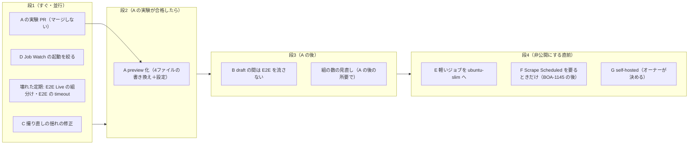

# GitHub Actions の分数を減らす設計（とくに E2E）

## 0. 目的と範囲

- 目的: 将来リポジトリを非公開にしたとき（BOA-45）の Actions の費用を下げる。あわせて今の PR の待ち時間（e2e の全部で約22分）を縮める
- 範囲: 設計だけ。`.github`・`.claude` の変更はこの PR に入れない。実装はオーナーの承認の後、下の「入れる順」の PR ごとに行う
- 守るもの（弱めない）:
  - ADR-0075 と追記: e2e の結果が出るまでマージしない（guard-pr-merge は実行中を ask、full の PR で `e2e-shard` が全部成功していなければ deny）
  - ADR-0097: 集約ジョブ `e2e` は `if: always()`。skip を通過に見せない
  - ADR-0077: 録画の再生と時計の固定。ADR-0100: 差分で none・light・full
  - ADR-0072・0079: verify:ci を PR と master の push で、no-undef と build をマージ後に
  - BOA-929: 録画の揺れ対策（採用の条件「再生が全件通る・skip が増えない・全テストが1回ずつ」を緩めない）
- 単価（オーナー提示、BOA-45 のコメント）: Linux 2-core 0.006ドル/分、1-core `ubuntu-slim` 0.002ドル/分、self-hosted は今0ドル。公開リポジトリの標準ランナーは無料なので、**今の費用は0ドル**。下の金額はすべて「非公開にしたら」の見込み

## 1. 過去の決定と施策（重ねない・壊さない）

| 施策 | 状態 | 守っているもの | 出典 |
|---|---|---|---|
| verify-*.js を台帳で分類し、PR と master の push で verify:ci | 済み | 検査の実行漏れ（063番の重複） | ADR-0072、#833 |
| マージをローカルのフック（guard-pr-merge）で止める | 済み | 赤の PR のマージ、worktree ごと消えるデータ、マージ順 | ADR-0075、#906・#929 |
| e2e の実行中もマージを ask。手元で E2E の全件を流さない | 済み | 走り終わる前のマージ、同じ Mac の負荷 | ADR-0075 追記、BOA-769 D、#1416、review-fix-cycle.md Phase5、AGENTS.md:96-99 |
| PR ゲートは録画（HAR）の再生と時計の固定 | 済み | 当日のデータでの揺れ（以前は30回中14回失敗） | ADR-0077、BOA-466、#913 |
| 録画を1日4回撮り直す。主の起動は Vercel Cron の dispatch | 済み（採用の不具合は #1856 で修正） | 録画の鮮度 | ADR-0077 §6、BOA-929、#1080・#1721・#1856 |
| e2e-rerecord を3ジョブに分け、再生を並行に | 済み | 90分の上限での打ち切り | BOA-799、#1441 |
| 本番データでの e2e を毎日1回（E2E Live） | 済み（ただし下の 2.4 で毎回60分切れ） | 本番側の変化の検知 | ADR-0077 §3 |
| CI の workers を4に | 不採用（効果なし） | 律速は CPU（vite dev と Chromium の取り合い） | BOA-769、#1263 |
| vite build＋preview で走らせる（BOA-769 B） | 不採用（**速さは出た**。/src を直に import する4ファイルが通らず閉じた） | — | #1319 |
| e2e を組に分ける（3組→5組、所要で割る、e2e/shards.json に一本化） | 済み | 待ち時間、最後の組の30分切れ | BOA-769 E、#1318、ADR-0100 §4、#1791 |
| 差分で e2e の範囲を決める（none／light／full、判定は base 側） | 済み | 記事・docs だけの PR の無駄。抜け道は guard が master の一覧で判定し直す | ADR-0100、#1779、#1942 |
| 同じ PR の新しい push で古い実行を取り消す（concurrency cancel-in-progress） | 済み（E2E・Quality Gates・AI Review） | 古い実行の無駄 | #1190 |
| 機械生成の文書はマージ後に CI が作り直す | 済み | 並行 PR の衝突 | ADR-0078 |
| no-undef・build をマージ後にも（Post-merge Checks） | 済み | 組み合わせで壊れる型 | ADR-0079 |
| AI の PR を別ベンダーで審査（review.yml） | 済み | 承認の身元 | ADR-0097 E |
| auto-merge を ON にする | 取りやめ（10/24 オーナー決定） | M2〜M7 を飛ばす道を作らない | ADR-0097:45 |
| 定期の job の見張り（Job Watch） | 済み（試運転） | 鍵の誤り・一時的な失敗の見落とし | ADR-0097 追記、#1679・#1777 |
| `.claude/` だけの PR を e2e の軽い範囲に入れる | 未着手（full のまま） | hooks を含む | ADR-0100「結果」 |
| replay の timeout（30分）の見直し | 未着手 | — | ADR-0100 §4 |
| 非公開にしたときの費用 | 検討中 | — | BOA-45（Backlog） |

関係の Linear: BOA-929（Backlog、揺れ。#1779・#1791・#1856 の後も状態は未更新）、BOA-769（In Progress、C は提案のまま）、BOA-977（Done 10/26、Nightly DB Verify の15分切れ。効果は未確認）、BOA-900（Backlog、Bot HTML Parity が 10/19 から失敗）、BOA-1145（Backlog、取得のレーン。Vercel 側）。

## 2. 実測（2026-10-20 00:00Z〜10-27 00:00Z の7日）

測り方: `gh api repos/.../actions/runs?created=…`（6時間ずつ、全7,966 run）と `…/runs/{id}/attempts/{n}/jobs`（ジョブの started_at・completed_at）。課金の分は**ジョブごとに分へ切り上げ**、skip のジョブは0分。Job Watch・Scrape Scheduled は250 run、Key Canary・Slack・DB Apply は50 run、Regenerate は80 run を等間隔に抜いて全体へ伸ばした。残りの小さな定期は run の長さを1ジョブとみなした。ランナーは全ジョブ `ubuntu-latest`（公開なので 4 vCPU）。月は7日×30/7。ジョブは最後の attempt だけを取ったので、rerun の前の attempt の分（E2E の12 run、7日で約1,000分＝月約4,300分）が抜けて少なめに出ている。

### 2.1 ワークフローごと

| ワークフロー | run（7日） | 課金の分（7日） | 月の分 | 非公開なら月（0.006ドル） | 測り方 |
|---|---|---|---|---|---|
| E2E Smoke Test | 505 | 33,256 | 142,526 | 855ドル | 全ジョブ |
| E2E Re-record | 52 | 4,895 | 20,979 | 126ドル | 全ジョブ |
| Quality Gates | 825 | 3,512 | 15,051 | 90ドル | 全ジョブ |
| Job Watch | 2,950 | 2,726 | 11,683 | 70ドル | 抜き取り |
| Scrape Scheduled | 1,457 | 1,574 | 6,746 | 40ドル | 抜き取り |
| Post-merge Checks | 211 | 664 | 2,846 | 17ドル | 全ジョブ |
| Key Canary | 329 | 658 | 2,820 | 17ドル | 抜き取り |
| AI Review | 535 | 501 | 2,147 | 13ドル | 全ジョブ |
| E2E Live | 7 | 427 | 1,830 | 11ドル | 全ジョブ |
| Slack PR Notification | 293 | 293 | 1,256 | 8ドル | 抜き取り |
| その他32本 | 802 | 1,479 | 6,339 | 38ドル | 混在 |
| **合計** | **7,966** | **49,985** | **214,221** | **1,285ドル** | |

- E2E が全体の66.5%。E2E と録画の撮り直しで76%
- 依頼文の「24時間で約97分×79回」とは日によって違う。日ごとの E2E は 1,280〜9,413分（10/24 が最大）

### 2.2 E2E Smoke Test の中身

| 項目 | 値 |
|---|---|
| 結果 | 成功 344・取り消し 144・失敗 17 |
| 範囲 | full 467・light 8・none 30（none・light は ADR-0100 の効き目） |
| full の成功1回の課金 | 中央 87分（5組の後は中央 90分、3組のころは 83分） |
| 経過時間（5組） | 中央 22分・90% 34分（3組のころは中央 39分） |
| 組ごと（5組、中央） | 1: 20.0分・2: 17.5分・3: 17.8分・4: 17.3分・5: 18.7分 |
| 組の中の内訳（例 run 39377214420） | テストの実行が 95% 以上。checkout・setup-node・npm ci・Playwright の install は合わせて約40秒 |
| 取り消しで使った分 | 3,666分（11%）。取り消しまでの経過は中央 7.4分 |
| 失敗で使った分 | 1,545分 |
| 同じブランチの次の push までの間 | 中央 10.2分。3分未満が217回中46回 |
| PR（ブランチ）の数 | 288。1本あたり run 平均 1.75・90% 3・最大 20 |
| 最後の push ではない full の run | 197回・9,441分（E2E の28%）。うち codex/ は 9回・800分 |
| 最後の push の full の run | 270回・23,709分 |
| 接頭辞ごと | codex/ 131本・full 135回・12,134分（ほぼ1 push）。claude/ 93本・full 196回・11,788分 |

### 2.3 その他の要点

- **Job Watch**: 見張る40本の終わりのたびに起動（7日で2,950回）。1回は約26秒なのに切り上げで1分。中身が要るのは、見張る run が成功以外（7日で88回）と Key Canary の成功（329回）だけ。残りの約2,500回は「直近24時間の失敗を全部見回す」を繰り返しているだけ
- **E2E Re-record**: 7日で採用は1回（10/26 08:53Z の 8a3f6d900）。不採用でも1日4〜5回撮り直し、1回は「録画 55〜85分＋再生 5組×約18分＋判定」で約160分。10/24・10/25 は再生が全部終わったうえで「再生で2件失敗」（run 40166218690 の判定）で不採用。10/23 までは再生の組が30分で切れて取り消し
- **Quality Gates**: verify は1回 約3.2分（課金4分）。ml-tests は scripts/ml を触らない PR でも checkout（fetch-depth 0）で約37秒かかり、1分の課金（763回のうち pytest まで走ったのは20回）
- **Scrape Scheduled**: cron-job.org からの dispatch が1日約204回（5分ごと）＋予備の schedule。1回 約54秒（checkout の全履歴で約25秒）。今は取得の主が Vercel で、こちらは肩代わり（ghaSkipGate）の予備
- **Key Canary**: Vercel の dispatch（289回）と予備の schedule（40回）。2ジョブ（環境が別）で各3〜4秒、課金は各1分

### 2.4 壊れている定期（分の削減とは別に、同時に直すもの）

| ワークフロー | 7日の結果 | 使った分 | 影響 |
|---|---|---|---|
| E2E Live（本番データ） | 7回とも60分の上限で取り消し | 427分 | 本番データでの検知（ADR-0077 §3）が1週間働いていない |
| Nightly DB Verify | 7回とも15分の上限で取り消し | 112分 | BOA-977（#1956、10/26）の効果は 10/27 の夜で確かめる |
| E2E Smoke Test | 全ジョブに `timeout-minutes` が無い（既定360分） | — | 止まったときは e2e-rerun.js の50分の判定だけが頼り |

## 3. 減らす案の比較

月の分は 4 vCPU（今の公開の環境）での見込み。非公開の `ubuntu-latest` は **2 vCPU・8GB**（公式の runner の仕様。公開は 4 vCPU・16GB）なので、CPU が律速の E2E は分が増える（1.3〜2倍、**未検証**）。

| 案 | 月の分の削減 | 月の費用の削減（非公開時） | 壊れ方（見逃す不具合・待ち時間・guard との関係） | 判定 |
|---|---|---|---|---|
| A. E2E を `vite build`＋`preview` で走らせる（#1319 の再挑戦。/src を直に import する4ファイルを書き換える） | 約 −71,000（E2E と撮り直しの再生を約半分。#1319 の実測で組の合計 49分→21.5分、build 込み） | 約 −430ドル | 本番の束で試すので dev だけの挙動（StrictMode の二重描画・dev の警告）を見なくなる。代わりに本番に近い。名前・範囲・guard は変えない。要実験 | **推奨（実験の結果で決める）** |
| B. draft の PR では E2E の全部を流さず、ready_for_review と ready の後の push で流す（claude/ 等。codex/ は対象外） | 上限 約 −37,000（A の後は約 −18,500）。ready の後の直し・衝突の解消は残るので実際は下回る | 約 −220ドル（A の後 −110ドル） | draft はマージできない（GitHub）。guard は full なのに e2e-shard が成功でなければ deny のまま。気づくのが ready の後になり、最後の待ちが約22分のびうる。draft の間の集約 `e2e` は**失敗**にする（skip にすると ADR-0097 の穴） | 推奨（A の後） |
| C. 撮り直しの揺れ（再生で1〜2件落ちる）を直す（BOA-929）。打ち切りは「同じテストが2回続けて落ちた」ときだけ | 揺れが直れば最大 約 −15,800（採用の後の起動は今の gate で2分の空振りになる）。打ち切りの規則の上乗せはほぼ0 | 最大 約 −95ドル | 「同じ日に2回で打ち切り」は採らない。7日で唯一の採用（run 40279649935）はその日4回目の完走で、前の3回は1・1・2件の失敗だった。2回で打ち切ると今週の採用は0。採用の条件は緩めない | **推奨（すぐ。揺れの修正が本体）** |
| D. Job Watch の scan を「見張る run が成功以外」か「Key Canary の成功」のときだけにし、毎時の見回りを足す | 約 −9,300 | 約 −56ドル | 見回りは毎回直近24時間を全部見るので、成功の起動を省いても拾い漏れない。毎時の schedule が遅れても次の失敗の起動で拾う | **推奨（すぐ）** |
| E. 軽いジョブを `ubuntu-slim`（1 vCPU・5GB・15分まで・container）へ | 分は同じ | 約 −66ドル（約16,500分を 0.006→0.002） | 15分で打ち切られる。sudo・Docker 不可、入っている道具が少ない（psql 等）。公開中は効果0なので非公開の直前でよい | 推奨（非公開の前） |
| F. Scrape Scheduled を「肩代わりが要るときだけ起動」へ（Vercel 側で ghaSkipGate と同じ条件を見てから dispatch） | 約 −6,100 | 約 −37ドル | 予備の取得が遅れる・起動しない壊れ方は取得の欠落になる。BOA-1145・BOA-313 のレーンと ADR-0066 の範囲。cron-job.org の設定はオーナーの操作 | 非公開の時に（BOA-1145 の後） |
| G. self-hosted（E2E と撮り直し） | 約 −61,000（A・B・C の後に残る E2E 分） | 約 −370ドル（今の単価0ドルのとき） | 実行機が止まるとマージも止まる（guard が deny）。開発の Mac は複数セッションで負荷が高い（BOA-769 D、load average 100前後）。公開中は使わない（fork の PR がコードを流せる） | 非公開の時にオーナーが決める |
| H. 依存とブラウザのキャッシュ | 約 −4,000 | 約 −25ドル | 組ごとの準備は約40秒しかなく、切り上げを越える回は少ない。Playwright のコンテナに替えると pull の時間で相殺しうる | 見送り（A の後に測って決める） |
| I. 組の数を減らす（5→3） | 約 −3,500 | 約 −20ドル | 待ちが 22分→約39分（3組のころの実測） | 見送り（A の後に組を見直す） |
| J. 押した直後の数分を待ってから組を始める（取り消しの無駄を減らす） | 小さい | — | 待つ1ジョブを走らせると毎回約3分の課金で、節約（3分未満の連続 push は217回中46回）に負ける。environment の wait timer ならランナーを使わないが（非公開で使えるかは未確認）、毎回の待ちが +3分になるのに節約が小さい | 不採用 |
| K. 途中の push は「変更に関係する組だけ」 | — | — | SPA は src の1か所の変更が全画面に効き、対応の表を作れない。見逃しが出る | 不採用 |
| L. merge queue | — | — | `merge_group` の起動を全ワークフローと guard・hq の codex-pr に足す必要。auto-merge の取りやめ（ADR-0097:45）と同じ論点。organization の持つリポジトリ向けで、user の持つこのリポジトリでは使えないはず（**未確認**） | 不採用 |
| M. ml-tests を scripts/ml を触らないときに skip | 約 −3,400 | 約 −20ドル | 必須の check。guard-pr-merge.js:314 は SUCCESS 以外を deny するので、guard・hq の codex-pr.json の期待も変える必要がある | 不採用（E で ubuntu-slim に寄せる） |

## 4. 推奨と入れる順（最短）

最短の見込みと、それを決めている制約:
- 段1: 4本とも今日着手できる。互いに触るファイルが重ならない（5章）。マージは CI 緑とオーナーの承認（`.github` を変えるため手のマージ。ADR-0100 §3）が要る
- 段2: A の実験 PR の CI 1回（約20分）の結果が要る。4ファイルの書き換えは実験と並行に書ける
- 段3: B は A の後（A の後の E2E の所要で「最後の待ち」を見積もり直すため）。`.claude` と AGENTS.md の決まりの変更を含む
- 段4: 非公開にする日（オーナーの判断）が要る。F は BOA-1145 の取得のレーンが落ち着いてから

### 4.1 削減の見込み（月、4 vCPU 換算の分）

| 時点 | 月の分 | 非公開なら月の費用 | 今との差 |
|---|---|---|---|
| 今 | 214,221 | 1,285ドル | — |
| 段1〜3（A・B・C・D） | 約 102,600 | 約 616ドル | −52% |
| ＋F | 約 96,500 | 約 579ドル | −55% |
| ＋E（slim） | 同じ | 約 513ドル | −60% |
| ＋G（E2E と撮り直しを self-hosted） | 約 35,200（GitHub の課金分） | 約 145ドル | −89% |

- Pro・Team の無料枠（3,000分/月）は上から引いていない
- rerun の前の attempt の分（月約4,300分）は「今」に入っていない（2章）。#1694・#1696 の Key Canary の job `r2`（月約 +1,400分）も入っていない
- C は揺れが直る前提（撮り直しを7日 4,895分→約2,000分）。直らなければ段1〜3 は約 +12,400分/月
- B は上限の見込み。`.claude/` だけの PR を軽い範囲にする件（ADR-0100「結果」、未着手）は入れていない
- 非公開で 4 vCPU 以上のランナーを使えるのは Team 以上の想定（未確認）なので、2 vCPU の遅さは避けられない前提で見積もる
- 2 vCPU になると E2E の分が増える（未検証）。段1〜3 の後の E2E 約 52,700分/月が2倍なら、+約316ドル。A の実験で 2 vCPU を模して測る（6章）
- A の効き目は #1319 の1回の実測からの見込みで、組・テストが増えた今は測り直す

### 4.2 各案の作り（実装の PR で決めることも書く）

**C 撮り直しの揺れの修正**（BOA-929 のレーン。落ちるテストの側。打ち切りを入れるときだけ e2e-recording.js の gate）
- 本体は揺れの修正。10/24〜10/26 の不採用の judge のログ（run 40166218690・40253998386・40265781033・40275236455）で落ちたテストを集めて直す。直れば今の gate（e2e-recording.js:239-249「今日の録画を採用済みなら撮らない」）だけで、その日の残りの起動は2分の空振りになる
- 打ち切りの規則は、揺れの修正の後に7日の採用の実績を見て、要るときだけ入れる。入れるなら「同じテストが2回続けて落ちた（決定的な失敗）」ときだけ撮らない。失敗の件数・テストが回ごとに違う揺れでは撮り直しに意味がある（10/26 は4回目で採用）
- 打ち切りを入れるとき、gate（`scheduleGate(now, pointer)`、:238）には今日の不採用を数える入力が無い。collectTodayRuns（:308-325）と同じ API 読みと、judge の「完走して不採用」と落ちたテストを読める印（step の名前か output）を足す。notify-dedupe（:288-305）とは食い違わない
- 採用の条件（再生の全件通過・skip が増えない・全テストが1回ずつ）は変えない

**D Job Watch の起動を絞る**（job-watch.yml）
- `scan` の if に「`github.event.workflow_run.conclusion != 'success'` か、`github.event.workflow_run.path` が key-canary.yml」を足す（名前でなく path。job-watch.js:36 の CANARY_PATH と揃える）。skip のジョブは0分
- concurrency を workflow の単位（job-watch.yml:66-70）から `scan` の job へ移す。workflow の単位のままだと、scan が skip になる run も枠を取り、待っている scan を置き換える（今も7日で258回取り消し）。置き換えた run が何もしないので、失敗に気づくのが次のカナリアか毎時まで遅れ、日をまたぐと recoveryReruns の同じ日の条件（scripts/lib/jobWatch.js:91）で鍵が直った後の rerun を落とす
- schedule（毎時、0分を避ける）を足し、scan の if（:74-79）に `schedule` を足す。`on:` の中では `workflow_dispatch:` の後に書く（verify-job-watch.js:206 は `workflows:` から `workflow_dispatch:` までを切り出して一覧の一致を見る）
- 鍵の Issue をカナリアの成功で閉じる処理（job-watch.js:242-266）は、カナリアで scan が走るので残る
- hq の config/platform.json:117 の `actions_fresh`（`"Job Watch": {"any": 8}`）は最後の起動を見ている。D の後は skip の run も起動に数えるので、scan が止まっても緑のままになる。hq の側を「schedule の run の成功」で見るように変える（別プロジェクト。起票で頼む）
- 開いている PR #1694・#1696 が job-watch.yml と key-canary.yml（job `r2` を足す。Key Canary の分は +50%、月約 +1,400分）を触るので、その後に入れるか、その上に積む

**A preview 化**（playwright.config.js の webServer、e2e の4ファイル、e2e-smoke-test.yml）
- 1つの組で1回 `vite build`、`vite preview` で配る。組ごとに build する（約1分）か、1ジョブで build して artifact で配るかは実験で決める（後者は needs が1段増え、経過が約1分のびる）
- `/src/*.js` を `page.evaluate(() => import(...))` で読む4ファイル（boat-vs-course-labels・exhibition-st-flying・flying-badge-meet-wrap・hit-display-technique の spec）は、テストの側（Node）で関数を import して確かめる形に書き換える。画面の確認は残す
- `/api/*` の素通し: vite の `server.proxy` を使っていれば `preview.proxy` も同じ設定が効くかを確かめる
- 録画（E2E_RECORD）・本番データ（E2E_LIVE）・手元の実行も同じ webServer を使う。手元は dev のままにする（環境変数で切り替え）か、実験で決める
- build は webServer の command に入れない（webServer の `timeout: 30000`、playwright.config.js:129 で切れる）。前の step で build し、webServer は `vite preview` だけ
- 今は replayServerEnv（playwright.config.js:27-40）が dev の env で `VITE_SUPABASE_URL` を録画の supabaseOrigin に差し替えている。build ではこの値が束に焼き込まれるので、build の時の env に渡す。渡さないと HAR の完全一致が外れて全件が素通しになる。再生の束は E2E_LIVE・E2E_RECORD と別の束
- 録画（e2e-rerecord の record）と再生は同じ配り方に揃える。片方だけ dev だと素通しの集合が変わる
- dev だけで効く分岐を見なくなる: src/i18n.js:23（翻訳ファイルが無いと throw）。同じ検知を verify が持っているかを確かめ、無ければ verify に足す。analytics.js:32 は本番の束で GA を読もうとするが、再生は外部のホストを abort する（e2e/fixtures.js:37）ので送られない
- 手元は dev のまま、環境変数で切り替える（AGENTS.md:97-99 の run-heavy の運用）
- #1319 の 21.5分は、素通しが1,132種類あり組3が失敗した1回の値。6章で測り直す
- 名前（ワークフロー `E2E Smoke Test`、ジョブ `e2e-scope`・`e2e-shard`・`e2e-light`・`e2e`）、範囲の判定、`if: always()` は変えない

**B draft の間は流さない**（e2e-smoke-test.yml の types と範囲、guard-pr-merge.js の文言、AGENTS.md・CLAUDE.md の決まり）
- `on.pull_request.types` を `[opened, synchronize, reopened, ready_for_review]` の4つ全部で書く（今は types が無く既定の3つ。`ready_for_review` だけを書くと push で走らなくなる）
- 範囲の判定（base 側の e2e-scope.js）には手を入れない。workflow で「`full` かつ `github.event.pull_request.draft`」のときだけ `draft` に置き換え、`e2e-shard`・`e2e-light` を流さない。none・light の draft は今のまま（docs だけの draft を赤にしない）
- 集約 `e2e` は `draft)` を明示の失敗で「draft のため未実行」と出す（今の `*) … exit 1`、e2e-smoke-test.yml:355-359 でも落ちるが明示する）。verify-review-workflow.js:522-527 の固定に `draft)` の失敗を足す
- ready の直後、新しい run の集約 `e2e` が出るまでは draft の時の FAILURE が残る。guard はこれを `onFailure: "ask"`（guard-pr-merge.js:99-108・314-320）で「DB の状態で落ちることがある」と返し、人が承認しうる（最後は ruleset の必須 check が止める）。同じ PR で guard を直す
  - judgeE2eScope の早期 return（:442。集約 `e2e` が SUCCESS のときしか `e2e-shard` を見ない）を外し、full なのに `e2e-shard` の SUCCESS が無ければ `e2e` の状態によらず deny
  - `e2e-scope`・`e2e-shard` が RUNNING_STATES（:112-118）なら「実行中」の ask を返す
  - verify-guard-pr-merge.js に「draft の失敗が残った窓」の入力を足して固定する
- Claude の PR は draft で作り、Codex の審査の指摘を直し終えたら ready にする。codex/ の PR（ほぼ1 push）は今のまま
- patrol.sh・e2e-rerun.js（draft を除く作り、e2e-rerun.js:7）が draft の失敗を警報にしないかを確かめる
- `@codex review` が draft で動くかは**未確認**。動かなければ ready にしてから頼み、B の効き目は小さくなる

**E ubuntu-slim**（候補: Job Watch・Key Canary・Slack PR Notification・AI Review の gate・llm・approve・e2e-scope・Regenerate Generated Docs・Verify Cache Configuration・ml-tests。materials は psql を入れるので除く）
- 候補に集約 `e2e`（npm ci と `--list` を3回、中央36秒、月約2,100分）も足せる
- 素の `node` を呼ぶもの（job-watch.yml:98・118、review.yml:69・134・168）と `jq` を使うもの（slack-notify-pr.yml:31、regenerate-generated-docs.yml:100）は、slim のイメージに道具があるか未確認。切り替える PR で setup-node を足すか、最初の step で `command -v node jq gh git` を確かめる
- ml-tests は setup-python と pip install（quality-gates.yml:107-115）があるので、1 vCPU で pytest まで走る回（7日で20回）の所要を見る
- actionlint は 1.7.12 に固定（scripts/maintenance/actionlint-tools.json:9）。ラベル `ubuntu-slim` を知っているかをリリースノートで先に確かめ、知らなければ actionlint の設定にラベルを足す
- 1ジョブずつ切り替え、所要が15分の上限から遠いことを7日見る

**F Scrape Scheduled**: 起動の判断を cron-job.org の5分ごとから、Vercel の cron（ghaSkipGate と同じ条件を Vercel で判定し、要るときだけ dispatch）へ移す。朝の初期化の安全装置（JST 07:00 に races が無ければ初期化）を必ず残す。設計は BOA-1145・scraping-vercel-consolidation の側で行い、この文書では見込みだけを持つ

**G self-hosted**: 非公開にする時に決める。開発の Mac ではなく、専用の小さな実行機を推す（負荷・スリープでマージが止まるため）。料金は決める時点で公式で確かめ直す（2025-12 の発表は延期で、永久に無料の約束ではない。BOA-45）

## 5. 並行の作業と衝突しないこと

| 段の PR | 触るファイル | 並行の作業との関係 | マージの順 |
|---|---|---|---|
| C | 揺れの出るテスト（e2e/）。打ち切りを入れるときだけ e2e-rerecord.yml・e2e-recording.js と verify | BOA-929・769 のレーンが同じファイルを触る（#1721・#1856）。同じレーンで行う | 揺れの修正が先、打ち切りは7日見てから |
| D | job-watch.yml（hq の platform.json は起票で頼む） | 開いている PR #1694・#1696 が job-watch.yml・key-canary.yml を触る | #1694・#1696 の後、または上に積む |
| E2E Live・timeout | e2e-live.yml（組分けは e2e/shards.json を読む）、e2e-smoke-test.yml の timeout-minutes | BOA-929 のレーン | C と同じレーンで順に |
| A | playwright.config.js、e2e の4ファイル、e2e-smoke-test.yml、e2e-rerecord.yml、e2e-live.yml | e2e/shards.json の所要の書き換えを伴う。全貌動画・/today 型 b・BOA-1145 は 10/17 以降 `.github` を触っていない（git log） | C・timeout の後 |
| B | e2e-smoke-test.yml、guard-pr-merge.js と verify-guard-pr-merge.js、verify-review-workflow.js、AGENTS.md・CLAUDE.md・.claude/skills/orchestrate、ADR-0100 の追記 | hq・Codex の自動 PR の流れ（codex/ は対象外） | A の後 |
| E | 多くのワークフローの runs-on の1行 | 衝突しやすい。1つの PR にまとめ、他のレーンが `.github` を触っていない時間に | 非公開の直前 |
| F | scrape-scheduled.yml、api/cron の新しい dispatch、cron-job.org の設定 | BOA-1145・BOA-313 | BOA-1145 の後 |

名前の依存（変えると壊れるもの）。どの段でも変えない:

| 名前 | 依存しているもの |
|---|---|
| 集約ジョブ `e2e` | ruleset「master-checks」の必須、guard-pr-merge.js:99・442、.claude/skills/orchestrate/scripts/patrol.sh:31、hq の config/codex-pr.json:178、verify-review-workflow.js:516-525（`needs: [e2e-scope, e2e-shard, e2e-light]` と `if: always()`） |
| ジョブ `e2e-shard`（表示名 `e2e-shard (N/M)`） | guard-pr-merge.js:433（`/^e2e-shard\b/`）、e2e-rerun.js、hq の codex-pr.json:178（完全一致） |
| ジョブ `e2e-scope`・`e2e-light` | 集約の needs、verify-e2e-shards.js:184 |
| `verify`・`ml-tests`（Quality Gates） | ruleset の必須、guard-pr-merge.js:84・92（deny）、patrol.sh:31、codex-pr.json:178 |
| ファイル `quality-gates.yml` | hq の codex-pr.json:160、codex-pr.py:1228-1244（master の push の run の成否）、scripts/watch/job-watch.json |
| ファイル `e2e-smoke-test.yml`・`e2e-rerecord.yml` | e2e-rerun.js:34、verify-e2e-scope.js・verify-e2e-shards.js、patrol.sh:81、e2e-recording.js:316、api/cron/e2e-rerecord-dispatch.js |
| ワークフロー名（Job Watch の一覧） | job-watch.yml の workflow_run の一覧と verify-job-watch.js:206（`workflows:` から `workflow_dispatch:` までを切り出す） |
| Job Watch の最後の起動 | hq の config/platform.json:117（`actions_fresh` の `"Job Watch": {"any": 8}`）。D で意味が変わる |
| 集約の範囲の分岐 | verify-review-workflow.js:516-527、verify-e2e-scope.js（B で `draft` を足すとき） |

**今すでに食い違っている所**: hq の `config/codex-pr.json:178` の期待する check が `e2e-shard (1/3)〜(3/3)` のまま。#1791（10/24）で組は5つになり、今の名前は `e2e-shard (N/5)`。codex-pr.py:460-466 は期待の名前が無いと M2 を満たさないので、Codex の自動マージが止まっているとみられる（推測。判定の記録は見ていない）。light・none の PR では展開されない名前で1件出るだけなので、3組の名前に戻しても通らない。hq の側で `^e2e-shard\b` の正規表現（guard と同じ）に揃えるのが要る。A・I で組の数が変わるたびに同じことが起きる。

## 6. A の実験（マージしない PR、#1319 と同じ形）

| 測るもの | 合格の線 | 理由 |
|---|---|---|
| 組ごとの課金の分（4 vCPU） | 今（中央 90分/run）より30%以上減る | 目安（根拠は #1319 の1回だけ） |
| 同じ run で `taskset -c 0,1`（2 CPU に絞る）での組の所要 | 記録する（線にしない） | 非公開の 2 vCPU の見積もりのため。メモリ（8GB）の差は模せない |
| テストの件数・合否 | dev の run と同じ件数、同じテストが通る（skip が増えない） | 守りを弱めない |
| 録画に無い通信の一覧 | dev と同じ集合 | ADR-0077 の前提 |

外れたら A は採らず、B・C・D の効き目だけで進める（4.1 の段1〜3 は約 −19%に下がる）。

## 7. ADR の更新（各段の実装の PR に入れる）

| 案 | ADR | 理由 |
|---|---|---|
| A | ADR-0077 の追記（または新しい ADR） | #1319（BOA-769 B）の不採用を覆し、再生の配り方を変える |
| B | ADR-0100 の追記 | 範囲に `draft` を足す。guard の判定も変わる |
| C（打ち切りを入れるとき） | ADR-0077 §6 の追記 | 撮り直しの起動の条件が変わる |
| D | ADR-0097 の追記「定期の job の見張り」 | 見張りの起動の条件と鮮度の見方が変わる |
| E・F・G | 実装の時に決める | ランナー・起動の出元・実行機の変更 |

## 8. オーナーの承認が要る所

- `.github` の実装すべて（段1〜4。この PR は設計だけ）
- B の決まりの変更（Claude の PR を draft で作る。`.claude`・AGENTS.md）
- F の cron-job.org の設定の変更
- G の実行機（費用・置き場）と、非公開にする日
- hq の codex-pr.json の check 名の直し（別プロジェクト。今の食い違いは非公開の話と無関係に効いている）

## 9. 未確認

- 非公開の 2 vCPU での E2E の所要（6章で模して測る）
- self-hosted の料金の今（2025-12 の発表の延期の後）
- merge queue が個人のアカウントのリポジトリで使えるか（L は不採用の理由がほかにあるので結論は変わらない）
- `@codex review` が draft の PR で動くか（B の効き目に効く）
- E2E Live の60分切れの原因（組分けで足りるか、本番の応答の遅さか）
- docs/ で始まるブランチで full が18回・1,255分（7日）。docs 以外を触った正しい full か、none の一覧の漏れか（ADR-0100 の一覧の点検で確かめる）
- hq の codex-pr が今止めている件数（codex-pr.json の cycle が measure のため未確認）

## 10. 審査（system-architect、2026-10-27）と対応

P0 は無し。ADR-0072・0075・0079・0097・0100 の守りを壊す穴は無く、B で skip を成功に見せる穴も無い、という判定。

| 重大度 | 指摘 | 対応 |
|---|---|---|
| P1 | C の「同じ日に2回で打ち切り」は、7日で唯一の採用（4回目の完走）を消す | 採用。C を「揺れの修正が本体、打ち切りは同じテストが2回続けて落ちたときだけ、7日見てから」に変えた（3章・4.2） |
| P2 | C の −11,000/月は再現しない | 採用。見込みを「揺れが直れば最大 −15,800、規則の上乗せはほぼ0」に変え、直らないときの差を 4.1 に書いた |
| P2 | B の types は4つ全部を書く | 採用（4.2） |
| P2 | B の ready 直後、draft の FAILURE が残る窓で guard が ask を誤った文言で返す | 採用。judgeE2eScope の早期 return を外す・e2e-scope と e2e-shard の実行中を ask にする・verify に固定、を B の同じ PR に入れる（4.2・5章） |
| P2 | verify-review-workflow.js に `draft)` の失敗を固定する | 採用（4.2） |
| P2 | ADR の更新が設計に無い | 採用（7章） |
| P2 | D で concurrency が workflow の単位のままだと、skip の run が待っている scan を置き換える | 採用。concurrency を scan の job へ（4.2） |
| P2 | hq の platform.json の Job Watch の鮮度が D の後に緑のままになる | 採用。5章と 4.2 に足し、hq へ起票で頼む |
| P2 | A の build の時間切れ・Supabase の宛先の焼き込み・撮りと再生の揃え | 採用（4.2） |
| P2 | slim で node・jq が無いかもしれない | 採用（4.2） |
| P3 | カナリアは path で判定・schedule の置き場所・draft は full のときだけ・#1694/#1696 の r2・その他32本・rerun の前の attempt の抜け・J の理由・merge queue・docs/ ブランチの full・`.claude/` だけの PR・集約 e2e も slim の候補・actionlint の版 | すべて採用（各章） |
