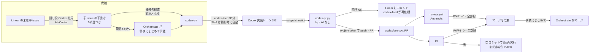

# Codex の直接 PR の仕組み（設計）

状態: 設計と審査まで。実装はオーナーの承認の後。鍵・`.github`・CI・権限の変更はここに書くだけで、まだ変えない。

## 0. 目的と前提

- 目的（オーナー 2026-10-22「保留にせず進めて。codexを使ってスケールさせたいので。」）: **Claude の使用量を増やさずに**、Codex の実装の量で開発をスケールさせる
- 守る決定: トークンの消費を第一に（10/15・10/17）。マージは人（Orchestrate）。Preview の鍵は直接 PR でも外さない（10/7）。審査は作った側と別のベンダー（ADR-0097）
- 言われたとおり「パッチ → PR の機械化」だけを作っても効かない。**詰まりは供給（codex-ok の起票）**で、10/14〜10/20 はパッチが0（§1）。この設計は「PR の機械化」と「供給の機械化」を同じ重さで扱う

## 1. 確かめた事実（2026-10-22）

| 事実 | 出典 |
|---|---|
| 記事の PR は既に AI なしで直接出ている。hq の `scripts/content-pr.py`（LLM なし）が専用の clone で許可のパスだけを書き、push 前に `origin/master...HEAD` の全変更を許可のリストと照合し、`scripts/app-token.sh` で `ryujin-maker` 名義で push・PR。#1763〜#1766 はこの経路で作られ、review.yml の審査（ryujin-reviewer の APPROVE）と CI 緑でマージ済み | `~/hq/scripts/content-pr.py` 冒頭、`gh pr view 1766` |
| review.yml は作者の数値 ID が `REVIEW_MAKER_BOT_ID` の PR だけを審査し、`codex/` は Anthropic、`claude/` は OpenAI | `.github/workflows/review.yml`、`scripts/review/gate.js` |
| `codex/**` は Vercel Preview を作らない（`vercel.json` の `git.deploymentEnabled`、`verify-codex-no-preview.js` で固定） | `vercel.json`、AGENTS.md |
| CI の e2e は `VITE_SUPABASE_URL`・`VITE_SUPABASE_ANON_KEY`（公開してよい鍵）だけでビルドし、スクリーンショットを artifact に上げている | `.github/workflows/e2e-smoke-test.yml` |
| AGENTS.md と `docs/operation/codex-backlog.md` は既に「2026-10-22 以降 Codex は `codex/` から PR を直接出す」と書いている（#1625）。ただし Codex のレーン（codexlane）は App の鍵に届かず、push する手段が無い。**規約だけ先に進み、仕組みが無い** | AGENTS.md・codex-backlog.md 3行目 |
| Orchestrate の SKILL は今も「Codex の PR の審査は Claude が `claude -p` で行う」「src/ の画面の作業は Codex に回さない」 | `.claude/skills/orchestrate/SKILL.md`「Codex の PR」 |
| 供給: BOA の未完了 179件のうち codex-ok は5件（969・920・909・873・779）。パッチが出ているのは boa-909・boa-969（10/21）の2つで、まだ PR になっていない | Linear API、`~/ryujin-codex-dev/out/patches/` |
| 供給があった週の量: 10/8〜10/15 の提出は42束、うち36束が「300行・5ファイル以内」の大きさの条件だけは満たす（独立の PR 数ではない） | hq 下書き `2026-10-16-codex-direct-pr-design.md` §3 |
| `codex-feed.py` は元の SHA が3日より古いと積まず、Orchestrate に取り直しを頼む（人の手が残る） | `~/hq/scripts/codex-feed.py` |

hq の旧い下書き（10/16）との違い: 下書きは「docs だけ・Preview の鍵の分離が前提」。本設計は docs に絞らず（docs だけでは対象が週0〜1件）、Preview は作らない・鍵は外さないまま進める。

## 2. 全体の流れ

Claude が関わるのは「範囲A の外の割りの承認」と「束のマージ」だけ。パッチの取り込み・PR 作成・審査・CI の見張りから Claude を外す。

## 3. パッチ → PR を AI なしで作る（決めること1）

### 3.1 どこで・誰の名義で

- **hq に `scripts/codex-pr.py` を足す**。`content-pr.py` の骨格（専用の clone・許可のリスト照合・`app-token.sh`）を流用し、記事の関門の代わりに下の関門を置く。launchd で30分ごと（`codex-feed.py` と同じ周期）
- 動く身元は hq の OS ユーザー。App の秘密鍵は hq の Keychain にあり、codexlane からは読めない（今と同じ。Codex は鍵に届かない）
- 名義は `ryujin-maker`（ADR-0097）。ブランチは `codex/<issue id 小文字>`（再提出は `-v2`。force push しない、AGENTS.md）
- 取り込みレーン（Claude）との二重取りを避けるため、拾ったパッチには `CLAIMED-codex-pr` を置く。切替の日から Claude のレーンは `out/patches/` を拾わない（codex-backlog.md の旧方式を止める）

### 3.2 関門（どれか1つでも NG なら PR を作らない）

入力の正本は **Linear の issue を今取り直した5項目**。パッチや Codex の報告の中の自己申告は使わない。ただし「変えてよいファイル」を書くのも Codex の割り役（§6）なので、G3 は独立した歯止めにならない。**実質の歯止めは範囲A の許可のリスト（G8）と禁止のパス（G5）**で、これは龍神の repo と hq の設定に置き、Codex は変えられない。

| # | 検査 | 理由 |
|---|---|---|
| G0 | 段取り S が済んでいる（repo の階層に書き込みの本番の鍵が無い。`gh secret list` で機械に確かめる）。済むまで push しない | §7 の P0 |
| G1 | パッチの束の sha256 を記録し、同じ (issue, sha256) で PR を2度作らない | 再起動・再実行で重複 PR を作らない |
| G2 | issue の「元にする master の SHA」から切って `git apply`（`--3way` なし）で作業ツリーに当て、作者・コミットは codex-pr.py が付け直して commit する（`git am` で Codex のコミットの情報を持ち込まない）。当たらなければ NG | 衝突の自動解消をしない（AGENTS.md） |
| G3 | 変えたパス ⊆ issue の「変えてよいファイル」（完全一致または明記した glob） | 依頼の外を触らない |
| G4 | 追加＋削除 ≤ 300行、ファイル ≤ 5 | Codex の範囲（codex-backlog.md） |
| G5 | 禁止のパスに触れない: `.github/**`、`scripts/review/**`、`supabase/migrations/**`、`vercel.json`、`package.json`・`package-lock.json`、`.claude/**`、`AGENTS.md`、`.env*`、`.gitattributes`・`.gitmodules`・`.npmrc`、`scripts/maintenance/verify-codex-no-preview.js`、`docs/adr/**` | 守りの仕組み・依存・本番 DB・設計判断を Codex の PR で変えない |
| G6 | 削除・改名・mode の変更・symlink・バイナリは、issue が明示したときだけ | `content-pr.py` と同じ考え |
| G7 | 秘密の文字列の検査（`platform/spool.py` の `secret_patterns` を流用） | 鍵の混入 |
| G8 | 範囲の判定（§4）が A。B は CI のスクリーンショットの仕組みが入るまで NG | 画面の確かめ方 |
| G9 | 元の SHA の上で当てた後、`origin/master` に rebase して衝突しないこと。衝突すれば NG。**rebase の後、push の直前に `origin/master...HEAD` の全変更（削除・改名元・mode を含む）で G3〜G8 をやり直す**（`content-pr.py` の `verify_diff` と同じ形） | master が進んだときに古い版で上書きしない・rebase で範囲の外が混ざらない |

- 新しい `verify-*.js` を足すパッチは台帳（`verify-registry.json`）の追加が要る（BOA-838 の教訓）。issue の「変えてよいファイル」に台帳があるときだけ、**追加の行だけ**を許す（G3 と G6 の特例）
- `通すべきコマンド` は codex-pr.py では実行しない（コードを実行しない。鍵を持つ身元で Codex のコードを動かさない）。実行は CI に任せる

### 3.3 失敗したときの扱い

| 何が起きたか | 動き |
|---|---|
| 関門 NG | PR を作らない。Linear の issue に理由をコメントし、ラベル `codex-retry` を付ける。codex-feed が最新の SHA で同じ issue を1回だけ積み直す。2回 NG なら `codex-ok` を外し、Orchestrate の朝夜のまとめに1行 |
| CI が赤（直し） | 下の再実行でも赤なら、CI の失敗の要約を Linear に写し、Codex がその PR の head を元に直しのパッチを出す。codex-pr.py が関門を通して**同じブランチに追加のコミットで push**（AGENTS.md「同じブランチに push」。force push しない）。master と衝突したときだけ `-v2` で作り直す |
| CI が赤（再実行） | 落ちた job だけを1回だけ再実行。空のコミットは review.yml を synchronize で起こし審査費が倍になるので使わない。作成の App は Actions: write を持たない（ADR-0097）ため、再実行は ADR-0097 追記（10/20）の master の定義の rerun の job に任せる（実装の時に流用できるか確かめる）。まだ赤なら上の「直し」へ |
| review.yml が P0/P1 | 同上（指摘の要約を Linear に写して積み直す）。Claude は直さない |
| codex-pr.py 自身の誤り | 何もしない・通知だけ（終了コード 1、hq_notify） |

## 4. 対象の広さ（決めること2）

| 範囲 | パス | 確かめ方 | 始める時期 |
|---|---|---|---|
| A | **許可のリスト**（ワイルドカードの `scripts/**` にしない）: `docs/**`（`docs/adr/**` を除く）、`e2e/**`、`scripts/analysis/**`、`scripts/maintenance/verify-*.js`（§4.1 の守りの verify を除く）。リストは実装の時に system-architect の審査で確定する | CI（verify:ci・ml-tests・e2e）と review.yml | 承認の後すぐ |
| A2 | 画面から呼ばれるロジック（`src/utils/**`・`src/lib/**`） | 範囲B と同じ撮影が要る（パスの照合では「画面に出ない」を判定できない） | 範囲B と同時 |
| B | 小さな画面の修正（`src/components/**`・`src/pages/**` の既存の部品の文言・表示条件・余白。新しいページ・タブ・導線は除く） | CI の e2e で、issue の「確かめる画面」を 375px と 1440px で撮って artifact と PR コメントに出す（anon key だけでビルド。Vercel Preview は作らない・鍵は外さない） | CI の撮影の仕組み（`.github` の変更）をオーナーが承認した後 |
| 対象外 | `api/**`（「読み取りだけ」をパスで判定できない。マージ後は本番の鍵で動く）、マイグレーション・RPC、新しいページ・タブ・主要コンポーネント（review-fix-cycle の新UIフロー）、設計の判断、依存の追加、`.github`・`scripts/review` | Claude のレーン | — |

- B は SKILL の「src/ の画面の作業は Codex に回さない」を変える。Vercel Preview の代わりに CI の撮影で確かめる案で、**オーナーの判断が要る**。B の PR は段階0の束には入れず、撮影を Orchestrate が見てからマージする

### 4.1 範囲A の scripts から外すもの

範囲A は許可のリストなので、リストの外は全部入らない。とくに次は、本番に書く・守りの仕組み・CI の判定を動かすもので、許可のリストに足さない（system-architect の審査、2026-10-22）。prod-jobs の定期 job はマージ後の `scripts/**` を service key で動かすため、守りの本体を Codex の PR で変えさせない。

- `scripts/db/**`（db-apply・db-reconcile）、`scripts/watch/**`（job-watch）、`scripts/lib/**`（定期 job と共有。`dbApplySql.js` の軽い・重いの判定を書き換えると SQL が承認なしで当たる。`jobWatch.js`・`dbReconcile.js`・`supabaseClient.js`）
- `scripts/sns/**`（送信）、`scripts/review/**`、`scripts/vercel-ignore-build.js`、cron の job の本体
- 守りの verify: `verify-workflow-secrets.js`・`verify-review-workflow.js`・`verify-codex-no-preview.js`。`verify-registry.json` は追加の行だけの特例（§3.2）

## 5. 審査と CI（決めること3）

- 審査は **review.yml（Anthropic API）に一本化**し、Orchestrate の SKILL の「Claude が `claude -p` で審査」をやめる。review.yml は Claude Code の週の枠を使わない（API の別の財布、と読んだ。請求先が週の枠と別かは**未確認**で、実装前にオーナーに確かめる）。上限 `REVIEW_MONTHLY_LIMIT` は**審査の run の件数**（既定300、`scripts/review/gate.js:26`）で金額では止まらず、記事・`claude/` の PR と同じ枠を分け合う。既定の審査モデルは `claude-opus-5`（`scripts/review/llm.js:129`）。1件の単価を試運転で測り、Codex の PR の分の上限を件数で別に置くかを決める
- 束に入れる条件（マージの時点で判定し直す。SKILL の F と同じ形）: 作者が `REVIEW_MAKER_BOT_ID`、head が `codex/`、今の head SHA に ryujin-reviewer の APPROVE、CI が全部緑、変えたパスが範囲A の中、**今の master にそのまま当たる（先にマージした Codex の PR と衝突しない・古くない）**。ruleset に必須の check がまだ無い（ADR-0097）ので、CI 緑はこの判定だけで守る。判定は hq か龍神の小さなスクリプト（`codex-pr.py --merge-check <PR>`）で出し、Orchestrate は一覧を見て `gh pr merge` するだけ
- Orchestrate の手間: 朝夜2回、束を一覧で見てマージ。1件あたり読むのは PR のタイトルと判定の1行（推測: 1件 1〜2分の Claude のターン）
- auto-merge は使わない（マージは人、10/15・10/17 の決定と ADR-0097 の「auto-merge は切替のとき」を待つ）

## 6. 起票の供給（決めること4）

供給が無いと仕組みは空回りする。Claude を増やさずに供給を作る。

1. **割り役を hq の Codex 社員にする**（新設、Codex の枠）。毎朝、Linear の未着手の issue（`Backlog`・`Todo`）のうち**受け入れの条件（期待値・再現手順）が既に書かれたもの**だけから、範囲A に割れるものを選び、子 issue の下書きを**1日3件まで**作る（どのファイルを変えるかは設計の判断に近いので、条件が書かれていない issue は割らせない）。5項目を埋め、「変えてよいファイル」は実在するパス、「通すべきコマンド」は `package.json` に実在する script に限る。`codex-split-draft` ラベル
2. **機械の検査で codex-ok を付ける**（hq、AI なし）: パスが実在・5ファイル以内・禁止のパスなし・範囲A・コマンドが実在 → `codex-ok` を自動で付ける。範囲A の外は Orchestrate の朝夜のまとめに一覧で出し、承認したものだけ付ける
3. **SHA は積むときに自動で入れる**: issue の SHA の欄が `latest` なら、codex-feed が積む時点の `origin/master` を入れる。3日の期限切れでの取り直しの依頼（人の手）を無くす
4. **qa 社員の起票に5項目を足す**: qa（Codex、試用）が起票するとき、範囲A なら「## Codex 用」を最初から書く
5. **取り込み待ちの上限 INTAKE_CAP=6 を見直す**: 上限は Claude の取り込み量に合わせたもの（10/13 案B）。取り込みが機械になれば根拠が無くなる。代わりに「CI 待ち＋審査待ちの PR が6件以上なら積まない」に置き換える（GitHub Actions の分と Anthropic の審査費の歯止め）

割りの質は割り役の出来次第で、最初の2週は Orchestrate が `codex-split-draft` を全部見る（範囲A でも自動の codex-ok を止める。1日3件まで、朝夜のまとめで一覧）。この2週は今の取り込みがほぼ0なので **Claude の量は純増する**（下書きを読む分）。差し戻しが2割を切ったら自動にする（目安、根拠なし）。

## 7. 費用・鍵・権限と止め方（決めること5）

| 項目 | 変更 | 承認 |
|---|---|---|
| ryujin-maker の権限 | 変えない（Contents・Pull requests・Workflows の書き込み）。Workflows の書き込みは残るので、`.github/**` を触らないのは G5 で守る。守りの本体は ADR-0097 の審査の App の承認 | 不要 |
| Vercel Preview | 変えない（`codex/**` は作らない、鍵は外さない） | 不要 |
| repo の階層の本番の鍵（**P0、実装の前提**） | 2026-10-22 の `gh secret list` で、`SUPABASE_SERVICE_KEY`・`SUPABASE_URL`・`SLACK_WEBHOOK_URL`・`LINEAR_API_KEY`・`GOOGLE_SERVICE_ACCOUNT_KEY`・`VERCEL_DEPLOY_HOOK` が **repo の階層に残っている**（ADR-0097 の段取り S が終わっていない）。今の pull_request の workflow は anon 以外を参照しない（`verify-workflow-secrets.js` で固定）が、`codex/*` に workflow が1本入れば、審査の前、push の時点で読める。そのときの守りは G5 の文字列の照合だけになり、ADR-0097 の「守りは審査の App の承認」と食い違う。**段取り S（書き込みの鍵を Environment に移し、repo の階層から消す）を済ませるまで、codex-pr.py は push しない**（関門 G0 として実装する）。なお同じ穴は今の `ryujin-maker` の全経路（記事・`claude/` の PR）に既にある | オーナー |
| CI の撮影（範囲B） | e2e の job に「issue の確かめる画面を撮る」段を足す（`.github` の変更）。e2e は PR のコードを `pull-requests: write`・`issues: write` で動かす（`e2e-smoke-test.yml:25-29`）ので、Codex の `e2e/**` から見せかけの PR コメントを作れる。撮影は **artifact だけを正**とし、PR コメントは信用しない | オーナー |
| SKILL・AGENTS.md | 「Codex の PR の審査は Claude」を「review.yml」に。**束に入れてよい範囲を、段階0（A〜F）から「範囲A の Codex の PR」に広げる**（SKILL:117 より広い。段階0の拡大）。「src/ の画面は Codex に回さない」は範囲B の承認まで据え置き。AGENTS.md の「Codex が直接 push」の書き方を「パッチを出し、hq の機械が PR にする」に直す | オーナー |
| 費用 | Anthropic API の審査費が PR の数だけ増える（1件の単価は未測定。`scripts/review/usage.js` の記録から試運転で測る）。GitHub Actions の分。Codex は今の契約の枠の中 | オーナー（月の上限 `REVIEW_MONTHLY_LIMIT` の値） |

止め方（どれも1手）:
- 全体: hq の `state/codex-pr.paused` を置く（codex-pr.py が見て何もしない）。launchd を外しても止まる
- 供給: 割り役を止める・`codex-ok` の自動付与を止める（hq の設定1行）
- 審査: `REVIEW_MONTHLY_LIMIT` を超えたら review.yml が止まる（既存）。止まると APPROVE が付かず束に入らない
- マージ済みの不具合: `git revert` の PR（SKILL の段階0と同じ）

## 8. 効きの見込み（決めること6）

| 数 | 値 | 根拠 |
|---|---|---|
| 供給があるときの Codex の提出 | 週42束（10/8〜15） | hq 下書きの実測。束は独立の PR ではない |
| そのうち大きさの条件を満たす | 36束 | 同上 |
| 今の供給 | codex-ok 5件 | Linear |
| 見込み PR 増 | 週10〜15件（推測） | 割り役が1日2件の範囲A を出し、関門と CI で2〜3割落ちると置いた。根拠は無く、試運転の2週で測る |
| 測る指標（試運転） | マージ済み PR 1件あたりの Orchestrate のトークン、割りの下書きの点検のトークン、マージ後の revert・不具合の率、審査費の1件単価、CI の分数、Codex の PR どうしの衝突の率、関門・CI・審査での差し戻しの率 | 見込みの数字はどれも測っていない |
| Claude の量の減り | PR 1件あたり「取り込み（git am・検査・PR・CI の見張り）＋ `claude -p` の審査」が0になり、Orchestrate のマージの1〜2分だけ残る | 1件あたりのトークンは未測定。試運転で、取り込みレーンの起動回数と週の使用率の推移を比べる |

**正直な限界**: Claude の量が「減る」のは、今 Claude が取り込んでいる分（10/14 以降はほぼ0）に対してだけ。今の主な効きは「Claude を増やさずに PR を増やす」ほうで、量の削減の実績はまだ無い。

## 9. オーナーに決めてほしい点（spec-ambiguity-detector の未決点から）

| # | 問い | 推奨 | 理由 |
|---|---|---|---|
| Q1 | Codex が自分で push するか（AGENTS.md の書き方）、Codex はパッチまでで hq の機械が PR にするか | 後者（本設計） | Codex のレーンに App の鍵を渡すと「Codex は鍵に届かない」が崩れる。記事の経路（content-pr.py）で同じ形が動いている。採れば AGENTS.md・codex-backlog.md の「直接 PR」の書き方を合わせて直す |
| Q2 | 範囲B（小さな画面の修正）を CI の撮影つきで入れるか | 試運転の後に別に判断。最初は範囲A だけ | SKILL の「画面は Codex に回さない」と vercel.json の決定を変える話。撮影は `.github` の変更が要る |
| Q3 | review.yml の Anthropic API の審査費を「Claude の使用量」に数えるか | 数えない（週の枠とは別の財布）。ただし月の上限 `REVIEW_MONTHLY_LIMIT` で抑える | 目的の「Claude の使用量」は 10/15・10/17 の決定の文脈で週の枠のこと、と読んだ。違えば審査を Codex の別の役に替える案が要る |
| Q4 | 大きい issue を割る役を誰にするか | hq の Codex 社員（新設） | Claude を増やさない。割りの判断のうち設計の判断に当たるもの（範囲A の外）は Orchestrate の承認に回す |
| Q5 | 段階0（オーケストレーターがまとめてマージする束）を「範囲A の Codex の PR」まで広げるか | 広げる（範囲A は許可のリスト・review.yml の APPROVE・CI 緑・merge-check の4つで守る） | 広げなければ Codex の PR は段階1・2になり、1件ずつオーナーかOrchestrate の判断が要って量が出ない |
| Q6 | 段取り S（repo の階層の本番の鍵を Environment に移す）を、この仕組みの前提として先に済ませるか | 済ませる（P0） | §7。済むまで codex-pr.py は push しない |

上限（300行・5ファイル）は変えない。種類だけを広げる（未決点5の既定値）。マージは手でまとめて（未決点6の既定値）。

## 10. 試運転と順番

1. （オーナーの承認）この設計、範囲A、SKILL・AGENTS.md の審査の書き換え
2. codex-pr.py を `--dry-run` で boa-909・boa-969 に当て、関門の判定だけを見る
3. 供給と切り離して、今の codex-ok 5件（969・920・909・873・779）のうち範囲A のものだけを `--push` で出し、Orchestrate が手でマージ。review.yml の審査費と CI の分を記録
4. 割り役を2週動かす（自動の codex-ok は止めたまま）。週の PR 数・差し戻しの率・Claude の週の使用率を測る
5. 範囲B（CI の撮影）はその後に別の承認

2週続けて週5件を下回るか、Orchestrate の手間が減らなければ、割り役の対象を見直す（目安、根拠なし）。

## 11. 審査の記録（2026-10-22）

| 審査 | 主な指摘 | 対応 |
|---|---|---|
| spec-ambiguity-detector | 確認が要る4点（Codex が push するか・画面を入れるか・API の審査費を数えるか・割り役） | §9 の Q1〜Q4 にした |
| system-architect | P0: 本番の鍵が repo の階層に残る（`gh secret list` で再現）。P1: `scripts/**` が守りの仕組みを含む、`api/**` の読み取りだけはパスで判定できない、束の範囲が段階0より広い。P2: rebase 後の再照合、G3 は同じベンダーで独立しない、e2e のコメントは偽装できる、`git am` が作者を持ち込む。P3: 空コミットで審査費が倍、`-v2` が AGENTS.md と食い違う | 全部採用。G0・許可のリスト（§4.1）・`api/**` を対象外・Q5 と Q6・G9 の再照合・G2 を `git apply` に・artifact だけを正・同じブランチに追加の push |
| second-opinion-reviewer（Codex の `codex:rescue` が権限の設定で使えなかったための代わり） | P1: 範囲A に `src/` を入れると画面が変わりうる、審査の上限は件数（既定300、`gate.js:26`）で金額で止まらない、割りの点検で試運転中は Claude が純増。P2: §8 の数字では効きを測れない、merge-check で衝突を判定し直す、ruleset に必須の check が無い | 全部採用。`src/` を A2 に分けた・上限と単価の測り方を §5 に・割りは1日3件で受け入れの条件がある issue だけ・測る指標を §8 に・merge-check に衝突の判定 |

反証できなかった点: 「Codex に push 権限を渡す」「取り込みを Claude の安いモデルで続ける」の2案は、前者は鍵を持たせ、後者は週の枠を使うので、本設計より短い道ではない（second-opinion-reviewer）。
