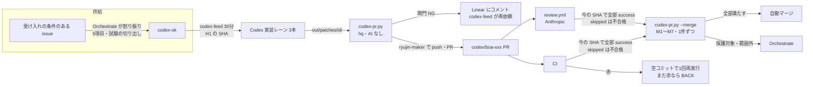
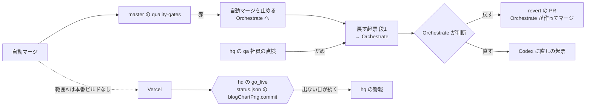

# Codex の直接 PR の仕組み（設計）

状態: 設計と審査まで。実装はオーナーの承認の後。鍵・`.github`・CI・権限の変更はここに書くだけで、まだ変えない。

## 0. 目的と前提

- 目的（オーナー 2026-10-22「保留にせず進めて。codexを使ってスケールさせたいので。」）: **Claude の使用量を増やさずに**、Codex の実装の量で開発をスケールさせる
- 守る決定: トークンの消費を第一に（10/15・10/17）。マージは人（Orchestrate）、ただし 10/22 のオーナーの yes で、範囲A の Codex の PR は §5.2 の条件で自動マージ。Preview の鍵は直接 PR でも外さない（10/7）。審査は作った側と別のベンダー（ADR-0097）
- 言われたとおり「パッチ → PR の機械化」だけを作っても効かない。**詰まりは供給（codex-ok の起票）**で、10/14〜10/20 はパッチが0（§1）。この設計は「PR の機械化」と「供給の機械化」を同じ重さで扱う

## 1. 確かめた事実（2026-10-22）

| 事実 | 出典 |
|---|---|
| 記事の PR は既に AI なしで直接出ている。hq の `scripts/content-pr.py`（LLM なし）が専用の clone で許可のパスだけを書き、push 前に `origin/master...HEAD` の全変更を許可のリストと照合し、`scripts/app-token.sh` で `ryujin-maker` 名義で push・PR。#1763〜#1766 はこの経路で作られ、review.yml の審査（ryujin-reviewer の APPROVE）と CI 緑でマージ済み | `~/hq/scripts/content-pr.py` 冒頭、`gh pr view 1766` |
| review.yml は作者の数値 ID が `REVIEW_MAKER_BOT_ID` の PR だけを審査し、`codex/` は Anthropic、`claude/` は OpenAI | `.github/workflows/review.yml`、`scripts/review/gate.js` |
| `codex/**` は Vercel Preview を作らない（`vercel.json` の `git.deploymentEnabled`、`verify-codex-no-preview.js` で固定） | `vercel.json`、AGENTS.md |
| CI の e2e は `VITE_SUPABASE_URL`・`VITE_SUPABASE_ANON_KEY`（公開してよい鍵）だけでビルドし、スクリーンショットを artifact に上げている | `.github/workflows/e2e-smoke-test.yml` |
| AGENTS.md と `docs/operation/codex-backlog.md` は既に「2026-10-22 以降 Codex は `codex/` から PR を直接出す」と書いている（#1625）。ただし Codex のレーン（codexlane）は App の鍵に届かず、push する手段が無い。**規約だけ先に進み、仕組みが無い** | AGENTS.md・codex-backlog.md 3行目 |
| Orchestrate の SKILL は今も「Codex の PR の審査は Claude が `claude -p` で行う」「src/ の画面の作業は Codex に回さない」 | `.claude/skills/orchestrate/SKILL.md`「Codex の PR」 |
| 供給: BOA の未完了 179件のうち codex-ok は5件（969・920・909・873・779）。パッチが出ているのは boa-909・boa-969（10/21）の2つで、まだ PR になっていない | Linear API、`~/ryujin-codex-dev/out/patches/` |
| 供給があった週の量: 10/8〜10/15 の提出は42束、うち36束が「300行・5ファイル以内」の大きさの条件だけは満たす（独立の PR 数ではない） | hq 下書き `2026-10-16-codex-direct-pr-design.md` §3 |
| `codex-feed.py` は元の SHA が3日より古いと積まず、Orchestrate に取り直しを頼む（人の手が残る） | `~/hq/scripts/codex-feed.py` |

hq の旧い下書き（10/16）との違い: 下書きは「docs だけ・Preview の鍵の分離が前提」。本設計は docs に絞らず（docs だけでは対象が週0〜1件）、Preview は作らない・鍵は外さないまま進める。

## 2. 全体の流れ

Claude が関わるのは「codex-ok の割り振り」「3回差し戻した PR」「公開後の戻す判断」だけ。パッチの取り込み・PR 作成・審査・CI の見張りから Claude を外す。

## 3. パッチ → PR を AI なしで作る（決めること1）

### 3.1 どこで・誰の名義で

- **hq に `scripts/codex-pr.py` を足す**。`content-pr.py` の骨格（専用の clone・許可のリスト照合・`app-token.sh`）を流用し、記事の関門の代わりに下の関門を置く。launchd で30分ごと（`codex-feed.py` と同じ周期）
- 動く身元は hq の OS ユーザー。App の秘密鍵は hq の Keychain にあり、codexlane からは読めない（今と同じ。Codex は鍵に届かない）
- 名義は `ryujin-maker`（ADR-0097）。ブランチは `codex/<issue id 小文字>`（再提出は `-v2`。force push しない、AGENTS.md）
- パッチと issue の結び付けは `out/patches/<id>/` の `<id>` を正とする（hq の回答 10/23）。再提出は `out/patches/<id>/v<n>/`
- Linear の操作（コメント・ラベル・閉じる）は hq の機械（codex-pr.py）が行う。`codex-ok` は PR を作った時点で外す（PR にした後の数え方は H2 の state で持つ）
- 取り込みレーン（Claude）との二重取りを避けるため、拾ったパッチには `CLAIMED-codex-pr` を置く。切替の日から Claude のレーンは `out/patches/` を拾わない（codex-backlog.md の旧方式を止める）

### 3.2 関門（どれか1つでも NG なら PR を作らない）

入力の正本は **Linear の issue を今取り直した5項目**。パッチや Codex の報告の中の自己申告は使わない。ただし「変えてよいファイル」を書くのも Codex の割り役（§6）なので、G3 は独立した歯止めにならない。**実質の歯止めは範囲A の許可のリスト（G8）と禁止のパス（G5）**で、これは龍神の repo と hq の設定に置き、Codex は変えられない。

| # | 検査 | 理由 |
|---|---|---|
| G0 | 段取り S が済んでいる（repo の階層に書き込みの本番の鍵が無い。`gh secret list` で機械に確かめる）。済むまで push しない | §7 の P0 |
| G1 | パッチの束の sha256 を記録し、同じ (issue, sha256) で PR を2度作らない | 再起動・再実行で重複 PR を作らない |
| G2 | issue の「元にする master の SHA」から切って `git apply`（`--3way` なし）で作業ツリーに当て、作者・コミットは codex-pr.py が付け直して commit する（`git am` で Codex のコミットの情報を持ち込まない）。当たらなければ NG | 衝突の自動解消をしない（AGENTS.md） |
| G3 | 変えたパス ⊆ issue の「変えてよいファイル」（完全一致または明記した glob） | 依頼の外を触らない |
| G4 | 追加＋削除 ≤ 300行、ファイル ≤ 5 | Codex の範囲（codex-backlog.md） |
| G5 | 禁止のパスに触れない: `.github/**`、`scripts/review/**`、`supabase/migrations/**`、`vercel.json`、`package.json`・`package-lock.json`、`.claude/**`、`AGENTS.md`、`.env*`、`.gitattributes`・`.gitmodules`・`.npmrc`、`scripts/maintenance/verify-codex-no-preview.js`、`docs/adr/**`、`docs/db-migration/**` | 守りの仕組み・依存・本番 DB・設計判断を Codex の PR で変えない。`docs/db-migration/**` はマージが db-apply を通じて本番 DB への書き込みにつながる（hq の指摘 10/23） |
| G6 | 削除・改名・mode の変更・symlink・バイナリは、issue が明示したときだけ | `content-pr.py` と同じ考え |
| G7 | 秘密の文字列の検査（`platform/spool.py` の `secret_patterns` を流用） | 鍵の混入 |
| G8 | 範囲の判定（§4）が A。B は CI のスクリーンショットの仕組みが入るまで NG | 画面の確かめ方 |
| G9 | 元の SHA の上で当てた後、`origin/master` に rebase して衝突しないこと。衝突すれば NG。**rebase の後、push の直前に `origin/master...HEAD` の全変更（削除・改名元・mode を含む）で G3〜G8 をやり直す**（`content-pr.py` の `verify_diff` と同じ形） | master が進んだときに古い版で上書きしない・rebase で範囲の外が混ざらない |

- 新しい `verify-*.js` を足すパッチは台帳（`verify-registry.json`）の追加が要る（BOA-838 の教訓）。issue の「変えてよいファイル」に台帳があるときだけ、**追加の行だけ**を許す（G3 と G6 の特例）
- `通すべきコマンド` は codex-pr.py では実行しない（コードを実行しない。鍵を持つ身元で Codex のコードを動かさない）。実行は CI に任せる

### 3.3 失敗したときの扱い

| 何が起きたか | 動き |
|---|---|
| 関門 NG | PR を作らない。Linear の issue に目印つきで理由をコメントし、ラベル `codex-retry` を付ける。hq の同じ台帳で Codex に積み直す（H3、§6.1）。差し戻しは**関門 NG・CI の赤・審査の P0/P1 を合わせて issue ごとに3回**まで。3回で直らなければ Orchestrate へ（§5.2 と一本化） |
| CI が赤 | 再実行はしない。全部の check が終わる（completed）まで待つ（e2e は layout だけで約18分、`e2e-smoke-test.yml:39`。30分の周で in_progress なら次の周へ。2時間たっても終わらなければ通知）。終わって赤なら、次の周（30分後）に同じ head がまだ赤のとき、CI の失敗の要約を目印つきで Linear に写し、Codex がその PR の head を元に直しのパッチを出す。codex-pr.py が関門を通して**同じブランチに追加のコミットで push**（force push しない）。master と衝突したときだけ `-v2` で作り直す（hq の実装 10/23。空のコミットの再実行は審査費が倍になるので使わない）。e2e の失敗で、その PR が `e2e/**`・`src/**` を変えていないもの（docs だけ等）は揺れ（本番への素通し）と見て差し戻しの3回に数えず、Orchestrate に1行で知らせる |
| review.yml が P0/P1 | 同上（指摘の要約を Linear に写して積み直す）。Claude は直さない |
| codex-pr.py 自身の誤り | 何もしない・通知だけ（終了コード 1、hq_notify） |

## 4. 対象の広さ（決めること2）

| 範囲 | パス | 確かめ方 | 始める時期 |
|---|---|---|---|
| A | **許可のリスト**（ワイルドカードの `scripts/**` にしない）: `docs/**`（`docs/adr/**` を除く）、`e2e/**`、`scripts/analysis/**`、`scripts/maintenance/verify-*.js`（§4.1 の守りの verify を除く）。リストは実装の時に system-architect の審査で確定する | CI（verify:ci・ml-tests・e2e）と review.yml | 承認の後すぐ |
| A2 | 画面から呼ばれるロジック（`src/utils/**`・`src/lib/**`） | 変えたファイルを import する試験が CI で走ること（§4.2）。画面の見た目は e2e・layout の CI と公開後の戻す起票で拾う | 条件つきで範囲A と同時（§4.2） |
| B | 小さな画面の修正（`src/components/**`・`src/pages/**` の既存の部品の文言・表示条件・余白。新しいページ・タブ・導線は除く） | CI の e2e で、issue の「確かめる画面」を 375px と 1440px で撮って artifact と PR コメントに出す（anon key だけでビルド。Vercel Preview は作らない・鍵は外さない） | CI の撮影の仕組み（`.github` の変更）をオーナーが承認した後 |
| 対象外 | `api/**`（「読み取りだけ」をパスで判定できない。マージ後は本番の鍵で動く）、マイグレーション・RPC、新しいページ・タブ・主要コンポーネント（review-fix-cycle の新UIフロー）、設計の判断、依存の追加、`.github`・`scripts/review` | Claude のレーン | — |

- B は SKILL の「src/ の画面の作業は Codex に回さない」を変える。Vercel Preview の代わりに CI の撮影で確かめる案で、**オーナーの判断が要る**。B の PR は自動マージせず、撮影を Orchestrate が見てからマージする

### 4.1 範囲A の scripts から外すもの

範囲A は許可のリストなので、リストの外は全部入らない。とくに次は、本番に書く・守りの仕組み・CI の判定を動かすもので、許可のリストに足さない（system-architect の審査、2026-10-22）。prod-jobs の定期 job はマージ後の `scripts/**` を service key で動かすため、守りの本体を Codex の PR で変えさせない。

- `scripts/db/**`（db-apply・db-reconcile）、`scripts/watch/**`（job-watch）、`scripts/lib/**`（定期 job と共有。`dbApplySql.js` の軽い・重いの判定を書き換えると SQL が承認なしで当たる。`jobWatch.js`・`dbReconcile.js`・`supabaseClient.js`）
- `scripts/sns/**`（送信）、`scripts/review/**`、`scripts/vercel-ignore-build.js`、cron の job の本体
- 守りの verify: `verify-workflow-secrets.js`・`verify-review-workflow.js`・`verify-codex-no-preview.js`。`verify-registry.json` は追加の行だけの特例（§3.2）

### 4.2 範囲A2 を早めに入れる案（条件つき）

範囲A だけでは流れる issue がほぼ無い（§6.0）。範囲A2 を、範囲A の試運転の後でなく、次の条件をすべて満たすものに限って範囲A と同時に入れる。

| 条件 | 機械での判定 |
|---|---|
| パスが **A2 の許可の一覧**の中 | `src/utils/**`・`src/lib/**`（画面の側。鍵は anon だけ）と、`scripts/lib/**` のうち**純粋な関数だけのファイルを1本ずつ並べた許可の一覧**。除外の一覧（grep で鍵・DB・送信を探す形）にしない。grep では、引数で受け取った client で書くもの（`fanPeriodJob`・`pitReportJob`・`raceResultFix`・`racerProfileSync`・`snsAutoPlanRunner`・`inCautionHealth` 等）や本番の起動（`dbApplyDispatch.js`・`analogyDispatch.js`・`roQuery.js`）を拾えない（system-architect 10/23）。`scripts/lib` の許可の一覧は最初は空で、Orchestrate が1本ずつ「I/O が無い（fs・fetch・DB・`process.env` を使わない）」を確かめて足す。一覧は hq の設定に置く |
| 変えたファイルを import する単体の試験が CI で必ず走る | 変えたファイルを import する `scripts/maintenance/verify-*.js`（台帳で `ci`）か `scripts/tests/**` が1本以上ある。e2e・layout は数えない（`src/utils` の値の誤りは、5幅の崩れを見る layout でも録画の再生の e2e でも捕まらない） |
| 差分に、変えた関数の試験の**追加**がある | 試験のファイルの新規か、既存の試験のファイルへの行の追加だけ。既存の試験の行の削除・書き換えがあれば範囲外（M7 と同じ理由。検査を弱めない） |
| CI の全部の check が success（M2） | merge-check |

- A2 の自動マージは、範囲A の docs・e2e と同じ試運転の扱い（最初の3件は Orchestrate が手でマージ、2週で revert 0件なら自動。M4）
- 残る危険: `src/utils` の変更が画面の数値・文言を変えても、単体の試験の期待値が誤っていれば通る。公開後の戻す起票（§5.4）で拾う
- 効きは小さい: 2026-10-23 の未着手で受け入れの条件がある31件のうち、A2 で済むものは0件（§6.0）

## 5. 審査・CI・自動マージ（決めること3）

自動マージの条件はオーナー 10/22 の yes（hq 経由、出典 `~/hq/drafts/arch-target-20261022.md`）。「マージは人」の 10/15・10/17 の決定は、Codex の PR のうち下の条件をすべて満たすものに限って置き換わる。

- 審査は **review.yml（Anthropic API）に一本化**し、Orchestrate の SKILL の「Claude が `claude -p` で審査」をやめる。review.yml は Claude Code の週の枠を使わない（API の別の財布、と読んだ。請求先が週の枠と別かは**未確認**で、実装前にオーナーに確かめる）。上限 `REVIEW_MONTHLY_LIMIT` は**審査の run の件数**（既定300、`scripts/review/gate.js:26`）で金額では止まらず、記事・`claude/` の PR と同じ枠を分け合う。審査モデルは Variable `REVIEW_ANTHROPIC_MODEL` の `claude-opus-5-5` が優先（`llm.js:129` の既定 `claude-opus-5` は使われない）。1件の単価を試運転で測り、Codex の PR の分の上限を件数で別に置くかを決める

### 5.1 確かめた事実（2026-10-22、`gh api` の読み取り）

| 事実 | 出典 |
|---|---|
| master の ruleset `master-guard`（id 24693068、active）: 必須の検査は `e2e`・`verify`・`ml-tests`（GitHub Actions）。`strict_required_status_checks_policy=false`（base に追いついていなくても通る）。承認1件、`dismiss_stale_reviews_on_push=true`・`require_last_push_approval=true`（push で承認が消える）。squash だけ | `gh api repos/.../rules/branches/master` |
| bypass は2つ: RepositoryRole 5（admin）と Integration 5220661。5220661 は `ryujin-maker`（5377197）でも `ryujin-reviewer`（5377028）でもない。ADR-0097:21 の「ryujin-bot の bypass は always のまま」から **ryujin-bot と推測**（名前は未実測） | `gh api repos/.../rulesets/24693068`、`~/hq/config/github-apps.json`、ADR-0097:21 |
| #1763〜#1766（記事の PR）は全部 `reviewDecision=APPROVED` で、ryujin-reviewer の承認が必須の1件に数えられている。マージは4件とも admin（bypass）で、**`ryujin-maker` の名義でマージが通るかは未実測** | `gh pr view` |
| approve の check-run は `REQUEST_CHANGES` を出しても success になる | `scripts/lib/reviewPr.js:226-` |
| 範囲A のパス（`docs/`・`e2e/`・`scripts/analysis/`・`scripts/maintenance/`）は全部 Vercel の `IGNORED_DIRS` に入り、本番ビルドが起きない | `scripts/lib/vercelIgnoreBuild.js:15-27` |
| `post-merge-checks.yml` は build と no-undef だけで、`docs/**`・`e2e/**` の .md 等は paths に入らない。master への push で範囲A を検査するのは `quality-gates.yml` だけで、その失敗の Slack 通知・job-watch の見張りは無い（grep で見つからない） | `.github/workflows/post-merge-checks.yml`、`quality-gates.yml`、`scripts/watch/job-watch.json` |
| `scripts/analysis/` のうち `aggregate-racer-stats.js`・`train-moriarty-calibration.js`・`train-conditional-logit.js`・`train-adler-temps.js` は定期の workflow が service key で実行する | `aggregate-stats.yml:25`、`train-moriarty.yml:24`、`train-sherlock.yml:25,30` |
| review.yml の `llm` は `materials` が success か **skipped** のとき動く（`review.yml:106`）。`materials` は gate の `sql_tables` が空でないときだけ動くので、SQL を触らない PR では skipped が正常。SQL の PR で materials が落ちると llm が skipped になり、approve は `REQUEST_CHANGES`（`scripts/lib/reviewPr.js` の `decideAction`: `llmResult !== "success"` は承認しない）。**審査不能は今も承認にならない** | `review.yml:101-106`、`scripts/lib/reviewPr.js` |
| approve は承認の直前に head を取り直し、審査した SHA と違えば何もしない | `scripts/review/approve.js:39-52` |
| GitHub は `if:` で skipped になった必須の検査を合格に数える | GitHub の一般仕様（この repo では未実測） |

### 5.2 自動マージの条件（全部を満たしたときだけ。1つでも欠ければマージしない）

| # | 条件 | どう守るか |
|---|---|---|
| M1 | **今の head SHA で** CI と AI 審査が合格。push で SHA が変われば合格は無効 | 審査: ruleset の `require_last_push_approval`・`dismiss_stale_reviews_on_push` と approve.js の SHA の照合（既存）。CI: マージは `--match-head-commit <判定した SHA>` を付けて行い、判定と実行の間に SHA が変われば GitHub が断る |
| M2 | **skipped と審査不能は不合格**。範囲ごとに期待する check を固定し（下の表）、「success が要る」check が1つでも success 以外（skipped・neutral・cancelled・timed_out・無い）なら不合格。「skipped を許す」check は skipped 以外（success を含む）が出たら不合格（作りの前提が崩れた印）。一覧に無い check は見ない。check-runs は `filter=latest` で取り、再実行の古い run を拾わない。combined status は status が0件でも `pending` を返すので判定に使わない。審査は reviews の API で、`user.id` が ryujin-reviewer の bot（344660046）・`state=APPROVED`・`commit_id` が今の head SHA のものがあること（`COMMENTED`・`REQUEST_CHANGES`・無しは不合格）。approve の check-run は審査の結果と関係なく success になるので、審査の合否には使わない | merge-check が check-runs と reviews を API で読んで判定。ruleset だけでは skipped を落とせない（5.1）ので、merge-check が本体 |
| M3 | 保護対象を変える PR は自動マージしない: `.github/**`、`scripts/review/**`、`docs/db-migration/**`、鍵まわり（`.env*`、`vercel.json`、`scripts/lib/supabaseClient.js`、`verify-workflow-secrets.js`・`verify-review-workflow.js`・`verify-codex-no-preview.js`）、§3.2 G5・§4.1 の全部 | codex-pr.py の G5 で PR 自体を作らない。merge-check でも差分のパスをもう一度照合（二重） |
| M4 | 範囲A（§4 の許可のリスト）と、§4.2 の条件を満たす範囲A2 の中だけ。範囲B は自動マージしない。範囲A2 は最初の3件を Orchestrate が手でマージし、2週で revert 0件なら自動 | merge-check |
| M5 | 今の master にそのまま当たる（先にマージした PR と衝突しない）。master の最新の `quality-gates` が緑 | GitHub の mergeable と merge-check の rebase の試し。`strict=false` なので古い base の CI 合格のままマージされうる。post-merge-checks では拾えない（範囲A は paths に入らない）。そこで **`--merge` は1回に1件だけ**にし、前の1件のマージの後の master の `quality-gates` の run が緑になるまで次をマージしない。赤なら自動マージを止めて Orchestrate へ |
| M7 | `e2e/**` と `scripts/maintenance/verify-*.js` は**新しいファイルの追加だけ**を自動マージする。既存のファイルの変更は検査を弱めうるので Orchestrate へ。`docs/**` は変更も可 | merge-check が差分の種類（A/M）を見る |
| M6 | 作者が `REVIEW_MAKER_BOT_ID`、head が `codex/`、`CLAIMED-codex-pr` の記録と PR が一致 | merge-check |

#### M2 の期待する check（範囲A・A2、2026-10-23）

| check | 期待 | 根拠（その PR の差分で動くか） |
|---|---|---|
| `gate`・`llm`・`approve` | success | review.yml。作者が `REVIEW_MAKER_BOT_ID` の PR では gate が動き、llm は gate が ok で materials が success か skipped のとき動く（`review.yml` の gate の if、`review.yml:101-106`） |
| `materials` | **skipped を許す** | `sql_tables` が空でないときだけ動く。`sql_tables` は `docs/db-migration/*.sql` の変更だけから作る（`scripts/lib/reviewPr.js:75-80`）。範囲A・A2 は G5・M3 で `docs/db-migration/**` を禁じたので、必ず skipped。success・failure が出たら不合格 |
| `e2e-shard (1/3)`〜`(3/3)`・`e2e` | success | `e2e-smoke-test.yml:14-17`。`pull_request`（base master）で paths の絞りが無い |
| `verify`・`ml-tests` | success | `quality-gates.yml`。if が止めるのは ryujin-bot の push と `[automated]` の push だけ（`quality-gates.yml:36-41`・`82-87`）。PR では必ず動く |
| `notify` | **一覧から外す** | `slack-notify-pr.yml:7-8` の `types: [opened]`。push の後の head には付かず、常に欠ける（hq の指摘 10/23） |
| `Vercel Preview Comments` | 一覧に入れない | `codex/**` は Preview を作らない（`vercel.json`） |

実測（2026-10-23）:
- #1775（docs だけ、作者 rhapsody0919 なので review.yml の gate・llm・approve は skipped）: e2e-shard×3・e2e・verify・ml-tests は success、materials は skipped。docs だけの差分でも e2e・verify・ml-tests は動く
- #1766・#1773（`ryujin-maker`、記事の PR）: gate・llm・approve・e2e-shard×3・e2e・verify・ml-tests・notify が success、materials は skipped
- `ryujin-maker` の docs だけ・e2e だけの PR の実測は**まだ無い**。試運転の最初の PR（§10 の4）で一覧と合うかを確かめ、合わなければ自動マージを止めて一覧を直す

- 実行するのは hq の `codex-pr.py --merge`（AI なし、launchd 30分ごと）。名義は `ryujin-maker`（ruleset の bypass に入っていないことが前提。5.3 の O1）。GitHub の auto-merge 機能は使わない。GitHub の auto-merge は必須の3つの検査と承認しか見ず、M2〜M4 を守れないため
- **Codex の分の審査の月の線**: `REVIEW_MONTHLY_LIMIT`（300）は、**PR の作者（actor）ごと**に、その月の review.yml の run を取り消し・skipped を含めて全部数える（`scripts/lib/reviewPr.js:280-284` の `monthlyRunsPath`、`scripts/review/gate.js:32`）。review.yml が審査するのは作者が `ryujin-maker` の PR だけ（gate の if）なので、300 を分け合うのは `ryujin-maker` が作る全部の PR（記事・Codex・`ryujin-maker` で出す `claude/`）。10月（1〜23日）の `ryujin-maker` の run は33件（`claude/` 18・`codex/content-*` 9・その他の `codex/` 6）、24ブランチで1ブランチ平均1.4件（`gh api .../workflows/review.yml/runs?actor=ryujin-maker[bot]`、10/23）。codex-pr.py の PR は直しの push（synchronize）・reopened・取り消しで1件あたりの run が増えるので **1件3件**と置き、Codex の分の線を **月120件**（40 PR、週10件。§8 の見込みの上限）にする。codex-pr.py は自分の PR の run を同じ数え方（取り消し・skipped を含む）で数え、120 に達したら `--push` を止めて hq に通知する。残りの180件を記事と `claude/` に残す。1件あたりの費用は未測定
- **マージで Linear の issue が閉じるか**: BOA-785 は PR #1443 のマージ（2026-10-12 06:27）と同じ秒に Done になった（連携で閉じた形）。BOA-839 は PR #1429 のマージ（04:17）の11分後に Done（手で閉じた形）。連携の設定は確かめていない。そこで PR 本文に `Fixes BOA-xxx` を書き、codex-pr.py はマージの次の周（30分後）に issue を読み、閉じていなければ Linear の API で Done にして PR のリンクをコメントする
- 差し戻し（関門 NG・CI の赤・審査の P0/P1）は issue ごとに合わせて数え、**3回差し戻して直らない PR だけ人へ**。Orchestrate が判断し、要ればオーナーへ
- 小さく戻せる変更から始める: 最初は範囲A の docs・e2e（新規だけ）を自動マージにし、2週で revert が0件なら `scripts/analysis/**`・verify（新規だけ）を足す（目安、根拠なし）。`scripts/analysis/**` を足す前に、定期の workflow が実行するファイル（5.1 の最後の行の4本と、それらが import するもの）を許可のリストから外す
- 段3〜4（Linear の優先度 Normal・Low）の起票は、Orchestrate の割り振り（§6）・Codex の実装・自動マージだけで回し、Claude の枠を空ける。段1〜2（Urgent・High）は今までどおり Claude のレーンか Orchestrate が見る

### 5.3 保護ルールを変える案（オーナーが行う手順。Claude は変えない）

| # | 案 | 手順 | 理由 |
|---|---|---|---|
| O1 | bypass の Integration 5220661 は外さない。名前が ryujin-bot であることだけ1回確かめる | GitHub の Settings → Rules → Rulesets → `master-guard` → Bypass list で名前を見る | App の ID の照合で作成・審査の App ではないと確かめた（5.1）。ryujin-bot の bypass は ADR-0097 で残すと決めたもの（master に直接 push する11本の workflow のため） |
| O2 | 必須の検査に review.yml の `approve` を足さない（推奨） | — | 承認は ruleset の承認1件で既に必須。`approve` の check-run は審査の結果と関係なく success になり、gate が動かない人の PR では skipped（合格に数えられる）になるので、必須にしても守りにならない |
| O3 | `strict_required_status_checks_policy` は false のまま（推奨） | — | true にすると Codex の PR がマージのたびに base の更新（push）を要し、push ごとに審査が走って費用が倍になる。古い base の危険は M5 と post-merge-checks で拾う |

### 5.4 マージの後

- 範囲A は全部 Vercel の `IGNORED_DIRS` の中なので本番ビルドが起きず、go_live（`https://www.boat-ai.jp/ai-snapshots/status.json` の `blogChartPng.commit`）は範囲A では動かない（記事・`src/` の PR の見張りとしてそのまま。hq の持ち物）。範囲A のマージの後の検査は master の `quality-gates` の run で、M5 がこれを次のマージの前に見る
- `quality-gates` の master での失敗の通知と job-watch の見張りが無い。job-watch に `quality-gates`（master の push）を足す（龍神の側の変更、§13）
- 公開後にだめなら、戻す起票（段1）が Orchestrate に来る。戻すかの判断と revert の PR は Orchestrate（SKILL の段階0と同じ）。revert の PR は Claude の PR なので自動マージの対象外
- `public/blog/**` が `post-merge-checks.yml` の `paths` に無い（`src/**`・`api/**`・`scripts/**` 等だけ）。記事の PR はマージ後の検査が走らない。扱いは Orchestrate が別に判断する（本設計の範囲A は `public/**` を含まないので直接は当たらない）

## 6. 起票の供給（決めること4）

### 6.0 数（2026-10-23）

- hq の実測（正規表現の近似）: 未着手163件、受け入れの条件あり29件、範囲A のパスに触れる10件、範囲A だけで済む2件（BOA-997 は済み、BOA-781）。hq は割り役の新設を見送った
- こちらの数え直し（同じ近似、Linear の BOA の未完了173件、2026-10-23）: 受け入れの条件あり31件の内訳は 範囲A 3件（BOA-781・478・357）、A2 0件、B 1件（BOA-598）、範囲外18件、パスの記載なし9件。範囲外の多くは `.github/workflows/`・`public/blog/`・hq の `content-pr.py` を本文で触れているため
- 起票の速さ: 直近7日（10/16〜23）の起票51件のうち、受け入れの条件あり25件

今の起票の形のままでは、自動の道に流れるのは週0〜1件。供給は「範囲A に入る形で起票する」ことで作る。

### 6.1 供給の作り方（割り役は置かない）

1. **codex-ok は Orchestrate の割り振り**。Orchestrate が受け入れの条件のある issue に「## Codex 用」の5項目を書いて `codex-ok` を付け、hq の機械（codex-feed）が拾う。SHA の欄は `latest` でよい（H1）
2. **試験を Codex に書かせ、Claude の修正の材料にする**（単独ではマージしない）: 修正前に落ちる再現試験は、単独の PR にすると §3.3 の差し戻しが3回続いて終わり、マージされても master の CI が赤になって M5 で自動マージが全部止まる（system-architect 10/23）。そこで、受け入れの条件がある issue の再現試験（新しい `e2e/*.spec.js` か `scripts/maintenance/verify-*.js`）は、Codex がパッチ（`codex-pr.py` の PR にしない、ラベル `codex-test-only`）として出し、Claude のレーンが修正の PR に取り込む。期待値は Orchestrate が5項目を書くときに決めるので、issue の文の誤読は Orchestrate の割り振りで止める。自動マージの PR は増えないが、Claude が試験を書く分が減る
2b. **修正が範囲A・A2 で済む issue は、試験と修正を1つのパッチで Codex に出させる**。修正後に試験が通る形で1つの PR になり、自動マージの道に乗る
3. **範囲A の起票の例と条件**（割り振りの手本）

| 例 | 変えてよいファイル | 通すべきコマンド・期待値 |
|---|---|---|
| 再現試験と修正（範囲A・A2 で済むとき） | `e2e/<新しい名前>.spec.js`・A2 の許可の一覧のファイル | 修正後に CI が緑。修正前に落ちることは、Codex の報告の試験の結果で見る（自己申告。合否の根拠にはしない） |
| 機械の検査の新設（今の master で通るもの） | `scripts/maintenance/verify-<名前>.js`、`scripts/maintenance/verify-registry.json`（追加の行だけ） | `node scripts/maintenance/verify-<名前>.js` が今の master で緑。壊した入力で赤になる例を試験に含める |
| 運用文書の更新 | `docs/operation/<名前>.md` など（`docs/adr/**`・`docs/db-migration/**` を除く） | 期待値は「どの記述をどう直すか」を1文で |
| 一度きりの分析 | `scripts/analysis/<新しい名前>.js` | 定期の workflow が実行するファイル（§5.1）は触らない。結果のファイルを足すなら `data/analysis/` は範囲A に無いので、出力は PR に含めない |

条件: 変えてよいファイルが全部範囲A（§4）の許可のリストの中、e2e・verify は新しいファイルだけ、期待値を1文で書ける、`docs/db-migration/**` を含まない、通すべきコマンドが `package.json` か実在のファイル。削除・改名・mode の変更は「変えてよいファイル」の箇条に（削除）［改名］（mode）の目印で書く（G6）

4. **qa 社員の起票に5項目を足す**: qa（Codex、試用）が起票するとき、範囲A なら「## Codex 用」を最初から書く

見込み（推測）: 受け入れの条件がある起票は週25件。自動マージの道に乗るのは、修正まで範囲A・A2 で済むもので、今の起票の形では週0〜2件。試験だけを Codex に書かせる分（2）は、期待値を機械で確かめられるものを半分と置いて週10件前後だが、自動マージの PR は増えず、Claude が試験を書く分が減るだけ。どれも未実測で、試運転の2週で数える。Orchestrate の割り振りは Claude の量を使う（1件の5項目を書く分）。差し引きは未測定

### 6.2 hq の変更（hq が ops-architect の審査を通して決めた、10/23）

hq のレーン3本・依頼口・必須の5項目・3日の期限は変えない。

| # | 決定 |
|---|---|
| H1 | issue の SHA の欄が `latest` なら、codex-feed が積む時点の `origin/master` を hq の state に書き、codex-pr.py はそれを base の正にする |
| H2 | INTAKE_CAP 6 は hq の `state/codex-pr.json`（PR にしたが未マージ＋関門待ち）で数える |
| H3 | 関門 NG・CI の赤・審査の P0/P1 を同じ台帳で Codex に積み直す。回数は issue ごとに合計3回で、§5.2 の「3回で人へ」と一本化。Linear から写すコメントは目印つきのものだけ。パッチは `out/patches/<id>/v<n>/` |
| ラベル | Linear の `codex-retry` は作成済み（BOA チーム） |

## 7. 費用・鍵・権限と止め方（決めること5）

| 項目 | 変更 | 承認 |
|---|---|---|
| ryujin-maker の権限 | 変えない（Contents・Pull requests・Workflows の書き込み）。Workflows の書き込みは残るので、`.github/**` を触らないのは G5 で守る。守りの本体は ADR-0097 の審査の App の承認 | 不要 |
| Vercel Preview | 変えない（`codex/**` は作らない、鍵は外さない） | 不要 |
| repo の階層の本番の鍵（**P0、実装の前提**） | 2026-10-22 の `gh secret list` で、`SUPABASE_SERVICE_KEY`・`SUPABASE_URL`・`SLACK_WEBHOOK_URL`・`LINEAR_API_KEY`・`GOOGLE_SERVICE_ACCOUNT_KEY`・`VERCEL_DEPLOY_HOOK` が **repo の階層に残っている**（ADR-0097 の段取り S が終わっていない）。今の pull_request の workflow は anon 以外を参照しない（`verify-workflow-secrets.js` で固定）が、`codex/*` に workflow が1本入れば、審査の前、push の時点で読める。そのときの守りは G5 の文字列の照合だけになり、ADR-0097 の「守りは審査の App の承認」と食い違う。**段取り S（書き込みの鍵を Environment に移し、repo の階層から消す）を済ませるまで、codex-pr.py は push しない**（関門 G0 として実装する）。なお同じ穴は今の `ryujin-maker` の全経路（記事・`claude/` の PR）に既にある | オーナー |
| CI の撮影（範囲B） | e2e の job に「issue の確かめる画面を撮る」段を足す（`.github` の変更）。e2e は PR のコードを `pull-requests: write`・`issues: write` で動かす（`e2e-smoke-test.yml:25-29`）ので、Codex の `e2e/**` から見せかけの PR コメントを作れる。撮影は **artifact だけを正**とし、PR コメントは信用しない | オーナー |
| SKILL・AGENTS.md | 「Codex の PR の審査は Claude」を「review.yml」に。**範囲A の Codex の PR を §5.2 の条件で自動マージする**（オーナー 10/22 yes。SKILL:117 の案Z の書き換え）。「src/ の画面は Codex に回さない」は範囲B の承認まで据え置き。AGENTS.md の「Codex が直接 push」の書き方を「パッチを出し、hq の機械が PR にする」に直す | オーナー |
| 費用 | Anthropic API の審査費が PR の数だけ増える（1件の単価は未測定。`scripts/review/usage.js` の記録から試運転で測る）。GitHub Actions の分。Codex は今の契約の枠の中 | オーナー（月の上限 `REVIEW_MONTHLY_LIMIT` の値） |

止め方（どれも1手）:
- 全体: hq の `state/codex-pr.paused` を置く（codex-pr.py が見て何もしない）。launchd を外しても止まる
- 供給: Orchestrate が `codex-ok` の割り振りを止める
- 審査: `REVIEW_MONTHLY_LIMIT` を超えたら review.yml が止まる（既存）。止まると APPROVE が付かず自動マージされない
- 自動マージだけを止める: hq の `state/codex-pr.merge-paused` を置くか、repo の Variable `CODEX_AUTOMERGE` を `off` にする（Mac から離れていても GitHub の画面で止められる）。PR の作成は続け、マージは Orchestrate の手に戻す。判定はマージの直前にもう一度行う
- hq の Mac が落ちる・トークンが切れる: マージしない側に倒れる。PR が溜まり、審査の費用は先に掛かる（PR の作成の時点で審査が走るため）
- マージ済みの不具合: `git revert` の PR（SKILL の段階0と同じ）

## 8. 効きの見込み（決めること6）

| 数 | 値 | 根拠 |
|---|---|---|
| 供給があるときの Codex の提出 | 週42束（10/8〜15） | hq 下書きの実測。束は独立の PR ではない |
| そのうち大きさの条件を満たす | 36束 | 同上 |
| 今の供給 | codex-ok 5件 | Linear |
| 見込み PR 増 | 週0〜2件（推測） | 自動マージの道に乗るのは修正まで範囲A・A2 で済む issue だけ（§6.1）。試験だけを Codex に書かせる分（週10件前後、推測）は PR を増やさず Claude の作業を減らす。根拠は無く、試運転の2週で測る |
| 測る指標（試運転） | マージ済み PR 1件あたりの Orchestrate のトークン、割りの下書きの点検のトークン、マージ後の revert・不具合の率、審査費の1件単価、CI の分数、Codex の PR どうしの衝突の率、関門・CI・審査での差し戻しの率 | 見込みの数字はどれも測っていない |
| Claude の量の減り | PR 1件あたり「取り込み（git am・検査・PR・CI の見張り）＋ `claude -p` の審査」が0になり、Orchestrate のマージの1〜2分だけ残る | 1件あたりのトークンは未測定。試運転で、取り込みレーンの起動回数と週の使用率の推移を比べる |

**正直な限界**: Claude の量が「減る」のは、今 Claude が取り込んでいる分（10/14 以降はほぼ0）に対してだけ。今の主な効きは「Claude を増やさずに PR を増やす」ほうで、量の削減の実績はまだ無い。

## 9. 決まったこと・オーナーに残る点

2026-10-23 の決まり（`~/.claude/CLAUDE.md`「判断の流れ」）: 設計の判断は独立のレビューを通して指摘を直したら推奨どおり進め、オーナーには事後に伝える。オーナーに聞くのは費用・鍵とセキュリティ・公開の方針・事業の判断だけ。

### 9.1 決まり（推奨どおり、Orchestrate 10/23）

| # | 決まり | 理由 |
|---|---|---|
| Q1 | Codex はパッチまで。PR は hq の機械（codex-pr.py）が作る。AGENTS.md・codex-backlog.md の「Codex が直接 push」の書き方を直す（§13） | Codex のレーンに App の鍵を渡すと「Codex は鍵に届かない」が崩れる。記事の経路（content-pr.py）で同じ形が動いている |
| Q2 | 範囲B（小さな画面の修正）は試運転の後に別に判断する。A2 は §4.2 の条件つきで範囲A と同時（Q9） | SKILL の「画面は Codex に回さない」と vercel.json の決定を変える話。撮影は `.github` の変更が要る |
| Q3 | review.yml の Anthropic API の審査費は既存の予算（`REVIEW_MONTHLY_LIMIT`）の中で扱い、Claude の週の枠には数えない | 既存の予算の中（Orchestrate 10/23） |
| Q4 | 割り役は置かない（hq が新設を見送った 10/23）。codex-ok は Orchestrate の割り振りで付け、試験を先に切り出す（§6.1） | 範囲A に入る形で起票しないと供給が無い |
| Q5 | 範囲A の Codex の PR を §5.2 の条件で自動マージする | オーナー 10/22 yes |
| Q7 | H1〜H3 は hq が決めた（§6.2） | ops-architect の審査済み |
| Q9 | 範囲A2 を条件つきで範囲A と同時に入れる（§4.2） | 範囲A だけでは流れる issue がほぼ無い |

上限（300行・5ファイル）は変えない。種類だけを広げる。

### 9.2 オーナーに残る点（鍵とセキュリティ。Orchestrate からオーナーに出す）

| # | 問い | 推奨 | 理由 |
|---|---|---|---|
| Q6 | 段取り S（repo の階層の本番の鍵を Environment に移し、repo の secret を消す）を先に済ませる | 済ませる（P0） | §7。済むまで codex-pr.py は push しない |
| Q8 | ruleset `master-guard` の bypass の Integration 5220661 の名前を1回確かめる（§5.3 O1） | 外さない。App の ID の照合で作成・審査の App ではないと確かめ済み（推測で ryujin-bot） | 名前が ryujin-bot でなければ自動マージの前に外す |

## 10. 試運転と順番

1. （オーナー）Q6・Q8 を済ませる。済むまでは codex-pr.py は `--dry-run` だけ
2. hq が codex-pr.py を実装する（§12）。龍神の側の書き換え（§13）は別の PR
3. `--dry-run` で boa-909・boa-969 に当て、関門の判定だけを見る
4. 供給と切り離して、今の codex-ok 5件（969・920・909・873・779）のうち範囲A のものだけを `--push` で出す。最初の3件は `--merge` を止めたまま Orchestrate が手でマージし（そのうち1件は `ryujin-maker` の名義で `--merge` の経路を1回だけ通し、maker の名義でマージが通るかを確かめる）、merge-check の判定と手の判断が合うかを見る。審査費と CI の分を記録
5. 3件が合えば docs・e2e だけ自動マージを入れる。2週で revert が0件なら `scripts/analysis/**`・verify を足す（目安、根拠なし）
6. 試験を Codex に書かせる分（§6.1 の2）と範囲A・A2 の割り振りを2週回す。週の PR 数・差し戻しの率・Orchestrate の割り振りの量・Claude の週の使用率を測る
7. 範囲B・A2（CI の撮影）はその後に別に判断

2週続けて週5件を下回るか、Orchestrate の手間が減らなければ、供給の作り方を見直す（目安、根拠なし）。

## 11. 審査の記録（2026-10-22・23）

| 審査 | 主な指摘 | 対応 |
|---|---|---|
| spec-ambiguity-detector | 確認が要る4点（Codex が push するか・画面を入れるか・API の審査費を数えるか・割り役） | §9 の Q1〜Q4 にした |
| system-architect | P0: 本番の鍵が repo の階層に残る（`gh secret list` で再現）。P1: `scripts/**` が守りの仕組みを含む、`api/**` の読み取りだけはパスで判定できない、束の範囲が段階0より広い。P2: rebase 後の再照合、G3 は同じベンダーで独立しない、e2e のコメントは偽装できる、`git am` が作者を持ち込む。P3: 空コミットで審査費が倍、`-v2` が AGENTS.md と食い違う | 全部採用。G0・許可のリスト（§4.1）・`api/**` を対象外・Q5 と Q6・G9 の再照合・G2 を `git apply` に・artifact だけを正・同じブランチに追加の push |
| second-opinion-reviewer（Codex の `codex:rescue` が権限の設定で使えなかったための代わり） | P1: 範囲A に `src/` を入れると画面が変わりうる、審査の上限は件数（既定300、`gate.js:26`）で金額で止まらない、割りの点検で試運転中は Claude が純増。P2: §8 の数字では効きを測れない、merge-check で衝突を判定し直す、ruleset に必須の check が無い | 全部採用。`src/` を A2 に分けた・上限と単価の測り方を §5 に・割りは1日3件で受け入れの条件がある issue だけ・測る指標を §8 に・merge-check に衝突の判定 |
| system-architect（§5 の再審査、2026-10-23） | P1: post-merge-checks では範囲A の古い base を拾えない（quality-gates の通知も無い）、範囲A は本番ビルドが起きず go_live が空振り、`scripts/analysis/**` に定期 job が service key で動かすファイルがある。P2: check の一覧を固定しないと起動されなかった run を見落とす、承認は user.id と commit_id で照合（approve の check-run は常に success）、verify・e2e の既存ファイルの変更は検査を弱めうる。P3: 止め印が Mac だけ・launchd の重なり、審査モデルの記載違い。O1 は 5220661 が maker・reviewer でないと確かめ済み | 全部採用。M2 に11本の一覧と filter=latest、M5 を1件ずつ＋master の quality-gates、M7（新規だけ）、承認の照合、§5.4 の書き直し、`scripts/analysis/**` を足す前の除外、Variable の止め印、O1 と Q8 の書き直し |
| system-architect（A2・M2・供給の再審査、2026-10-23） | P1: `scripts/lib` の除外を grep で決めると、引数の client で書くもの・本番の起動を拾えない。§4.2 と M4 が矛盾。月の線の数え方の誤り（上限は作者ごとに取り消し・skipped を含む全部の run、300 を分けるのは ryujin-maker の全部の PR）。修正前に落ちる試験を単独の PR にすると3回の差し戻しで終わり、マージされると master が赤になる。P2: 「試験の追加か変更」は既存の試験を弱められる、`src/utils` の値の誤りは layout・e2e で捕まらない、試験の期待値の誤読、CI の in_progress と failure の区別、揺れる e2e が3回に数えられる。P3: M2 の根拠の行は実物と合う（quality-gates の if は 39-41・86-88） | 全部採用。A2 の `scripts/lib` は純粋な関数の許可の一覧（最初は空）に反転、M4 を直した、試験は単体の試験の追加だけ、月の線を actor の数え方で数え直し（10月33件・24ブランチ）、試験だけのパッチは Claude の修正の材料（単独でマージしない）にし試験と修正が範囲A・A2 で済むものだけ1つのパッチ、CI は completed まで待つ、docs だけの PR の e2e の失敗は数えない、§8 の見込みを週0〜2件に下げた |

反証できなかった点: 「Codex に push 権限を渡す」「取り込みを Claude の安いモデルで続ける」の2案は、前者は鍵を持たせ、後者は週の枠を使うので、本設計より短い道ではない（second-opinion-reviewer）。

## 12. hq への実装の依頼（codex-pr.py）

hq の持ち場（`~/hq/scripts`）。この節をそのまま依頼の文として渡す。

> **依頼: Codex のパッチを AI なしで PR にし、条件を満たすものを自動マージする `scripts/codex-pr.py` を作る**
>
> 設計の正本: 龍神 `docs/design/codex-direct-pr/design.md`（§3・§4・§5・§7）。`content-pr.py` の骨格（専用の clone・許可のリスト照合・`app-token.sh`）を流用する。AI を呼ばない。Codex のコードを実行しない。
>
> 動き: launchd で30分ごと。`--dry-run`（既定）・`--push`・`--merge` の3つ。`state/codex-pr.paused` があれば何もしない。`state/codex-pr.merge-paused` があれば `--merge` だけ止める。
>
> 受け入れの条件（全部を満たしたら完了。各項目に再現テストを付ける）:
> 1. Q6（repo の階層に書き込みの本番の鍵が無い）を `gh secret list` で確かめ、残っていれば `--push`・`--merge` を断って終わる（G0）。テスト: 鍵の名前が一覧にある偽の出力で断ること
> 2. 関門 G1〜G9（§3.2）。それぞれに「通る例」と「落ちる例」のテスト。とくに: 変えてよいファイルの外（G3）、301行・6ファイル（G4）、`.github/**`・`scripts/review/**`・`.gitattributes`（G5）、削除と mode の変更（G6）、秘密の文字列（G7）、範囲A の許可のリストの外（G8）、rebase の後に範囲の外が混ざる（G9 の再照合）
> 3. 入力の正本は Linear の issue を今取り直した5項目。パッチ・Codex の報告の自己申告を使わない
> 4. `git apply`（`--3way` なし）で当て、作者・コミットは codex-pr.py が付け直す。`git am` を使わない
> 5. 同じ (issue, パッチの sha256) で PR を2度作らない（G1）。拾ったパッチに `CLAIMED-codex-pr` を置く。hq の再起動の後も重複しない（state のファイル）
> 6. 関門 NG・CI の赤（全部の check が completed になってから、次の周でも同じ head が赤。docs だけの PR の e2e の失敗は数えず通知）・審査の P0/P1 を目印つきで Linear にコメントし、issue ごとに合計3回まで同じ台帳で積み直す。3回で Orchestrate に1行（§3.3・§5.2・H3）。`codex-ok` は PR を作った時点で外す
> 6c. ラベル `codex-test-only` の issue のパッチは PR にしない（Claude のレーンが修正の PR に取り込む、§6.1 の2）。範囲A2 の `scripts/lib` は hq の設定の許可の一覧（最初は空）だけを通す（§4.2）
> 6b. マージの次の周に Linear の issue が閉じていなければ Done にする（§5.2）。Codex の分の審査の run が月120件に達したら `--push` を止めて通知
> 7. `--merge` は §5.2 の M1〜M7 を全部満たすものだけ。M2 の範囲ごとの期待する check（success が要る9本と、skipped を許す materials。notify は見ない）を `filter=latest` で判定（combined status は使わない）、reviews で ryujin-reviewer（user.id 344660046）の `APPROVED` の `commit_id` が今の head SHA、保護対象と範囲外は除く、e2e・verify は新規ファイルだけ、`--match-head-commit` で実行。テスト: skipped が1つある・check が1本無い・承認が古い SHA・保護対象のパス・既存の e2e の変更、のそれぞれでマージしないこと
> 8. `--merge` は1回に1件だけ。前のマージの後の master の `quality-gates` の run が緑になるまで次をマージしない。赤なら自動マージを止めて Orchestrate に通知。launchd の重なりを lock で防ぐ。止め印は `state/codex-pr.merge-paused` と repo の Variable `CODEX_AUTOMERGE=off` の両方を、マージの直前に読む
> 9. 最初は自動マージの範囲を docs・e2e（新規だけ）にする設定を持つ（§10 の5）。`scripts/analysis/**` を足すときは、定期の workflow が実行するファイルを除外のリストに入れる（§5.2）
> 10. 失敗（自分の誤り・トークンが取れない・API の誤り）は何もせず通知だけ。部分的に push・マージした状態を残さない
> 11. 1日の数（PR を作った・関門 NG・マージした・差し戻し）を hq の朝夜のまとめに1行で出す
>
> 渡さないもの: App の秘密鍵はこのスクリプトに渡らない（`app-token.sh` が短命のトークンを作る）。Codex のレーン・依頼口・codex-feed は変えない（H1〜H3 は別に諮る）。

## 13. 龍神の側に要る変更（別の PR の案）

docs と `.claude` だけ。codex-pr.py が動き始める前（§10 の4の前）にマージする。

| ファイル | 変えること |
|---|---|
| `AGENTS.md`「実装者としての規約」・13行目 | 「Codex は `codex/` から PR を直接出す」→「Codex はパッチを出し、hq の `codex-pr.py` が `ryujin-maker` で `codex/` の PR にする」。`codex/*` の審査は「Claude が審査」→「review.yml（Anthropic）」。CI の失敗は「自分で同じブランチに push」→「直しのパッチを出し、codex-pr.py が同じブランチに追加の push」 |
| `docs/operation/codex-backlog.md` | 3行目と流れの図を、パッチ → codex-pr.py → PR に。取り込みレーン（Claude）は `out/patches/` を拾わない（`CLAIMED-codex-pr`）。差し戻し3回で人へ |
| `.claude/skills/orchestrate/SKILL.md`「Codex の PR（`codex/*`）」 | 「審査は Claude が `claude -p`」→ review.yml。「案Z」→ 範囲A は §5.2 で自動マージ、範囲外・3回差し戻し・戻す起票（段1）だけが Orchestrate に来る。「自動マージの名義は未決」→ `ryujin-maker`（codex-pr.py）。「src/ の画面は Codex に回さない」は範囲B の判断まで据え置き |
| `scripts/watch/job-watch.json` | master への push の `quality-gates` の失敗を見張りに足す（今は通知が無い。§5.4）。`scripts/watch/**` は保護対象なので Claude の PR で行う |
| `scripts/maintenance/verify-codex-no-preview.js` | 変えない（`codex/**` の Preview は作らないまま） |
