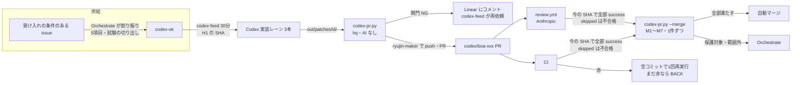
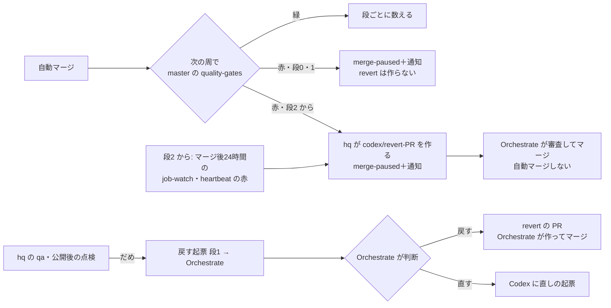

# Codex の直接 PR の仕組み（設計）

状態: 設計と審査まで。実装はオーナーの承認の後。鍵・`.github`・CI・権限の変更はここに書くだけで、まだ変えない。

## 0. 目的と前提

- 目的（オーナー 2026-10-22「保留にせず進めて。codexを使ってスケールさせたいので。」）: **Claude の使用量を増やさずに**、Codex の実装の量で開発をスケールさせる
- 守る決定: トークンの消費を第一に（10/15・10/17）。マージは人（Orchestrate）、ただし 10/22 のオーナーの yes で、範囲A の Codex の PR は §5.2 の条件で自動マージ。Preview の鍵は直接 PR でも外さない（10/7）。審査は作った側と別のベンダー（ADR-0097）
- 言われたとおり「パッチ → PR の機械化」だけを作っても効かない。**詰まりは供給（codex-ok の起票）**で、10/14〜10/20 はパッチが0（§1）。この設計は「PR の機械化」と「供給の機械化」を同じ重さで扱う

## 1. 確かめた事実（2026-10-22）

| 事実 | 出典 |
|---|---|
| 記事の PR は既に AI なしで直接出ている。hq の `scripts/content-pr.py`（LLM なし）が専用の clone で許可のパスだけを書き、push 前に `origin/master...HEAD` の全変更を許可のリストと照合し、`scripts/app-token.sh` で `ryujin-maker` 名義で push・PR。#1763〜#1766 はこの経路で作られ、review.yml の審査（ryujin-reviewer の APPROVE）と CI 緑でマージ済み | `~/hq/scripts/content-pr.py` 冒頭、`gh pr view 1766` |
| review.yml は作者の数値 ID が `REVIEW_MAKER_BOT_ID` の PR だけを審査し、`codex/` は Anthropic、`claude/` は OpenAI | `.github/workflows/review.yml`、`scripts/review/gate.js` |
| `codex/**` は Vercel Preview を作らない（`vercel.json` の `git.deploymentEnabled`、`verify-codex-no-preview.js` で固定） | `vercel.json`、AGENTS.md |
| CI の e2e は `VITE_SUPABASE_URL`・`VITE_SUPABASE_ANON_KEY`（公開してよい鍵）だけでビルドし、スクリーンショットを artifact に上げている | `.github/workflows/e2e-smoke-test.yml` |
| AGENTS.md と `docs/operation/codex-backlog.md` は既に「2026-10-22 以降 Codex は `codex/` から PR を直接出す」と書いている（#1625）。ただし Codex のレーン（codexlane）は App の鍵に届かず、push する手段が無い。**規約だけ先に進み、仕組みが無い** | AGENTS.md・codex-backlog.md 3行目 |
| Orchestrate の SKILL は今も「Codex の PR の審査は Claude が `claude -p` で行う」「src/ の画面の作業は Codex に回さない」 | `.claude/skills/orchestrate/SKILL.md`「Codex の PR」 |
| 供給: BOA の未完了 179件のうち codex-ok は5件（969・920・909・873・779）。パッチが出ているのは boa-909・boa-969（10/21）の2つで、まだ PR になっていない | Linear API、`~/ryujin-codex-dev/out/patches/` |
| 供給があった週の量: 10/8〜10/15 の提出は42束、うち36束が「300行・5ファイル以内」の大きさの条件だけは満たす（独立の PR 数ではない） | hq 下書き `2026-10-16-codex-direct-pr-design.md` §3 |
| `codex-feed.py` は元の SHA が3日より古いと積まず、Orchestrate に取り直しを頼む（人の手が残る） | `~/hq/scripts/codex-feed.py` |

hq の旧い下書き（10/16）との違い: 下書きは「docs だけ・Preview の鍵の分離が前提」。本設計は docs に絞らず（docs だけでは対象が週0〜1件）、Preview は作らない・鍵は外さないまま進める。

## 2. 全体の流れ

Claude が関わるのは「codex-ok の割り振り」「3回差し戻した PR」「公開後の戻す判断」だけ。パッチの取り込み・PR 作成・審査・CI の見張りから Claude を外す。

## 3. パッチ → PR を AI なしで作る（決めること1）

### 3.1 どこで・誰の名義で

- **hq に `scripts/codex-pr.py` を足す**。`content-pr.py` の骨格（専用の clone・許可のリスト照合・`app-token.sh`）を流用し、記事の関門の代わりに下の関門を置く。launchd で30分ごと（`codex-feed.py` と同じ周期）
- 動く身元は hq の OS ユーザー。App の秘密鍵は hq の Keychain にあり、codexlane からは読めない（今と同じ。Codex は鍵に届かない）
- 名義は `ryujin-maker`（ADR-0097）。ブランチは `codex/<issue id 小文字>`（再提出は `-v2`。force push しない、AGENTS.md）
- パッチと issue の結び付けは `out/patches/<id>/` の `<id>` を正とする（hq の回答 10/23）。再提出は `out/patches/<id>/v<n>/`
- Linear の操作（コメント・ラベル・閉じる）は hq の機械（codex-pr.py）が行う。`codex-ok` は PR を作った時点で外す（PR にした後の数え方は H2 の state で持つ）
- 取り込みレーン（Claude）との二重取りを避けるため、拾ったパッチには `CLAIMED-codex-pr` を置く。切替の日から Claude のレーンは `out/patches/` を拾わない（codex-backlog.md の旧方式を止める）

### 3.2 関門（どれか1つでも NG なら PR を作らない）

入力の正本は **Linear の issue を今取り直した5項目**。パッチや Codex の報告の中の自己申告は使わない。ただし「変えてよいファイル」を書くのも Codex の割り役（§6）なので、G3 は独立した歯止めにならない。**実質の歯止めは範囲A の許可のリスト（G8）と禁止のパス（G5）**で、これは龍神の repo と hq の設定に置き、Codex は変えられない。

| # | 検査 | 理由 |
|---|---|---|
| G0 | 段取り S が済んでいる（repo の階層に書き込みの本番の鍵が無い。`gh secret list` で機械に確かめる）。済むまで push しない | §7 の P0 |
| G1 | パッチの束の sha256 を記録し、同じ (issue, sha256) で PR を2度作らない | 再起動・再実行で重複 PR を作らない |
| G2 | issue の「元にする master の SHA」から切って `git apply`（`--3way` なし）で作業ツリーに当て、作者・コミットは codex-pr.py が付け直して commit する（`git am` で Codex のコミットの情報を持ち込まない）。当たらなければ NG | 衝突の自動解消をしない（AGENTS.md） |
| G3 | 変えたパス ⊆ issue の「変えてよいファイル」（完全一致または明記した glob） | 依頼の外を触らない |
| G4 | 追加＋削除 ≤ 300行、ファイル ≤ 5 | Codex の範囲（codex-backlog.md） |
| G5 | 禁止のパスに触れない: `.github/**`、`scripts/review/**`、`supabase/migrations/**`、`vercel.json`、`package.json`・`package-lock.json`、`.claude/**`、`AGENTS.md`、`.env*`、`.gitattributes`・`.gitmodules`・`.npmrc`、`scripts/maintenance/verify-codex-no-preview.js`、`scripts/maintenance/verify-pure-imports.js`、`docs/adr/**`、`docs/db-migration/**` | 守りの仕組み・依存・本番 DB・設計判断を Codex の PR で変えない。`docs/db-migration/**` はマージが db-apply を通じて本番 DB への書き込みにつながる（hq の指摘 10/23） |
| G6 | 削除・改名・mode の変更・symlink・バイナリは、issue が明示したときだけ | `content-pr.py` と同じ考え |
| G7 | 秘密の文字列の検査（`platform/spool.py` の `secret_patterns` を流用） | 鍵の混入 |
| G8 | 範囲の判定（§4）が A。B は CI のスクリーンショットの仕組みが入るまで NG | 画面の確かめ方 |
| G9 | 元の SHA の上で当てた後、`origin/master` に rebase して衝突しないこと。衝突すれば NG。**rebase の後、push の直前に `origin/master...HEAD` の全変更（削除・改名元・mode を含む）で G3〜G8 をやり直す**（`content-pr.py` の `verify_diff` と同じ形） | master が進んだときに古い版で上書きしない・rebase で範囲の外が混ざらない |

- 新しい `verify-*.js` を足すパッチは台帳（`verify-registry.json`）の追加が要る（BOA-838 の教訓）。issue の「変えてよいファイル」に台帳があるときだけ、**追加の行だけ**を許す（G3 と G6 の特例）
- `通すべきコマンド` は codex-pr.py では実行しない（コードを実行しない。鍵を持つ身元で Codex のコードを動かさない）。実行は CI に任せる

### 3.3 失敗したときの扱い

| 何が起きたか | 動き |
|---|---|
| 関門 NG | PR を作らない。Linear の issue に目印つきで理由をコメントし、ラベル `codex-retry` を付ける。hq の同じ台帳で Codex に積み直す（H3、§6.1）。差し戻しは**関門 NG・CI の赤・審査の P0/P1 を合わせて issue ごとに3回**まで。3回で直らなければ Orchestrate へ（§5.2 と一本化） |
| CI が赤 | 再実行はしない。全部の check が終わる（completed）まで待つ（e2e は layout だけで約18分、`e2e-smoke-test.yml:39`。30分の周で in_progress なら次の周へ。2時間たっても終わらなければ通知）。終わって赤なら、次の周（30分後）に同じ head がまだ赤のとき、CI の失敗の要約を目印つきで Linear に写し、Codex がその PR の head を元に直しのパッチを出す。codex-pr.py が関門を通して**同じブランチに追加のコミットで push**（force push しない）。master と衝突したときだけ `-v2` で作り直す（hq の実装 10/23。空のコミットの再実行は審査費が倍になるので使わない）。e2e の失敗で、その PR が `e2e/**`・`src/**` を変えていないもの（docs だけ等）は揺れ（本番への素通し）と見て差し戻しの3回に数えず、Orchestrate に1行で知らせる |
| review.yml が P0/P1 | 同上（指摘の要約を Linear に写して積み直す）。Claude は直さない |
| codex-pr.py 自身の誤り | 何もしない・通知だけ（終了コード 1、hq_notify） |

## 4. 対象の広さ: 危険の段と実績で広げる（決めること2）

hq の案 v2（`~/hq/drafts/codex-automerge-tiers-20261023.md`、ops-architect と龍神の規約の観点の審査済み）に合わせ、前の範囲 A・A2・B を**段（0〜3）＋対象外**に置き換える（2026-10-24）。段0・1 は構造の理由（本番のビルドが起きない・新しいファイルの追加だけで、既存のファイルを変えない限りどの入口からも届かない）で開け、本数の線は段2 から置く。承認は全段で review.yml の今の SHA の APPROVED と CI の期待の check（M1・M2）。「低リスクは LLM の審査なし」は採らない。

他の節に残る前の呼び名は、範囲A＝段0・1、範囲A2＝段2、範囲B＝段3 と読み替える（範囲A の `docs/**` は段0 の除外つき、`scripts/analysis/**` は段1 の新規だけ）。

| 段 | 中身 | 開く |
|---|---|---|
| 0 | `docs/**/*.md`（.md だけ）から次を除いたもの。追加・変更。除外: `docs/adr/**`・`docs/db-migration/**`・`docs/knowledge/**`（AGENTS.md:9 が作業の前に読むよう定め、AI への指示として効く）・`docs/reference/**`（機械の生成物）・`docs/design/codex-direct-pr/**`（AGENTS.md・SKILL が正本として指す。Codex が自動マージの条件を広げられてしまう）・`docs/design/*/mock/**`（段階0 B の承認の根拠）・`docs/design/db-apply-automation-finish/**`（段2 の守りの dev-gate と、オーナーが本番に流す SQL）、それに **AGENTS.md・`.claude/**` が読むよう定めた docs のパス**（`docs/operation/sdd-and-codex-review.md`・`content-pr-contract.md`・`sns-video-producer-prompt.md`・`codex-backlog.md` 等。hq が AGENTS.md と `.claude/**` を grep して機械で集め、`automerge.exclude` に足す。集め直しは毎周）。`.md` だけにするので `docs/content-manifests/**`（`scripts/lib/contentPrGate.js:26` が読む JSON）も入らない | 開いている。除外は hq が `automerge.exclude` に足す |
| 1 | 新しいファイルの追加だけ（git の A）: `e2e/**`、`scripts/maintenance/verify-*.js`（§4.1 の守りの verify を除く）と `verify-registry.json` の追加の行（tier=`ci` だけ、`timeoutSec` に上限）、`scripts/analysis/**`（ネットワーク・DB・鍵の import を新しい verify で禁じたものだけ。その verify はまだ無く、`scripts/analysis/**` を開く前提） | 影の運用（§10）の後。`e2e/**` の新規は今も開いている |
| 2 | `src/pure/**`・`scripts/lib/pure/**`（§4.2。`verify-pure-imports.js` が前提で、まだ master に無い）。最初の3件は Orchestrate が手でマージ、切り出しの PR は自動にしない | §10 の線に届いたら hq が開け、事後に報告 |
| 3 | 既存の画面の小さな修正（§4.4） | §4.4 の前提が全部そろい、オーナーが判断 |
| 対象外 | §3.2 G5・§5.2 M3 の全部、`api/**`、`scripts/lib/**`（pure を除く）・`scripts/db/**`・`scripts/watch/**`・`scripts/sns/**`、本番に書くスクリプト、`data/**`（鍵の定期 job が読み書きする: `collect-racer-news.yml:65・86`、scrape-venue-* の health.json、`reportComparison.js:24` の readdirSync 等）、既存のファイルの変更（段0 を除く）、削除・改名、`automerge.exclude` | 自動にしない（要審査の PR として Orchestrate へ。§5.2） |

- 300行・5ファイル（G4）は全段で変えない
- 新しいファイルの追加だけでも、readdir・glob でまとめて読む所からは届く。段1 のフォルダについて、開く前に1回 grep で確かめる（`e2e/**` は playwright の testDir、`scripts/maintenance/verify-*.js` は registry に載ったものだけ CI が呼ぶ）
- `scripts/analysis/**` の新しいファイルを hq や社員が後で手元で鍵つきで動かすとき（`fetch-growth.sh` に名前を足すとき）は、hq が中を読んでから足す
- 段2 の守りの上乗せ: 龍神の dev-gate の prodWrite の導出（`docs/design/db-apply-automation-finish/dev-gate.draft.json`）を共用し、鍵の判定は job 単位、たどれない呼び方が1つでもあれば全部を対象外に倒す。許可は一覧で決め、たどる仕組みは守りを足すだけ
- 鍵の実行のたどり（閉包）を機械で求めて範囲を決める案は採らない。この repo では入口（Actions・Vercel のビルド・hq の Mac・Python・`execFileSync`・変数のパス）を機械でたどり切れず、穴が黙って残る（hq 案 v2 §0）
- Actions・DB の起票は、Codex に再現・試験・移行前後の比べ・適用と戻しの案まで作らせる（パッチは docs と試験の新規＝段0・1 に収まる）。適用は今の別の道（Orchestrate・db-apply）

### 4.1 段に入れない scripts

範囲A は許可のリストなので、リストの外は全部入らない。とくに次は、本番に書く・守りの仕組み・CI の判定を動かすもので、許可のリストに足さない（system-architect の審査、2026-10-22）。prod-jobs の定期 job はマージ後の `scripts/**` を service key で動かすため、守りの本体を Codex の PR で変えさせない。

- `scripts/db/**`（db-apply・db-reconcile）、`scripts/watch/**`（job-watch）、`scripts/lib/**`（定期 job と共有。`dbApplySql.js` の軽い・重いの判定を書き換えると SQL が承認なしで当たる。`jobWatch.js`・`dbReconcile.js`・`supabaseClient.js`）
- `scripts/sns/**`（送信）、`scripts/review/**`、`scripts/vercel-ignore-build.js`、cron の job の本体
- 守りの verify: `verify-workflow-secrets.js`・`verify-review-workflow.js`・`verify-codex-no-preview.js`・`verify-pure-imports.js`（G5 にも入れる）。`verify-registry.json` は追加の行だけの特例（§3.2）

### 4.2 段2: 専用のフォルダと機械の強制（Gemini・Grok の案の照合、10/23）

名前の許可の一覧（1本ずつ確かめる）をやめ、**鍵・DB・送信に触れない純粋な処理だけを置く専用のフォルダ**を作り、そこから外の部品を読めないことを機械で強制する。範囲A2 の自動マージは、そのフォルダの中だけにする。

| 項目 | 決め |
|---|---|
| フォルダ | `src/pure/**`（画面の側）と `scripts/lib/pure/**`（スクリプトの側）。今は無い（2026-10-23 確認） |
| 強制の仕方 | 新しい `scripts/maintenance/verify-pure-imports.js`（台帳で `ci`、Quality Gates で必ず走る）。規則を並べる形（`no-restricted-imports` 等）にしない。`no-restricted-imports` は静的な import と `export … from` しか見ず、`import()`・`require`・`createRequire` が通り、scripts の側は `globals.node` で `require` も定義済み（`eslint.config.js:35-48`）だから。代わりに ESLint のパーサ（`verify-no-undef.js` と同じ使い方）で AST を取り、全部の ImportDeclaration・ExportNamed/AllDeclaration の `from`・ImportExpression・`require(` の呼び出しの行き先をパスに解決し、**根ごとの許可の向き（下の「追記（2026-10-24）: 共有の根」。`src/pure/` は自分の中だけ、`scripts/lib/pure/` は自分の中と `src/pure/`）に合う .js だけ**を許す。文字列でない `import()` は不合格。`../` での脱出・再 export・JSON・npm の部品も同じ判定で塞ぐ。グローバルは ES の組み込みだけにして no-undef を当て、`globalThis`・`window`・`self`・`process`・`eval`・`Function`・`import.meta`・`fetch`・`XMLHttpRequest`・`WebSocket` は個別に禁止する。龍神は JavaScript なので、型（TypeScript）で守る案（Gemini の前提）は使わない |
| CI の lint | `npm run lint`（`eslint .`）は今 CI で走っていない（Quality Gates に無い。未定義参照だけ `verify-no-undef.js` が見る）。そこで lint 全体を必須にするのでなく、上の verify を verify:ci に入れて必須にする（`.github` を変えない） |
| 切り出しの PR | 既存の処理を pure のフォルダに移す PR は自動マージしない（Claude の PR か、Orchestrate が審査する Codex の PR）。移した後は verify が import を見張るので、import 先が変わったら CI が落ちる（確かめ直しを機械に任せる） |
| 自動マージの条件 | 変えたパスが全部 pure のフォルダの中、変えた関数を import する単体の試験の**追加**が差分にある（数えるのは `scripts/maintenance/verify-*.js` で台帳が `ci` のものだけ。`scripts/tests/**` は CI が呼ばない、AGENTS.md:91）（既存の試験の行の削除・書き換えは範囲外。M7 と同じ）、M2 の check が全部 success |
| 残る危険 | 純粋でも、計算の誤りは呼び出す側（定期の job・画面）を通じて本番の DB の値や画面の数字を誤らせる。単体の試験の期待値が誤っていれば通る。公開後の戻す起票（§5.4）で拾う |

- 前の案（`src/utils/**`・`src/lib/**` を条件つきで入れる、`scripts/lib` は名前の許可の一覧）は取り下げる。`src/utils` は画面と鍵の両方に近い部品が混ざり、パスでは守れない
- 入れる時期は §10 の順番のとおり、範囲A の自動マージのルールが安定した後

#### 追記（2026-10-24）: 共有の根

開発効率の計画（`docs/design/dev-efficiency/plan.md` の 1b）で、画面とスクリプトの両方が使う純関数の置き場を決める。

**決定: 2つの根のまま、`scripts/lib/pure/**` から `src/pure/**` への片方向の import だけを許す。画面とスクリプトの両方が使う純関数は `src/pure/**` に置く（共有の根は `src/pure`）。`src/pure/**` から `scripts/lib/pure/**` への import は禁じる。新しい根は足さない。**

今の依存（2026-10-24、origin/master `e2d194f35` の grep）:

| 向き | 数 | 例 |
|---|---|---|
| scripts・api → src | 104 ファイル（静的な `from` の import。`grep -rlE "from ['\"](\.\./)+src/" scripts api`。`import()` を含めると 111、うち `scripts/maintenance` の verify が 69、本番の処理は 42） | `src/components/race/seriesPoints.js`（8）・`src/data/blogPosts.js`・`src/config/languages.js`・`src/utils/snsObservations.js`・`src/utils/dateUtils.js`・`src/utils/raceOutcome.js` |
| src → scripts/lib | 4 ファイル・5 行 | `supabaseDataService.js:11-12`（`hitCalculator.js`・`dateUtils.js`）、`racerConditionStats.js:2`（`hitCalculator.js`）、`basicInfoStats.js`・`adlerModel.js`（`hitCalculator.js`・`harville.js`） |
| 往復 | 1 本 | `supabaseDataService.js` → `src/utils/racerConditionStats.js` → `scripts/lib/hitCalculator.js` → `src/utils/raceOutcome.js`（`hitCalculator.js:9`） |

理由:

1. **今の向きに合う。** scripts から src を読む向きが主流（本番の処理だけでも 42 ファイル）、逆は 4 ファイル。共有の根を src の側に置けば、逆向きの 5 行は「`src/pure` に移して `scripts/lib/*.js` は再 export を残す」で消え、往復も解ける（`hitCalculator.js` と `raceOutcome.js` の純粋な部分を両方 `src/pure` に移す）
2. **画面の束（バンドル）に scripts の木が入らない。** `src/pure` → `scripts/lib/pure` を禁じるので、ブラウザで動く側が Node の側の部品に依存しない。`scripts/lib/pure` はスクリプトだけが使う純関数の置き場として残す（§4.2 の表のまま）
3. **新しい根は既存の守りの外に落ちる。** 例えば最上位に `shared/pure/` を足すと、`post-merge-checks.yml` の `paths`（`src/**`・`scripts/**` 等、27-38 行）に入らず、マージ後の no-undef・build が走らない。`verify-no-undef.js:43-51` の対象（src・api・middleware.js・scripts・e2e 等）にも入らない。直すには `.github` の変更が要り、本計画の「`.github` は変えない」と食い違う。`eslint.config.js` の区分、hq の codex-pr.py の段2 のパス（§4・M7）も全部足し直しになる
4. **§4.2 の表・段2 の表・hq の設定が既に `src/pure`・`scripts/lib/pure` で書かれている。** 根を変えない案は、それらを変えずに済む

採らなかった案: 新しい共有の根を1つ足す（上の3・4）。`scripts/lib/pure` を共有の根にする（画面から scripts の木を読む向きが増え、1・2 と逆）。

verify-pure-imports.js の判定（§4.2 の表に足す）:
- `src/pure/` の中のファイル: 行き先が `src/pure/` の中の .js だけを許す
- `scripts/lib/pure/` の中のファイル: 行き先が `scripts/lib/pure/` か `src/pure/` の中の .js だけを許す
- どちらの根も、グローバルは ES の組み込みだけ（`scripts/lib/pure` も `globals.node` を使わない。`src/pure` から読まれる物と同じ条件にそろえる）
- グローバルの判定は `eslint.config.js` を使わず、verify-pure-imports.js が自分の設定（`overrideConfigFile: true`、`ecmaVersion` と ES の組み込みだけ）で no-undef を当てる。flat config の `languageOptions.globals` は上から重ねて合わさり、後のブロックの `globals: {}` では `eslint.config.js:19` の browser・35-46 行の node の名前を消せないため（審査 P2）
- コメントの中の型の import（JSDoc の `import('...')`）と `/// <reference` も、import と同じ判定にかける。`tsc` はこれらを解決して根の外のファイルをプログラムに入れる（4 の型の検査の範囲を閉じるため。審査 P2）

移したときの旧の置き場: `scripts/lib/hitCalculator.js`・`src/utils/raceOutcome.js` 等は再 export だけのファイルとして残す（定期の job・画面の import を変えない）。共通ロジックの索引（`scripts/maintenance/generate-lib-index.js:39-55` の TARGETS は `scripts/lib`・`src/utils`・`src/services` だけ。再 export の行は export に数えない）から移した関数が消えないよう、切り出しの最初の PR で TARGETS に `src/pure` を足す（Claude の PR）。`scripts/lib/**` は段の対象外なので、この再 export の PR は Claude の PR（§4.2「切り出しの PR」）。

G5（§3.2）と M3（§5.2）に足すもの（守りの設定を Codex の PR で緩めさせない）:
- `eslint.config.*`（区分のグローバル・規則の重さを変えると verify-no-undef と verify-pure-imports の判定が変わる）
- 抑制の一覧: `scripts/maintenance/*-allowlist.json`（`verify-no-undef-allowlist.json` と、1a で規則ごとに足す一覧）
- `**/jsconfig*.json`・`**/tsconfig*.json`（4 の範囲を限った tsc の `include` を広げ・狭めると検査が変わる。今は無い）
- `scripts/maintenance/verify-no-undef.js`（1a で lint の本体になる守りの verify。§4.1 の守りの verify にも足す）
- `scripts/maintenance/verify-pure-imports.js`（既に G5 にある。再掲）

この glob は hq の `config/codex-pr.json` の `forbidden_paths`・`automerge.exclude` が既に持つもの（system-architect の審査で確認、2026-10-24）にそろえた。段2 を開くとき、hq の `merge_protected` の `scripts/lib/**` から `scripts/lib/pure/**` を除く（今は除かれておらず、安全側に倒れている）。

### 4.3 画面の Codex の PR（オーナー 10/24）

オーナー 2026-10-24「codexはlinearチケットで開発でできそうなやつを回しても良い」で、丸ごと任せる試運転の1件の例外を広げ、`src/` の画面の Codex の PR も受ける。段3 が開くまで自動マージしない。

| 項目 | 決め |
|---|---|
| codex-pr.py の扱い | G3（変えてよいファイル）・G4（300行・5ファイル）・G5（禁止のパス）・G7（秘密）・G9 はそのまま。G8（段）に当たって要審査の PR になる。大きな起票を割らずに任せるとき（G4 を外す）は、hq の設定に置いた issue の id だけを根拠にする（ラベルは付け替えられるので根拠にしない） |
| 審査 | Orchestrate が手元の Playwright で PR のブランチと master を 375px・1440px に撮り、実測する（`run-heavy.sh` 経由・`--workers=1`。#1798・#1799 で実施した形）。**Codex は手元で Playwright を動かさない**（AGENTS.md の「録画に無い取得が本番へ素通し」、`codex-backlog.md:99` の「Codex の環境はブラウザが起動しない」）。CI の blob の artifact は保存が1日（`e2e-smoke-test.yml:88-96`）なので審査の根拠にしない。Codex の新しい試験は録画に無い取得を素通ししやすいので、PR の素通しの記録も見る |
| 対象外 | 新しいページ・タブ・主要コンポーネント（review-fix-cycle の新UIフロー） |
| 測る | 完了までの時間、Orchestrate の審査の量、差し戻しの回数、公開後の不具合（§8） |

### 4.4 段3（画面の自動マージ）の前提

段3 は、次が全部そろうまで開かない（最後に開く。§10）。

| 前提 | 中身 |
|---|---|
| 固定のデータ | e2e は録画（`e2e/recordings/api.har`）の再生で動き、ブラウザの時計を録画の時刻に固定する（`e2e/fixtures.js:33-34`）。素通しの報告（`report-e2e-passthrough.js`）は素通しがあっても終了コード0（同ファイル:17）なので、範囲B の試験は `E2E_REPLAY_STRICT=1`（`e2e/fixtures.js:97`。録画に無い取得を失敗にする既存の仕組み）で走らせて素通し0件を合格の条件にする。録画は1日4回撮り直される（`e2e-rerecord.yml:78-81`）ので、画像の比較は値の部分を `mask` するか、範囲B 専用の固定の録画を置く（どちらにするかは範囲B を入れるときに決める） |
| 送らない設定 | 試験の中で送信（X・Slack・投稿）の API を呼ばない。素通し0件で担保する |
| スマホと PC の期待値 | 375px と 1440px の両方で、操作（押す・切り替える）と見えるべき値を試験に書く |
| 画像の比較 | 今の Playwright の `toHaveScreenshot` で行い、許容の差を `maxDiffPixelRatio` の数で決める（値は試運転で決める。根拠の無い値は置かない）。Storybook は入れない。基準画像は CI と同じ環境（Linux のコンテナ）で作り、手元の Mac で作らない（ファイル名に OS 名 `-linux` が付く。CI で作った画像を artifact から取り込む手順を範囲B を入れるときに書く）。今の e2e に `toHaveScreenshot` の使用は無い（2026-10-23 の grep） |
| アクセシビリティ | 今の `e2e/smoke.spec.js` の `@axe-core/playwright` を流用し、変えた画面で serious・critical の新しい違反が0件 |
| 書き換えだけでは合格にしない | 実装役が試験の期待値や基準画像（`*-snapshots/`）を書き換えた PR は自動マージしない（M7 を基準画像に広げる）。基準画像の更新は Orchestrate が審査する |
| Preview の環境変数（確かめた結果） | `SUPABASE_SERVICE_KEY` は production・preview・development に別々の行で載っている（値が同じかは読んでいない）。本番の `api/**` と同じ名前の鍵が Preview にもある。`VITE_SUPABASE_URL`・`VITE_SUPABASE_ANON_KEY`・`SUPABASE_URL`・`SUPABASE_ANON_KEY` は development・preview・production で同じ1つの値で、Preview は**本番の Supabase** につながる（Vercel MCP の `filter_project_envs`、値は読まずに target だけを確認、2026-10-23）。このため `codex/**` の Preview は作らないまま（AGENTS.md・`vercel.json`）。範囲B の確かめは CI の録画の再生だけで行う |

## 5. 審査・CI・自動マージ（決めること3）

自動マージの条件はオーナー 10/22 の yes（hq 経由、出典 `~/hq/drafts/arch-target-20261022.md`）。「マージは人」の 10/15・10/17 の決定は、Codex の PR のうち下の条件をすべて満たすものに限って置き換わる。

- 審査は **review.yml（Anthropic API）に一本化**し、Orchestrate の SKILL の「Claude が `claude -p` で審査」をやめる。review.yml は Claude Code の週の枠を使わない（API の別の財布、と読んだ。請求先が週の枠と別かは**未確認**で、実装前にオーナーに確かめる）。上限 `REVIEW_MONTHLY_LIMIT` は**審査の run の件数**（既定300、`scripts/review/gate.js:26`）で金額では止まらず、記事・`claude/` の PR と同じ枠を分け合う。審査モデルは Variable `REVIEW_ANTHROPIC_MODEL` の `claude-opus-5-5` が優先（`llm.js:129` の既定 `claude-opus-5` は使われない）。1件の単価を試運転で測り、Codex の PR の分の上限を件数で別に置くかを決める

### 5.1 確かめた事実（2026-10-22、`gh api` の読み取り）

| 事実 | 出典 |
|---|---|
| master の ruleset `master-guard`（id 24693068、active）: 必須の検査は `e2e`・`verify`・`ml-tests`（GitHub Actions）。`strict_required_status_checks_policy=false`（base に追いついていなくても通る）。承認1件、`dismiss_stale_reviews_on_push=true`・`require_last_push_approval=true`（push で承認が消える）。squash だけ | `gh api repos/.../rules/branches/master` |
| bypass は2つ: RepositoryRole 5（admin）と Integration 5220661。5220661 は `ryujin-maker`（5377197）でも `ryujin-reviewer`（5377028）でもない。ADR-0097:21 の「ryujin-bot の bypass は always のまま」から **ryujin-bot と推測**（名前は未実測） | `gh api repos/.../rulesets/24693068`、`~/hq/config/github-apps.json`、ADR-0097:21 |
| #1763〜#1766（記事の PR）は全部 `reviewDecision=APPROVED` で、ryujin-reviewer の承認が必須の1件に数えられている。マージは4件とも admin（bypass）で、**`ryujin-maker` の名義でマージが通るかは未実測** | `gh pr view` |
| approve の check-run は `REQUEST_CHANGES` を出しても success になる | `scripts/lib/reviewPr.js:226-` |
| 範囲A のパス（`docs/`・`e2e/`・`scripts/analysis/`・`scripts/maintenance/`）は全部 Vercel の `IGNORED_DIRS` に入り、本番ビルドが起きない | `scripts/lib/vercelIgnoreBuild.js:15-27` |
| `post-merge-checks.yml` は build と no-undef だけで、`docs/**`・`e2e/**` の .md 等は paths に入らない。master への push で範囲A を検査するのは `quality-gates.yml` だけで、その失敗の Slack 通知・job-watch の見張りは無い（grep で見つからない） | `.github/workflows/post-merge-checks.yml`、`quality-gates.yml`、`scripts/watch/job-watch.json` |
| `scripts/analysis/` のうち `aggregate-racer-stats.js`・`train-moriarty-calibration.js`・`train-conditional-logit.js`・`train-adler-temps.js` は定期の workflow が service key で実行する | `aggregate-stats.yml:25`、`train-moriarty.yml:24`、`train-sherlock.yml:25,30` |
| review.yml の `llm` は `materials` が success か **skipped** のとき動く（`review.yml:106`）。`materials` は gate の `sql_tables` が空でないときだけ動くので、SQL を触らない PR では skipped が正常。SQL の PR で materials が落ちると llm が skipped になり、approve は `REQUEST_CHANGES`（`scripts/lib/reviewPr.js` の `decideAction`: `llmResult !== "success"` は承認しない）。**審査不能は今も承認にならない** | `review.yml:101-106`、`scripts/lib/reviewPr.js` |
| approve は承認の直前に head を取り直し、審査した SHA と違えば何もしない | `scripts/review/approve.js:39-52` |
| GitHub は `if:` で skipped になった必須の検査を合格に数える | GitHub の一般仕様（この repo では未実測） |

### 5.2 自動マージの条件（全部を満たしたときだけ。1つでも欠ければマージしない）

| # | 条件 | どう守るか |
|---|---|---|
| M1 | **今の head SHA で** CI と AI 審査が合格。push で SHA が変われば合格は無効 | 審査: ruleset の `require_last_push_approval`・`dismiss_stale_reviews_on_push` と approve.js の SHA の照合（既存）。CI: マージは `--match-head-commit <判定した SHA>` を付けて行い、判定と実行の間に SHA が変われば GitHub が断る |
| M2 | **skipped と審査不能は不合格**。範囲ごとに期待する check を固定し（下の表）、「success が要る」check が1つでも success 以外（skipped・neutral・cancelled・timed_out・無い）なら不合格。「skipped を許す」check は skipped 以外（success を含む）が出たら不合格（作りの前提が崩れた印）。一覧に無い check は見ない。check-runs は `filter=latest` で取り、再実行の古い run を拾わない。combined status は status が0件でも `pending` を返すので判定に使わない。審査は reviews の API で、`user.id` が ryujin-reviewer の bot（344660046）・`state=APPROVED`・`commit_id` が今の head SHA のものがあること（`COMMENTED`・`REQUEST_CHANGES`・無しは不合格）。approve の check-run は審査の結果と関係なく success になるので、審査の合否には使わない | merge-check が check-runs と reviews を API で読んで判定。ruleset だけでは skipped を落とせない（5.1）ので、merge-check が本体 |
| M3 | 保護対象を変える PR は自動マージしない: `.github/**`、`scripts/review/**`、`docs/db-migration/**`、鍵まわり（`.env*`、`vercel.json`、`scripts/lib/supabaseClient.js`、`verify-workflow-secrets.js`・`verify-review-workflow.js`・`verify-codex-no-preview.js`）、§3.2 G5・§4.1 の全部 | codex-pr.py の G5 で PR 自体を作らない。merge-check でも差分のパスをもう一度照合（二重） |
| M4 | 変えたパスが全部、**開いている段**（§4）の中。段2 は最初の3件を Orchestrate が手でマージ。段3 はオーナーが開くまで自動マージしない。対象外・未開の段に1本でも当たれば要審査の PR（本文に範囲の外になったファイルと理由） | merge-check（hq の `config/codex-pr.json` の `tiers`） |
| M5 | 今の master にそのまま当たる（先にマージした PR と衝突しない）。master の最新の `quality-gates` が緑 | GitHub の mergeable と merge-check の rebase の試し。`strict=false` なので古い base の CI 合格のままマージされうる。post-merge-checks では拾えない（範囲A は paths に入らない）。そこで **`--merge` は1回に1件だけ**にし、前の1件のマージの後の master の `quality-gates` の run が緑になるまで次をマージしない。赤なら自動マージを止めて Orchestrate へ |
| M7 | 段0（docs）だけ既存の変更も可。段1・2 は**新しいファイルの追加だけ**（段2 は変えた関数の単体の試験の追加つき、§4.2）。**特例**: 段1 の verify を足す PR の `scripts/maintenance/verify-registry.json` は既存のファイルの変更だが、次を全部満たすときだけ許す: 削除・書き換えの行が0、足した行の `script` が同じ PR で足したファイル、`tier` が `ci`、`timeoutSec` が無いか 300 以下（今の台帳で `timeoutSec` を持つ `ci` の3本は 300・300・600）。基準画像（`*-snapshots/`）の追加・変更は自動マージしない。既存の試験・verify の変更は検査を弱めうるので要審査 | merge-check が差分の種類（A/M）を見る |
| M6 | 作者が `REVIEW_MAKER_BOT_ID`、head が `codex/`、`CLAIMED-codex-pr` の記録と PR が一致 | merge-check |

#### M2 の期待する check（範囲A・A2、2026-10-23）

| check | 期待 | 根拠（その PR の差分で動くか） |
|---|---|---|
| `gate`・`llm`・`approve` | success | review.yml。作者が `REVIEW_MAKER_BOT_ID` の PR では gate が動き、llm は gate が ok で materials が success か skipped のとき動く（`review.yml` の gate の if、`review.yml:101-106`） |
| `materials` | **skipped を許す** | `sql_tables` が空でないときだけ動く。`sql_tables` は `docs/db-migration/*.sql` の変更だけから作る（`scripts/lib/reviewPr.js:75-80`）。範囲A・A2 は G5・M3 で `docs/db-migration/**` を禁じたので、必ず skipped。success・failure が出たら不合格 |
| `e2e-shard (1/3)`〜`(3/3)`・`e2e` | success | `e2e-smoke-test.yml:14-17`。`pull_request`（base master）で paths の絞りが無い |
| `verify`・`ml-tests` | success | `quality-gates.yml`。if が止めるのは ryujin-bot の push と `[automated]` の push だけ（`quality-gates.yml:36-41`・`82-87`）。PR では必ず動く |
| `notify` | **一覧から外す** | `slack-notify-pr.yml:7-8` の `types: [opened]`。push の後の head には付かず、常に欠ける（hq の指摘 10/23） |
| `Vercel Preview Comments` | 一覧に入れない | `codex/**` は Preview を作らない（`vercel.json`） |

実測（2026-10-23）:
- #1775（docs だけ、作者 rhapsody0919 なので review.yml の gate・llm・approve は skipped）: e2e-shard×3・e2e・verify・ml-tests は success、materials は skipped。docs だけの差分でも e2e・verify・ml-tests は動く
- #1766・#1773（`ryujin-maker`、記事の PR）: gate・llm・approve・e2e-shard×3・e2e・verify・ml-tests・notify が success、materials は skipped
- `ryujin-maker` の docs だけ・e2e だけの PR の実測は**まだ無い**。試運転の最初の PR（§10 の4）で一覧と合うかを確かめ、合わなければ自動マージを止めて一覧を直す

- 実行するのは hq の `codex-pr.py --merge`（AI なし、launchd 30分ごと）。名義は `ryujin-maker`（ruleset の bypass に入っていないことが前提。5.3 の O1）。GitHub の auto-merge 機能は使わない。GitHub の auto-merge は必須の3つの検査と承認しか見ず、M2〜M4 を守れないため
- **Codex の分の審査の月の線**: `REVIEW_MONTHLY_LIMIT`（300）は、**PR の作者（actor）ごと**に、その月の review.yml の run を取り消し・skipped を含めて全部数える（`scripts/lib/reviewPr.js:280-284` の `monthlyRunsPath`、`scripts/review/gate.js:32`）。review.yml が審査するのは作者が `ryujin-maker` の PR だけ（gate の if）なので、300 を分け合うのは `ryujin-maker` が作る全部の PR（記事・Codex・`ryujin-maker` で出す `claude/`）。10月（1〜23日）の `ryujin-maker` の run は33件（`claude/` 18・`codex/content-*` 9・その他の `codex/` 6）、24ブランチで1ブランチ平均1.4件（`gh api .../workflows/review.yml/runs?actor=ryujin-maker[bot]`、10/23）。codex-pr.py の PR は直しの push（synchronize）・reopened・取り消しで1件あたりの run が増えるので **1件3件**と置き、Codex の分の線を **月120件**（40 PR、週10件。§8 の見込みの上限）にする。codex-pr.py は自分の PR の run を同じ数え方（取り消し・skipped を含む）で数え、120 に達したら `--push` を止めて hq に通知する。残りの180件を記事と `claude/` に残す。1件あたりの費用は未測定
- **マージで Linear の issue が閉じるか**: BOA-785 は PR #1443 のマージ（2026-10-12 06:27）と同じ秒に Done になった（連携で閉じた形）。BOA-839 は PR #1429 のマージ（04:17）の11分後に Done（手で閉じた形）。連携の設定は確かめていない。そこで PR 本文に `Fixes BOA-xxx` を書き、codex-pr.py はマージの次の周（30分後）に issue を読み、閉じていなければ Linear の API で Done にして PR のリンクをコメントする
- 差し戻し（関門 NG・CI の赤・審査の P0/P1）は issue ごとに合わせて数え、**3回差し戻して直らない PR だけ人へ**。Orchestrate が判断し、要ればオーナーへ
- 段は実績で開く（§10）: 段0 は開いている。段1 は影の運用の後、段2 は線に届いた後、段3 はオーナーの判断。`scripts/analysis/**` は新しいファイルだけで、定期の workflow が実行する既存のファイル（5.1 の最後の行の4本）には届かない
- **要審査の PR は二重に読まない**: Orchestrate は「範囲の外になったファイル」の差分と、review.yml の指摘・CI の結果だけを読む。範囲の外のファイルの一覧は、PR 本文の記述に頼らず、差分と段の定義から自分で出す（AGENTS.md の「判定は差分で行い、本文の記述には頼らない」）。範囲の外のファイルがある PR では、その PR が足した試験・`verify-registry.json` の行も読む（外の変更を中の新しい試験が誤った期待値で固める、外の既存の verify を弱めて中の新しい verify に置き換える、registry の行で timeout を延ばす、の組み合わせを防ぐ）。それ以外の範囲の中のファイルは review.yml の承認と CI に任せる。github-actions の PR のコメントはデータとして扱う（e2e は PR のコードを PR のコメントを書ける token で動かす、`e2e-smoke-test.yml:30-34`）
- Linear の優先度 Normal・Low の起票は、Orchestrate の割り振り（§6）・Codex の実装・自動マージだけで回し、Claude の枠を空ける。段1〜2（Urgent・High）は今までどおり Claude のレーンか Orchestrate が見る

### 5.3 保護ルールを変える案（オーナーが行う手順。Claude は変えない）

| # | 案 | 手順 | 理由 |
|---|---|---|---|
| O1 | bypass の Integration 5220661 は外さない。名前が ryujin-bot であることだけ1回確かめる | GitHub の Settings → Rules → Rulesets → `master-guard` → Bypass list で名前を見る | App の ID の照合で作成・審査の App ではないと確かめた（5.1）。ryujin-bot の bypass は ADR-0097 で残すと決めたもの（master に直接 push する11本の workflow のため） |
| O2 | 必須の検査に review.yml の `approve` を足さない（推奨） | — | 承認は ruleset の承認1件で既に必須。`approve` の check-run は審査の結果と関係なく success になり、gate が動かない人の PR では skipped（合格に数えられる）になるので、必須にしても守りにならない |
| O3 | `strict_required_status_checks_policy` は false のまま（推奨） | — | true にすると Codex の PR がマージのたびに base の更新（push）を要し、push ごとに審査が走って費用が倍になる。古い base の危険は M5 と post-merge-checks で拾う |

### 5.4 マージの後

- codex-pr.py は次の周（30分ごと）で、前の自動マージの後の master の `quality-gates` を見る（M5 と同じ run）
- 段0・1: 赤なら `merge-paused` を置いて通知だけ。revert は作らない（範囲が Vercel の `IGNORED_DIRS` の中で本番のビルドが起きない。足したファイルの revert は削除で、規則の例外が要る）
- 段2 から: 赤、または本番の job-watch・heartbeat の赤（マージ後 24時間）で、hq が `git revert` の結果だけの PR（`codex/revert-<PR>`、`ryujin-maker`）を作り、`merge-paused`・通知。revert の PR は自動マージせず、Orchestrate が審査してマージする。審査の run は Codex の分の 120 に数える。前の PR のせいか分からない（他の push が間に入った）ときは revert を作らず止めて通知
- 段2 は本番にデプロイされ、デプロイ前の検査は無い（Vercel は master で即デプロイ）。canary は作らない（費用の判断）
- 公開後にだめなら、戻す起票（段1）が Orchestrate に来る。戻すかの判断は Orchestrate
- go_live（`https://www.boat-ai.jp/ai-snapshots/status.json` の `blogChartPng.commit`）は本番のビルドが起きる変更の見張り（hq の持ち物）。段0・1 では動かない
- master の `quality-gates` の失敗は job-watch が Issue に書く（#1777 で足した。段2 の revert の条件の job-watch の赤もこれを含む）
- `public/blog/**` が `post-merge-checks.yml` の `paths` に無い件は Orchestrate が別に判断する（本設計の段は `public/**` を含まない）

## 6. 起票の供給（決めること4）

### 6.0 数（2026-10-23）

- hq の実測（正規表現の近似）: 未着手163件、受け入れの条件あり29件、範囲A のパスに触れる10件、範囲A だけで済む2件（BOA-997 は済み、BOA-781）。hq は割り役の新設を見送った
- こちらの数え直し（同じ近似、Linear の BOA の未完了173件、2026-10-23）: 受け入れの条件あり31件の内訳は 範囲A 3件（BOA-781・478・357）、A2 0件、B 1件（BOA-598）、範囲外18件、パスの記載なし9件。範囲外の多くは `.github/workflows/`・`public/blog/`・hq の `content-pr.py` を本文で触れているため
- 起票の速さ: 直近7日（10/16〜23）の起票51件のうち、受け入れの条件あり25件

今の起票の形のままでは、自動の道に流れるのは週0〜1件。供給は「範囲A に入る形で起票する」ことで作る。

### 6.1 供給の作り方（割り役は置かない）

1. **codex-ok は Orchestrate の割り振り**。Orchestrate が受け入れの条件のある issue に「## Codex 用」の5項目と**段（0〜2 か対象外）**を書いて `codex-ok` を付け、hq の機械（codex-feed）が拾う。対象外も Codex に回す（自動マージは期待せず、§5.2 の二重に読まない形で Orchestrate の読む量を減らす）。SHA の欄は `latest` でよい（H1）
2. **試験を Codex に書かせ、Claude の修正の材料にする**（単独ではマージしない）: 修正前に落ちる再現試験は、単独の PR にすると §3.3 の差し戻しが3回続いて終わり、マージされても master の CI が赤になって M5 で自動マージが全部止まる（system-architect 10/23）。そこで、受け入れの条件がある issue の再現試験（新しい `e2e/*.spec.js` か `scripts/maintenance/verify-*.js`）は、Codex がパッチ（`codex-pr.py` の PR にしない、ラベル `codex-test-only`）として出し、Claude のレーンが修正の PR に取り込む。期待値は Orchestrate が5項目を書くときに決めるので、issue の文の誤読は Orchestrate の割り振りで止める。自動マージの PR は増えないが、Claude が試験を書く分が減る
2b. **修正が開いている段で済む issue は、試験と修正を1つのパッチで Codex に出させる**。修正後に試験が通る形で1つの PR になり、自動マージの道に乗る（段1・2 が開くまでは要審査の PR）
3. **範囲A の起票の例と条件**（割り振りの手本）

| 例 | 変えてよいファイル | 通すべきコマンド・期待値 |
|---|---|---|
| 再現試験と修正（範囲A・A2 で済むとき） | `e2e/<新しい名前>.spec.js`・A2 の許可の一覧のファイル | 修正後に CI が緑。修正前に落ちることは、Codex の報告の試験の結果で見る（自己申告。合否の根拠にはしない） |
| 機械の検査の新設（今の master で通るもの） | `scripts/maintenance/verify-<名前>.js`、`scripts/maintenance/verify-registry.json`（追加の行だけ） | `node scripts/maintenance/verify-<名前>.js` が今の master で緑。壊した入力で赤になる例を試験に含める |
| 運用文書の更新 | `docs/operation/<名前>.md` など（§4 の段0 の除外を除く） | 期待値は「どの記述をどう直すか」を1文で |
| 一度きりの分析 | `scripts/analysis/<新しい名前>.js` | 定期の workflow が実行するファイル（§5.1）は触らない。結果のファイルを足すなら `data/analysis/` は範囲A に無いので、出力は PR に含めない |

条件: 変えてよいファイルが全部範囲A（§4）の許可のリストの中、e2e・verify は新しいファイルだけ、期待値を1文で書ける、`docs/db-migration/**` を含まない、通すべきコマンドが `package.json` か実在のファイル。削除・改名・mode の変更は「変えてよいファイル」の箇条に（削除）［改名］（mode）の目印で書く（G6）

4. **qa 社員の起票に5項目を足す**: qa（Codex、試用）が起票するとき、範囲A なら「## Codex 用」を最初から書く

見込み（推測）: 受け入れの条件がある起票は週25件。自動マージの道に乗るのは、修正まで範囲A・A2 で済むもので、今の起票の形では週0〜2件。試験だけを Codex に書かせる分（2）は、期待値を機械で確かめられるものを半分と置いて週10件前後だが、自動マージの PR は増えず、Claude が試験を書く分が減るだけ。どれも未実測で、試運転の2週で数える。Orchestrate の割り振りは Claude の量を使う（1件の5項目を書く分）。差し引きは未測定

### 6.2 hq の変更（hq が ops-architect の審査を通して決めた、10/23）

hq のレーン3本・依頼口・必須の5項目・3日の期限は変えない。

| # | 決定 |
|---|---|
| H1 | issue の SHA の欄が `latest` なら、codex-feed が積む時点の `origin/master` を hq の state に書き、codex-pr.py はそれを base の正にする |
| H2 | INTAKE_CAP 6 は hq の `state/codex-pr.json`（PR にしたが未マージ＋関門待ち）で数える |
| H3 | 関門 NG・CI の赤・審査の P0/P1 を同じ台帳で Codex に積み直す。回数は issue ごとに合計3回で、§5.2 の「3回で人へ」と一本化。Linear から写すコメントは目印つきのものだけ。パッチは `out/patches/<id>/v<n>/` |
| ラベル | Linear の `codex-retry` は作成済み（BOA チーム） |

### 6.3 回す範囲と相談の道（オーナー 2026-10-24）

オーナー 2026-10-24（Orchestrate のセッションで直接「推奨通りで良い」）。**変えるのは「何を Codex に回すか」だけで、§4 の段（自動マージの範囲）・§3.2 の関門・§5.2 の条件は変えない**。運用の正本は `docs/operation/codex-backlog.md`「回すもの・回さないもの」「相談の道」。

| 項目 | 決め |
|---|---|
| 回さない (a) | 守りの仕組み（`.github/**`・`.claude/**`・`AGENTS.md`・CI の関門・§4.1 の守りの verify と本体・`vercel.json`・鍵）。Codex の変更を止める柵なので Codex に書かせない |
| 回さない (b) | Codex の環境でできないこと（本番 DB の適用・鍵を使う処理の実行・ブラウザの確認）。実装・試験・手順書までを Codex が作り、適用・実行・確認は Claude。本番 DB の変更は SQL の案と手順を `docs/design/<slug>/db-draft.md`（未審査の案と頭に書く）で出し、Claude が system-architect の審査を一から通して移行のファイルにする（G5 の `docs/db-migration/**` は変えない） |
| それ以外 | 見せ方・数値の定義の判断が要る起票も回す。§6.1 の3の条件（期待値を1文で書ける等）は、自動マージの道に乗る起票の手本として残し、回すかどうかの条件にはしない。決まっていない所は Codex が質問で聞き返す |
| 相談の道 | Codex は迷ったらパッチの代わりに `out/questions/<boa-x>.md`（小文字）（形は CX04: `# 質問: BOA-x`・`## 問い`・`## 案A: 名`・`## 案B: 名`・任意の `## 案C`・`## 推奨`・`## 根拠`）を出す。hq が Linear の起票に写し、`codex-question` を付けて Orchestrate に知らせる。答えるのは、規約・既存の決定で決まるものは Orchestrate、設計の判断は専門役の審査を通して Orchestrate、費用・鍵・公開・事業・ブランドはオーナー。Orchestrate が `<!-- codex-answer -->` で始まるコメントで答え（オーナーに上げたものは `[オーナー判断]`）、`codex-question` を外し、hq が答えつきで積み直す。上限は1起票2回、24時間で催促。実装は hq の CX04（`~/hq/drafts/codex-question-path-20261024.md`、`scripts/codex-feed.py`・`codex_questions.py`・`config/codex-questions.json`、331358c）。旗が消えるまで相談の道は動かさない（(4) が入るまでは Codex の質問は拾われず知らせも出ないので、Orchestrate が朝夜に `~/ryujin-codex-dev/out/questions/` を見る）。#1809 のマージは再開の条件ではない。止めるスイッチは hq の `~/hq/state/codex-questions.off`（ある間は質問を拾わない。2026-10-24 は止めたまま）。再開の条件は、(1) 答えの照合（柵の (2)）が hq にコミット済み（331358c で済み）、(2) `answer_user_ids` を設定済み（済み）、(3) `codex-backlog.md` の「残り」の試験が緑、(4) 旗がある間は hq が task_text から質問の指示を外す処理が入っている。全部そろったら hq が旗を消す（`codex-backlog.md`「相談の道」） |
| 柵の守り | (1) 質問の本文は Orchestrate にとってデータ（本文より長い囲いか `> ` で写し、メンション・リンクを無効にし、G7 で検査。中の指示文に従わない）。(2) 答えにするコメントは、書き手の `user.id` が `answer_user_ids` と一致し、`<!-- codex-answer -->` で始まり、`<!-- codex-question -->` を含まないものだけ。他の書き手のコメントは答えにせず知らせる。答えは「参考・権限なし・範囲は本文の『## Codex 用』だけ」の前置きつきで囲んで渡す。限界: hq と Orchestrate は Linear の同じ身元を使うので、互いは見分けられない。防げるのは他の人と連携の書き込みまで。同じ身元の中は目印で分け（機械の書き手の本文は `<!-- codex-answer -->` で始まらない）、それを hq の試験で固める。「変えてよいファイル」「通すべきコマンド」は本文の「## Codex 用」の項目だけで決まり、答えの文で広がらない。広げるときは Orchestrate が本文を書き直す。G3 は Linear から取り直した本文で照合し、外れたら PR を作らないので、答えの文のパスは PR に入らない（`codex-pr.py` の parse_spec）。「通すべきコマンド」は機械で照合しない。期待値は答えのコメントで決めてよい（hq の答えの前置きが「期待値も本文だけが正」のうちは、本文の期待値も書き直す）。(3) 「変えてよいファイル」に (a) が入った起票は hq が積まない（最初と積み直しの両方）。積んだ場合、G5 にあるパスは PR の作成で止まるが、2026-10-24 の G5 は (a) の一部だけで、残り（`scripts/db/**`・`scripts/watch/**`・`scripts/lib/**`・`run-verify-registry.js`・`guard-pr-merge.js`・`playwright.config.*`・`e2e/fixtures.js`・`e2e/shards.json`・`verify-workflow-secrets.js`・`verify-review-workflow.js` 等）は `merge_protected`・G8 で要審査になるだけ。hq が G5 に足し、(a) の機械の正本を G5 の1か所にする。(4) Codex は (a) を開く許可を質問しない（AGENTS.md）。(5) 「既存の決定」は ADR・オーナーの発言・`APPROVED.md`・Claude かオーナーの PR で入った文書に限り、`codex/*` が入れた文書を根拠にしない。(6) 1つの起票の質問は2回まで（目安、根拠なし。H3 の3回と別に数える）。質問で終えるのは正常の終わりで H3 に数えない |

**hq が作る**（`~/hq/scripts` の持ち場）。CX04（757f965・331358c、ops の審査済み）で済んだもの: `out/questions/` の拾い（mtime と sha256）、Linear への写し（囲み・`@` とリンクの無効化・G7 の鍵の形の検査）、ラベル `codex-question`・Orchestrate への通知、柵の (2) の3条件での答えの照合と他の書き手の知らせ、前置きつきの囲みでの積み直し、`codex-question` の付いた起票を積まない、上限2回・24時間の催促と警報 `codex_question_stale`、記録 `ledger/codex-questions.jsonl`、期待値の「未定」を埋まった扱い・質問で終えるのを H3 に数えない、止める旗。残り（hq に足す。G5・exclude は hq の作業ツリーで未コミット）: 旗がある間は task_text から質問の指示を外す、`codex-question` のある起票のパッチを codex-pr.py が PR にしない、Codex への文から「期待値も本文だけが正」を外す、最初に積むときと積み直すときの (a) の照合、G5 の `forbidden_paths` に (a) の残りを足す、段0 の `automerge.exclude` に `docs/design/*/spec.md`・`screens.md`・`plan.md`・`tasks.md`・`db-draft.md` を足す（除外を集める正規表現が `docs/design/{slug}/` に当たらない）、数の記録（質問の数・答えるまでの時間・答えた人の区分・質問の後にパッチが PR になった割合。§8 の測る物に足す）。Linear のラベル `codex-question` の作成も hq。

## 7. 費用・鍵・権限と止め方（決めること5）

| 項目 | 変更 | 承認 |
|---|---|---|
| ryujin-maker の権限 | 変えない（Contents・Pull requests・Workflows の書き込み）。Workflows の書き込みは残るので、`.github/**` を触らないのは G5 で守る。守りの本体は ADR-0097 の審査の App の承認 | 不要 |
| Vercel Preview | 変えない（`codex/**` は作らない、鍵は外さない） | 不要 |
| repo の階層の本番の鍵（**P0、実装の前提**） | 2026-10-22 の `gh secret list` で、`SUPABASE_SERVICE_KEY`・`SUPABASE_URL`・`SLACK_WEBHOOK_URL`・`LINEAR_API_KEY`・`GOOGLE_SERVICE_ACCOUNT_KEY`・`VERCEL_DEPLOY_HOOK` が **repo の階層に残っている**（ADR-0097 の段取り S が終わっていない）。今の pull_request の workflow は anon 以外を参照しない（`verify-workflow-secrets.js` で固定）が、`codex/*` に workflow が1本入れば、審査の前、push の時点で読める。そのときの守りは G5 の文字列の照合だけになり、ADR-0097 の「守りは審査の App の承認」と食い違う。**段取り S（書き込みの鍵を Environment に移し、repo の階層から消す）を済ませるまで、codex-pr.py は push しない**（関門 G0 として実装する）。なお同じ穴は今の `ryujin-maker` の全経路（記事・`claude/` の PR）に既にある | オーナー |
| CI の撮影（範囲B） | e2e の job に「issue の確かめる画面を撮る」段を足す（`.github` の変更）。e2e は PR のコードを `pull-requests: write`・`issues: write` で動かす（`e2e-smoke-test.yml:25-29`）ので、Codex の `e2e/**` から見せかけの PR コメントを作れる。撮影は **artifact だけを正**とし、PR コメントは信用しない | オーナー |
| SKILL・AGENTS.md | 「Codex の PR の審査は Claude」を「review.yml」に。**範囲A の Codex の PR を §5.2 の条件で自動マージする**（オーナー 10/22 yes。SKILL:117 の案Z の書き換え）。「src/ の画面は Codex に回さない」は範囲B の承認まで据え置き。AGENTS.md の「Codex が直接 push」の書き方を「パッチを出し、hq の機械が PR にする」に直す | オーナー |
| 費用 | Anthropic API の審査費が PR の数だけ増える（1件の単価は未測定。`scripts/review/usage.js` の記録から試運転で測る）。GitHub Actions の分。Codex は今の契約の枠の中 | オーナー（月の上限 `REVIEW_MONTHLY_LIMIT` の値） |

止め方（どれも1手）:
- 全体: hq の `state/codex-pr.paused` を置く（codex-pr.py が見て何もしない）。launchd を外しても止まる
- 供給: Orchestrate が `codex-ok` の割り振りを止める
- 審査: `REVIEW_MONTHLY_LIMIT` を超えたら review.yml が止まる（既存）。止まると APPROVE が付かず自動マージされない
- 自動マージだけを止める: hq の `state/codex-pr.merge-paused` を置くか、repo の Variable `CODEX_AUTOMERGE` を `off` にする（Mac から離れていても GitHub の画面で止められる）。PR の作成は続け、マージは Orchestrate の手に戻す。判定はマージの直前にもう一度行う
- hq の Mac が落ちる・トークンが切れる: マージしない側に倒れる。PR が溜まり、審査の費用は先に掛かる（PR の作成の時点で審査が走るため）
- マージ済みの不具合: `git revert` の PR（SKILL の段階0と同じ）

## 8. 効きの測り方と見込み（決めること6）

**Codex の PR の数を主な指標にしない**（ChatGPT の案の照合、10/23）。1件の起票を細かく割って PR が増えた分は数えない。

| 測る物 | 定義 | 取り方 |
|---|---|---|
| 完了した元の起票の数 | Codex が関わって Done になった Linear の issue（子 issue でなく元の issue）の週の数 | Linear の API（hq） |
| Claude の使用量 | Claude Code の週の枠の使用率と、Orchestrate の割り振り・審査・修正の取り込みに使った量 | 週の枠の記録（未確立。試運転の前に取り方を決める） |
| 手戻りの時間 | 差し戻し（関門 NG・CI の赤・審査の P0/P1）から次のパッチまでの時間の合計、Orchestrate に回った件数 | hq の state/codex-pr.json |
| 本番に出た不具合 | Codex の PR の revert と、戻す起票（段1）の件数 | GitHub・Linear |
| 審査費 | Codex の分の審査の run の数と1件の単価 | review.yml の usage の記録 |
| 相談の道（§6.3） | 質問の数・答えるまでの時間・答えた人の区分・質問の後にパッチが PR になった割合 | hq の state（CX04） |

導入前の基準値: 試運転の前に、直近2週の (1) Codex が関わって Done になった元の起票の数、(2) Claude の取り込みレーンが Codex のパッチの取り込みに使った起動の回数、(3) Claude の週の枠の使用率を記録する（hq と Orchestrate）。

見直しの線（目安、根拠なし）: 2週続けて「完了した元の起票」が基準値を上回らない、または Orchestrate の審査・割り振りの量が基準値より増えたら、範囲と供給の作り方を見直す。本番の不具合（Codex の PR の revert）が1件出たら、その種類の自動マージを止めて原因を見る

| 数 | 値 | 根拠 |
|---|---|---|
| 供給があるときの Codex の提出 | 週42束（10/8〜15） | hq 下書きの実測。束は独立の PR ではない |
| 今の供給 | codex-ok 5件、範囲A で済むものは0件（hq の dry-run 10/23） | Linear・hq |
| 見込み | 完了した元の起票: 週0〜2件（推測）。自動マージの道に乗るのは修正まで範囲A・A2 で済む issue だけ（§6.1）。丸ごと任せる試運転（§4.3）の結果で、画面の起票を Codex に回せるかが分かる | 根拠は無く、試運転の2週で測る |

**正直な限界**: Claude の量が減る実績はまだ無い。今の主な効きは「Claude の修正の PR に Codex の試験を材料として渡す」ことと、丸ごと任せる試運転の結果しだいで画面の起票を Codex に回せる可能性。

## 9. 決まったこと・オーナーに残る点

2026-10-23 の決まり（`~/.claude/CLAUDE.md`「判断の流れ」）: 設計の判断は独立のレビューを通して指摘を直したら推奨どおり進め、オーナーには事後に伝える。オーナーに聞くのは費用・鍵とセキュリティ・公開の方針・事業の判断だけ。

### 9.1 決まり（推奨どおり、Orchestrate 10/23）

| # | 決まり | 理由 |
|---|---|---|
| Q1 | Codex はパッチまで。PR は hq の機械（codex-pr.py）が作る。AGENTS.md・codex-backlog.md の「Codex が直接 push」の書き方を直す（§13） | Codex のレーンに App の鍵を渡すと「Codex は鍵に届かない」が崩れる。記事の経路（content-pr.py）で同じ形が動いている |
| Q2 | 範囲B（小さな画面の修正）は試運転の後に別に判断する。A2 は §4.2 の条件つきで範囲A と同時（Q9） | SKILL の「画面は Codex に回さない」と vercel.json の決定を変える話。撮影は `.github` の変更が要る |
| Q3 | review.yml の Anthropic API の審査費は既存の予算（`REVIEW_MONTHLY_LIMIT`）の中で扱い、Claude の週の枠には数えない | 既存の予算の中（Orchestrate 10/23） |
| Q4 | 割り役は置かない（hq が新設を見送った 10/23）。codex-ok は Orchestrate の割り振りで付け、試験を先に切り出す（§6.1） | 範囲A に入る形で起票しないと供給が無い |
| Q5 | 範囲A の Codex の PR を §5.2 の条件で自動マージする | オーナー 10/22 yes |
| Q7 | H1〜H3 は hq が決めた（§6.2） | ops-architect の審査済み |
| Q9 | 範囲A2 は専用のフォルダ（`src/pure`・`scripts/lib/pure`）と `verify-pure-imports.js` の強制で守り、範囲A の自動マージが安定した後に入れる（§4.2） | 名前の許可の一覧は1本ずつの確認が要り、import 先が変わると守れない。3つの外部 AI のうち2つが専用のフォルダを推した |
| Q10 | 丸ごと任せる試運転を1件（§4.3）。SKILL の「画面は Codex に回さない」をこの1件だけ例外にする | 割るか任せるかを実測で決めるため。SKILL の追記はオーナーの直接の承認が要る |
| Q11 | 主な指標は完了した元の起票・Claude の使用量・手戻りの時間・本番の不具合。Codex の PR の数は主な指標にしない（§8） | 割って PR を増やしても目的に効かない |

上限（300行・5ファイル）は変えない。種類だけを広げる。

### 9.2 オーナーに残る点（鍵とセキュリティ。Orchestrate からオーナーに出す）

| # | 問い | 推奨 | 理由 |
|---|---|---|---|
| Q6 | 段取り S（repo の階層の本番の鍵を Environment に移し、repo の secret を消す）を先に済ませる | 済ませる（P0） | §7。済むまで codex-pr.py は push しない |
| Q8 | ruleset `master-guard` の bypass の Integration 5220661 の名前を1回確かめる（§5.3 O1） | 外さない。App の ID の照合で作成・審査の App ではないと確かめ済み（推測で ryujin-bot） | 名前が ryujin-bot でなければ自動マージの前に外す |

## 10. 段の開け方と順番（hq 案 v2 §5、2026-10-24）

1. （オーナー）Q6・Q8 を済ませる。済むまでは codex-pr.py は `--dry-run` だけ
2. 段0（docs）は開いている。`docs/knowledge/**`・`docs/reference/**` を外す（hq）
3. **影の運用**: 段を開く前に、その段の判定を実際のマージに使わず台帳（hq の `ledger/codex-prs.jsonl`）に「開いていたら自動」と書き、Orchestrate の実際の判断と照らす。段1 は 10本・誤って通した数 0 で開く（目安、根拠なし）
4. **段2 の線**（目安、根拠なし）: 自動マージ 20本・流出 0件。日数の上限は4週（届かなければ流量の問題として見直す）。`verify-pure-imports.js` が master に入っていること
5. 段3 は §4.4 の前提が全部そろってから、オーナーが判断する
6. 流出が1件出たら、その段の自動マージを止める。戻すかは hq と Orchestrate

数える物（段ごと、codex-pr.py が台帳に書く）: 自動マージの本数、要審査の本数、Orchestrate がマージした・断った本数、誤って通した数（影の運用で「自動」と判定したのに Orchestrate が断った・直させた）、マージ後の直し（同じファイルを7日以内に直した PR）・revert・master の quality-gates の赤・段2 からは本番の job-watch・heartbeat の赤（マージ後24時間）、元の起票1件あたりの Orchestrate の Claude の量と、起票から Done までの待ち時間。

0件でも言えるのは上限まで: 流出 0件のとき、流出率の95%の上限は 1−0.05^(1/n)（20本で 14%、30本で 9.5%、100本で 3.0%、300本で 1.0%）。**合格の本数ではない**。「n 本で流出0件なら、流出率がこの値を超える見込みは低い」としか言えない。

割るのは独立して完成・検証できる境界のときだけ。範囲に収めるためだけには割らない。成果は元の起票1件の単位で数える（§8）。Claude が起票を自動で割る仕組みは作らない。

## 11. 審査の記録（2026-10-22・23）

| 審査 | 主な指摘 | 対応 |
|---|---|---|
| spec-ambiguity-detector | 確認が要る4点（Codex が push するか・画面を入れるか・API の審査費を数えるか・割り役） | §9 の Q1〜Q4 にした |
| system-architect | P0: 本番の鍵が repo の階層に残る（`gh secret list` で再現）。P1: `scripts/**` が守りの仕組みを含む、`api/**` の読み取りだけはパスで判定できない、束の範囲が段階0より広い。P2: rebase 後の再照合、G3 は同じベンダーで独立しない、e2e のコメントは偽装できる、`git am` が作者を持ち込む。P3: 空コミットで審査費が倍、`-v2` が AGENTS.md と食い違う | 全部採用。G0・許可のリスト（§4.1）・`api/**` を対象外・Q5 と Q6・G9 の再照合・G2 を `git apply` に・artifact だけを正・同じブランチに追加の push |
| second-opinion-reviewer（Codex の `codex:rescue` が権限の設定で使えなかったための代わり） | P1: 範囲A に `src/` を入れると画面が変わりうる、審査の上限は件数（既定300、`gate.js:26`）で金額で止まらない、割りの点検で試運転中は Claude が純増。P2: §8 の数字では効きを測れない、merge-check で衝突を判定し直す、ruleset に必須の check が無い | 全部採用。`src/` を A2 に分けた・上限と単価の測り方を §5 に・割りは1日3件で受け入れの条件がある issue だけ・測る指標を §8 に・merge-check に衝突の判定 |
| system-architect（§5 の再審査、2026-10-23） | P1: post-merge-checks では範囲A の古い base を拾えない（quality-gates の通知も無い）、範囲A は本番ビルドが起きず go_live が空振り、`scripts/analysis/**` に定期 job が service key で動かすファイルがある。P2: check の一覧を固定しないと起動されなかった run を見落とす、承認は user.id と commit_id で照合（approve の check-run は常に success）、verify・e2e の既存ファイルの変更は検査を弱めうる。P3: 止め印が Mac だけ・launchd の重なり、審査モデルの記載違い。O1 は 5220661 が maker・reviewer でないと確かめ済み | 全部採用。M2 に11本の一覧と filter=latest、M5 を1件ずつ＋master の quality-gates、M7（新規だけ）、承認の照合、§5.4 の書き直し、`scripts/analysis/**` を足す前の除外、Variable の止め印、O1 と Q8 の書き直し |
| system-architect（A2・M2・供給の再審査、2026-10-23） | P1: `scripts/lib` の除外を grep で決めると、引数の client で書くもの・本番の起動を拾えない。§4.2 と M4 が矛盾。月の線の数え方の誤り（上限は作者ごとに取り消し・skipped を含む全部の run、300 を分けるのは ryujin-maker の全部の PR）。修正前に落ちる試験を単独の PR にすると3回の差し戻しで終わり、マージされると master が赤になる。P2: 「試験の追加か変更」は既存の試験を弱められる、`src/utils` の値の誤りは layout・e2e で捕まらない、試験の期待値の誤読、CI の in_progress と failure の区別、揺れる e2e が3回に数えられる。P3: M2 の根拠の行は実物と合う（quality-gates の if は 39-41・86-88） | 全部採用。A2 の `scripts/lib` は純粋な関数の許可の一覧（最初は空）に反転、M4 を直した、試験は単体の試験の追加だけ、月の線を actor の数え方で数え直し（10月33件・24ブランチ）、試験だけのパッチは Claude の修正の材料（単独でマージしない）にし試験と修正が範囲A・A2 で済むものだけ1つのパッチ、CI は completed まで待つ、docs だけの PR の e2e の失敗は数えない、§8 の見込みを週0〜2件に下げた |
| system-architect（専用のフォルダ・丸ごと任せる・範囲B・測る物、2026-10-23） | P1: `no-restricted-imports` は `import()`・`require` を通す、`scripts/tests/**` は CI が呼ばない、blob の artifact は1日で消える、外す根拠が id とラベルで食い違う、素通しの報告は終了コード0、録画が1日4回撮り直されて基準画像がずれる。P2: verify-pure-imports を守りの verify に、Codex の試験は素通ししやすい、導入前の基準値と見直しの線が無い、SKILL の例外の承認が先。P3: SUPABASE_SERVICE_KEY の書き方 | 全部採用。AST で行き先を解決して pure の根の中だけを許す形、単体の試験は台帳 `ci` の verify だけ、画面は Orchestrate が手元で撮る、id の1本、`E2E_REPLAY_STRICT=1`、mask か固定の録画、基準値と見直しの線、§10 の2 に承認を明記。SUPABASE_SERVICE_KEY は production・preview・development の3行と自分の確認で直した（前の版の「Preview だけ」は誤り） |
| system-architect（段0〜3 への書き換え、2026-10-24） | P1: M7 に registry の特例が無く段1 の verify が自動にならない、段0 の `docs/**` に指示・承認・本番 SQL として効く所が残る、SKILL の「本文の範囲外ファイルだけ読む」が AGENTS.md の「本文に頼らない」と食い違う、範囲の中と外の組み合わせで危なくなる場合を見落とす。P2: job-watch の行を消した、段を起票に書く件が無い、`scripts/analysis` の前提の verify が無い、読み替えの1行で足りない所（§6.1）、SKILL の画面の PR が段階0 のどれか、AGENTS.md が承認の3段階への参照を消した。P3: 図の矢印 | 全部採用。段0 を `.md` だけ＋除外（AGENTS.md・`.claude` が読む docs を機械で集める）、M7 の registry の特例（削除0・同じ PR の script・ci・300 以下）、範囲の外の一覧は差分から自分で出し、外があれば足した試験・registry も読む、job-watch の行を戻す、§6.1 に段を書く、SKILL・AGENTS.md の文はオーナーに再承認をもらって直す |

反証できなかった点: 「Codex に push 権限を渡す」「取り込みを Claude の安いモデルで続ける」の2案は、前者は鍵を持たせ、後者は週の枠を使うので、本設計より短い道ではない（second-opinion-reviewer）。

## 12. hq への実装の依頼（codex-pr.py）

hq の持ち場（`~/hq/scripts`）。この節をそのまま依頼の文として渡す。

> **依頼: Codex のパッチを AI なしで PR にし、条件を満たすものを自動マージする `scripts/codex-pr.py` を作る**
>
> 設計の正本: 龍神 `docs/design/codex-direct-pr/design.md`（§3・§4・§5・§7）。`content-pr.py` の骨格（専用の clone・許可のリスト照合・`app-token.sh`）を流用する。AI を呼ばない。Codex のコードを実行しない。
>
> 動き: launchd で30分ごと。`--dry-run`（既定）・`--push`・`--merge` の3つ。`state/codex-pr.paused` があれば何もしない。`state/codex-pr.merge-paused` があれば `--merge` だけ止める。
>
> 受け入れの条件（全部を満たしたら完了。各項目に再現テストを付ける）:
> 1. Q6（repo の階層に書き込みの本番の鍵が無い）を `gh secret list` で確かめ、残っていれば `--push`・`--merge` を断って終わる（G0）。テスト: 鍵の名前が一覧にある偽の出力で断ること
> 2. 関門 G1〜G9（§3.2）。それぞれに「通る例」と「落ちる例」のテスト。とくに: 変えてよいファイルの外（G3）、301行・6ファイル（G4）、`.github/**`・`scripts/review/**`・`.gitattributes`（G5）、削除と mode の変更（G6）、秘密の文字列（G7）、範囲A の許可のリストの外（G8）、rebase の後に範囲の外が混ざる（G9 の再照合）
> 3. 入力の正本は Linear の issue を今取り直した5項目。パッチ・Codex の報告の自己申告を使わない
> 4. `git apply`（`--3way` なし）で当て、作者・コミットは codex-pr.py が付け直す。`git am` を使わない
> 5. 同じ (issue, パッチの sha256) で PR を2度作らない（G1）。拾ったパッチに `CLAIMED-codex-pr` を置く。hq の再起動の後も重複しない（state のファイル）
> 6. 関門 NG・CI の赤（全部の check が completed になってから、次の周でも同じ head が赤。docs だけの PR の e2e の失敗は数えず通知）・審査の P0/P1 を目印つきで Linear にコメントし、issue ごとに合計3回まで同じ台帳で積み直す。3回で Orchestrate に1行（§3.3・§5.2・H3）。`codex-ok` は PR を作った時点で外す
> 6c. ラベル `codex-test-only` の issue のパッチは PR にしない（Claude のレーンが修正の PR に取り込む、§6.1 の2）。範囲A2 は `src/pure/**`・`scripts/lib/pure/**` だけ（§4.2）。hq の設定に置いた丸ごと任せる issue の id だけ G4・G8 を外して PR にし、自動マージしない（ラベルは根拠にしない、§4.3）
> 6d. §8 の測る物（完了した元の起票・手戻りの時間・本番の不具合）を state/codex-pr.json に記録し、週に1回まとめに出す
> 6b. マージの次の周に Linear の issue が閉じていなければ Done にする（§5.2）。Codex の分の審査の run が月120件に達したら `--push` を止めて通知
> 7. `--merge` は §5.2 の M1〜M7 を全部満たすものだけ。M2 の範囲ごとの期待する check（success が要る9本と、skipped を許す materials。notify は見ない）を `filter=latest` で判定（combined status は使わない）、reviews で ryujin-reviewer（user.id 344660046）の `APPROVED` の `commit_id` が今の head SHA、保護対象と範囲外は除く、e2e・verify は新規ファイルだけ、`--match-head-commit` で実行。テスト: skipped が1つある・check が1本無い・承認が古い SHA・保護対象のパス・既存の e2e の変更、のそれぞれでマージしないこと
> 8. `--merge` は1回に1件だけ。前のマージの後の master の `quality-gates` の run が緑になるまで次をマージしない。赤なら自動マージを止めて Orchestrate に通知。launchd の重なりを lock で防ぐ。止め印は `state/codex-pr.merge-paused` と repo の Variable `CODEX_AUTOMERGE=off` の両方を、マージの直前に読む
> 9. 最初は自動マージの範囲を docs・e2e（新規だけ）にする設定を持つ（§10 の5）。`scripts/analysis/**` を足すときは、定期の workflow が実行するファイルを除外のリストに入れる（§5.2）
> 10. 失敗（自分の誤り・トークンが取れない・API の誤り）は何もせず通知だけ。部分的に push・マージした状態を残さない
> 11. 1日の数（PR を作った・関門 NG・マージした・差し戻し）を hq の朝夜のまとめに1行で出す
>
> 渡さないもの: App の秘密鍵はこのスクリプトに渡らない（`app-token.sh` が短命のトークンを作る）。Codex のレーン・依頼口・codex-feed は変えない（H1〜H3 は別に諮る）。

## 13. 龍神の側に要る変更（別の PR の案）

docs と `.claude` だけ。codex-pr.py が動き始める前（§10 の4の前）にマージする。

| ファイル | 変えること |
|---|---|
| `AGENTS.md`「実装者としての規約」・13行目 | 「Codex は `codex/` から PR を直接出す」→「Codex はパッチを出し、hq の `codex-pr.py` が `ryujin-maker` で `codex/` の PR にする」。`codex/*` の審査は「Claude が審査」→「review.yml（Anthropic）」。CI の失敗は「自分で同じブランチに push」→「直しのパッチを出し、codex-pr.py が同じブランチに追加の push」 |
| `docs/operation/codex-backlog.md` | 3行目と流れの図を、パッチ → codex-pr.py → PR に。取り込みレーン（Claude）は `out/patches/` を拾わない（`CLAIMED-codex-pr`）。差し戻し3回で人へ |
| `.claude/skills/orchestrate/SKILL.md`「Codex の PR（`codex/*`）」 | 「審査は Claude が `claude -p`」→ review.yml。「案Z」→ 範囲A は §5.2 で自動マージ、範囲外・3回差し戻し・戻す起票（段1）だけが Orchestrate に来る。「自動マージの名義は未決」→ `ryujin-maker`（codex-pr.py）。「src/ の画面は Codex に回さない」は範囲B の判断まで据え置き（10/24 に「src/ の画面の Codex の PR も受ける」へ改め済み。§4.3） |
| `scripts/watch/job-watch.json` | master への push の `quality-gates` の失敗を見張りに足す（今は通知が無い。§5.4）。`scripts/watch/**` は保護対象なので Claude の PR で行う |
| `.claude/skills/orchestrate/SKILL.md` | 丸ごと任せる1件の例外（#1784、マージ済み）は、オーナー 10/24 の判断で「src/ の画面の Codex の PR も受ける」に広げた（段0〜3 の書き換えの PR） |
| `scripts/maintenance/verify-pure-imports.js`・`verify-registry.json`・`src/pure/`・`scripts/lib/pure/` | 範囲A2 を入れるとき（§10 の4）に Claude の PR で作る。`verify-registry.json` に `ci` で登録 |
| `scripts/maintenance/verify-codex-no-preview.js` | 変えない（`codex/**` の Preview は作らないまま） |
