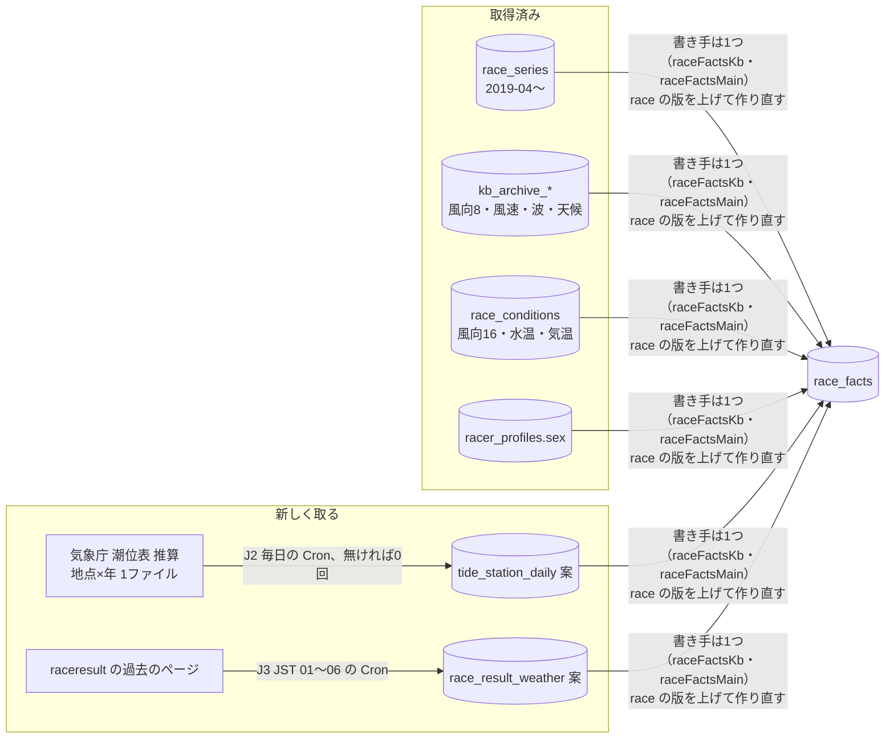

# 軸の切り替えに要るデータの欠けと、取得の設計（レーン J）

> 設計の案（2026-11-28）。DB の変更は [db-draft.md](./db-draft.md)（未審査の案）。本番の読み取りは §4 の SELECT（オーナーか窓口が流す。作り手は本番に繋がない）。審査の記録は §7（system-architect「直してから進める」→ 反映済み）。
> 前提の設計: [past-data-backfill/plan.md](../past-data-backfill/plan.md)（facts の表 race_facts・run_facts、ADR-0113。マイグレーション 212・213 は本番に適用済み）

## 1. 目的と、言われた案が最短か

- 目的: レーン I（軸の切り替えの画面）が、全ての指標をグレード（SG〜一般）・種別（女子戦等）・条件（風・波・天候・水温・潮位）で絞れるように、facts の表のその列を両方の era（kb 2019-04〜2025-12-02・main 2025-12-03〜）で埋める
- 最短か: 欠けの多くは「取りに行く」物ではなく、**facts の書き手が今ある列を読んでいない**物（kb の種別・グレード、両 era の風向の区分）。新しく取るのは潮位と、kb の期間の水温・気温だけ。取りに行く前に書き手を直すのが最短（§3 の段 J1a）
- 同じ原因で直す物: 本体の 2025-12-03〜2026-09-18 は条件が発走前の値で、条件の軸から外れる（past-data-backfill §7）。同じ raceresult の取り直しで埋まるので、kb の水温と同じ仕組みで扱う（段 J3）

## 2. 欠けの表

今のコードで確かめたこと（2026-11-28、origin/master 736a16c45）。値が実際に入っているかは本番の読み取り（§4）で確かめる。

| 軸 | 今の表と列 | facts の今（書き手） | 出所 | facts へ載せる形 | 段 |
|---|---|---|---|---|---|
| グレード | main: `races.race_grade`（約77%）・`race_series.grade`。kb: `kb_archive_venue_days.race_grade`（phase-m は全件 NULL、kb-longterm-backfill は投入済みと書き食い違う。Q1） | main は 補正→races→race_series→class_code（raceFactsMain.js:41）。**kb は補正→venue_days だけ**（raceFactsKbJob.js:32）で race_series を見ない | 月間スケジュール（race_series、2019-04〜 取得済み・毎月の Cron あり） | kb も main と同じ順。月間スケジュールは QC と QC シリーズ・CC とレディース CC を1つの節にまとめるので、特別な節の補正（`SPECIAL_SERIES_RULES`、scripts/lib/racerCareerSeries.js:29）を先に当てる（kb の CLI は loadJudgeInputs で既に渡している） | J1a |
| 種別（節） | `race_series.kind`（sg・g1・g2・g3・ippan・lady・venus・rookie・masters）。2019-04〜 | main は埋まる（raceFactsMain.js:59）。**kb は常に NULL**（raceFactsKbJob.js:34 `seriesKind: null`）。特別な節の補正はグレードだけを直し、QC シリーズ・レディース CC の種別は 'g1'・'sg' のまま（両 era、既存の問題） | 同上（取得済み） | kb も `race_series.kind` を節で照合。補正に種別も持たせ両 era に効かせる | J1a |
| 種別（レース単位の女子戦） | 列なし。男女W優勝戦等の節の中の女子だけのレースは、種別の文字にも K/B にも印が無い時期がある（§5） | なし | `racer_profiles.sex`（fan 由来、今の選手だけ） | 新しい列 `field_gender`（db-draft §2）。6艇の性別から書き手が決める | J1b（DB の変更・Q8・オーナーの答えの後） |
| 風向 | main: `race_conditions.wind_direction`（16、**中身は画面の矢印の番号**、preregistration 1.1）。kb: `kb_archive_races.wind_direction`（K の8方位） | **両方の era で NULL**（raceFactsMain.js:123・raceFactsKb.js:94） | 取得済み | 検証済みの扇形 × 風速の5区分（`tail_strong`・`tail`・`calm_cross`・`head`・`head_strong`、weather-in-escape preregistration 3.1） | J1a |
| 風速・波・天候 | main: `race_conditions`。kb: `kb_archive_races`（K、発走時点） | 埋まる。main の条件の出所は `condition_source`（race_result／before_race） | 取得済み | 今のまま。2025-12-03〜2026-09-18 の before_race は J3 で結果のページの値を足す | J3 |
| 気温・水温 | main: `race_conditions.temperature`・`water_temperature`。kb: **列なし**（K に無い） | main は埋まる（時点は condition_source と同じ混ざり）。kb は NULL（raceFactsKb.js:96） | 公式の結果のページ（raceresult）の水面気象。過去は 2019-04-15 まで確かめ済み（past-data-backfill §4） | 新しい表 `race_result_weather`（両 era、db-draft §3）→ 書き手が読む | J3（V0・V1 の後） |
| 潮位 | **どこにも無い**（boatrace.jp・K/B・DB）。干満差の有無だけ `src/data/venueWaterProfiles.js`（12会場） | 両方の era で NULL | 気象庁の潮位表（推算）。§5 | 新しい表 `tide_station_daily`（地点×日、db-draft §1）→ 書き手が締切の時刻の潮位と上げ・下げを引く | J2（検証の後） |

- 走ごとの記録（選手ページの `getRacerRaceHistory`、src/services/racerQueries2.js:294）には今、グレード（races だけ）・天候・風速・波高しか無く、風向・水温・種別は無い。facts の `get_racer_runs` はレースの列を全部返す（`to_jsonb(f)`）ので、画面が facts に移れば（past-data-backfill §11 の3）走ごとにも付く。run_facts に条件の列を足す必要は無い
- 欠けとして数えない物: 進入・ST・着（両 era にある）。オリジナル展示・チルト（past-data-backfill §4 の段1・段3、軸でなく指標）

## 3. 取得の設計



段と順序:

| 段 | 中身 | DB の変更 | 取得 | 待つ物 |
|---|---|---|---|---|
| J1a | kb の種別・グレード、両 era の風向の区分、補正に種別 | なし | なし | Q1・Q2（節の当て方を決める） |
| J1b | 女子戦 `field_gender` | 列の追加 | なし | Q8・オーナーの3 |
| J2 | 潮位 | 表の追加 | 気象庁 99回 | 手元の検証・オーナーの1・2 |
| J3 | kb の水温・気温、main の前半の条件 | 表の追加 | raceresult（夜間） | V0・V1・ADR-0101 の追記・data-scientist・オーナーの4 |

### 3.1 段 J1a: 書き手を直す（DB の変更なし、取得なし）

- **節の当て方を1つにする**: main の `seriesFinder`（raceFactsMainJob.js:101、同じ日に2節あれば始まりの遅い方）を kb からも呼ぶ。kb の窓で race_series を読むときは main と同じく、窓に期間が重なる節（`start_date <= 窓の終わり AND end_date >= 窓の始まり`）を読む。2節に当たる日を「遅い方」にするか NULL にするかは Q2 の数で1つに決め、両 era に同じ規則を当てる（今は main だけ遅い方）
- グレードは main と同じ順（補正 → venue_days.race_grade → race_series.grade → class_code の読み替え）。`mainGradeOf` を kb からも呼ぶ（同じ規則を2か所に書かない）
- 特別な節の補正（`SPECIAL_SERIES_RULES`）に種別も持たせる（QC シリーズ → g3、レディース CC → g2 等。値は racerCareerSeries.js の規則に合わせて決める）。両 era の書き手が同じ補正を読む
- 風向の区分: 純関数 `windSectorOf({ era, venueCode, direction, speed, conditionSource })` を `src/pure/` に置く
  - main: 矢印の番号 `r`（WIND_DIRECTIONS の位置）をそのまま使う
  - kb: K の方位名 → 16方位の番号 `k`（北=0、時計回り、北東=2…。K は偶数だけ）→ `r = (k + offset_v) mod 16`、`offset_v` は VENUE_WIND_OFFSET（preregistration 1.1 の式そのまま、analyze-weather-in-escape.js:113 `tailwindAngle`）
  - `φ = (r − 4) × 22.5°` を −180〜180 に直し、preregistration 3.1 の5区分
  - 風速なし → NULL、風速1m以下か無風 → `calm_cross`、風速2m以上で向きが分からない → NULL。**condition_source が NULL なら必ず NULL**（212 の CHECK に当たり、その窓のバルク upsert が丸ごと落ちる）
  - 今の `windRelation`（src/utils、凍結）と `windBin`（分析の台本）が同じ答えを返すことを verify で照らす（置き換えは範囲の外）
- **8方位と16方位の違い**: offset が奇数の10会場では、kb の行は ±135° に入れない（weather-in-escape results §3.1）。同じ語彙で era によって中身が違うので、ADR-0113 に追記する（V2 までは条件の軸で era をまたがない。月ごとの件数の表も era の別で持つ）。V2（past-data-backfill §9）で決め直す
- **版を表ごとに分ける**: 今は `RACE_FACTS_RULE_VERSION`（raceFactsKb.js:18）が race と run の両方の payload に入り、`upsertChangedRows` は変わった行を全列で書く（built_at だけ比べから外す、raceFactsWrite.js:22）。このまま上げると J1a は race の列しか変えないのに kb の run_facts の全行（約221万艇）も書き直す。`RACE_FACTS_RULE_VERSION` と `RUN_FACTS_RULE_VERSION` に分け、J1a では race の版だけ上げる
- 作り直し: kb 層は CLI（race-facts-backfill.js --era=kb、オーナー）、main は毎晩の起動が古い月を順に回す（`race_facts_main` が live であることを §4 の Q9 で確かめる）
- **今夜の kb の投入は待たなくてよい**。J1a の作り直しで race_facts の kb の行だけをもう1回書く。ADR-0113 決定4 の `CLUSTER run_facts` は J1a の作り直しの後に回す（版を分ければ run_facts は書き直さないが、分ける前に作り直すなら並びが崩れる）
- 試験: verify-race-facts-kb-rows.js:69 は `RACE_FACTS_RULE_VERSION === 2` を、:76 と verify-race-facts-main-rows.js:28 は列のキーの完全一致を見ている。新しいファイルに分けても同じ定数を読むので逃げ道にならない。**既存の verify を値の入った期待へ置き換え、guard-weakening の変異検査を通す**（AGENTS.md 安全の6点 4 の例外）。通らなければ止めて窓口へ返す

### 3.2 段 J1b: 女子戦（列の追加の後）

- `field_gender`: 出走した艇（欠場を除く）の `racer_profiles.sex` が全員2なら `female`、全員1なら `male`、混ざれば `mixed`、1艇でも分からなければ NULL
- 種別の軸の「女子戦」は `series_kind IN ('lady','venus')` か `field_gender='female'` を画面の登録簿が決める
- 性別の出所が kb の期間に足りない見込み: `racer_profiles.sex` は fan の最新の期で既にある行だけを更新し（fanPeriodRows.js:202-208・racerProfileSync.js:265）、行を作らない。racer_period_stats に sex は無い。kb の期間に引退した選手は NULL のまま。Q8 でレースの単位の欠けを測り、大きければ fan の過去の期から性別だけを持つ小さな出所を別に設計する（その時に DB の変更が要るかを決める）
- 書き手が racer_profiles を読むときは `fetchAll` に `order(racer_id)` を付け（1000行を超える）、読みに失敗したら throw する（NULL で続けない）。sex を後から埋めても kb の facts は CLI を回すまで直らないので、kb-backfill と同じく案内を出す
- 順序: マイグレーションを当て、それが定時の配備より先に入ってから書き手の PR（列を足すだけの変更）。`RACE_FACT_COLUMNS` は kb と main で共有なので両方の書き手が同時に変わる

### 3.3 段 J2: 潮位（検証の後に作る）

- 出所の確かめは §5（official-data-spec 2026-11-28）
- 取得: 共通のラッパの Cron `tide_table`（ADR-0066）。fan_period（registry.js:323）と同じ形で、**毎日起動し、取っていない「地点×年」（2019〜翌年）があれば1起動で数ファイルを取る。無ければ0リクエスト**。99ファイルを毎日11件ずつに分けて取れ、過去分の CLI が要らない。翌年の推算が公開されれば自然に取る（公開の時期は未確認）。hosts は `www.data.jma.go.jp`
- 送信元: 気象庁は boatrace.jp でないので ADR-0101 の予算の外。定時の取得は ADR-0066 の Cron。**検証のための手元の取得は可**（取得は99ファイル、DB に入れない）。気象庁の robots.txt は実装の前に1回確かめる（未確認）
- 進み: `backfill_progress` の source='jma_tide'、`unit_id='2019-01-01|TK'`・`target_date='2019-01-01'`（212:202 の CHECK が unit_id の先頭10文字と target_date の一致を求める）。365か366行でないファイルは error（0件の書き込みを成功にしない）
- 保存: 1地点×1日を1行（24時の毎時の値の配列と満潮・干潮）。毎時の行（past-data-backfill db-draft §4 の `venue_tide_hourly`）より行が24分の1で、気象庁のファイルの1行と1対1。書き手が半月の窓で読むのは 11地点×16日 ≒ 176行（db-draft §1）
- facts へ: 書き手がレースの締切の時刻（`deadline_time`）の前後の毎時の値を直線で補い `tide_cm`、満潮・干潮の時刻から `tide_phase`（`rising`・`falling`。満潮・干潮の前後30分は `high`・`low`、目安（根拠なし）で検証で決める）。干満差の無い12会場は `tide_phase='none'`・`tide_cm` NULL（212 の COMMENT と同じ）
- 潮位の基準は地点ごとの潮位表基準面で、地点の間で比べられない（実測とも東京で約80cm ずれる）。軸に使うのは会場の中の3分位と位相だけにし、cm の値を会場をまたいで並べない
- 鳴門（小松島 20km）・若松（砂津 11km、洞海湾の外）・大村（長崎 20km、大村湾の外）は別の水域の地点で代える。この3会場は検証で他と分けて見て、通らなければ `tide_phase` を NULL にする（`none` は干満差の無い会場の印なので使わない）
- 作る前の検証（past-data-backfill §5、data-scientist）: 推算の表を kb の 2019-04〜2025-12 に当て、会場ごとに潮位の3分位・位相で1コース1着率・まくりの割合を比べる。前後の期間とも同じ向きで 2pt 以上の会場だけを軸に出す。**表を作る前に、ファイルを手元に落として分析の台本で行う**。通らなければ J2 の DB の変更はしない

### 3.4 段 J3: kb の水温・気温と、本体の前半の条件

- 出所: raceresult の過去のページ（1レース1リクエスト）。past-data-backfill §4 の段2 と同じ物
- 対象と量（どちらも未検証の見積り）:
  - kb: 2019-04〜2025-12-02、約37万レース（約221万艇÷6）。全部は取らない。V1（水温の効き目）が通ったら、1〜2年分（約5.5万〜11万）から
  - main の前半: 2025-12-03〜2026-09-18 の `condition_source='before_race'` のレース（約4万、Q5 で数える）。条件の軸の母数が9か月分増える
- **時間帯は JST 01:00〜06:00**。本番の結果の取得 `/api/cron/result` は JST 07:00〜00:59 の毎分、`result-catchup` は 23:50・00:30 に同じ raceresult のパスを取り（vercel.json）、間隔の制御はプロセスごとにしか効かないので重ねない
- **止め方は J3 の前に ADR-0101 へ追記する**。今の追記（2026-11-27）は boatrace.jp の段2 の止め方を「この追記では決めない」としている。決めるのは、ブレーカーのキーを分けるか（ジョブの中で 403 を見て自分を off にするか）と、raceresult の1晩の上限（目安なら根拠なしと書く）。取得の増加は ADR-0067 のオーナーの承認
- **書く先は race_conditions でなく新しい表 `race_result_weather`**（db-draft §3、両 era、1レース1行）。race_conditions に結果のページの値で上書きすると、学習のデータ（scripts/ml/export-training-data.js:202 は condition_source を見ずに race_conditions の風・波・水温を出す）に発走の後の値が入る期間が広がる。推論は発走前の値を使うので、AGENTS.md の落とし穴「そのレースの時点で分からない値を事前の判定に使わない」に当たる
  - kb_archive_extra（212）は CHECK `race_date <= '2025-12-02'` があり main の期間に使えない。kb と main で出所も列も同じなので、表を1つにする。kb_archive_extra の source='raceresult' の列（temperature・water_temperature・wind_direction16）は使わない（db-draft §3 に食い違いとして残す）
  - data-scientist に「学習と推論の値のずれを許せるか」を確かめ、許せるとなっても書く先は変えない（facts の書き手が読む所を1つにするため）
- facts へ: 書き手は `race_result_weather` の行があればそれを条件の列に使い `condition_source='race_result'`、無ければ今の出所（K・race_conditions）
- 取る前の確かめ V0（past-data-backfill §4）: 過去の raceresult が当時の値か。本体の 2026-09-19 以降（結果のページの値が入っている）から約300レースを取り直し、列ごとの一致率を出す。合わない列は取らない
- kb の16方位の風向は、`wind_sector` を K の8方位より細かく直せる（V2）。V2 の後に書き手が16方位を優先するかを決める

## 4. 本番の読み取り（オーナーか窓口が流す。全部 SELECT だけ）

- **1回に1文で流す**。SQL Editor は最後の文の結果しか出さないので、`BEGIN READ ONLY; … ROLLBACK;` で包むと何も出ない（db-operations.md:18）
- Q1〜Q7・Q9 は軽い見込み（未実測）なので、窓口が claude_ro（ro-query.js、READ ONLY・30秒）で流せる。Q8 は約250万艇の結合で30秒の上限に近い（未実測）ので、オーナーの SQL Editor で
- 結果は数字だけを共有のメモへ（repo は公開。実数の扱いは AGENTS.md の決まり）

```sql
-- Q1 kb のグレードの埋まり（年ごと）。phase-m と kb-longterm-backfill の食い違いを決める
SELECT extract(year FROM race_date)::int AS y, count(*) AS days, count(race_grade) AS graded
  FROM kb_archive_venue_days GROUP BY 1 ORDER BY 1;

-- Q2a race_series の範囲
SELECT min(start_date), max(end_date), count(*), count(*) FILTER (WHERE grade IS NULL) AS grade_null FROM race_series;
-- Q2b 種別の内訳
SELECT kind, count(*) FROM race_series GROUP BY 1 ORDER BY 2 DESC;
-- Q2c kb の開催日に節が当たらない（0）・2つ当たる（2）日の数
SELECT hits, count(*) FROM (
  SELECT d.venue_day_id, count(s.start_date) AS hits
    FROM kb_archive_venue_days d
    LEFT JOIN race_series s ON s.venue_code = d.venue_code AND d.race_date BETWEEN s.start_date AND s.end_date
   GROUP BY 1) t GROUP BY 1 ORDER BY 1;
-- Q2d main の開催日の同じ数
SELECT hits, count(*) FROM (
  SELECT r.race_date, r.venue_code, count(DISTINCT s.start_date) AS hits
    FROM races r
    LEFT JOIN race_series s ON s.venue_code = r.venue_code AND r.race_date BETWEEN s.start_date AND s.end_date
   GROUP BY 1, 2) t GROUP BY 1 ORDER BY 1;

-- Q3 main で races.race_grade と race_series.grade が食い違う数（2節に当たる日は行が倍に数わる）
SELECT r.race_grade, s.grade, s.class_code, count(*)
  FROM races r JOIN race_series s ON s.venue_code = r.venue_code AND r.race_date BETWEEN s.start_date AND s.end_date
 WHERE r.race_grade IS NOT NULL GROUP BY 1, 2, 3 ORDER BY 4 DESC;

-- Q4a kb の風向の値の種類（8方位＋無風か）
SELECT wind_direction, count(*) FROM kb_archive_races GROUP BY 1 ORDER BY 2 DESC;
-- Q4b main の風向の値の種類（16方位の名か）
SELECT wind_direction, count(*) FROM race_conditions GROUP BY 1 ORDER BY 2 DESC;

-- Q5 main の条件の埋まりと時点（月ごと）。J3 の main の前半の対象の数
SELECT date_trunc('month', r.race_date)::date AS m, count(*) AS races,
       count(c.race_id) AS has_row, count(c.wind_direction) AS wind_dir, count(c.water_temperature) AS water_t,
       count(c.temperature) AS air_t, count(c.weather_observed_at) AS observed,
       count(*) FILTER (WHERE c.weather_observed_at >= (r.race_date + r.start_time) AT TIME ZONE 'Asia/Tokyo') AS race_time
  FROM races r LEFT JOIN race_conditions c ON c.race_id = r.race_id
 GROUP BY 1 ORDER BY 1;

-- Q6 facts の今の埋まり（era・版ごと）。J1a の前後と作り直しの途中で同じ SELECT を流して比べる
-- （field_gender は J1b の列の追加の後に count(field_gender) を足す）
SELECT era, rule_version, count(*) AS races, count(race_grade) AS grade, count(series_kind) AS kind,
       count(wind_sector) AS sector, count(water_temperature) AS water_t, count(tide_phase) AS tide,
       count(condition_source) AS cond, count(*) FILTER (WHERE condition_source = 'race_result') AS cond_race_time
  FROM race_facts GROUP BY 1, 2 ORDER BY 1, 2;

-- Q7a 容量（J2・J3 の前）
SELECT pg_size_pretty(pg_database_size(current_database()));
-- Q7b 関係する表の大きさ
SELECT relname, pg_size_pretty(pg_total_relation_size(oid)) FROM pg_class
 WHERE relname IN ('race_facts', 'run_facts', 'kb_archive_extra', 'race_conditions', 'kb_archive_races', 'race_series')
 ORDER BY pg_total_relation_size(oid) DESC;

-- Q8a 女子戦の判定に要る性別の欠け（kb、レースの単位。1艇でも欠ければ NULL になるレースの割合）
SELECT left(race_id, 4) AS y, count(*) AS races,
       count(*) FILTER (WHERE n_known = n) AS all_known,
       count(*) FILTER (WHERE n_female = n) AS all_female
  FROM (SELECT k.race_id, count(*) AS n, count(p.sex) AS n_known, count(*) FILTER (WHERE p.sex = 2) AS n_female
          FROM kb_archive_boats k LEFT JOIN racer_profiles p USING (racer_id) GROUP BY 1) t
 GROUP BY 1 ORDER BY 1;
-- Q8b main の同じ数
SELECT left(race_id, 4) AS y, count(*) AS races,
       count(*) FILTER (WHERE n_known = n) AS all_known,
       count(*) FILTER (WHERE n_female = n) AS all_female
  FROM (SELECT e.race_id, count(*) AS n, count(p.sex) AS n_known, count(*) FILTER (WHERE p.sex = 2) AS n_female
          FROM race_entries e LEFT JOIN racer_profiles p USING (racer_id) GROUP BY 1) t
 GROUP BY 1 ORDER BY 1;

-- Q9 main の Cron が live か（live でなければ J1a の作り直しは main の行に届かない）
SELECT job, mode, cursor, last_success_at FROM scrape_job_state WHERE job = 'race_facts_main';
```

## 5. 出所の確かめ（official-data-spec 2026-11-28）

実リクエストは気象庁 14回・利用規約 1回・boatrace.jp 4回（間隔3秒以上）。「確かめた」は実物を取った物、それ以外は文書・コードから読んだ物。

| 項目 | 出所と URL の形 | 最古 | 単位と量 | 条件 | 確かめ |
|---|---|---|---|---|---|
| 潮位（推算） | 気象庁 潮位表のテキスト `https://www.data.jma.go.jp/kaiyou/data/db/tide/suisan/txt/{YYYY}/{地点記号}.txt` | 2011（2010 は 404） | 1地点×1年＝365行×136桁（約50KB）。2019〜2027 の11地点で99回 | 公共データ利用規約（第1.0版）。出典「出典：気象庁ホームページ（URL）」、加工した旨を書く。商用・転載の本文は未確認 | 確かめた（TK・CF・KM・N0 の 2019、NS の 2011 が 200。書式は readme.html） |
| 潮位（実測） | 気象庁 潮汐観測資料（HTML の表、1地点×1月） | 1997 | 7地点しか会場の近くに無い（宮島・徳山・若松・福岡は無し）、約588回 | 同上 | 確かめた（東京 2019-04）。**推算を使う** |
| 種別（レース単位） | 種別の文字・K/B に女子の印が無い時期がある（2019-08-02 若松 12R は6人全員女子で種別は「優勝戦」だけ。2026 の racelist には「予選女子」）。6艇の `racer_profiles.sex` で決める | — | 取得なし | — | 確かめた（racelist と K190802・B190802） |
| グレード | 月間スケジュールの節の格。QC と QC シリーズ（2024-12 蒲郡、G1 の1節）・CC とレディース CC（2024-11 下関、SG の1節）が1つの節にまとまる | 2019-04 | 取得済み | `SPECIAL_SERIES_RULES` を必ず通す。SG・G1 の節の中の一般戦の扱いは未照合 | 確かめた（monthlyschedule 2024-11・2024-12） |
| 風向 | K は8方位＋無風。raceresult は16方位（`is-wind1`〜`16`、17 は無風）で中身は画面の矢印の向き | K 2019-04、raceresult 2019-04-15 | — | — | K は実物（K190415・K260930・2020-02 の解析済み）、raceresult はコードから |
| 水温・気温 | K に無い（見出し行は天候・風向・風速・波だけ、kbFileParserK.js:24） | — | — | — | 確かめた（生データ2日分） |

潮位表の書式（readme.html）: 1〜72桁が毎時（0〜23時）の3桁 cm、73〜78桁が年月日、79〜80桁が地点記号、81〜108桁が満潮の時刻（4桁）と潮位（3桁）×4、109〜136桁が干潮の同じ形×4。予測されない回は 9999／999。

会場と推算の地点（直線の距離の目安、地点の座標は気象庁の station2027、会場は src/data/venueGuidesEn.js）:

| 会場 | 地点 | 会場 | 地点 |
|---|---|---|---|
| 江戸川 | TK 東京（10km） | 宮島 | Q8 広島（15km） |
| 平和島 | TK 東京（8km） | 徳山 | QA 徳山（4km） |
| 浜名湖 | MI 舞阪（4km） | 下関 | CF 長府（0km） |
| 鳴門 | KM 小松島（20km、代用） | 若松 | N0 砂津（11km、洞海湾の外、代用） |
| 丸亀 | TX 多度津（5km） | 福岡 | QF 博多（2km） |
| 児島 | J8 与島（7km） | 大村 | NS 長崎（20km、大村湾の外、代用） |

- past-data-backfill §5 の「鳴門・丸亀・宮島・若松・大村が地点に無い疑い」は、丸亀・宮島は外れた。「約200回」は 2019〜2027 なら99回
- 地点の対応は src/data に出典つきの定数で置く（取得のハンドラーと書き手の両方が読む）。2018 年以前の地点の一覧が今と同じかは未確認（取るのは 2019 以降）

## 6. オーナーに聞くこと

推奨つき。費用は増えない見込み（容量は表2枚で数十MB の見込み、未実測。Vercel の crons の行が2つ増え、今は82行。上限は未確認）。

1. **潮位を作るか**（J2）: 推奨は「検証（手元の台本、DB に入れない）を先に回し、通った会場だけ表を作る」。気象庁への取得は99回で、boatrace.jp の予算（ADR-0101）の外。利用の条件は出典の表示と加工の明記。公開する画面に「出典：気象庁ホームページ」と加工の旨を書いてよいか（公開方針）
2. **代用の地点の3会場**（鳴門・若松・大村）: 推奨は「検証で他と分けて見て、通らなければ潮位を出さない」
3. **女子戦の判定に選手の性別を使うか**（J1b、列の追加）: 推奨は「使う」（公式の印が無い時期がある）。性別が欠けた選手のいるレースは判定しない（NULL）。欠けが大きければ fan の過去の期で足す設計を別に出す（Q8 の後）
4. **main の前半（2025-12-03〜2026-09-18）と kb の条件を raceresult で取り直すか**（J3、main 約4万・kb は V1 の後に1〜2年分、JST 01〜06）: 推奨は「V0 が通り、ADR-0101 に止め方を追記してから取る」。条件の軸の母数が9か月分増える。ADR-0067 の取得の増加の承認が要る

聞かずに進めてよい物: J1a（書き手の直し。DB の変更も取得も無い。承認済みの facts の設計の範囲）

## 7. 審査の記録

- system-architect（2026-11-28）: 直してから進める。全部を反映した
  - P1: 版が race と run で同じで run_facts の全行を書き直す → 版を表ごとに（§3.1）／unit_id が 212 の CHECK に落ちる → `YYYY-MM-DD|地点`（§3.3）／J3 の時間帯が本番の結果の取得と重なる → JST 01〜06（§3.4）／boatrace.jp の段2 の止め方が ADR-0101 で未決 → J3 の前に追記（§3.4）／race_conditions の上書きで学習に発走の後の値が入る → 新しい表 race_result_weather（§3.4・db-draft §3）
  - P2: 節の当て方が kb と main で違う → seriesFinder を1つに（§3.1）／補正が種別を直さない → 補正に種別（§3.1）／CHECK を列の追加の文に書くと全行を読む・NOT VALID と VALIDATE を同じトランザクションに置く意味が無い → db-draft §2・§4／field_gender を「DB の変更なし」に入れていた → J1a・J1b に分けた／性別の出所が kb に足りない → §3.2・Q8 をレースの単位に／wind_sector の era の違いを ADR に → §3.1／既存の verify は guard-weakening だけが道 → §3.1／潮位の送信元の書き方の食い違いと年1回の Cron の欄が無い → fan_period の形（§3.3）／SQL Editor で包むと何も出ない → §4
  - P3: hourly_cm の次元・下限、time[] の返り値の形、戻しの順、claude_ro の読み、ER 図、kb のレース数、K の方位の番号の式 → db-draft・§3.1・§3.4
- 残る未確定: data-scientist（学習と推論のずれ、潮位の検証の設計）、Q1〜Q9 の結果、気象庁の robots.txt と利用規約の本文

## 8. 食い違い（この設計では直さない）

- docs/knowledge/data-definitions.md:74 は「K ファイルは16方位単位」と書きつつ同じ行で「8方位の K ファイル」とも書く。実物は8方位（official-data-spec 2026-11-28）
- past-data-backfill §5 の地点の疑い・約200回（§5 の注記）
- kb_archive_extra（212）の source='raceresult' のレースの行の気象の列は、J3 では使わない（race_result_weather に移す）。past-data-backfill db-draft §3 と食い違う
- 2026-09-19 以降の race_conditions は結果のページの値で上書きされ（raceResultPersist.js:230）、学習のデータに発走の後の値が入っている（既存。scripts/ml/export-training-data.js:202）
- 特別な節の補正が種別を直さないのは main の書き手でも既に起きている
