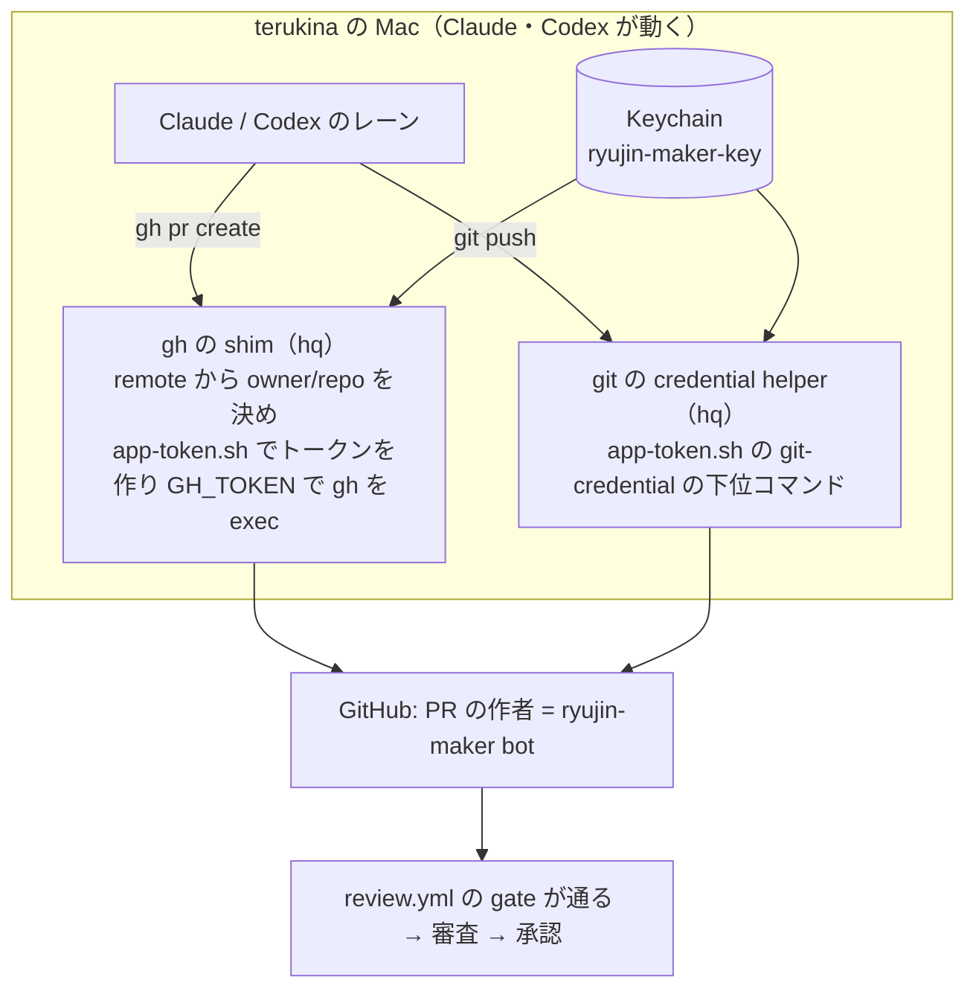
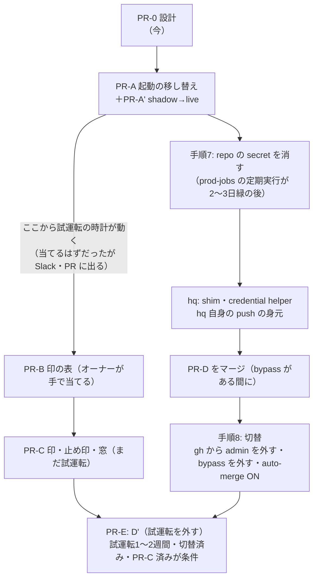

# 自動の適用の仕上げ（ADR-0097 の段取り D → D' と切替）

[ADR-0097](../../adr/0097-identity-separation-auto-review-and-db-apply.md) の「レーンの PR → 審査の App の承認 → db-apply の定期の起動が軽い SQL を当てる」経路を、実際に動く形にする設計。ADR-0097 の決定（身元・審査・当てる対象の5点・軽い／重いの判定）は変えない。変えるのは、起動の出元・PR を作る身元の配線・D' の前に要る3点・その順番。

オーナーの手順の正本は [identity-separation-owner-steps.md](../../operation/identity-separation-owner-steps.md)、適用の手順の正本は [db-apply.md](../../operation/db-apply.md)。この文書は、それらへの変更の設計を1か所にまとめたもの。実装は、オーナーの判断の後に PR を分けて行う（§5）。

## 1. 今、動いていない理由（2026-10-20 15:30 JST の実測）

| # | 何が | 実測 | 出典 |
|---|---|---|---|
| 1 | 毎時の起動が来ない | `db-apply.yml` の schedule（`17 * * * *`）は #1674（2026-10-20 01:41Z に master）から 06:32Z までに起動0回（期待5回）。run は workflow_dispatch の2件だけ | `gh run list --workflow db-apply.yml` |
| 1' | 同じ現象はリポジトリ全体 | 直近24時間の schedule の起動: Scrape Scheduled（`*/10`、約16時間ぶん＝約96回の期待）が4回。key-canary（`7,37 * * * *`、02:19Z に master）は0回 | `gh run list --event schedule`、`--workflow key-canary.yml` |
| 2 | 審査が動かない | review.yml の直近15件が全部 `skipped`。gate の条件 `github.event.pull_request.user.id == vars.REVIEW_MAKER_BOT_ID` に、rhapsody0919 名義の PR が当たらない | `gh run list --workflow review.yml`、review.yml の gate の `if` |
| 2' | 作成の App の道具はある | hq の `scripts/app-token.sh`（Keychain の秘密鍵から1時間のインストールのトークン、`gh`・`push` の下位コマンドつき）。App ID は hq の `config/github-apps.json`。龍神の .claude・AGENTS.md・scripts からは呼ばれていない | 読み取りで確認 |
| 2'' | 手順7・8 は未了 | repo の secret に `SUPABASE_SERVICE_KEY` 等8つが残っている。Claude の `gh` は rhapsody0919（keyring、scope `repo`・`workflow`） | `gh api .../actions/secrets`、`gh auth status` |
| 3 | 試運転のまま | `DB_APPLY_DRY_RUN: "true"`（db-apply.yml の env）。D' は切替の後（ADR-0097「試運転」） | db-apply.yml |

補足:
- 段取り S（鍵を使う job に `environment: prod-jobs`）は済んでいる。repo の secret の8つを参照する workflow で `environment:` を持たないものは0本（grep で確認）
- 1 の結果、試運転の「当てるはずだった」の通知も一度も出ていない。ADR-0097 の「試運転1〜2週間」は、まだ始まっていない

## 2. (a) 起動を Vercel Cron からの dispatch に移す

### 形


### 変えるもの

| 場所 | 変更 |
|---|---|
| `.github/workflows/db-apply.yml` の `on.workflow_dispatch.inputs` | `mode`（choice: `manual`・`reconcile`、既定 `manual`）を足す。`migration` は `required: false` にする（reconcile では空） |
| 同 `inspect` の `if` | `github.event_name == 'workflow_dispatch' && inputs.mode != 'reconcile'`。`migration` が空なら `db-apply.js inspect` のパスの検証で落ちる（今と同じ） |
| 同 `reconcile` の `if` | `github.event_name == 'schedule' \|\| (github.event_name == 'workflow_dispatch' && inputs.mode == 'reconcile')`。ほかの条件（repository・`REVIEWER_BOT_USER_ID`）はそのまま |
| 同 `reconcile` の最初の step | `mode=reconcile` で `migration` が空でなければ落とす（どちらの意図か曖昧な起動を通さない） |
| 同 `notify` の `if` | `github.event_name == 'schedule'` を reconcile と同じ式に置き換える |
| `scripts/lib/analogyDispatch.js` の `DISPATCH_WORKFLOWS` | `db_apply_reconcile: { workflow: "db-apply.yml", inputs: { mode: "reconcile" } }` を足す。起動の関数・失敗の扱いは今のものを使う（新しい関数を作らない） |
| `api/cron/db-apply-dispatch.js`（新） | `createScrapeCronHandler({ job: "db_apply_dispatch", run: createAnalogyDispatchRun("db_apply_reconcile"), modeGated: true })`。in-caution-dispatch.js と同じ形 |
| `scripts/lib/scrapeJobs/registry.js` | `db_apply_dispatch: { kind: "monitor", leaseSec: 60, maxDurationSec: 60, hosts: [], failureAlertAfter: 1 }` |
| `vercel.json` | `{ "path": "/api/cron/db-apply-dispatch", "schedule": "17 * * * *" }`（UTC。JST も毎時17分）。登録は今63本で、上限100本（ADR-0066） |
| `scrape_job_state` | `('db_apply_dispatch', 'shadow')` の1行（オーナーが SQL を当てる。shadow で1日見てから `live`） |
| `scripts/maintenance/verify-analogy-dispatch.js` | 新しい対象の配線（registry・api の job 名・inputs のキーが workflow の inputs にあること）を足す |

- schedule は残す。来たときも同じ reconcile が動くだけで、二重に当てることは無い: reconcile は db-apply の他の run が `in_progress`・`queued`・`waiting` 等なら何もしない（`isBusy`、自分の run は除く）。2本が同時に始まると、互いを busy と見て両方とも何もしない（その回は飛ぶだけ）
- Vercel Cron の重複配信（まれ）も同じ理由で無害
- Vercel Cron は「リトライ無し・best-effort」。1回抜けても次の時間に拾う（突き合わせなので、抜けた回の分は残らない）

### トークン

- 今の Vercel の環境変数 `GITHUB_ACTIONS_DISPATCH_TOKEN` をそのまま使う。fine-grained PAT、boatrace-ai-predictor だけ、Actions: Read and write だけ（[analogy-weekly-train-dispatch.md](../../operation/analogy-weekly-train-dispatch.md) 49行目）。新しい鍵は作らない
- **このトークンでできることは増えない**。今でも db-apply を dispatch できる（Actions: write はワークフローを選べない）。手での起動（mode=manual）は今までどおり production-db の承認で止まる。reconcile は、審査の App が承認した PR のファイルしか選ばない
- オーナーに確かめてもらうこと（値ではなく設定の画面）: この PAT に Actions 以外の書き込み、とくに **Deployments・Environments・Administration が付いていない**こと。PAT の持ち主は production-db の required reviewer（オーナー）なので、Deployments の書き込みが付いていると、この PAT で承認（pending_deployments）ができてしまう
- Vercel の環境変数を **Sensitive**（作った後は値を読めない）にしてもらう。Claude は Vercel CLI の認証に届く（hq の drafts/identity-separation §54）ので、Sensitive でないと値を読み出せる
- Actions: write の残る弱み（ADR-0097 の追記と同じ）: run の取り消し・ログの削除・workflow の無効化もできる。どれも「止める」側で、当てる側には効かない
- 期限切れ: 401 で dispatch が失敗し、`failureAlertAfter: 1` で1回目から Slack に出る（学習の起動と同じ）

### フック・規律との整合

- `.claude/hooks/guard-deploy-approval.sh` は変えない。Claude の Bash からの `gh workflow run`・`/dispatches`・`pending_deployments` は今までどおり止める。起動するのは Vercel の関数で、Claude ではない
- db-apply.md「Claude（AI）は起動・承認しない」の節に「定期の突き合わせ（mode=reconcile）は Vercel Cron が起動する。手での起動（mode=manual）はユーザー本人だけ」と1文足す
- Claude が `api/cron/db-apply-dispatch.js` を手で叩いて起動する経路: CRON_SECRET が要る（cronWrapper の認証）。Claude は .env.local 等から届きうるが、起動しても選ばれるのは審査済みのファイルだけ（上と同じ理由で、危険は増えない）

### 同じ問題を持つ他の workflow（別スコープ）

key-canary（30分ごと）・job-watch の見張りの前提の定期起動も schedule に頼っていて、key-canary は 10/20 に0回。ADR-0097 の追記の「鍵が直ったかはカナリアの成功で判定」が機能していない。別のチケットにする（§7）。

## 3. (b) レーンの PR と push を作成の App の名義にする

### 考え方

龍神の手順（スキル・AGENTS.md）は `gh` と `git push` を素で呼ぶままにして、**身元は環境の側で差し替える**。理由:
- create-pr・implement・orchestrate・Codex のレーンなど、`gh pr create`・`git push` を書いた場所が多い。各所に `app-token.sh gh ...` を書き込むと、書き漏れの所が rhapsody0919 のまま動き、審査が skipped になるだけで誰も気づかない
- 道具は Mac 全体の身元の道具で、hq の持ち物（hq の drafts/identity-separation §39）。龍神は「どの名義で動いているか」を検査するだけにする

### 形



### hq に頼むもの（龍神からは書き換えない）

1. `app-token.sh` に git の credential helper の下位コマンド（`get` に `username=x-access-token`・`password=<token>` を返す）。トークンはファイルに残さない
2. `gh` の shim（PATH の先頭に置く）。カレントの git の remote から `owner/repo` を決め、作成の App が入っているリポジトリならトークンを作って `GH_TOKEN` で本物の `gh` を exec する。入っていないリポジトリ（hq 等）は hq の決めた身元（hq の drafts §108: hq だけの App か deploy key）
3. 切替のときの片付け（§6 の手順8）

### 龍神の側で変えるもの（切替の PR、§5 の PR-D）

| 場所 | 今 | 変更 |
|---|---|---|
| `.claude/commands/merge-pr.md` 24行目 | `gh pr merge {pr} --squash --admin` | `gh pr merge {pr} --squash --auto`。切替の後は admin の bypass が無く、作成の App にも admin は無い。審査の承認と必須の check がそろったら GitHub がマージする |
| `.claude/skills/orchestrate/SKILL.md` 118・176行目 | 「名義は未決」「`--admin`」 | 作成の App の名義で `--auto`。段階0の自己マージは「auto-merge を付ける」意味になる |
| `.claude/commands/create-pr.md` | `git push -u origin HEAD`・`gh pr create` | 変えない。push・PR の前に「名義の確認」の1行（下の検査）を足す |
| AGENTS.md 47・123行目 | Codex はマージ・auto-merge をしない | 変えない（Codex の PR の auto-merge はオーケストレーターが付ける） |
| `scripts/maintenance/guard-pr-merge.js` | `--auto` は ruleset が3つの check を必須にしているときだけ GitHub に任せる | 変えない（既に対応） |
| 新: 名義の検査 `scripts/maintenance/check-gh-identity.js` | ― | `gh api /installation/repositories` が通る（＝インストールのトークン）ことと、`gh auth status` に rhapsody0919 が無いことを見る。create-pr の最初と session-start-check に入れる。rhapsody0919 なら止める（審査が skipped になるだけで気づけないため） |

- コミットの author（`git config user.*`）は変えなくてよい。審査の gate は PR の作成者（`pull_request.user.id`）を見る
- ラベル（`gh pr create --label`）が通らなければ作成の App に Issues: Read and write を足す（オーナーの手順6の5、既にある）
- 切替の後、`gh api user` はインストールのトークンでは通らない。龍神の scripts・.claude に使っている所は無い（grep で確認）

### 切替の前の暫定（入れない）

切替の前に、create-pr だけを `app-token.sh gh ...` に替えて審査を動かす案は採らない。Claude の gh が rhapsody0919 のままだと、作成の App の PR と admin の PR が混ざり、admin の名義で出た PR は審査されずに `--admin` でマージできる。名義を混ぜる期間を作らず、切替で一度に替える。

## 4. (c) D' の前に要る3点

### 4.1 当て直しの防止: DB の側の印

```sql
-- 新しいマイグレーション（重い。CREATE SCHEMA・REVOKE を含むので production-db、オーナーの1タップ）
CREATE SCHEMA db_apply;
REVOKE ALL ON SCHEMA db_apply FROM PUBLIC, anon, authenticated;
CREATE TABLE db_apply.applied (
  file        text PRIMARY KEY,            -- docs/db-migration/NNN_xxx.sql のファイル名
  sha256      text NOT NULL CHECK (sha256 ~ '^[0-9a-f]{64}$'),
  route       text NOT NULL CHECK (route IN ('manual', 'auto', 'gated')),
  run_id      bigint NOT NULL,             -- GitHub Actions の run
  applied_at  timestamptz NOT NULL DEFAULT now()
);
ALTER TABLE db_apply.applied ENABLE ROW LEVEL SECURITY;  -- policy は作らない（postgres のみ）
GRANT USAGE ON SCHEMA db_apply TO claude_ro;
GRANT SELECT ON db_apply.applied TO claude_ro;            -- 台帳とのずれを Claude が読むため
```

- スキーマ `db_apply` は PostgREST の公開スキーマに入れない（`public` でない。anon・authenticated の権限も外す）
- **印は適用と同じトランザクションで入れる**:
  - `single-transaction`（ファイルに BEGIN/COMMIT が無い）: psql の引数を `-c SET … -f <file> -c "INSERT INTO db_apply.applied …"` にする。`--single-transaction` の中なので、適用と印は一緒に入るか一緒に戻る
  - `file-transaction`（ファイル自身の BEGIN〜COMMIT）: 末尾の COMMIT の後に足すと別のトランザクションになる。解析器は既に文を分けている（`inspectMigration` の statements）ので、最後の COMMIT の直前に固定の INSERT を差し込んだ一時ファイルを作って流す。差し込むのは固定の雛形だけで、値（file・sha256・route・run_id）は psql の変数（`-v`）で渡し、`:'file'` で引用させる
  - 自動の経路（apply-auto）は `file-transaction` を判定で「重い」に回してもよい（軽い SQL に BEGIN/COMMIT は要らない）。そうすれば差し込みは承認つきの経路だけになる
- **主キーで二重を構造的に止める**: 2本の run が同じファイルを当てても、後の方は INSERT が一意制約で失敗し、ファイルの変更ごとロールバックする。busy の検査や台帳の読みの競合に頼らない
- 当てる前の確認（3つの経路の全部、`requireUnappliedOnMaster` の後）:
  - 行が無い → 当てる
  - 行があり sha256 が同じ → **当てずに record だけ進める**（当てた後の record の失敗からの自己回復。台帳を「適用済み」にする）。apply の job は成功で終わり、出力 `already_applied=true` を付ける
  - 行があり sha256 が違う → 止めて通知（同じ名前の別の中身。人が見る）
  - 表が無い（`to_regclass('db_apply.applied') IS NULL`）→ 止める（fail closed）。ただし手での経路（mode=manual）は、印の表を作るマイグレーション自身を当てられるよう、表が無ければ印を入れずに当てる（この1本だけの抜け道。表ができた後は全経路で必須）
- 既存の適用済みのファイル（170本ほど）は印の表に入れない。対象は「これから当てるもの」だけ。台帳との突き合わせ（APPLIED.md の「適用済み」と表の行）は、表ができた日以降の行だけを verify で見る

### 4.2 失敗・却下したファイルの止め印

- 置き場所は**台帳（APPLIED.md）の「適用状況」の先頭の語**。新しい語 `保留` を足す（意味: 自動では当てない。理由と run の URL を括弧の中に書く）
  - DB に置かない理由: 失敗した適用はロールバックで DB に何も残らない。止め印のためだけに別のトランザクションで DB に書くと、鍵を持つ job の仕事が増える
  - PR のコメントに置かない理由: 誰でも書ける（ADR-0097「PR のコメントにある判定の結果は信用しない」）。止める側に倒れるだけとはいえ、正本を増やさない
- 書く job: `hold`（新）。`needs: [judge, apply-auto, apply-gated]`、`if: apply-auto か apply-gated の result が failure`。Environment の却下が job の結果でどう出るか（failure か）は PR-C で実測し、failure でなければその結果も条件に足す。record と同じく Environment `ryujin-bot` の名義で master に直接コミットする（`push-with-retry.sh`）。行の書き換えは `db-apply.js mark-held <file> <run の URL>`（mark-applied と同じ書き方）
- 突き合わせ（`ledgerState`）は `保留` を「当てない」に足す。今の規則「止まったファイルがあれば、以後の番号は当てずに止まる」は保つ（番号の順に依存があるため）。止まった通知は日付を入れて毎日1回（今の止まったままの扱いと同じ）
- 外し方: 原因を直した後、行を `未適用` に戻す PR（審査を通る）。または、オーナーが手で当てて `適用済み` にする
- `hold` の job が失敗したとき（push の失敗等）: 次の時間にもう一度同じファイルが選ばれる。自動の経路はもう一度失敗する（トランザクションで戻るので DB は変わらない）、承認つきはもう一度オーナーに承認を求める。どちらも Slack に出る。害は通知の重複だけ
- `lock_timeout` 切れの扱い: 一時的な原因でも1回目で `保留` にする。数えて再試行する仕組みは作らない（KISS）。オーナーかレーンが `未適用` に戻す1行の PR で再開する

### 4.3 開催の無い時間帯に限るか

- 自動の経路（承認なし）の lock は10秒で、待つ間は後ろの読み取りも並ぶ（ADD COLUMN の ACCESS EXCLUSIVE）。statement は120秒（CREATE INDEX は表への書き込みを止める）
- 取得の Cron は UTC 20〜14時台（JST 5:00〜23:59）に集まっている（vercel.json）。JST 0:00〜5:00 は夜の集計（in-caution 2:30 等）だけ
- 案:

| 案 | 自動で当てる時間 | 良い点 | 悪い点 |
|---|---|---|---|
| **A（推奨）** | JST 1:00〜4:59 だけ。他の時間は judge まで動いて「次の窓で当てる」と記録だけ | 開催中のロック待ちが起きない。窓は4回の起動ぶんあり、1回抜けても当たる | 新しい列に頼るコードは、SQL のマージから最大で約1日待つ（ADR-0097「SQL を先の PR で入れる」と同じ運用で吸収） |
| B | いつでも | 早い | lock の10秒の間、取得とページの読み取りが並ぶ。開催中に ADD COLUMN が当たると、取得の Cron が10秒待つことがある |

- 重いもの（承認つき）は時間を限らない。オーナーが承認を押す時間を選べる
- 実装: judge が `mode=auto` を出す条件に「JST の窓の中」を足し、窓の外なら `mode=wait`（何もしない、通知もしない）。apply-auto でも当てる直前に窓を確かめ直す（判定と同じ2段）。窓は workflow の env（`DB_APPLY_AUTO_WINDOW_JST: "01-05"`）に固定する

## 5. PR の分け方

| PR | 中身 | 触る所 | マージ | 前提 |
|---|---|---|---|---|
| PR-0 | この設計（docs だけ） | docs | オーナー | ― |
| PR-A | 起動の移し替え（§2） | .github・api・scripts・vercel.json | オーナー（.github） | オーナーの判断1・2 |
| PR-A' | `scrape_job_state` の1行（shadow → 1日後に live） | 本番 DB（INSERT。重い） | オーナーが db-apply で当てる | PR-A のマージ |
| PR-B | 印の表のマイグレーション（§4.1 の SQL） | docs/db-migration | オーナー（手で当てる、重い） | 判断3 |
| PR-C | 印・止め印・時間の窓のコード（§4） | scripts/db・scripts/lib・.github・verify | オーナー（.github） | PR-B の適用 |
| PR-D | 名義の切替の龍神の側（§3） | .claude・scripts/maintenance | オーナー。**切替の直前に、admin の bypass がまだある間にマージ** | hq の道具 |
| PR-E | `DB_APPLY_DRY_RUN: "false"`（D'） | .github | オーナー | 切替の後、試運転が1〜2週間通った後 |

## 6. 順番と戻し方



| 段 | 戻し方 | 戻したときの状態 |
|---|---|---|
| PR-A | `scrape_job_state` の mode を `off`（DB の1行）。急ぎなら Vercel の Cron を外す PR | schedule だけに戻る（今と同じ） |
| PR-B | 表は残してよい（読まれなければ害は無い）。消すなら `DROP SCHEMA db_apply CASCADE` を手で（重い） | ― |
| PR-C | revert の PR。止め印 `保留` の行は手で `未適用` に戻す | 試運転なので当てる動きは変わらない |
| 手順7 | 消した secret を repo に入れ直す（オーナー） | 今と同じ |
| PR-D・手順8 | 手順書の「戻し方（逆の順）」。auto-merge を OFF → bypass に Repository admin を足す → `gh auth login`（rhapsody0919）→ PR-D を revert | 今と同じ |
| PR-E | `DB_APPLY_DRY_RUN: "true"` に戻す PR。急ぎは Environment `production-db-auto` を消す（オーナー。apply-auto が動けなくなる） | 試運転に戻る |

### 手順7・8 への追記（owner-steps に足す）

- 手順7の前提に「job-watch・key-canary が prod-jobs の鍵で緑」を足す（10/20 の Invalid API key の再発の確認。key-canary が schedule で来ない間は、prod-jobs を使う日次の job の緑で見る）
- 手順8の1（gh から admin を外す）を、届く経路ごとに分けて書く。Claude が動く Mac のユーザーから rhapsody0919 の書き込みに届く経路は、`gh` の keyring だけではない（hq の drafts §54）:

| 経路 | 今 | 切替でどうするか |
|---|---|---|
| `gh` の keyring（rhapsody0919、`repo`・`workflow`） | あり | `gh auth logout -u rhapsody0919`（オーナー） |
| git の credential（osxkeychain の github.com、`gh auth git-credential`） | 設定あり | Keychain の github.com のエントリを消し、hq の credential helper に替える |
| SSH の鍵（`~/.ssh/github_rsa`、ssh.github.com:443） | ある。どのアカウントの鍵かは未確認 | rhapsody0919 に登録されていれば、GitHub の設定から外す（オーナー）。龍神の remote は https なので、龍神の作業には要らない |
| ブラウザ（Claude in Chrome・アプリのブラウザ）の GitHub のログイン | オーナーとして操作できる（hq の drafts §54） | Claude が操作できるブラウザで GitHub からログアウトする。オーナーの作業は別のプロファイルで行う（手順書の「全体の決まり」と同じ） |
| Vercel CLI の認証 → Vercel の環境変数の dispatch の PAT | 届く | PAT を Sensitive にする（§2） |

- どこまで外すかはオーナーの判断（判断4）。全部は外せない（terukina は macOS の admin で、sudo のパスワードを入れた後の操作には届く。hq の drafts §128）

## 7. 別スコープ（Linear に起票する）

- key-canary・job-watch の前提の定期の起動が来ない（10/20 に key-canary 0回）。同じ dispatch の形で Vercel Cron から起こすか、hq の見張りに寄せる

## 8. オーナーに決めてもらう点

| # | 点 | 推奨 |
|---|---|---|
| 1 | 起動を Vercel Cron の dispatch にする（PR-A）。今の PAT を流用し、Sensitive にする | はい。新しい鍵を作らず、できることも増えない |
| 2 | PAT の権限が Actions だけかを、PAT の設定画面で確かめる | 確かめる（Deployments の書き込みがあると、PAT で production-db を承認できる） |
| 3 | D' の前の3点を §4 の形で作る（印は DB の主キー、止め印は台帳の `保留`） | はい |
| 4 | 自動の経路を JST 1:00〜4:59 に限る（§4.3 案 A） | 案 A |
| 5 | 切替で、§6 の表の経路をどこまで外すか | gh・git の credential・ブラウザの GitHub のログインは外す。SSH の鍵は登録先を確かめてから |
| 6 | 名義の差し替えを環境の側（hq の shim・credential helper）で行い、切替の前の暫定は置かない（§3） | はい |
