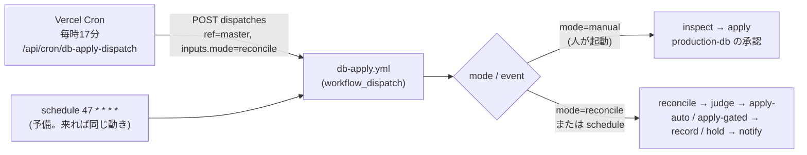
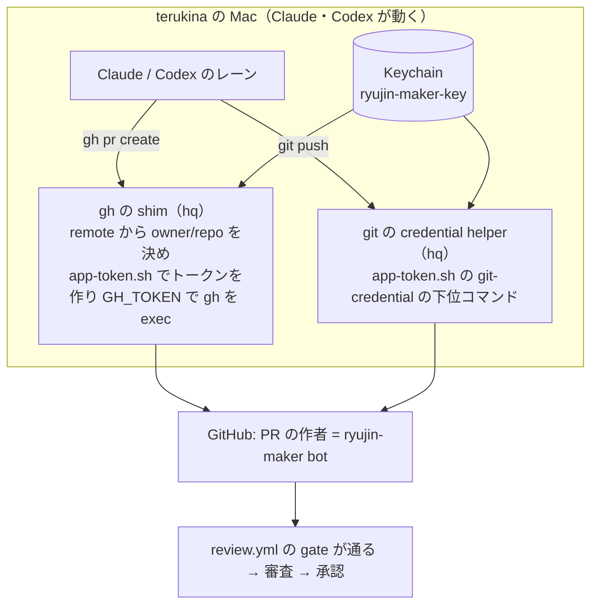
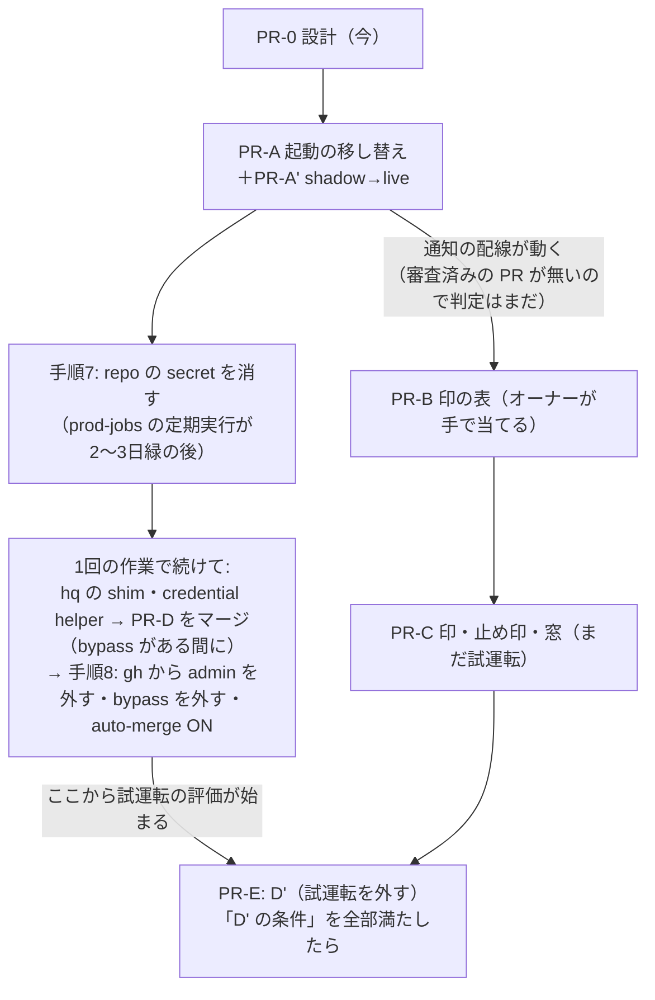

# 自動の適用の仕上げ（ADR-0097 の段取り D → D' と切替）

[ADR-0097](../../adr/0097-identity-separation-auto-review-and-db-apply.md) の「レーンの PR → 審査の App の承認 → db-apply の定期の起動が軽い SQL を当てる」経路を、実際に動く形にする設計。ADR-0097 の決定（身元・審査・当てる対象の5点・軽い／重いの判定）は変えない。変えるのは、起動の出元・PR を作る身元の配線・D' の前に要る3点・その順番。

オーナーの手順の正本は [identity-separation-owner-steps.md](../../operation/identity-separation-owner-steps.md)、適用の手順の正本は [db-apply.md](../../operation/db-apply.md)。この文書は、それらへの変更の設計を1か所にまとめたもの。実装は、オーナーの判断の後に PR を分けて行う（§5）。system-architect の審査（2026-10-20）の指摘を反映済み（§11）。

## 1. 今、動いていない理由（2026-10-20 15:30 JST の実測）

| # | 何が | 実測 | 出典 |
|---|---|---|---|
| 1 | 毎時の起動が来ない | `db-apply.yml` の schedule（`17 * * * *`）は #1674（2026-10-20 01:41Z に master）から 06:32Z までに起動0回（期待5回）。run は workflow_dispatch の2件だけ | `gh run list --workflow db-apply.yml` |
| 1' | 高頻度・新設の schedule は来ない | 直近24時間: Scrape Scheduled（`*/10`、約96回の期待）が4回。10/20 に足した key-canary（`7,37 * * * *`）は0回。日次の schedule は来ている（審査の実測で5日5/5） | `gh run list --event schedule -L 200`、`--workflow key-canary.yml` |
| 2 | 審査が動かない | review.yml の直近15件が全部 `skipped`。gate の条件 `github.event.pull_request.user.id == vars.REVIEW_MAKER_BOT_ID` に、rhapsody0919 名義の PR が当たらない | `gh run list --workflow review.yml`、review.yml の gate の `if` |
| 2' | 作成の App の道具はある | hq の `scripts/app-token.sh`（Keychain の秘密鍵から1時間のインストールのトークン、`gh`・`push` の下位コマンドつき）。App ID は hq の `config/github-apps.json`。龍神の .claude・AGENTS.md・scripts からは呼ばれていない | 読み取りで確認 |
| 2'' | 手順7・8 は未了 | repo の secret に、移す対象の8つ（`SUPABASE_SERVICE_KEY` 等）が残っている。ADR の一覧に無い `GOOGLE_SPREADSHEET_ID` も残る。Claude の `gh` は rhapsody0919（keyring、scope `repo`・`workflow`、git_protocol ssh） | `gh api .../actions/secrets`、`gh auth status` |
| 3 | 試運転のまま | `DB_APPLY_DRY_RUN: "true"`（db-apply.yml の env）。D' は切替の後（ADR-0097「試運転」） | db-apply.yml |

補足:
- 段取り S（鍵を使う job に `environment: prod-jobs`）は済んでいる。repo の secret の8つを参照する workflow で `environment:` を持たないものは0本（grep で確認）
- 1 の結果、試運転の通知も一度も出ていない。さらに 2 の結果、承認の付いた PR が無いので、起動が来ても軽い／重いの判定は1件も動かない（§5「D' の条件」）

## 2. (a) 起動を Vercel Cron からの dispatch に移す

### 形



### 変えるもの

| 場所 | 変更 |
|---|---|
| `.github/workflows/db-apply.yml` の `on.workflow_dispatch.inputs` | `mode`（choice: `manual`・`reconcile`、既定 `manual`）を足す。`migration` は `required: false` にする（reconcile では空） |
| 同 `inspect` の `if` | `github.event_name == 'workflow_dispatch' && inputs.mode != 'reconcile'`。`migration` が空なら `db-apply.js inspect` のパスの検証で落ちる（今と同じ） |
| 同 `reconcile` の `if` | `github.event_name == 'schedule' \|\| (github.event_name == 'workflow_dispatch' && inputs.mode == 'reconcile')`。ほかの条件（repository・`REVIEWER_BOT_USER_ID`）はそのまま |
| 同 `reconcile` の最初の step | `mode=reconcile` で `migration` が空でなければ落とす（どちらの意図か曖昧な起動を通さない） |
| 同 `notify` の `if` | `github.event_name == 'schedule'` を reconcile と同じ式に置き換える。`needs.judge.outputs.mode != 'wait'` を足す（窓の外で prod-jobs の deployment を毎時作らない）。`needs` に hold を足し、`RESULT_HOLD` を渡す |
| 同 `record` の `MIGRATION`・`SHA256` | `inputs.migration \|\| needs.judge.outputs.file` をやめ、手での起動（`workflow_dispatch` かつ `mode != 'reconcile'`）なら MIGRATION は `inputs.migration`・SHA256 は inspect の出力、それ以外は両方とも judge の出力と、mode で分ける。reconcile の入口の検査に加えた二重の守り（ずれると、別のファイルを台帳に「適用済み」と書く） |
| 同 `schedule` | `17` を `47 * * * *` にずらして残す（予備）。同じ分だと、遅れて来た schedule と dispatch が重なり、互いを busy と見て両方とも何もしない |
| `scripts/lib/analogyDispatch.js` の `DISPATCH_WORKFLOWS` | `db_apply_reconcile: { workflow: "db-apply.yml", inputs: { mode: "reconcile" } }` を足す。起動の関数・失敗の扱いは今のものを使う |
| `api/cron/db-apply-dispatch.js`（新） | `createScrapeCronHandler({ job: "db_apply_dispatch", run: …, modeGated: true })`。in-caution-dispatch.js と同じ形。run は下の「見張り」の確認をしてから `createAnalogyDispatchRun("db_apply_reconcile")` を呼ぶ |
| `scripts/lib/scrapeJobs/registry.js` | `db_apply_dispatch: { kind: "monitor", leaseSec: 60, maxDurationSec: 60, hosts: [], failureAlertAfter: 1 }` |
| `vercel.json` | `{ "path": "/api/cron/db-apply-dispatch", "schedule": "17 * * * *" }`（UTC。JST も毎時17分）。登録は今63本で、上限100本（ADR-0066） |
| `scrape_job_state` | 共通ラッパが初回の起動で `mode='off'` の行を作る（`cronWrapper.js:148`）。オーナーは `INSERT INTO scrape_job_state (job, mode) VALUES ('db_apply_dispatch', 'shadow') ON CONFLICT (job) DO UPDATE SET mode = excluded.mode` を当てる（in-collapse-caution の owner-prod-steps-pr1.sql と同じ形。ラッパが行を作る前でも後でも効く。`ON CONFLICT DO NOTHING` だと off のまま残る）。shadow で1日見てから `live` |
| `scripts/maintenance/verify-analogy-dispatch.js` | 新しい対象の配線（registry・api の job 名・inputs のキーが workflow の inputs にあること）を足す |

- 予備の schedule が来ても、同じ reconcile が動くだけで二重に当てることは無い: reconcile は db-apply の他の run が `in_progress`・`queued`・`waiting` 等なら何もしない（`isBusy`、自分の run は除く）。2本が同時に始まると、互いを busy と見て両方とも何もしない（その回は飛ぶだけ）。最後の守りは §4.1 の主キー
- Vercel Cron の重複配信（まれ）も同じ理由で無害
- Vercel Cron は「リトライ無し・best-effort」。1回抜けても次の時間に拾う（突き合わせなので、抜けた回の分は残らない）

### トークン

- 今の Vercel の環境変数 `GITHUB_ACTIONS_DISPATCH_TOKEN` をそのまま使う。fine-grained PAT、boatrace-ai-predictor だけ、Actions: Read and write だけ（[analogy-weekly-train-dispatch.md](../../operation/analogy-weekly-train-dispatch.md) 49行目）。Vercel では Encrypted・Production だけ（審査の実測。Preview のデプロイからは読めない）。新しい鍵は作らない
- 今のトークンでも db-apply は dispatch できる（Actions: write は workflow を選べない）ので、PR-A で当てられる対象は増えない。手での起動（mode=manual）は production-db の承認で止まり、reconcile は審査の App が承認した PR のファイルしか選ばない。**増えるのは、承認なしの経路（reconcile → apply-auto）を任意の時刻に起動できること**（今までは schedule だけ。PR #1722 の審査、P2）。D' の後は、この PAT に届いた者が、審査済みの軽いファイルを当てる時刻を選べる。ADR-0097 の「残る弱み」に足す（判断5）
- ただし**切替の後の目標の状態と比べると、残る弱み**になる。このトークンは Actions: write を持つ（ADR-0097 は作成の App に Actions: write を付けない、と決めている）。Claude は Vercel CLI の認証（hq の drafts/identity-separation §54）と Vercel MCP に届き、値を読む関数をデプロイすれば読める（Sensitive は画面の表示を止めるだけ）。届いたときにできること: master の任意の workflow を inputs つきで dispatch、prod-jobs の run の rerun、review.yml の無効化。同じ経路で Vercel の SUPABASE_SERVICE_KEY 等にも届く
  - 塞ぐのは切替のとき（§6 の表）: Claude の動くユーザーから Vercel CLI の認証を外す（または書き込みの無いトークンにする）・Vercel MCP を切る。塞がないなら ADR-0097 の「残る弱み」に書いてオーナーが受け入れる（判断5）
- オーナーに設定の画面で確かめてもらうこと（値ではなく）:
  - この PAT に Actions 以外の書き込み、とくに **Deployments・Environments・Administration が付いていない**こと。PAT の持ち主は production-db の required reviewer（オーナー）なので、deployment の承認の権限があると、この PAT で承認できてしまう
  - Environment `production-db`・`production-db-auto`・`prod-jobs`・`ryujin-bot` の Deployment branches が **master だけ**であること。dispatch は任意の ref を指定でき、そのブランチの YAML が動く。鍵に届かせない守りはこの設定だけ（Claude からはフックが Environments の API を止めるので読めない）
- 期限切れ: 401 で dispatch が失敗し、`failureAlertAfter: 1` で1回目から Slack に出る（学習の起動と同じ）

### 見張りの空振り

dispatch は 204 を返すだけで、run が本当に動いたかは分からない。次はどれも黙る: `vars.REVIEWER_BOT_USER_ID` が空で reconcile が skipped（notify も skipped）、run が queued のまま、Vercel Cron 自体が来ない（monitor の job には死活の検知が無い）。
- dispatch の関数で、起動の前に db-apply の run と、その run の jobs（PAT の Actions: Read で読める）を見て、「最初の live の起動（`scrape_job_runs` の db_apply_dispatch の live の最古の行）から3時間を過ぎ、直近3時間に **reconcile の job が success で終わった** run が無い」なら（run の結論で数えると、reconcile が skipped の run も数え、承認待ちの run は reconcile が終わっていても in_progress のままで、空振りする） `outcome: "error"` を返す（起動はする）。`failureAlertAfter: 1` で Slack に出る
- Vercel Cron 自体が来ないことは、内側からは分からない。hq の外の見張り（scrape_job_runs の最終実行の鮮度）に `db_apply_dispatch` を足してもらう
- scrape-monitor は JST 7:00 から通知するので、夜の失敗（§4.3 の窓の中を含む）は朝に出る

### フック・規律との整合

- `.claude/hooks/guard-deploy-approval.sh` は変えない。Claude の Bash からの workflow の起動・承認は今までどおり止める。起動するのは Vercel の関数で、Claude ではない
- db-apply.md「Claude（AI）は起動・承認しない」の節に「定期の突き合わせ（mode=reconcile）は Vercel Cron が起動する。手での起動（mode=manual）はユーザー本人だけ」と1文足す
- Claude が `api/cron/db-apply-dispatch.js` を手で叩く経路: CRON_SECRET が要る（cronWrapper の認証）。届いても、選ばれるのは審査済みのファイルだけ

## 3. (b) レーンの PR と push を作成の App の名義にする

### 考え方

龍神の手順（スキル・AGENTS.md）は `gh` と `git push` を素で呼ぶままにして、**身元は環境の側で差し替える**。理由:
- create-pr・implement・orchestrate・Codex のレーンなど、`gh pr create`・`git push` を書いた場所が多い。各所に `app-token.sh gh ...` を書き込むと、書き漏れの所が rhapsody0919 のまま動き、審査が skipped になるだけで誰も気づかない
- 道具は Mac 全体の身元の道具で、hq の持ち物（hq の drafts §39）。龍神は「どの名義で動いているか」を検査するだけにする

### 形



### hq に頼むもの（龍神からは書き換えない）

1. `app-token.sh` に git の credential helper の下位コマンド（`get` に `username=x-access-token`・`password=<token>` を返す）。トークンはファイルに残さない。git の側は `credential.useHttpPath=true` を付ける（付けないとリポジトリを見分けられない）
2. `gh` の shim（PATH の先頭に置く）。カレントの git の remote から `owner/repo` を決め、作成の App が入っているリポジトリならトークンを作って `GH_TOKEN` で本物の `gh` を exec する。入っていないリポジトリ（hq 等）は hq の決めた身元（hq の drafts §108: hq だけの App か deploy key）
3. shim の細部: `-R`/`--repo`・`GH_REPO` の指定があればそれでリポジトリを決める。リポジトリの外の呼び出しは止める（名義が分からないため）。インストールのトークンは1時間で切れるので、長い watch（`/merge-pr` の本番ビルド待ち等）は途中で作り直す
4. 切替のときの片付け（§6 の手順8）

### 龍神の側で変えるもの（切替の PR、§5 の PR-D）

| 場所 | 今 | 変更 |
|---|---|---|
| `.claude/commands/merge-pr.md` 24行目 | `gh pr merge {pr} --squash --admin` | `gh pr merge {pr} --squash --auto`。切替の後は admin の bypass が無く、作成の App にも admin は無い。審査の承認と必須の check がそろったら GitHub がマージする |
| `.claude/skills/orchestrate/SKILL.md` 118・176行目 | 「名義は未決」「`--admin`」 | 作成の App の名義で `--auto`。段階0の自己マージは「auto-merge を付ける」意味になる |
| `.claude/commands/create-pr.md` | `git push -u origin HEAD`・`gh pr create` | 変えない。push・PR の前に「名義の確認」の1行（下の検査）を足す |
| AGENTS.md 47・123行目 | Codex はマージ・auto-merge をしない | 変えない（Codex の PR の auto-merge はオーケストレーターが付ける） |
| AGENTS.md 110行目・`scripts/maintenance/e2e-rerun.js --apply` | 落ちた e2e を `gh run rerun --failed`・cancel で1回だけ再実行 | 作成の App には Actions: write が無い（ADR-0097）ので、切替の後は 403 で壊れる。再実行を空のコミットの push に替える（ADR-0097「切替の後、CI のやり直しは空のコミット」）。止まった shard の cancel はできないので、50分を超えたら「上げる」にする |
| `scripts/maintenance/guard-pr-merge.js` | `--auto` は ruleset が3つの check を必須にしているときだけ GitHub に任せる | 変えない（既に対応） |
| 新: 名義の検査 `scripts/maintenance/check-gh-identity.js` | ― | `gh api /installation/repositories` が通る（＝インストールのトークン）ことと、`gh auth status` に rhapsody0919 が無いことを見る。create-pr の最初と session-start-check に入れる。rhapsody0919 なら止める（審査が skipped になるだけで気づけないため） |

- コミットの author（`git config user.*`）は変えなくてよい。審査の gate は PR の作成者（`pull_request.user.id`）を見る
- ラベル（`gh pr create --label`）が通らなければ作成の App に Issues: Read and write を足す（オーナーの手順6の5、既にある）
- 切替の後、`gh api user` はインストールのトークンでは通らない。龍神の scripts・.claude に使っている所は無い（grep で確認）
- **作業の順番**: hq の shim・credential helper を入れる・PR-D をマージする・手順8の1〜3 は、**1回の作業で続けて**行う。shim を先に入れると admin の keyring と併存する期間ができ（下の「名義を混ぜない」に反する）、PR-D を先にマージすると 8.1 まで check-gh-identity が create-pr を止め、8.3 まで `--auto` のマージも通らない。PR-D は bypass がまだある間（8.2 の前）にオーナーがマージする
- gh の `git_protocol` は今 ssh。手順8で `gh config set git_protocol https` にする

### 切替の前の暫定（入れない）

切替の前に、create-pr だけを `app-token.sh gh ...` に替えて審査を動かす案は採らない。Claude の gh が rhapsody0919 のままだと、作成の App の PR と admin の PR が混ざり、admin の名義で出た PR は審査されずに `--admin` でマージできる。名義を混ぜる期間を作らず、切替で一度に替える。

## 4. (c) D' の前に要る3点

### 4.1 当て直しの防止: DB の側の印

```sql
-- 新しいマイグレーション（重い。CREATE SCHEMA・GRANT を含むので production-db、オーナーの1タップ）
CREATE SCHEMA db_apply;
REVOKE ALL ON SCHEMA db_apply FROM PUBLIC, anon, authenticated;
CREATE TABLE db_apply.applied (
  file        text PRIMARY KEY,            -- docs/db-migration/NNN_xxx.sql のファイル名
  sha256      text NOT NULL CHECK (sha256 ~ '^[0-9a-f]{64}$'),
  route       text NOT NULL CHECK (route IN ('manual', 'auto', 'gated')),
  run_id      bigint NOT NULL,             -- GitHub Actions の run
  applied_at  timestamptz NOT NULL DEFAULT now()
);
ALTER TABLE db_apply.applied ENABLE ROW LEVEL SECURITY;  -- policy は作らない（postgres のみ）
REVOKE ALL ON db_apply.applied FROM anon, authenticated, service_role;
GRANT USAGE ON SCHEMA db_apply TO claude_ro;
GRANT SELECT ON db_apply.applied TO claude_ro;            -- 台帳とのずれを Claude が読むため
```

- スキーマ `db_apply` は PostgREST の公開スキーマに入れない。適用の後、claude_ro で `has_table_privilege` を見て anon・authenticated・service_role が false であることを確かめる
- **印は適用と同じトランザクションで、ファイルより先に入れる**: 両方の形（`single-transaction`、`file-transaction`＝ファイル自身の BEGIN〜COMMIT。後者は今 34/159 本）で、psql を `-1 -v db_apply_file=… -v db_apply_sha256=… -v db_apply_route=… -v db_apply_run_id=… -f marker.sql -f <元のファイル>` で動かす
  - `marker.sql` はリポジトリに置く固定のファイルで、`INSERT INTO db_apply.applied (file, sha256, route, run_id) VALUES (:'db_apply_file', :'db_apply_sha256', :'db_apply_route', :'db_apply_run_id'::bigint);` の1文だけ。psql の変数は `-c` では展開されず `-f` の中で展開されるので、ファイルにする。変数名は本文と当たらないよう `db_apply_` を付ける
  - `file-transaction` のファイルの BEGIN は「既にトランザクションの中」の WARNING だけになり、ファイルの最後の COMMIT で印ごと確定する。途中の失敗は ON_ERROR_STOP で印ごと戻る。**元のファイルを書き換えないので、審査した sha256 と流すバイト列がずれない**
  - 印を先に入れるので、ファイルの中の `SET LOCAL ROLE` の影響を受けない
  - **runner の psql 16 で実機確認してから採る**（PR-C の最初の作業。捨てられる DB（runner の postgres の service container）で、両方の形・途中の失敗・同時の2本を試す）。psql の文書には「スクリプト自身が BEGIN・COMMIT を使うと `-1` は意図した効果にならない」とある
  - `TX_BEGIN_RE` は `BEGIN ISOLATION LEVEL …`・`START TRANSACTION READ …` も通す。`-1` の下ではそのオプションが黙って捨てられるので、自動・承認つきの経路ではオプションの付いた BEGIN を「止める」にする（今は該当0本）
  - 実機確認で file-transaction の形が崩れたときの代わり: 切り替えより後の新しいマイグレーションは single-transaction の形だけにする（ファイルに BEGIN/COMMIT を書かない。verify で検査し、judge は file-transaction を「止める」にする）。今の 34 本の file-transaction は全部切り替えより前で、自動の経路の対象外
- **主キーで二重を構造的に止める**: 2本の run が同じファイルを当てても、後の方は印の INSERT が一意制約で失敗し、何も当たらずに戻る。busy の検査や台帳の読みの競合に頼らない
- 当てる前の確認（3つの経路の全部）:
  - 行が無い → 当てる
  - 行があり sha256 が同じ → **当てずに record だけ進める**（当てた後の record の失敗からの自己回復。台帳を「適用済み」にする）。apply の job は成功で終わり、出力 `already_applied=true` を付ける。通知の文は「当てた」ではなく「既に当たっていたので台帳だけ直した」、台帳に書く run の URL は印の `run_id`（元の run）
  - 行があり sha256 が違う → 止めて通知（同じ名前の別の中身。人が見る）
  - 表が無い（`to_regclass('db_apply.applied') IS NULL`）→ 止める（fail closed）。例外は作らない（PR-B は PR-C より前に、印の無い今のコードで当てるため）
- 手での経路（mode=manual）には `requireUnappliedOnMaster`（台帳の確認）を足さない。手で当てる経路は台帳が `不明` の行や切り替え前のファイルにも使っているため。手での経路で足すのは「印の行があれば止める」と「印を入れる」だけ
- 自己回復（sha256 が同じなら record だけ）は印を信じる。印を偽って書ける経路（`.env.local` の SUPABASE_ACCESS_TOKEN の管理 API 等、hq の drafts §54）が残る限り、「当てずに適用済み」にされうる。D' の条件に、その鍵を Claude の届く所から外すことを入れる（§5）
- 既存の適用済みのファイル（170本ほど）は印の表に入れない。対象は「これから当てるもの」だけ。台帳との突き合わせ（APPLIED.md の「適用済み」と表の行）は、表ができた日以降の行だけを verify で見る
- 表ができる前に手で当てて、台帳が `未適用` のまま残った切り替えより後のファイルは、印が無いので自動の経路が当て直しうる。D' の前に claude_ro で実物（表・列・索引）と照合し、当たっているものは台帳を直す（§5）
- PR-B のマイグレーションの冒頭にこの plan.md の参照を書くなら、`verify:er-diagram` のため plan.md に erDiagram を生成して貼る

### 4.2 失敗・却下したファイルの止め印

- 置き場所は**台帳（APPLIED.md）の「適用状況」の先頭の語**。新しい語 `保留` を足す（意味: 自動では当てない。理由と run の URL を括弧の中に書く）
  - DB に置かない理由: 失敗した適用はロールバックで DB に何も残らない。止め印のためだけに別のトランザクションで DB に書くと、鍵を持つ job の仕事が増える
  - PR のコメントに置かない理由: 誰でも書ける（ADR-0097「PR のコメントにある判定の結果は信用しない」）。止める側に倒れるだけとはいえ、正本を増やさない
- **突き合わせの直し**: `LEDGER_STATES` に `保留` を足すだけでは足りない。今の `db-reconcile.js:150` と `pickNext`・`pendingCandidates`（`dbReconcile.js:170`・`:238`）は、状態が null でも `未適用` でもないファイルを候補から外すので、`保留` を飛ばして**後ろの番号が当たる**（審査の P1-1、コードで再現）。`pickNext` は番号の順で先頭が `保留` なら `status: "blocked"`・理由「保留（run の URL）」を返す。verify に「保留の後ろの番号が選ばれない」を足す。これで今の規則「止まったファイルがあれば、以後の番号は当てずに止まる」（番号の順に依存があるため）を保つ。止まった通知は日付を入れて毎日1回
- 書く job: `hold`（新）。`needs: [judge, apply-auto, apply-gated]`、`if: !cancelled() && (apply-auto か apply-gated の result が failure) && その job の出力 attempted == 'true'`（`!cancelled()` が無いと暗黙の success() で skip される。cancelled（timeout・concurrency の取り消し）は `保留` にしない。当てたかどうかは印で分かるので、次の起動の自己回復に任せる）
  - `attempted` は apply-auto・apply-gated が **psql を動かす直前**に出す。当てる前の確認で止まったもの（窓の外・台帳が `未適用` でない・印の表が無い・sha256 が違う・試運転）は `保留` にしない。窓の外は失敗にせず、成功で終えて次の窓で拾う（judge が窓の中で auto を出しても、concurrency の待ちで apply-auto が窓を過ぎてから動くことがあるため）。それ以外の確認の止まりは今どおり失敗にして通知する
  - Environment の却下は steps が動かないので `attempted` が出ない。却下が job の結果でどう出るかを PR-C で実測し、却下も `保留` にする条件を足す
- notify の `needs` に hold を足し、`保留` にしたこと（ファイル・run の URL）と hold の失敗を Slack に出すrecord と同じく Environment `ryujin-bot` の名義で master に直接コミットする（`push-with-retry.sh`）。行の書き換えは `db-apply.js mark-held <file> <run の URL>`（mark-applied と同じ書き方）。**`未適用` の行だけを書き換える**（record と競合して `適用済み` を上書きしない）
- 外し方:
  - 一時的な原因（lock 等）: 行を `未適用` に戻す PR（審査を通る）。検査4は SQL を足したコミットの差分しか見ない（`db-reconcile.js:164`）ので、戻す PR とはぶつからない
  - SQL の中身が誤り: 中身を直すと検査2（PR の head と master の blob の一致）で永久に通らない。**新しい番号で出し直し、古い行は `廃止`** にする
  - オーナーが手で当てて `適用済み` にする
- `hold` の job が失敗したとき（push の失敗等）: 次の時間にもう一度同じファイルが選ばれる。自動の経路はもう一度失敗する（トランザクションで戻るので DB は変わらない）、承認つきはもう一度オーナーに承認を求める。どちらも Slack に出る。害は通知の重複だけ
- `lock_timeout` 切れの扱い: 一時的な原因でも1回目で `保留` にする。数えて再試行する仕組みは作らない（KISS）。1行の PR で再開する

### 4.3 開催の無い時間帯に限るか

- 自動の経路（承認なし）の lock は10秒で、待つ間は後ろの読み取りも並ぶ（ADD COLUMN の ACCESS EXCLUSIVE）。statement は120秒（CREATE INDEX は表への書き込みを止める）。`dbApplySql.js` の `AUTO_TIMEOUTS`
- 取得の Cron は UTC 20〜14時台（JST 5:00〜23:59）に集まっている（vercel.json）。JST 0:00〜5:00 は夜の集計（in-caution 2:30 等）だけ
- 案:

| 案 | 自動で当てる時間 | 良い点 | 悪い点 |
|---|---|---|---|
| **A（推奨）** | JST 1:00〜4:59 だけ。他の時間は judge まで動いて当てない | 開催中のロック待ちが起きない。窓は4回の起動ぶんあり、1回抜けても当たる | 新しい列に頼るコードは、SQL のマージから最大で約1日待つ（ADR-0097「SQL を先の PR で入れる」と同じ運用で吸収） |
| B | いつでも | 早い | lock の10秒の間、取得とページの読み取りが並ぶ。開催中に ADD COLUMN が当たると、取得の Cron が10秒待つことがある |

- 重いもの（承認つき）は時間を限らない。オーナーが承認を押す時間を選べる
- 実装: judge が `mode=auto` を出す条件に「JST の窓の中」を足し、窓の外なら `mode=wait`（何もしない、毎時の notify も出さない）。apply-auto でも当てる直前に窓を確かめ直す（判定と同じ2段）。窓は workflow の env に、始まりを含み終わりを含まない形で固定する（`DB_APPLY_AUTO_WINDOW_JST_FROM: "1"`・`DB_APPLY_AUTO_WINDOW_JST_UNTIL: "5"`＝JST 1:00 以上 5:00 未満）

## 5. PR の分け方

| PR | 中身 | 触る所 | マージ | 前提 |
|---|---|---|---|---|
| PR-0 | この設計（docs だけ） | docs | オーナー | ― |
| PR-A | 起動の移し替え（§2） | .github・api・scripts・vercel.json | オーナー（.github） | 判断1・2 |
| PR-A' | `scrape_job_state` の mode を shadow → 1日後に live（UPDATE） | 本番 DB | オーナーが SQL エディタで当てる。docs/db-migration の番号つきファイルにはしない（in-caution と同じく `docs/design/…/owner-prod-steps` の形。番号つきにすると、切り替えより後に審査なしで足されたファイルとして reconcile の列の先頭で blocked になり、後ろの番号を止める） | PR-A のデプロイの後（ラッパが off の行を作った後） |
| PR-B | 印の表のマイグレーション（§4.1 の SQL） | docs/db-migration | オーナー（手で当てる、重い） | 判断3 |
| PR-C | 印・止め印・時間の窓のコード（§4）。最初に psql の実機確認 | scripts/db・scripts/lib・.github・verify | オーナー（.github） | PR-B の適用 |
| PR-D | 名義の切替の龍神の側（§3） | .claude・scripts/maintenance | オーナー。切替の作業の中で、8.2 の前にマージ | hq の道具 |
| PR-F | ④ 審査の関門の画像の例外（§9.1）と再現テスト、ADR-0097 の追記 | scripts/lib/reviewPr.js・scripts/review・verify・docs/adr | オーナー（審査の仕組みの変更、段階2） | 判断8 |
| PR-H | §10 の機械化（`decideAction` の P1・観点、月の上限、draft の検査、`config/dev-gate.json`） | scripts/lib/reviewPr.js・scripts/review・scripts/maintenance・config・.github | オーナー（段階2） | 判断13〜16。切替の前 |
| PR-G | ⑥ orchestrate の段階0 F・案Z の書き直し（§9.3） | .claude/skills/orchestrate/SKILL.md | オーナー（.claude） | 判断11 |
| PR-U | 審査の usage を annotation に1行（§10.7） | scripts/review/llm.js・.github/workflows/review.yml | オーナー（deny のクラス、直接承認・マージ） | 判断14 の測定の前 |
| PR-E | `DB_APPLY_DRY_RUN: "false"`（D'）と、急ぎの止め方の repo の変数 `DB_APPLY_AUTO_ENABLED`（apply-auto の `if` とコードの両方で見る。`== 'true'` のときだけ当てる。未設定・消したときは当てない） | .github | オーナー | 下の「D' の条件」 |

### D' の条件（審査の P1-2）

切替の前は、承認の付いた PR が無いので reconcile の pending は全部 `ok:false` になり、`judge-all` は `ok:true` しか判定しない（`db-apply.js:241`）。PR-A の後も、軽い／重いの判定は実物で1件も動かず、出るのは「5点の検査を通らない」の通知だけ。試運転の評価は**切替の後から**始まる。D' に進む条件:
- `DB_APPLY_SWITCH_SHA` より後に、審査の App の承認なしで足された `未適用` のファイルが無い（手で当てるか `廃止` にする）。今 `171_sns_today_heading_variants.sql` が該当する（台帳 `未適用`、rhapsody0919 名義）。残ると `pickNext` が先頭で blocked を出し続け、後ろの審査済みのファイルが1本も当たらない。`judge-all` も先頭10本（`MAX_PENDING`）しか見ないので、10本たまると下の「5本判定」も満たせない。あわせて切替の PR で `DB_APPLY_SWITCH_SHA` を切替のコミットに進めるかを決める（判断12）
- D' に切り替える時点の、切り替えより後の `未適用` の一覧（試運転の間に審査の承認で入った SQL）をオーナーが見た（D' の瞬間に軽いものが一度に当たるため）
- 切替の後7日以上、試運転が動いている
- 審査済みの SQL を5本以上、judge-all が判定し、オーナーが Slack の「当てるはずだった」に誤りが無いと見た
- PR-C が入っている
- 印を偽れる鍵（`.env.local` の SUPABASE_ACCESS_TOKEN 等）を Claude の届く所から外した（§4.1）
- 切り替えより後に手で当てたファイルの台帳を、claude_ro で実物と照合した（§4.1）

## 6. 順番と戻し方



| 段 | 戻し方 | 戻したときの状態 |
|---|---|---|
| PR-A | `scrape_job_state` の mode を `off`（オーナーの SQL エディタ、同じ ON CONFLICT の形）。急ぎなら Vercel の Cron を外す PR | 予備の schedule だけに戻る（今と同じ） |
| PR-B | 表は残してよい（読まれなければ害は無い）。消すなら `DROP SCHEMA db_apply CASCADE` を手で（重い） | ― |
| PR-C | revert の PR。止め印 `保留` の行は手で `未適用` に戻す | 試運転なので当てる動きは変わらない |
| 手順7 | 消した secret を repo に入れ直す（オーナー） | 今と同じ |
| PR-D・手順8 | 手順書の「戻し方（逆の順）」。auto-merge を OFF → bypass に Repository admin を足す → `gh auth login`（rhapsody0919）→ PR-D を revert | 今と同じ |
| PR-E | 急ぎは repo の変数 `DB_APPLY_AUTO_ENABLED` を `false`（オーナー。作成の App は Variables を書けない、ADR-0097）。後で `DB_APPLY_DRY_RUN: "true"` に戻す PR。Environment `production-db-auto` を消すのは効かない（参照された Environment は GitHub が保護なしで作り直す。owner-steps 4-2） | 試運転に戻る |

### 手順7・8 への追記（owner-steps に足す）

- 手順7の前提に「job-watch・key-canary が prod-jobs の鍵で緑」を足す（10/20 の Invalid API key の再発の確認。key-canary が schedule で来ない間は、prod-jobs を使う日次の job の緑で見る）
- 手順8の1（gh から admin を外す）を、届く経路ごとに分けて書く。Claude が動く Mac のユーザーから rhapsody0919 の書き込みや本番の鍵に届く経路は、`gh` の keyring だけではない（hq の drafts §54）:

| 経路 | 今 | 切替でどうするか |
|---|---|---|
| `gh` の keyring（rhapsody0919、`repo`・`workflow`） | あり | `gh auth logout -u rhapsody0919`（オーナー）。`gh config set git_protocol https` |
| git の credential | `/opt/homebrew/etc/gitconfig` の osxkeychain を `~/.gitconfig` の空の `credential.helper=` で打ち消し、その後に `gh auth git-credential` を置いている | gh の helper の行だけを hq の helper に替え、**空のリセット行は残す**（消すと osxkeychain が戻り、インストールのトークンを Keychain に保存する。期限切れのトークンが先に返る原因にもなる）。Keychain に残る github.com のエントリは消す |
| SSH の鍵（`~/.ssh/github_rsa`、ssh.github.com:443） | ある。どのアカウントの鍵かは未確認 | rhapsody0919 に登録されていれば、GitHub の設定から外す（オーナー）。龍神の remote は https なので、龍神の作業には要らない |
| ブラウザ（Claude in Chrome・アプリのブラウザ）の GitHub のログイン | オーナーとして操作できる | Claude が操作できるブラウザで GitHub からログアウトする。オーナーの作業は別のプロファイルで行う（手順書の「全体の決まり」と同じ） |
| Vercel CLI の認証・Vercel MCP → Vercel の環境変数（dispatch の PAT・SUPABASE_SERVICE_KEY 等） | 届く（Sensitive でもデプロイしたコードからは読める） | Vercel CLI をログアウトするか書き込みの無いトークンにする、Vercel MCP を切る（§2） |
| `.env.local` の SUPABASE_ACCESS_TOKEN（管理 API）・VERCEL_OIDC_TOKEN 等。**全 worktree の写し（`.claude/worktrees/*/.env.local`）を含む** | 届く | Claude の届く所から外す（印を偽れるため。D' の条件） |
| Vercel の環境変数 `GITHUB_MERGE_TOKEN`（ADR-0034、PR の書き込み権限の PAT、オーナーの名義） | ある | **失効させる（手順8の前提）**。ruleset は書き込み権限のある身元の承認を数えるので、この PAT で作成の App の PR を承認でき、審査の App を迂回できる（§9.2） |

- どこまで外すかはオーナーの判断（判断5）。全部は外せない（terukina は macOS の admin で、sudo のパスワードを入れた後の操作には届く。hq の drafts §118）

### 決まった後の ADR-0097 の追記

- 「失敗・却下したファイルは次の起動でまた選ばれる」（ADR-0097 の「本番 SQL の適用」）を、`保留` の止め印に合わせて書き直す
- 「残る弱み」に、dispatch の PAT がオーナーとして動く経路と、外さなかった経路（判断5）を足す

## 7. 別スコープ（Linear に起票する）

- sitemap の `<loc>`（`scripts/lib/sitemapLastmod.js:48`・`generate-sitemap.js:346`）と llms.txt の記事の title・description（`generate-llms-txt.js`）がエスケープしていない（BOA-920）
- BOA-917: key-canary・job-watch の前提の定期の起動が来ない（10/20 に key-canary 0回）。同じ dispatch の形で Vercel Cron から起こすか、hq の見張りに寄せる。schedule が来ない原因そのものは未調査（この設計は迂回だけ）

## 8. オーナーに決めてもらう点

**決定（2026-10-20 23:5x、オーナー、オーケストレーター経由）**: 判断1〜26 を推奨どおり一括で承認（「一括で yes」）。
- 27 は未承認（hq の v6.2 の数え直し 394 本を添えて、オーケストレーターからオーナーに出す）
- 29 は推奨どおり承認（2026-10-20 夜、オーナー、オーケストレーター経由）
- 28 は「30 本で知らせ、60 本で止める」で決定（2026-10-20 夜、オーナー、オーケストレーター経由）
- 2（PAT の範囲と Environment の Deployment branches）は、オーナーが設定の画面で確かめた（2026-10-21 0時台、オーケストレーター経由）:
  - dispatch の PAT（`GITHUB_ACTIONS_DISPATCH_TOKEN`、fine-grained）: 対象は boatrace-ai-predictor だけ。権限は Actions の Read and write と Metadata の Read だけ（deployment の承認の権限は無い）。有効期限は無い（期限を付けるかは判断5の鍵の整理のときに決める）
  - Environment の4つ（production-db・production-db-auto・prod-jobs・ryujin-bot）の Deployment branches は、どれも master だけ
- 14 は「1 run の実費と runs の API の 1000 件の頭打ちを測ってから決める。それまで切替をしない」で確定
- この承認は設計の方向の承認。.github・.claude を変える実装の PR（PR-A・C・D・E・F・G・H の一部）は、それぞれ文案・差分をこのレーンでオーナーに直接見せて承認をもらい、マージはオーナーが行う
- PR-H（§10 の機械化）の前に、dev-gate v3 の再審査を通す

| # | 点 | 推奨 |
|---|---|---|
| 1 | 起動を Vercel Cron の dispatch にする（PR-A）。今の PAT を流用する | はい。当てられる対象は増えない。承認なしの経路を任意の時刻に起動できる点だけ増える（§2「トークン」、切替の後の弱みは判断5で扱う） |
| 2 | PAT の権限が Actions だけか、Environment 4つの Deployment branches が master だけかを、設定の画面で確かめる | 確かめる（PAT に承認の権限があると production-db を承認でき、Deployment branches が広いと dispatch の ref で鍵に届く） |
| 3 | D' の前の3点を §4 の形で作る（印は DB の主キー、止め印は台帳の `保留`） | はい |
| 4 | 自動の経路を JST 1:00〜4:59 に限る（§4.3 案 A） | 案 A |
| 5 | 切替で、§6 の表の経路をどこまで外すか | gh・git の credential・ブラウザの GitHub のログイン・Vercel CLI と MCP・全 worktree の `.env.local` の管理の鍵は外す。`GITHUB_MERGE_TOKEN` は失効させる（手順8の前提）。SSH の鍵は登録先を確かめてから。外さないものは ADR-0097 の「残る弱み」に書く |
| 6 | 名義の差し替えを環境の側（hq の shim・credential helper）で行い、切替の前の暫定は置かない（§3） | はい |
| 7 | D' の条件（§5: 切替の後7日・審査済みの SQL を5本判定 等） | この条件 |
| 8 | ④ 審査の関門の画像の例外を §9.1 の条件（jpg だけ・印の欄の許可のリスト・EOI まで歩く・縦横の上限・F のパスだけの PR に限る）で入れ、同じ PR で ADR-0097 に追記する（段階2） | はい |
| 9 | ② で寸法の表がビルドで作られる形になったときの関門の条件 | #1699 の後は縦横の上限だけで照合（§10.4 v2）。content は #1699 のマージの後から有効 |
| 10 | 画像の中身が LLM の審査に渡らないこと・polyglot を防ぎきれないこと・作成の App が自分で `--auto` を付けられることを受け入れるか | 受け入れて ADR-0097 の残る弱みに書く（グラフ・表の画像で、記事の本文は審査に入る。`nosniff` を足す） |
| 11 | ⑥ SKILL.md の段階0 F・案Z の5点の書き直し（§9.3。5点目の P0/P1 の扱いはオーナー決定済み、文案の承認が要る） | はい。PR-D とは別の PR |
| 12 | 切替の PR で `DB_APPLY_SWITCH_SHA` を切替のコミットに進めるか（切替の前に足した未承認の `未適用` を自動の対象から外す） | 進める。外れたものは手で当てる（今の手順のまま） |
| 13 | P1 を機械で止めるか（§10.1） | 案 A: P1 も止め、止めない観点を許可のリストに（記事の fan・seo だけ）。木の SHA での持ち越し・切る前の件数・出口・2週の見直しの線とセット |
| 14 | 審査の月の上限と費用（§10.2。30日で970本・月 2,000〜3,500 run の見込み） | 1 run の実費と API の頭打ちを測ってから、run の上限とベンダーの上限の金額を決め直す。それまで切替をしない |
| 15 | `--auto` の後の push とマージ順（§10.3） | `--auto` を付けた head SHA を残し、見回りで違えば `--disable-auto`。`--match-head-commit` が効くならそれを第一に。draft は補助 |
| 16 | 例外の線の正本（§10.4） | `config/dev-gate.json`（仮）を master から読む。名前と置き場所は hq の v2 と合わせる |
| 17 | orchestrate のクラスを機械で分けるか（§10.4） | 分けるまでは owner と同じ。分けるならオーケストレーター用の別の App |
| 18 | owner のクラス（.github・.claude・AGENTS.md・vercel.json・ルートの package.json・docs/adr・守りの部品）で ADR-0097 の「仕組みの変更も審査の App だけで通る」を改めるか | 改める（draft の形）。hq の分類で owner（パス）は 75 本／946 本 |
| 19 | dev-gate を全員に効かせるか社員だけか | 全員 |
| 20 | 審査の仕組み（dev-gate.json・review.yml・scripts/review・reviewPr.js）を変える PR を機械で落とすか（§10.4） | 落とす（deny）。オーナーは ruleset を一時 Disabled にして入れる |
| 21 | ブランチの接頭辞を `claude/`・`codex/` に機械で揃える（§10.0。今は 970 本中 85 本だけ） | PR-D の check-gh-identity で push と PR の前に検査する |
| 22 | verify-registry.json と docs/knowledge を「足すだけ」なら employee にする（§10.4 v2） | はい（v3: verify の台帳は既存の完全一致＋足す項目のキーを制限、knowledge は - の行が0・行の形を検査、README は owner） |
| 23 | docs/db-migration を deny から外し、新しい SQL の追加と APPLIED.md の行の追加だけを employee にする（§10.4 v2） | はい（v3: 台帳の行は4条件、外れたら owner）。deny のままだと db-apply の自動の経路が0本になる |
| 24 | employee の大きさの上限（30ファイル・2000行・削除3ファイル・削除500行、超えたら owner） | この初期値で入れ、hq の分布で直す |
| 25 | 大きさの上限の数え方 | v3: 種類ごとの束（prodWrite 10/300・frontendSmall 8/300・employee 30/2000）を全部同時に検査、閉包は master と head の和 |
| 26 | docs/adr を deny から owner に移す | はい |
| 27 | scripts/maintenance/verify-*.{js,sh} の変更・削除を owner にするか（§10.4 v6・v6.1・v6.2） | (ii) v6.2: 削除は owner、変更は「字句の比較で既存の文が全部残り増えたのは丸ごとの文だけ」「import の書き換え（読み込み先が同じ・束縛が残る）」「反復の元にしか使わない表の配列（for…of の対象、または参照が全部 for…of・`.entries`・`.forEach`・`.map`・`.filter`・`.length` の読み取りだけの宣言）の直接の要素の追加（途中・先頭も可）」の組み合わせだけで、禁止の文字列（`.length` への代入・`.splice(` を足した）が無ければ employee、他は owner。export・freeze・引数・プロパティ・入れ子の配列、`.includes` 等に使う宣言、名前に skip 等・expect を含む宣言への追加は owner。nightly-verify-db.yml が prod-jobs で変数のパスで動かす5つの verify（本番の Storage を消す verify-analogy-v16.js を含む）は名前で owner。社員で回るのは 394 本（41.6%、hq の v6.2 の数え直しで確認）。v6.1 は 389、全部 owner の下限は 334 |
| 28 | 1日の自動マージの上限（小分けの迂回・暴走の止め役、§10.4 v6.1・v6.2） | **決定（2026-10-20 夜、オーナー、オーケストレーター経由）: 30 本で知らせ、60 本で止める**。数えるのはその日に APPROVE した PR の数（重複を除く）で、30 本目で知らせ、60 本に達した後（61 本目から）を止める。残る弱み: v6.2 の分類の実測（0本の日を含む31日、マージの日で代えた）で 30 以上は3日（10/1 45・10/2 40・10/13 60）、最大 60 で、上限に余裕0本。マージの日は承認を少なく数える側。上げる案は 75（目安、根拠なし）。月の run は日ごとに数えて足す。判断14 の実費の後と切替の後の実測で見直す |
| 29 | v4・v5 の変更（registry は部分列・名前で書いたパスを閉包より優先し deny の閉包は owner・判定の本体は deny・api/cron の小さな直しを prodWrite（認証・ゲート・config の文字列は owner）・knowledge と mock と規則外れは owner・検証を緩める台帳は owner） | はい（v6 の直し: cronSmall は語の境で照合、既存の SQL の変更は owner、verify の範囲は maintenance に揃える）|

## 9. 中身の PR（ブログ記事）を同じ道に乗せる（2026-10-20 夕の追加）

オーナーの yes（10/20 夕、hq 経由「記事を集客だけで出す道を作ってよい」、オーケストレーター経由）で、記事の PR も「作成の App → 審査の App → auto-merge」に乗せる。この節は ④ 審査の関門の画像の例外と ⑥ orchestrate の段階0 F・案Z の書き直し。② 翻訳のメタの JSON 化・寸法をビルドで作る、③ `scripts/content/check-content-pr.js`（manifest の形を含む）、⑤ ADR-0034（`GITHUB_MERGE_TOKEN` の PAT で記事の PR をマージする古い道）の廃止と PAT の失効は、別のレーンが受け持つ。§9 は system-architect の2回目の審査（P1 6件・P2 10件・P3 5件）を反映済み（§11）。

**時期**: 記事の PR が作成の App の名義で出るのは、切替（§6 の一連の作業）の後。切替までは PR の作者が rhapsody0919 で review.yml は skipped になるので（§1）、9.1 の例外も 9.2 の判定も効く PR が無い。**切替までは F の記事を案Z の束に入れない**（今の F のまま、オーケストレーターが4つのレビューを見てマージする）。

### 9.1 ④ 審査の関門に画像の狭い例外を入れる（段階2、オーナーが直接承認）

今は `scripts/lib/reviewPr.js:57-60` が、本文の無い差分（バイナリ）を消したファイル以外は全部落とす。記事の画像はバイナリなので、記事の PR は全部落ちる。

**例外を効かせる PR**: PR の変更したファイルが**全部** F の許可のパス（9.3 の 90 行目の一覧）の中にあるときだけ。コードを含む PR では、画像も今どおり落とす（claude/ の PR を全部審査するので、例外を全 PR に効かせない）。許可のパスの正本は1か所（§10.4 の `config/dev-gate.json`、master から読む）に置き、③ の機械（push の前の照合）も同じものを読む。

**例外にする画像の条件**（全部を満たすファイルだけ、本文の無い差分の理由から外す）:

| 条件 | 確かめ方（PR の head は checkout しない。API で取って読むだけ） |
|---|---|
| `status === "added"`（変更・改名・複製は対象外。`previous_filename` があれば対象外） | compare の files |
| パスが `^public/images/blog/[a-z0-9-]{1,100}\.jpg$`（webp は既存0枚なので入れない） | 正規表現。大文字・`..`・入れ子は当たらない。既存 183 枚は全部小文字の jpg |
| mode が `100644` | 今の `headModes`（head の木） |
| 大きさが 400KB（409,600 バイト）以下 | head の木の項目の `size` で先に判定し、blob は sha を木の項目から取って compare の `sha` と一致を確かめる。`GET /git/blobs/{sha}` は `encoding === "base64"`・復号した長さが `size` と同じ |
| **JPEG の印の欄（marker segment）が許可のリストだけ** | SOI から**1つ目の EOI まで全部を歩く**（プログレッシブはスキャンの間に APPn・COM を置けるので、SOS の前だけでは足りない）。スキャンの中は `FF 00` と RST0〜7 を飛ばす。埋め草の `FF` の連続は飛ばす。印の欄の長さは2以上でファイルの中に収まること。通すのは SOI、APP0（`JFIF\0` で、サムネイルが 0×0。JFXX は拒否）、APP2（`ICC_PROFILE\0` だけ）、DQT・DHT・DRI、SOF（C0・C1・C2 のどれか**1つだけ**）、SOS、RST0〜7、EOI。他（APP1 の EXIF・XMP、APP13 の Photoshop・IPTC、APP3〜15、COM、DNL・DHP・EXP、他の SOF）は全部落とす。C4（DHT）・C8・CC（DAC）を SOF と取り違えない |
| EOI がファイルのちょうど終わり、SOI と EOI が1つずつ | 1つ目の EOI の後ろに2枚目の JPEG・任意のデータを付けたものを落とす |
| 縦横の上限 | SOF の縦横が 幅 2000 以下・高さ 4000 以下、高さ 0（DNL の形）は拒否。既存の最大は幅 1200・高さ 2439 |
| 縦横が寸法の表と一致 | PR の head の `src/data/blogImageDimensions.js` を API で取り（実行しない）、画像名をエスケープして完全一致で探す。一致する行が**ちょうど1つ**で、`"/images/blog/<name>": { width: N, height: M },` の形 |
| 同じ PR で表の行を足している | 表の patch の `+` の行が、上の1行と同じ文であること（コメントに足した `+` の行で騙されない）。表の patch が省かれた（大きすぎる）ときは既存の規則で落ちる |

- 実装: 純粋関数 `jpegCheck(bytes)`・`imageException(...)` を `reviewPr.js` に足す。Node の組み込みだけ。解析の例外は落とす理由として返し、プロセスを止めない（gate が exit 1 で終わると approve の job が skipped になり、REQUEST_CHANGES も理由も残らない。review.yml:138）
- **`mechanicalRejections` は `scripts/review/gate.js:45` と `scripts/review/llm.js:113` の2か所から呼ばれる**。引数（blob・寸法の表）を足すなら両方で同じものを取って渡す。引数を省略したときは画像を落とす側（今と同じ）にする。verify に「2か所が同じ引数で呼ぶ」の検査を足す。`llm.js` の job は Environment pr-review（API キーあり）で動くので、そこで PR の画像のバイト列を解析することになる（純粋な解析で許容。ADR の追記に書く）
- `buildReviewPrompt`（`reviewPr.js:147`）で、画像は「機械で検査済みのバイナリ、本文なし」と注記する
- 再現テスト（`verify-review-workflow.js` か新しい verify）: 通るもの（ベースライン・ICC つき・プログレッシブ）、落ちるもの（EXIF・XMP・APP13・COM・JFXX のサムネイル・MPF の APP2・スキャンの間の APPn・EOI の後ろのデータ・SOF が2つ・SOF3・高さ0・長さ0/1 の印の欄・400KB 超・上限超えの縦横・拡張子と中身の不一致・改名・modified・入れ子のパス・大文字・寸法の不一致・表の行が無い／2つある・コメントの `+` だけ・symlink・コードを含む PR の画像）
- **既存の画像183枚のうち、APP1（EXIF）と APP13 が各 99 枚、APP2 の ICC が 41 枚、プログレッシブが 27 枚**（実測）。記事の画像を作る側（③ のレーン、または画像の生成の道具）で、コミットの前に許可のリストの外の印の欄を全部外す（EXIF だけを外す道具では APP13 が残って落ちる）
- 改稿で画像を差し替えると、GitHub が改名（renamed）や modified として扱い、落ちる。F の文に「画像は別の名前で足す（差し替えはオーナー）」と書く（8月以降の画像の変更は3件）
- ② で寸法の表がビルドで作られる形に変わると、PR の head に表が無くなる。そのときの照合は ② と合わせて決める（判断9）。縦横の上限はそれまでも効く
- 画像の中身（写っているもの・文字）は、LLM の審査に渡らない（判断10）。画像と他の形式を兼ねたファイル（polyglot）は ICC・DQT・スキャンの中に任意のバイトを置けるので防ぎきれない。配信は `image/jpeg` で、ブラウザは画像をスクリプトとして実行せず、使うにはコードの側に参照が要り、それは審査の LLM が見る。念のため `vercel.json` の `/images/*` に `X-Content-Type-Options: nosniff` を足す（今は無い）
- ADR-0097:31・34（バイナリは機械で落とす）への追記は、**コードと同じ PR（PR-F）**で入れる（食い違う期間を作らない）

### 9.2 中身の PR を流すときの守り

- **前提: 切替の作業より前に、作成の App の名義で中身の PR を出さない**。手順7の前は repo の secret がどのブランチの workflow からも読め、作成の App は Workflows の書き込みを持つため（system-architect の審査の P0）。§6 の順番（手順7 → 切替の一連の作業）ならこれは起きない。順番を変えて手順7の前に流すなら、PR を作る機械（③）が push の前に、変えたパスの全部（改名の元・mode・削除を含む）を 9.1 の許可のパスと照合する。関門（review.yml）での照合は push の時点の workflow を止められないので、この守りにはならない
- **束のマージは、マージする時点で判定し直す**。見るのは、PR の作者の bot の ID（`REVIEW_MAKER_BOT_ID`）、今の head SHA に審査の App の APPROVE があること、変えたパスが許可のパスの中、CI が全部緑。束を作った時点の判定を使わない
- **CI が赤でもすぐ閉じない**。空のコミットで1回だけ再実行してから決める（切替の後は Actions: write が無い。ADR-0097「影響」）
- **`--auto` を付けるのは、F の確認（下の5点目）が済んだ後のオーケストレーターだけ**。ただし作成の App は自分で `--auto` を付けられ、審査の LLM の指示文は禁止語・誇大表現を見ないので、機械では守れない。ADR-0097 の残る弱みに足す
- **古い道の `GITHUB_MERGE_TOKEN`**（ADR-0034、PR の書き込み権限のある PAT、オーナーの名義、Vercel の環境変数）は、ruleset が書き込み権限のある身元の承認を誰のものでも数えるので（ADR-0097:109）、切替の後も作成の App の PR を承認でき、審査の App を迂回できる。Claude は Vercel に届く（§6 の表）。**PAT の失効を手順8の前提条件にする**（§6 の表と判断5に入れた。ADR-0034 の状態を「廃止」にするのは ⑤ のレーン）

### 9.3 ⑥ orchestrate の段階0 F と案Z の書き直し（段階2、.claude）

`.claude/skills/orchestrate/SKILL.md` を次の5点で直す（表の4点と、下の5点目）。文案は .claude なので、オーナーが直接承認してから書く。

| 行 | 今 | 直した後 |
|---|---|---|
| 69（A） | 「別ベンダーの審査（Claude の PR は Codex。止まっているときは代わりの審査）」 | review.yml の審査も「別ベンダーの審査」に含める。ただし review.yml は **P0 が0件なら P1 が残っていても APPROVE する**（`reviewPr.js:261-270`）。A の条件は「APPROVE があり、承認の本文の指摘に P1 が無い。P1 があれば実在を確かめて直す」 |
| 90（F のパス） | `public/blog/`・`src/data/blog-posts/`・`public/images/blog/`・`src/data/blogImageDimensions.js`・`src/data/blogPostsEn.js` | `src/data/blogPostsKo.js`・`src/data/blogPostsZhTw.js` を足す（記事の翻訳のメタ。② で JSON に移るなら、移った先のパスに置き換える）。「画像は別の名前で足す（差し替えはオーナー）」を足す |
| 116（案Z の束） | 束に入れてよいのは段階0（A〜E） | A〜F。ただし F は切替の後だけ。F の束は 9.2（マージの時点の判定し直し・空のコミットで1回だけ再実行）に従う。`codex/*` には Vercel Preview が無いので（115 行目）、Codex の記事の PR のファンのレビューは discussion-panel だけ |
| 118 | 「自動マージをどの名義で行うかは未決」 | 消す（ADR-0097 v5 で決着）。書き直しは **PR-D に一本化**する（§3 の表の 118・176 行目と同じ行のため）。PR-G は 118 行目を触らない |

- 5点目（オーナー決定、10/20 19:3x、オーケストレーター経由）: F の「4つのレビューで P0・P1 が0」（91〜96行目）を変える。文案:

```
  - content-qa（`.claude/agents/content-qa.md`）・wording-editor・ファンのレビュー（boatrace-fan-reviewer か discussion-panel）・seo-marketer の4つの観点で審査する
  - P0 は4つの観点のどれで出ても止める
  - P1 は content-qa と wording-editor の分だけ止める。ファン・seo-marketer の P1 は助言として扱い、件数を PR コメントとダイジェストに記録する
  - 4つの役を別々に呼ばず、1回の審査が観点ごとに分けて結果を出す形でもよい。役と観点の表の対応は契約に固定する（どの文書に置くかは ③ のレーンと hq で決める）
  - 本文の数値を出典（DB・分析結果・公式）と照合済み
  - 止まる指摘が出たら直して、その観点の審査を回し直す
```

- PR-G（9.3）は切替の前にマージしてよい（F を束に入れるのは切替の後、と文に書くため）。PR-D（merge-pr の `--auto` 等）は切替の作業の中でマージする。別の PR

## 10. auto-merge に移る前に決めること（2026-10-20 夜の追加、オーケストレーター経由の system-architect の別の審査）

切替（手順8の3）で auto-merge を ON にすると、今はオーケストレーターのマージと Claude のフックが受け持っている判定の一部が効かなくなる。切替の前に、どれを機械に移すかを決める。この節は system-architect の審査（P1 8件・P2 10件）を反映済み。

### 10.0 前提の実測（2026-10-20）

| 項目 | 値 | 出典 |
|---|---|---|
| 2026-09-20 以降に作られた PR | **970本**（前の版の「223本」は誤り） | `gh pr list --state all --search "created:>=2026-09-20"` |
| ブランチの接頭辞 | `fix/` 317・`feature/` 210・`feat/` 154・`docs/` 105・**`claude/` 85**・`chore/` 43・`content/` 13・`blog/` 5 ほか | 同 |
| 1本あたりのコミット | 平均約 3.7（`claude/` は中央値2・p90 8） | 審査の実測 |

- **`vendorForBranch`（`reviewPr.js:17-22`）は `claude/`・`codex/` 以外で null を返し、REQUEST_CHANGES になる**。今の 970 本のうち 880 本ほどは接頭辞が違うので、切替の後はそのままでは全部承認されず、しかも run に数えられる。implement.md:22・create-pr.md:30 は `claude/` と書いているが守られていない。PR-D の `check-gh-identity.js`（または create-pr）で、push と PR の前に接頭辞を機械で検査する

### 10.1 P1 が残った PR がそのまま本番に出る

- `decideAction`（`scripts/lib/reviewPr.js:254-270`）は P0 が1件以上なら REQUEST_CHANGES、それ以外は P1 が残っていても APPROVE を返す。段階0 A の「実在する P0・P1 が0件」は、今はオーケストレーターが手でマージするときにしか効いていない
- 案:

| 案 | 中身 | 良い点 | 悪い点 |
|---|---|---|---|
| **A（推奨）** | P0 は全部の PR で止める。**P1 も止める。止めない観点を許可のリストにする**: 記事の PR（content のクラス）だけ、観点が `fan`・`seo` の P1 は止めない。それ以外の観点・観点の無い P1 は全部止める（記事のパスの JS のコードの P1、LLM のラベルの誤り、記事の本文の注入で観点をずらされた場合も、止める側に倒れる）。`VERDICT_SCHEMA` に `viewpoint` を enum・required で足す（OpenAI の strict、`llm.js:38-44`）。approve の job には gate の出力で PR のクラスを渡す | 段階0 A と F の (a) が機械で効く。判定は master の定義で動く審査の側にある | LLM の P1 の出る率は実測が0（今まで実物は skipped）。全レーンが詰まりうる → 下の3つで抑える |
| B | P1 は止めない（今のまま）。オーケストレーターだけが `--auto` を付ける | 変更が無い | 作成の App は自分で `--auto` を付けられる。P1 の残った PR が機械では止まらない |
| C | ③ の `check-content-pr.js` の結果を gate が読む | 記事の観点を Claude 側の4役で見られる | ③ の結果は作成の App の名義で書かれるので偽れる |

- A を採るときに一緒に入れるもの:
  1. **判定を head の木の SHA で持ち越す**。gate が審査の App の過去の review の本文から tree SHA を読み、同じ木なら LLM を呼ばず前の判定を使う。空のコミット（e2e のやり直し）・reopen で APPROVE が REQUEST_CHANGES に反転するのを防ぎ、P1 が消えるまで引き直すのも防ぐ。費用も下がる
  2. **止める件数は切る前に数える**。`reviewPr.js:205-213` は30件で切るので、止める P1 の件数（`blocking`）を llm の段で切る前に数え、P0 と同じく max で渡す（`approve.js:24-28`）
  3. **出口**: P1 で止まり、レーンが直しても同じ趣旨の P1 が2回出たら、オーケストレーターが手で「同じ」と判定してオーナーに上げる（`decideAction` は前の回を覚えず、文は回ごとに変わるので機械では照合しない）。オーナーが PR を APPROVE すれば数える（作者ではない）。審査の App の REQUEST_CHANGES が残って止まるなら、オーナーが dismiss する
  4. **材料の無い観点は機械に移す**: 禁止語（本文の「競艇」等の決まった文字列）は gate の機械の検査にし、一覧は `config/dev-gate.json` に置く。「本文の数値を出典と照合済み」は機械にならないので、F の手の確認に残す
  5. **見直しの線**: 切替の後2週、P1 で止まった率・出口を通った数を記録する。止まる PR が3割を超えたら案を見直す
- 費用: P1 を直す push ごとに run が増える（「呼ぶ回数は変わらない」は誤り）。10.2 に入れる

### 10.2 審査の月の上限と費用

- `scripts/review/gate.js:26`: `REVIEW_MONTHLY_LIMIT`（既定 300）。数えるのは作成の App が起こした review.yml の run の数で、**push ごと**に1回（取り消し・reopen・関門で落ちた run も1回）。超えると fail closed で全レーンが止まる
- 見込み: 970 本 × 約3.7 コミットが全部乗ると、月 **2,000〜3,500 run**。1 run 0.1〜0.2 ドル（owner-steps:162、推測）なら月 200〜700 ドルで、ベンダーの月の上限（OpenAI 60・Anthropic 30 ドル）に**先に**当たる。当たると llm の失敗が REQUEST_CHANGES になり（`reviewPr.js:244-248`）、全部止まる
- `total_count` の頭打ち（要実測）: workflow runs の API を actor・created で絞ると、件数が 1,000 で頭打ちになるおそれがある（審査役の記憶、未確認）。頭打ちなら、1000 を超える上限も 80% の通知も発火しない
- 案（推奨）: 数を決める前に測る
  1. 切替の手順6のテスト PR で 1 run の実費を測る
  2. runs の API の頭打ちを、件数の多い別の workflow で読み取りで確かめる（頭打ちなら日ごとに分けて数える）
  3. 1 と 10.1 の木の SHA の持ち越しを入れた上で、run の上限とベンダーの上限の金額を決め直す（オーナー、費用の判断）。それまでは切替をしない
- **測定の結果（2026-10-20 夜、判断14 の前提）**:
  - **runs の API の頭打ちは 1000 件ではなく 2500 件**。`quality-gates.yml` の runs で、絞り込みなしの `total_count` は 3027、`actor=rhapsody0919` か `created=>=2026-09-20` で絞ると **2500 ちょうど**、期間を2つに分けると 1541＋1467＝3008（`gh api repos/…/actions/workflows/quality-gates.yml/runs?per_page=1&…` の `total_count`）。gate の数え方（`actor`＋`created`、`gate.js:32-33`）では、月 2500 を超える数を数えられない。見込みの月 2,000〜3,500 run と重なるので、上限を 2500 未満にするか、日ごとに分けて数えて足す
  - **1 run の実費はまだ測れない**。`scripts/review/llm.js` は API の応答の usage を記録しておらず、審査が実際に動いたのはテスト PR の4 run（10/19、差分が小さく代表にならない）だけ。代わりに入力の大きさを測った: 直近にマージした 60 本の PR の差分（patch の文字数の合計）は 中央値 18,378 字・p90 86,239 字・最大 418,946 字、上限 20 万字で切った平均 37,559 字（`gh api repos/…/pulls/N/files` の patch の長さ）。1 run の入力は、平均でこの差分＋指示文。トークンへの換算（日本語とコードの混ざりで 1 トークン 2.5〜3 字と仮定）で平均 1.3〜1.5 万トークンの見込み（推測）。月 3,400 run なら入力で約 4,400〜5,100 万トークン
  - 実費を確かめる手段は2つ: (1) オーナーが OpenAI の project `ryujin-review`・Anthropic の workspace の 10/19 の使用量（4 run 分）を見て、上の文字数と比べる、(2) `llm.js` に usage を annotation の1行で出す変更（§10.7、PR-U）を入れ、切替の前のテスト PR で実物の大きさの差分を流す。モデル名（`REVIEW_OPENAI_MODEL`）は Environment pr-review の変数で、Claude からは読めない（フックが Environments の API を止める）。単価はオーナーが確かめる
- 通知: pr-review（審査の鍵）に Slack の鍵を足さない。数えて知らせるのは Slack を持つ側（hq の見張りか Vercel Cron の関数。GitHub の schedule は来ないので使わない、BOA-917）。見る数は run の数と、「審査が完了しなかった」の REQUEST_CHANGES の数（ベンダーの上限・429 の検知）

### 10.3 マージ順と、`--auto` を付けた後の push

- 前の版の「auto-merge はフックを通らない」は半分誤り。**`gh pr merge --auto` でもフックのマージ順の検査は動く**（`guard-pr-merge.js:505-511` → `checkMergeOrder`）。Claude が `/merge-pr` で付ける限り、順番は今も守られる
- 本当の穴:
  - (a) フックを通らない道で `--auto` が付く（Codex、`gh api graphql` の enablePullRequestAutoMerge、作成の App の他の道具）
  - (b) **オーケストレーターが head X で段階0の条件を確かめて `--auto` を付けた後に、レーンが push する**。auto-merge は書き込み権限のある身元の push では外れない見込み（要実機確認）。新しい head は審査の App の承認だけで入る。docs だけの段階0 D の PR に後から `.github/` を足しても止まらない
  - (c) フックの順番の検査は、`gh pr view` が失敗すると素通しになる（`mergeOrder.js:90` の `states[n] === undefined` で null）。切替の後は shim のトークンの期限切れ等で起きうる
- 案（推奨）:
  1. `--auto` を付けた head SHA を台帳に残す。見回り（`patrol.sh`）で、`autoMergeRequest` があり head が残した SHA と違う PR、または前の PR が未マージの PR を見つけたら `--disable-auto` して知らせる。`--match-head-commit`（expectedHeadOid）が auto-merge の後の push に効くかを実機で確かめ、効くならそれを第一にする
  2. 台帳に制約がある PR だけ、状態が読めなければ止める側に変える（`mergeOrder.js`）
  3. draft は主にしない（作成の App は Pull requests: write を持ち、どのレーンも `gh pr ready` できる）。補助に留める
- 台帳（`$(git rev-parse --git-common-dir)/merge-order.json`、`mergeOrder.js:5`）は Mac の中にしか無く、GitHub の側からは強制できない。このことを残る弱みに書く
- 並行の2本が同じ番号（`docs/db-migration` の番号・ADR の番号）を足して両方入りうる（up to date を要求しないため）。db-reconcile が同じ番号を見つけたら blocked にする検査を PR-C に足す

### 10.4 例外の線の正本（`config/dev-gate.json`）

- §9.1 の「許可のパス」「画像の条件」、§10.1 の「止めない観点」、禁止語の一覧は、どれも審査の関門の線。`config/dev-gate.json`（仮）に置き、gate.js・llm.js・approve.js が **master の checkout（`github.sha`）から**読む。PR が書き換えても、その PR の審査には効かない（review.yml の今の守りと同じ）
- **ただし2段で緩められる**: PR1 で JSON を緩めて審査の承認と `--auto` で入れ、PR2 で使う。作成の App は自分で `--auto` を付けられる。そこで（推奨）**gate が `config/dev-gate.json`・review.yml・`scripts/review/**`・`scripts/lib/reviewPr.js` を変える PR を機械で落とす**（deny のクラス）。オーナーは ruleset を一時 Disabled にしてマージする（ADR-0097「影響」の形）。線を JSON に集めるほど、そこを緩める1本の PR の価値が上がるため（判断20）
- JSON の形は、PR の CI の verify では守れない（作成の App が PR の中で書き換えられる）。gate・llm・approve が実行のときに形を検査し、読めない・形が違うときは例外なし（全部止める側）として理由を返す。exit 1 にしない（approve が skipped になり理由が残らない、review.yml:136-138）
- ③ の機械（push の前の照合）は、作業ツリーではなく `git show origin/master:config/dev-gate.json` を読む（作業ツリーは Claude が書き換えられる）
- 置き場所・名前は hq の v2 の審査と合わせて決める（判断16）

### 10.5 ほかに auto-merge で変わるもの

| 今の判定 | auto-merge での扱い | 対応 |
|---|---|---|
| 必須チェック（verify・ml-tests は止める、e2e は確認を挟む。`guard-pr-merge.js:67-94`・`280-325`） | ruleset が必須にする | e2e の「確認を挟む」（DB の状態で落ちたものを人が見て通す、ADR-0077）が無くなる。e2e の揺れは空のコミットで再実行し、run 1回と審査1回の費用になる（10.1 の木の SHA の持ち越しで審査の反転は防ぐ） |
| `--delete-branch` で worktree の中身が消える（`420-464`） | `--auto` のときは gh がその場で消さない見込み（要確認） | 実機確認の項目に入れる |
| 段階0 A の「レビュー結果が PR コメントにある」・mock-diff・ファン評価（SKILL.md:69-71） | オーケストレーターが付ける `--auto` の前には効く | 付けた後の push（10.3 (b)）と、作成の App が自分で付ける `--auto` では効かない。判断10 の残る弱みに「段階0 の全部と段階1・2 の振り分けは機械では守れない」を足す |

### 10.6 切替の前の実機確認（手順6のテスト PR で）

1. workflow runs の API の頭打ち（10.2）
2. 1 run の実費（10.2）
3. draft・`--auto`・auto-merge の後の push・`--match-head-commit` の挙動（10.3）
4. 作成の App で審査の App の review を dismiss できるか（10.1 の出口の前提。dismiss しても承認は増えないので迂回にはならない）
5. `--auto` のときの `--delete-branch`（10.5）

### 10.7 審査の usage を1 run ごとに残す（hq の費用の案 cost-control-20261020 v2、判断14 の測定の前提）

置き場は system-architect の判定（2026-10-20）で決めた: **llm の job のログに `::notice title=review-usage::{JSON}` を1行出し、check run の annotation として読む**。新しい鍵・action・Environment は増えず、「LLM を呼ぶ job は API キーだけ」（ADR-0097）を守る。ADR の追記は要らない。

| 置き場 | 判定 |
|---|---|
| **A: annotation（採用）** | 失敗した job でも残る（run 39268115731 の 429 で実測）。job id ＝ check run id。保持は run と同じ（既定90日）で、hq が毎日取り込んで手元に貯めれば関係ない |
| B: artifact | SHA 固定の action が増え、失敗の後も残すには `if: always()` の step が要る。A で足りる |
| C: DB の表 | pr-review に書き込みの鍵が増える（ADR-0097 の鍵の分離に反する） |
| D: Slack | webhook が増え、hq が数字として読めない |
| 承認の本文 | llm が失敗したときに残らない |

**JSON の形（1行、自由文を入れない）**:

```
{"v":1,"run_id":…,"attempt":…,"pr":…,"head_sha":"…","vendor":"openai|anthropic",
 "model_req":"…","model":"…","at":"ISO8601",
 "in":…,"out":…,"cached_in":…,"cache_write":…,"reasoning":…,
 "http":200,"outcome":"ok|unreadable|incomplete|refused|http|timeout|mechanical|error",
 "p0":…,"p1":…}
```

- OpenAI: `in`＝`usage.prompt_tokens`、`out`＝`completion_tokens`、`cached_in`＝`prompt_tokens_details.cached_tokens`、`reasoning`＝`completion_tokens_details.reasoning_tokens`。Anthropic: `in`＝`input_tokens`、`out`＝`output_tokens`、`cached_in`＝`cache_read_input_tokens`、`cache_write`＝`cache_creation_input_tokens`
- 注入の対策: トークン数は `Number.isSafeInteger` を通したものだけ（他は null）、model は `/^[\w.:-]+$/`（外れたら `"invalid"`）、PR 番号は `/^\d+$/`、head SHA は既存の正規表現。エラーの本文・finish_reason・理由の文は入れず、失敗は列挙値。PR のタイトル・本文・ブランチ名は使わない
- 失敗も残す: 応答が来たもの（length・refusal・JSON が読めない）は課金済みなので usage つき。応答が来ないもの（429・5xx・401・timeout）は usage を null にして種類だけ。機械の検査で LLM を呼ばなかったもの（mechanical）も出す
- 出し方（最小）: モジュールの変数を呼び出しの関数が埋め、`process.on("exit")` で `fs.writeSync(1, line)` を1回書く（`fail()` の `process.exit` も通る）
- 取り消された job（cancel-in-progress）は行が出ない。課金はされうるので、hq は llm の job の `conclusion=cancelled` を「usage 不明」として別に数える

**変更の範囲（PR-U、deny のクラス: オーナーが直接承認・マージ）**: `scripts/review/llm.js`（呼び出しの2関数で usage・model・HTTP の状態を記録、exit で1行）・`scripts/review/usage.js`（行を作る純関数）と、`review.yml` の llm の step の env に `PR_NUMBER: ${{ github.event.pull_request.number }}` の1行（approve と同じ書き方）。gate.js・approve.js・common.js・reviewPr.js は触らない。行を作る純関数は `scripts/review/usage.js` に置き（llm.js は読み込むと main が走るため、検証から import できる別のファイルにした。PR-U）、`verify-review-workflow.js` で「自由文が入らない・改行と `%` が無い・null の扱い」を固定する

**hq の読み方**（偽の記録を拾わないため、`/commits/{sha}/check-runs` の job 名では引かない。作成の App は自分のブランチの workflow で同じ名前の job と notice を出せる）:
1. `gh api --paginate 'repos/rhapsody0919/boatrace-ai-predictor/actions/workflows/review.yml/runs?event=pull_request_target&created=<JST の1日>&per_page=100'`、`path == ".github/workflows/review.yml"` を確かめる（1日は 2500 の頭打ちより十分少ない）
   - 加えて、行の `pr` の base が master であること・run の head SHA が行と同じことを確かめる（作成の App が自分のブランチを base にした PR では、そのブランチの review.yml が `pull_request_target` で動き、1 の条件を全部通る偽の行を出せる。PR-U の審査の指摘。手順の正本は `docs/operation/identity-separation-owner-steps.md` 5節）
2. `gh api 'repos/…/actions/runs/{run_id}/jobs?filter=all'`（再実行の前の試行も数える）で `name=="llm"` の job id
3. `gh api 'repos/…/check-runs/{job_id}/annotations'` の `title=="review-usage"` の message を JSON として読み、`v` を確かめる
4. 単価を掛けて日ごとに合計し、hq の手元に JSONL で貯める（1日約110 run で API 約220回）

**判断14 の測定の手順**（PR-U のマージの後、切替の前）:
- 元の PR の head のコミット（`refs/pull/N/head`）に `claude/costprobe-N`・`codex/costprobe-N` のブランチを作り、hq の道具（作成の App）で PR にする（squash マージなので元のコミットは master の祖先でなく PR を作れ、差分は元のまま）
- 標本: 直近60本の分布から中央値（約1.8万字）・p90（約8.6万字）・上限20万字に近いものを1本ずつと、materials が付く SQL の PR を1本。OpenAI・Anthropic の両方で、同じ差分を2回ずつ（8〜10 run）
- テスト PR はマージせず（auto-merge を付けない）、run を確かめたらすぐ閉じる。機械の検査で落ちない PR を選ぶ
- 月の数え方は、この記録を日ごとに足せば runs の API の 2500 の頭打ちを避けられる（§10.2）

#### 中身の案 v2（[dev-gate.draft.json](./dev-gate.draft.json)、2026-10-20 夜。hq の分類を反映）

hq が v1 の案で、9/20 以降にマージされた 946 本（作者は全部 rhapsody0919）を分類した（正本は hq の drafts/dev-gate-classify-20261020.md）。

| v1 のクラス | 本数 |
|---|---|
| deny | 394（41.6%） |
| employee | 133 |
| orchestrate（frontendSmall の上限超え） | 130 |
| frontendSmall | 106 |
| owner（パス） | 75 |
| prodWrite | 45 |
| owner（prodWrite の上限超え） | 32 |
| content | 31 |

- 社員で回る（employee・frontendSmall・prodWrite・content）のは 315 本（33%）。そのうち接頭辞が `claude/`・`codex/` のものは 15 本だけ（§10.0）
- deny の4割は docs/adr・docs/knowledge・docs/db-migration・verify-registry.json。verify-registry.json は 201 本が当たり、110 本はこれだけが理由
- frontendSmall の上限で上がる本数: 3ファイル/100行で 168、5/150 で 130、8/300 で 69、10/500 で 38、15/1000 で 5。上がった 236 本のうち 228 本は src/・public/ の外を含む
- prodWrite の閉包: 入口は workflow 66・cron 40、閉包は 330 ファイル。prodWrite のファイルだけで上限を数えると、上がるのは 2 本
- 審査の run: 1PR 平均 3.64 コミット（中央値2、最大136）、月約 3,400 run の見込み

v2 で直したこと（hq の指摘1〜5とオーケストレーターの追加）:

| 指摘 | v2 |
|---|---|
| 1. verify-registry.json の deny で 201 本 | appendOnly に移す。head の JSON が master の JSON の上位集合（既存のキーと値が同じ、足したキーだけ）なら employee、外れたら deny。patch の +/- では見ない（前の行の `,` が変わるため） |
| docs/knowledge の「足すだけ」（オーケストレーター） | appendOnly。patch の `-` の行が0（書き換え・削除なし）、改名は外れ |
| 2. blogPostsEn/Ko/ZhTw.js が generate-sitemap.js から import されて prodWrite になり、記事の画像の例外が効かない | **#1699（OPEN）を確かめた**: 翻訳のメタは `src/data/blog-posts/{en,ko,zh-TW}/*.json` に移り、`blogPostsEn.js` 等は `import.meta.glob`／`readdirSync` で読む形になり、記事の PR は触らない。`src/data/blogImageDimensions.js` は消え、寸法はビルドで作る。content のパスを #1699 の後の形（.md・.json・.jpg）にし、content は #1699 のマージの後から有効にする。寸法の照合は縦横の上限だけになる（判断9 はこれで決まる） |
| 3. content に画面や spec を混ぜた PR も content になる（#1525・#1444） | content は「PR の全ファイルが content のパスに収まるとき」だけ。混ざった PR は通常の分類で、content のファイルは employee として数え、画像の例外は効かない |
| 4. employee に大きさの上限が無い（#1684 は37ファイル・36万行、#1639・#1633 は大量の削除） | employee に 30ファイル・2000行・削除3ファイル・削除500行の上限を置き、超えたら owner（数は hq の分布で直す前提の初期値） |
| 5. src/utils の一部が閉包に入り、小さな画面の直しが prodWrite になる（19本、#1627 は2ファイル16行） | prodWrite の上限を prodWrite のファイルだけで数える（hq の実測で上がるのは2本）。P1 は全クラスで止めるので、prodWrite と frontendSmall の違いは上限だけになり、#1627 は審査の承認で入る |
| frontendSmall は src/・public/ だけで数える形も比べる（オーケストレーター） | src/**・public/** のファイルだけで数える形にした。上限は hq の落としどころの 8/300。v1 の「上がった 236 本のうち 228 本は外を含む」が消える。この形での本数は hq に数え直してもらう |

**v2 で見つけた食い違い（自分で）**: v1 は `docs/db-migration/**` を deny にしていたが、そうすると審査の App の承認つきの PR で足した SQL を当てる db-apply の自動の経路（ADR-0097、この設計の §2〜§4）の対象が0本になる。v2 は appendOnly にした: 新しい番号の SQL の**追加だけ**（既存の変更・改名・削除は deny）と、APPLIED.md の**行を足すだけ**（足した行は `未適用` で始まる）を employee にする。当てるかどうかは db-apply の判定（軽い／重い）と Environment が別に守る（2段）。runbook 等の他の docs/db-migration の変更は deny のまま

- docs/adr/** は deny から owner に移した（決定の記録なのでオーナーの承認が要るが、拒む理由は無い）
- 審査の仕組み（`config/dev-gate.json`・review.yml・`scripts/review/**`・`reviewPr.js`）は deny のまま（§10.4、2段の緩めを防ぐ）。`scripts/lib/mergeOrder.js` を deny に足した（merge-order.js の本体）
- prodWrite の閉包は静的な import だけをたどり、fs で読むデータ（JSON 等）はたどらない。#1699 の後の記事の JSON も generate-sitemap.js が readdir で読むが、閉包には入らない（記事の URL が sitemap に載るだけで、本番の DB は書かない）。送信・規則のデータ（today-variants.json・job-watch.json・risk-rules.json）は deny に名前で入れている。残る弱みに書く


#### v3（v2 の審査、system-architect、P1 3件・P2 10件・P3 6件を全部採用）

| 指摘 | v3 |
|---|---|
| P1 APPLIED.md の行を足すだけで、既存の行より上に挿して状態を「未適用」に戻せる（`ledgerState` は最初に合う行、`dbReconcile.js:22-31`、再現） | 足した行は「台帳の表の中・`ledgerState` と同じ分け方で状態が未適用・ファイル名が master の台帳に無い・同じ PR の added の SQL と1対1」を全部満たすときだけ。外れたら owner |
| P1 verify-registry.json の「上位集合」が `{$comment, entries: [...]}` の形に決まっていない。既存の項目に `args` を足すと検証を終了コード0にできる | master の entries は順番どおり完全一致、足した項目は新しい script で同じ PR の verify-*.js の追加と対、キーは許可のリスト（`args`・`note` は不可） |
| P1 上限をそのクラスのファイルだけで数えると、強いクラスの PR に他の種類を無制限に積める。閉包を master だけで作ると新しいファイルに逃がせる | 全部の束（prodWrite・frontendSmall・employee）の上限を同時に検査する。閉包は master と head の和。改名の元・削除も数える |
| P2 ADR の追記の案が deny と食い違う | 下の案の文を「線を変える PR は deny」に直した |
| P2 §4.2 の外し方が v2 では行の書き換え（deny）になる | APPLIED.md の足すだけの規則に当たらない変更は owner（オーナーの承認で保留を外す・廃止にする）。§4.2 の外し方の PR はオーナーの承認が要る |
| P2 守りの部品（記事の HTML の許可リスト・bot 向けの escape・sitemap・blog と migration の verify）が employee | owner に入れた。verify-*.js 全体の変更・削除を owner にするかは hq の本数で決める（判断27） |
| P2 deny の import の先が deny でない | deny の入口からの静的 import の閉包も deny（verify で固定） |
| P2 閉包が静的な import しか追わない（`morning-init.js:268`・`306`） | 文字列でない import()・child_process の起動が閉包にあり、許可のリストで解決されていなければ owner |
| P2 記事のファイル名に文字の制限が無く、sitemap の `<loc>` がエスケープせずに書く | content のパスに id の正規表現。sitemap・llms.txt のエスケープはコードの直しとして起票（§7） |
| P2 docs/knowledge への指示文の注入 | README.md は owner。足した行は「- で始まる1行・400字以内・日付つき・`<!--` なし」を機械で検査。審査の指示文で「エージェントに向けた命令文」を P1 にする |
| P2 改名の扱い | previous_filename もクラスと上限に数える |
| P2 PR を小分けにする迂回 | 残る弱みに書く。日ごとの自動マージの本数の上限は判断14 の測定と合わせて決める |
| P2 試運転の間に employee で入った SQL が D' で一度に対象になる | D' の条件（§5）に「D' の時点の未適用（切替より後）の一覧をオーナーが見る」を足す（判断12 で SWITCH_SHA を進める場合も同じ） |
| P3 混ざった PR のブログの JSON が src/** に当たる・JSON の image の欄・llms.txt のエスケープ・判断18 と draft の食い違い・APPLIED.md の検査の部品がまだ無い・最終行の改行 | 全部反映（image は `^/images/blog/…\.jpg$`、判断18 の文を draft に合わせた、部品は PR-H で作る、改行の対は許す） |


#### v4（hq の v3 の数え直し、2026-10-21。正本は hq の drafts/dev-gate-classify-20261020.md の「v3」の節）

v3 の数え直しの結果（946 本）: 社員で回るのは **437 本（46.2%）**（v2 は 315 本）。frontendSmall の上限 8/300 で上がるのは 49 本（5/150 なら 128、10/500 なら 26）。全部の束を同時に検査すると、一番強い束だけより 14 本多く上がる。content のパスに他のファイルが混ざった PR は 25 本。

| hq の指摘（v3 でも直感に合わない） | v4 |
|---|---|
| 1. verify-registry.json の足すだけの規則から外れた 157 本のうち 127 本は、既存の項目を変えずに新しい項目を途中に挿しただけ | 「master の entries が head の中に同じ順で（部分列として）残り、各項目はキーを足さずに深く一致」に緩める。足した項目の規則（新しい script・同じ PR で verify を追加・キーの許可のリスト）はそのまま。hq の数で社員で回るは 474 本（50.1%） |
| 2. owner に書いた dbApplySql.js・dbReconcile.js が deny の閉包に入る（check-e2e-skips.js も、#867） | 名前で書いたパスを閉包より優先する。あわせて deny の閉包は deny ではなく owner に下げる（deny の入口の依存は、オーナーが見れば足りる） |
| 3. api/cron だけが理由の deny が 34 本（#753 は 18 行） | api/cron を deny から外し、`cronSmall` を足す: 既存のファイルの変更で、+/- の行に `CRON_SECRET`・`authorization`・`adminAuth`・`cronWrapper`・`createScrapeCronHandler`・`modeGated`・`export const config` を含まず、prodWrite の束の上限の中なら prodWrite。それ以外（新しい Cron・認証に触れる変更）は owner。認証の本体の `cronWrapper.js` は owner に名前で書く |
| 4. docs/knowledge の新しいファイル・見出しつきの整理が外れて deny（10 本） | 外れたら owner にする（新しいファイルも owner） |
| 5. mock だけが理由の deny が 6 本 | `docs/design/*/mock/**` を deny から owner に移す（承認の記録の `APPROVED.md` は deny のまま） |

**判断27（verify-*.js の変更・削除）の比較**:

| 案 | 社員で回る | 止められる手口 | 止められない手口 |
|---|---|---|---|
| (i) hq の案: 削除だけ owner、変更は検査を足して employee | 437 本（v3 のまま。削除のある 4 本は既に deny） | 削除 | 既存の期待値の書き換え（閾値を緩める・比較の向きを変える・検査の行を消す）。前の審査の P1 のとおり、パスでも演算子でも止まらない |
| **(ii)（推奨）**: 削除は owner。変更は「- の行が0（足すだけ）で、足した行に `process.exit(0)`・トップレベルの `return`・`process.argv` での分岐・`.skip(`・`SKIP` を含まない」なら employee、他は owner | 437 本から下がる。329 本の変更のうち - の行が0のものの本数は hq の数え直しが要る（変更・削除を全部 owner にすると 303 本、32.0% が下限） | 削除・期待値の書き換え・検査の行の削除・典型の早い終了 | 足すだけで書き方を変えた早い終了や分岐。審査の指示文で「検証を弱める変更」を P1 にして補う（機械では守り切れない。残る弱みに書く） |

- 推奨は (ii)。テストを弱める道（既存の期待値の書き換え）は、オーナーの1タップで止める価値がある。hq に「verify の変更で - の行が0の PR の本数」を数え直してもらい、社員で回る割合が大きく下がる場合は (i) との間を再検討する

**判断28（1日の自動マージの本数の上限）の推奨**: マージ済み 946 本 / 31 日 ≈ 30 本/日、社員で回る 46% ≈ 14 本/日。作成の App の PR の auto-merge を JST の日ごとに数え、**40 本**で以後の承認を止め（COMMENT で翌日まで待たせる）、30 本で知らせる。月の run の上限は、runs の API の頭打ち（2500）より下の **2400 以下**にするか日ごとに数えて足す。どちらも判断14 の実費の測定の後に見直す


#### v5（v4 の審査、system-architect、2026-10-21。P1 1件・P2 6件・P3 3件を全部採用）

| 指摘 | v5 |
|---|---|
| P1 cronSmall の「認証に触れる変更は owner」が成り立たない。exhibition・odds・race-info は `export default createXxxCronHandler();` で禁止の文字列に当たらない。認証の呼び出しは cronWrapper.js の外に4か所（`preRaceHandlers.js:268`・`452`、`predictionOddsHandlers.js:294`、`boatcast/probe.js:65`）あり、prodWrite になっていた（再現） | 3ファイルを owner に名前で書く。禁止の文字列に `isAuthorized`・`export default`・`Handler(` を足す |
| P2 mode のゲートの既定は registry.js の kind（`cronWrapper.js:588`、再現）。kind を monitor に変えると mode が off でも動く。`job:` の付け替えも同じ | registry.js を owner。禁止の文字列に `job:` |
| P2 api/cron の41本のうち37本は config が複数行で、maxDuration が別の行 | 禁止の文字列に `maxDuration`・`config`。patch が省かれたファイルは owner |
| P2 deny の閉包を owner に下げると、自動の適用の判定の本体（`dbReconcile.js`・`dbApplySql.js`）が owner になり、2段で緩められる | 2つを deny に名前で書く |
| P2 判断27 の (ii) の表が強く書きすぎ（`/* */`・テンプレートリテラル・`if (false)`・`process.exit` の差し替えで、足すだけでも検査を消せる） | 表を直した（下）。禁止の文字列に `process.exit`・`exitCode`・`process.on(`・`/*`・`*/`・`if (false`・バッククォートを足す。インデントの無い `return` で「トップレベルの return」を判定 |
| P2 verify の範囲の抜け（draft の中の食い違い、検証を緩める台帳の JSON が6つ employee、`verify-push-with-retry.sh`、scripts/analysis の verify） | 食い違いを消した。`*-allowlist.json` 5つと `jsx-japanese-baseline.json` は変更を全部 owner。範囲は `scripts/maintenance/verify-*.{js,sh}` |
| P2 判断28 の数の扱い（月 2400 が見込み 3,400 を下回る・日 40 本は最大で月約 4,400 run・数えるのはマージでなく承認・翌日の起こし直しが要る・持ち越しとの関係） | 数えるのは APPROVE。月は10日ごとに数えて足す。止めた PR は翌日に空のコミットで起こし直す（自動の再起動に頼らない）。上限による COMMENT は持ち越さない。数は実費の測定の後に、日と月が食い違わない値で決める |
| P3 registry の一番上のキーの固定・新しい script の置き場所・名前で書いたパスどうしの強さ・registry と docs/db-migration のその他の規則外れ | 全部反映（規則外れは deny から owner に下げた） |

**判断27 の比較（v5 で直した）**:

| 案 | 確実に止めるもの | 止め切れないもの |
|---|---|---|
| (i) 削除だけ owner | 削除 | 既存の期待値の書き換え（閾値を緩める・比較の向きを変える・検査の行を消す）と、足すだけで検査を消す書き方の全部 |
| **(ii)（推奨）** 削除は owner、変更は「- の行が0で、足した行に禁止の文字列が無い」なら employee | 削除・**既存の行の書き換え**（期待値を書き換えて通す手抜き）・典型の足し方（`process.exit` の差し替え、`/* */`、`if (false)`、テンプレートリテラル） | 列挙していない書き方で足して検査を消すもの。審査の指示文の「検証を弱める変更は P1」で補う（残る弱み） |

- hq に数え直しを頼むもの: cronSmall の強化後の本数、(ii) の「- の行が0で禁止の文字列なし」の本数、registry の部分列の後の本数


#### v6（hq の v5 の数え直し、2026-10-21。正本は hq の drafts/dev-gate-classify-20261020.md の「## v5」の節）

社員で回る（content・frontendSmall・employee・prodWrite）本数、946 本:

| 形 | 本数 |
|---|---|
| v5 の基準（判断27 (ii)・cronSmall の強化・registry の部分列の3つを v4 の形に戻したもの） | 443（46.8%） |
| ＋判断27 (ii) | 346（36.6%）。116 本が owner へ（社員で回るから 97） |
| ＋cronSmall の強化 | 437 |
| ＋registry の部分列 | 479（50.6%） |
| 3つ全部（v5 の draft） | 376（39.7%）。deny 125・owner 402・orchestrate 43 |
| verify の変更・削除を全部 owner（下限） | 334（35.3%） |
| 3つ全部で、バッククォートを禁止の文字列から外す | 396（41.9%） |

v6 で直したこと:

| hq の指摘 | v6 |
|---|---|
| (ii) の誤判定: owner の理由が verify だけの PR が 125 本で最多。主因は「- の行」271 ファイルとバッククォート 55 ファイル。#781 は 38 行足しただけ（- 0）でテンプレートリテラルで owner、#1229 は import の改行だけで owner | バッククォートを禁止の文字列から外す。「- の行」は、空白・改行だけの違いと、import 文の書き換え（- の行の名前が全部 + に残る）を許す形にする。それ以外の - の行は owner のまま（期待値の書き換えを止めるのが (ii) の目的なので、一般の書き換えは許さない）。この形での本数は hq に数え直してもらう（バッククォートだけ外して 396 なので、それ以上） |
| cronSmall の `config` が大小文字を問わない部分一致で、コメントの `unconfigured` に当たった（#1517） | 語の境（`\b`）で照合する |
| 判断27 の範囲が、表は `scripts/**/verify-*.js`、draft は `scripts/maintenance/verify-*.{js,sh}`（maintenance の外の verify の変更は 18 ファイル） | `scripts/maintenance/verify-*.{js,sh}` に揃える（maintenance の外は CI で動かない） |
| v4 の比較の「437 から下がる」「下限 303」は v3 の数 | v5 の数（基準 443、(ii) 単独 346、3つ全部 376、下限 334）に直した（下の判断27 の推奨） |
| 既存の SQL の変更が deny とも owner とも読める | **owner** に決めた。既存のファイルの変更は自動の適用の対象にならない（検査1は追加 A だけ）ので、オーナーの承認で足りる。hq の v5 で 9 本が deny から owner に移る |
| §8 で承認済みは判断1〜26。判断29 も未承認 | §8 の決定の記録に、27・28・29 が未承認であることを書いた |

**判断27 の推奨（v6）**: (ii) v6（削除は owner、変更は「- の行が無いか、許す形（空白・改行だけ・import の書き換え）だけ」で、足した行に禁止の文字列（`process.exit`・`exitCode`・`process.on(`・`/*`・`*/`・`if (false`・`.skip(`・`SKIP`・`process.argv`・インデントの無い `return`）が無ければ employee、他は owner）。範囲は `scripts/maintenance/verify-*.{js,sh}`。
- 社員で回る本数: hq の v6 の数え直しで **388 本（41.0%）**。下限（全部 owner）の 334 より 54 本多い
- 確実に止めるもの: 削除・既存の期待値の書き換え（閾値・比較の向き・検査の行の削除）・典型の早い終了
- 止め切れないもの: 足すだけで検査を囲んで消す書き方（テンプレートリテラル・列挙していない書き方）。バッククォートを外したことで、テンプレートリテラルで囲む形も止まらない。審査の指示文の「検証を弱める変更は P1」で補い、ADR の残る弱みに書く
- (i)（削除だけ owner）との差: (i) は 443 に近いが、期待値の書き換えが審査の LLM の判断だけで通る。AI の手抜き（期待値を書き換えて通す）を機械で止める価値の方が大きいので (ii) v6 を推奨

**判断28 の推奨（v6）**: v5 の draft で社員で回る PR の1日の本数は 中央値9・90%点36・最大56（10/13）、40 以上は2日（10/13・10/1）、平均12本/日（hq の v5、マージの日 JST で数えた）。数えるのは、その日に APPROVE した PR の数（同じ PR の承認し直しは1つ。実測のマージの本数と同じ単位）。**60 で以後の APPROVE を止め、40 で知らせる**。普段の日（90%点 36）は止めず、過去の最大（56）を超える暴走だけを止める。止めた PR は翌日に空のコミットで審査を起こし直す。月の run は10日ごとに数えて足す。数は判断14 の実費の測定の後に見直す


**v6 の審査（system-architect、2026-10-21、P1 4件・P2 2件・P3 2件、全部採用）で直したこと**:

| 指摘 | 直し |
|---|---|
| P1 「空白・改行だけの違い」を空白を除いた文字列で比べると、文字列・正規表現の中の空白の書き換え（`"1 着"`→`"1着"`）、改行を消してコメントにつなげる書き換え、return の後の改行が通る | .js は acorn の字句の並びで比べ、「master の字句が文の境で区切られたまま全部残り、増えたのは丸ごとの文だけ」を許す。.sh には空白の許しを適用しない |
| P1 import の書き換えで、名前を残したまま読み込み先を差し替えられる（`from "./stub.js"`・別名・2文に分ける） | import を構文で取り出し、読み込み先が同じで、master の束縛（名前と別名の組）が全部残るときだけ許す |
| P1 `\bjob:\b` は実物の `job: "` に一度も当たらない | 言葉の端が英数字の側だけに境を付ける（`job:` は後ろに付けない） |
| P1 `\bHandler(` は `createScrapeCronHandler(` 以外の `createXxxHandler(` 9種類を外す。`authorization` の境は `authorizationHeader`、`config` の境は `CONFIG_X` を外す | 境を付けるのは `config` だけ（#1517 の対策）。他は部分一致に戻す。`export\s+default` |
| P2 既存の文の末尾にセミコロンが無いと、次の行頭に `&& false`・`\|\| true`・`?? 0`・`.` を置いた行を足すだけで前の文の値を変えられる（v6 の前からの穴） | 字句の比較（上の P1）で「増えたのは丸ごとの文だけ」を見るので、既存の文につながる行は外れる |
| P2 判断28 の 60/40 は、実測（マージの本数）と数える単位（APPROVE の回数）が違う | 数える単位を「その日に APPROVE した PR の数（重複を除く）」に変えた。60 は最大 56 の少し上、40 は 90%点 36 の少し上で、実測と同じ単位 |
| P3 バッククォートを外したこと | 新しく通るのはテンプレートリテラルで囲む形だけで、#781 の誤判定（55 ファイル）を直す効果の方が大きい（審査の評価） |
| P3 未適用の SQL を変えると突き合わせが止まる | 「当てていない SQL を直すときは新しい番号で足し、古い行は廃止」を書いた |

- hq への数え直しは、字句の比較・`config` だけの境の形で頼む（照合の形で #1517 等の移り方が変わる）
- gate の実装の PR（PR-H）では、上の例（文字列の中の空白・コメントへのつなげ・return の改行・import の差し替え・`job: "x"`・`createResultSlotHandler(`・`unconfigured`）を verify で固定する


**v6.1（hq の v6 の数え直し、2026-10-21。正本は hq の drafts/dev-gate-classify-20261020.md の「## v6」の節）**

- 社員で回るのは **388 本（41.0%）**（前の版の「396 以上」は誤り）。cronSmall の語の境の直しで変わったのは #1517 の1本だけ。既存の SQL を owner にした分は deny→owner の 9 本で、社員で回る本数は変わらない
- 判断27 の (ii) は文面どおり動くが、配列・オブジェクトに要素を足す変更が owner になる。例は verify-frontend-pure-functions.js の退行の表・TARGETS への追加（#1248・#1246・#1215・#1192）。一方 #848（既存の期待値のオブジェクトに `locked: null` を足したもの）も同じ形で、こちらは止めるのが正しい

| 案 | 中身 | 良い点 | 悪い点 |
|---|---|---|---|
| **A（推奨）** | 構文木で「配列のリテラルの末尾に要素を足しただけ（既存の要素が同じ字句・同じ順で全部残る）」を許す。オブジェクトへのプロパティの追加は許さない。配列を代入している名前が skip・ignore・allow・exclude・except・known・baseline を含むときは許さない | 退行の表・検査の対象の追加（検証を増やす変更）が社員で回る。#848 の形（既存の期待値の書き換え）は owner のまま | 名前の一覧に無い「検査を外す配列」に足す形は止まらない（残る弱み）。構文木の比較を gate に入れる手間が少し増える（字句の比較と同じ acorn） |
| B | 今の形のまま（配列・オブジェクトへの追加は全部 owner）にし、残る弱みではなく「検査を増やす変更もオーナーの1タップ」と書く | 機械が単純 | 検証を増やす良い変更（退行の表への追加）がオーナーの手に移り、テストを足す動機を下げる |

- 推奨は A。配列の末尾への追加は検査の項目を増やす向きが大半で、オブジェクトへのプロパティの追加は既存の期待値の意味を変える向き、と形で分けられる。A での本数は hq に数え直してもらう
- 判断28: 0本の日を含めた分布は 中央値8・平均12.5・90%点24・最大59（10/13）、60以上の日は0日（過去に審査の App の APPROVE は0件なので、マージの日で代えて数えた）。前の版の「40 は 90%点 36 の少し上」は0本の日を除いた数で、根拠にならない。**30 で知らせ、60 で止める**に直した（30 は 90%点 24 の上、60 は過去の最大 59 の上で普段の日は止めない）

**v6.2（hq の v6.1 の数え直しと system-architect の審査を受けて、2026-10-20）**

hq の v6.1 の数え直し（正本は hq の drafts/dev-gate-classify-20261020.md の「## v6.1」の節）で分かったこと: 例にした4本（#1248・#1246・#1215・#1192）は v6.1 の「末尾だけ」では4本とも owner のまま（`MUTANTS` は機能ごとの塊の先頭や途中に挿す書き方、#1248 の `TARGETS` はオブジェクト）。名前の除外は1本も効いていない。末尾で通った8ファイルのうち5つは名前の無い配列で、期待値の配列への追加を止めていない。

自分の数え直し（hq の判定の道具 tok61.cjs・verify61.py・classify61.py を写し、足した配列の親の形を記録する1項目だけ足した。946 本、3つ全部の形）:

| 形 | 社員で回る | v6.1 からの差 |
|---|---|---|
| v6.1（末尾だけ・名前の除外） | 389（41.1%） | — |
| どこに挿してもよい（hq の参考、再現した） | 398（42.1%） | +9 |
| 最初の v6.2（形で分ける: 宣言・`Object.freeze` の宣言・for…of の対象） | 395（41.8%） | +6 |
| **v6.2（使われ方で分ける、審査の後）** | **394（41.6%）**（hq の数え直しで確認） | +5 |

どこに挿してもよい形で、配列の追加で通った 28 ファイルの配列の親の形と、v6.2 の行き先:

| 親の形 | ファイル | v6.2 |
|---|---|---|
| 宣言の初期値で、参照が反復の元だけ（`MUTANTS`・`mutants`・`jobMutants`・`CLASSIFY_CASES`・`SNAPSHOT_CANDIDATES`・`TONE_CASES`・`jobs`・`ADMIN_PATHS`） | 15 | 許す |
| 宣言の初期値で、反復の元以外に使う（`ROWS` は `overrides.rows ?? ROWS` で全部の検査の入力、`bad` は別の用途の同名あり） | 2 | owner |
| for…of の対象（`for (const [label, sql, re] of [...])`） | 5 | 許す |
| `Object.freeze([...])` の宣言（#919 の `MIGRATION_FILES`。`[0]` を使い、適用の順に意味がある） | 1 | owner |
| 呼び出しの引数（verify-scrape-jobs の `same(windowJobNames().sort(), [...])` 4本、#1674 の `new Set([...])`） | 5 | owner |
| メンバーの呼び出しの元（#1354・#1357 の `const bannedHits = [...].map(...).filter(...)`） | 2 | owner |
| 既存の要素の中のプロパティの値の配列（#1567 の `const bad` の既存の行の中の `x_thread`） | 1 | owner |

（1ファイルで複数の配列に当たるものがあるので、合計は 28 を超える。引数の5ファイルは、PR の行き先が他の理由で owner 以上（#1674 は scripts/db を含み deny）のため本数は変わらない。#1359 も他の理由で owner。v6.2 の最初の形から本数が動くのは #919 の1本だけ。）

**審査（system-architect、2026-10-20。P1 2件・P2 4件・P3 4件、全部採用）**

| 指摘 | 再現 | 直し |
|---|---|---|
| P1 形（宣言した配列）だけでは、除外の一覧・期待値・検査の入力を分けられない。`verify-pre-race-parsers.js:797` の `NEW_KEYS`（:812 の `.includes` で比べる前に外すキー。`"exhibitionTime"` を足すと展示タイムの退行を比べなくなる）、`verify-races-derived-backfill.js:44` の期待値 `w`、`verify-ai-copy-text.js:60` の `ROWS`（:120 で全部の検査の入力）が、最初の v6.2 で employee | コードで確かめた | 宣言の配列は、そのファイルの中の名前の参照が全部「反復の元」（for…of・`.entries()`・`.forEach`・`.map`・`.filter`・`.length` の読み取り・別の表の中の `...X`）のときだけ許す。`.includes`・`.has`・`.indexOf`・`.some`・`.every`・`.find`・`.join`・添字・`new Set(X)`・引数・代入・return・`.length` への代入があれば owner。export した宣言・分割代入の宣言・代入式・クラスのフィールド・`Object.freeze` 等で包んだ宣言も owner |
| P1 `verify-analogy-v16.js:54` の `export const CLEANUP` は、nightly-verify-db.yml（environment: prod-jobs）が毎晩 `--cleanup` つきで動かし（:61 の `node "scripts/maintenance/$script.js" $ARGS`）、本番の Storage を消す一覧。先頭に `["scenario", 1]` を挿すと、龍神ソナーの表示用（2年残す）を毎晩消す。run の行のパスが変数なので、prodWrite の導出が拾わない。v6 の (a) でも `CLEANUP.unshift(…)` の文を足せば通る | コードと workflow で確かめた。変数のパスで verify を動かす workflow はこの1つ | 同じ for の5つの script を owner に名前で書いた。prodWrite の導出に「run の行の変数のパスは、for の単語の並びを展開して入口に足す。展開できなければその workflow を変える PR は owner」を足した。export は (c) で owner |
| P2 順番に意味がある配列への途中の挿入。`verify-data-health-job.js:186-187` の `MIGRATION_FILES` は「適用の順に並べる（後ろが前の CREATE OR REPLACE を上書き）」、:194 は `[0]` を使う。最初の v6.2 で許す例に挙げていた | コードで確かめた | 使われ方の条件（添字は owner、freeze で包んだ宣言は owner）で外れる。plan の「表の行の位置は検査の意味を変えない」は、反復の元にしか使わない表に限って成り立つ、に直した |
| P2 判断28 の数が v6.2 の分類と食い違う。v6.2 で数えると 10/2 が 40・10/13 が 60（#1486 が owner から外れて 10/13 にマージ）。「60 で止める」が60本目を通すかが無い。マージの日は承認を少なく数える側 | rows_any_ctx.json と prs.json の mergedAt で再現（10/1 45・10/2 40・10/13 60） | 数を v6.2 で書き直した。数え方を「notifyAt 本目で知らせ、perDay 本を超えた APPROVE から止める」と書いた。推奨は下の判断28 |
| P2 名前の除外は補助にとどまる（`UNEXPECTED`・`unknown`・`exception`・`shallow` で誤って止める、`exempt`・`legacy`・`permit`・`whitelist`・`bypass`・`NEW_KEYS` は拾わない）。道具は `Object.freeze` の宣言の名前を取っていない | 確かめた（tok61.cjs の nameOf は呼び出しの親で null） | 主の線を使われ方にし、名前は補助と明記。freeze で包んだ宣言は owner にしたので、名前の取り方の問題は消えた |
| P2 (a) の文の追加で表を空にできる（`ADMIN_PATHS.length = 0;` を足すと管理画面の認証の検査が全部消える）。(c) でもスプレッドで副作用を混ぜられる（`...((assert.ok = () => {}), [])`） | 審査の再現 | 禁止の文字列に `.length` への代入（`\.length\s*=(?!=)`）と `.splice(` を足した。(c) で足す要素は SpreadElement・代入・更新・delete を含まない |
| P3 宣言の範囲（const だけか let・var・関数の中もか）、分割代入の宣言、日付が 10-21、version が小数 | — | let・var を含むと書き、分割代入は owner、v6.2 の節の日付を 10-20 に、version を文字列 "6.2" にした |

**設計に関わっていない審査（独立、P2 1件・P3 8件、全部採用）**: (a)・(b)・(c) の1ファイル内の併用が書かれていない（P2。#1246・#1215・#1192 は (a) と (c)、#1354 は (a) と (b) の併用が前提で、「どれか1つ」で作ると例が通らない）→「1ファイルの差分を (a)・(b)・(c) に分け、全部の部分がどれかに当たれば許す」と書いた。ほかに、`same(jobs, [...])` の書き方を実物の `same(windowJobNames().sort(), [...])` に、#1567 の分類の置き場所を揃え、#1674 は deny と直し、禁止の文字列が .js にも掛かることを明記し、上限での最悪の月の run を書き、$comment の版の経緯を plan に寄せた（`.claude/rules/documentation.md` の変更履歴を書かない規則）。

v6.2 の決めたこと（判断27・28）:

| 決めること | v6.2 | 理由 |
|---|---|---|
| 1. 途中・先頭への挿入 | 許す（既存の要素が同じ字句・同じ順で全部残り、増えたのは丸ごとの要素だけ）。ただし下の 2 の「反復の元だけ」の表に限る | 反復の元にしか使わない表は、どの行も同じ検査を通るので、位置で意味が変わらない。末尾だけだと、例の4本のうち3本（#1246・#1215・#1192）が通らない。添字・`[0]`・`.join` で使う配列は 2 で外れる |
| 2. 期待値の配列 | 足してよいのは for…of の対象の配列と、参照が全部「反復の元」の宣言の配列の、直接の要素だけ。他（引数・メンバーの呼び出しの元・プロパティ・入れ子・export・freeze・分割代入・`.includes` 等に使う宣言）は owner | 形では、除外の一覧・期待値・検査の入力・本番を消す一覧を分けられない（審査の P1 の実例4つ）。使われ方なら、例の表（`MUTANTS` 等）は通り、実例4つは止まる。誤って止める側は #1354・#1357（`[...].map` の元、検査を増やす向き）と #919（freeze）で、本数への影響は 4 本（v6.2 の最初の形から −1、どこでもから −4） |
| 名前の除外 | 残し、`expect` を足す。補助と明記 | 過去31日に当たった例は0本で、止める本数は増えない。主の線は使われ方 |
| 3. 判断28 | オーナー決定（2026-10-20 夜）の「30 本で知らせ、60 本で止める」に合わせる。60 本に達した後（61 本目から）を止める、と数え方を書いた | v6.2 の分類で数えると（マージの日 JST で代えた。APPROVE は過去0件）、30 以上は3日（10/1 45・10/2 40・10/13 60）、最大 60。**残る弱み**: 60 は過去の最大の日にちょうど届き余裕が0本で、マージの日は承認を少なく数える側（閉じた PR・承認のし直しが入らない、量は未測）なので、忙しい日に止まりうる。止まった損は翌日の起こし直しだけ。上げる案は 75（目安、根拠なし）で、切替の後の実測で見直す。月の run は、上限いっぱいの日が続くと 10日の区間で約 2,100 run（1 PR 3.55 run の試算、未実測）と頭打ち 2500 に近いので、日ごとに数えて足す形にした |

- 残る弱み（draft の residual に書いた）: 反復の元にしか使わない表でも、反復の本体が「当たったら飛ばす」形なら、行を足すと検査が減る。使われ方の判定は1ファイルの中だけ（export を owner にしたのはこのため）。審査の指示文の「検証を弱める変更は P1」で補う
- gate の実装の PR（PR-H）で verify に固定するもの: owner になる例（`NEW_KEYS` への追加・`w` への追加・`ROWS` への挿入・`MIGRATION_FILES` の先頭・途中への挿入・`const [x] = [...]` の先頭・`export const CLEANUP` への追加・`const SKIP_X = [...]`・`const expected = [...]`・#1567 の入れ子・`same(x, [...])`・`new Set([...])`・`[...].includes(x)`・スプレッドでの副作用・`ADMIN_PATHS.length = 0;` の文・`CLEANUP.unshift(…)`（名前で owner））、employee になる例（`MUTANTS` の途中への挿入・for…of の対象への追加・(a) と (c) の併用）
- hq の数え直し: 394 本で一致（下の「v6.2 の hq の数え直し」）
- 試算の比 3.55 run/PR は旧文の「40 本で月約 4,400 run」からの逆算で、実測ではない（判断14 の実費の測定で置き換える）

**v6.2 の hq の数え直し（2026-10-20、正本は hq の drafts/dev-gate-classify-20261020.md の「v6.2」の節）**: 社員で回るのは **394 本（41.6%）** で見込みと一致し、手で当てた 28 ファイルの判定は acorn の参照の解析による機械の判定とファイル単位で全部一致した。判断28 の日の分布（v6.2 の分類）は 中央値8・平均12.7・90%点25・最大60（10/13）、30 以上は3日。照合で合わなかった draft の文3つを直した:

| hq の指摘 | 直し |
|---|---|
| 名前で owner に書いた5つの verify が import する `src/utils/analogyRetention.js`（消す範囲の日数 `SONAR_KEEP_DAYS`）が抜けている。展開を実装するまで prodWrite にも入らない | owner に名前で書いた（過去31日に触った PR は1本で、他の理由で owner。本数への影響0） |
| 「展開できない変数のパスがあれば、その workflow を変える PR は owner」は、workflow が `.github/**` で既に owner なので何も足さない | 守る相手を「workflow は変えず、変数のパスで動くスクリプトと閉包を変える PR」と書き直し、展開できない形を見つけたらそのスクリプトを名前で owner に足す、とした |
| `working-directory` を付けて素のファイル名で動かす入口（analogy-v16-morning・in-caution-nightly・train-analogy・train-poirot の9本、閉包24ファイル）を導出が拾わない | 入口の規則に「working-directory からのパスとして足す」を加えた。過去31日の社員で回る8本は prodWrite の束の上限の中で、本数は変わらない |

#### ADR の追記の案（番号は PR 作成時に origin/master の最大＋1）

> 審査の関門の線（dev-gate）: 作成の App の PR を、変えたパスでクラスに分ける（deny・owner・prodWrite・content・frontendSmall・employee）。線の正本は `config/dev-gate.json` で、審査（review.yml）が master の定義から読む。線を変える PR（`config/dev-gate.json`・review.yml・`scripts/review/**`・`reviewPr.js`）は deny で、オーナーが ruleset を一時 Disabled にして入れる。**全員（claude/・codex/・hq の社員）に効かせる**（同じ名義で、社員だけを機械で見分けられないため）。orchestrate のクラスは、オーケストレーターの別の身元ができるまで owner と同じ。ADR-0097 の「仕組みの変更も審査の App の承認だけで通る」は、owner のクラスに当たるパスについて改める。

- 全員に効かせるのを推奨（判断19）。社員だけにすると、同じ PR を claude/ の接頭辞で出せば線を外せる

## 11. 審査（system-architect、2026-10-20）の指摘と対応

| 指摘 | 重大度 | 対応 |
|---|---|---|
| `保留` を「当てない」に足すと、`pickNext` が飛ばして後ろの番号が当たる | P1 | 採用（コードで再現）。§4.2 で `pickNext` が blocked を返す形と verify を明記 |
| 切替の前は judge-all が何も判定せず、PR-A から試運転の時計は動かない | P1 | 採用（`db-apply.js:241` で再現）。§5「D' の条件」を新設、図を直した |
| Vercel の経路は Sensitive では閉じない（デプロイしたコードから読める） | P1 | 採用。§2・§6 で切替のときに Vercel CLI・MCP を外す形にし、外さない場合は ADR の残る弱みに書く |
| record の MIGRATION が `inputs.migration \|\| …` に頼る | P2 | 採用。mode で分ける（§2） |
| psql の `-c` は変数を展開しない、file-transaction の差し込みは sha がずれる | P2 | 採用。`-1 -f marker.sql -f 本体`（印が先）に変更。実機確認を PR-C の最初に置く |
| 表が無いときの抜け道が恒久になる | P2 | 採用。PR-B のファイル名に固定 |
| 手での経路に台帳の確認を足すと運用が変わる | P2 | 採用。手での経路は印の確認だけ |
| hold の `!cancelled()`・`未適用` だけを書き換える・中身の修正は新しい番号 | P2 | 採用（§4.2） |
| Environment の削除は急ぎの止め方として効かない | P2 | 採用。repo の変数 `DB_APPLY_AUTO_ENABLED` |
| PR-A' は素の INSERT だと失敗する（ラッパが off の行を作る） | P2 | 採用。UPDATE にした |
| 見張りの空振り（dispatch 成功でも run が動かない） | P2 | 採用。dispatch の関数で直近3時間の reconcile の完了を見る、Cron の死活は hq の外の見張り |
| schedule と dispatch が同じ17分 | P2 | 採用。schedule を47分にずらして予備に |
| PR-D・shim・手順8 の順番 | P2 | 採用。1回の作業で続けて行う |
| 印を信じる自己回復の弱み、表の前の手での適用 | P2 | 採用。D' の条件に入れた |
| dispatch の ref と Environment の Deployment branches | P2 | 採用。判断2に足した |
| ADR の追記 | P2 | 採用。決まった後に追記（§6） |
| （/code-review）hold が当てる前の止まり（窓の外等）も保留にする・notify が hold を拾わない・見張りが run と job を区別しない・file-transaction の代わりの案が無い・PR-A' を番号つきにすると列を塞ぐ・窓の境界が曖昧 | P1〜P3 | 採用。`attempted` の出力、notify の needs、job の結果で数える、single-transaction だけにする代わりの案、owner-prod-steps の形、FROM/UNTIL |
| （代わりの審査、Codex は未接続）切替の前の未承認の 171 が D' の後の列を止める・PR-D に e2e-rerun（Actions: write）が漏れ・cancelled を保留にしない・PR-B の例外は要らない・PR-A' の SQL の形・notify の wait と hold・BEGIN のオプション・`DB_APPLY_AUTO_ENABLED` の未設定・shim の `-R` とトークンの期限・git の credential の空のリセット行・全 worktree の `.env.local`・record の MIGRATION の書き分け | P2〜P3 | 採用（171・e2e-rerun はコードと台帳で再現）。D' の条件・判断12・PR-D の表・§6 の表に反映。「Encrypted と Sensitive の揺れ」は別の概念（Encrypted は Vercel の保存の形、Sensitive は表示の可否）なので直さない。「§6 の図で PR-B が PR-A の後」は推奨の順で、前提ではないので直さない |
| （§10 の審査）30日の PR は 970 本で月 2,000〜3,500 run・runs の API の頭打ち・通知を出す job が無い・接頭辞が `claude/` 85 本だけ・`--auto` でもフックは動き本当の穴は付けた後の push・draft は守りにならない・止める観点を許可のリストに・木の SHA での持ち越し・切る前の件数・出口・dev-gate の2段の緩め・JSON の形は実行のときに検査・同じ番号の2本 | P1〜P3 | 全部採用（970 本・接頭辞・`guard-pr-merge.js:505-511` を再現）。§10 を書き直した。dev-gate の自己変更は deny に移した |
| （§9 の2回目の審査）JPEG を禁止のリストで見ている（APP13 等が通る）・SOS の前だけ／末尾 FF D9 では足りない・`llm.js` の2か所目の呼び出し・review.yml の APPROVE は P1 を残しうる・切替の前は F の PR が存在しない・`GITHUB_MERGE_TOKEN` で審査を迂回できる・SOF の扱い・webp・縦横の上限・表の読み方・関門の許可のリストがどの PR に効くか・差し替えの画像・118 行目の二重・`--auto` は機械で守れない・codex の Preview・ADR の追記の時期・blob の sha・解析の例外・指示文の注記・polyglot と nosniff・ファイル名の長さ | P1〜P3 | 全部採用（APPROVE の条件 `reviewPr.js:261-270`、2か所の呼び出し `gate.js:45`・`llm.js:113`、APP13 99枚を再現）。§9 を書き直した |
| §1 の 1' の言い過ぎ、git_protocol、useHttpPath、細部（mode=wait の notify、already_applied の文、REVOKE service_role、SET LOCAL ROLE、erDiagram） | P3 | 採用（該当箇所を直した。SET LOCAL ROLE は印を先に入れることで解消） |
