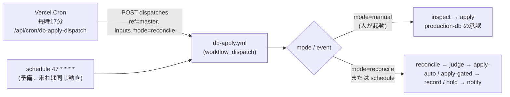
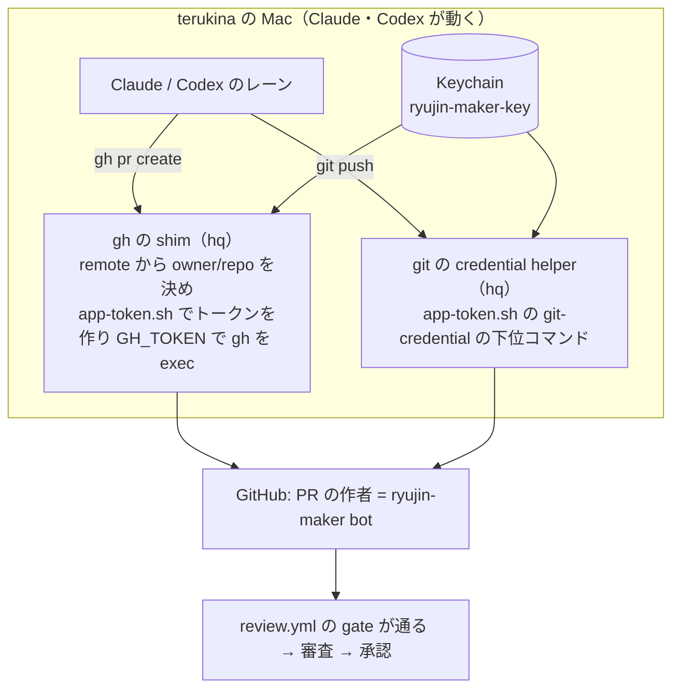
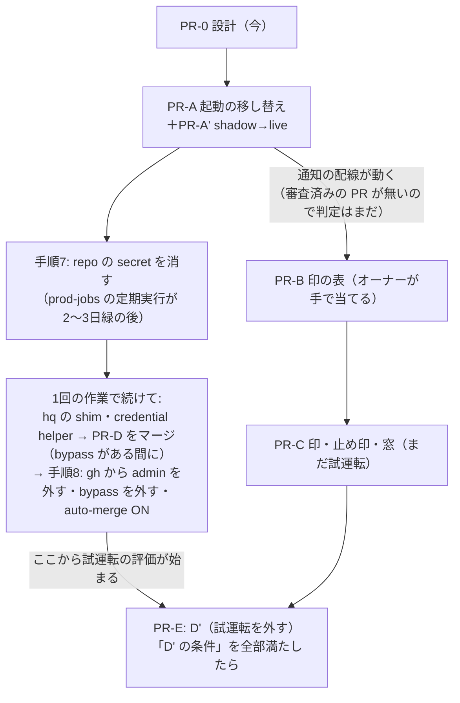

# 自動の適用の仕上げ（ADR-0097 の段取り D → D' と切替）

[ADR-0097](../../adr/0097-identity-separation-auto-review-and-db-apply.md) の「レーンの PR → 審査の App の承認 → db-apply の定期の起動が軽い SQL を当てる」経路を、実際に動く形にする設計。ADR-0097 の決定（身元・審査・当てる対象の5点・軽い／重いの判定）は変えない。変えるのは、起動の出元・PR を作る身元の配線・D' の前に要る3点・その順番。

オーナーの手順の正本は [identity-separation-owner-steps.md](../../operation/identity-separation-owner-steps.md)、適用の手順の正本は [db-apply.md](../../operation/db-apply.md)。この文書は、それらへの変更の設計を1か所にまとめたもの。実装は、オーナーの判断の後に PR を分けて行う（§5）。system-architect の審査（2026-10-20）の指摘を反映済み（§10）。

## 1. 今、動いていない理由（2026-10-20 15:30 JST の実測）

| # | 何が | 実測 | 出典 |
|---|---|---|---|
| 1 | 毎時の起動が来ない | `db-apply.yml` の schedule（`17 * * * *`）は #1674（2026-10-20 01:41Z に master）から 06:32Z までに起動0回（期待5回）。run は workflow_dispatch の2件だけ | `gh run list --workflow db-apply.yml` |
| 1' | 高頻度・新設の schedule は来ない | 直近24時間: Scrape Scheduled（`*/10`、約96回の期待）が4回。10/20 に足した key-canary（`7,37 * * * *`）は0回。日次の schedule は来ている（審査の実測で5日5/5） | `gh run list --event schedule -L 200`、`--workflow key-canary.yml` |
| 2 | 審査が動かない | review.yml の直近15件が全部 `skipped`。gate の条件 `github.event.pull_request.user.id == vars.REVIEW_MAKER_BOT_ID` に、rhapsody0919 名義の PR が当たらない | `gh run list --workflow review.yml`、review.yml の gate の `if` |
| 2' | 作成の App の道具はある | hq の `scripts/app-token.sh`（Keychain の秘密鍵から1時間のインストールのトークン、`gh`・`push` の下位コマンドつき）。App ID は hq の `config/github-apps.json`。龍神の .claude・AGENTS.md・scripts からは呼ばれていない | 読み取りで確認 |
| 2'' | 手順7・8 は未了 | repo の secret に、移す対象の8つ（`SUPABASE_SERVICE_KEY` 等）が残っている。ADR の一覧に無い `GOOGLE_SPREADSHEET_ID` も残る。Claude の `gh` は rhapsody0919（keyring、scope `repo`・`workflow`、git_protocol ssh） | `gh api .../actions/secrets`、`gh auth status` |
| 3 | 試運転のまま | `DB_APPLY_DRY_RUN: "true"`（db-apply.yml の env）。D' は切替の後（ADR-0097「試運転」） | db-apply.yml |

補足:
- 段取り S（鍵を使う job に `environment: prod-jobs`）は済んでいる。repo の secret の8つを参照する workflow で `environment:` を持たないものは0本（grep で確認）
- 1 の結果、試運転の通知も一度も出ていない。さらに 2 の結果、承認の付いた PR が無いので、起動が来ても軽い／重いの判定は1件も動かない（§5「D' の条件」）

## 2. (a) 起動を Vercel Cron からの dispatch に移す

### 形



### 変えるもの

| 場所 | 変更 |
|---|---|
| `.github/workflows/db-apply.yml` の `on.workflow_dispatch.inputs` | `mode`（choice: `manual`・`reconcile`、既定 `manual`）を足す。`migration` は `required: false` にする（reconcile では空） |
| 同 `inspect` の `if` | `github.event_name == 'workflow_dispatch' && inputs.mode != 'reconcile'`。`migration` が空なら `db-apply.js inspect` のパスの検証で落ちる（今と同じ） |
| 同 `reconcile` の `if` | `github.event_name == 'schedule' \|\| (github.event_name == 'workflow_dispatch' && inputs.mode == 'reconcile')`。ほかの条件（repository・`REVIEWER_BOT_USER_ID`）はそのまま |
| 同 `reconcile` の最初の step | `mode=reconcile` で `migration` が空でなければ落とす（どちらの意図か曖昧な起動を通さない） |
| 同 `notify` の `if` | `github.event_name == 'schedule'` を reconcile と同じ式に置き換える |
| 同 `record` の `MIGRATION`・`SHA256` | `inputs.migration \|\| needs.judge.outputs.file` をやめ、手での起動（`workflow_dispatch` かつ `mode != 'reconcile'`）なら inspect の値、それ以外は judge の値と、mode で分ける。reconcile の入口の検査に加えた二重の守り（ずれると、別のファイルを台帳に「適用済み」と書く） |
| 同 `schedule` | `17` を `47 * * * *` にずらして残す（予備）。同じ分だと、遅れて来た schedule と dispatch が重なり、互いを busy と見て両方とも何もしない |
| `scripts/lib/analogyDispatch.js` の `DISPATCH_WORKFLOWS` | `db_apply_reconcile: { workflow: "db-apply.yml", inputs: { mode: "reconcile" } }` を足す。起動の関数・失敗の扱いは今のものを使う |
| `api/cron/db-apply-dispatch.js`（新） | `createScrapeCronHandler({ job: "db_apply_dispatch", run: …, modeGated: true })`。in-caution-dispatch.js と同じ形。run は下の「見張り」の確認をしてから `createAnalogyDispatchRun("db_apply_reconcile")` を呼ぶ |
| `scripts/lib/scrapeJobs/registry.js` | `db_apply_dispatch: { kind: "monitor", leaseSec: 60, maxDurationSec: 60, hosts: [], failureAlertAfter: 1 }` |
| `vercel.json` | `{ "path": "/api/cron/db-apply-dispatch", "schedule": "17 * * * *" }`（UTC。JST も毎時17分）。登録は今63本で、上限100本（ADR-0066） |
| `scrape_job_state` | 共通ラッパが初回の起動で `mode='off'` の行を作る（`cronWrapper.js:148`）。オーナーは `UPDATE scrape_job_state SET mode='shadow' WHERE job='db_apply_dispatch'` を当てる（素の INSERT は主キーで失敗し、`ON CONFLICT DO NOTHING` だと off のまま残る）。shadow で1日見てから `live` |
| `scripts/maintenance/verify-analogy-dispatch.js` | 新しい対象の配線（registry・api の job 名・inputs のキーが workflow の inputs にあること）を足す |

- 予備の schedule が来ても、同じ reconcile が動くだけで二重に当てることは無い: reconcile は db-apply の他の run が `in_progress`・`queued`・`waiting` 等なら何もしない（`isBusy`、自分の run は除く）。2本が同時に始まると、互いを busy と見て両方とも何もしない（その回は飛ぶだけ）。最後の守りは §4.1 の主キー
- Vercel Cron の重複配信（まれ）も同じ理由で無害
- Vercel Cron は「リトライ無し・best-effort」。1回抜けても次の時間に拾う（突き合わせなので、抜けた回の分は残らない）

### トークン

- 今の Vercel の環境変数 `GITHUB_ACTIONS_DISPATCH_TOKEN` をそのまま使う。fine-grained PAT、boatrace-ai-predictor だけ、Actions: Read and write だけ（[analogy-weekly-train-dispatch.md](../../operation/analogy-weekly-train-dispatch.md) 49行目）。Vercel では Encrypted・Production だけ（審査の実測。Preview のデプロイからは読めない）。新しい鍵は作らない
- 今のトークンでも db-apply は dispatch できる（Actions: write は workflow を選べない）ので、PR-A で今より**できることは増えない**。手での起動（mode=manual）は production-db の承認で止まり、reconcile は審査の App が承認した PR のファイルしか選ばない
- ただし**切替の後の目標の状態と比べると、残る弱み**になる。このトークンは Actions: write を持つ（ADR-0097 は作成の App に Actions: write を付けない、と決めている）。Claude は Vercel CLI の認証（hq の drafts/identity-separation §54）と Vercel MCP に届き、値を読む関数をデプロイすれば読める（Sensitive は画面の表示を止めるだけ）。届いたときにできること: master の任意の workflow を inputs つきで dispatch、prod-jobs の run の rerun、review.yml の無効化。同じ経路で Vercel の SUPABASE_SERVICE_KEY 等にも届く
  - 塞ぐのは切替のとき（§6 の表）: Claude の動くユーザーから Vercel CLI の認証を外す（または書き込みの無いトークンにする）・Vercel MCP を切る。塞がないなら ADR-0097 の「残る弱み」に書いてオーナーが受け入れる（判断5）
- オーナーに設定の画面で確かめてもらうこと（値ではなく）:
  - この PAT に Actions 以外の書き込み、とくに **Deployments・Environments・Administration が付いていない**こと。PAT の持ち主は production-db の required reviewer（オーナー）なので、deployment の承認の権限があると、この PAT で承認できてしまう
  - Environment `production-db`・`production-db-auto`・`prod-jobs`・`ryujin-bot` の Deployment branches が **master だけ**であること。dispatch は任意の ref を指定でき、そのブランチの YAML が動く。鍵に届かせない守りはこの設定だけ（Claude からはフックが Environments の API を止めるので読めない）
- 期限切れ: 401 で dispatch が失敗し、`failureAlertAfter: 1` で1回目から Slack に出る（学習の起動と同じ）

### 見張りの空振り

dispatch は 204 を返すだけで、run が本当に動いたかは分からない。次はどれも黙る: `vars.REVIEWER_BOT_USER_ID` が空で reconcile が skipped（notify も skipped）、run が queued のまま、Vercel Cron 自体が来ない（monitor の job には死活の検知が無い）。
- dispatch の関数で、起動の前に db-apply の run と、その run の jobs（PAT の Actions: Read で読める）を見て、「live にしてから3時間を過ぎ、直近3時間に **reconcile の job が success で終わった** run が無い」なら（run の完了で数えると、reconcile が skipped の run も数えて空振りする） `outcome: "error"` を返す（起動はする）。`failureAlertAfter: 1` で Slack に出る
- Vercel Cron 自体が来ないことは、内側からは分からない。hq の外の見張り（scrape_job_runs の最終実行の鮮度）に `db_apply_dispatch` を足してもらう
- scrape-monitor は JST 7:00 から通知するので、夜の失敗（§4.3 の窓の中を含む）は朝に出る

### フック・規律との整合

- `.claude/hooks/guard-deploy-approval.sh` は変えない。Claude の Bash からの workflow の起動・承認は今までどおり止める。起動するのは Vercel の関数で、Claude ではない
- db-apply.md「Claude（AI）は起動・承認しない」の節に「定期の突き合わせ（mode=reconcile）は Vercel Cron が起動する。手での起動（mode=manual）はユーザー本人だけ」と1文足す
- Claude が `api/cron/db-apply-dispatch.js` を手で叩く経路: CRON_SECRET が要る（cronWrapper の認証）。届いても、選ばれるのは審査済みのファイルだけ

## 3. (b) レーンの PR と push を作成の App の名義にする

### 考え方

龍神の手順（スキル・AGENTS.md）は `gh` と `git push` を素で呼ぶままにして、**身元は環境の側で差し替える**。理由:
- create-pr・implement・orchestrate・Codex のレーンなど、`gh pr create`・`git push` を書いた場所が多い。各所に `app-token.sh gh ...` を書き込むと、書き漏れの所が rhapsody0919 のまま動き、審査が skipped になるだけで誰も気づかない
- 道具は Mac 全体の身元の道具で、hq の持ち物（hq の drafts §39）。龍神は「どの名義で動いているか」を検査するだけにする

### 形



### hq に頼むもの（龍神からは書き換えない）

1. `app-token.sh` に git の credential helper の下位コマンド（`get` に `username=x-access-token`・`password=<token>` を返す）。トークンはファイルに残さない。git の側は `credential.useHttpPath=true` を付ける（付けないとリポジトリを見分けられない）
2. `gh` の shim（PATH の先頭に置く）。カレントの git の remote から `owner/repo` を決め、作成の App が入っているリポジトリならトークンを作って `GH_TOKEN` で本物の `gh` を exec する。入っていないリポジトリ（hq 等）は hq の決めた身元（hq の drafts §108: hq だけの App か deploy key）
3. 切替のときの片付け（§6 の手順8）

### 龍神の側で変えるもの（切替の PR、§5 の PR-D）

| 場所 | 今 | 変更 |
|---|---|---|
| `.claude/commands/merge-pr.md` 24行目 | `gh pr merge {pr} --squash --admin` | `gh pr merge {pr} --squash --auto`。切替の後は admin の bypass が無く、作成の App にも admin は無い。審査の承認と必須の check がそろったら GitHub がマージする |
| `.claude/skills/orchestrate/SKILL.md` 118・176行目 | 「名義は未決」「`--admin`」 | 作成の App の名義で `--auto`。段階0の自己マージは「auto-merge を付ける」意味になる |
| `.claude/commands/create-pr.md` | `git push -u origin HEAD`・`gh pr create` | 変えない。push・PR の前に「名義の確認」の1行（下の検査）を足す |
| AGENTS.md 47・123行目 | Codex はマージ・auto-merge をしない | 変えない（Codex の PR の auto-merge はオーケストレーターが付ける） |
| `scripts/maintenance/guard-pr-merge.js` | `--auto` は ruleset が3つの check を必須にしているときだけ GitHub に任せる | 変えない（既に対応） |
| 新: 名義の検査 `scripts/maintenance/check-gh-identity.js` | ― | `gh api /installation/repositories` が通る（＝インストールのトークン）ことと、`gh auth status` に rhapsody0919 が無いことを見る。create-pr の最初と session-start-check に入れる。rhapsody0919 なら止める（審査が skipped になるだけで気づけないため） |

- コミットの author（`git config user.*`）は変えなくてよい。審査の gate は PR の作成者（`pull_request.user.id`）を見る
- ラベル（`gh pr create --label`）が通らなければ作成の App に Issues: Read and write を足す（オーナーの手順6の5、既にある）
- 切替の後、`gh api user` はインストールのトークンでは通らない。龍神の scripts・.claude に使っている所は無い（grep で確認）
- **作業の順番**: hq の shim・credential helper を入れる・PR-D をマージする・手順8の1〜3 は、**1回の作業で続けて**行う。shim を先に入れると admin の keyring と併存する期間ができ（下の「名義を混ぜない」に反する）、PR-D を先にマージすると 8.1 まで check-gh-identity が create-pr を止め、8.3 まで `--auto` のマージも通らない。PR-D は bypass がまだある間（8.2 の前）にオーナーがマージする
- gh の `git_protocol` は今 ssh。手順8で `gh config set git_protocol https` にする

### 切替の前の暫定（入れない）

切替の前に、create-pr だけを `app-token.sh gh ...` に替えて審査を動かす案は採らない。Claude の gh が rhapsody0919 のままだと、作成の App の PR と admin の PR が混ざり、admin の名義で出た PR は審査されずに `--admin` でマージできる。名義を混ぜる期間を作らず、切替で一度に替える。

## 4. (c) D' の前に要る3点

### 4.1 当て直しの防止: DB の側の印

```sql
-- 新しいマイグレーション（重い。CREATE SCHEMA・GRANT を含むので production-db、オーナーの1タップ）
CREATE SCHEMA db_apply;
REVOKE ALL ON SCHEMA db_apply FROM PUBLIC, anon, authenticated;
CREATE TABLE db_apply.applied (
  file        text PRIMARY KEY,            -- docs/db-migration/NNN_xxx.sql のファイル名
  sha256      text NOT NULL CHECK (sha256 ~ '^[0-9a-f]{64}$'),
  route       text NOT NULL CHECK (route IN ('manual', 'auto', 'gated')),
  run_id      bigint NOT NULL,             -- GitHub Actions の run
  applied_at  timestamptz NOT NULL DEFAULT now()
);
ALTER TABLE db_apply.applied ENABLE ROW LEVEL SECURITY;  -- policy は作らない（postgres のみ）
REVOKE ALL ON db_apply.applied FROM anon, authenticated, service_role;
GRANT USAGE ON SCHEMA db_apply TO claude_ro;
GRANT SELECT ON db_apply.applied TO claude_ro;            -- 台帳とのずれを Claude が読むため
```

- スキーマ `db_apply` は PostgREST の公開スキーマに入れない。適用の後、claude_ro で `has_table_privilege` を見て anon・authenticated・service_role が false であることを確かめる
- **印は適用と同じトランザクションで、ファイルより先に入れる**: 両方の形（`single-transaction`、`file-transaction`＝ファイル自身の BEGIN〜COMMIT。後者は今 34/159 本）で、psql を `-1 -v db_apply_file=… -v db_apply_sha256=… -v db_apply_route=… -v db_apply_run_id=… -f marker.sql -f <元のファイル>` で動かす
  - `marker.sql` はリポジトリに置く固定のファイルで、`INSERT INTO db_apply.applied (file, sha256, route, run_id) VALUES (:'db_apply_file', :'db_apply_sha256', :'db_apply_route', :'db_apply_run_id'::bigint);` の1文だけ。psql の変数は `-c` では展開されず `-f` の中で展開されるので、ファイルにする。変数名は本文と当たらないよう `db_apply_` を付ける
  - `file-transaction` のファイルの BEGIN は「既にトランザクションの中」の WARNING だけになり、ファイルの最後の COMMIT で印ごと確定する。途中の失敗は ON_ERROR_STOP で印ごと戻る。**元のファイルを書き換えないので、審査した sha256 と流すバイト列がずれない**
  - 印を先に入れるので、ファイルの中の `SET LOCAL ROLE` の影響を受けない
  - **runner の psql 16 で実機確認してから採る**（PR-C の最初の作業。捨てられる DB（runner の postgres の service container）で、両方の形・途中の失敗・同時の2本を試す）。psql の文書には「スクリプト自身が BEGIN・COMMIT を使うと `-1` は意図した効果にならない」とある
  - 実機確認で file-transaction の形が崩れたときの代わり: 切り替えより後の新しいマイグレーションは single-transaction の形だけにする（ファイルに BEGIN/COMMIT を書かない。verify で検査し、judge は file-transaction を「止める」にする）。今の 34 本の file-transaction は全部切り替えより前で、自動の経路の対象外
- **主キーで二重を構造的に止める**: 2本の run が同じファイルを当てても、後の方は印の INSERT が一意制約で失敗し、何も当たらずに戻る。busy の検査や台帳の読みの競合に頼らない
- 当てる前の確認（3つの経路の全部）:
  - 行が無い → 当てる
  - 行があり sha256 が同じ → **当てずに record だけ進める**（当てた後の record の失敗からの自己回復。台帳を「適用済み」にする）。apply の job は成功で終わり、出力 `already_applied=true` を付ける。通知の文は「当てた」ではなく「既に当たっていたので台帳だけ直した」、台帳に書く run の URL は印の `run_id`（元の run）
  - 行があり sha256 が違う → 止めて通知（同じ名前の別の中身。人が見る）
  - 表が無い（`to_regclass('db_apply.applied') IS NULL`）→ 止める（fail closed）。例外は PR-B のファイル名（コードに固定する）の1本だけ。一般の分岐（「表が無ければ印なし」）にはしない
- 手での経路（mode=manual）には `requireUnappliedOnMaster`（台帳の確認）を足さない。手で当てる経路は台帳が `不明` の行や切り替え前のファイルにも使っているため。手での経路で足すのは「印の行があれば止める」と「印を入れる」だけ
- 自己回復（sha256 が同じなら record だけ）は印を信じる。印を偽って書ける経路（`.env.local` の SUPABASE_ACCESS_TOKEN の管理 API 等、hq の drafts §54）が残る限り、「当てずに適用済み」にされうる。D' の条件に、その鍵を Claude の届く所から外すことを入れる（§5）
- 既存の適用済みのファイル（170本ほど）は印の表に入れない。対象は「これから当てるもの」だけ。台帳との突き合わせ（APPLIED.md の「適用済み」と表の行）は、表ができた日以降の行だけを verify で見る
- 表ができる前に手で当てて、台帳が `未適用` のまま残った切り替えより後のファイルは、印が無いので自動の経路が当て直しうる。D' の前に claude_ro で実物（表・列・索引）と照合し、当たっているものは台帳を直す（§5）
- PR-B のマイグレーションの冒頭にこの plan.md の参照を書くなら、`verify:er-diagram` のため plan.md に erDiagram を生成して貼る

### 4.2 失敗・却下したファイルの止め印

- 置き場所は**台帳（APPLIED.md）の「適用状況」の先頭の語**。新しい語 `保留` を足す（意味: 自動では当てない。理由と run の URL を括弧の中に書く）
  - DB に置かない理由: 失敗した適用はロールバックで DB に何も残らない。止め印のためだけに別のトランザクションで DB に書くと、鍵を持つ job の仕事が増える
  - PR のコメントに置かない理由: 誰でも書ける（ADR-0097「PR のコメントにある判定の結果は信用しない」）。止める側に倒れるだけとはいえ、正本を増やさない
- **突き合わせの直し**: `LEDGER_STATES` に `保留` を足すだけでは足りない。今の `db-reconcile.js:150` と `pickNext`・`pendingCandidates`（`dbReconcile.js:170`・`:238`）は、状態が null でも `未適用` でもないファイルを候補から外すので、`保留` を飛ばして**後ろの番号が当たる**（審査の P1-1、コードで再現）。`pickNext` は番号の順で先頭が `保留` なら `status: "blocked"`・理由「保留（run の URL）」を返す。verify に「保留の後ろの番号が選ばれない」を足す。これで今の規則「止まったファイルがあれば、以後の番号は当てずに止まる」（番号の順に依存があるため）を保つ。止まった通知は日付を入れて毎日1回
- 書く job: `hold`（新）。`needs: [judge, apply-auto, apply-gated]`、`if: !cancelled() && (apply-auto か apply-gated の result が failure) && その job の出力 attempted == 'true'`（`!cancelled()` が無いと暗黙の success() で skip される。timeout による cancelled も入れるかは PR-C で決める）
  - `attempted` は apply-auto・apply-gated が **psql を動かす直前**に出す。当てる前の確認で止まったもの（窓の外・台帳が `未適用` でない・印の表が無い・sha256 が違う・試運転）は `保留` にしない。窓の外は失敗にせず、成功で終えて次の窓で拾う（judge が窓の中で auto を出しても、concurrency の待ちで apply-auto が窓を過ぎてから動くことがあるため）。それ以外の確認の止まりは今どおり失敗にして通知する
  - Environment の却下は steps が動かないので `attempted` が出ない。却下が job の結果でどう出るかを PR-C で実測し、却下も `保留` にする条件を足す
- notify の `needs` に hold を足し、`保留` にしたこと（ファイル・run の URL）と hold の失敗を Slack に出すrecord と同じく Environment `ryujin-bot` の名義で master に直接コミットする（`push-with-retry.sh`）。行の書き換えは `db-apply.js mark-held <file> <run の URL>`（mark-applied と同じ書き方）。**`未適用` の行だけを書き換える**（record と競合して `適用済み` を上書きしない）
- 外し方:
  - 一時的な原因（lock 等）: 行を `未適用` に戻す PR（審査を通る）。検査4は SQL を足したコミットの差分しか見ない（`db-reconcile.js:164`）ので、戻す PR とはぶつからない
  - SQL の中身が誤り: 中身を直すと検査2（PR の head と master の blob の一致）で永久に通らない。**新しい番号で出し直し、古い行は `廃止`** にする
  - オーナーが手で当てて `適用済み` にする
- `hold` の job が失敗したとき（push の失敗等）: 次の時間にもう一度同じファイルが選ばれる。自動の経路はもう一度失敗する（トランザクションで戻るので DB は変わらない）、承認つきはもう一度オーナーに承認を求める。どちらも Slack に出る。害は通知の重複だけ
- `lock_timeout` 切れの扱い: 一時的な原因でも1回目で `保留` にする。数えて再試行する仕組みは作らない（KISS）。1行の PR で再開する

### 4.3 開催の無い時間帯に限るか

- 自動の経路（承認なし）の lock は10秒で、待つ間は後ろの読み取りも並ぶ（ADD COLUMN の ACCESS EXCLUSIVE）。statement は120秒（CREATE INDEX は表への書き込みを止める）。`dbApplySql.js` の `AUTO_TIMEOUTS`
- 取得の Cron は UTC 20〜14時台（JST 5:00〜23:59）に集まっている（vercel.json）。JST 0:00〜5:00 は夜の集計（in-caution 2:30 等）だけ
- 案:

| 案 | 自動で当てる時間 | 良い点 | 悪い点 |
|---|---|---|---|
| **A（推奨）** | JST 1:00〜4:59 だけ。他の時間は judge まで動いて当てない | 開催中のロック待ちが起きない。窓は4回の起動ぶんあり、1回抜けても当たる | 新しい列に頼るコードは、SQL のマージから最大で約1日待つ（ADR-0097「SQL を先の PR で入れる」と同じ運用で吸収） |
| B | いつでも | 早い | lock の10秒の間、取得とページの読み取りが並ぶ。開催中に ADD COLUMN が当たると、取得の Cron が10秒待つことがある |

- 重いもの（承認つき）は時間を限らない。オーナーが承認を押す時間を選べる
- 実装: judge が `mode=auto` を出す条件に「JST の窓の中」を足し、窓の外なら `mode=wait`（何もしない、毎時の notify も出さない）。apply-auto でも当てる直前に窓を確かめ直す（判定と同じ2段）。窓は workflow の env に、始まりを含み終わりを含まない形で固定する（`DB_APPLY_AUTO_WINDOW_JST_FROM: "1"`・`DB_APPLY_AUTO_WINDOW_JST_UNTIL: "5"`＝JST 1:00 以上 5:00 未満）

## 5. PR の分け方

| PR | 中身 | 触る所 | マージ | 前提 |
|---|---|---|---|---|
| PR-0 | この設計（docs だけ） | docs | オーナー | ― |
| PR-A | 起動の移し替え（§2） | .github・api・scripts・vercel.json | オーナー（.github） | 判断1・2 |
| PR-A' | `scrape_job_state` の mode を shadow → 1日後に live（UPDATE） | 本番 DB | オーナーが SQL エディタで当てる。docs/db-migration の番号つきファイルにはしない（in-caution と同じく `docs/design/…/owner-prod-steps` の形。番号つきにすると、切り替えより後に審査なしで足されたファイルとして reconcile の列の先頭で blocked になり、後ろの番号を止める） | PR-A のデプロイの後（ラッパが off の行を作った後） |
| PR-B | 印の表のマイグレーション（§4.1 の SQL） | docs/db-migration | オーナー（手で当てる、重い） | 判断3 |
| PR-C | 印・止め印・時間の窓のコード（§4）。最初に psql の実機確認 | scripts/db・scripts/lib・.github・verify | オーナー（.github） | PR-B の適用 |
| PR-D | 名義の切替の龍神の側（§3） | .claude・scripts/maintenance | オーナー。切替の作業の中で、8.2 の前にマージ | hq の道具 |
| PR-F | ④ 審査の関門の画像の例外（§9.1）と再現テスト、ADR-0097 の追記 | scripts/lib/reviewPr.js・scripts/review・verify・docs/adr | オーナー（審査の仕組みの変更、段階2） | 判断8 |
| PR-G | ⑥ orchestrate の段階0 F・案Z の書き直し（§9.3） | .claude/skills/orchestrate/SKILL.md | オーナー（.claude） | 判断11 |
| PR-E | `DB_APPLY_DRY_RUN: "false"`（D'）と、急ぎの止め方の repo の変数 `DB_APPLY_AUTO_ENABLED`（apply-auto の `if` とコードの両方で見る） | .github | オーナー | 下の「D' の条件」 |

### D' の条件（審査の P1-2）

切替の前は、承認の付いた PR が無いので reconcile の pending は全部 `ok:false` になり、`judge-all` は `ok:true` しか判定しない（`db-apply.js:241`）。PR-A の後も、軽い／重いの判定は実物で1件も動かず、出るのは「5点の検査を通らない」の通知だけ。試運転の評価は**切替の後から**始まる。D' に進む条件:
- 切替の後7日以上、試運転が動いている
- 審査済みの SQL を5本以上、judge-all が判定し、オーナーが Slack の「当てるはずだった」に誤りが無いと見た
- PR-C が入っている
- 印を偽れる鍵（`.env.local` の SUPABASE_ACCESS_TOKEN 等）を Claude の届く所から外した（§4.1）
- 切り替えより後に手で当てたファイルの台帳を、claude_ro で実物と照合した（§4.1）

## 6. 順番と戻し方



| 段 | 戻し方 | 戻したときの状態 |
|---|---|---|
| PR-A | `scrape_job_state` の mode を `off`（DB の1行）。急ぎなら Vercel の Cron を外す PR | 予備の schedule だけに戻る（今と同じ） |
| PR-B | 表は残してよい（読まれなければ害は無い）。消すなら `DROP SCHEMA db_apply CASCADE` を手で（重い） | ― |
| PR-C | revert の PR。止め印 `保留` の行は手で `未適用` に戻す | 試運転なので当てる動きは変わらない |
| 手順7 | 消した secret を repo に入れ直す（オーナー） | 今と同じ |
| PR-D・手順8 | 手順書の「戻し方（逆の順）」。auto-merge を OFF → bypass に Repository admin を足す → `gh auth login`（rhapsody0919）→ PR-D を revert | 今と同じ |
| PR-E | 急ぎは repo の変数 `DB_APPLY_AUTO_ENABLED` を `false`（オーナー。作成の App は Variables を書けない、ADR-0097）。後で `DB_APPLY_DRY_RUN: "true"` に戻す PR。Environment `production-db-auto` を消すのは効かない（参照された Environment は GitHub が保護なしで作り直す。owner-steps 4-2） | 試運転に戻る |

### 手順7・8 への追記（owner-steps に足す）

- 手順7の前提に「job-watch・key-canary が prod-jobs の鍵で緑」を足す（10/20 の Invalid API key の再発の確認。key-canary が schedule で来ない間は、prod-jobs を使う日次の job の緑で見る）
- 手順8の1（gh から admin を外す）を、届く経路ごとに分けて書く。Claude が動く Mac のユーザーから rhapsody0919 の書き込みや本番の鍵に届く経路は、`gh` の keyring だけではない（hq の drafts §54）:

| 経路 | 今 | 切替でどうするか |
|---|---|---|
| `gh` の keyring（rhapsody0919、`repo`・`workflow`） | あり | `gh auth logout -u rhapsody0919`（オーナー）。`gh config set git_protocol https` |
| git の credential（osxkeychain の github.com、`gh auth git-credential`） | 設定あり | Keychain の github.com のエントリを消し、hq の credential helper に替える |
| SSH の鍵（`~/.ssh/github_rsa`、ssh.github.com:443） | ある。どのアカウントの鍵かは未確認 | rhapsody0919 に登録されていれば、GitHub の設定から外す（オーナー）。龍神の remote は https なので、龍神の作業には要らない |
| ブラウザ（Claude in Chrome・アプリのブラウザ）の GitHub のログイン | オーナーとして操作できる | Claude が操作できるブラウザで GitHub からログアウトする。オーナーの作業は別のプロファイルで行う（手順書の「全体の決まり」と同じ） |
| Vercel CLI の認証・Vercel MCP → Vercel の環境変数（dispatch の PAT・SUPABASE_SERVICE_KEY 等） | 届く（Sensitive でもデプロイしたコードからは読める） | Vercel CLI をログアウトするか書き込みの無いトークンにする、Vercel MCP を切る（§2） |
| `.env.local` の SUPABASE_ACCESS_TOKEN（管理 API）等 | 届く | Claude の届く所から外す（印を偽れるため。D' の条件） |

- どこまで外すかはオーナーの判断（判断5）。全部は外せない（terukina は macOS の admin で、sudo のパスワードを入れた後の操作には届く。hq の drafts §128）

### 決まった後の ADR-0097 の追記

- 「失敗・却下したファイルは次の起動でまた選ばれる」（ADR-0097 の「本番 SQL の適用」）を、`保留` の止め印に合わせて書き直す
- 「残る弱み」に、dispatch の PAT がオーナーとして動く経路と、外さなかった経路（判断5）を足す

## 7. 別スコープ（Linear に起票する）

- key-canary・job-watch の前提の定期の起動が来ない（10/20 に key-canary 0回）。同じ dispatch の形で Vercel Cron から起こすか、hq の見張りに寄せる

## 8. オーナーに決めてもらう点

| # | 点 | 推奨 |
|---|---|---|
| 1 | 起動を Vercel Cron の dispatch にする（PR-A）。今の PAT を流用する | はい。今よりできることは増えない（切替の後の弱みは判断5で扱う） |
| 2 | PAT の権限が Actions だけか、Environment 4つの Deployment branches が master だけかを、設定の画面で確かめる | 確かめる（PAT に承認の権限があると production-db を承認でき、Deployment branches が広いと dispatch の ref で鍵に届く） |
| 3 | D' の前の3点を §4 の形で作る（印は DB の主キー、止め印は台帳の `保留`） | はい |
| 4 | 自動の経路を JST 1:00〜4:59 に限る（§4.3 案 A） | 案 A |
| 5 | 切替で、§6 の表の経路をどこまで外すか | gh・git の credential・ブラウザの GitHub のログイン・Vercel CLI と MCP・`.env.local` の管理の鍵は外す。SSH の鍵は登録先を確かめてから。外さないものは ADR-0097 の「残る弱み」に書く |
| 6 | 名義の差し替えを環境の側（hq の shim・credential helper）で行い、切替の前の暫定は置かない（§3） | はい |
| 7 | D' の条件（§5: 切替の後7日・審査済みの SQL を5本判定 等） | この条件 |
| 8 | ④ 審査の関門の画像の例外を §9.1 の条件で入れ、ADR-0097 に追記する（段階2） | はい |
| 9 | ② で寸法の表がビルドで作られる形になったときの関門の条件 | ② のレーンと合わせて決める。それまでは PR の head の表で照合 |
| 10 | 画像の中身が LLM の審査に渡らないことを受け入れるか | 受け入れて ADR-0097 の残る弱みに書く（グラフ・表の画像で、記事の本文は審査に入る） |
| 11 | ⑥ SKILL.md の段階0 F・案Z の4点の書き直し（§9.3） | はい。PR-D とは別の PR |

## 9. 中身の PR（ブログ記事）を同じ道に乗せる（2026-10-20 夕の追加）

オーナーの yes（10/20 夕、hq 経由「記事を集客だけで出す道を作ってよい」、オーケストレーター経由）で、記事の PR も「作成の App → 審査の App → auto-merge」に乗せる。この節は ④ 審査の関門の画像の例外と ⑥ orchestrate の段階0 F・案Z の書き直し。② 翻訳のメタの JSON 化・寸法をビルドで作る、③ `scripts/content/check-content-pr.js`（manifest の形を含む）、⑤ ADR-0034（`GITHUB_MERGE_TOKEN` の PAT で記事の PR をマージする古い道）の廃止と PAT の失効は、別のレーンが受け持つ。

### 9.1 ④ 審査の関門に画像の狭い例外を入れる（段階2、オーナーが直接承認）

今は `scripts/lib/reviewPr.js:57-60` が、本文の無い差分（バイナリ）を消したファイル以外は全部落とす。記事の画像はバイナリなので、記事の PR は全部落ちる。

例外にする条件（全部を満たすファイルだけ、本文の無い差分の理由から外す）:

| 条件 | 確かめ方（gate の job。鍵なし、PR の head は checkout しない） |
|---|---|
| `status === "added"`（変更・改名・複製は対象外。`previous_filename` があれば対象外） | compare の files |
| パスが `^public/images/blog/[a-z0-9-]+\.(jpg\|webp)$` | 正規表現。大文字・`..`・入れ子のディレクトリは当たらない |
| mode が `100644` | 今の `headModes`（head の木） |
| 大きさが 400KB（409,600 バイト）以下 | `GET /git/blobs/{sha}` の `size`（中身は base64 で取る。実行しない） |
| magic bytes が拡張子と一致 | jpg: 先頭 `FF D8 FF`・末尾 `FF D9`。webp: 先頭 `RIFF`・8〜11 バイト目 `WEBP` |
| EXIF・XMP が無い | jpg: APP1（`FF E1`）と COM（`FF FE`）の segment が1つも無い（EXIF も XMP も APP1 に入る）。APP2 の ICC は許す。SOS より前の segment だけを読む。webp: `EXIF`・`XMP ` の chunk が無い |
| 縦横が寸法の表と一致 | jpg は SOF0・SOF2 から、webp は VP8・VP8L・VP8X から縦横を読む。表は PR の head の `src/data/blogImageDimensions.js` を API で取り（実行しない）、`"/images/blog/<name>": { width: N, height: M }` の1行を正規表現で読む。行が無い・形が違えば落とす |
| 同じ PR で表の行を足している | 表の差分（patch）の `+` の行にその画像の行がある（既存の行に頼らない） |

- 純粋関数 `imageException(file, blob, headMode, dimensionsSource)` を `reviewPr.js` に足し、`mechanicalRejections` の本文の無い差分の分岐で使う。画像の読み取りは Node の組み込みだけ（review.yml の「npm ci・cache を使わない」）
- 再現テスト（`scripts/maintenance/verify-review-workflow.js` か新しい verify）: 通るもの（jpg・webp、ICC つき）、落ちるもの（EXIF つき・XMP つき・400KB 超・拡張子と中身の不一致・改名・modified・入れ子のパス・大文字・寸法の不一致・表の行が無い・symlink）
- **既存の画像183枚のうち99枚に EXIF がある**（実測）。記事の画像を作る側（③ のレーン、または画像の生成の道具）で、コミットの前に EXIF・XMP を外す。外さないと関門で落ちる
- ② で寸法の表がビルドで作られる形に変わると、PR の head に表が無くなる。そのときの条件（例: 縦横がそれぞれ 4000px 以下）は ② と合わせて決める（判断9）
- 画像の中身（写っているもの・文字）は、LLM の審査に渡らない（差分の本文に出ないため）。受け入れるか、画像を審査の LLM に画像の入力として渡すかを決める（判断10。推奨は、ブログの画像はグラフ・表の画像で、記事の本文が審査に入るので受け入れる。ただし ADR-0097 の「残る弱み」に書く）
- ADR-0097:34（「本文の無い差分は…機械で落とす」）に、この例外の追記をする（決まった後）

### 9.2 中身の PR を流すときの守り（system-architect、10/20 の審査の P0〜P2）

- **P0: 手順7の前に中身の PR を流すなら、push の前に、変えたパスの全部（改名の元・mode・削除を含む）を許可のリストと照合する**。作成の App は Workflows の書き込みを持ち、手順7の前は repo の secret がどのブランチの workflow からも読めるため。照合は PR を作る機械（③ の担当）が push の前に行い、関門（review.yml）でも同じ許可のリストで落とす（二重）
- **P1: 束のマージは、マージする時点で判定し直す**。見るのは、PR の作者の bot の ID（`REVIEW_MAKER_BOT_ID`）、今の head SHA に審査の App の APPROVE があること、変えたパスが許可のリストの中、CI が全部緑。束を作った時点の判定を使わない
- **P2: CI が赤でもすぐ閉じない**。空のコミットで1回だけ再実行してから決める（切替の後は Actions: write が無いので、再実行は空のコミット。ADR-0097「影響」）
- 古い道（`finalize-blog-draft.js` → `merge-blog-pr.js`、`GITHUB_MERGE_TOKEN` の PAT、ADR-0034）は、ADR-0097:109（書き込みの権限を他の App・人に配らない）と食い違う。廃止は ⑤ のレーン

### 9.3 ⑥ orchestrate の段階0 F と案Z の書き直し（段階2、.claude）

`.claude/skills/orchestrate/SKILL.md` を次の4点で直す。

| 行 | 今 | 直した後 |
|---|---|---|
| 69（A） | 「別ベンダーの審査（Claude の PR は Codex。止まっているときは代わりの審査）」 | review.yml の審査（作成の App の PR を別ベンダーの LLM が審査し、審査の App が承認）も「別ベンダーの審査」に含める。review.yml の APPROVE がある PR は、それで A のこの条件を満たす |
| 90（F のパス） | `public/blog/`・`src/data/blog-posts/`・`public/images/blog/`・`src/data/blogImageDimensions.js`・`src/data/blogPostsEn.js` | `src/data/blogPostsKo.js`・`src/data/blogPostsZhTw.js` を足す（記事の翻訳のメタ。② で JSON に移るなら、移った先のパスに置き換える） |
| 116（案Z の束） | 束に入れてよいのは段階0（A〜E） | A〜F。F の中身の束は、9.2 の P1（マージの時点の判定し直し）と P2（空のコミットで1回だけ再実行）に従う |
| 118 | 「自動マージをどの名義で行うかは未決」 | 消す。ADR-0097（v5）で決着: 切替の後は作成の App の PR を審査の App が承認し、auto-merge でマージする。切替までは、オーケストレーターが束を 9.2 の P1 で判定し直してからマージする |

- 同じ PR で、merge-pr の `--admin` → `--auto`（§3 の PR-D）と合わせるかは、切替の作業の日程で決める（9.3 は切替の前にも効く書き直し、PR-D は切替の作業の中でマージ）。別の PR にする

## 10. 審査（system-architect、2026-10-20）の指摘と対応

| 指摘 | 重大度 | 対応 |
|---|---|---|
| `保留` を「当てない」に足すと、`pickNext` が飛ばして後ろの番号が当たる | P1 | 採用（コードで再現）。§4.2 で `pickNext` が blocked を返す形と verify を明記 |
| 切替の前は judge-all が何も判定せず、PR-A から試運転の時計は動かない | P1 | 採用（`db-apply.js:241` で再現）。§5「D' の条件」を新設、図を直した |
| Vercel の経路は Sensitive では閉じない（デプロイしたコードから読める） | P1 | 採用。§2・§6 で切替のときに Vercel CLI・MCP を外す形にし、外さない場合は ADR の残る弱みに書く |
| record の MIGRATION が `inputs.migration \|\| …` に頼る | P2 | 採用。mode で分ける（§2） |
| psql の `-c` は変数を展開しない、file-transaction の差し込みは sha がずれる | P2 | 採用。`-1 -f marker.sql -f 本体`（印が先）に変更。実機確認を PR-C の最初に置く |
| 表が無いときの抜け道が恒久になる | P2 | 採用。PR-B のファイル名に固定 |
| 手での経路に台帳の確認を足すと運用が変わる | P2 | 採用。手での経路は印の確認だけ |
| hold の `!cancelled()`・`未適用` だけを書き換える・中身の修正は新しい番号 | P2 | 採用（§4.2） |
| Environment の削除は急ぎの止め方として効かない | P2 | 採用。repo の変数 `DB_APPLY_AUTO_ENABLED` |
| PR-A' は素の INSERT だと失敗する（ラッパが off の行を作る） | P2 | 採用。UPDATE にした |
| 見張りの空振り（dispatch 成功でも run が動かない） | P2 | 採用。dispatch の関数で直近3時間の reconcile の完了を見る、Cron の死活は hq の外の見張り |
| schedule と dispatch が同じ17分 | P2 | 採用。schedule を47分にずらして予備に |
| PR-D・shim・手順8 の順番 | P2 | 採用。1回の作業で続けて行う |
| 印を信じる自己回復の弱み、表の前の手での適用 | P2 | 採用。D' の条件に入れた |
| dispatch の ref と Environment の Deployment branches | P2 | 採用。判断2に足した |
| ADR の追記 | P2 | 採用。決まった後に追記（§6） |
| （/code-review）hold が当てる前の止まり（窓の外等）も保留にする・notify が hold を拾わない・見張りが run と job を区別しない・file-transaction の代わりの案が無い・PR-A' を番号つきにすると列を塞ぐ・窓の境界が曖昧 | P1〜P3 | 採用。`attempted` の出力、notify の needs、job の結果で数える、single-transaction だけにする代わりの案、owner-prod-steps の形、FROM/UNTIL |
| §1 の 1' の言い過ぎ、git_protocol、useHttpPath、細部（mode=wait の notify、already_applied の文、REVOKE service_role、SET LOCAL ROLE、erDiagram） | P3 | 採用（該当箇所を直した。SET LOCAL ROLE は印を先に入れることで解消） |
