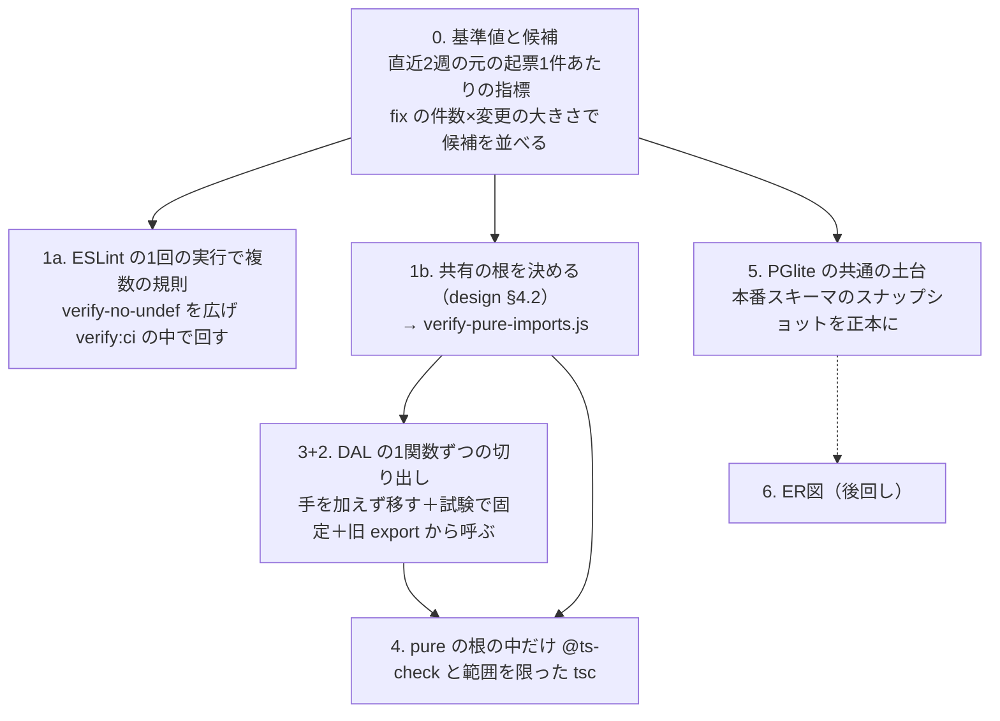

# 開発効率の計画（1週目〜2週目）

オーナーが 2026-10-24 に「推奨どおりで良い」で承認した計画。system-architect の審査の指摘を反映した版。

## 0. 目的

- 1件の起票が完了するまでの時間・差し戻し・衝突・Claude の週の枠の使用を減らす
- 手段は「機械が落とす検査を増やす」と「純関数を Node で試験できる場所へ移す」の2つ。Codex に任せられる範囲（`docs/design/codex-direct-pr/design.md` の段1・2）を広げることにもつながる
- 測れない効きは主張しない。§5 の基準値と比べて判断する

## 1. 全体の流れ

1a と 1b は並べる。3+2 は 1b の決定が要る（移す先のパスが決まらないと verify-pure-imports.js が書けない）。ただし依存が `src/utils` にある関数は、1b を待たず `src/services` の下の別ファイルへ移してよい（§2 の 3+2）。

## 2. 段ごとの中身

### 0. 基準値と候補

- 直近2週（2026-10-10〜10-23）の元の起票1件あたりで、完了までの時間・差し戻しの回数（CI の赤・審査の P0/P1）・衝突（rebase・番号の付け直し）・Claude の枠の使用を記録する。定義と取り方は `docs/design/codex-direct-pr/design.md` §8 に合わせる
- 候補の並べ方: ファイルごとの fix コミットの件数 × 変更の大きさ（追加＋削除の行）。上位から切り出しの候補にする
- 切り出した関数の試験が効いているかは BOA-255 の方式（変異の検証: 実装をわざと壊して試験が落ちるかを確かめる）で見る

#### 0 の結果: 候補の上位20件（2026-10-24）

`node scripts/analysis/rank-fix-hotspots.js`（既定の窓: 直近90日、`--since 2026-07-26`）。HEAD `2c1d17721`、浅い複製でないことを確認済み。全体は 999 コミット・うち fix 371・1,352 ファイル。正本は `data/analysis/dev-efficiency/fix-hotspots.json`（上位50件）。

- 数え方: master の first-parent・merge を除く・`[automated]` を除く。対象は `src`・`scripts`・`api` の `.js/.jsx/.mjs` と `middleware.js`。fix は件名が `fix:`・`fix(…):` で始まるもの（`codex: fix:` は数えない）
- 列: 変更の回数＝そのファイルを変えたコミット数、行数＝追加＋削除の合計、積＝回数×行数×fix、plan の式＝fix×行数（上の「候補の並べ方」）
- 表は積の順。plan の式の順で並べると、上位20件のうち17件は同じで、`PredictionPanel.jsx`・`raceIndicators.jsx`・`venueGuidesKo.js` が外れ、`src/App.jsx`・`verify-scrape-pre-race-job.js`・`verify-sns-bundle-import.js` が入る。1〜5位は両方で同じ

| # | ファイル | 変更の回数 | 行数 | fix の数 | 積 | plan の式の値 |
|---|---|---|---|---|---|---|
| 1 | `src/services/supabaseDataService.js` | 129 | 11,551 | 54 | 80,464,266 | 623,754 |
| 2 | `src/pages/admin/SnsHubAdmin.jsx` | 43 | 7,270 | 16 | 5,001,760 | 116,320 |
| 3 | `src/components/race/RaceMeetTab.jsx` | 36 | 3,991 | 20 | 2,873,520 | 79,820 |
| 4 | `scripts/maintenance/verify-frontend-pure-functions.js` | 37 | 2,981 | 22 | 2,426,534 | 65,582 |
| 5 | `src/components/analysis/MotorConditionChart.jsx` | 37 | 3,065 | 18 | 2,041,290 | 55,170 |
| 6 | `src/components/race/RaceBasicInfoTab.jsx` | 25 | 3,172 | 10 | 793,000 | 31,720 |
| 7 | `scripts/daily/scrape-results.js` | 22 | 3,113 | 10 | 684,860 | 31,130 |
| 8 | `src/components/race/RaceResult.jsx` | 23 | 2,263 | 12 | 624,588 | 27,156 |
| 9 | `scripts/maintenance/verify-series-points-stage-rules.js` | 21 | 1,935 | 15 | 609,525 | 29,025 |
| 10 | `src/data/blogPosts.js` | 46 | 3,822 | 3 | 527,436 | 11,466 |
| 11 | `src/components/race/seriesPoints.js` | 19 | 1,287 | 14 | 342,342 | 18,018 |
| 12 | `src/components/race/basicInfoStats.js` | 25 | 1,018 | 12 | 305,400 | 12,216 |
| 13 | `src/components/race/PredictionPanel.jsx` | 37 | 1,013 | 8 | 299,848 | 8,104 |
| 14 | `src/pages/ThinkingAssistPage.jsx` | 27 | 1,367 | 8 | 295,272 | 10,936 |
| 15 | `src/data/thinkingAssistCopy.js` | 24 | 1,029 | 9 | 222,264 | 9,261 |
| 16 | `src/components/race/raceIndicators.jsx` | 27 | 906 | 9 | 220,158 | 8,154 |
| 17 | `src/components/race/RaceBeforeInfoTab.jsx` | 20 | 1,077 | 9 | 193,860 | 9,693 |
| 18 | `src/data/venueGuidesKo.js` | 28 | 2,005 | 3 | 168,420 | 6,015 |
| 19 | `src/components/race/RaceWakuInfoTab.jsx` | 14 | 1,632 | 7 | 159,936 | 11,424 |
| 20 | `scripts/daily/generate-predictions.js` | 15 | 1,024 | 10 | 153,600 | 10,240 |

読み方:
- 1位の DAL が2位の約5倍（plan の式）〜16倍（積）で突出する。3+2 の対象を DAL から始める §2 の方針と合う
- `verify-*.js`（4・9位）は fix の PR が再現テストを足す決まり（`.claude/rules/review-fix-cycle.md`）で伸びる。切り出しの対象ではなく、上に載った fix の写し
- `src/data/*`（10・15・18位）は記事・文言のデータで、fix が少なく行数で上がっている。切り出しの対象にしない

#### 段3（切り出し）の最初の対象の候補

DAL の中の偏りは、DAL を変えた fix 54件の差分の hunk を、その時点のファイルで直前のメソッド名に寄せて数えた（使い捨ての集計、目安。メソッドの外の行・入れ子の関数は寄せ先がずれる）。`getMeetScoreboard` が 18件・800行で最多、次は `getRaceMotorBreakdown` 5件・110行、`getRacerScopedRaceStats` 5件・28行、モーターの世代まわり（`getMotorUsageHistory`・`getMotorWakuStats`・`getVenueMotorRanking` 等）が各3〜5件。

| 順 | 候補 | 理由 |
|---|---|---|
| 1 | `getMeetScoreboard`（`supabaseDataService.js:6909-7534`）の中の「順位の対象から外す選手と理由」の即時関数（約65行、`withdrawnRacerIds`・`exclusionReasonByRacer` を返す所）を純関数にする | 手戻り: DAL の fix の最多のメソッドで、この判定だけで途中帰郷・賞典除外の fix が4件（#1000・#1128・#1149・#1477）。次の案件: BOA-598（L1 を賞典除外に足す）がこの判定そのものを変える。呼び出し: `getMeetScoreboard` は src の7ファイルから使われる。小ささ: 中で使う `prelimEndRaceIdOf`・`flyingRacerIdsInMeet`・`withdrawnByAbsence` は既に `seriesPoints.js`（Node で import できる）にあり、入力は取得済みの配列だけ（SQL を移さない） |
| 2 | `getRacerScopedRaceStats` の整形（BOA-1022 の案どおり `buildRacerScopedRaceRows`） | 手戻り: fix 5件。呼び出し: src の12ファイルから使われ、4候補で最多。小ささ: 取得と整形の行の境目・入力・試験の固定データが起票に書いてある。BOA-1021 の後で、G4（300行）を超えるので Claude のレーン |
| 3 | `getRaceMotorBreakdown` の一覧の自前の値の整形（世代の範囲の当て方） | 手戻り: fix 5件・110行。次の案件: BOA-1020（入れ替え前の世代の最初の節）がここを変える。BOA-1019 の `motorGenerationStartAsOf` が既に純関数で入っている。ただし取得と整形が入り組み、`motorWindowStart` を他のドリルダウンと共有するので、1・2より切り出しは大きい。BOA-1020 の前に切り出すかは 1 の結果で決める |

1 を最初にする。DAL の fix の集まりがいちばん大きく、次の案件（BOA-598）が近く、SQL を移さずに済む。

#### 基準値（直近2週、JST 2026-10-10〜10-23）

| 測る物 | 値 | 数え方と出典 |
|---|---|---|
| 完了した元の起票 | 185件（うち codex-ok 34件） | Linear GraphQL、BOA チーム、`completedAt` が窓の中で状態の種類が completed、`includeArchived: true`（付けないと自動の保管で3件しか出ない）。親を持つ起票は0件だったので185件すべてが元の起票 |
| 元の起票1件あたりの完了の時間 | 中央値 54時間、平均 176時間、75%点 268時間 | 同上の `createdAt`→`completedAt`。起票してから着手までの待ちを含む。`startedAt` が入っているのは15件だけで、着手→完了は数えられない（中央値 280時間、n=15 で参考にしない） |
| マージした PR | 411件（作ってからマージまで中央値 1.4時間） | `gh api graphql` の search、`is:merged base:master`、マージが窓の中 |
| 差し戻し: CI の赤 | 411件中45件の PR で、赤の check suite が計67回（0.16回/PR）。起票の番号が付いた PR から元の起票に寄せられた72件では 0.35回/件、赤が1回以上の起票が16件 | 各 PR のコミットの check suite のうち、Quality Gates・E2E Smoke Test が FAILURE のもの。PR の件名・ブランチ名の `BOA-n` で起票に寄せた（259件の PR は番号が無く寄せられない） |
| 差し戻し: 審査の P0/P1 | 未計測 | GitHub の review は ryujin-reviewer の APPROVED 21件・DISMISSED 1件だけで、CHANGES_REQUESTED は0件。Codex の review は窓の中に GitHub 上で0件。Claude の PR の審査（`/code-review`・サブエージェント・Codex）の指摘は PR のコメントの自由文で、P0/P1 の数を機械で取れない |
| 衝突: rebase | force push 19回（8件の PR） | 各 PR の timeline の `head_ref_force_pushed`（REST）。rebase して force push した回数の代わり。merge で追いついた PR は数に入らない |
| 衝突: master の取り込み | 92件の PR で master の merge コミットが計136件。寄せた72件の起票では 0.54件/件（22件） | PR のコミットの件名が `Merge branch 'master'`・`Merge remote-tracking branch 'origin/master'` で始まるもの。衝突の解消でない追いつきも含む（上限の値） |
| 衝突: 番号の付け直し | 0件 | 窓の中の手元の全 ref（`git log --all`）のコミットの件名の `番号…付け直`・`renumber`。#1659（10/19〜、番号の予約をやめた決まり）以後の付け直しは件名に書かれないことがあり、下限の値 |
| Claude の週の枠の使用 | 未計測 | 枠の記録の取り方が未確立（`docs/design/codex-direct-pr/design.md` §8） |

限界: 時間は起票の作り方（後で起票して即 Done にする記録の起票も入る）に左右される。2週目の終わりに同じ数え方で取り直して比べる。

### 1a. lint の範囲を広げる

- `scripts/maintenance/verify-no-undef.js` を、ESLint の1回の実行（`ruleFilter` に複数の規則）で見る形に広げ、verify:ci の中で回す。`.github` は変えない（Quality Gates が既に verify:ci を必ず走らせる）
- 規則の一覧は引数で渡し、`verify-registry.json` の行の `args` で verify:ci のときだけ付ける。引数なしは今のまま no-undef だけ。`post-merge-checks.yml:69` が引数なしで呼ぶので、マージ後の Slack の範囲は広がらない（ADR-0079 追記）
- 最初に error にするもの: 今の違反が少ない規則（`no-empty`・`no-irregular-whitespace` 等）と、`src` だけの `react-hooks/rules-of-hooks`
- `no-unused-vars` は BOA-1015〜1018・1024（既存の違反の解消）の後に入れる
- 抑制の一覧（`verify-no-undef-allowlist.json` を規則ごとに広げたもの）は、解消済みの行が残っていても落とす（今の流儀のまま）
- ファイル内の `eslint-disable` の追加も検出する（一覧を通らない抑制を塞ぐ）
- 「await し忘れ」（`no-floating-promises` 相当）は型の情報が要るので、4 の型の段まで外す
- 実測: error は 345（2026-10-24、system-architect の実測）。本 PR の作成時の再測（origin/master `e2d194f35`、`npx eslint . -f json`）は全体で 699、`docs/`（235 件の no-undef は docs の中の .js の例）と `sns-video-studio/`（別の React の作り）を除くと 352。範囲の取り方で数が変わるので、1a の PR で対象のディレクトリを verify-no-undef と同じにそろえて数え直す。lint 全体を必須にしない理由は ADR-0079 の追記

| 規則 | src | scripts | e2e | analysis | 1a での扱い |
|---|---|---|---|---|---|
| `no-unused-vars` | 16 | 293 | 2 | 5 | BOA-1015〜1018・1024 の後 |
| `no-irregular-whitespace` | 3 | 3 | 12 | 0 | 最初に error（直してから入れる） |
| `no-empty` | 3 | 0 | 0 | 0 | 最初に error（同上） |
| `react-hooks/rules-of-hooks` | 0 | — | 1 | — | `src` だけ最初に error（e2e の1件は `e2e/fixtures.js:516` の Playwright の fixture の `use` を React の Hook と取り違えた誤検出） |
| `react-hooks/set-state-in-effect`・`purity`・`preserve-manual-memoization` | 11 | — | — | — | 後で判断（React 19 の新しい規則。直すと挙動が変わりうる） |
| `no-control-regex`・`no-useless-escape` | 0 | 2 | 0 | 0 | 最初に error（同上） |

### 1b. 共有の根と verify-pure-imports.js

- 共有の根の決定は `docs/design/codex-direct-pr/design.md` §4.2 の追記（2026-10-24）を正本にする
- 決定の後に `scripts/maintenance/verify-pure-imports.js`（台帳で `ci`）を作る。仕様は同 §4.2 の表

### 3+2. DAL の切り出し

- `src/services/supabaseDataService.js`（DAL）は Node で import できない（`./supabaseClient`（拡張子なし）が `import.meta.env.VITE_SUPABASE_URL` を読む・`../utils/stConsideration` 等の拡張子なしの import を Node の ESM が解決しない、の2つ。`src/services/supabaseClient.js:44-45`、`supabaseDataService.js:8・22`）。中の純粋な計算は Node の verify で試験できない
- 1つの PR で次を同時に行う: (a) 1関数を手を加えずに移す (b) 移した先で今の動きを試験で固定する (c) DAL の旧の export からはその関数を呼ぶ（呼び出し側は変えない）
- 試験の期待値は2つに分ける: 「旧の実装から取った値」（今の動きの固定。誤りも含めて写す）と「仕様の値」（公式の定義・設計書から決まる値）。食い違ったら別の起票にし、切り出しの PR では直さない
- SQL を変えていない証拠: その PR の E2E で、録画に無いリクエストの素通しが0件（`scripts/maintenance/report-e2e-passthrough.js` の集計）。録画の照合は URL（PostgREST のクエリ）で行うので、クエリが変われば素通しが出る。限界: E2E が通らない関数のクエリは証拠にならない。そういう関数は SQL の部分を移さない
- 依存が `src/utils` にある関数は、1b が決まるまで `src/services` の下の別ファイル（Node で import できるもの）に移す。1b の後に pure の根へ移し直す
- 切り出しの PR は自動マージしない（design §4.2「切り出しの PR」）
- 切り出しの最初の PR で、共通ロジックの索引（`scripts/maintenance/generate-lib-index.js` の TARGETS）に `src/pure` を足す。足さないと移した関数が索引から消える（design §4.2 追記）

### 4. 型の検査

- pure の根の中だけ `// @ts-check` を付け、範囲を限った `tsc --noEmit`（jsconfig の `include` を pure の根だけ、`"types": []`、DOM を含まない `"lib"`）を verify:ci の中で回す。JSDoc の `import('...')` 型と `/// <reference` で根の外が入らないよう、verify-pure-imports.js がコメントの中も見る（ADR-0079 追記）
- `typescript` は今 devDependency に無い。足す PR は `package.json` を変えるので Claude の PR（Codex の G5 の対象）
- 全体に `checkJs` を入れない理由は ADR-0079 の追記

### 5. PGlite の共通の土台

- 今の PGlite の verify（`scripts/maintenance/` に34本）は、それぞれ必要なマイグレーションだけを読む。全スキーマの土台は無く、マイグレーションの積み上げでは DROP・RENAME を追えない
- 共通の土台は、本番のスキーマのスナップショット（`claude_ro` でカタログ（`pg_catalog`・`information_schema`）を読んで DDL にしたもの）を正本にする
- Supabase Branching は入れない（費用が掛かる。今の verify は PGlite で足りる）

### 6. ER図

- 後回し。5 のスナップショットができれば機械で作れる（`docs/reference/database-design.md` の関係図と同じ考え方）

## 3. Codex と Claude の分け方

| 段 | Codex | Claude |
|---|---|---|
| 0 | fix の件数×大きさの集計のスクリプト（`scripts/analysis/` の新規、段1） | 基準値の記録（Linear・枠の記録）、候補の決定 |
| 1a | 規則ごとの違反の一覧・解消のパッチ（BOA-1015〜1018・1024 等、既存の変更は要審査） | `verify-no-undef.js` の拡張（守りの verify なので Claude）、`eslint.config.js` の変更 |
| 1b | — | 共有の根の決定（本 PR）、`verify-pure-imports.js`（G5 の守りの verify） |
| 3+2 | 移した関数の試験の追加（段1・2 の範囲） | 切り出しの PR（DAL の変更を含むので Claude。自動マージしない） |
| 4 | pure の根の中の型の注記の追加（段2、根が開いた後） | `typescript` の追加・jsconfig・verify の追加 |
| 5 | スナップショットを使う verify の新規（段1） | スナップショットの job（`claude_ro` の鍵を使う。オーナーの承認） |

## 4. 最初の2週間（最短）

前の結果が本当に要る所だけを順にする。

| 日 | Claude | Codex |
|---|---|---|
| 1日目（10/24） | 本 PR（docs）。基準値の記録の着手 | fix の件数×大きさの集計のスクリプト |
| 2日目 | 1a の verify の拡張の PR、1b の verify-pure-imports.js の PR（並べる） | 1a の規則ごとの違反の一覧 |
| 3日目 | 3+2 の1件目（候補の上位、`src/services` の下の別ファイルか pure の根） | 1件目の試験の追加 |
| 4〜5日目 | 3+2 の2・3件目。3件の後に ADR-0072 のランナーの見直し | BOA-1015〜1018・1024 の解消 → `no-unused-vars` を入れる |
| 2週目 | 4（`typescript` の追加と範囲を限った tsc）、5 のスナップショットの job（鍵の承認の後） | pure の根の中の型の注記、スナップショットを使う verify |

最短を決めている制約:
- 1b の決定（本 PR のマージ）→ verify-pure-imports.js → pure の根への切り出し
- BOA-1015〜1018・1024 の解消 → `no-unused-vars` の error
- オーナーの承認（スナップショットの job の鍵）→ 5

## 5. 成果の測り方

| 測る物 | 基準 | 見る時点 |
|---|---|---|
| 元の起票1件あたりの完了の時間 | §2 の 0 の直近2週 | 2週目の終わり |
| 差し戻し（CI の赤・審査の P0/P1） | 同上 | 同上 |
| 衝突（rebase・番号の付け直し） | 同上 | 同上 |
| Claude の週の枠の使用 | 同上 | 同上 |
| 新しい規則が止めた不具合 | 0（導入前） | PR ごと（verify:ci の失敗の記録） |
| 切り出した関数の試験の強さ | — | 切り出しの PR ごとに変異の検証（BOA-255 の方式） |

見直しの線（目安、根拠なし）: 2週目の終わりに4つの指標がどれも基準を下回らなければ、3+2 の候補の選び方を見直す。

## 6. 承認が要る所

| 物 | 誰 | 理由 |
|---|---|---|
| スナップショットの job の鍵（`claude_ro` を Actions か hq の定期 job で使う） | オーナー | 鍵とセキュリティ |
| Supabase Branching の費用 | オーナー | 新しい費用（本計画では入れない） |
| 必須の check の追加（ruleset） | オーナー | 保護ルールの変更。本計画は verify:ci の中に入れるので、新しい必須の check は要らない |
| それ以外（1a・1b・3+2・4 の設計） | 不要 | system-architect の審査を通して推奨どおり進める（`~/.claude/CLAUDE.md`「判断の流れ」） |

## 7. 関連

- ADR-0079（lint の範囲・型の検査の範囲、2026-10-24 追記）
- ADR-0072（ランナーの見直しの線、2026-10-24 追記）
- `docs/design/codex-direct-pr/design.md` §4.2（共有の根、2026-10-24 追記）
- `docs/knowledge/db-operations.md`（DAL・PGlite・eslint の実測・E2E の素通し・ADR-0072 の線）
