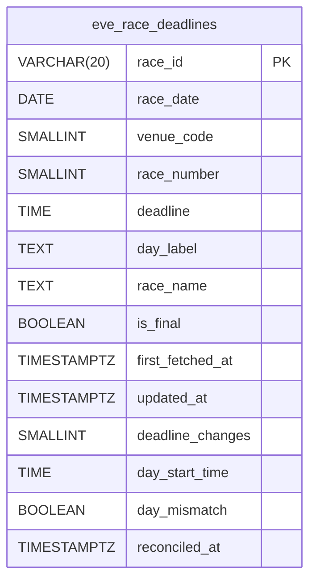

# 前夜の締切予定（eve_race_deadlines）

BOA-1282・BOA-1306。オーナー 2026-11-04 21時「前夜の投稿に翌日の締切を書く」（数日の測定は省き、すぐ書く形）。前夜は締切を書かない、という前の決定を上書きした。

## 1. なぜ要るか

翌日のレースの行（races）は当日 05:00〜の朝の初期化（races_init）で入る。21:30 の前夜の投稿（final_gap の Shorts、X の節の機力）の作りの時点では、翌日の races が DB に無い。公式の raceindex は前夜に翌日の締切予定（HH:MM）を出している（11/4 の測定: jcd=04 等の3場で 20:3x と 21:02 に12個とも同じ値）。

## 2. 持ち場

| 担当 | 物 |
|---|---|
| 龍神（このリポジトリ） | 前夜の取得ジョブ・表・当日朝の照合・final_gap の束の `final_deadline` の口と、その冒頭・題・説明の検査 |
| hq | 共通の読み口 `platform/eve_deadlines.py`（race_id → 締切、`final_deadline(date, jcd)` → (R, "HH:MM")）。表が無い・行が無いときは None で今どおり。束の題・説明・`final_deadline` は hq が書く |

Shorts の節の機力（motor_gap・motor_up・border）は翌日のレースを出さないので、この表を使わない（hq の訂正、11/4）。X の節の機力の画像は hq がこの表を読む。

## 3. 表 `public.eve_race_deadlines`

1行＝翌日の1レース。前夜に取った値を残し、当日朝に races と比べた結果を同じ行に書く。

| 列 | 型 | 意味 |
|---|---|---|
| race_id | varchar(20) PK | races と同じ形 `YYYY-MM-DD-VV-RR`（races への外部キーは付けない。前夜は races の行が無い） |
| race_date | date | 開催日（取得した翌日） |
| venue_code | smallint 1〜24 | |
| race_number | smallint 1〜12 | |
| deadline | time | 前夜に取った締切予定（秒は 0）。前夜の取得で変わったら新しい値 |
| day_label | text | raceindex の日の札（「初日」「２日目」「最終日」等、公式の表記のまま） |
| race_name | text | racelist のレース名（「優勝戦」「選抜戦Ａ」等。距離表記は除く）。取ったレースだけ、他は NULL |
| is_final | boolean | 優勝戦か。最終日でない日の会場は false。最終日の会場は racelist を 12・11・10R で取り、名前に「優勝戦」を含み「準優勝戦」「進出」でなければ true、違えば false。1〜9R は false（優勝戦は10R より前に無い前提）。10〜12R で名前が取れなければ NULL（未確認）。日の札が取れなかった回は前の回の値を使う |
| first_fetched_at | timestamptz | 最初に取れた時刻 |
| updated_at | timestamptz | 前夜の取得で値（締切・日の札・レース名・優勝戦の判定）を最後に書いた時刻 |
| deadline_changes | smallint | 前夜の取得の間で締切が変わった回数（0 が普通） |
| day_start_time | time | 当日朝の races.start_time（照合の時点） |
| day_mismatch | boolean | deadline と day_start_time が違う。NULL は未照合（races の行が無い・start_time が無い） |
| reconciled_at | timestamptz | 照合の時刻 |

- 索引: (race_date, venue_code)（hq の final_deadline(date, jcd) の読み）
- RLS 有効・ポリシーなし（191 sns_send_events と同じ形）。REVOKE ALL FROM PUBLIC, anon, authenticated, service_role の後、service_role に SELECT・INSERT・UPDATE（既定の権限の ALL から DELETE・TRUNCATE を外す）、claude_ro に SELECT（166 で BYPASSRLS なのでポリシーは要らない）。画面では使わない
- 量: 1晩 約15会場×12R＝約180行（1行 約150B、1年 約10MB）。書くのは値の変わる行だけ（data-acquisition.md「変更の無い行は書かない」。2回目以降の起動はふつう0行）。取得の回数は行に持たず、起動ごとの会場の成否は scrape_job_state.last_report に残る。消すのは今は要らない
- 審査で「回数」の列（fetch_count）を外した: 毎回すべての行を書くことになり、上の規則に反する。値が変わったことは deadline_changes と updated_at で分かる
- hq の読み方: `race_id` で引く。当日の races の行があれば races.start_time を正とし、無ければこの表の deadline を使う（表の deadline は前夜の値で、当日は直さない）
- hq との契約: is_final が true の行が1会場に2つある日がある（男女W優勝戦）。どちらを出すかは hq が決める。is_final が NULL（未確認）のときに 12R を優勝戦とみなさない。deadline_changes > 0 の行は前夜の間に締切が動いた（出すかは hq）

## 4. ジョブ

共通ラッパ（scripts/lib/scrapeJobs/cronWrapper.js）の日次ジョブ2つ。新しい取得は Vercel Functions＋Vercel Cron（ADR-0066）なので .github は触らない。

### 4.1 `eve_deadlines`（前夜の取得）

- registry: kind daily、targetTimeJst "20:40"、finalRunAfterJst "21:20"、leaseSec 800、maxDurationSec 800、hosts ["boatrace.jp"]
- cron（vercel.json、UTC）: `40 11 * * *`・`0,10,20 12 * * *`（JST 20:40・21:00・21:10・21:20 の4回）。api/cron/eve-deadlines.js、実装 scripts/lib/eveDeadlinesJob.js
- 対象: 対象日（20:40 から解決した JST の日）の翌日。期待する会場は race_series（start_date ≦ 翌日 ≦ end_date、約15）。その晩の最初の起動（表にその日の行がまだ無い）だけ、残りの会場も取る（race_series の欠けを見つける）
- 取得: raceindex（`/owpc/pc/race/raceindex?jcd=VV&hd=YYYYMMDD`）を1場ずつ、取得の間に5秒空ける（同時1）。UA・IP は politeFetch の既定のまま。解析は scripts/lib/raceIndexParser.js（行の「NR」と締切を対にする。朝の scrape-to-json.js の getRaceStartTimes は時刻の td を順に割り当てるので使わない）
- raceindex を全部取った後に、最終日の会場（日の札「最終日」）だけ、まだレース名の無い racelist の 12・11・10R を同じく5秒おきに取る（レース名は raceStageParser.js）。打ち切られても失うのは名前だけで、次の起動が名前の無いものを取り直す
- 2回目以降の起動は、race_series の会場に、その晩に既に行のある会場（race_series に無かったが開催のあった会場）を足して取る
- 失敗: 期待する会場（上の2つ）で 2xx でない応答（politeFetch は登録していないパスの 403 を普通の応答で返す）・取得の例外・0行・並びの異常（1R から続かない・12R を越える・締切が昇順でない・06:00 より前）は、その会場の失敗。書かずに incomplete。期待しない会場は0行なら開催なし、行があれば書いて通知、並びの異常は書かずに通知（失敗に数えない）
- 書き込み: その晩の既存の行を読み（失敗は例外）、値の変わる行だけを upsert（純粋関数 buildEveRows）。毎回すべての列（照合の3列を除く）を送る（PostgREST のバルク upsert は列の集合が違う行を NULL で埋める）。締切が変われば deadline_changes＋1、取れなかった回のレース名・優勝戦の判定は前の値を残す
- 完了: finalRunAfterJst（21:20）より前に始まった起動は `incomplete: true`（同じ対象日をもう一度取る）。21:20 以後の起動で、失敗・未着手の会場と取れなかった名前が無ければ済み。残れば incomplete のまま、同じ晩の 23:40（指定＋3時間）から monitor の daily_overdue が出る。最後の起動の失敗は last_report.alerts（翌日の 12:00 まで）にも出す
- 0件: rowsExpected＝期待する会場の数を返すので、期待する会場があるのに1行も取れない起動は共通ラッパの0件の検査で失敗になる。期待する会場が無く24場も空なら失敗
- 1回の時間: 1ページ約8〜10秒＋5秒で、最初の起動は24場で約5.6分＋最終日の会場×3ページ、2回目以降は約15場で約3.5分＋名前の残り。maxDuration 800 秒、ソフトデッドライン（−30秒）で打ち切り、残りは次の起動
- 取得の数: 1晩 raceindex 約70ページ（24＋3×15）、racelist は最終日の会場×3（約9〜24）。docs/design/scraping-load-budget/spec.md §4.2 の raceindex の予算を 200→280 に直した（racelist は今の枠の余りで足りる）
- shadow: 取得・解析だけで書かない。mode はマイグレーションで live にする（作ったその晩から hq が読む。並びの検査が通らない会場は書かない）

### 4.2 `eve_deadlines_reconcile`（当日朝の照合）

- registry: kind daily、targetTimeJst "06:30"、leaseSec 120、maxDurationSec 60、hosts []（取得なし）
- cron: `30 21 * * *`・`0 23 * * *`（JST 06:30・08:00）。api/cron/eve-deadlines-reconcile.js
- races_init の last_target_date が今日になるまで比べない（incomplete、08:00 が取り直す）。済んだら、その日の表の行と races（race_id・start_time）を読み、day_start_time・day_mismatch・reconciled_at を値の変わる行だけ書く。行は既存の全列に3列を足して送る（3列だけの upsert は INSERT の行の NOT NULL で落ちる）
- 食い違い（day_mismatch true）は last_report.alerts に race_id ごとの key で出す（その日の 12:00 まで）。races に行が無い（中止の疑い）・行はあるが start_time が無い、はそれぞれ day_mismatch NULL のまま、まとめて1つずつ通知し、照合は済みにする
- 前夜の投稿は送ったものなので直さない。表の deadline も前夜の値のまま残し、当日の正は races.start_time（hq の読み口が races を先に見る）

## 5. final_gap の束（Shorts、sns-video-studio）

- 束に任意の `final_deadline: { "race": "11R", "time": "15:45" }` を足す（hq が表から入れる。無い・null なら今どおり締切を出さない）
- 冒頭（hook）と締め（close）の頁の札の下（y 215）に「11R 締切予定 15:45」を出す。Shorts の見本の絵（YouTube が選ぶ）にも出る
- 検査（checkBundle）: race が 1〜12 の「NR」、time が HH:MM。題（youtube.title）と説明（youtube.description）に race と time の両方が入っていること（hq が書く。入っていなければ止める）。画面の文に出る数に race・時・分を足す
- when=eve・today のどちらでも受ける（オーナー「全ての動画に締切」）

## 6. 戻し方

- 取得を止める: `UPDATE scrape_job_state SET mode='off' WHERE job IN ('eve_deadlines','eve_deadlines_reconcile');`
- 表を消す: `DROP TABLE public.eve_race_deadlines;`（hq の読み口は表が無いと None）
- 束の `final_deadline` は hq が入れなければ今どおり

## 7. 審査（system-architect、2026-11-04）と対応

| 指摘 | 対応 |
|---|---|
| P1-1 取れなかった会場が「開催なし」に化ける | 採用。race_series で期待する会場を決め、2xx でない・0行・並びの異常を失敗にする。rowsExpected を返す。期待しない会場の行は通知 |
| P1-2 取得の予算表を更新していない | 採用。scraping-load-budget の raceindex を 200→280、racelist は余りで足りると注記 |
| P1-3 書き込みで NULL の上書き・NOT NULL 違反 | 採用。読み取りの失敗は例外、毎回すべての列、照合は既存の全列に3列を足して送る |
| P2-1 claude_ro は BYPASSRLS | 採用。ポリシーを消し 191 の形に |
| P2-2 daily_overdue は同じ晩の 23:40 | 採用。記述を直し、境の時刻を registry の finalRunAfterJst にして validateRegistry で検査 |
| P2-3 照合の incomplete の条件・通知の繰り返し | 採用。races_init の last_target_date で待つ、races に無い行は済みにして通知、通知は until つき・key に race_id |
| P2-4 1回の時間 | 採用。会場を約15に絞り、raceindex を先に全部、名前は後で残りだけ |
| P2-5 毎回の全行 UPDATE | 採用。fetch_count を外し、値の変わる行だけ書く |
| P2-6 解析を2つ作らない | 一部採用。レース名は raceStageParser.js を使う。raceindex は朝の getRaceStartTimes が番号をずらしうるので、行で読む新しい解析にし、朝の側は変えない（朝の races_init の挙動を変えるのはこの依頼の外） |
| P2-7 台帳・ER 図 | 採用 |
| P2-8 shadow を飛ばす | 採用しない（初回は表が入った日の 21:30、オーナーの決定）。並びの検査が通らない会場は書かない・deadline_changes で hq が区別できる |
| P3 service_role の既定の ALL | 採用。REVOKE ALL の後に SELECT・INSERT・UPDATE |
| P3 W優勝戦・未確認の扱い | 採用。§3 の hq との契約に書いた |
