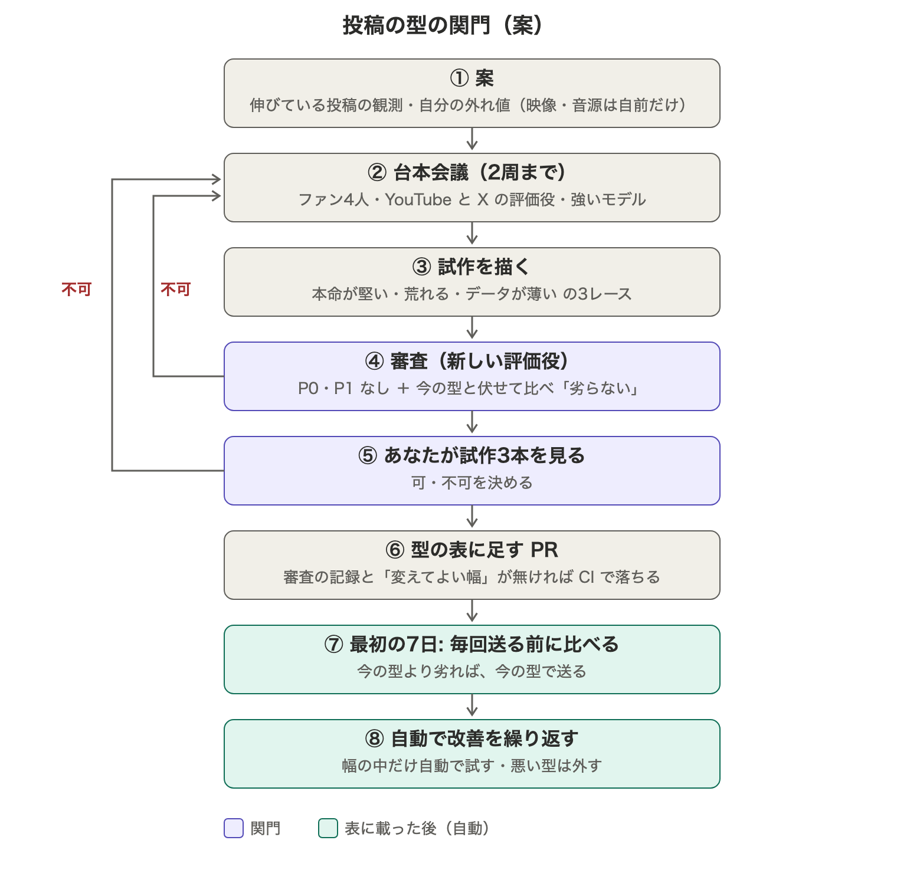

# 全貌動画の投稿の型の関門

全貌動画（X・YouTube Shorts・YouTube 完全版）は、機械の検査が通れば承認なしで毎日送られる（ADR-0094）。hq PD02 で、hq の機械が毎日「投稿の型」を割り当てて自動で改善を繰り返す仕組みを作った（daily.mjs `--type-spec`、#1882）。この文書は、型を龍神の型の表（`sns-video-studio/remotion/scripts/full-picture/type-spec.mjs` の `TYPE_IMPL`）に載せる前の関門を決める。

## 目的

オーナー 2026-10-25:
- 「投稿内容がクオリティが高くて人間の目線で、満足できるものであれば自動で改善を繰り返してよいのです。ただ、明らかに質が低いものは害なので、ワークフローで何とかしてほしい」
- 「型に関しては台本というか投稿内容をボートレースファンや強いエージェント、SNSマーケターと議論した上である程度固めてから、仕組みに載せた方が良さそう」
- 「無限に落ち続けてトークンが無駄になるのは避けたい」
- 「台本会議の後、試作の前に私が見た方が良さそう」

## 経緯（なぜ関門が要るか）

- 最初の4型（e02 寸止め・e03 要点1つ・e04 選手名・e05 数字1枚）は、出どころが「他の AI の案（出典未確認）」「根拠なし」だった。審査は同じモデルのファン役・デザイナー役で、型の文だけを見ていた
- 試作を描くと、オーナーは e05 を「明らかにダメ」、e03 を「今の投稿の劣化版」とした。youtube-channel・x-channel も e02・e04 に P1 を出した
- 評価役の P0・P1 は「見られないもの」を落とす定義で、「見られるが今の型より劣る型」（e03）は落とせない（second-opinion-reviewer 2026-10-25）
- 型の表は空にした（#1882）。表に無い型はすべて `type_unsupported` で止まり、投稿は今の型（v2）のまま

## 流れ

（図は台本の確認（3）を足す前の版。表が正）

| 段 | 中身 | 落ちたら |
|---|---|---|
| 1 案 | 伸びている同じ分野の投稿の観測（hq PD03）か、自分の投稿の外れ値を元にする。他の AI の案だけでは入れない。映像・音源は自前の素材だけ（他人のレース映像は使わない） | 入れない |
| 2 台本会議 | ファン4人（discussion-panel）・youtube-channel・x-channel・強いモデル（統合役）で、場面ごとの台本（何を・どの数字で・何秒）と「今の型より良い理由」を書く。今ある部品の出し入れでなく、要れば新しい場面を設計する | 2周まで。超えたら捨てる |
| 3 オーナーが台本を見る | 試作を描く前に、台本と「今の型より良い理由」を読んで可・不可を決める | 不可なら 2 へ（周の数に数える） |
| 4 試作 | 条件の違う過去3レース（本命が堅い・荒れる・普通）で描く。データが薄いレースはそもそも作らない（オーナー 10/25） | 描き直しは1回まで |
| 5 審査 | 台本会議に出ていない新しいエージェントで。(a) youtube-channel・x-channel が P0・P1 なし、(b) 今の型との伏せた比較（下）で「劣らない」。安いものから1つずつ回し、最初に落ちた所で止める | 2 へ（周の数に数える） |
| 6 オーナーが試作を見る | 試作3本で可・不可を決める（外す条件は下） | 2 へ |
| 7 型の表に足す PR | 表の各型に、審査の記録（各段の判定・オーナーの可否の日付・評価役とオーナーの一致）と「変えてよい幅」を持たせる。記録が無い型は CI の試験で落とす | — |
| 8 最初の7日 | 型の投稿は、送る前に毎回、今の型との伏せた比較にかける。劣れば今の型で送る（止めない） | 今の型で送る |
| 9 自動の改善 | 「変えてよい幅」の中の変更（例: 尺 30〜40秒、題の型を決めた候補から選ぶ）は、機械の検査と伏せた比較だけで自動で試す。幅の外の変更は新しい型として 1 から | 外す |

## 今の型との伏せた比較

- 同じレースの今の型と比べる。どちらが今の型かは伏せる
- 順を入れ替えて2回判定し、2回とも「劣らない」ときだけ可
- 基準はオーナーの過去の判断に固定する: 冒頭は結論から（10/11）、解説なしの数字の羅列にしない（10/11）、題の問いに動画の中で答える（10/13）、根拠の数字が冒頭の数字・結論とつながる、字幕を毎秒8字で読める・意味のない空白が多くない、見終わった後に分かったことが多い
- 見えない所（音・テンポ）は「判定できない」と書く
- 試し（2026-10-25）: オーナーが退けた e03・e05 を、今の型（10/23 住之江11R）と比べた。どちらも2回とも「劣る」で落ちた（e03: 6艇比較を抜いて判断材料が減る。e05: 11秒同じ画面で本文より情報が少ない）。費用は1回の比較で約14万トークン

## 無駄打ちを止める上限

- 安いところから順に落とす。台本の段で不可なら試作を描かない。審査は1つずつ回し、最初の P0・P1・「劣る」で止める
- 1型: 台本会議は2周まで（オーナーの不可・審査の不可も周に数える）。試作の描き直しは1回まで
- 全体: 関門に入れる型は週2つまで（目安・根拠なし）。続けて3型が落ちたら関門を止め、落ちた理由をまとめてオーナーに出す（案の出どころを見直す）
- 型ごとに使ったトークンと落ちた段を記録し、週の報告に出す

## オーナーの確認を外す条件

6（試作）の確認は、関門の判定とオーナーの判定が続けて3型（目安・根拠なし）一致し、その中にオーナーが退けた型を関門も落とした例が1つ以上あれば外す。外した後も、判定が際どい型（評価役は可だが比較が割れる等）はオーナーに回す。3（台本）の確認は外さない（安いので残す）。

## 分担

- 候補の一覧: hq の `~/hq/config/content-types.json`（hq の持ち物。関門は読むだけ）。候補ごとに出どころ・狙い・審査の材料を書く
- 関門（2〜7）: 龍神のレーン。台本・試作・審査の記録はこのディレクトリの `candidates/{id}/` に置く
- 割り当て（8・9）: hq の機械（pdca_daily.py）。割り当ててよい型は `daily.mjs --list-types` が返す表だけ。対の a（今の型）は `--type-spec` を渡さない
- 8 の送る前の比較は、まだ仕組みが無い。最初の型を表に載せる PR と同時に作る

## 今の型（v2）の弱点（比較の審査で見えたもの）

伏せた比較の審査員が、型を問わず今の型に共通する弱点として挙げた。新しい型を探す前に、今の型を直す候補にする（関門の 2 から通す）。
- 「1号艇は堅い？」に言葉で答える結論の一文が無い
- 冒頭の画面の下6割が空いている（visual-designer 2026-10-24 にも同じ指摘）
- 「内3艇そろう」が説明なしで出る
