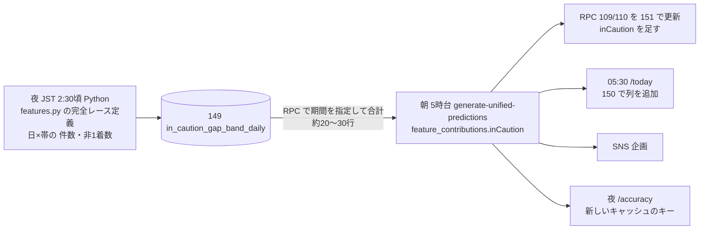

# 案Y の設計判定（2026-10-12、system-architect）

plan（/step2）の土台。本番 DB は見ていない（コード・マイグレーション・`docs/db-migration/APPLIED.md` から）。ADR の追加は1本（次の番号は 0095。0090〜0094 は sns-pdca-loop が使用済み、`verify:adr-numbers`）: 「イン崩れ注意度は勝率差の帯ごとの全国実績。日ごとの小さな表を夜に作る」。ADR-0012（会場内パーセンタイル）には「置き換え済み」と書き足す。ADR-0070（/today は 05:30 に事前計算）はそのまま。

## 1. 帯ごとの率
- 夜に「日×帯」の小さな表（主キー race_date・gap_band、値 n・non_win・source・computed_at、約5万行）を作り、朝は RPC `get_in_caution_band_rates(p_from, p_through)`（service_role のみ）で期間を合計する。PostgREST は GROUP BY できず、JS で合計すると1000行で黙って切れる
- 作るのは Python（`features.py` の `race_ok`＝統計検証の母集団と同じ判定。長期 kb と本体の切り分け `KB_END` も流用）。同じ判定を SQL・JS に書き直さない（ADR-0085 と同じ理由）
- 期間は表に入れず、読む側の定数と RPC の引数で決める（全期間・直近N年を作り直しなしで替えられる）
- 勝率差は 1/100 の整数で計算する（浮動小数だと 6.10−5.60 が 0.4999… で帯が1つずれる）。Python と JS で同じ規則、過去数日分で帯の一致を verify
- 「前日まで」はレースの日付で読む（`race_date < 対象日`）。合計に使った最終日 `through` を値と一緒に保存
- 夜のジョブは JST 2:30 頃（Vercel Cron → workflow_dispatch、`analogyDispatch.js` に1行）。日中に表を書き換えない（朝の予想が日全体を作り直すことがあり、/today と食い違う）。毎回は直近14日と抜けた日だけ

| 壊れ方 | 結果 | 防ぎ方 |
|---|---|---|
| 夜のジョブが失敗 | `through` が1日古いまま。6年分の合計なので差はほぼ無い | Slack 通知、`through` の遅れの監視 |
| RPC が失敗 | 予想全体は止めない | inCaution を null で書いて Slack。0% や前日の値で埋めない |
| 勝率が無い艇 | 値なし | null |
| 欠場の艇 | 未定 | 統計側で決める（検証の母集団は欠場のあるレースを除いている） |

## 2. 保存のキーと RPC
- 新しいキー `feature_contributions.inCaution`（例 `{nonWin, n, rate, level, gapCents, band, through, def}`）を足す。`volatilityPercentile`・`volatilityComposite` の意味を変えて使い回さない（RPC の 0.7/0.3・/today の 50・集計・SNS 企画の閾値が古い意味のまま動き、`verify-rpc-key-regression` も意味の変化は検知しない）
- 段 `level` は生成のときに1つの JS 関数で決めて保存する。境目は画面に出す丸めた値で判定（34.6% を「35%」と出して「35%未満」に入れない）
- RPC（151）: get_today_races（土台 110）・get_predictions_by_date(_light)（土台 109）に `'inCaution'` を1キー足す。既存の `volatility` は残す。書く前に本番の `md5(prosrc)` がファイルと一致するかを読み取りで確かめる（110 は APPLIED.md:170 に記録）。直接クエリの代わりの経路（`supabaseDataService.js` getRaces）にも同じキー。適用後に `verify-rpc-output-keys.js`
- /today: `morning_digest_rows` に `in_caution_rate numeric(5,2)`・`in_caution_n integer`（150）。`volatility_percentile` は使い回さない。列が無ければ外して書く（131 と同じ）
- 画面は `inCaution` だけを読み、無ければ「—」。`volatility` には戻らない
- 旧キーは、読み手（SNS 企画・digest・ホーム・一覧・AIコピー・find-video-worthy-race）を全部切り替えてから書くのをやめる（先にやめると SNS 企画が0件を正常として止まる）。やめるときに90日分の分布の読み込みも外す

## 3. /accuracy
- 新しいスクリプトと新しいキャッシュのキー（例 `in_caution_accuracy`）。`unified_volatility_accuracy` は上書きしない
- `inCaution` のある行だけを切り替えの日から。実際の非1着の定義は夜の表と同じ完全レースの判定。段は保存した `level` をそのまま使う
- 旧キーを読む `/winning-technique?tab=volatility` を外すリリースで、旧ジョブも止める

## 4. races.volatility_*（旧列）
- BOA-822 では触らない（画面は読んでいない）。別チケットで「書くのをやめる → 読み手を消す → DROP」。新しいコードはこの列を読まない

## 5. 展開予測の的中のキー
- `is_hit_turn`・`race_history_cache`・`accuracy_cache` の展開予測のキーは書き続ける（共有の列の一覧が変わると一括 upsert で NULL を書く事故の元。計算を残すなら当たり方を見る唯一の手段）。`race_history_cache` のジョブは、/races から外して読み手がいないことを確かめてから別チケットで止める
- get_today_races の `turnPrediction` キーも残す

## 6. マイグレーションと本番の手順

| 番号 | 中身 | 適用の時期 |
|---|---|---|
| 149 | 表 `in_caution_gap_band_daily`（RLS 有効、anon・authenticated に付けない、service_role ALL、CHECK `0<=non_win<=n`）と RPC `get_in_caution_band_rates`（STABLE、EXECUTE は service_role のみ） | 夜のジョブのマージより前 |
| 150 | `morning_digest_rows` に `in_caution_rate`・`in_caution_n` | digest の書き手のマージより前（後でもよい） |
| 151 | RPC 3本に `inCaution` | 生成側のマージの前後どちらでも |

番号は着手時にオーケストレーターが取り、PR の前に `npm run verify:migration-numbers`。書き込みはオーナーが SQL Editor で、確認の SELECT はレーンが読み取りで。

1. 149 を適用。`relrowsecurity=true`、anon の SELECT・EXECUTE が false、advisor の `rls_disabled_in_public` 0件
2. 夜のジョブをマージし全期間を作る。年ごとの `sum(n)` が完全レースの数と合う、数日分の帯の率が round3 の B05 と一致
3. 150 を適用。anon の新しい列の SELECT が true
4. 生成側（inCaution を書く。旧キーも当面書く）をマージ。翌朝、inCaution のある割合と `through`＝前日
5. 151 を適用、`verify-rpc-output-keys.js`、APPLIED.md
6. 画面・/today・SNS・/accuracy を切り替え、読み手が全部切り替わったら旧キーをやめる

ロールバック: 151 は 109・110 を再実行。150 は列を残す。149 は生成側と夜のジョブを先に戻してから DROP FUNCTION → DROP TABLE。旧キーを書き続けている間は古い画面に戻せる。
