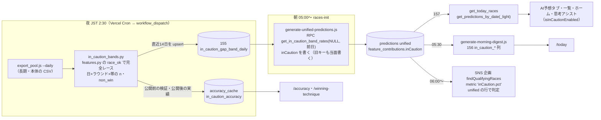
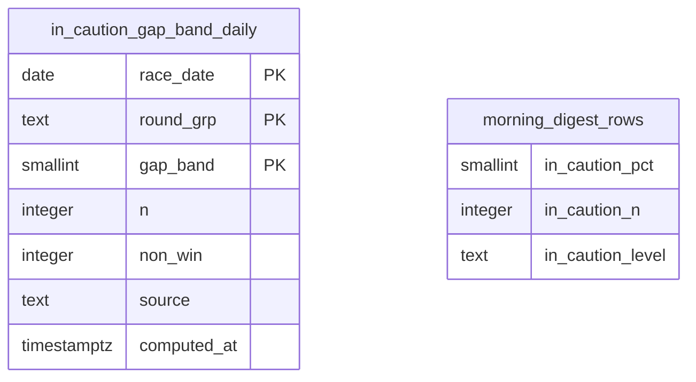

# イン崩れ注意度の作り直しと展開予測の画面からの撤去: システム設計（plan）

元: [spec.md](./spec.md)（FR-1〜FR-8）・[screens.md](./screens.md)・[mock/APPROVED.md](./mock/APPROVED.md)。土台の判定: [architecture-y.md](./architecture-y.md)（system-architect、2026-10-12）。ADR: [0095](../../adr/0095-in-caution-gap-band-nightly-table.md)。マイグレーション: 155・156・157（予約の 149〜151 は `verify-migration-numbers` の「master の最大番号より大きいこと」に合わず付け替えた。hq 了承済み、2026-10-13）。

## 全体構成



公開は機能フラグ `isInCautionEnabled()`（`src/config/featureFlags.js`、`IN_CAUTION_PUBLIC`、内部確認は `?caution=1`）で切り替える。生成・RPC・画面の PR を先に master に入れて隠したまま本番で確かめ、計測の基準（10/11〜）を7日以上取った日に `IN_CAUTION_PUBLIC = true` の1行の PR で全画面を同時に切り替える（FR-5 の「同じレースで全画面の値が一致する」を公開の瞬間から満たすため）。公開後に旧画面のコードと旧キーを消す。

## 1. 注意度の値（FR-2）

### 定義（統計検証 round4 の B05r と同じ）

| 項目 | 定義 | 根拠 |
|---|---|---|
| 勝率差 | `gapCents = round(1号艇の win_rate × 100) − max(round(2〜6号艇の win_rate × 100))`。win_rate は `race_entries.win_rate`（出走表の全国勝率）。2〜6号艇は勝率のある艇・欠場でない艇だけで最大を取る。**勝率が無い＝NULL だけ。0.00 は勝率として扱う**（新人は 0.00 で入る。統計検証も 0.00 を数えている: 1号艇 0.00 の完全レース 257件は全部帯 −8。JS で `!win_rate` と書かない。design-reviewer 指摘4）。最大が同点のときの `topOtherBoat` は艇番の小さい方 | r4.py `nat_i`・`top_i`、features.py |
| 帯 | `band = clamp(floor(gapCents / 50), −8, 6)`。帯 −8 は「−3.5未満」、6 は「+3.0以上」、それ以外は `[band×0.5, band×0.5+0.5)` | r4.py `band_from_int`。**spec・round4.md の「−4.0未満」は書き違い**（clamp の下限 −8 は −4.0〜−3.5 の帯で、それより下も含むので「−3.5未満」）。2026-10-10 の帯の表（82.3%・7,320件）もこの定義の値 |
| ラウンド | `race_conditions.race_stage` を `getRaceStageCategory`（`src/constants/raceStageConfig.js:129`）で分け、semifinal → `junyu`、final → `yusho`、それ以外（空を含む）→ `other` | Python の `round_from_stage`（features.py:138）と同じ規則（82件の突き合わせ済み、#1262） |
| 率 | その (ラウンド, 帯) の 2019-04-01〜前日の `sum(non_win) / sum(n)` | r4.py `B05r`、round4「期間は全期間」 |
| 基準 | 同じ期間の全行の `sum(non_win) / sum(n)`（全国の全レース。ラウンドで分けない） | spec「基準」 |
| 母集団 | features.py の `race_ok`（欠場・返還・不成立・中止のないレース、1着が1艇、1〜3着に返還艇なし）。1号艇の F・L は「1着を逃した」 | spec FR-2、round1 と同じ |

### 段（level）

- 画面に出す整数の% `pct = floor((200 × nonWin + n) / (2 × n))`（整数だけで四捨五入。浮動小数の `rate × 100` を丸めると、保存の桁によって 0.145・0.285・0.565・0.575 などで答えがずれる。system-architect L5）。`pct` を保存し、画面の%も段もこれから出す
- `level = pct < 35 ? "low" : pct < 55 ? "mid" : "high"`（34.6% を「35%」と出して「35%未満」に入れない）
- 閾値・期間・定義の版は `src/data/inCautionConfig.json`（`def: "gapband-r-v1"`・`thresholds: [35, 55]`・`bandWidthCents: 50`・`bandMin: -8`・`bandMax: 6`・`from: "2019-04-01"`・`minTotalN`・`prelaunch` の期間・`launchDate`）に1か所だけ置き、JS（`src/utils/inCautionLevel.js`）と Python（`in_caution_bands.py` が `ROOT/src/data/` を読む。無ければ FileNotFoundError で落ちて Slack）の両方が読む。JS からの読み方は、この repo の src に Node と Vite の両方から JSON を import する前例が無い（`data/*/model.json` は Vite だけ）ので、task 1 で `import ... with { type: "json" }` が Node 22・Vite・Vercel 関数のバンドルの3つで動くかを確かめる。動かなければ JS の定数の module（`src/constants/inCautionConfig.js`）を正にし、Python 用の JSON はそこから書き出して verify で一致を見る（design-reviewer 指摘10）。閾値・帯・期間を変えたら `def` を上げる（verify で値の組と `def` を固定）。境目の例（`nonWin/n` が 34.49%・34.5%・54.5% になる組）を JS と Python で同じ答えになるかを verify で固定する
- 段は朝の生成が決めて保存し、RPC・画面・digest・/accuracy は保存した `level` を使う（閾値をかけ直さない。architecture-y.md §2）

### 出さないレース

| 条件（朝の生成の時点） | 扱い | 根拠 |
|---|---|---|
| 1号艇が欠場（`race_entries.is_absent`）・1号艇の勝率が無い | `inCaution: null`、`inCautionSkip: "boat1_absent" / "boat1_no_rate"` | spec FR-2 |
| 2〜6号艇の欠場が2艇以上 | `null`、`"multi_absent"`（58R、未検証） | round4 item5 |
| 2〜6号艇の勝率が全部無い | `null`、`"others_no_rate"` | 勝率差が出せない |
| RPC の失敗・表が欠けている | `null`、`"rates_unavailable"`。予想全体は止めない。0% や前日の値で埋めない。「表が欠けている」は RPC の `first_date` が config の `from` より後、`last_date` が前日より3日以上古い、合計の `n` が `minTotalN`（例 40万）未満のどれか（初回の full の前・full の失敗後に、直近14日分だけの表から、もっともらしいが違う率を書かない。system-architect M2） | architecture-y.md §1 |
| 1艇欠場 | 残りの艇で出し、`absentBoats: [n]` を付ける（画面は「欠場あり（5艇）」） | round4 item5（AUC 0.667、3,983R） |
| (ラウンド, 帯) のセルが無い・件数 < 100 | `null`、`"sparse_cell"`。全期間で該当するのは準優・優勝戦の端の帯だけ（優勝戦 −8 は 2件・0%、準優 +2.5〜3.0 は 3件・0% など。出すと「1号艇が一番弱い優勝戦」が「堅め」として一覧・ホーム・SNS に流れる）。2025-06〜2026-10-10 で当たるのは完全レースの 0.04%（28レース。準優 0.77%・優勝戦 0.17%、直近30日で2レース、analysis/sparse-cells.md）。セルが無いときに n=0 で割らない | design-reviewer 指摘2（races.pkl で再現）。2026-10-13 ユーザー決定（Orchestrate 経由） |
| 帯の件数 100〜299 | 出し、`lowSample: true`（画面は「件数少なめ（n件）」） | spec FR-2 |

- 朝の後に1号艇の欠場が出たら、レース詳細は直前情報（`exhibitionData` の `is_absent`、`supabaseDataService.js:5560-5563`。詳細のページで読み込み済み）を見てカードを出さない。RPC・一覧・ホームには欠場の項目が無いので朝の値のまま（157 にキーを足すと「1キーだけ」の前提と md5 が変わるので足さない。design-reviewer 指摘3）。2〜6号艇の後からの欠場は朝の値のまま（spec「展示後の出し直しはしない」）。この限界は `/accuracy` の注記と同じ扱いで画面には書かない
- `inCautionSkip` は監視用（夜の verify で理由ごとの件数を出す）。画面は読まない

### 保存の形（`predictions.feature_contributions.inCaution`、unified の行）

```json
{
  "pct": 65, "n": 34842, "nonWin": 22634, "level": "high",
  "gapCents": -212, "band": -5, "round": "other",
  "boat1WinRate": 4.81, "topOtherBoat": 3, "topOtherWinRate": 6.93,
  "basePct": 45, "absentBoats": [], "lowSample": false,
  "through": "2026-10-10", "def": "gapband-r-v1"
}
```

- 例は 2026-10-11 戸田4R（予選、1号艇 4.81・3号艇 6.93、本番で確認）。(other, −5) の 2019-04-01〜2026-10-10 の値（design-reviewer が races.pkl から出した値）。**spec・モックの「64.8%・35,181件」はラウンドで分けない帯の、2026-10-09 までの値**で、実装の値（34,842件・pct 65）とは件数が違う。`mock-diff-checker` がこの差を拾っても、コードをモックに合わせない（design-reviewer 指摘5）
- `pct`・`basePct` は上の整数の式。率そのものが要るとき（検証）は `nonWin / n`。`through` は RPC の全体の `last_date`（帯ごとの最終日ではない。夜のジョブが遅れたら前日より古くなる）。`def` は定義の版（/accuracy の公開後の実績は同じ `def` の行だけを数える）。期間の始まりは `def` から決まる（config の `from`）ので保存しない
- 1レース約250字（今の feature_contributions は 1,169〜1,290字、system-architect が 2026-10-12 の168行で実測）。RPC では選ばずにそのまま返す（get_today_races の出力が約1.5割増える。RPC 側でキーを選ぶと、保存の形と RPC の2か所でキーの一覧を持つことになるので、保存の形を小さくする方を選んだ。system-architect L6）
- 理由の1つめ（勝率差）は `boat1WinRate`・`topOtherBoat`・`topOtherWinRate` から画面で組み立てる（文を保存しない。4言語のため）
- 2つめ以降の理由（spec FR-3「v16 の差がつく材料の言い方で最大2つ」）: **モックの承認範囲では理由は勝率差の1行と「ほかの材料（展示・モーター等）は龍神ソナーの『差がつく材料』で」の1行だけ**で、2つめ以降の行は描かれていない（mock/1-ai-tab-375.png）。承認したモックに合わせて、2つめ以降の理由は出さない。v16 の材料は 07:10 以降に作られ、朝 5時台の生成では読めない（today-impact.md）ことも理由。平均ST は出さないので BOA-818 の期間の食い違いは画面から消える

### 生成側の変更（`scripts/daily/generate-unified-predictions.js`）

- 新しい純関数 `scripts/lib/inCaution.js`: `computeInCaution({entries, raceStage, rates})` → `{inCaution, skip}`。`rates` は RPC の結果を `{cells: Map("round|band" → {n, nonWin}), base: {n, nonWin}, through, usable}` にしたもの（`usable` は表の欠けのガードの結果）。段は `src/utils/inCautionLevel.js` の `pctOf`・`levelOf` を import（DRY、生成と画面で同じ関数）
- `generateUnifiedPredictions` の先頭で RPC を1回呼ぶ（`client.rpc("get_in_caution_band_rates", {p_from: null, p_through: 前日})`）。`p_through` は対象日（`--date`、JST）の前日（`--include-started` で過去の日を作り直すときも対象日から決める）。失敗は間隔を空けて3回まで再試行し、それでも失敗したら全レース `rates_unavailable` で予想の行は書いた上で、戻り値に `inCautionFailed: true` を返す
- やり直し: `findRacesMissingUnified` の「欠けているレース」を「unified の行が無い、または `feature_contributions->>inCautionSkip = 'rates_unavailable'` の行がある発走前のレース」に広げる。races-init の後始末（`job.js:138-152`）は `inCautionFailed` のとき `fin.unified` を記録せず（次の起動の2分後にやり直す）、`cursor` に回数を数えて5回で打ち切って失敗を記録する。`morning-init.js`（別プロセスで生成を呼ぶ、`:57-66`）も同じ `findRacesMissingUnified` を通るので、次の回で拾い直す（system-architect M3。最初の案「戻り値で失敗を記録する」だけでは、次の起動で欠けが0件に見えて作り直さないことを design-reviewer 指摘1 が見つけた）
- `race_conditions` は今も `*` で読んでいるので `race_stage` の追加の読み取りは要らない。`race_entries.is_absent` も `*` に含まれる
- 旧キー（`turnPrediction`・`volatilityComposite`・`volatilityPercentile`・`volatilityPercentileIsFallback`・`volatilityReasons`）は §7 の「旧キーをやめる」まで書き続ける
- 同じ日の作り直し（races-init の後始末、`job.js:24-25`）で全レースを書き直しても、夜の表は日中に変わらないので値は同じ（/today の 05:30 の固定と食い違わない）

## 2. 夜の表とジョブ（ADR-0095）

### 置き場所と起動

| 物 | 場所 | 内容 |
|---|---|---|
| 本体 | `scripts/ml/analogy/in_caution_bands.py` | `features.load_kb` + `load_main` + `add_labels`（`add_history` 等の重い処理は通さない）で完全レースの1号艇の行を作り、勝率差・帯・ラウンドを付けて日×ラウンド×帯で数える。書くのは `db.request`（`scripts/ml/analogy/db.py`、PostgREST、service_role） |
| workflow | `.github/workflows/in-caution-nightly.yml` | `analogy-v16-morning.yml` と同じ形（`export_pool.js --daily` → Python）。inputs: `full`（全期間を書き直す）。失敗は Slack |
| 起動 | `scripts/lib/analogyDispatch.js` の `DISPATCH_WORKFLOWS` に `in_caution_nightly`、`api/cron/in-caution-dispatch.js`、`vercel.json` の cron `30 17 * * *`（JST 2:30）、`scripts/lib/scrapeJobs/registry.js` に `in_caution_dispatch`（modeGated、`failureAlertAfter: 1`） | GitHub Actions の schedule は使わない（遅れ・欠落が常態、analogyDispatch.js の冒頭） |

- 毎晩は直近14日（`race_date >= 対象日−14`）だけを作り直す（結果の訂正・遅れて入った結果を拾う）。全期間は初回と `full=true` のときだけ（約5万行、1000行ずつ）
- 書き方は「upsert してから古い行を消す」: 実行の開始時刻を `computed_at` として全行の payload に入れて upsert（`on_conflict=race_date,round_grp,gap_band`、`Prefer: resolution=merge-duplicates`。更新では DEFAULT が効かないので payload に入れる）→ 窓の中で `computed_at < 開始時刻` の行を DELETE。件数が0になったセル（CHECK `n > 0` で0の行は書けない）を消すため。full も先に全部消さずに同じやり方にする（途中で落ちても半分の表を作らない。system-architect M1）
- 14日のモードは本体の表だけを export し（`export_pool.js --daily races entries exhibition conditions results start_timings`）、Python は `load_main` だけを使う。長期（kb_archive、2025-12-02 まで）は full のときだけ読む（毎晩6年分を Storage から読まない。system-architect L7。`--daily` とテーブル名の指定を同時に使えるかは実装で確かめる）
- workflow に `concurrency: in-caution-nightly`。full の手動実行も JST 04:30〜23:00 は書かない（`force=true` のときだけ書く）。「日中に表を書き換えない」をコードで守る（system-architect L8）。時間外で書かずに終わったときは exit≠0 にして Slack に出す（遅れて動いた日を黙って成功にしない。design-reviewer 指摘6）
- Python から表を読むとき（公開前の検証）は主キー順に limit/offset で1000行ずつ、`count=exact` で件数を照合。predictions は `race_id` の gte/lt と `select=race_id,ic:feature_contributions->inCaution` で読み、LIKE は使わない（anon の `race_id=like.…` は 57014 になった。system-architect L9）
- 14日より前の本体の結果の訂正は週次の学習のキャッシュ（`analogy/source/main/`）に入ってから `full` で拾う。6年分の合計に対する影響はほぼ無いので、定期の `full` は作らない（YAGNI）
- 日中に表を書き換えない（朝の生成が日全体を作り直すことがあり、/today と食い違う）。2:30 は結果の確定（前日の最終レース 21時頃＋訂正）より後、races-init（05:00〜）より前
- `--daily` は週次のキャッシュの月が1つでも欠けると失敗する（export_pool.js の冒頭）。v16 の朝のバッチと同じ前提で、失敗は Slack に出る

### 表と RPC（155）

ER 図（`node scripts/maintenance/generate-er-diagram.js in-collapse-caution` の出力）:



- 新しいリレーション（外部キー）は無い。`morning_digest_rows` は既存の表に列を足すだけ
- `in_caution_gap_band_daily`: RLS 有効・ポリシーなし、anon・authenticated の権限なし、service_role のみ。CHECK `n > 0`・`0 <= non_win <= n`・`gap_band BETWEEN −8 AND 6`・`round_grp IN (other, junyu, yusho)`。勝率差が出せないレースは書かない
- `get_in_caution_band_rates(p_from date, p_through date)` → `(round_grp, gap_band, n, non_win, last_date)`。STABLE・SECURITY INVOKER・`search_path = public`、EXECUTE は service_role のみ（136 と同じ書き方）。`p_from` が NULL なら表の最初から。期間は表に入れず引数で決める（全期間・直近N年を作り直しなしで替えられる）

## 3. RPC（157）と画面への経路

- `get_predictions_by_date`・`get_predictions_by_date_light`（土台 109）・`get_today_races`（土台 110）のレースの `json_build_object` に `'inCaution'` を1キー足す（`'volatility'` の直前、unified の `feature_contributions->'inCaution'` をそのまま）。`'volatility'`・`'turnPrediction'` は残す。157 は 109・110 の本文に機械的に1キーを差し込んで作った（土台の取り違えを防ぐ。BOA-363・BOA-431）
- 画面への経路は3本とも RPC: Edge `api/races/today.js`・`api/predictions/[date].js` が RPC を呼び、失敗時の代わりの経路も `supabase.rpc(...)`（`supabaseDataService.js:1385`・`:1508-1513`）。直接クエリの経路は BOA-668 で無くなっているので、RPC に足せば全経路に届く
- `transformEdgeResponse`（`supabaseDataService.js:1013`）と `transformTodayRaces`（`src/utils/todayRaces.js:16`）で `inCaution` をレース直下にそのまま通す（`...race` で通るものも明示して、`raceData.unified` からは読まない）
- `verify-rpc-output-keys.js` に `MIGRATION_157_IN_CAUTION_KEYS` を足す（適用前は WARN、適用後は失敗）。キーを足すだけなので `verify-rpc-key-regression` の更新は要らない
- 画面は `inCaution` だけを読み、無ければ「—」またはカードなし。`volatility` に戻らない

## 4. 画面（screens.md S-1〜S-9）

### コンポーネントとデータの流れ

| 部品 | 場所 | 読むもの |
|---|---|---|
| `InCautionCard`（新規） | `src/components/race/InCautionCard.jsx`、`RaceAiPredictionTab.jsx` の先頭 | `prediction.inCaution`（`RaceDetailPage.jsx:81-85` で unified から写す所に1行足す）、直前情報の 1号艇の `is_absent`、確定後は `result.rank1` 等の既存の結果 |
| `RateBar`（共通化） | `src/components/race/RateBar.jsx` | 思考アシストの `RoughCard.jsx` の `MiniBar` を切り出す。`RoughCard`・`InCautionCard`・`InCautionAccuracyChart` の3か所 |
| `InCautionBadge`（新規、札） | `src/components/race/InCautionBadge.jsx` | `level`。カード・`RaceCard`・ホーム・/today で同じ言葉と色 |
| `RaceCard` | 拡張 | `racePrediction.inCaution`。真ん中の段は枠線だけ。`raceCard.badgeTurn` と的中/外れを外す |
| `TodaysVolatilityHighlights` | 拡張（名前は据え置き） | `race.inCaution.pct`・`level`。`volatilityHighlights.js` の入力を `{rate, level, closed}` に |
| `InCautionAccuracyChart`（新規） | `src/components/analysis/` | `accuracy_cache.in_caution_accuracy`（新しい `getInCautionAccuracy()`、6h キャッシュ、`getUnifiedVolatilityAccuracy` と同じ形） |
| 思考アシスト `RoughCard`・`RoughSheet` | 拡張 | 1着のバー = `100 − inCaution.pct`（%）（件数は `inCaution.n`）。万舟は今の級の並びのまま。アシストのページは `useThinkingAssistData.js:34` が `useDatePredictions`（`getPredictions`）でレースを読んでいるので、157 の後は `inCaution` がそのまま届く（問い合わせは増えない） |

- `isInCautionEnabled()` が false の間は今の画面のまま（旧部品を消さない）。true で新部品に切り替わる。公開後の掃除の PR で旧部品と分岐を消す
- 段の色（ダークモードは意味トークン、mock-reviews-v1.md）: 崩れやすい＝`--color-warning-dark-text`（文字）＋その薄い塗り、中くらい＝`--border-hairline` の枠線・塗りなし、堅め＝`--color-success-text`＋薄い塗り、本文＝`--text-primary`。4つとも `src/styles/design-tokens.css` にライト・ダーク両方ある（63・66・123・124 行、ダーク 368〜377 行）。新しい CSS は `in-caution-` の接頭辞（`verify:css-collisions`）。ダークで 3:1 以上を e2e の layout で確かめる
- 押せる部品は 44px 以上（mock-reviews-v1.md）。ホームの行は行全体を押せる

### 外すもの（FR-1、フラグ true の側で描かない → 掃除の PR で削除）

- AI予想タブ: 展開予測（`PredictionCard statKey="turn"`・`TurnPatternList`、`RaceAiPredictionTab.jsx:232-246`）、確定後の答え合わせ（:182-201）、イン崩れの振り返り（:131-178、`VolatilityPercentileBar`）、`VolatilityDisplay`（:249-263）、`ai-tab-sonar-link`（:62-74）。`OutcomePatternPreview`（:266-278）は残す
- `RaceCard` の的中/外れ（:71-81・:104-110）、`HitRaces.jsx`・`hits/*`、`AccuracyStatBadge` の展開予測の分、`RaceMoodEffect`
- 確定後のシェア文（`share.js:397-412`、`PredictionPanel.jsx:263-270`）、AIコピーの展開予測の節（`aiCopyText.js:110-155`・`:300`、`useAiCopyText.js:380`）
- `TECHNIQUE_NAMES` は `src/constants/techniqueNames.js` に移し、`raceIndicators.jsx:13` の import を替える。`src/utils/turnPrediction.js` は掃除の PR で読み手が無くなってから消す

### URL

| URL | 扱い |
|---|---|
| `/hit-races` | `vercel.json` の redirects に `{"source": "/hit-races", "destination": "/accuracy", "permanent": false}`（最初は一時的な転送 307。数日見て問題が無ければ掃除の PR で `true`（308）にする。恒久の転送はブラウザに残り、戻しても利用者が飛ばされ続ける。design-reviewer 指摘8）、SPA 側も `AppRouter.jsx:197` を `Navigate replace` に（`OutcomeDistributionRedirect` と同じ形）。`Header.jsx:147-148・201-203` のナビ、`App.jsx:16,56,90`、`HomeAiIntro.jsx:120`・`HowToUse.jsx:279` のリンク、`scripts/generate-sitemap.js:52`、`verify-hit-verification-guidance.js`・`check-missing-content-index.js` から外す。**フラグの切り替えと同じ PR で入れる**（vercel.json はフラグで隠せない） |
| `/accuracy` | `AccuracyDashboard.jsx` を作り替える。今は `turn.totalRaces > 0` でデータあり判定（:70）なので、新しい判定は `in_caution_accuracy` の有無。旧3モデルの `/accuracy/history` へのリンク（:177-181）は残す |
| `/accuracy/history` | 変えない。旧3モデル（2026年8月で運用終了）の月別アーカイブで、展開予測・イン崩れに依存しない（`AccuracyHistory.jsx:22`、`accuracy_summary`） |
| `/races` | 残す。日別の展開予測の的中率（`RaceHistory.jsx:80-91・152-154・176-192`）を外すと「開催日ごとのレース一覧への入口（日付・完了レース数・`/races/:date` へのリンク）」が残る。meta description（:98）とページの説明（:111）を書き直す。`race_history_cache` の `turnRaces`・`turnHitRate` は書き続け、読み手が無いのを確かめてから別チケットで止める（architecture-y.md §5） |
| `/winning-technique?tab=volatility` | タブの中身を `InCautionAccuracyChart` に替える（タブのキーは据え置き、`?tab=volatility` のリンクを壊さない）。ラベルは新しいキーを足してフラグで切り替える（`analysisPage.tabs.volatility` を上書きすると、`scripts/generate-ai-snapshots.js:367-374` のボット向けの静的ページが公開前に変わる。design-reviewer 指摘9）。掃除の PR で古いキーを消す |
| `?tab=aiPrediction` | 今のまま AI予想タブ（案A） |

### i18n

- 新しいキー（4言語）: `inCaution.*`（カード・札・段の言葉・注記・導線）、`accuracy.inCaution.*`（/accuracy）、`home.volatilityHighlights*` の書き直し、`analysisPage.tabs.volatility` の書き直し。思考アシスト・/today は ja のみ（`src/data/morningDigestCopy.js`）
- 消すキー（掃除の PR で4言語から）: `turnPatternList.*`、`result.turnSectionTitle`・`result.volatilitySectionTitle`、`termHints.turnPrediction`、`raceCard.badgeTurn`・`missBadge`、`panel.shareTurnHit.*`、`aiCopy.turnPrediction*`、`aiPredictionTab.sonarLink`、`volatility.*` のうち使わなくなったもの
- 対訳の登録（実装の前に）: `docs/reference/i18n-glossary.md` のドメイン用語の表（`日本語|英語|繁體中文|한국어|補足`、:94-95）に「イン崩れ注意度」「勝率差」「崩れやすい／中くらい／堅め」「段ごとの実績」「公開前の検証」。既存の「イン崩れ」（:119-121）・「展開予測」（:137）・「荒れ度」（:141）の行の補足に BOA-822 の扱いを書く。訳は wording-editor に当てる

## 5. /today と朝のダイジェスト（FR-5、156）

- `generate-morning-digest.js` の `fetchVolatility`（:275）と並べて `fetchInCaution` を足し、行に `in_caution_pct`（保存の `pct`）・`in_caution_n`・`in_caution_level` を書く。`OPTIONAL_ROW_COLUMNS`（:824）に3列を足し、156 の適用前は列を外して書く（131 と同じ）
- 注目レースの選び方（`pickFeatured` :582-627、`digestMetrics.js:147-169` の方向一致度）は、フラグの切り替えの日から `in_caution_pct` を使う（`v/100` → `in_caution_pct/100`）。0〜100 の一様な順位から 20〜82% の率に替わるので、逃げの方向一致度（`1 − v`）の重みが変わる。選ばれるレースの変化は公開前に過去7日分で比べて PR に書く。**BOA-851（同じ `pickFeatured` の取りこぼし）を先にマージしてから触る**
- digest の切り替えはフラグと別に、`MORNING_DIGEST_IN_CAUTION` の定数（digest のスクリプトはブラウザのフラグを読めない）を公開の PR で true にする
- **用語集・説明の本文（`src/data/morningDigestCopy.js`）は、ボット向け HTML（`api/_lib/botToday.js`）がサーバー側で読むのでブラウザのフラグで隠せない**。書き直しは公開の PR（§7 の 8）に入れる（先に入れるとボット向け HTML だけが新しい用語になる。system-architect M6）
- 画面: `DigestRaceCard.jsx:96-99` を「イン崩れ注意度 {p}%」、`FeaturedRaceCard.jsx:97-108` の「50以上なら高い」を札に。SNS のネタの本文（:879-899）・理由文（:617）・用語集（`morningDigestCopy.js:25-26・97・134-148`、`MorningDataDigest.jsx:333-345`）を FR-2 の中身で書き直す。ボット向け HTML（`api/_lib/botToday.js:32,203-211`）は用語の本文を `morningDigestCopy.js` から読むので連動する
- 過去の日の /today は `volatility_percentile` のまま（旧指数の行は出し直さない。spec「旧指数の過去の実績は出さない」と同じく、画面は `in_caution_*` が無い行は注意度の欄を出さない）

## 6. /accuracy（FR-6）

- 夜の `in_caution_bands.py` が、表を書いた後に `accuracy_cache` の新しいキー `in_caution_accuracy` を書く（`unified_volatility_accuracy` は上書きしない）。完全レースの判定が Python にしか無いので、実績の集計も同じジョブで行う（ADR-0085 と同じ理由。JS に `race_ok` を書き直さない）

```json
{
  "calculatedAt": "...", "def": "gapband-r-v1",
  "prelaunch": {"from": "2025-06-01", "to": "2026-10-10", "base": {"n": 0, "nonWin": 0},
                "byLevel": {"low": {"n": 0, "nonWin": 0}, "mid": {}, "high": {}}},
  "postlaunch": {"from": "<launchDate>", "through": "<前日>", "base": {}, "byLevel": {}}
}
```

- **公開前の検証**: 表だけで作れる。期間が固定なので、毎晩は作り直さず、full のときと `in_caution_accuracy.prelaunch` が無いとき（または `def` が違うとき）だけ作る。期間の各日 d・(ラウンド, 帯) について、2019-04-01〜d−1 の累積の率で段を決め、その日の `n`・`non_win` をその段に足す。round4 の L と同じ作り方（前日までの過去レースだけで作る）だが、ラウンドで分けた率（B05r）で段を決めるので、round4 の 26.7／42.6／65.5%（分けない B05）から少し変わる。/accuracy に出す値はこの再計算の値で、data-accuracy-verifier で round4 との差を確かめて PR に書く。期間は `inCautionConfig.json` の `prelaunch`（2025-06-01〜2026-10-10、ユーザー承認の期間）
- **公開後**: `launchDate`（公開の PR で `inCautionConfig.json` に書く）以降の、`inCaution.def` が同じ unified の行（保存した `level`）と、完全レースの1号艇の1着の有無を突き合わせる。完全レースでないレース（1艇欠場で出したレース等）は数えない（夜の表と同じ母集団）
- 画面: 段ごとに率・件数・Wilson の95%区間（画面で計算、純関数）、段の範囲の帯、全国の点線。公開後の段の件数が30未満なら率を出さず件数だけ。注記「同じ日・同じ会場に偏るので、実際の幅はもう少し広い」
- 旧 `calculate-unified-volatility-accuracy.js`（`calculate-accuracy.yml` の JST 23:30）は、`/winning-technique?tab=volatility` と `/accuracy` を切り替えた後の掃除の PR で外す。`calculate-unified-model-accuracy.js`（`unified_model_accuracy` の `place`・`turn`）は展開予測の的中の記録として書き続ける（§8）

## 7. 切り替えの順（読み手を全部替えてから旧キーをやめる）

| # | PR | 本番への影響 | 前提 |
|---|---|---|---|
| 1 | 155 のマイグレーション案＋夜のジョブ（Python・workflow・dispatch・cron・registry は mode off）＋ verify | 無し | — |
| 2 | （本番）155 を適用 → mode を live → `full=true` で全期間を作る → 年ごとの `sum(n)` と round4 の件数、2026-10-10 の帯の率を突き合わせる | 表ができる | 1 |
| 3 | 生成（`inCaution` を書く、旧キーも書く）＋ `inCautionLevel.js`・`inCautionConfig.json` ＋ verify | 予想の行に新しいキーが増えるだけ | 2 |
| 4 | 157 を適用（`md5(prosrc)` を確かめてから）→ `verify-rpc-output-keys.js` → APPLIED.md | RPC の出力に1キー増える | 3 の翌朝に値が入っている |
| 5 | 画面（フラグ false で隠す）: AI予想タブ・一覧・ホーム・思考アシスト・/accuracy・/winning-technique・/races。複数 PR に分けてよい | 無し（`?caution=1` で内部確認） | 4 |
| 6 | 156 を適用＋ digest（列を書く。注目レースは定数 false のまま旧の選び方）＋ SNS 企画（metric の `inCaution.pct`、unified の行で判定）＋ AIコピーの選択肢（`level === "high"`、フラグの側） | /today の行に列が増えるだけ（`morningDigestCopy.js` の本文は触らない） | BOA-851 |
| 7 | 説明の書き直し（About・FAQ・HowToUse・HomeAiIntro、FR-7）。画面の文はフラグで分ける。フラグで隠せないもの（ブログ上位2記事と翻訳版、`morningDigestCopy.js` の用語集・説明）は公開の PR に入れる | — | — |
| 8 | **公開**: `IN_CAUTION_PUBLIC = true`、`MORNING_DIGEST_IN_CAUTION = true`、`launchDate`、`/hit-races` の 301・ナビ・sitemap、ブログ上位2記事、`morningDigestCopy.js`（ボット向け HTML も同時に替わる） | 全画面が同時に切り替わる | 計測の基準 7日以上（10/18 以降）、GA4 の4件の登録、ユーザーの確認 |
| 9 | 掃除: 旧部品・分岐・i18n キー・`turnPrediction.js`（src）・`calculate-unified-volatility-accuracy.js`・`todays-volatility-digest.js` を消す | — | 8 の後、問題が無いことを数日見てから |
| 10 | 旧キーをやめる: 生成の `volatilityFactors` の呼び出しと90日の分布の読み込みを外す（旧キーを書かない）。`find-video-worthy-race.js`・`AnswerCheckHookCM.jsx` を `inCaution` に替える。digest の `fetchVolatility`・`volatility_percentile` の書き込みと `scripts/verification/verify-morning-digest-sns-topic.js` も外す | 旧キーの無い行が増える | 9、読み手が残っていないことを grep（`volatilityPercentile`・`volatilityComposite`・`volatilityReasons`・`volatility_percentile`）で確認 |

- SNS 企画: `sns_campaigns` は 2026-09-08 の1件だけで `status = completed`（2026-10-13 読み取りで確認、`selection_criteria` は `volatilityPercentile >= 0.985`）。動いている企画は無いので、旧キーをやめても企画は止まらない。`findQualifyingRaces`（`snsCampaigns.js:111-189`）は `metric` を `feature_contributions` の直下のキーで読むので、`"inCaution.pct"` の点区切りを読めるようにする。あわせて `model_id` を select し、`inCaution.*` の条件のときは unified の行を使う（今は standard と unified のうち `predicted_at` が新しい方の1行を使うので、standard が新しいレースは `inCaution` が取れず黙って対象外になる。system-architect M5）。次の企画の閾値は企画を作るときに決める（`create-campaign.js` の既定値の 0.985 は新しい値では意味が無いので、既定値を外して必須にする）
- ロールバック: 8 は公開の PR を revert する（フラグ・`MORNING_DIGEST_IN_CAUTION`・`launchDate`・ブログ・`morningDigestCopy.js`・e2e の期待・307 の転送がまとめて戻る。フラグの1行だけ戻すと説明と画面が食い違う。design-reviewer 指摘8）。10 までは旧キーを書いているので旧画面が動く。157 は 109・110 を再実行。156 は列を残す。155 は生成側と夜のジョブを先に戻してから DROP

## 8. 展開予測の計算を残す理由（FR-1、spec の未確定事項の確定）

spec FR-1 は「AI予想の統合モデル（本命・データ出走表のAI予想行、`unifiedModel.js`）」を利用先に挙げていたが、コードで確かめると違った（2026-10-13）。spec を直す。

| 利用先 | 依存 | 根拠 |
|---|---|---|
| AI予想の本命（unified の top_pick） | **依存しない**（コース別勝率の上位2艇、`placeRecommendation`） | `generate-unified-predictions.js:122-141・359-360` |
| 出現パターン（`OutcomePatternPreview`） | 依存しない（`topPick.number` だけ） | `OutcomePatternPreview.jsx:26-46` |
| データ出走表のAI予想行 | 行が無い（`unifiedModel.js` の `boatScores` は DB にも画面にも出ていない） | `raceIndicators.jsx`、`unifiedModel.js:254-258` |
| SNS 企画の買い目・本文・2枚目のカード・結果の振り返り | **依存する**（展開予測に出た艇を3倍に優遇、`turnPredictionTop3` を画像に出す） | `campaignVolatilityModel.js:22,34-58`、`campaign-detect-and-generate.js:28-52,119-145`、`renderCampaignCard.js:59`、`campaignResultRetrospective.js:82-148` |
| 旧3モデル（standard・safeBet・upsetFocus）の生成 | 依存する（スコアのボーナス、top_pick） | `generate-predictions.js:712-800` |
| 今のイン崩れ指数 | 依存する（AI逃げ確率、重み 0.12） | `volatilityFactors.js:124-140`。§7 の 10 で旧キーをやめると無くなる |
| 当たり方の記録（`is_hit_turn`・`race_history_cache`・`unified_model_accuracy.turn`） | 依存する | `hitCalculator.js:61-78`、`update-race-history-cache.js`、`calculate-unified-model-accuracy.js:117-131` |

- 結論: 計算（`scripts/lib/turnPrediction.js`）と unified・standard の行の `turnPrediction` は残す。残す理由は「SNS 企画の買い目と旧3モデルの生成が使っている」「計算を残すなら当たり方を見る唯一の手段」。画面から外したあとも SNS 企画の2枚目のカードには展開予測が出る（サイトの画面ではないので Q1 の範囲外として残す。扱いは BOA-858）
- `generate-unified-trifecta-reference.js` は起動元が無く表示も廃止済み（2026-08-14）。BOA-822 では触らない
- `get_today_races` の `turnPrediction` キーは src に読み手が無いが、157 では消さない（キーを消すと `verify-rpc-key-regression` に理由の登録が要り、BOA-822 の範囲を広げる）

## 9. 検証（再現テストと監視）

| 何を守るか | 置き場所 | 種別 |
|---|---|---|
| 勝率差・帯・ラウンド・段・欠場の扱い（`computeInCaution`）、境目（帯 −8 は −3.5 未満、勝率差 −350 は帯 −7、34.49%・34.5%・54.5%） | `scripts/maintenance/verify-in-caution.js` | ci |
| JS と Python の帯・段が同じ答え（固定の20件の入力を両方に通す） | `scripts/ml/analogy/tests/test_in_caution_bands.py`（`tests/test_features.py` と同じ置き場所）＋ verify-in-caution.js が同じ JSON を読む | ci |
| 夜の表の鮮度（`max(race_date)` が前日、`min(race_date)` が config の `from`、合計の `n`） | Vercel Cron `api/cron/in-caution-health.js`（JST 04:30、`registry.js` に `failureAlertAfter: 1`）。RPC `get_in_caution_band_rates` を service_role で呼んで `first_date`・`last_date`・合計の `n` を見る。dispatch は投げっぱなしなので、Actions が動かなかった日もここで Slack に出る（design-reviewer 指摘6）。同じ判定を `scripts/maintenance/verify-in-caution-coverage.js --table` でも手元から流せる。`nightly-verify-db.yml`（JST 3:00）は 2:30 の dispatch の30分後で、full や起動の遅れで空振り・誤報になるので使わない（system-architect M4） | manual |
| 今日の unified の行で `inCaution` がある割合、`inCautionSkip` の内訳、`through` の遅れ | 同じ `in-caution-health.js` を JST 05:45 にもう1回（モードで分ける）。手元は `verify-in-caution-coverage.js --today` | manual |
| RPC の出力キー | `verify-rpc-output-keys.js` の `MIGRATION_157_IN_CAUTION_KEYS` | manual（既存） |
| 送るイベント（`caution_visible`・`caution_click`） | `verify-frontend-pure-functions.js` に純関数、e2e に1本（measurement.md） | ci |
| 画面（375・1440px、ダーク、0〜100 の数字が出ない、展開予測が出ない、4言語） | `e2e/acceptance/in-collapse-caution.spec.js`（acceptance-test-writer）、`e2e/layout.spec.js` | — |
| /hit-races の 301 | `verify-hit-verification-guidance.js` を書き直す | ci |

更新が要る既存の verify（registry の行）: `verify-hit-verification-guidance`（TurnPatternList を持つこと → 持たないこと）、`verify-race-outcome`（judgeTurnPrediction）、`verify-race-detail-boa711`（TurnPatternList.css・イン崩れの見た目）、`verify-ai-copy-text`（展開予測の節）、`verify-frontend-pure-functions`（`suiteTurnPrediction`・`suiteVolatilityLevel`、掃除の PR で）、`verify-volatility-accuracy-heading`（掃除の PR で外す）、`verify-bot-page-model`・`verify-bot-page-function`（イン崩れの用語）。e2e のモック（`today-highlights-result`・`race-share-text`・`race-cancelled-ai`・`race-outcome-display`・`race-result-popularity`・`analogy-contribution`・`race-detail-details`・`turn-prediction-wording`・`smoke` の 316-324・1324・3912、`layout` の 404-432）は、フラグ false の間は変えず、公開の PR で新しい期待に替える。録画データ（`e2e/recordings/`）は 157 の適用後に取り直す

## 10. 本番 DB の手順（オーナーが SQL Editor で書き込み、レーンは読み取りで確認）

1. 155 を適用。確認: `relrowsecurity = true`、anon の SELECT・EXECUTE が false、advisor の `rls_disabled_in_public` 0件
2. 夜のジョブの mode を live、`full=true` で1回。確認: 年ごとの `sum(n)` が完全レースの数（round4 の件数）と合う、2026-10-10 の (other, −5) の率が 64.8% 前後（ラウンドで分けるので round4 の B05 と少し違う）、`max(race_date)` が前日
3. 生成をマージ。翌朝: unified の行で `inCaution` のある割合、`through` が前日、例のレース（2026-10-11 戸田4R）の値を表から出し直して一致（data-accuracy-verifier）
4. 157: 本番の `md5(prosrc)` が 109・110 のファイルの本文と一致するのを読み取りで確かめてから適用。`verify-rpc-output-keys.js`、APPLIED.md
5. 156 を適用。anon の新しい列の SELECT が true
6. 公開の後: 公開の翌々日に GA4 の4ディメンション（measurement.md）、/accuracy の公開後の件数が増えていること

## 11. 失敗したときの壊れ方

| 壊れ方 | 結果 | 防ぎ方 |
|---|---|---|
| 夜のジョブの失敗・遅れ | `through` が古いまま。6年分の合計なので値はほぼ変わらない。/accuracy の公開後が1日遅れる | Slack（workflow・registry の `failureAlertAfter: 1`）、verify-in-caution-coverage |
| 週次のキャッシュの月が欠ける | `--daily` が失敗（上と同じ） | v16 の朝のバッチと同じ前提。週次の学習の失敗は既に Slack に出る |
| RPC の失敗 | その日の生成で全レース `inCaution: null`（予想は書く）。画面は「—」。次の races-init の起動（2分後）で作り直す（5回まで）。直らないまま 05:30 の digest が走ると、公開後は /today の注目レースが0件になる（`computeConsistency` が値の無い行を候補から外す、design-reviewer 指摘7）。注目レースは値が無い日は選ばない（推奨。旧の値に戻すと意味の違う値が混ざる）。06:30・08:00 の再実行で埋まるかは task 33 で確かめる | `console.error`・verify-in-caution-coverage が `rates_unavailable` の件数を出す |
| JS と Python の帯・段のずれ | /accuracy の段と画面の段が食い違う | 両言語で同じ固定の入力の verify（ci） |
| 157 を古い定義を土台に書く | 後から足したキーが消える | 109・110 から機械的に作った、適用前の md5 の確認、`verify-rpc-key-regression` |
| 旧キーを先にやめる | 旧画面に戻せない、旧の読み手が0件を正常として止まる | §7 の順。10 は 9 の後 |
| フラグの切り替えと vercel.json の不一致 | /hit-races が 301 なのに画面は旧（または逆） | 同じ PR に入れる |

## 12. 別スコープ（Linear に起票済み、2026-10-13）

- BOA-857: 展開予測・イン崩れ指数に触れる残りのブログ（ja 41本・4言語65ファイル）、動画13作品、`public/llms.txt` の書き直し（spec FR-7「別チケット」）
- BOA-858: SNS 企画の展開予測（買い目の優遇・2枚目のカード・結果の振り返り）を残すか（§8。サイトの画面ではないので Q1 の範囲外）
- BOA-859: `races.volatility_*` の旧列（書くのをやめる → 読み手を消す → DROP）と `race_history_cache` の展開予測の集計ジョブの停止（architecture-y.md §4・§5）
- BOA-822 の公開で前提が無くなる既存のチケット（BOA-725・BOA-747・BOA-748・BOA-758・BOA-761・BOA-762・BOA-763・BOA-767。旧指数・展開予測の画面の細部）は、公開の後に Canceled／Duplicate にする候補（状態は今は変えない）

## ユーザーの決定（2026-10-13、Orchestrate 経由・段階1）

- 理由は勝率差の1行と「ほかの材料は龍神ソナーで」の1行だけ（承認したモックに合わせる。spec FR-3 の「最大2つ」をやめる）
- `/races` は開催日ごとのレース一覧への入口として残す
- /today の注目レースは新しい値に替える。公開前に過去7日分の比較（入れ替わる件数と例）を PR に書き、変わり方が大きければ Orchestrate に返す。BOA-851 は #1455 でマージ済み
- 件数100未満の (ラウンド, 帯) は注意度を出さない、100〜299件は「件数少なめ（n件）」を付けて出す（2026-10-13 ユーザー回答。件数は analysis/sparse-cells.md）
- 公開の1行 PR（`IN_CAUTION_PUBLIC`）はユーザーが判断する。その前に Preview の URL と見るところを Orchestrate に渡す

## 設計検証（system-architect、2026-10-13）の指摘と対応

判定: 大筋は ADR-0085・0070・0074 と整合。157 が 109・110 から `'inCaution'` の7行×3か所だけ違うことを diff で確認。本番の `md5(prosrc)` は 109・110 のファイルと一致（2026-10-13、レーンが読み取りで再確認: `5d0ff6d8…`・`a5c39f55…`・`8f6cf80c…`）。

| # | 重大度 | 指摘 | 検証 | 対応 |
|---|---|---|---|---|
| H1 | 高 | 157 が `verify:migration-rls` で落ちる（114番以降は関数ごとに権限か除外の印が要る） | 手元で再現（NG 3件） | 採用。`-- function-exempt` を3行、自己検査に anon の EXECUTE を足した。再実行で OK |
| M1 | 中 | 14日の upsert では件数0になったセルが残り、`computed_at` も更新されない | CHECK `n > 0` と upsert の仕様から確か | 採用。§2「upsert してから古い行を消す」 |
| M2 | 中 | 表が欠けていても朝の生成が気づかない。`last_date` が帯ごと | RPC の定義から確か | 採用。RPC に全体の `first_date`・`last_date`、生成で3つのガード（§1 の表） |
| M3 | 中 | RPC の一時的な失敗でその日は null のまま戻らない | `job.js:139-150` の後始末の条件から確か | 採用。3回の再試行、`inCautionFailed` で後始末を失敗にして次の起動でやり直す（§1） |
| M4 | 中 | 監視の時刻（3:00）が夜のジョブの30分後で、今日の行もまだ無い | `nightly-verify-db.yml` の時刻から確か | 採用。表は 04:30 頃、今日の行は 05:40 以降に分けた（§9）。起動の仕組みは tasks で決める |
| M5 | 中 | SNS 企画が standard の行を使うと `inCaution` が取れず黙って0件 | `snsCampaigns.js` のコメント（standard・unified の新しい方の1行）で確か | 採用。unified の行で判定（§7） |
| M6 | 中 | `morningDigestCopy.js` はボット向け HTML がサーバーで読むのでフラグで隠せない | `api/_lib/botToday.js` が import | 採用。公開の PR に入れる（§5・§7） |
| L1・L2 | 低 | 155 の「−4.0未満」、ヘッダーの節の参照が古い | 確か | 採用 |
| L3 | 低 | 157 の自己検査が 109 より弱い | 確か | 採用。109 の条件を足した |
| L4 | 低 | 156 の NOT VALID → VALIDATE は同じトランザクションで効果なし、適用の時刻 | 確か | 採用。時刻の注記を足した（害が無いので書き方はそのまま） |
| L5 | 低 | `floor(rate×100+0.5)` は保存の桁で答えが変わる | 指摘どおり（0.145 等） | 採用。整数の式で `pct` を保存。156 も `in_caution_pct smallint` に替えた |
| L6 | 低 | get_today_races の出力が約2割増える。RPC 側でキーを選ぶ案 | 実測は agent（216,334字・132レース） | 一部採用。保存の形を小さくした（約250字）。RPC でキーを選ぶ案は、キーの一覧を2か所に持つので採らない |
| L7 | 低 | 毎晩6年分を Storage から読む | export_pool.js の `--daily` の仕様 | 採用。14日のモードは本体だけ |
| L8 | 低 | concurrency と日中の書き込みの禁止 | — | 採用 |
| L9 | 低 | Python の読み方（ページング・LIKE を使わない） | agent が 57014 を観測 | 採用 |
| ADR | 低 | 却下の理由の言い方、Storage に置く案、ADR-0066 の例外、ADR-0012 の状態 | — | 採用。ADR-0095 に反映（ADR-0012 の状態は ADR を採用にするときに書き足す） |

## 設計レビュー（design-reviewer、2026-10-13）の指摘と対応

判定: 条件付きで進んでよい。統計値（帯の率・件数・3段・端の名前・基準 45.19%・表の約5万行・RPC の43行）は races.pkl から独立に再現。コードの前提（本命が展開予測に依存しない、全経路が RPC、思考アシストが light の RPC を通る、`--daily` とテーブル名の併用、157 が1キーだけの差、JS と Python のラウンドの分け方が race_stage 485種で一致）も確認。本番 DB は reviewer の環境から読めなかったので、レーンが読み取りで補った（例のレースの 4.81・6.93・予選、`race_stage` は 2026-10-06〜12 で空0件、`win_rate` は 2026-09〜 で NULL 0件・0.00 は 3件、本番の md5 は 109・110 と一致）。

| # | 重大度 | 指摘 | 検証 | 対応 |
|---|---|---|---|---|
| 1 | P1 | `inCautionFailed` で後始末を失敗にしても、次の起動で欠けが0件に見えて作り直さない。morning-init は別プロセス | `job.js:138-152`・`morning-init.js:57-66` で確認 | 採用。`findRacesMissingUnified` が `rates_unavailable` の行も欠けとして数える、5回まで（§1、task 10） |
| 2 | P1 | (ラウンド, 帯) のセルが無い・極小（優勝戦 −8 は 2件・0%）で、0で割る・段が逆転する | reviewer の races.pkl の集計（セル43、準優・優勝戦の端） | 採用。セルが無い・100件未満は出さない（`sparse_cell`）。2026-10-13 ユーザー決定「100件未満は出さないで進めてよい」 |
| 3 | P2 | `entries[0].isAbsent` は RPC・変換に無い | grep で確認 | 採用。詳細は直前情報の `is_absent`、一覧・ホームは朝の値のまま（§1） |
| 4 | P2 | 勝率 0.00 の扱いが未定義（統計は勝率として数える） | 本番で 0.00 は 3件／39,096行 | 採用。NULL だけを「勝率なし」（§1、task 3・8） |
| 5 | P2 | 年ごとの件数が result4.json に無い。例の値（64.8%・35,181件）はラウンドで分けない 10-09 までの値 | reviewer の再集計 | 採用。照合の値を task 6b・30 に、保存例を (other, −5) の 34,842件・pct 65 に。モックとの差はコードを合わせない |
| 6 | P2 | 夜の表の監視の起動が未定、dispatch が成功して Actions が動かない日を検知できない | `analogyDispatch.js` は起動するだけ | 採用。Vercel Cron `in-caution-health.js`（04:30・05:45）、時間外は exit≠0（§2・§9、task 12） |
| 7 | P2 | RPC が失敗した日は /today の注目レースが0件 | `computeConsistency` が null を外す | 採用。§11 に書き、値が無い日は選ばない。再実行で埋まるかを task 33 で確かめる |
| 8 | P3 | ロールバックは1行ではない、301 はブラウザに残る | — | 採用。revert で戻す、最初は 307（§7・URL の表、task 39・41a・42） |
| 9 | P3 | `analysisPage.tabs.volatility` の上書きでボット向けの静的ページが先に変わる | `generate-ai-snapshots.js:367-374` | 採用。新しいキーをフラグで切り替える |
| 10 | P3 | 引数の不一致、JSON の import の前例が無い、同点、`p_through` の基準、JST、`--daily` の量 | — | 採用（§1・task 1・8）。`--daily` の量は注記のみ（正しく動く） |

受け入れ E2E（acceptance-test-writer、32件）の曖昧点6つは、screens.md S-1・S-3 に承認したモックの文言・並び・見出し・2列の表示・空状態の文を書いて解消した。テストにできなかった要件のうち、一覧の URL（`/races/:date/:venueCode`）・外すボタンの `data-testid`・FAQ と HowToUse の URL も screens.md に書いた。
