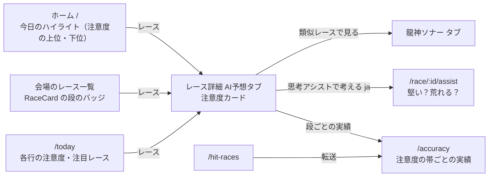

# イン崩れ注意度の作り直し screens

元: [spec.md](./spec.md)（FR-1〜FR-8）。承認: [mock/APPROVED.md](./mock/APPROVED.md)（2026-10-12、置き場所は案A＝AI予想タブ、思考アシストは (a)）。

## 画面の流れ



## 画面ごとの変更

### S-1 レース詳細の注意度カード（新規 `InCautionCard`、FR-2・FR-3）
承認した見た目は `mock/1-ai-tab-375.png`・`mock/1-ai-tab-1440.png`（下の図は要素の一覧）。

```
┌ イン崩れ注意度 ─────────────────────────┐
│ [段の札: 崩れやすい側 / 中くらい / 堅い側]   │
│ 1号艇が1着を逃したのは 62%                 │
│ ███████████████░░░░░░ ┆全国 45%            │
│ 勝率差が今日と同じ帯のレース（全国 18,240件）│
│ 理由                                        │
│  ・1号艇 5.20、他で一番高い 4号艇 6.85（差 −1.65）│
│  ほかの材料は龍神ソナーの「差がつく材料」で │
│ （準優・優勝戦: 勝率差による差がつきにくい）  │
│ （欠場あり（5艇） / 件数少なめ（n件））       │
│ 類似レースで見る › 龍神ソナー              │
│ 思考アシストで考える ›（ja のみ）           │
└─────────────────────────────────────┘
```

- 文言と並び（承認したモック `mock/1-ai-tab-375.png` が正。上の図は要素の一覧で、並び・言い回しはモックに従う。2026-10-13 受け入れ E2E の曖昧点への回答）:
  - 見出し「イン崩れ注意度」と段の札、「1号艇が1着を逃したのは」、大きい数字「{pct}%」、点線の上に「全レース {basePct}%」（2026-10-17 オーナー決定。準優・優勝戦で本文の「全国◯件」と取り違えないため）、棒の下の両端「← 堅め（35%未満）」「崩れやすい（55%以上）→」
  - 範囲の文「1号艇と、他の艇で一番高い勝率の差が今日と同じくらい（{帯の範囲}）のレース。全国 {n}件（{期間}）」。帯の範囲は「−2.5〜−2.0」の形、端は「−3.5未満」「+3.0以上」
  - 理由は見出し「今日の勝率差（全国勝率）」の下の3行の表: 「1号艇 {名前}（{級}）{勝率}」「一番高い {x}号艇 {名前}（{級}）{勝率}」「差 {差}」。その下に「ほかの材料（展示・モーター等）は龍神ソナーの『差がつく材料』で」
  - 免責「過去の実績の割合で、今日の結果を保証するものではありません。」
  - 導線は2つのボタン: 「類似レースで見ると？ 龍神ソナー ›」（2026-10-17 オーナー決定。件数は書かない。準優・優勝戦ではソナーの件数が400件より少ない）「軸から考える 思考アシスト ›」（思考アシストは ja のみ）。その下にリンク「段ごとの実績を見る ›」（`/accuracy`）
  - 値が無いときの空状態の1行: 「このレースはイン崩れ注意度を出していません」
  - 「0〜100 の数字が出ない」（spec FR-3）は、旧の言葉（「会場内パーセンタイル」「イン崩れ指数」）と 0〜100 の指数のバーが出ないこと。注意度の%自体は 0〜100 の範囲の値なので、数値の範囲では判定しない
- 置き場所: AI予想タブ（`RaceAiPredictionTab.jsx`）の先頭（案A、承認）。展開予測のブロックと「龍神ソナーへの案内」ボタン（`data-testid="ai-tab-sonar-link"`）を外す。出現パターン（`OutcomePatternPreview`）は下に残す
- 確定後: 同じカードに「結果: 1号艇は{n}着」を1行足す（1レースの当たり外れの判定は出さない。今の方針どおり）
- 値が無いレース（中止・1号艇の欠場・勝率の無い1号艇・2艇以上の欠場・生成前）: カードを出さず、タブの空状態の1行
- 段の札の色: 3段に意味トークンの色を当てる（新しい CSS は `in-caution-` の接頭辞。ダークモードで見えるか確認）
- i18n: 4言語（`inCaution.*` の新しいキー。`volatility.*` は使わなくなったものを消す）

### S-2 レース一覧のバッジ（`RaceCard.jsx` の拡張、FR-1・FR-5）
- 場所: 会場のレース一覧 `/races/:date/:venueCode`（`VenueRaceListPage`）
- 段のバッジ（今の「🌪️高」「🎯本命有利」と左の色線）を、3段の札と割合（例「! 崩れやすい 65%」。承認時は ▲、予想の印に読まれるので 2026-10-18 オーナー決定で ! に）に替える。真ん中の段は色なし・枠線だけで出す（承認）
- 展開予測の的中/外れのバッジ（`raceCard.badgeTurn`）を外す
- `RaceCard` を使う画面（会場のレース一覧、Holmes 系4画面）すべてに効く

### S-3 ホームの今日のハイライト（`TodaysVolatilityHighlights.jsx` の拡張、FR-5）
- 場所: `/`（と `/races/:date`、どちらも `VenueGridPage`）。見出しは「今日のイン崩れ注意度」。今と同じく2列（崩れやすい順の5件・堅めの順の5件）を並べて出す（切り替えの UI は無い。モックは上の列だけ描いて「堅めの順も同じ形で5件」と注記した）
- 上位・下位5件の値を注意度の割合と札に替える。選び方（`volatilityHighlights.js`）は割合の順に替える
- 見出し・説明の i18n キー（`home.volatilityHighlights*`）を書き直す

### S-4 /today（`DigestRaceCard.jsx`・`FeaturedRaceCard.jsx`・`morningDigestCopy.js`・`MorningDataDigest.jsx` の拡張、FR-5・FR-7）
- 「イン崩れ指数 {v}%」を「イン崩れ注意度 {p}%」に、注目レースの「50以上なら高い」を3段の札に替える
- 説明・用語集の「当日の条件からAIが算出した」を FR-2 の中身で書き直す（ja のみ）

### S-5 /accuracy（`AccuracyDashboard.jsx` の作り替え、FR-6）
- 展開予測の大きい数字・会場別の表を外す
- 注意度の3段ごとに、実際に1号艇が1着を逃した割合・件数・ぶれ幅の棒（段の範囲の帯・全国の点線）。「公開後」と「公開前の検証」の切り替え（承認）、件数30未満の段は割合を出さない。起算日と「同じ日・同じ会場に偏るので、実際の幅はもう少し広い」の注記
- 旧 `VolatilityAccuracyChart`（`/winning-technique?tab=volatility` でも使う）は旧指数の実績なので、新しい部品 `InCautionAccuracyChart` に置き換え、`/winning-technique` のタブも同じ部品にする
- `/hit-races` は `/accuracy` へ転送（最初は一時的な転送 307、数日後に 308。plan「URL」。`vercel.json`・`AppRouter.jsx`）。ヘッダーのナビ（`Header.jsx:147`）・sitemap から外す。`/accuracy/history` の扱いは plan で決める

### S-6 /races（`RaceHistory.jsx`、FR-1）
- 日別の展開予測の的中率を外す。残る内容が無くなる場合のページの扱いは plan で決める

### S-7 思考アシスト「堅い？荒れる？」（`RoughCard.jsx`・`RoughSheet.jsx`、FR-4、(a) を承認）
- 1着のバーを注意度の裏返し（100−p%）に替え、行ごとに範囲の名前と件数。万舟は級の並びのまま

### S-8 説明のページ（About・FAQ・HowToUse・HomeAiIntro、FR-1・FR-7）
- 場所: `/about`・`/faq`・`/how-to-use`、HomeAiIntro はホーム `/` の AI の紹介の欄
- 展開予測の説明・「的中率約79%」を外し、注意度の説明を FR-2 の中身で書き直す

### S-9 外すだけのもの（FR-1）
- `TurnPatternList`・`PredictionCard`（statKey `turn`）・`AccuracyStatBadge`（展開予測の分）・`VolatilityPercentileBar`・`RaceMoodEffect`・`VolatilityDisplay`・確定後のシェア文（`generateTurnHitShareText` 等）・AIコピーの展開予測の節・`HitRaces.jsx`／`hits/*`
- `TECHNIQUE_NAMES` は `raceIndicators.jsx` が使うので移して残す

## 部品の作り方

| 部品 | 新規／拡張 | 方針 |
|---|---|---|
| `InCautionCard` | 新規（`src/components/race/`） | AI予想タブで使う。barrel export に足す |
| 割合の棒（値＋基準の点線） | 共通化 | 思考アシストの `RoughCard.jsx` 内の `MiniBar` と同じ形。`src/components/race/RateBar.jsx` に切り出し、`RoughCard`・`InCautionCard`・`InCautionAccuracyChart` で使う（同じパターンが3か所） |
| 段の判定・言葉 | 新規 `src/utils/inCautionLevel.js` | `volatilityLevel.js`（0.7/0.3）を置き換える。生成側は保存した `level` を使い、画面で閾値をかけ直さない（architecture-y.md） |
| `RaceCard` のバッジ | 拡張 | 段の札は `InCautionCard` と同じ言葉・色のトークン |
| `TodaysVolatilityHighlights` | 拡張（名前はそのまま、中身を替える） | 割合の順 |
| `InCautionAccuracyChart` | 新規（`src/components/analysis/`） | `/accuracy` と `/winning-technique` で共通 |

- 色: 段の色・文字は `design-tokens.css` の意味トークン（`--text-primary` 等）と既存の状態色で表す。新しい CSS は段の札と棒の並びだけ（`in-caution-` 接頭辞、`verify:css-collisions`）
- `App.jsx` と `RaceDetail.jsx` の両方に同じ UI は無い（注意度はレース詳細の `PredictionPanel` 配下と一覧の `RaceCard` のみ）
- 文言は wording-editor で検査（禁止語・単位）。モックの説明文も対象
