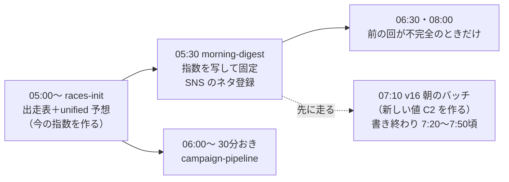

# /today（本日のデータ一覧）と朝の処理への影響（BOA-822）

2026-10-12 のユーザー指摘「本日のデータのところは影響範囲が大きそう」を受けた洗い出し。コードから読んだもの。

## 今の仕組み

- `/today` の行は JST 05:30 に1回だけ作られ、`predictions`（unified）の `volatilityPercentile` を `morning_digest_rows.volatility_percentile`（0〜100）に写して固定する（`scripts/daily/generate-morning-digest.js:275-297`）。06:30・08:00 の回は前の回が不完全なときだけ動く（`scripts/lib/scrapeJobs/cronWrapper.js:468-474`）
- v16 の朝のバッチは 07:10 起動で、10/8 は約10分、10/6 は40分で打ち切り（9:24 回が25分）。**今の仕組みのままでは、新しい値は /today に入らない**
- 指数が無い行は NULL で書き、注目レースは作らない（`:1021-1025`）

## 指数を使っている所（/today と朝）

| 場所 | 使い方 |
|---|---|
| `DigestRaceCard.jsx:96-99` | 「イン崩れ指数 {v}%」の表示 |
| `FeaturedRaceCard.jsx:97-108` | 数値と、50 以上「高い（荒れやすい）」未満「低い（堅い）」（閾値の直書き） |
| `generate-morning-digest.js:582-630` pickFeatured | 注目レースの選び方。スコア＝z×方向一致度（`digestMetrics.js:147-152`: 逃げは 1−v/100、まくり・逃がしは v/100）。理由の文に指数の値 |
| `generate-morning-digest.js:879-904` | SNS のネタの本文「イン崩れ指数{v}%」 |
| `morningDigestCopy.js:25-26・97・134-148`、`MorningDataDigest.jsx:333-345` | 説明・用語集（ja のみ）「当日の条件からAIが算出した」 |
| `campaign-detect-and-generate.js`・`snsCampaigns.js:115-170` | SNS 企画の判定（`volatilityPercentile >= 0.985` など）、文言「イン崩れ注意度N%」。06:00〜30分おき |
| `todays-volatility-digest.js` | 手動の CLI（定期実行なし） |

並べ替えには指数を使っていない（skill_delta の降順）。

## ほかの画面の経路

| 画面 | 経路 | 時点 |
|---|---|---|
| ホーム TodaysVolatilityHighlights | RPC `get_today_races`（最新 110）の `volatility.percentile` | 読むたびに最新 |
| レース一覧のバッジ | RPC `get_predictions_by_date(_light)`（最新 109）の `volatility.level`（RPC 内で 0.7/0.3） | 同上 |
| `/accuracy` の帯ごとの実績 | `calculate-unified-volatility-accuracy.js`（JST 23:30）→ `accuracy_cache.unified_volatility_accuracy` | 夜に1回。指数の意味を変えると新旧が混ざる |

## 置き換えで変える所

- 作る側: `generate-unified-predictions.js:33-35・160-190・350-372`（composite・percentile・reasons）、v16 の朝のバッチ（C2 の保存を足す）
- DB: `morning_digest_rows.volatility_percentile`（098）、RPC `get_today_races`（110）・`get_predictions_by_date(_light)`（109）。次のマイグレーション番号は 149
- 検証: `verify-morning-digest.js`、`verify-morning-digest-sns-topic.js`、`verify-volatility-accuracy-heading.js`、`verify-volatility-st-reason.js`、`verify-frontend-pure-functions.js`、`verify-morning-init-refactor.js`
- e2e のモック: `today-highlights-result`・`race-share-text`・`race-cancelled-ai`・`race-outcome-display`・`race-result-popularity`・`analogy-contribution`・`race-detail-details`
- ほか: `AiCopyBanner.jsx`・`AiCopyPromptSelector.jsx`・`aiCopyPrompts.js`・`find-video-worthy-race.js`・`unchangedRows.js`・`AnswerCheckHookCM.jsx`

## 決めること（統計検証 第3回の結果を待って推奨を出す）

- 早朝（05:30）の時点の値: (1) ダイジェストを v16 の後（8:00 前後）に回す、(2) 05:30 は代わりの値（勝率差の帯の過去の率など）で作り、v16 の後に置き換える、(3) /today だけ代わりの値のまま
- v16 のバッチが止まった日の表示
- `/accuracy` の帯の切り方と、新旧の切り替え日の扱い

## 調査中に見つけた別スコープの不具合

- BOA-851: 注目レースが上限25件で切った後の逃げ候補から選ばれている（`nigeAll` が未使用）
