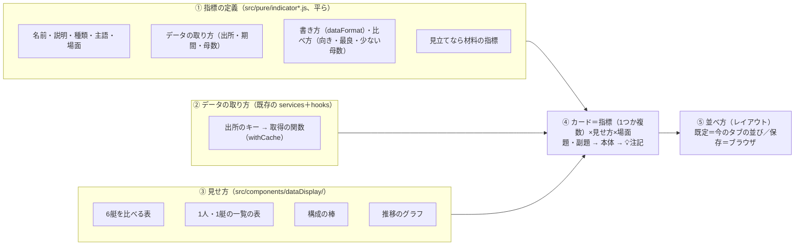
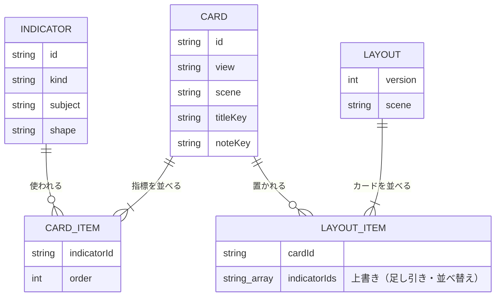
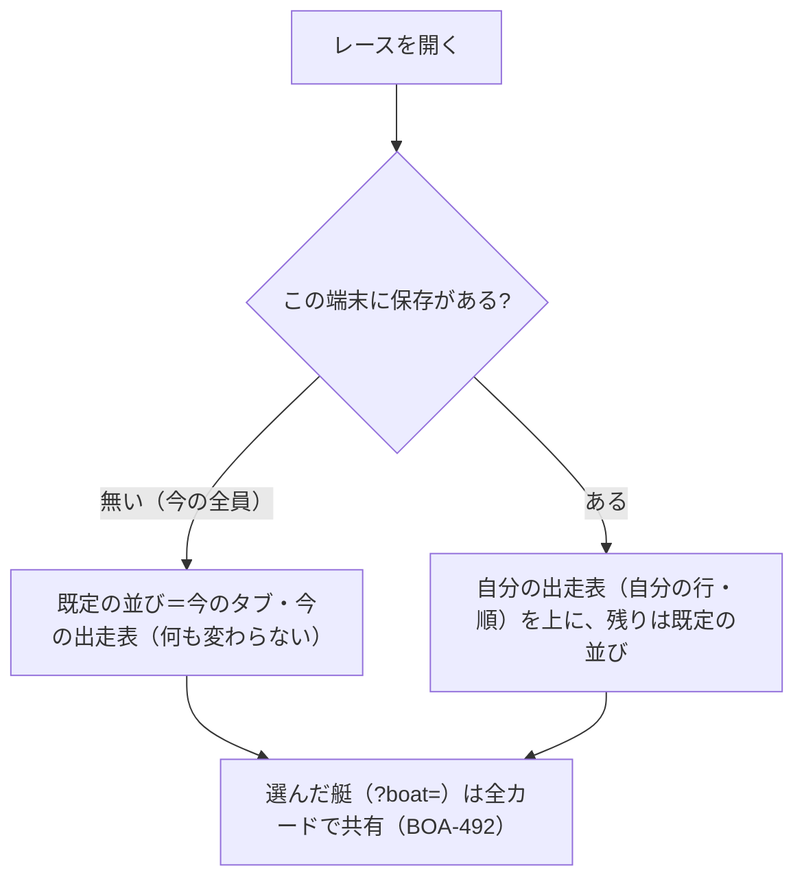
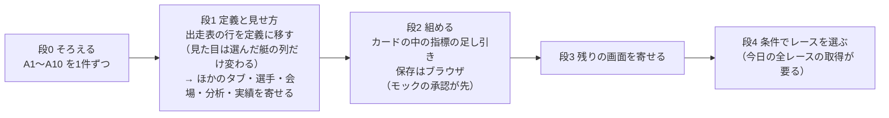

# 指標の部品（設計）

- 状態: 承認（2026-11-23 オーナー、窓口の確認で4点を決定。§10）。system-architect の審査（判定「直してから進める」、P1 4件・P2 7件・P3 1件）は全部入れた
- 発端: オーナー 2026-11-23「表とグラフの部品化というか、ボートレースで分析する上での一つ一つの観点・指標・要素を部品化するイメージ。それに合わせてアーキテクチャを検討した方が良い」。同日の答え: 公式・集計の指標と龍神の見立ての両方を部品にし、見立ては材料を持つ／選ぶ単位と開いた時に出す物は、洗い出しとファンの議論の後に決める
- 前提の決まり: `docs/reference/design-system.md`「表とグラフ」（2026-11-23 承認、同日夕に決まり7を直した: 進入コースには艇の色を付けない）
- 材料: 指標の棚卸し約870行を119族・10大分類にまとめた族の表（`catalog.md`。この置き場に入れる。300行の線のため別の PR）、ファンパネル `fan-panel-unit-and-open.md`

## 1. 目的と、言われた案が最短か

- 目的: ユーザーが自分の龍神を組めるようにする（保存はまずブラウザ、登録なし）。その前に、同じ指標が画面ごとに別の計算・別の書き方で出ている状態（棚卸しで「そろえるべき別計算」A10件・B22件・C6件・D7件）をやめる
- 最短か: 見た目の部品（表・棒・グラフ）だけを先に作ると、行の中身（計算・期間・母数・最良の判定）は画面ごとに残り、同じ名前で値が違う問題は直らない。**指標の定義を1か所に置き、見せ方はそれを受け取る**形が最短。見た目の部品は定義を描く側として作る（先に作った #3292 の数字の書式は、この定義の「書き方」にそのまま使う）
- 同じ原因で直すべき物: 下の「8. 先にそろえる物」。ファン4人も「組める画面より先に、同じ名前で値が違う物を直してほしい」で一致した

## 2. 全体の形（5つの層）



- ① は React を持たない（純関数とデータ）。画面・Node（ボット向け HTML・SNS の素材・AI 用コピー）の両方から読める（ADR 0089 の向き）。`src/pure` は平ら（AGENTS「構造と依存の向き」、オーナー 2026-11-10）なので下の階層を作らず、`indicator<大分類>.js` の名前で分ける。pure は pure しか読めない（`verify-pure-imports.js`）ので、既定のカード等の設定は引数で受け取る
- ② は今の `src/services/<領域>Queries*.js` を使う。段1は `useRaceAnalysisData` の出所（`SOURCES`）と出走表の値（`players`）をそのまま使う。段2で、出所の表（キー → 取得の関数。今の `SOURCES` の形）とキーの集合を受け取る汎用の hook にし、`useRaceAnalysisData` はその既定の組の1つにする（ユーザーが別の hook の指標を足すと、条件で hook を呼び分けられないため）。出していない指標の出所は取らない
- 今の行の素の共有（`src/pure/raceIndicatorText.js`、表と AI 用コピーが共有、RA41d）は登録簿に吸収する。2つ目の登録簿を作らない
- ③ は値の形（下の shape）だけを知り、どの指標かは知らない
- ④ と ⑤ はデータ（JSON にできる形）。保存・共有・既定の並びの全部がこの形

## 3. 指標の定義の型

```js
/** @typedef {Object} IndicatorDef */
{
  id: "racer.winRate.official",     // 族.指標.変種。変種（期間・母数の違い）は別の id にし、名前でも分ける
  family: "F-001",                  // 族（catalog.md）。同じ問いに答える指標のまとまり
  category: "racerPower",           // 大分類（10個）
  kind: "official",                 // official（公式の値）| aggregate（当社が数えた）| judgement（龍神の見立て）
  subject: "racer",                 // racer | boat（艇番）| course（進入コース）| motor | hull（ボート）| venue | race | meet | prediction
  scenes: ["race", "racer"],        // 使える場面（race・racer・venue・meet・list）
  shape: "perBoat",                 // 値の形。見せ方を決める（下の表）
  text: { label: "dataTable.rowWinRate", short: "review.cols.winRate", hint: "winRate" }, // i18n のキー（4言語）
  sources: ["players"],             // 出所のキーの配列（1行が2つの出所を読む物がある: モーターは analysis.motor、無ければ players）
  window: "公式の最新の期",          // 期間・母集団の説明（注記に出す）
  format: "winRate",                // dataFormat の関数の名前と一致させる（verify で照らす）
  compare: { direction: "max", digits: 2, minN: null }, // 最良の判定（bestOf）。direction:null は比べない
  select: ({ players, analysis }, ctx) => /* Map<艇番, { value, n, hidden }> を返す純関数 */,
  note: (values) => null,           // 全艇の値から決まる注記（未使用の新モーター等）の i18n キー。無ければ null
  detailTab: null,                  // 詳しいタブ（racecard | motor | racer …）。?tab= の id を変えない（ADR 0084）
  adornment: "gradeBadge",          // 値の横の札・リンク。列挙した名前だけ（gradeBadge | motorPowerLink | trendArrow）
  materials: undefined,             // judgement のときだけ: 材料の指標の id の並び（輪にしない）
}
```

- **セルの状態は定義でなくカードが決める**: 全部の出所の `pending`・`failed`（`useRaceAnalysisData` が出所ごとに返す）から、骨組み（取得中）・失敗（`InlineFetchError`）・「—」（取れて値が無い）を分ける。`select` は値だけを返す（失敗を「データなし」にしない、ADR 0069）。出所を取らない場面（一覧のカード `RaceCardDataTable`）は「取っていない」を明示し、その行を出さない
- **最良の除外は `hidden`**: 選手調子は上がった艇だけ、展示 ST はフライングの艇を外す、ST のずれ・回収率は走数0を外す（今の `raceIndicatorsRowDefs.jsx` の扱い）。`bestOf` は `hidden` を比べるが返さない
- **札・リンクは列挙**: 指標ごとの特別な描き方が見せ方の層に漏れないよう、`adornment` の名前の一覧を見せ方の層が持つ。新しい札は「既存の札で描けないか」を先に見て、足すときは見せ方の PR で1つずつ（線: 2つ以上の指標が使う物だけを札にし、1つだけの物は値の字に入れる）
- **書き方**: `dataFormat`（#3292）に無い種類（ST の `.14`／`0.15`／`F.01`、展示タイム、決まり手・級・着順の訳の要る字）は、使う PR より前に `dataFormat` に足す
- **見立ての断り**: `kind: judgement` を1つでも含むカードは「結果を保証しない」（ja common.json の `disclaimer`）を自動で出す。登録簿の verify で見る

| shape（値の形） | 中身 | 合う見せ方 | 例 |
|---|---|---|---|
| perBoat | 6艇それぞれに1つの値＋母数 | 6艇を比べる表 | 勝率・モーター2連率・平均ST |
| byCondition | 1つの主語の、条件（コース・期・会場）ごとの値 | 1人・1艇の一覧の表、横棒 | 選手のコース別1着率、会場のコース別1着率 |
| composition | 合計100%の内訳 | 構成の棒 | 決まり手の割合、出目の分布 |
| series | 時の並びの値 | 推移のグラフ | 期別の勝率、モーター2連率の推移 |
| scalar | 1つの値 | 札・一言 | イン崩れ注意度、得点率 |

決まりの対応:
- 艇番（boat）と進入コース（course）は別の主語。course の値を艇の色で塗らない（決まり7、2026-11-23 夕）。今「想定コース」（枠なりの仮定）で出している値は subject を course にし、名前に「想定」を残す
- 少ない母数は `compare.minN`（既定は dataFormat の6）。今の線（3〜1000 の8種）は、根拠のある物だけ定義に残し、無い物は6に寄せる案を指標ごとに出す（根拠の無い線は「目安（根拠なし）」と書く）
- 見立て（judgement）は `materials` を必ず持つ。カードの注記に「材料: 全国勝率・直近30走のST・…」を自動で出せる（U7）

## 4. カードと並べ方



```js
// カード（既定のカードはコードに置く。今のタブ・表の中身がそのまま既定）
{ id: "race.entryTable", scene: "race", view: "boatCompare",
  title: "dataTable.title", note: "dataTable.noteExpectedCourse",
  indicators: ["racer.winRate.official", "racer.localWinRate.official", /* … */] }

// 並べ方（ユーザーの保存。localStorage の boatai-user:layout:v1:race）
{ version: 1, scene: "race",
  items: [ { card: "race.entryTable", indicators: ["racer.winRate.official", "racer.st.last30"] },
           { card: "race.inCaution" } ] }
```

- カードの中の指標は同じ shape・同じ主語にそろえる（混ぜると見せ方が決まらない）。検査は純関数 `validateCard`
- **選ぶ単位は2段のどちらにも合う**: ユーザーがカードを選ぶ（items に card を足す）ことも、カードの中で指標を足し引きする（indicators の上書き）こともできる。**決定: 「カードを選ぶ→中で指標を足し引き」の2段**（オーナー 2026-11-23、ファンパネルの推奨どおり）
- 見せ方はユーザーに選ばせない（指標の shape と場面で決まる。ファンパネル）
- 保存の決まり（古い版が最大約12時間動くので、新旧が同時に同じ保存を読む前提）:
  - キーは `boatai-user:layout:<scene>`、版は本文の `version` の1か所だけ（`boatai:` はキャッシュの全削除で消える、BOA-665）
  - 読んだ時に書き戻さない。`normalizeLayout` は描く時の絞り込みだけ。書くのはユーザーが操作した時だけ
  - 知らない id はその id だけを描かない（並び全体を既定に戻さない）。カードの中が空になった時だけ、そのカードを既定で描く
  - 本文の `version` が自分より新しい保存は、既定で描き、編集させず、上書きもしない
  - 壊れた JSON は既定で描き、上書きはユーザーが操作した時だけ
  - id を改名する時のために `aliases`（旧 id → 新 id）を登録簿に持つ
  - 別のタブとの同期は `useFavorites.js` と同じ storage イベント
- 組む画面（カードを選ぶ・指標を足し引きする UI）は ja だけ（`lang === "ja"` の判定、新しいページは ja 専用の決まりと同じ）。指標の名前は `/race` が翻訳の対象なので4言語
- ボット向け HTML は既定の並びだけを使う（レースのボット向け HTML は表の値を出さない、`api/_lib/botRace.js` の決定7）

## 5. レースを開いた時



- ファンパネルの推奨: 開いた時は「自分の出走表」。展示の前後で自動で並びを入れ替えない（開くたびに場所が変わると探す）。直前の指標は足せる行として用意する。**決定: 自動で入れ替えない**（オーナー 2026-11-23）
- 選んだ艇の列の強調（承認済みの5）はこの形の中で全カード共通の動きになる

## 6. ユースケースとの対応

| ID | 型 | この設計で何ができるか | 段 |
|---|---|---|---|
| U1 | いつもの指標でレースを見る | 出走表のカードの指標を足し引き・並べ替えて保存 | 2 |
| U3 | 1艇を深掘り | ?boat= の共有＋perBoat と byCondition のカード | 1 |
| U4 | 展開を読む | 進入・ST・決まり手の指標（艇番とコースを分けた定義） | 1 |
| U5 | 直前で確かめる | 直前の指標を出走表に足せる | 2 |
| U7 | AI の見立てを確かめる | judgement の materials から材料のカードへ | 2 |
| U9・U13 | 会場を知る・選ぶ | 会場の byCondition・composition のカード（会場ページの刷新が使う） | 1 |
| U10・U11・U14・U15 | モーター・勝負駆け・選手を探す・似たレース | 各画面のカードを定義に寄せる | 3 |
| U2 | 条件でレースを選ぶ | 指標の定義を条件にも使う（scene: list）。ただし今日の全レースの値を一度に取る取得が要る（今はレースごと）ので後の段 | 4 |
| U8・U12 | 振り返り・買い目 | 優先は低い。買い目は断りと言葉の審査が前提 | 4 |

## 7. 置き場と、今の行の仕組みを使う所

| 物 | 置き場 | 段 |
|---|---|---|
| 指標の定義 | `src/pure/indicator<大分類>.js`（平ら。1ファイル400行以下） | 1 |
| 登録簿と検査 | `src/pure/indicatorRegistry.js`（`getIndicator`・`aliases`）。verify で id の重複・ja のキー・書き方の種類・`materials` の参照先と輪・見立ての断り | 1 |
| 数字の書式 | `src/pure/dataFormat.js`（#3292） | 1 |
| 見せ方 | `src/components/dataDisplay/`（BoatCompareTable は出走表の表の切り出し、作業中・未 PR） | 1 |
| 既定のカード | `src/pure/indicatorCards.js`（データ。pure から読めるように pure に置く） | 2 |
| カード・並べ方の検査 | `src/pure/indicatorLayout.js`（`validateCard`・`normalizeLayout`、カードは引数で受け取る） | 2 |
| 並べ方の保存 | `src/hooks/useIndicatorLayout.js`（localStorage） | 2 |
| 出所の表と汎用の取得 | `src/hooks/useIndicatorSources.js` | 2 |

登録簿に寄せる、今の行の仕組みを使う所（どれも段1で定義を通すようにする。通さない所が残ると「同じ名前で値が違う」がまた起きる）:
`DataRaceTable`・`RaceCardDataTable`（一覧のカード）・`RaceBeforeInfoTab`・`RaceWakuInfoTabData`・`PredictionSection`・`useAiCopyText`／`useAiCopyTextRows`（AI 用コピー。検査は `verify-ai-copy-text.js`）・`src/pure/raceIndicatorText.js`

## 8. 先にそろえる物（同じ名前で値が違う、棚卸しの A）

定義を書くときに必ずぶつかるので、族ごとに「寄せる／名前で分ける」を決めてから定義にする。どれも画面の数字が変わるので、1件ずつ票にし、画面の PR はファン評価を通す。

| # | 中身 | 案 | 誰が決めるか |
|---|---|---|---|
| A1 | モーターの「2連率」の5定義が同じ凡例名 | 名前で分ける（公式・期間・節内・コース別・選手×コース） | 作り手（名前の付け直し） |
| A5・A10 | イン崩れ注意度の新旧が同じ見出し・閾値3種・表記2種 | **決定: 新を公開して旧を消す**（`IN_CAUTION_PUBLIC` を true にし、全画面を新に切り替える。公開の PR は画面が変わるのでファン評価を通す。旧の定義は登録簿に入れない） | 決定済み（オーナー 2026-11-23） |
| A2 | 思考アシストの「1号艇の1着」5通り | 名前で分け、集め方を注記に | 作り手 |
| A6 | 「イン」「逃げ」の5〜6定義、艇番と進入コースの混在 | 主語で分ける（1号艇の1着／1コースの1着） | 作り手 |
| A3・A4・A8・A9 | 決まり手の分母、勝率のチップ名、枠番勝率と想定コース1着率、平均ST の4定義 | 名前に期間・主語を入れて分ける | 作り手 |
| A7 | 展開予測の的中の判定が4実装、出す・出さないが画面で違う | 判定を1つに寄せる。出すかは BOA-617 の決定に合わせる | 作り手（出すかはオーナーの既決） |

## 9. 段（作る順）



- 段1の前に ADR を1本出す（指標の定義を正にする登録簿、並べ方の保存の形と旧版との両立。番号は PR を作る時に origin/master の最大＋1。関係: ADR 0069・0084・0089）
- 段1の範囲はレース詳細の全タブと一覧のカード・AI 用コピー（今の行の仕組みを使う所）まで。選手・会場・分析・実績は段3
- 段1の最初の PR は登録簿＋3行（勝率・当地勝率・2連率）を見た目を変えずに移すだけ。次の PR でモーターと選手調子（`hidden`・`note`・`adornment` の形を確かめる）。カードと並べ方は段1で作らない（段2のモックの承認の後、YAGNI）
- 数字が変わる変更（少ない母数の線を6に寄せる等）は、移すだけの PR と分ける。線の根拠は data-scientist が見る。`src/pure` は line-mutation の検査の範囲（`config/pr-path-rules.json`）
- 段0と段1は並行できる（段1は名前を変えない範囲から始める）。段2の前に、選ぶ画面のモックをオーナーが触って承認する
- 1画面＝1つの PR、300行5ファイル以内。画面が変わる PR は boatrace-fan-reviewer で P0・P1 が0になるまで（3周で0にならなければオーナー）
- 会場ページの刷新は自前で作り、段1の部品ができたら寄せる（その時、会場の byCondition・composition の定義を一緒に足す）

## 10. オーナーの決定（2026-11-23、窓口の確認）と、まだ決めないこと

| # | 問い | 決定 |
|---|---|---|
| 1 | 選ぶ単位 | 2段（カードを選ぶ→カードの中で指標を足し引き）。推奨どおり |
| 2 | 展示の前後で並びを自動で入れ替えるか | 入れ替えない。推奨どおり |
| 3 | イン崩れ注意度の新旧（A5） | 新を公開して旧を消す（推奨の「名前で分ける」ではなくこちら）。`IN_CAUTION_PUBLIC` を true にし、全画面を新に切り替える。公開の PR はファン評価を通す。旧の定義は登録簿に入れない |
| 4 | 段の順 | 0→1→2→3→4。推奨どおり。段0・段1に進んでよい |

まだ決めないこと: U2（条件でレースを選ぶ）の取得の作り方と時期（段4の前に）

## 11. 試験

- 登録簿: verify（上の §7）。移すだけの PR は、移す前後で出走表の全行の字と金枠が同じことを E2E で照らす（今の `avg-st-period.spec.js` 等の期待値は変えない）
- 保存（段2）: 保存が無い・ある・壊れた JSON・知らない id・自分より新しい版の5つの状態の E2E と、`normalizeLayout` の verify。375px で行を足した時のレイアウトの試験（`e2e/layout`）
- 録画に無い新しい出所は本番へ素通しするので、出所を足す PR は録画の撮り直しを頼む

## 12. 次に指摘されそうな点

- `adornment` の列挙は、指標が増えるたびに見せ方の層へ足す形になる。線（2つ以上の指標が使う物だけ）で増え方を抑えるが、超えたら見直す

- 119族の全部を定義にするのは大きい。段1は出走表の行（約14）から始め、画面を寄せるたびに増やす。全部を一度に書かない
- 棚卸しの数字・窓・閾値は未検証（コードを読んだ写し）。定義を書くときにコードで確かめ直す
- 定義の `select` が今の画面ごとの計算を1つにまとめるので、寄せる PR で数字が変わる画面が出る。変わる画面は PR 本文に前後の値を書く
