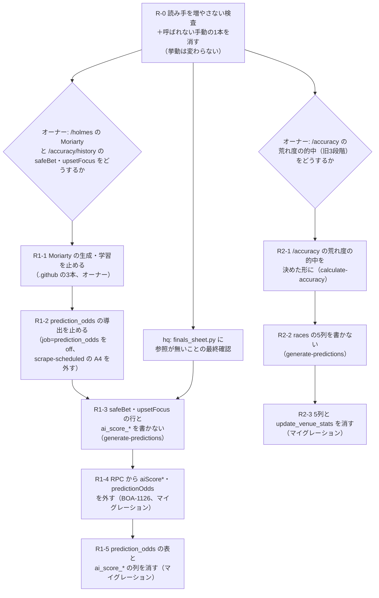

# 廃止した予想の作り続けと旧い荒れ度の列を止める（基盤の計画 R1・R2）

基盤の計画（`.git/orchestrator/foundation-plan-2026-10-27.md` の「データの地図」の流れ、10/27 の記録で R1・R2）の分割の案。読み手・書き手は台帳 `docs/reference/data-readers.md`（2026-10-27 の写し）と、2026-10-28 の origin/master（4d9f92bcd）の grep で確かめた。

- **R1**: 廃止した3モデルのうち safeBet・upsetFocus の予想と、`prediction_odds`、`race_entries.ai_score_*` を毎日作り続けている（BOA-1124・BOA-478・BOA-1126）
- **R2**: `races` の旧い荒れ度の列（`volatility_score`・`volatility_level`・`recommended_model`・`volatility_reasons`・`first_boat_avg_st`）を書き続けている（BOA-859）

目的: 誰も使わない取得・書き込みを止めて、関数と DB の書き込み（BOA-357 の Disk IO、BOA-1145 の取得の予算）を減らす。止める前に読み手を全部外し、画面・hq・バッチを壊さない。

## 1. 確かめた事実（起票の前提と違った所を含む）

| # | 事実 | 根拠 | 起票・前の調べとの差 |
|---|---|---|---|
| F1 | **standard は止められない**。`predictions` の standard の行の `feature_contributions.racerStats` を、レース詳細の枠別の成績が DB から直接読む | `src/services/supabaseDataService.js:5472-5489`（`getRaceRacerStats`、BOA-302） | BOA-1124 は「3モデルを止める」。`public-api-lockdown/plan.md` §3 の「standard の読み手0」は `/api` の写しの話で、DB の直読みは別 |
| F2 | standard の行は、会場ルールの的中（`ruleMatchService.js:104-109`、管理画面 `adminRuleService.js:69-76`）、`daily-rule-tracking.js:129-132` も読む | 同左 | 同上 |
| F3 | safeBet・upsetFocus の行と `prediction_odds`・`race_entries.ai_score_*` を毎日読むのは **Moriarty**（`/holmes` のα版、ナビ非公開だが公開中のルート）。生成は毎日（`generate-moriarty.yml` 0:00 UTC）、結果の更新は毎日、学習は毎週 | `scripts/daily/generate-moriarty-recommendations.js:30,81-130`、`scripts/analysis/train-moriarty-calibration.js:27-82`、`src/AppRouter.jsx:105-107,292`、`src/services/moriartyService.js` | BOA-478 は「読み手は Moriarty・週次学習・data-health だけ」。Moriarty が画面（`/holmes`）に出ている点は書かれていない |
| F4 | 3モデルの月別の成績は `/accuracy/history`（月別成績アーカイブ）が出す。今月・先月の欄は、作り続けている行から毎日の集計（`calculate-accuracy.js:380,506`→`get_accuracy_summary`）で埋まる | `src/pages/AccuracyHistory.jsx:76,128`、`src/services/supabaseDataService.js:1794` | 生成を止めると、止めた月から safeBet・upsetFocus の欄が空になる（アーカイブとして止めるかは決めが要る） |
| F5 | hq の `platform/finals_sheet.py` に safeBet の参照は **見当たらない**（2026-10-28、`~/hq/platform`・`~/hq/scripts` を `safeBet`・`safe_bet`・`upsetFocus`・`prediction_odds` で grep、0件。読み取りのみ） | 同左 | 台帳の外の読み手（`data-readers.extra.json`、BOA-1124）は「読む」。`public-api-lockdown/plan.md` §5 の 10/27 の grep とは一致。hq の最終の確認は要る |
| F6 | **`races.volatility_level` は公開画面が読む**。`calculate-accuracy.js:178-202` が `volatilityStats` を作り `accuracy_cache` に書き、`/accuracy` の `VolatilityAccuracySection` が出す | `src/services/supabaseDataService.js:1861-1869`、`src/components/AccuracyDashboard.jsx:56,216-217`、`src/AppRouter.jsx:202` | BOA-859 は「画面は読まない」。誤り |
| F7 | `update_venue_stats()` は `races.volatility_score` を読み、048 で消した `venues.avg_volatility_score` に書く。本番で呼ぶと失敗する形のまま残り、呼び手は0（RPC の呼び手の見つからないもの） | 写しの `functions[update_venue_stats]`・`relations[venues].columns`、`docs/db-migration/048_drop_venues_avg_volatility_score.sql:21`、台帳の RPC の表 | 起票なし |
| F8 | `scripts/maintenance/update-today-recommended-models.js` は `races.recommended_model` を旧い3モデルの切り替え（FR6 で廃止）で書き直す手動のスクリプト。どこからも呼ばれない（`.github`・`package.json`・`scripts`・`docs` の参照は台帳と in-collapse-caution/inventory.md の一覧だけ） | grep | BOA-859 は読み手に数える |
| F9 | `prediction_odds` の書き手は2つ。Vercel の `api/cron/odds.js`（`scrape_job_state` の `job='prediction_odds'` が off/shadow/live）と、GitHub Actions の `scrape-scheduled.yml`→`scrape-scheduled.js:30`→`scrape-prediction-odds.js` | `api/cron/odds.js:26-30`、`scripts/lib/scrapeJobs/predictionOddsHandlers.js:15` | BOA-478 は「5分ごと」。止めるには両方 |

## 2. 読み手・書き手（止める物ごと）

| 物 | 書き手 | 今も効いている読み手 | 読み手が分析・保守だけのもの |
|---|---|---|---|
| `predictions` safeBet・upsetFocus の行 | `generate-predictions.js:1151-1170`（全部）・`:1654-1670`（`mainRefresh`） | Moriarty（F3）、`/accuracy/history`（F4）、`predictionOddsHandlers.js:50`・`scrape-prediction-odds.js:40`（`prediction_odds` の組の元） | `compare-pcexpect.js`・`verify-calculations.js`・`analyze-expected-value-strategy.js` |
| `prediction_odds` | F9 の2つ | Moriarty（F3）、RPC `get_predictions_by_date(_light)` の `predictionOdds`（`/api` は #1906 で外し済み、匿名キーの RPC 直は返す。BOA-1126） | `check-prediction-odds-shadow.js`、`delete-phantom-races.js` 等の掃除 |
| `race_entries.ai_score_standard`・`ai_score_safe_bet`・`ai_score_upset_focus` | `generate-predictions.js:1058-1060` | Moriarty（F3）、RPC の `aiScore*`（`/api` は外し済み） | `raceEntriesKbRestore.js:28`、`verify-unchanged-rows.js:237-241` |
| `races.volatility_score`・`volatility_level`・`recommended_model`・`volatility_reasons`・`first_boat_avg_st` | `generate-predictions.js:989-1000`（全部）・`:1447-1462`（`planRacesVolatilityUpdates`） | `/accuracy` の荒れ度の的中（F6、`volatility_level`）、`update_venue_stats`（F7、呼び手0） | `scripts/analysis/` の5本（`verify-label-accuracy`・`verify-all-venues-label-accuracy`・`analyze-upset-factors`・`turn-prediction-venue-deep-analysis`・`redesign-volatility-by-venue`）、F8、`unchangedRows.js:42`（丸め） |

standard の行（F1・F2）・unified の行は止めない。

## 3. 分割と順番

| PR | 中身 | 挙動 | 前提 | 承認 |
|---|---|---|---|---|
| **R-0**（#2044） | `verify-legacy-prediction-readers.js`（ci）: 止める物の名前（`prediction_odds`・`predictionOdds`・`safeBet`・`upsetFocus`・`ai_score_*`・5列）が出てくるファイルを、今の一覧より増やさない。名前が消えたファイルは注意だけ出し `--prune` で一覧から外す（減る向きにだけ動く。他のレーンの PR は止めない）。F8 の手動のスクリプトを消す | 変わらない（CI の検査と、呼ばれないファイルの削除） | なし | 段階0 |
| R1-1 | `generate-moriarty.yml`・`update-moriarty.yml`・`train-moriarty.yml` を止める。`/holmes` の Moriarty の欄は D1 の決めどおり（止めた日までの記録を出す、または欄を外す） | `/holmes` の Moriarty が更新されなくなる | D1 | `.github` はオーナー |
| R1-2 | `scrape_job_state` の `prediction_odds` を off（本番のデータの変更）。`scrape-scheduled.yml` の A4 の段を外す | `prediction_odds` が増えなくなる | R1-1 | 本番の行・`.github` はオーナー |
| R1-3 | `generate-predictions.js` で safeBet・upsetFocus の行と `ai_score_*` を書かない（standard・unified は今のまま）。`verify-feature-contributions-dedup.js` 等の期待を合わせる | 予想の行が1レース2行減る | R1-2、H1、D1（`/accuracy/history`） | 段階0（コードのみ） |
| R1-4 | `get_predictions_by_date(_light)` から `aiScore*`・`predictionOdds` を外す（BOA-1126 の言うとおり、次にこの RPC を変えるマイグレーションに同梱）。`verify-rpc-output-keys` の更新 | 匿名キーの RPC 直の応答から欄が減る（`/api` は既に返さない） | R1-3 | db-apply はオーナー |
| R1-5 | `prediction_odds` の表、`race_entries.ai_score_*` の列を消す | なし（読み手0を台帳で確かめてから） | R1-4、台帳の読み手0 | db-apply はオーナー |
| R2-1 | `/accuracy` の荒れ度の的中（`VolatilityAccuracySection`）を D2 の決めどおりに: 今の荒れ度（unified の `volatilityPercentile`）に作り直す、または外す。`calculate-accuracy.js:178-202` を合わせる | 画面が変わる | D2 | D2 の形で段階1〜2 |
| R2-2 | `generate-predictions.js` で5列を書かない（`writeToSupabase`・`planRacesVolatilityUpdates`）。`unchangedRows.js:42`・`verify-unchanged-rows.js` を合わせる。分析の5本は scripts/archive へ | なし（R2-1 の後は読み手0） | R2-1 | 段階0 |
| R2-3 | 5列と `update_venue_stats()` を消す | なし | R2-2、台帳の読み手0 | db-apply はオーナー |

- R1 と R2 は同じ `generate-predictions.js` を触るので、R1-3 と R2-2 は同時に開かない（衝突する）。どちらかを先に入れる
- 各マイグレーションの PR は、B のゲート（`verify-data-readers.js` の DROP の検査、基盤の計画 10/31〜）が入っていればそれも通す
- 本番の行（`scrape_job_state`）と db-apply はこのレーンからは書かない

## 4. 決めが要る所（オーナー）

| # | 問い | 案 | 推奨 |
|---|---|---|---|
| D1 | `/holmes` の Moriarty（α版）と、`/accuracy/history` の safeBet・upsetFocus の月別の欄 | A: Moriarty の生成を止め、止めた日までの記録だけ出す。アーカイブの欄も止めた月で終わり / B: Moriarty を unified と `race_odds` に載せ替える（作り直し） / C: 今のまま（R1 は止める） | A（`/holmes` はナビ非公開の検証ページで、元のモデルが廃止済み。B は新しい作業） |
| D2 | `/accuracy` の荒れ度の的中（旧 high/medium/low の3段階） | A: unified の荒れ度で作り直す / B: 外す（BOA-822 のイン崩れ注意度の公開と同じ PR） / C: 今のまま（R2 は止める） | B（BOA-822 の公開で荒れ度の見せ方が変わる。旧3段階の的中を残す理由が無い） |

## 5. R-0 の検査が台帳のゲートと別に要る理由

台帳（B）と DROP のゲートは、表・列・RPC の名前で読み手を見る。safeBet・upsetFocus は `model_id` の値と JSON の鍵（`predictions.safeBet`）で、列ではないので台帳に出ない。R-0 は名前の文字列で見るので、この2つも拾う。対象のファイルの一覧は、止める作業の PR だけが減らす（新しい読み手を足す PR は CI で落ちる）。共有の一覧に読み手の登録を求めないという B の方針（基盤の計画「CI で落とすもの」）とは、新しい読み手を足させないという向きが逆なので衝突しない。
