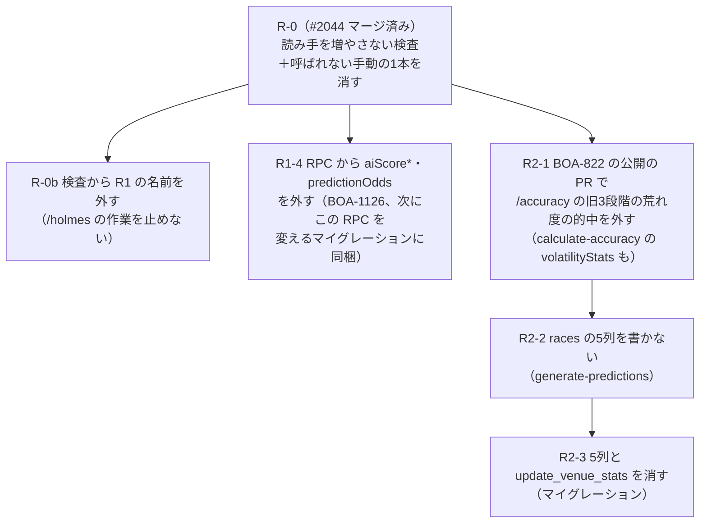

# 廃止した予想の作り続けと旧い荒れ度の列を止める（基盤の計画 R1・R2）

基盤の計画（`.git/orchestrator/foundation-plan-2026-10-27.md` の「データの地図」の流れ、10/27 の記録で R1・R2）の分割の案。読み手・書き手は台帳 `docs/reference/data-readers.md`（2026-10-27 の写し）と、2026-10-28 の origin/master（4d9f92bcd）の grep で確かめた。

- **R1**: 廃止した3モデルのうち safeBet・upsetFocus の予想と、`prediction_odds`、`race_entries.ai_score_*` を毎日作り続けている（BOA-1124・BOA-478・BOA-1126）
- **R2**: `races` の旧い荒れ度の列（`volatility_score`・`volatility_level`・`recommended_model`・`volatility_reasons`・`first_boat_avg_st`）を書き続けている（BOA-859）

目的: 誰も使わない取得・書き込みを止めて、関数と DB の書き込み（BOA-357 の Disk IO、BOA-1145 の取得の予算）を減らす。止める前に読み手を全部外し、画面・hq・バッチを壊さない。

**オーナーの決定（2026-10-28）**

- D1「触らなくて良い。/holmes は tinaba の担当」: `/holmes`（Moriarty）が読む safeBet・upsetFocus の行、`prediction_odds`、`race_entries.ai_score_*` は止めない・変えない。**/holmes は tinaba の担当で触らない（オーナー 2026-10-28）**。R1 は /holmes に影響しない範囲だけにする。`/accuracy/history` の safeBet・upsetFocus の欄も、生成を止めないので今のまま
- D2「推奨通り」: `/accuracy` の旧3段階の荒れ度の的中は、BOA-822（イン崩れ注意度）の公開の PR で外す（§4 の D2 の B）

この決定で、R1 に残る作業は R1-4（RPC の応答から2欄を外す、BOA-1126）だけになった（§3）。R2 は BOA-822 の公開の PR を起点に進める。

## 1. 確かめた事実（起票の前提と違った所を含む）

| # | 事実 | 根拠 | 起票・前の調べとの差 |
|---|---|---|---|
| F1 | **standard は止められない**。`predictions` の standard の行の `feature_contributions.racerStats` を、レース詳細の枠別の成績が DB から直接読む | `src/services/supabaseDataService.js:5472-5489`（`getRaceRacerStats`、BOA-302） | BOA-1124 は「3モデルを止める」。`public-api-lockdown/plan.md` §3 の「standard の読み手0」は `/api` の写しの話で、DB の直読みは別 |
| F2 | standard の行は、会場ルールの的中（`ruleMatchService.js:104-109`、管理画面 `adminRuleService.js:69-76`）、`daily-rule-tracking.js:129-132` も読む | 同左 | 同上 |
| F3 | safeBet・upsetFocus の行と `prediction_odds`・`race_entries.ai_score_*` を毎日読むのは **Moriarty**（`/holmes` のα版、ナビ非公開だが公開中のルート）。生成は毎日（`generate-moriarty.yml` 0:00 UTC）、結果の更新は毎日、学習は毎週。Moriarty は表を直接読み（`predictions`・`race_odds`・`prediction_odds`・`race_entries`、`BASE_MODELS = [standard, safeBet, upsetFocus]`）、`get_predictions_by_date` は呼ばない。画面（`moriartyService.js`）は `bet_recommendations`・`model_performance_daily` だけを読む。`races` は `race_id, venue_code` だけで、R2 の5列は読まない | `scripts/daily/generate-moriarty-recommendations.js:30,81-130`、`scripts/daily/update-moriarty-outcomes.js:56-59`、`scripts/analysis/train-moriarty-calibration.js:27-82`、`src/AppRouter.jsx:105-107,292`、`src/services/moriartyService.js` | BOA-478 は「読み手は Moriarty・週次学習・data-health だけ」。Moriarty が画面（`/holmes`）に出ている点は書かれていない |
| F4 | 3モデルの月別の成績は `/accuracy/history`（月別成績アーカイブ）が出す。今月・先月の欄は、作り続けている行から毎日の集計（`calculate-accuracy.js:380,506`→`get_accuracy_summary`）で埋まる | `src/pages/AccuracyHistory.jsx:76,128`、`src/services/supabaseDataService.js:1794` | D1 で生成を止めないので、欄は今のまま埋まり続ける |
| F5 | hq の `platform/finals_sheet.py` に safeBet の参照は **見当たらない**（2026-10-28、`~/hq/platform`・`~/hq/scripts` を `safeBet`・`safe_bet`・`upsetFocus`・`prediction_odds` で grep、0件。読み取りのみ） | 同左 | 台帳の外の読み手（`data-readers.extra.json`、BOA-1124）は「読む」。`public-api-lockdown/plan.md` §5 の 10/27 の grep とは一致。D1 で safeBet の行を止めないので、hq の最終の確認（旧 H1）は要らなくなった |
| F6 | **`races.volatility_level` は公開画面が読む**。`calculate-accuracy.js:178-202` が `volatilityStats` を作り `accuracy_cache` に書き、`/accuracy` の `VolatilityAccuracySection` が出す | `src/services/supabaseDataService.js:1861-1869`、`src/components/AccuracyDashboard.jsx:56,216-217`、`src/AppRouter.jsx:202` | BOA-859 は「画面は読まない」。誤り |
| F7 | `update_venue_stats()` は `races.volatility_score` を読み、048 で消した `venues.avg_volatility_score` に書く。本番で呼ぶと失敗する形のまま残り、呼び手は0（RPC の呼び手の見つからないもの） | 写しの `functions[update_venue_stats]`・`relations[venues].columns`、`docs/db-migration/048_drop_venues_avg_volatility_score.sql:21`、台帳の RPC の表 | 起票なし |
| F8 | `scripts/maintenance/update-today-recommended-models.js` は `races.recommended_model` を旧い3モデルの切り替え（FR6 で廃止）で書き直す手動のスクリプト。どこからも呼ばれない（`.github`・`package.json`・`scripts`・`docs` の参照は台帳と in-collapse-caution/inventory.md の一覧だけ） | grep | BOA-859 は読み手に数える |
| F9 | `prediction_odds` の書き手は2つ。Vercel の `api/cron/odds.js`（`scrape_job_state` の `job='prediction_odds'` が off/shadow/live）と、GitHub Actions の `scrape-scheduled.yml`→`scrape-scheduled.js:30`→`scrape-prediction-odds.js` | `api/cron/odds.js:26-30`、`scripts/lib/scrapeJobs/predictionOddsHandlers.js:15` | BOA-478 は「5分ごと」。止めるには両方 |

## 2. 読み手・書き手（止める物ごと）

| 物 | 書き手 | 今も効いている読み手 | 読み手が分析・保守だけのもの |
|---|---|---|---|
| `predictions` safeBet・upsetFocus の行 | `generate-predictions.js:1151-1170`（全部）・`:1654-1670`（`mainRefresh`） | Moriarty（F3）、`/accuracy/history`（F4）、`predictionOddsHandlers.js:50`・`scrape-prediction-odds.js:40`（`prediction_odds` の組の元） | `compare-pcexpect.js`・`verify-calculations.js`・`analyze-expected-value-strategy.js` |
| `prediction_odds` | F9 の2つ | Moriarty（F3）、RPC `get_predictions_by_date(_light)` の `predictionOdds`（`/api` は #1906 で外し済み、匿名キーの RPC 直は返す。BOA-1126） | `check-prediction-odds-shadow.js`、`delete-phantom-races.js` 等の掃除 |
| `race_entries.ai_score_standard`・`ai_score_safe_bet`・`ai_score_upset_focus` | `generate-predictions.js:1058-1060` | Moriarty（F3）、RPC の `aiScore*`（`/api` は外し済み） | `raceEntriesKbRestore.js:28`、`verify-unchanged-rows.js:237-241` |
| `races.volatility_score`・`volatility_level`・`recommended_model`・`volatility_reasons`・`first_boat_avg_st` | `generate-predictions.js:989-1000`（全部）・`:1447-1462`（`planRacesVolatilityUpdates`） | `/accuracy` の荒れ度の的中（F6、`volatility_level`）、`update_venue_stats`（F7、呼び手0） | `scripts/analysis/` の5本（`verify-label-accuracy`・`verify-all-venues-label-accuracy`・`analyze-upset-factors`・`turn-prediction-venue-deep-analysis`・`redesign-volatility-by-venue`）、F8、`unchangedRows.js:42`（丸め） |

standard の行（F1・F2）・unified の行は止めない。D1 で、表の上3行（safeBet・upsetFocus の行、`prediction_odds`、`ai_score_*`）の生成と表・列も止めない。R1 で変えるのは、`/holmes` が使わない RPC `get_predictions_by_date(_light)` の応答の2欄（`aiScore*`・`predictionOdds`）だけ。

## 3. 分割と順番

D1・D2（2026-10-28）を入れた後の形。`/holmes` に影響する段（旧 R1-1 Moriarty の生成・学習を止める、旧 R1-2 `prediction_odds` の導出を止める、旧 R1-3 safeBet・upsetFocus の行と `ai_score_*` を書かない、旧 R1-5 `prediction_odds` の表と `ai_score_*` の列を消す）と、それにだけ要った hq の確認（旧 H1）は計画から外した。**/holmes は tinaba の担当で触らない（オーナー 2026-10-28）。**

| PR | 中身 | 挙動 | 前提 | 承認 |
|---|---|---|---|---|
| **R-0**（#2044、マージ済み） | `verify-legacy-prediction-readers.js`（ci）: 止める物の名前が出てくるファイルを、今の一覧より増やさない。F8 の手動のスクリプトを消した | 変わらない | なし | 段階0 |
| R-0b | R-0 の検査の名前から R1 の物（`prediction_odds`・`predictionOdds`・`safeBet`・`upsetFocus`・`ai_score_*`・`aiScore*`）を外し、R2 の5列（と `recommendedModel`）だけを残す。D1 で R1 の物は止めないので、検査を残すと tinaba の `/holmes` の作業で新しいファイルがこれらの名前を使うたびに CI が落ちる | 変わらない（CI の検査の範囲が狭まる） | D1 | 段階0 |
| R1-4 | `get_predictions_by_date(_light)` から `aiScore*`・`predictionOdds` を外す（BOA-1126 の言うとおり、次にこの RPC を変えるマイグレーションに同梱）。`verify-rpc-output-keys` の更新。Moriarty はこの RPC を呼ばず（F3）、`/api` は #1906 で既に外したので、`/holmes`・画面に影響しない | 匿名キーの RPC 直の応答から欄が減る | なし（同梱する先のマイグレーション） | db-apply はオーナー |
| R2-1 | **BOA-822（イン崩れ注意度）の公開の PR に入れる**（D2）。`/accuracy` の `VolatilityAccuracySection`（旧 high/medium/low の的中）を外し、`calculate-accuracy.js:178-202` の `volatilityStats` の集計と、`supabaseDataService.js:1861-1869` の読み出しを消す。`accuracy_cache` の古い `volatilityStats` の鍵は、読み手を消した後は残っても害が無い | `/accuracy` から旧3段階の荒れ度の的中の節が消える | BOA-822 の公開 | BOA-822 の公開の承認に含める |
| R2-2 | `generate-predictions.js` で5列を書かない（`writeToSupabase`・`planRacesVolatilityUpdates`）。`unchangedRows.js:42`・`verify-unchanged-rows.js` を合わせる。分析の5本は scripts/archive へ | なし（R2-1 の後は読み手0） | R2-1 がマージ済み | 段階0 |
| R2-3 | 5列と `update_venue_stats()`（F7、呼び手0）を消す | なし | R2-2、台帳の読み手0 | db-apply はオーナー |

- R1 で `generate-predictions.js` を触る段が無くなったので、旧い「R1-3 と R2-2 を同時に開かない」の注意は要らなくなった
- R2-1 は BOA-822 のレーンの PR に載る。このレーンからは R2-1 の差分（上の3か所）を BOA-822 のレーンへ渡し、R2-2 はそのマージの後に開く
- 各マイグレーションの PR は、B のゲート（`verify-data-readers.js` の DROP の検査、基盤の計画 10/31〜）が入っていればそれも通す
- 本番の行と db-apply はこのレーンからは書かない
- 起票の前提の食い違い: BOA-1124 は「3モデルと prediction_odds を止める」、BOA-478 は「prediction_odds の取得を止めるか」で、D1 とは逆（止めない）。BOA-859 は「画面は読まない」（F6 で誤り）。BOA-1124・BOA-478 にはコメントで決定を書いた（本文は書き換えない）。BOA-1126 は R1-4 と前提が一致するのでコメントしない。BOA-859 の前提の誤り（F6）は D2 で R2-1 の置き場が決まったので、R2-2 の着手のときに直す

## 4. 決めが要る所（オーナー）

2026-10-28 に D1・D2 とも決まった（決定の欄）。

| # | 問い | 案 | 推奨 | 決定（2026-10-28） |
|---|---|---|---|---|
| D1 | `/holmes` の Moriarty（α版）と、`/accuracy/history` の safeBet・upsetFocus の月別の欄 | A: Moriarty の生成を止め、止めた日までの記録だけ出す。アーカイブの欄も止めた月で終わり / B: Moriarty を unified と `race_odds` に載せ替える（作り直し） / C: 今のまま（R1 は止める） | A（`/holmes` はナビ非公開の検証ページで、元のモデルが廃止済み。B は新しい作業） | 「触らなくて良い。/holmes は tinaba の担当」。推奨 A は採らず、/holmes が読む物は止めない・変えない（C に近いが、R1-4 の RPC の2欄だけは外す） |
| D2 | `/accuracy` の荒れ度の的中（旧 high/medium/low の3段階） | A: unified の荒れ度で作り直す / B: 外す（BOA-822 のイン崩れ注意度の公開と同じ PR） / C: 今のまま（R2 は止める） | B（BOA-822 の公開で荒れ度の見せ方が変わる。旧3段階の的中を残す理由が無い） | 「推奨通り」。B（BOA-822 の公開の PR で外す） |

## 5. R-0 の検査が台帳のゲートと別に要る理由

台帳（B）と DROP のゲートは、表・列・RPC の名前で読み手を見る。safeBet・upsetFocus は `model_id` の値と JSON の鍵（`predictions.safeBet`）で、列ではないので台帳に出ない。R-0 は名前の文字列で見るので、この2つも拾う。D1（2026-10-28）で safeBet・upsetFocus・`prediction_odds`・`ai_score_*` は止めないので、R-0b でこれらを検査から外し、R2 の5列だけを見る形にする。対象のファイルの一覧は、止める作業の PR だけが減らす（新しい読み手を足す PR は CI で落ちる）。共有の一覧に読み手の登録を求めないという B の方針（基盤の計画「CI で落とすもの」）とは、新しい読み手を足させないという向きが逆なので衝突しない。
