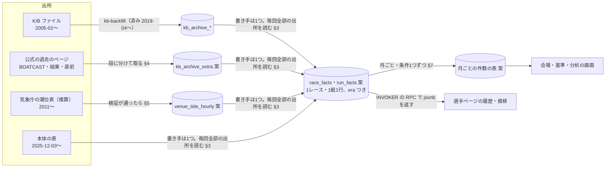

# 過去データの取り込みと、軸を潰さない集計の作り直し（F・BOA-1719・J）

> 設計の案（2026-11-27）。DB の変更は [db-draft.md](./db-draft.md)（未審査の案）。審査の記録は §12（system-architect「直してから進める」、data-scientist、どちらも反映済み）。マイグレーション・cron の行・本番の実行・本番の読み取りの実測は人の手。

関係する票: [BOA-1719](https://linear.app/boat-ai/issue/BOA-1719)（過去分）・[BOA-332](https://linear.app/boat-ai/issue/BOA-332)（最終の精度の確かめ）・[BOA-582](https://linear.app/boat-ai/issue/BOA-582)（finish_mark の埋め戻し）・[BOA-1337](https://linear.app/boat-ai/issue/BOA-1337)（6艇の時系列）。台帳のレーン F（集計の作り直し）・J（データの欠け、潮位）。前提の決定: 部品化の台帳 11/24「元（出所）の行を前もって計算し、指標の値は画面で登録簿の定義から出す」（推奨 D）、11/25「始まりの日を直書きしない」。

## 1. 目的と、言われた案が最短か

- 目的: 2025-12 より前の分を取れるだけ使えるようにし、選手ページの履歴・回収率の基準・推移の図・会場の集計が、過去分も今と同じ形で数えられるようにする。過去分が後から入っても、集計を数え直すだけで済むようにする
- **多くは取り込み済み**: 公式の K/B ファイルは `kb_archive_*` に 2019-04-01〜2025-12-02 が入っている（約221万艇、[kb-longterm-backfill](../kb-longterm-backfill/plan.md)、docs/knowledge/data-columns.md 31行目）。足りないのは「画面と集計が kb を読まない」ことの方
  - 選手ページの履歴（`getRacerRaceHistory`、src/services/racerQueries2.js:294）・回収率の基準（scripts/lib/racerBoatReturnBaselineJob.js）・会場の集計の多く（90日の窓）は、本体の表（2025-12-03〜）だけを読む
  - kb と本体をつないでいるのは、選手の通算の表（190、ADR-0104、画面に未接続）・決まり手の期間の表・分析の台本だけ
- なので最短は「新しく取りに行く」より先に「kb と本体を1つの行の表にそろえ、画面と集計がそれを読む」こと（§3）。新しく取るのは、K/B に無い項目のうち効き目のある物だけ（§4）
- 同じ原因で直す物: 始まりの日の直書き（190 の SQL・分析の台本 約15本・注記の文 約20か所。§6）

## 2. 全体の流れ

## 3. 行の表（推奨 D の形）

| 案 | 中身 | 判定 |
|---|---|---|
| A 本体の表へ kb を昇格させる | races・race_entries 等へ 2019-04〜を入れる | 採らない。定義が違う（B の当地勝率は racelist と値が違う）。範囲を指定しない集計（aggregate-racer-stats.js）が黙って変わる。kb-longterm-backfill §4.1 の却下と同じ |
| B 画面ごとに kb と本体を足す RPC | 190 のように era ごとに数える | 採らない。画面ごとに同じ継ぎ目を書き、定義がずれる |
| B2 kb_archive に racer_id の索引を足し、INVOKER で読む | 読む表を増やさない | 採らない。anon に kb_archive の生の列（B の全部）の SELECT が要り、074 の方針と ADR-0104 の却下に反する |
| B3 ビューで kb と本体を UNION | 容量が増えない | 採らない。security_invoker でないと RLS を迂回し、verify-migration-rls はビューを見ていない |
| **C 1レース・1艇1行の表を新しく作る** | `race_facts`・`run_facts`。`era` 列で出所を持つ。画面と集計はこれだけを読む | **推す**。継ぎ目は書き手の1か所。値の定義（着のコード・進入・グレード・優勝戦）は書き手が ADR-0104 と同じ規則で決める |

- 行に入れるのは「出所の値と、規則で決まる区分」だけ。率・勝率・回収率は入れない（ADR-0104 決定2）
- **書き手は1つ**。組み立ての関数が kb_archive・kb_archive_extra・潮位・本体を毎回全部読んで1行を作る。列の一部だけを埋める書き手は作らない（全列で書けば他の出所の値を NULL で消し、列を省けば PostgREST のバルク upsert がキーの違う行に NULL を書く。db-operations.md:21）
- **境目の日**: 2025-12-02 は kb に120レース・races に12レースある（kbArchiveBoundary.js:4）。CHECK `(era='kb' AND race_date<='2025-12-02') OR (era='main' AND race_date>='2025-12-03')` で守り、main の書き手は `MAIN_TABLES_START` 以降だけを組み立てる。定数は verify で kbArchiveBoundary.js と照合する
- **鮮度**: 選手ページの「今節の着順」（RacerTodayRuns.jsx:57-64）は `getRacerRaceHistory` から出すので、毎晩の組み立てだけだと今日の結果が夜まで出ない。書き手を3つの起動に分ける
  - 当日の起動: 当日と前日を15〜30分ごとに組み立て直す（変わらない行は書かない。1日約150レース）
  - 毎晩の起動: 直近7日と、古い月を1つずつ順に（進みの位置は `scrape_job_state.last_report`。約2週間で main の全期間を回る）。kfile_sync（JST 07:00・12:00）の後に置く
  - kb 層: 手動の CLI（`scripts/maintenance/race-facts-backfill.js --era=kb`）。半月ずつ、夜間に、オーナーが `--apply`。kb-backfill.js は kb_archive に書いた後に「facts の kb 層を作り直す」と出す（kb_archive に updated_at が無く、値だけの再投入を検知できない。db-operations.md:23）
- **消すべき行**: upsert は行を消さない。窓の中の PK の集合の差で消す。`built_at` は値の比べから外す（入れると変わらない行も毎回書く）
- **読み方**: 選手の全期間は数千行になり、1000行で黙って切れる（RETURNS TABLE も同じ、db-operations.md:135）。SECURITY INVOKER の RPC が jsonb を1つ返す形（jsonb_agg に ORDER BY）。索引 (racer_id, race_id) で anon の3秒に収まるかは未検証（kb は race_id の順に入っており、1選手の行が散る）
- **移す読み手**（data-readers.md で確かめる）: `getRacerRaceHistory`・`getRacerScopedRaceStats`（203 の RPC）・`getRaceFrontTakingByRacer`（racerQueries6.js:84）・`racerHistoryCutoff` の読み手・回収率の基準の RPC。今の整形の関数（racerRaceHistoryRows.js）が読む列を全部 db-draft の対応表に載せる
- **匿名の読み取り**: ADR-0104 は「匿名に読ませるのは件数の表だけ」とした。走ごとの kb の行を出すのはこれを広げるので、新しい ADR を1本足し、オーナーに1行で確かめる（§10）。190 の表は当面そのまま残し、後で facts から作るよう移すかを ADR に書く

## 4. K/B に無い項目の過去分

公式のページの確かめ（2026-11-27、official-data-spec、実リクエスト20回、2019-04-15・2022-03-24・2024-01-15）と、効き目（data-scientist）:

| 項目 | 出所 | 遡れる最古（確かめた） | 効き目 | 判定 |
|---|---|---|---|---|
| オリジナル展示（周回・まわり足） | BOATCAST | 2024-01〜2025-06 の間（未特定。2025-06-14 は有り） | 検証済み。周回 +0.130、まわり足 +0.115（1SD、2,844R、original-exhibition-effect.md） | **段1**。残る最古から全部（約4.5万リクエスト） |
| 気温・水温・16方位の風向 | raceresult | 2019-04-15 | 予測への上積みは否定済み（phase-m-result.md MD-4）。見せる軸としては未検証。16方位の風向は K の8方位のずれを直せる見込み（weather-in-escape/results.md §3.1、未検証） | 段2の候補。V1・V2 が通ったときだけ、1〜2年分（約5.5万〜11万） |
| チルト・部品交換 | beforeinfo | 2019-04-15 | 判定不能（約2.06万R が要る）。本体に 2026-09-14〜ある | 段3。2027 秋に本体で件数がそろうので急がない |
| 展示ST・体重 | beforeinfo | 2019-04-15 | 上積みを否定。展示ST と本番ST の相関 0.08 | 取らない（チルトと同じページで付いてくるだけ） |
| 3連率 | racelist | 2019-04-15 | 上積みを否定（phase-m） | **取らない** |

- 過去の beforeinfo の気象は「その日の最終観測」を返す（3日とも再現）ので、過去分の気象は raceresult だけを使う
- **取る前の確かめ V0**: 過去のページが当時の値か。2025-12〜2026-11 の約300レースを今取り直し、本体に保存した値と列ごとの一致率を出す。合わない列は過去分を取らない
- 対象のレースは `kb_archive_races` から作る（今の取り直しの CLI と cron は本番の races の行から対象を選ぶので、2025-12-02 以前には使えない）。パーサーは今の関数を使い、取得・解析・投入を分ける
- 書く先は kb の側の別表（`kb_archive_extra`）。取得の時刻を持つ（後日の取得であることを残す）
- **送信元と止め方**: Vercel Cron の過去分のジョブ（共通ラッパ）。別の送信元（端末の CLI）は ADR-0101 の却下「名乗り・IP を変える、別の場所から取る」（オーナー 2026-10-26）に当たるので取らない。代わりに ADR-0101 に追記する
  - 決定3 の「90% で止める低い優先」に名指しで入れる。予算はレース数に比例する式の外の固定の別枠
  - JST 22〜06 だけ
  - 過去の raceresult は本番の結果と同じパスで、403 のブレーカー（決定5）を共有する。**過去分の起動で最初の 403 を受けたら、そのジョブ自身が off になり、再開はオーナー**（本番の結果の取得を最大6時間止めないため）
  - BOATCAST（段1）は過去の日付の無いファイルに 403 を返す（2019・2022・2024-01 で確認）。ファイルの 403 は台帳に 'no_file' と書いてブレーカーに数えず、カナリアが 403 ならジョブ自身が off（再開はオーナー）。上の「最初の 403 で off」は boatrace.jp（段2以降）に当てる（2026-11-27 訂正、ADR-0101 の追記）
    - 断られ始めに気づくため、(a) カナリアを起動の始めと50件ごと（目安（根拠なし））に当て（今の bc_mst は hp_txt/ の下で txt/ の拒否を表さないので、過去の日付で 200 を確かめた bc_oriten を第2のカナリアに足す）、(b) 遡れる最古の日より新しい範囲で「ファイル無し」が続けて N 件出たらジョブ自身を off にする。最古の日と N は V0（最古の日の特定を含む）の結果で決め、決まるまで live にしない（窓口 2026-11-27）
  - 取得を増やすので、実行の前にオーナーの承認（ADR-0067）

## 5. 潮位（J）

- boatrace.jp・K/B・DB のどこにも無い。公式の場データにあるのは干満差の有無だけ（src/data/venueWaterProfiles.js）。干満差がある会場は12（江戸川・平和島・浜名湖・鳴門・丸亀・児島・宮島・徳山・下関・若松・福岡・大村）
- 出所の候補: 気象庁の潮位表（推算、天文潮）。2011〜2027年。1地点1年1ファイルなら約200回（推定、URL は未確認）。レースの時刻で潮位と上げ・下げを引けばよく、レースごとに取りに行かない
- **作る前に検証を通す**（data-scientist）: 推算の表を kb の 2019-04〜2025-12（12会場、1会場約1.5万R）に当て、会場ごとに潮の位相と潮位の3分位で1コース1着率・まくりの割合を比べる。調整は会場×月×R帯×1号艇の級に風の区分。2019〜2022 で探し、2023〜2025 で確かめ、前後とも同じ向きで 2pt 以上の会場だけ残す。ボートレースのページは1件も取らない
- 未確認: 鳴門・丸亀・宮島・若松・大村が掲載の地点に無い疑い。会場と地点の対応（official-data-spec の担当）。利用の条件。会場のサイトの潮見表は、戸田・浜名湖・宮島が転載を制限している（ADR-0055）

## 6. 始まりの日の直書き

- データの境目（クエリの条件）で効く所は、正本 `kbArchiveBoundary.js` を読むようにする。190 の SQL の直書きは verify-racer-career-tables.js が照合しているので今のままでよい
- 注記の文（ja の common.json 9か所・JSX 約13か所）の「2025年12月以降」は、`facts_coverage` の最初の日から出す。画面を facts に切り替えるのと同じ PR で直す
- 選手ページの窓（730日）は変えない。**窓を伸ばすかは部品ごとに data-scientist とオーナーが決める**（§11 の統計の取り直しの後）

## 7. 集計の作り直し（F）

- 今の前集計の表の多くは、期間を直書きして1つの窓の値だけを持つ。天候・風・波の軸を持つ表は無く、進入コースを持つのは 094・098・190 だけ（棚卸し 2026-11-27）
- 形: **月ごとの件数の表を、条件の軸1つずつ別の表にする**（月×会場×進入×条件1つ）。全部を掛け合わせると空でない升が艇の数に近づき、件数の表の意味が無くなる（data-scientist、system-architect の見積りで1か月最大約23万セル）
- 会場・全国の集計は facts を直に数えない（facts の RLS は1トランザクションに1選手しか通さない、ADR-0113 決定4）。件数の表だけで出す
- 区分は新しい線を作らず検証済みの線を使う: 風は向きの扇形×速さ（1m以下／2〜3m／4m以上、weather-in-escape §3.1）、荒れは風5m・波5cm（rough-water-trait）。表は細かく持ち、まとめるのは画面の登録簿。母数は見せる単位の一番小さい区分が300R以上、割合は30件以上
- **条件の軸は時点をそろえる**: K の天候はレースの時点。本体は 2026-09-19（#724）から結果ページの値で上書きしている（scripts/lib/raceResultPersist.js:230）が、2025-12-03〜09-18 は発走前の値と K の値の混ざり（kbGapFill.js）。条件の軸はレースの時点の値だけで数え、時点の違う行は外す。`condition_source` は行ごとに書き手が決める。風向は出所ごとに方位の数が違う（K は8・本体は16）ので、生の風向は混ぜず検証済みの扇形にして入れる
- 「直近3か月」は、どの月を何日分含むかを列に持つ（ADR-0068）。画面は「90日」と書かず「直近3か月」と書く（見せ方の判断なので部品ごとにオーナーへ）。90日との値のずれは V4 で測る
- 月の表で出さない物: モーター（入れ替えの日で切る）・選手の推移（節で切る）・前日までの基準。これらは run_facts から出す
- 毎晩、直近2か月を数え直して upsert。件数が0になったセルは消す。件数を足していく方式は取らない（ADR-0104 却下2）
- 今の前集計の表は、画面が新しい表に移ってから1枚ずつ止める

## 8. 再実行・取り逃し・時間の内に収める

- どの書き手も主キーで upsert（`upsertChangedRows`）。全行が同じ列を持つ payload
- 取り込みの進みは台帳の表（`backfill_progress`: 出所 × 取得の単位〈BOATCAST はレース＝1ファイル〉× 状態 × 試した回数 × 最後のエラー × 最後に試した時刻）。毎回「済み以外で古い単位」から取り、1つの単位はその晩に1回だけ試す。retry は3回で failed。404 は「開催なし」、当日分のプレースホルダは保存しない
- Cron は1起動で最大 N レース（maxDuration 300秒・1ページ約9秒の応答・3秒の間隔から逆算して20前後、目安）
- RPC は PostgREST 経由で8秒で打ち切られる。組み立ては SQL なら半月ずつ、優勝戦とグレードの判定は JS が決めて RPC に渡す（ADR-0104 決定3・4 と同じ型）
- 0件の書き込みを成功にしない

## 9. 取る前・移す前の確かめ（本番の読み取りが要る物は人の手）

| # | 確かめること | 量 |
|---|---|---|
| V0 | 過去のページが当時の値か（§4） | 約300レースの取り直し |
| V1 | 水温（会場×月の中の3分位）で1コース1着率・まくり・展示の差が 2pt 以上か | 本体 2026-02〜 約4.5万R |
| V2 | 16方位を8方位に落としたときに扇形の区分が変わる割合と効き目の差 | 本体 |
| V4 | 90日と直近3か月の値のずれ | 本体 |
| V5 | B と racelist の当地勝率の一致率と、勝率差の帯の移り。1%を超えたら基準と当てはめる値を era でそろえ、選手の推移の線は era でつながない | B 約30日分 |
| — | pg_database_size と契約のディスクの上限、`kb_archive_venue_days.race_grade` の NULL の数（phase-m は全件 NULL、kb-longterm-backfill は投入済みと書き、食い違う） | 読み取り |
| — | 1か月の組み立ての時間と、走の多い選手の読みの EXPLAIN (ANALYZE, BUFFERS) | 読み取り |

置き場は `scripts/analysis/past-data-backfill/`・`data/analysis/past-data-backfill/`・`docs/design/past-data-backfill/analysis/`。

## 10. オーナーに聞くこと

> **2026-11-27 オーナー承認**（原文「1-4まで推奨通りで良い」、窓口経由）: (1) 容量は進める（契約のディスクの上限はオーナーが Supabase の画面で確かめる）。(2) 段1は進める（JST 22〜06、最初の 403 でジョブ自身が off、再開はオーナー。BOATCAST ではカナリアの 403 で off と読む、§4）。(3) 走ごとの kb の値の匿名の読み取りは進める。ただし表を直に開けず、選手1人ごとに jsonb を返す SECURITY INVOKER の RPC を通す。ADR を1本足す。(4) 2005〜2019-03 の K/B は今は取らない（2019-04〜をつないで、延びて価値のある統計を見てから決める）

- 容量（新しい費用の可能性）: facts の2表で約 +0.5GB（2019-04〜、推定）。2005〜2019-03 の K/B も入れると約 +0.8GB 増。契約のディスクの上限は未確認
- 公式からの取得を増やす: 段1（BOATCAST のオリジナル展示の過去分、約4.5万リクエスト）を夜間に足してよいか（ADR-0067・ADR-0101 の追記）
- 走ごとの kb の値を匿名に読ませる（ADR-0104 の「件数の表だけ」を広げる。ADR-0067 の現状維持の範囲か）
- 2005-01〜2019-03 の K/B（約5夜）も取るか

## 11. 作る順（承認の後）と、取り直す統計

1. ADR（facts の表・匿名の読み取り・190 との関係）と ADR-0101 の追記 → マイグレーション（人）→ db-apply（オーナー）
2. 組み立ての純関数と verify（kb の行・本体の行 → facts の行。PGlite で SQL と照合、境目の CHECK、era の行の数）→ kb 層の CLI → 当日・毎晩の Cron
3. 選手ページの履歴を facts に移す（画面は不変を照らす、今日の結果が30分以内に出る）→ 回収率の基準の RPC を facts に移す（kb の期間は複勝の払戻が無いので、複勝は main の期間のまま。db-draft §1）
4. 月ごとの件数の表と、会場の集計を1枚ずつ移す
5. V0 → 段1（オリジナル展示）→ V1・V2 → 段2
6. 潮位は §5 の検証の後
- 取り直す統計（stat-findings.md の行）: 高 = 85・87・89（会場の窓）、98 と回収率の基準、76〜79（注意度の帯、V5 の後）。中 = 104〜110、22〜31（段1の後）、42〜47・15。低 = 115〜119。不要 = 6・7・14・35〜38・103（もともと K の 2019〜で測った）

## 12. 審査の記録（2026-11-27）

- system-architect: 直してから進める。P1 = 当日の結果が夜まで出ない／境目の日の PK の衝突／複数の書き手の NULL／db-draft の無い列（kb の複勝）と逆の名前（payout_trifecta）／過去分が本番と同じブレーカーを共有。P2 = 1000行の上限・3秒の未検証・週1の全期間を1回で回さない・孤立した行・セルの数・ADR の整合・era をまたぐ定義。全部を §3・§4・§7・§8・db-draft に反映した
- data-scientist: 段1を raceresult からオリジナル展示へ（効き目が検証済みなのはオリジナル展示だけ）。3連率は取らない。「本体は60分前の値」は 2026-09-19 以降について誤り。era をまたぐ条件の軸は混ぜない。月の表は条件1つずつ。全部を §4・§7・§9・§11 に反映した
- 食い違いとして残す物（この設計では直さない）: phase-m-result.md の「チルトの過去分は取れない」（2019-04-15 で取れた）、phase-m の取得コストの欄「3連率は K/B 補完で埋まる」（survey.md は一致率約5%で不採用）、`kb_archive_venue_days.race_grade` の状態
