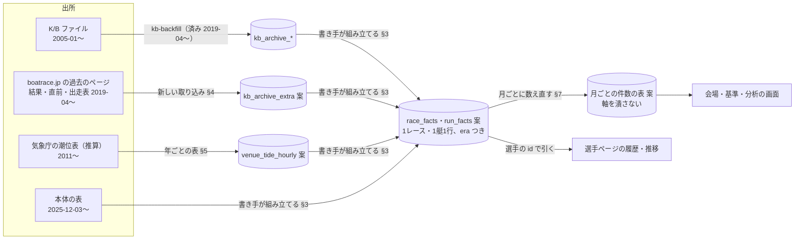

# 過去データの取り込みと、軸を潰さない集計の作り直し（F・BOA-1719・J）

> 設計の案（2026-11-27）。DB の変更は [db-draft.md](./db-draft.md)（未審査の案）。審査は system-architect・data-scientist（§9）。マイグレーション・cron の行・本番の実行は人の手。

関係する票: [BOA-1719](https://linear.app/boat-ai/issue/BOA-1719)（過去分）・[BOA-332](https://linear.app/boat-ai/issue/BOA-332)（最終の精度の確かめ）・[BOA-582](https://linear.app/boat-ai/issue/BOA-582)（finish_mark の埋め戻し）・[BOA-1337](https://linear.app/boat-ai/issue/BOA-1337)（6艇の時系列）。台帳のレーン F（集計の作り直し）・J（データの欠け、潮位）。前提の決定: 部品化の台帳 11/24「元（出所）の行を前もって計算し、指標の値は画面で登録簿の定義から出す」（推奨 D）、11/25「始まりの日を直書きしない」。

## 1. 目的と、言われた案が最短か

- 目的: 2025-12 より前の分を取れるだけ使えるようにし、選手ページの履歴・回収率の基準・推移の図・会場の集計が、過去分も今と同じ形で数えられるようにする。過去分が後から入っても、集計を数え直すだけで済むようにする
- **多くは取り込み済み**: 公式の K/B ファイルは `kb_archive_*` に 2019-04-01〜2025-12-02 が入っている（約221万艇、[kb-longterm-backfill](../kb-longterm-backfill/plan.md)、docs/knowledge/data-columns.md 31行目）。足りないのは「画面と集計が kb を読まない」ことの方
  - 選手ページの履歴（`getRacerRaceHistory`、src/services/racerQueries2.js:294）・回収率の基準（scripts/lib/racerBoatReturnBaselineJob.js）・会場の集計の多く（90日の窓）は、本体の表（2025-12-03〜）だけを読む
  - kb と本体をつないでいるのは、選手の通算の表（190、ADR-0104、画面に未接続）・決まり手の期間の表・分析の台本だけ
- なので最短は「新しく取りに行く」より先に「kb と本体を1つの行の表にそろえ、画面と集計がそれを読む」こと（§3）。新しく取るのは、K/B に無い項目だけ（§4）
- 同じ原因で直す物: 始まりの日の直書き（190 の SQL・分析の台本 約15本・注記の文 約20か所。§6）

## 2. 全体の流れ

## 3. 行の表（推奨 D の形）

| 案 | 中身 | 判定 |
|---|---|---|
| A 本体の表へ kb を昇格させる | races・race_entries 等へ 2019-04〜を入れる | 採らない。定義が違う（B の当地勝率は racelist と値が違う、天候は本体が60分前・K は確定）。範囲を指定しない集計（aggregate-racer-stats.js）が黙って変わる。kb-longterm-backfill §4.1 の却下と同じ |
| B 画面ごとに kb と本体を足す RPC | 190 のように era ごとに数える | 採らない。kb_archive は匿名に出さず、racer_id の索引も無い（ADR-0104）。画面ごとに同じ継ぎ目を書き、定義がずれる |
| **C 1レース・1艇1行の表を新しく作り、kb と本体の両方から書き手が組み立てる** | `race_facts`（1レース1行）・`run_facts`（1艇1行）。`era` 列で出所を持つ。画面と集計はこれだけを読む | **推す**。継ぎ目は書き手の1か所。値の定義（着のコード・進入・グレード・優勝戦）は書き手が ADR-0104 と同じ規則で決めて入れる。後から過去分・項目が増えても、行を足すか列を埋めるだけ |

- 行に入れるのは「出所の値と、規則で決まる区分」だけ。率・勝率・回収率は入れない（画面の登録簿の定義と純関数で出す。ADR-0104 決定2）
- 匿名に読ませるのは facts の表（選手の id・race_id で引く）。kb_archive そのものは今までどおり service_role だけ。kb の値を選手単位で匿名に出すのは 2026-10-28 のオーナーの答え（ADR-0067 の現状維持の範囲）の延長だが、**走ごとの行をそのまま出すのは量と範囲が広がる**ので、ADR を1本足し、オーナーに1行で確かめる（§10）
- 書き手:
  - kb 層: 手動の CLI（`scripts/maintenance/race-facts-backfill.js --era=kb`）を1回。kb_archive は race_id の範囲で半月ずつ読む（racerCareerCore.js と同じ型）
  - main 層: Vercel Cron（共通ラッパ）が毎晩、直近7日のレースを組み立て直して upsert（`upsertChangedRows`）。週に1回、main の全期間を月ずつ組み立て直す（後からの訂正を拾う）。1回の起動は1か月まで（約4,500レース・2.7万艇。maxDuration 300秒の内に収まるかは未検証、§8）
  - 新しい項目（§4・§5）は、その表を読んで facts の空の列を埋める（同じ組み立ての関数を通す）
- 境目の日は `scripts/lib/kbArchiveBoundary.js` だけを正にする（2025-12-02 は kb から数える）

## 4. K/B に無い項目の過去分（新しく取る）

公式のページの確かめ（2026-11-27、実リクエスト20回、2019-04-15・2022-03-24・2024-01-15）:

| 項目 | 出所 | 遡れる最古（確かめた） | 過去分の注意 |
|---|---|---|---|
| 気温・水温（レースの時点） | raceresult | 2019-04-15 | beforeinfo の気象は過去の日付だと「その日の最終観測」になる（3日とも再現）。過去分は raceresult だけを使う |
| 展示ST・チルト・体重・部品交換 | beforeinfo | 2019-04-15 | 部品交換は空の欄が「交換なし」か「欠け」かを分けられない（未確認）。展示の進入の並びは当時のままか未確認 |
| 3連率（全国・当地・モーター・ボート） | racelist | 2019-04-15 | 勝率・2連率は B と一致。3連率は当時の値か照合できない |
| グレード・種別 | race/index・月の予定 | 2019-04-15（月の予定は 2016-01 から、2019-04〜は race_series に投入済み） | kb_archive_venue_days.race_grade は投入済み |
| オリジナル展示 | BOATCAST | 2024-01〜2025-06 の間（未特定） | 2019・2022・2024-01 は 403。過去分は約4.5万リクエスト（boatcast-original-exhibition/plan.md） |

量（推定）: 2019-04-01〜2025-12-02 は約35万レース。1レース1ページで、raceresult・beforeinfo・racelist の3種を全部取ると約106万リクエスト。

- 今の boatrace.jp の1日の量は約1万〜1.5万（scraping-load-budget §4.2、上限の目安 18,000）。過去分に 1日3,000 を足すと全部で約1年。**全部は取らない**。項目ごとに統計の効き目（どの軸・指標に効くか）と、遡る年数を data-scientist が決め、段に分ける（§9 の問い）
- 案: 段1 = raceresult（気温・水温。条件の軸 I に要る。35万リクエスト、1日3,000で約4か月）。段2以降は段1の後に効き目で決める
- 送信元と速さ:
  - 推奨: Vercel Cron の「過去分の取り込み」のジョブ（共通ラッパ・予算の表に載せる）。夜間（JST 22〜06）に1日の予算の中で少しずつ。予算の段階2（90%）で最初に止まる優先に置く。IP・UA は変えない（scraping-load-budget §1）
  - 対案: オーナーの端末の CLI（kb-longterm-backfill の推奨。本番の取得と送信元を分ける）。数か月を手で回すのは続かない
  - どちらも、取得の量を増やすので ADR-0067 の「実行前にオーナーの承認」が要る（§10）
- 対象のレースは `kb_archive_races` から作る（今の取り直しの CLI と cron は、どれも本番の races の行から対象を選ぶので、2025-12-02 以前には使えない）。読み取り（パーサー）は今の関数を使い、取得・解析・投入を分ける（kb-backfill と同じ型）
- 書く先は本体の表でなく、kb の側の別表（db-draft の `kb_archive_extra`）。本体の表とは時点が違う（本体の直前情報は60分前・発走前の取得、過去分は後日の取得）ので混ぜない

## 5. 潮位（J）

- boatrace.jp・K/B・DB のどこにも無い。公式の場データにあるのは干満差の有無だけ（src/data/venueWaterProfiles.js）
- 干満差がある会場は12（江戸川・平和島・浜名湖・鳴門・丸亀・児島・宮島・徳山・下関・若松・福岡・大村）。他は潮位を持たない（NULL でなく「対象外」と区別する）
- 出所の候補: 気象庁の潮位表（推算、天文潮）。毎時の潮位と満潮・干潮を年ごとのテキストで出し、2011〜2027年を選べる。1地点1年1ファイルなら、12会場×約15年で200回前後（推定、URL は未確認）。レースの時刻（締切の予定、K にある）で潮位と上げ・下げを引けばよく、レースごとに取りに行かない
- 未確認: 鳴門・丸亀・宮島・若松・大村は掲載の地点に無い（一覧の表で確かめていない）。会場と地点の対応・ずれ（推算と実際の潮の差、会場の水面と地点の差）。利用の条件（出典の書き方）。**これらが確かめられるまで潮位は作らない**。会場のサイトの潮見表は、戸田・浜名湖・宮島が転載を制限している（ADR-0055）

## 6. 始まりの日の直書き

- データの境目（クエリの条件）で効く所は、正本 `kbArchiveBoundary.js` を読むようにする。190 の SQL の直書きは、verify-racer-career-tables.js が照合しているので今のままでよい
- 注記の文（ja の common.json 9か所・JSX 約13か所）の「2025年12月以降」は、facts の表の「最初の日」（db-draft の `facts_coverage`）から出す。画面に切り替えるのと同じ PR で直す（先に文だけ変えない）
- 選手ページの窓（`racerHistoryCutoff` の730日）は変えない。過去分が入っても、730日の窓は今と同じ範囲を数える。**窓を伸ばすか（例: 全期間・3年）は見せ方と統計の判断**なので、部品ごとに data-scientist とオーナーが決める（この設計では決めない）

## 7. 集計の作り直し（F）

- 今の前集計の表の多くは、期間を直書きして（90日・365日・2026-02-04〜）、1つの窓の値だけを持つ。天候・風・波の軸を持つ表は無く、進入コースを持つのは 094・098・190 だけ（棚卸し 2026-11-27）
- 作り直しの形: **月ごとの件数の表**。facts から「月 × 会場 × 枠 × 進入 × グレード × 段（優勝戦か）× 条件の区分」の件数（と払戻の合計）を持つ。90日・365日・時系列は、画面が月を足して出す（月の途中で切る「90日」は「直近3か月」に変わる。見せ方の判断なので部品ごとにオーナーへ）
- 条件の区分（風速・波高・水温の区切り）は、母数が細りすぎない線を data-scientist が決める（台帳のレーン I の「組み合わせごとの線を統計で決める」）
- 毎晩、直近2か月を数え直して upsert。過去分が入ったら、その月を数え直す（CLI）。件数を足していく方式は取らない（重複の配信で倍になる。ADR-0104 却下2）
- 今の前集計の表は、画面が新しい表に移ってから1枚ずつ止める（同じ PR で消さない）

## 8. 再実行・取り逃し・時間の内に収める

- どの書き手も主キーで upsert（`upsertChangedRows`）。変わらない行は書かない。全行が同じ列を持つ payload にする（キーのそろわない行で NULL を書く事故を避ける）
- 取り込みの進みは台帳の表（db-draft の `backfill_progress`: 出所 × 日 × 状態 × 試した回数 × 最後のエラー）で持つ。毎回「状態が済み以外で古い日」から取る。404 は「開催なし」、当日分のプレースホルダは保存しない（kb-backfill と同じ）。403・429・503 は連続で止める（共通ラッパのブレーカー）
- 1回の起動の量: Cron は1起動で最大 N レース（maxDuration 300秒から、1ページ約9秒の応答と3秒の間隔で逆算。目安は20レース前後、根拠は kb-longterm-backfill の応答時間の実測）。間隔は既存の取得と同じ
- RPC は PostgREST 経由で8秒で打ち切られる。組み立てと数え直しは月・半月に分けて呼ぶ。1か月の実行時間は未検証（適用前に1か月分で EXPLAIN ANALYZE）
- 0件の書き込みを成功にしない（その日に開催があるのに0行なら error）

## 9. 審査に出す問い

- system-architect: §3 の C（facts の2表）で容量・Disk IO・索引・RLS が持つか。main 層の毎晩の組み立て直し（直近7日＋週1の全期間）で後からの訂正を拾えるか。kb_archive_extra を kb_archive と分けるか
- data-scientist: §4 の項目のうち、どれを何年分取る価値があるか（段の順）。§7 の月の粒度と条件の区分。過去分を入れたとき、検証済みの統計（docs/knowledge/stat-findings.md）のどれを取り直すか

## 10. オーナーに聞くこと（審査の後にまとめて）

- 容量（新しい費用の可能性）: facts の2表で約 +0.5GB（2019-04〜、推定）。2005〜2019-03 の K/B も入れると約 +0.8GB 増。Supabase の契約のディスクの上限は未確認
- 公式からの取得を増やす: 段1（raceresult の過去分、1日3,000・約4か月）を夜間に足してよいか（ADR-0067 の承認）
- 走ごとの kb の値を匿名に読ませる（ADR-0067 の現状維持の範囲か）
- 2005-01〜2019-03 の K/B（約5夜）も取るか

## 11. 作る順（承認の後）

1. ADR（facts の表と匿名の読み取り）＋マイグレーション（人）→ db-apply（オーナー）
2. 組み立ての純関数と verify（kb の行・本体の行 → facts の行。PGlite で SQL と照合）→ kb 層の CLI → main 層の Cron
3. 選手ページの履歴を facts に移す（画面は不変を照らす）→ 回収率の基準の RPC を facts に移す
4. 月ごとの件数の表と、会場の集計を1枚ずつ移す
5. 段1 の取り込み（raceresult）→ facts の気温・水温を埋める
6. 潮位は §5 の未確認が解けてから
