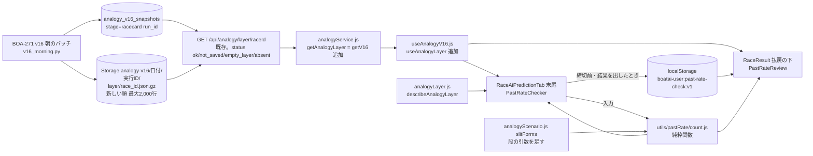
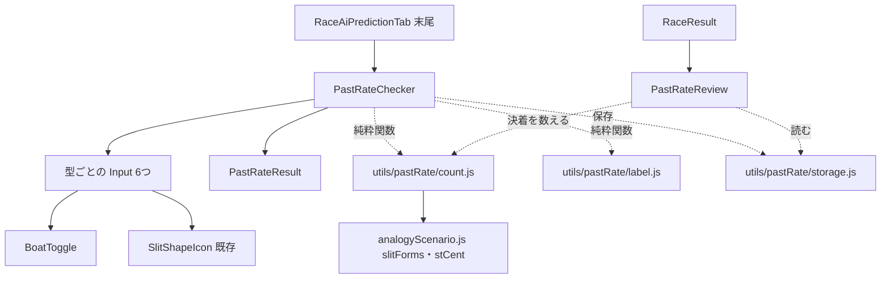

# 過去に発生した割合を見る plan

元: [spec.md](./spec.md)・[screens.md](./screens.md)。技術判断は [ADR-0081](../../adr/0081-past-rate-counted-on-client-from-layer-rows.md)（同じ条件の過去レースの新しい順最大2,000行を画面側で数え、保存は端末内）。土台は BOA-271 v16 の朝のバッチ（ADR-0085）と layer API（master にある）。

## 全体の流れ

## データ設計

**本機能では新しいテーブル・カラム・バッチ・API を作らない。** layer ファイルと `analogy_v16_snapshots` は BOA-271 v16 の朝のバッチが作り、`api/analogy/layer/[raceId].js` が返す（応答の形は spec「データ（土台）」）。マイグレーションは本機能に無い（ER 図も無い）。

値の約束 D-1〜D-5 は `scripts/ml/analogy/v16_pool.py`（`build_races`・`layer_ok`・`layer_row`）に実装済み。本番の layer ファイルでの実測は tasks T0-3。

端末内の保存形式は spec FR-5 のとおり。サーバーには何も送らない。

### 読み取りの量
- 1レースあたり最大2,000行。gzip 後で最大約50KB（analogy tasks T2-6）。取得は部品を出すときに1回で、AI予想タブと結果タブで同じキャッシュ（`getV16` のメモリ、60秒、最大12件）を使う
- API の CDN キャッシュは締切前 `s-maxage=60`、締切後 `s-maxage=86400`、`not_saved` とエラーは `no-store`（`api/_lib/analogyV16.js` `cacheControl`）。DB は snapshot の行を読むだけで、行そのものは Storage の静的ファイル
- `absent` は展示の後に分かることがある（展示後の段の snapshot、`is_absent`）。キャッシュが60秒なので、欠場が分かってから最大約60秒は部品が出たままになりうる。受け入れる（入力して保存されても、結果タブでは `absent` なので振り返りは出ない）

## フロントエンド

### ファイル構成

| ファイル | 役割 |
|---|---|
| `src/utils/analogyScenario.js`（既存を拡張） | `slitForms(stByCourse, level = 1)` に段の引数を足す。`SLIT_LEVELS = {1: {dent: 5, kado: 3, out: 5}, 2: {dent: 8, kado: 5, out: 8}}`。既定の1段目は今と同じ答え（龍神ソナー・`verify-analogy-facts.js` を変えない）。Python の `v16_defs.slit_forms_matrix` は変えない（1段目だけで使っている。2段目の検証は T0-2 のスクリプトが自前の式で行い、1段目が一致することを確かめている） |
| `src/utils/pastRate/count.js` | `countPastRate(rows, type, input)` → `{ n, count, excluded: [{ reason, count }], breakdown }`。型ごとの判定（spec FR-1）。スリットは `slitForms(st, level)` と `stCent` を使う（形の式を二重に持たない）。`st_by_course`・`course_by_boat` が配列ごと null の行は除く行に数える。`orderPoints(input)`（点数）。`isTruncated(layer)`（`n_returned < n_total`）。`incompatibleForms(selected, level)`（定義から同時に起きない形。spec FR-1 の表を定数で持つ） |
| `src/utils/pastRate/slitRates.js` | 全国の出現率（T0-2 の全期間の値、段ごと、小数1桁）と母数の定数。出典は `analysis/slit-pattern-rates.md` |
| `src/utils/pastRate/label.js` | `rateLabel(rate)` → `"standard" \| "rare" \| null`。線 x・y は T0-1 で決めた定数。T0-1 が済むまでは `THRESHOLDS = null` で常に null を返し、注記の線の文も出さない |
| `src/utils/pastRate/storage.js` | `loadEntries()`・`saveEntry(entry, { deadline, finished, now })`・`entriesForRace(raceId, { deadline })`。キー `boatai-user:past-rate-check:v1`、30日、上限1,000件、書く直前に読み直す、壊れた値・形の違う Entry を捨てる、例外の吸収（console に出す）、締切以降の Entry を振り返りから外す |
| `src/services/analogyService.js`（既存を拡張） | `getAnalogyLayer(raceId)` = `getV16("/api/analogy/layer/{raceId}")`。HTTP エラー・`status` の無い応答は `getV16` が投げる |
| `src/hooks/useAnalogyV16.js`（既存を拡張） | `useAnalogyLayer(raceId, enabled)` = `useAnalogyResource(key, () => getAnalogyLayer(raceId), enabled)` |
| `src/components/race/pastRate/PastRateChecker.jsx` | 外枠。型の切り替え・入力の状態・ボタン・結果の表示。保存は締切前（または締切不明で未確定）のときだけ。props: `layer`・`raceId`・`deadline`・`finished` |
| `src/components/race/pastRate/{Order,Boat1,Tenkai,Slit,Entry,PayoutBand}Input.jsx` | 型ごとの入力（screens） |
| `src/components/race/pastRate/BoatToggle.jsx` | 艇のボタン（公式色、`aria-pressed`）。このディレクトリ内でだけ使う |
| `src/components/race/pastRate/PastRateResult.jsx` | 結果（主文・ラベル・メーター・内訳・除いた件数・注記）。注記の層の説明文は `describeAnalogyLayer(conditions, t, {count: n_total})` |
| `src/components/race/pastRate/PastRateReview.jsx` | 結果タブの振り返り |
| `src/components/race/pastRate/PastRate.css` | `prc-` 接頭辞のクラス |

スリットの絵は龍神ソナーの `SlitShapeIcon`（`src/components/race/analogy/`）をそのまま使う（新しい SVG の部品は作らない）。7形の1段目の例は `SLIT_EXAMPLE`、2段目の例は `analogyScenario.js` に `SLIT_EXAMPLE_L2` を足す（2段目の線を満たす差）。

### 組み込み
- `PredictionPanel.jsx`: `RaceAiPredictionTab`（:516）と `RaceResult`（:631）に `raceStartTime={selectedRace?.startTime}` を足す（オッズ一覧タブ `RaceOddsListTab` に既に渡している値、:616。`races.start_time` の先頭5文字）
- `RaceAiPredictionTab`: `PredictionBlocks` の後ろ（BOA-822 の後はイン崩れ注意度のカード・出現パターンの後）に、layer を取得して `PastRateChecker` を出す小さなラッパー（同じファイル内の関数 `PastRateSlot`）を置く。中止のときは今の早期 return で出ない。`status` が `ok` でない・`rows` が0行・取得中は出さない。取得に失敗したときは `InlineFetchError`（`onRetry` で `retry`）。`deadline = getDeadlineDate(raceId, raceStartTime)`、`finished = Boolean(prediction?.result?.finished)`
  - BOA-822 の PR がこのファイルを書き換える（展開予測と `ai-tab-sonar-link` を外し、先頭に `InCautionCard`）。本機能は `PredictionBlocks` の外の末尾に1要素足すだけなので、どちらが先に入っても衝突は末尾の数行に限られる。後に入る側がもう一方の並びに合わせる
- `RaceResult`: 払戻表の下に `PastRateReview`（`raceId`・決着・`layer`・`deadline`）。layer の取得は `RaceResult` の中で `useAnalogyLayer` を呼ぶ。決着は `buildResultRows` が組み立てた着順（返還艇を外したもの）の position 1〜3 の艇。3着までそろわなければ決着の行を出さない。不成立（`outcome === RACE_OUTCOME.NO_RACE`）と `status` が `ok` でない・`rows` が0行では出さない。取得に失敗したときは `InlineFetchError`
- 決まり手のキーと DB の日本語の対応は `TECHNIQUE_NAMES`（`src/utils/turnPrediction.js`）を使う（新しい対応表を作らない）

### 状態の持ち方
- 型ごとの入力は `PastRateChecker` の state に型別に持つ（型を切り替えても他の型の入力は残る。モックどおり）
- 結果は「最後にボタンを押したときの型と入力」から出し、入力が変わったら隠す
- スリット: 選んだ形と段から `incompatibleForms` で押せない形を決める。2段目に切り替えると同時に起きない組になるときは2段目のボタンを押せなくする（spec FR-1、確認中）

### 表示時の計算の量
最大2,000行×1型の判定。着順の流しは最大 1×5×4 の点数でも、判定は行ごとに3つの集合の包含だけ。100ms の要件に対して十分小さいので、メモ化（`useMemo`）は入力と `layer.rows` の参照だけをキーにする

## 既存サービス層・共通ライブラリとの連携
- データ取得: `getV16`（`src/services/analogyService.js`）・`useAnalogyResource`（`src/hooks/useAnalogyV16.js`）。本機能から `supabaseDataService.js` は呼ばない
- 層の説明文: `describeAnalogyLayer`（`src/utils/analogyLayer.js`）
- スリット: `slitForms`・`stCent`・`SLIT_FORMS`・`SLIT_EXAMPLE`（`src/utils/analogyScenario.js`）、絵は `SlitShapeIcon`
- 締切: `getDeadlineDate`（`src/utils/raceDeadlineStatus.js`）
- 決まり手: `TECHNIQUE_NAMES`（`src/utils/turnPrediction.js`）
- 艇の色: `BOAT_COLORS`（`src/utils/colors.js`）、艇番の表示は `BoatBadge`（`src/components/race/BoatBadge.jsx`）、取得の失敗は `InlineFetchError`
- localStorage: `storage.js` は try/catch で包む（プライベートモード・容量超過で画面を壊さない）

## 検証

| 何を | どこで |
|---|---|
| 6つの型の判定・分母・除いた件数・点数・切り詰めの判定・同時に起きない形・ラベルの境界（x・y ちょうど） | `scripts/maintenance/verify-past-rate-count.js`（固定の行データ。`verify-registry.json` に ci で登録）。`src/utils/pastRate/` の純粋関数を import する |
| `slitForms` の2段目と、1段目が変わらないこと | 同じ verify に2段目の境界の行を入れる。1段目は既存の `verify-analogy-facts.js`（Python との300ケース）がそのまま通ること |
| 保存（置き換え・30日・上限・締切後は保存しない・壊れた値・例外・`clearCache()` の後も残る） | 同じ verify に保存の節を足す（localStorage は小さなメモリ実装を差し込む） |
| 画面の件数が実データと一致するか | 実装後の `data-accuracy-verifier`: 本番の数レースで、layer API の行を別の手段（Python）で数えた値と画面の数字を照合する。layer の行が v16 の層の定義どおりかは BOA-271 側の検証（`verify-analogy-v16.js`）に任せる |
| 受け入れ | `e2e/acceptance/past-rate-check.spec.js`（`acceptance-test-writer`、spec・screens だけから書いたもの）。layer API は route で固定データを返す |
| レイアウト | `npm run test:layout` に AI予想タブの部品と結果タブの振り返りを足す（375/768/1024/1440/1920px） |

## 定番／レアの線の検証（tasks T0-1。分析のみ）
- 置き場所: `scripts/analysis/past-rate-check/label-threshold.py`。test 2026-04〜09 の各レースの比べる行は、v16 の層と同じ規則（`v16_similar.layer_conditions`・`layer_mask`、`v16_pool.layer_ok`、そのレースの日より前の母集団、新しい順最大2,000件）で作る。固定データで layer ファイルと同じ行が選ばれることを確かめる
- データ: v16 の列がそろう export が要る（手元の 2026-10-01 版には無い。`export_pool.js` で作り直す。読み取りだけ）。T0-2 のスクリプトの互換の読み込みは、返還の判定が近似なので T0-1 には使わない
- 判定のロジックは `count.js` と同じ式を Python に持つ（固定データで JS と Python の件数が一致することを確かめる小さな検査を同じディレクトリに置く。両方とも1/100秒の整数で比べ、固定データには差が線ちょうどの行を入れる）
- 手順と判定の規則は spec FR-3 で固定済み。実行の前に FR-3 の節を単独のコミットで push し、second-opinion-reviewer で1パス見る。結果を `analysis/label-threshold-result.md` に書き、採った x・y を spec と `label.js` に反映し、`docs/knowledge/stat-findings.md` に1行足す

## 残る判断（plan では決めない）
- 定番／レアの線の値（T0-1 の結果）
- AI予想タブの中の置き場所・同時に起きない2形の扱い（オーケストレーターに確認中。spec 未確定事項）
