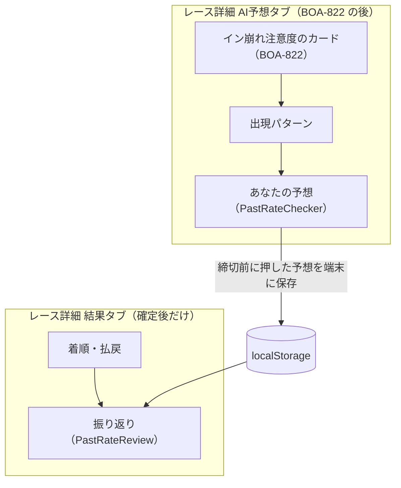

# 過去に発生した割合を見る screens

元: [spec.md](./spec.md)。画面は確定モック（https://claude.ai/artifact/RHjYWn3GWXYUetEHf6M7aq 、Version 3）のとおり。本書はモックとの差分と、部品の分け方・操作要素だけを書く。

## 画面

### S-1 レース詳細 > AI予想タブ（既存画面の拡張）
- タブの末尾（`PredictionBlocks` の外、その後ろ）に「あなたの予想」の部品（`PastRateChecker`）を置く。BOA-822 の並び（イン崩れ注意度のカード → 出現パターン）はそのまま（spec FR-4、2026-10-13 オーケストレーター判断）
- 中止確定のレース、layer API の `status` が `not_saved`／`empty_layer`／`absent` のレース、`rows` が0行のレースでは出さない。取得中も出さない。取得に失敗したときは同じ位置に `InlineFetchError`（再試行つき）
- `PredictionBlocks` の早期 return（予想なし・確定後・注意度の空状態）の分岐に巻き込まない
- 締切のために `RaceAiPredictionTab` に `raceStartTime` の props を足す（`PredictionPanel` から `selectedRace?.startTime`）

### S-2 レース詳細 > 結果タブ（既存画面の拡張）
- `RaceResult` の着順・払戻の下に「振り返り」（`PastRateReview`）を足す
- 不成立のレース、`not_saved`／`empty_layer`／`absent` のレース、`rows` が0行のレースでは出さない。取得に失敗したときは `InlineFetchError`（再試行つき）
- 締切のために `RaceResult` に `raceStartTime` の props を足す（`PredictionPanel` から `selectedRace?.startTime`）

App.jsx 側には置かない。思考アシスト（BOA-430）には今回埋め込まない（2026-10-13 オーナー決定）。

## モックとの差分

| # | モック | 本書 | 理由・決定 |
|---|---|---|---|
| D1 | スリットの強さ（約1/3艇身／約半艇身）を常に出す | 横一線・内3艇そろうだけを選んだときは強さを隠す | この2形は固定の線で、強さが効かない（2026-10-02 オーケストレーター判断） |
| D2 | 「自分で作る」は各コース「そろう→出る→凹む」。既定の「そろう」は判定では条件なし | 「指定なし→出る→凹む」の3状態。全部「指定なし」ならボタンを押せない | 「そろう」と書いて条件なしに数えると、表示と数え方が食い違う（同上） |
| D3 | 結果タブの振り返りは1件 | 保存した型をすべて型の順に。保存が無ければ決着の行だけ。当たり／外れなし | 型ごとに最新1件を保存する仕様のため（同上） |
| D4 | 分母は常に全件（例 128） | 型ごとに判定できる行だけ。除いた件数を理由つきで1行 | 決まり手・ST・実進入・払戻が無い行を「起きなかった」と数えないため（同上） |
| D5 | AI予想タブの一番上 | AI予想タブの末尾（イン崩れ注意度のカード・出現パターンの後） | BOA-822 の承認（2026-10-12、案A）の並びを崩さない（2026-10-13 オーケストレーター判断） |
| D6 | 比べる相手を「類似レース」と呼ぶ | 「同じ条件の過去レース」 | 龍神ソナー・思考アシストの類似レース（近い順）と分ける（2026-10-13 オーナー決定） |
| D7 | スリットの形はどの組み合わせでも2つまで選べる | 定義から同時に起きない2形は押せない（spec FR-1、2026-10-13 オーケストレーター判断） | 「0件」と「判定できない」を混ぜない（T0-2） |
| — | 強さの言い方の比較（案A〜C）の切り替え | 出さない。案A（艇身が主、秒数を小さく）に固定 | ユーザー確定（2026-10-01） |
| — | 結果の注記「定番は15%以上、レアは5%未満（例）」 | 「（例）」を外し、検証で採った線（15%・5%）を出す。ラベルを出さない小分け（着順1点・1号艇・配当の帯・自分で作る）では線の文も出さない | spec FR-3 |
| — | 例「過去128レース中」 | 切り詰めていなければ「過去{N}レース中」、切り詰めたら（`n_returned < n_total`）「同じ条件の新しい{N}レース中」 | 2026-10-02 ユーザー承認 |

## コンポーネント

新規はすべて `src/components/race/pastRate/` に置き、`src/components/race/index.js` の barrel export に `PastRateChecker`・`PastRateReview` を足す。

| コンポーネント | 新規/既存 | 役割・主要素 |
|---|---|---|
| `PastRateChecker` | 新規 | 部品の外枠。見出し「あなたの予想」、型の切り替え（tablist）、入力欄、ボタン、結果。props: `layer`・`raceId`・`deadline`・`finished` |
| `OrderInput` | 新規 | 着順。1着・2着・3着の3行×6艇のボタン、「流す」「やり直す」、点数の要約 |
| `Boat1Input` | 新規 | 1号艇。3つのピル |
| `TenkaiInput` | 新規 | 展開。起点の艇（6艇）と決まり手4つ |
| `SlitInput` | 新規 | スリット。7形の一覧（絵・全国の出現率）、強さ2段、「自分で作る」との切り替え |
| `SlitShapeIcon` | 既存（`src/components/race/analogy/`、龍神ソナー） | 横から見たスリットの絵（実縮尺、1艇身≒0.13秒）。7形の絵・強さの見本・「自分で作る」の絵に使う。新しい SVG の部品は作らない。7形の1段目の例は `SLIT_EXAMPLE`（`analogyScenario.js`）、2段目の例は本機能で足す |
| `EntryInput` | 新規 | 進入。3〜6号艇と3つのピル |
| `PayoutBandInput` | 新規 | 配当の帯。3つのピル |
| `PastRateResult` | 新規 | 結果。要約、主文、ラベル、メーター、内訳、除いた件数、比べた相手の注記 |
| `PastRateReview` | 新規 | 結果タブの振り返り。保存した予想の行（型の順）と決着の行、比べる相手が変わったときの注記 |
| `BoatBadge` | 既存（`src/components/race/BoatBadge.jsx`） | 内訳の艇番表示 |
| `InlineFetchError` | 既存（`src/components/InlineFetchError.jsx`） | 取得の失敗（再試行つき） |
| `RaceAiPredictionTab` | 既存を拡張 | 末尾に `PastRateChecker`。`raceStartTime` の props を足す |
| `RaceResult` | 既存を拡張 | 払戻の下に `PastRateReview`。`raceStartTime` の props を足す |
| `PredictionPanel` | 既存を拡張 | 2つのタブに `raceStartTime={selectedRace?.startTime}` を渡す |

艇の選択ボタン（6艇、公式色、`aria-pressed`）は `OrderInput`・`TenkaiInput`・`EntryInput` の3箇所で使うので、`PastRateChecker` 内の小さな部品 `BoatToggle` にまとめる（このディレクトリの外では使わないので barrel export しない）。

## データ取得

| フック | 中身 |
|---|---|
| `useAnalogyLayer(raceId)`（`src/hooks/useAnalogyV16.js` に足す。取得は `src/services/analogyService.js` の `getAnalogyLayer`＝`getV16` で `/api/analogy/layer/{raceId}`） | layer API の応答（spec「データ（土台）」）。`useAnalogyResource` の状態（`idle`／`loading`／`ready`／`error`、`retry`）。AI予想タブと結果タブで同じキャッシュ（`getV16` の `v16Cache`） |

部品の中ではデータを取りに行かない（`layer` で受ける）。比べた相手の注記の層の説明文は `describeAnalogyLayer`（`src/utils/analogyLayer.js`）で作る。

## デザイントークンと CSS
- トークンで足りる: 余白 `--space-*`、文字 `--font-size-*`、カード `--surface-card`、文字色 `--text-primary`・`--text-secondary`、境界線、ダークモードの反転
- 艇の公式色: `BOAT_COLORS`（`src/utils/colors.js`）を style に渡す。CSS 変数は新設しない
- 新規 CSS が要る: 部品の枠（強調の枠線）、型のピル、艇のボタンの選択状態、メーター、スリットの絵の一覧。クラス名は `prc-` 接頭辞（`.prc-type`・`.prc-boat` 等。`verify:css-collisions`）
- 「定番」「レア」のバッジ: 定番は既存のアクセント系の意味トークン、レアは注意系の意味トークン（新しい色を作らない。トークン名は実装時に `design-tokens.css` から選ぶ）。BOA-822 のカードの段の色と同じトークンは避ける（注意度の段と見分けがつくように）

## i18n
翻訳対象。文言は `src/locales/{ja,en,zh-TW,ko}/` の `aiPredictionTab.pastRate.*`（AI予想タブ）と `result.pastRate.*`（結果タブ）。決まり手4つは既存の訳語キーを使う。スリットの7形の名前・「艇身」は新しいキー（龍神ソナーに形の名前のキーがあれば共用する）。層の説明文は `aiPredictionTab.analogy.layer.*` を共用する。

## 画面の構造と操作要素（受け入れ E2E の前提）

| 対象 | 形 |
|---|---|
| 部品 | `<section aria-labelledby>`、見出し（h2 相当）「あなたの予想」。AI予想タブの中で、イン崩れ注意度のカード・出現パターンより後 |
| 型の切り替え | `role="tablist"`（`aria-label`「予想の型」）の tab 6つ。名前は「着順」「1号艇」「展開」「スリット」「進入」「配当の帯」の順。既定は「着順」 |
| 艇のボタン | `<button aria-pressed>`、`aria-label`「1号艇」〜「6号艇」。着順は行ごとに `role="group"`（`aria-label`「1着」「2着」「3着」）で囲み、行の見出しも同じ文言 |
| 流す | トグルボタン（`aria-pressed`）「流す（2着・3着を複数）」 |
| やり直す | ボタン「やり直す」。着順を空にし、結果を隠す |
| 点数 | 着順の下に「1-3,4-2,3,4（4点）」の形 |
| 1号艇・配当の帯・進入の選択肢 | `<button aria-pressed>`。1号艇は「1号艇が 1着」「1号艇が 残る（3着以内）」「1号艇が 飛ぶ（4着以下）」。配当は「堅い（3連単 1,000円未満）」「中穴（1,000〜10,000円）」「万舟（10,000円以上）」。進入は「3コース以内に入る」「4コース以内に入る」「枠なりのまま」、艇は3〜6号艇（1・2号艇は disabled） |
| 展開 | 起点の艇（6艇）と決まり手「逃げ」「差し」「まくり」「まくり差し」の `aria-pressed` ボタン |
| スリットの形 | 7つの `<button aria-pressed>`。名前は「横一線」「内3艇そろう（壁）」「2コース凹み」「カド受け凹み（3コース）」「カド一撃（4コース）」「イン凹み（1コース遅れ）」「ダッシュ勢先行（外3艇）」。各ボタンに絵（`role="img"`）と「全国15.2%」の形の出現率（選んでいる強さの段の値）。一覧の上に1回だけ「全国の出現率は2019-04〜2026-09の39.9万レース（F・出遅れ・欠場のあるレースを除く）」。1形を選んでいるとき、それと同時に起きない形（spec FR-1）のボタンは disabled で、下に「同時には起きない形です」 |
| スリットの強さ | 2つの `<button aria-pressed>`。主の文言「約1/3艇身」「約半艇身」、小さく「0.05秒差」「0.08秒差」。カド一撃を選んでいるときは下に「カド一撃は約1/4艇身（0.03秒）／約1/3艇身（0.05秒）」の注記。横一線・内3艇そろうだけのときは出さない（D1）。選んだ2形が2段目で同時に起きない組なら「約半艇身」は disabled |
| 自分で作る | ボタン「自分で作る（1艇ずつ）」で切り替え。各コースのボタン `aria-label`「1コース: 指定なし」（タップで「出る」「凹む」）。戻るボタン「形から選ぶに戻る」 |
| 判定ボタン | `<button>`「過去に発生した割合を見る」。入力が足りないとき disabled |
| 結果 | `aria-live="polite"` の領域。主文は「過去1,234レース中 30回（2.4%）」または「同じ条件の新しい2,000レース中 412回（20.6%）」の形。件数が少なくても%を出す。ラベル「定番」（15%以上）「レア」（5%未満）はテキストで出す（色だけにしない）。出すのは着順の流し・展開・スリットの形・進入だけ（spec FR-3「小分けごとのラベル」）。除いた件数は理由ごとに1行（件数1以上の理由だけ）:「決まり手が分からない{k}レースを除く」（展開のみ）「スタートタイミングがそろわない{k}レースを除く」「進入が分からない{k}レースを除く」「払戻が無い{k}レースを除く」。分母0のときは主文・メーター・ラベルの代わりに「同じ条件の過去レースに、この型を判定できるレースがありません」 |
| 比べた相手の注記 | 「比べた相手: 今日と同じく、1号艇の級別・1号艇と勝率トップの差・勝率トップの艇番がそろう過去レース7,286件のうち、新しい2,000件（全国、2024-03〜2026-10）」の形（spec FR-2） |
| 取得の失敗 | 既存の `InlineFetchError`（「データ取得エラー」と、ボタン「再読み込み」） |
| 内訳 | 着順（2点以上）は「内訳: 1-3-2 9回、1-4-2 6回、… ほか」（「ほか」は語だけで、件数を付けない）、展開は「そのとき2着に来た艇: 1号艇 12回、4号艇 9回」 |
| 振り返り（結果タブ） | 見出し（h3 相当）「振り返り」。1つのリスト（list）に、各行「あなたの予想 {要約} は、過去{N}レース中 {c}回（{p}%）{ラベル}」、最後に「決着 1-3-4 は、過去{N}レース中 {r}回（{p}%）」（ラベルなし）。決着の行も同じリストの listitem。1〜3着がそろわないときは決着の行を出さない。`run_id` が違う Entry があればリストの下に「入力したときから、同じ条件の過去レースが変わっています」 |
| URL | `/race/:raceId`。AI予想タブはタブ名「AI予想」、結果タブは「結果」 |
