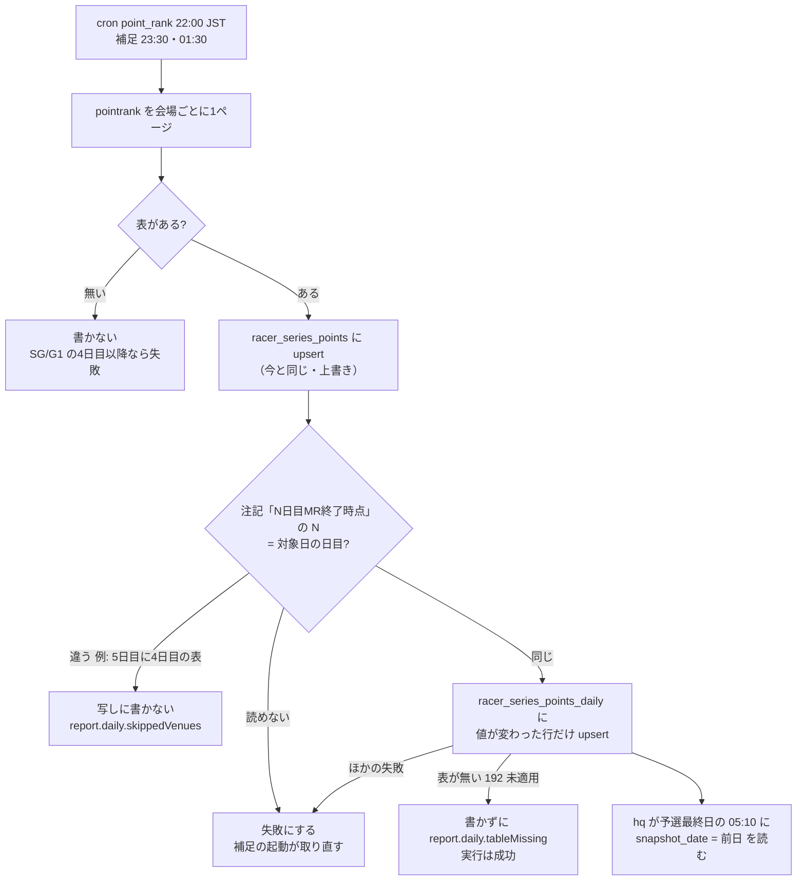

# 得点率（pointrank）の日ごとの写し（BOA-1210）

Shorts 型B「準優に残れるか」（SG/G1 の予選最終日の朝に出す。hq の drafts/shorts-border-person-20261031.md）の材料。予選最終日の朝 05:10 に、hq が前の晩までの公式の得点率を読めるようにする。オーナーは 2026-11-01 に、公式への取得が増えることを承認した（実際には増えない。§2）。

## 1. 今と変えること

| | 今 | 変えた後 |
|---|---|---|
| 取得 | cron point_rank が 22:00 JST（補足 23:30・01:30）に、開催中の全会場の pointrank を1ページずつ取る。表があれば日目を問わず書く | 同じ（取得の回数・時刻は変えない） |
| 保存 | racer_series_points に (venue_code, meet_start_date, racer_id) で上書き。最終日の値だけ残る | 加えて racer_series_points_daily に (snapshot_date, venue_code, racer_id) で残す。値が変わった行と新しい行だけ書く |
| 読む人 | 画面（節のページ・レース詳細） | hq（claude_ro）。画面は変えない |



## 2. 取得の回数と負荷（ADR-0067・0101）

- **増える取得は0**。cron point_rank は今も毎晩、開催中の全会場（約15）を1ページずつ取っている（scripts/daily/scrape-point-rank.js の run は日目で絞らない）。予選3日目の晩もすでに取っており、値を上書きで捨てていただけ。docs/design/scraping-load-budget/spec.md §2.1 の「夜の日次 約45」は変わらないので、予算の表は直さない
- 増えうるのは失敗の再試行だけ: 写しの書き込みの失敗・注記を読めないとき、実行を失敗にするので、補足の 23:30・01:30 に全会場（約15ページ）を取り直す。最大で1日 約30ページ。今の「会場の取得の失敗」と同じ扱い
- 05:10 にその場で取る案は採らない。新しい取得（SG/G1 の節ごとに1日1ページ）が増え、前の晩の値が取れない日（取得の失敗）を後から直せないのは同じだから
- 書き込み: SG/G1 の節で、表のある日（今の判定で1〜4日目。5日目以降は表が4日目の時点で止まるので書かない）ごとに約52行×約200B。1か月に SG/G1 が約5節で約1,000行・約0.2MB。同じ日の再取得は変更の無い行を書かない。Disk IO への影響は無視できる

## 3. 公式のページの仕様（2026-11-02、official-data-spec）

- 過去の日付（hd）で開いても、その日の時点の表は返らない。節の最新の表が返る（尼崎SG jcd=13 の hd=20261027・20261029 がどちらも「４日目１２R終了時点」、本番 racer_series_points と一致）。**予選中の日ごとの値は後から取り直せない**。よってバックフィルはできず、写しは 192 の適用の後の節からだけできる
- 見出しの注記は「N日目MR終了時点 ※当日の結果がリアルタイムで反映されます」。写しは N が対象日の日目と同じときだけ書き、M を as_of_race に残す
- 1日目・2日目の晩に表があった実例がある（若松G1 2026-09-22〜23、GHA の記録）。3日目の晩は未照合（推測で出る）。確かめ方: 次の SG/G1 の3日目に report.daily と写しの行を見る（3日目の行が無ければ、その節は3日目に表が無かった）
- 普通の6日の SG/G1 は予選が4日目まで（2025-12〜2026-10 の SG 7節・G1 34節）。グランプリ・クイーンズクライマックス・トーナメントの形は別。順延すると同じ日目が2日続くので、hq は「予選最終日の前日」を日付ではなく series_day と種別で決める

## 4. データ設計

マイグレーション: docs/db-migration/192_racer_series_points_daily.sql

```mermaid
erDiagram
    racer_series_points_daily {
        DATE snapshot_date PK
        SMALLINT venue_code PK
        INTEGER racer_id PK
        DATE meet_start_date
        SMALLINT series_day
        VARCHAR(10) race_grade
        VARCHAR(50) player_name
        VARCHAR(5) grade
        SMALLINT rank
        NUMERIC(4,_2) score_rate
        TEXT placements
        SMALLINT total_points
        SMALLINT penalty_points
        VARCHAR(30) remarks
        SMALLINT next_race_1
        SMALLINT next_race_2
        SMALLINT next_series_day
        SMALLINT as_of_race
        TIMESTAMPTZ scraped_at
    }
```

- 主キーの先頭は snapshot_date（書き手は対象日で既存行を読む。hq も対象日で読む）。節の通しの読みは (venue_code, meet_start_date, snapshot_date) の索引
- RLS 有効。anon・authenticated は SELECT のポリシーと GRANT SELECT だけ（racer_series_points と同じく公開の値）。claude_ro に SELECT を明示。書くのは service_role だけ
- hq の読み（例）: `SELECT * FROM racer_series_points_daily WHERE venue_code = $1 AND meet_start_date = $2 AND series_day = 3 ORDER BY rank NULLS LAST`

## 5. 適用とデプロイの順

- どちらが先でもよい。コードは表が無い間、写しを飛ばして racer_series_points を書き続ける（report.daily.tableMissing）
- 適用は db-apply（新しい表を作るだけで、混み合う表へのロックは無い）。時間帯の制約は無いが、次の SG/G1 の予選3日目の 22:00 JST より前に当てる。当てた後は Claude が 192 の頭の確認 SQL と get_advisors（security）を読む

## 6. 完了の確かめ（.claude/rules/data-acquisition.md 2章）

- [ ] 本番実測: 192 の適用後の最初の SG/G1 の節で、表のある日ごとに racer_series_points と同じ人数の行が写しにある（期待件数: その節の出場人数×表のある日数。バックフィルは不可＝取得開始日以降のみ）
- [ ] タイミング: 予選最終日の 05:10 JST より前に、前日の snapshot_date の行がある（取得は 22:00、補足 01:30 まで）。scraped_at で確かめる
- [ ] 継続監視: 写しの失敗は cron point_rank の失敗（consecutive_failures・既存の scrape-monitor の通知）に出る。tableMissing・skippedVenues は scrape_job_state.last_report.daily に出る
