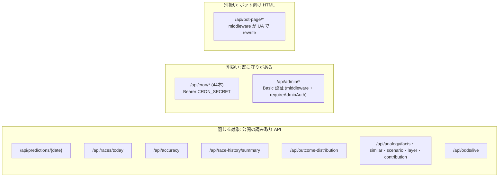
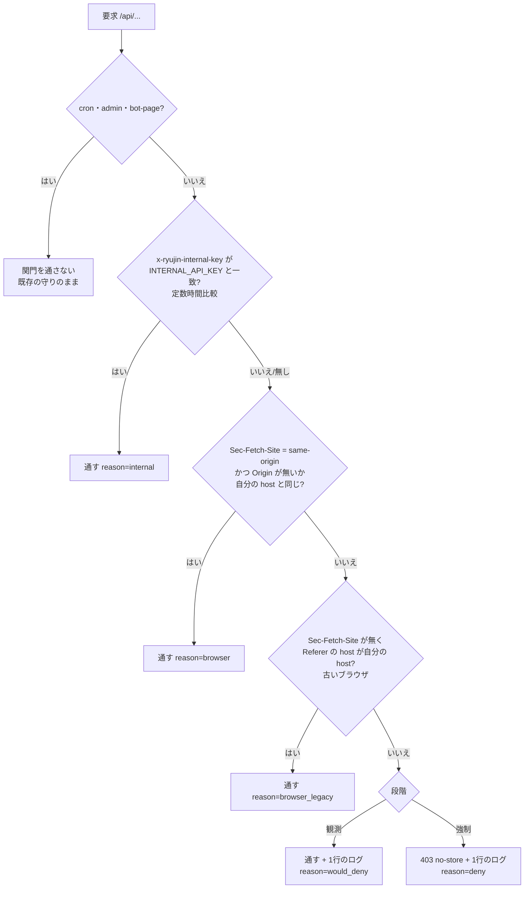
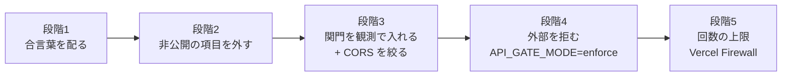

# 公開 API（/api/*）を自サイト専用に絞る設計（BOA-1110）

## 0. 前提と目的

- オーナーの決定（2026-10-27、直接）: 外部の AI 向けにデータを出す方針はやめる。`/api/*` は自分のサイト（画面・自分の処理）が使う分だけにし、外からの呼び出しは一旦禁止する
- これで `docs/proposal/ai-agent-era-strategy.md` の E（MCP の自己配布）・J（有料 API）は取り下げ。AI 検索向けの HTML（`/api/bot-page/*`・`dist/ai-snapshots/`、ADR-0032・0089）は人と同じ公開ページの写しなので残す（API ではない）
- 目的は3つ: ①非公開・廃止の値を外に出さない ②龍神ソナー（`/api/analogy/*`）の集計を丸ごと持っていかれない ③外からの呼び出しで Vercel・Supabase・公式（`/api/odds/live` は boatrace.jp への取得を伴う）の負荷と費用が増えない
- この文書は設計だけ。コード・`vercel.json`・`.github`・本番の設定は変えない

### 先に言うべき限界（実効性）

**`/api/*` を閉じても、同じデータの半分は Supabase の匿名キーで直接取れる。** 画面の配信物には Supabase の URL と匿名キーが入っており（公開バンドル）、`/api/predictions`・`/api/races/today`・`/api/accuracy`・`/api/outcome-distribution` は中で匿名キーの RPC・REST を呼んでいるだけ（`api/predictions/[date].js:17`、`api/races/today.js:11,28`、`api/accuracy/index.js:13`、`api/outcome-distribution/index.js:13`）。画面にも RPC 直のフォールバックがある（`src/services/supabaseDataService.js:1387,1513`）。

| データ | `/api` を閉じれば守れるか | 理由 |
|---|---|---|
| 龍神ソナー（`/api/analogy/facts・similar・scenario・layer・contribution`） | 守れる | サービスキーで非公開の Storage を読む（`api/_lib/analogyV16.js:21-22,63`）。外から直接は取れない |
| ライブオッズ（`/api/odds/live`） | 守れる（踏み台の防止） | 関数が boatrace.jp を取りに行く。外から叩かれると公式への取得が増える（ADR-0059 §2） |
| 予想・出走表・成績（`/api/predictions`・`races/today`・`accuracy`・`outcome-distribution`） | **守れない**（`/api` の口だけ閉じる） | 同じ RPC を匿名キーで直接呼べる。`inCaution` 等も RPC の応答に入っている |
| `race-history/summary` | 一部 | サービスキーを優先して使う（`api/race-history/summary.js:13`）。元の表を匿名で読めるかは未確認 |

予想系まで本当に閉じるには、Supabase 側（匿名ロールの RPC の GRANT・RLS）と画面の RPC 直のフォールバックを外す別の設計が要る。費用・画面への影響が大きいので、この設計の範囲外とし、別チケットで扱う（§8）。

## 1. エンドポイントと呼び出し元（読み取りの結果）

### 1.1 エンドポイントの分類

- `/api/cron/*` は44本すべてが `Authorization: Bearer ${CRON_SECRET}` を定数時間で比べる（`scripts/lib/scrapeJobs/cronWrapper.js:71,631` の共通ラッパ、または各ファイルの `CRON_SECRET` 判定。2026-10-27 に全ファイルを grep で確認）。呼び手は Vercel Cron（`vercel.json` の `crons`）と cron-job.org（`docs/operation/external-cron-setup.md`、同じ Bearer）。**この設計では変えない**。新しい関門からは外す（二重に判定しない）
- `/api/admin/*` は middleware の Basic 認証（`middleware.js` の `ADMIN_PATH_PREFIXES`）と関数側の `requireAdminAuth`。**変えない**。関門から外す
- `/api/bot-page/*` は AI クローラーの UA のとき middleware が rewrite する先。中身は公開ページの HTML で、閉じる目的（データの丸ごとの取得）に当たらない。関門から外す。ただし中で自分の `/api/races/today`・`/api/predictions` を取りに行くので、その内部の呼び出しには §2 の合言葉が要る

### 1.2 呼び出し元の一覧と、閉じたときに壊れるもの

凡例: 「関門の判定」は §2 の推奨（同じサイトのブラウザか、合言葉のヘッダか）で通るかどうか。

| # | 呼び出し元 | どこで動く | 叩く API | 判定の材料 | 閉じたら | 直す所（誰が） |
|---|---|---|---|---|---|---|
| a1 | 画面（`src/services/supabaseDataService.js:1365,1482,1536,1941,2079`・`analogyService.js`・`liveOddsService.js`・`adminRulePerformance.js`・`snsHubService.js`） | 利用者のブラウザ（www.boat-ai.jp・Preview の `*.vercel.app`） | predictions・races/today・accuracy・race-history・outcome-distribution・analogy/*・odds/live（admin は別扱い） | `Sec-Fetch-Site: same-origin`（相対 URL の fetch） | 通る | なし |
| a2 | 画面の自動の閲覧（Playwright・Chromium）: `verify-bot-html-parity.js`（GHA `bot-html-parity.yml`）、`api/admin/sns-hub/send-probe.js`・`snsHeadless.js`（Vercel の中の Chromium）、hq の `~/full-picture/.../collect-screen.cjs`・`screen-browser.cjs`（Mac） | 本物のブラウザで www.boat-ai.jp を開く | 画面と同じ | 画面と同じ | 通る（`screen-browser.cjs` は `route.continue()` でブラウザのヘッダのまま送る） | なし |
| b1 | ボット向け HTML の関数（`api/_lib/botPage.js:207`・`botRace.js:151`・`botToday.js:136`） | Vercel の中から自分の origin を fetch | races/today・predictions?light=true | なし（サーバー間） | **壊れる**（AI クローラーに 5xx） | 関数の fetch に合言葉のヘッダを足す（Claude、コード） |
| b2 | SNS の cron（`api/cron/sns-auto-plan.js:131` → `snsClaimCheck.checkClaims`、`api/cron/sns-send.js:86` → `createReadCurrent`） | Vercel の中から `https://www.boat-ai.jp/api/analogy/*` を fetch（`snsClaimCheck.js:81,176`） | analogy/facts・similar・scenario・layer | なし | **壊れる**（自動送信の照合が落ち、投稿が止まる） | 同上 |
| b3 | `/api/cron/*` の中の処理 | Vercel の中 | 公開 API は叩かない（Supabase・公式を直接） | — | 影響なし | なし |
| c1 | 全貌動画の材料（`sns-video-studio/remotion/scripts/full-picture/fetch-materials.mjs:1058,1094-1121`・`daily.mjs:238`） | オーナーの Mac（hq の launchd から） | analogy/facts・similar・scenario、predictions、outcome-distribution（24会場） | なし | **壊れる**（全貌動画が作れない） | `getJson` に合言葉のヘッダ、鍵は環境変数から（Claude、コード）＋ Mac の環境変数（オーナー） |
| c2 | hq の優勝戦の選び（`~/hq/platform/finals_run.py:47,125`） | Mac | predictions | なし | **壊れる**（優勝戦の思考投稿が止まる） | hq が直す（読むだけで確認、書き込みはしない） |
| c3 | hq の全貌動画の番組表（`~/hq/scripts/full-picture-daily.sh:94`・`full-picture-lib.sh:11` → `~/full-picture/.../analysis/fetch.cjs`） | Mac | predictions・analogy/facts・similar・scenario | なし | **壊れる** | hq が直す |
| c4 | 手元の開発サーバー・E2E（`vite.config.js:12-13,47` の proxy が `/api/(predictions|races|accuracy|race-history|outcome-distribution|analogy|odds)` を本番へ転送） | 手元の Mac、GHA の `e2e-smoke-test.yml`（録画に無い分の素通し）・`e2e-live.yml`・`e2e-rerecord.yml` | 読み取り API の全部 | 転送されるのはブラウザのヘッダのまま。`Sec-Fetch-Site: same-origin` だが、それは localhost に対して。`Origin`・`Referer` は `http://localhost:…` | **判定しだいで壊れる**（`Referer`・`Origin` まで見ると落ちる。`Sec-Fetch-Site` だけなら通ってしまう） | proxy に合言葉のヘッダを足す（`vite.config.js`、Claude）＋ GHA の secret（`.github`、オーナー承認） |
| c5 | 分析の手作業スクリプト（`scripts/analysis/full-picture-answer-stage/collect*.mjs`、`past-rate-check/*.mjs`、`analogy-judge-open-cards.js`、`in-collapse-caution/round1/fetch_c2.mjs`、`url-index-render-check.js`） | 手元 | analogy/*・predictions | なし | **壊れる**（手で回すときだけ） | 共通の取得に合言葉（Claude）。急がない |
| c6 | GitHub Actions のその他（`verify-cache-config.yml` 等） | GHA | `.github` 内に `boat-ai.jp/api` を叩く行は無い（2026-10-27 grep。e2e は c4） | — | 影響なし | なし |
| c7 | AI クローラー向けの静的スナップショット（`middleware.js` → `dist/ai-snapshots/`） | ビルド時に生成、配信は静的 | API は叩かない | — | 影響なし | なし |
| c8 | cron-job.org | 外部 | `/api/cron/*` だけ（Bearer CRON_SECRET） | 別扱い | 影響なし | なし |
| d1 | 外部の第三者（AI エージェント・スクレイパー・hq の壁打ち中の読み、BOA-1110 の5） | 不明 | 全部 | `Sec-Fetch-Site` 無し・`none`・`cross-site` | 拒む（目的どおり） | — |

c 群のうち hq（c2・c3）は hq のファイルなので、この設計では書き換えない。hq に「合言葉のヘッダを付ける」受け渡しを出す（§5 の段階1）。

## 2. 止め方の比較と推奨

### 2.1 比べた案

| 案 | 外からの呼び出しを止める力 | 壊れ方 | 費用 | 手間 |
|---|---|---|---|---|
| ① CORS を自サイトの origin に絞る | **ほぼ無い**。ブラウザの別サイトの JS が応答を読めなくなるだけ。curl・サーバー・AI のツールは止まらない | 無し（画面は同じ origin） | 0 | 小。ただし `vercel.json` の headers と、関数の中で `*` を付けている所（`api/analogy/contribution.js:33`・`api/_lib/analogyV16.js:161`・`api/accuracy/index.js:20,54`・`api/outcome-distribution/index.js:47,131`・`api/race-history/summary.js:22,61`・`api/races/today.js:19`）の両方を直す |
| ② `Sec-Fetch-Site`・`Origin`・`Referer` の確認 | 中。普通の AI のツール・`curl`・`fetch` は `Sec-Fetch-Site` を送らないので止まる。わざとヘッダを偽る相手は止まらない | c4（開発サーバー）が `Origin`・`Referer` の判定で落ちる。Preview の `*.vercel.app` を固定の一覧にすると落ちる（自分の host と比べれば落ちない） | 0（middleware の起動は今も多くのページで動いている。`/api/*` に広げた分の起動回数の費用は未確認） | 小 |
| ③ 内部の呼び出し元に合言葉のヘッダ（環境変数の鍵） | サーバー間の呼び出しを確実に区別できる（②と組む） | 配り漏れの呼び出し元が落ちる → 段階1で先に配り、観測で拾う | 0 | 中（Vercel・Mac・GHA に配る。鍵の新設はオーナー） |
| ④ 画面の呼び出しに短命の署名つきトークン（cookie） | ②より少し強い。ただしトークンはページを開けば誰でも取れるので、ブラウザを真似る相手は止まらない。IP ごとに数える材料にはなる | トークンの発行の経路（全ページの HTML を middleware に通すか、発行の API）を足す。期限切れ・cookie を拒む端末で画面が落ちうる | middleware をほぼ全ページで起動（費用は未確認） | 大 |
| ⑤ Vercel Firewall のカスタムルール・回数の上限 | 回数の上限で「丸ごとの取得」の速度を落とせる。条件でヘッダを見て拒むこともできる（CLI・API で `rate_limit` の窓10〜3600秒・数え方 `ip`・`ja4`・ヘッダ。Vercel 公式 CLI 文書） | 上限が低すぎると画面（1画面で数本の API）と hq の連続取得が 429 になる | Pro に含まれる範囲・超過の単価は**未確認**（公式の料金ページで確かめる） | 小（ダッシュボード）。設定は本番の変更なのでオーナー |
| ⑥ Cloudflare を前に置く | ⑤と同等以上（Bot 対策・回数の上限） | DNS の切り替え、Vercel の CDN と二重のキャッシュ、証明書。失敗するとサイト全体が落ちる | 無料枠あり。有料機能は未確認 | 大。後戻りしにくい |

補足:
- **関門は関数の中ではなく middleware に置く。** 公開 API の多くは `s-maxage` で CDN にキャッシュされる（`api/_lib/predictionsCache.js:11-12`・`analogyV16.js:151`・`accuracy/index.js:56` 等）。関数の中で拒んでも、キャッシュに当たった要求は関数まで届かない。Vercel の Routing Middleware がキャッシュの前で動くことは、今回の公式文書の検索では明記を確かめられなかった（**未確認**。既存の Basic 認証の `/api/admin/*` は no-store なので根拠にならない）。段階3で「キャッシュ済みの URL をヘッダ無しの curl で叩いても関門のログが出る」を実測して確かめ（§6 の確認3）、出なければ置き場所を見直す（その場合の代わり: Vercel Firewall のカスタムルールでヘッダを見て拒む。Firewall は要求の入口で効くとされるが、これも同じ curl で実測する）
- `/api/odds/live` はキャッシュの前に置かないと踏み台の防止にならない点も同じ

### 2.2 推奨

**②＋③を middleware で行い、①を同時に、⑤を最後に足す。④・⑥は採らない。**

- 理由: 目的（外部の普通の呼び出し・AI のツールを止める、龍神ソナーの丸ごとの取得を止める）に対して、費用0・手間が小さく、壊れ方が観測で拾える。④は②に比べて止められる相手がほとんど増えないのに手間と壊れ方が大きい（YAGNI。ヘッダを偽る取得がログで目立ったら再検討）。⑥は後戻りしにくく、Vercel の中の機能（⑤）で足りる
- 正直な限界: ヘッダを偽る・本物のブラウザで取る相手は止まらない。それは⑤の回数の上限で速度を落とすところまで。予想系は §0 のとおり Supabase から取れる

判定（middleware、`/api/*` のうち §1.1 の A だけ）:

- `Sec-Fetch-Site` を送らない古いブラウザ（Safari 16.4 より前など）は `Referer` で救う（`reason=browser_legacy` で別に数え、少なければ段階4の後に外してよい）。偽れる強さは `Sec-Fetch-Site` と同じ
- 自分の host は要求の `Host` から取る（固定の一覧にしない。Preview の `*.vercel.app` でも同じ判定で通る）
- `OPTIONS`（プリフライト）は同じ origin では発生しない。別 origin の `OPTIONS` は CORS を絞った後は許可のヘッダを返さないだけでよい（拒んでも同じ）
- 鍵が未設定のときは「合言葉の経路が無い」だけにする（fail-closed。鍵が空のとき空のヘッダで通さない）。ブラウザの経路は鍵に依らない
- 403 には `Cache-Control: no-store` を付ける（拒んだ結果を CDN に残さない）
- ログは1要求1行の JSON（`{"api_gate":reason,"path":…,"sfs":…,"origin_host":…,"ua_class":…}`）。IP・UA の全文・鍵は書かない。UA は「ブラウザ／AI ボット名／その他」に丸める
- 段階（観測／強制）は環境変数 `API_GATE_MODE`（`observe`／`enforce`、既定 `observe`）で切り替える。コードを戻さずに強制をやめられる

鍵の名前（案）: Vercel・Mac・GHA で同じ値の `INTERNAL_API_KEY`、ヘッダは `x-ryujin-internal-key`。値は Vercel の環境変数（Production・Preview）と Mac の環境変数、GHA の secret にだけ置き、ログ・PR・チャットに出さない。

## 3. 非公開・廃止の項目を応答から外す

#1906（2026-10-25、`api/_lib/predictionsResponse.js`）で、`entries[].aiScoreStandard・aiScoreSafeBet・aiScoreUpsetFocus` と `races[].predictionOdds` は外し済み。残りを次の表で扱う（2026-10-27 に本番の `/api/predictions/2026-10-26` の応答のキーを確かめた: races の欄は `inCaution`・`volatility`・`predictions{standard,safeBet,upsetFocus,unified}` 等、各予想に `turnPrediction`・`racerStats`・`volatilityPercentile`・`volatilityReasons`）。

**依頼の前提と食い違う点**: `IN_CAUTION_PUBLIC=false`（`src/config/featureFlags.js:22`）の間、公開中の画面は「今の画面（展開予測・旧イン崩れ指数）」のまま（同 7-8 行のコメント）。つまり **`predictions.unified.turnPrediction` と、`races[].volatility`・`unified.volatilityPercentile`・`volatilityReasons` は今も公開画面で描いている**。廃止で読み手が無いのは standard・safeBet・upsetFocus の3モデルの方。

画面への入口は `transformEdgeResponse`（`src/services/supabaseDataService.js:1026-1165`）。

| 欄 | 公開画面の読み手 | 他の読み手（ボット HTML・SNS・全貌動画・hq） | 判定 | 理由 |
|---|---|---|---|---|
| `predictions.safeBet`・`upsetFocus` | 無し。`supabaseDataService.js:1106-1119` の汎用ループで `raceData.predictions.<model>` に写すが、読むコンポーネントが0件（`AccuracyHistory.jsx:76,128` が読むのは `/api/accuracy` の集計で、この欄ではない） | 無し（`botRace.js:118-134` は見出しと `result.rank1` だけ、`fetch-materials.mjs:1110-1145`・`daily.mjs:47-53` は見出し・出走・展示・天候・結果だけ、hq の `select-daily.py`・`finals_run.py:61-66` は見出し系だけ） | **外す**（段階2） | 廃止モデル。読み手0 |
| `predictions.standard` | 無し。`supabaseDataService.js:1050-1063,1092` で race 直下の `turnPrediction`・`racerStats` に写すが、写した先の読み手が0件（画面の選手の成績は `useRaceAnalysisData.js:42` が DB から直接読む） | 無し（全貌動画の racerStats は API ではなく Supabase の predictions を直接読む、`fetch-materials.mjs:642`） | **外す**（段階2）。同じ PR で `supabaseDataService.js:1050-1063,1092` と `RaceDetailPage.jsx:88` の写しも消す | 廃止モデル。画面の写しを残すと RPC 直のフォールバックとの形の差になる |
| `predictions.*.racerStats` | 無し（unified のものも読まれない） | 無し | **外す**（段階2） | 読み手0 |
| `predictions.unified`（`topPick`・`top3`・`turnPrediction`・`volatilityPercentile(IsFallback)`・`volatilityReasons`） | **有り**。`supabaseDataService.js:1126-1149` → `RaceDetailPage.jsx:70-85`・`RaceAiPredictionTab.jsx:146,284-309`（展開予測・荒れ度）・`RaceCard.jsx:93-103`・`HitRaces.jsx:24`（`/hit-races`）・`PredictionPanel.jsx:292`（共有文）・`aiCopyText.js:110-154`（AI用にコピー） | 無し | **残す** | 現行のモデルで、公開画面が描いている。`turnPrediction`・荒れ度は `IN_CAUTION_PUBLIC=true` の PR で外す（その PR の範囲） |
| `races[].volatility` | **有り**。`supabaseDataService.js:1085-1090` → `RaceCard.jsx:41,59-62,79`（荒れ・堅いの札、会場の一覧） | 無し | **残す** | 同上 |
| `races[].inCaution` | プレビュー（`?caution=1`）のときだけ。`RaceAiPredictionTab.jsx:80-89`・`PredictionPanel.jsx:282-306`・`RaceCard.jsx:67-71,133`・`ThinkingAssistPage.jsx:464-465` | 無し（ホームの注意度は `/api/races/today` から） | **残す**（公開の時まで） | 外すと本番でのプレビュー（オーナーの内部確認）が壊れる。しかも同じ値は Supabase の RPC を匿名キーで直接呼べば取れる（§0）ので、`/api` から外しても露出は減らない。露出は段階4（関門）で `/api` の口を閉じて止め、RPC 側は §8 の別チケットで扱う |

段階2で同時に直すもの:
- `scripts/maintenance/verify-predictions-response.js:36-72`（`predictions.safeBet` が「残る」ことを確かめている。外す欄に移す）
- E2E で safeBet・upsetFocus・standard・racerStats を確かめるものは無い（2026-10-27 grep）。unified・inCaution・volatility を使う E2E（`in-caution-*.spec.js`・`race-outcome-display.spec.js`・`race-share-text.spec.js`・`layout.spec.js:605-636` 等）は残す欄なので影響なし
- `scripts/maintenance/verify-rpc-output-keys.js` は RPC 側のキーを見るので変えない（RPC は変えない、#1906 と同じ流儀）
- hq: 「hq に `predictions.safeBet` の参照がある」という前の調べは、2026-10-27 の grep では再現しなかった（§5）。段階2の前に hq に最終の確認を頼む

## 4. 入れる順

壊さない順。各段階の後に §6 の観測を見てから次へ進む。

| 段階 | やること | 変える所 | 誰の承認 | 進む条件 |
|---|---|---|---|---|
| 1 合言葉を配る | 鍵 `INTERNAL_API_KEY` を作り Vercel（Production・Preview）・Mac・GHA に置く。b1・b2（関数）、c1（fetch-materials・daily）、c4（`vite.config.js` の proxy）、c5 の取得にヘッダを足す（鍵が無ければ付けないだけ。この段階では関門が無いので何も変わらない）。hq（c2・c3）に受け渡し | `api/_lib/botPage.js`・`botRace.js`・`botToday.js`・`snsClaimCheck.js`、`sns-video-studio/.../fetch-materials.mjs`・`daily.mjs`、`vite.config.js`、`scripts/analysis/*`。GHA は `.github/workflows/e2e-*.yml` に env を1行 | 鍵の新設と配布・`.github` はオーナー。コードは段階0の PR | hq が c2・c3 を直したと返す |
| 2 非公開の項目を外す | §3 で「外す」にした欄を `stripUnusedPredictionFields` に名指しで足す（今と同じ流儀）。再現テストを `verify-predictions-response.js` に足す | `api/_lib/predictionsResponse.js` | §3 の判定どおり（画面・hq が読まない欄だけ） | E2E・verify:ci が緑、hq の読み手が外れている |
| 3 観測で入れる＋CORS | middleware の matcher に §1.1 A の `/api/*` を足し、`API_GATE_MODE=observe` で判定とログだけ。同時に `Access-Control-Allow-Origin: *` を `vercel.json` と関数の中から外す（同じ origin の画面には CORS ヘッダは要らない） | `middleware.js`、`vercel.json`、関数7本の CORS 定数 | `vercel.json` はオーナー | §6 の `would_deny` のうち、自分の呼び出し元が0件の日が平日・土日を含めて連続2日 |
| 4 外部を拒む | Vercel の環境変数 `API_GATE_MODE=enforce` | 本番の環境変数（コード変更なし） | オーナー | — |
| 5 回数の上限 | Vercel Firewall に `/api/`（cron・admin を除く）の IP ごとの上限。値は段階3のログの「画面の利用者1人あたりの最大の要求数」の実測から決める（根拠なしの数で決めない） | Vercel Firewall（本番） | オーナー（費用・プランの確認を含む） | — |

戻し方: 段階4は `API_GATE_MODE=observe` に戻すだけ。段階3は matcher を戻す PR。段階5は Firewall のルールを無効にする。

## 5. 受け渡し（hq）

hq（c2・c3）は hq のファイルなので、こちらからは書き換えない。段階1で次を渡す。

- `~/hq/platform/finals_run.py:125`（`urllib.request.urlopen(SCHEDULE_URL…)`）と `~/hq/scripts/full-picture-daily.sh:94`・`full-picture-lib.sh:11`・`~/full-picture/out/full-picture-template/*/analysis/fetch.cjs` の取得に、環境変数 `INTERNAL_API_KEY` があれば `x-ryujin-internal-key` を付ける
- §3 で外す欄を hq が読んでいないことの確認（前の調べでは hq に `predictions.safeBet` の参照がある、とされた。2026-10-27 の grep では `~/hq` の .py・.sh・.js・.cjs の本体に `safeBet`・`turnPrediction`・`inCaution` の参照は見当たらず、`company/tests/seo-human/fixtures/src/constants/index.js:43` の写しだけ。`~/full-picture/.../vendor/` の `hitCalculator.js`・`basicInfoStats.js` は本体の写しで、読むのは自前の材料。hq に最終の確認を頼む）

## 6. 誤って止めていないかを見る手順

1. **数える**: middleware の1行ログ（`api_gate`）を Vercel の Runtime Logs（または Observability）で、`reason` × `path` の先頭2段 × `ua_class` × 日で数える。段階3の間は毎日1回、hq の朝の報告に載せる（数える処理はスクリプトにし、`scripts/maintenance/` に置く。作るのは段階3の PR）
2. **自分の呼び出し元を見分ける**: `would_deny` のうち、`ua_class` が `node`・`python-urllib`・`curl` で、時刻が hq の launchd の時刻（全貌動画・優勝戦）や cron の時刻と重なるものは配り漏れを疑う。§1.2 の表と照らして1件ずつ潰す
3. **キャッシュの前で効いているか**（段階3の直後に1回）: キャッシュ済みの `/api/accuracy` を、ヘッダ無しの curl で2回叩き、2回目も `would_deny` のログが出る（強制の後は 403）こと。出なければ middleware がキャッシュの後ろにあり、関門の置き場所を見直す
4. **画面が通っているか**: 段階3の間、`reason=browser` が今までの API の要求数と同じ桁で出ていること。E2E（`e2e-live.yml`）と `bot-html-parity.yml` が緑
5. **強制の後**: 403 の件数を `ua_class` 別に毎日見る。`ua_class=browser` の 403 が出たら（古い端末で `Sec-Fetch-Site` を送らない等）、その UA を調べ、多ければ段階4を戻す
6. **回数の上限の後**: 429 の件数（Firewall のログ）。画面の利用者の 429 が出たら上限を上げる

## 7. オーナーの承認が要る所

| # | 何 | 段階 | なぜ承認が要るか |
|---|---|---|---|
| 1 | 鍵 `INTERNAL_API_KEY` の新設と配布（Vercel の Production・Preview、オーナーの Mac、GHA の secret） | 1 | 鍵とセキュリティ |
| 2 | `.github/workflows/e2e-smoke-test.yml`・`e2e-live.yml`・`e2e-rerecord.yml` に secret を env で渡す1行 | 1 | `.github` の変更 |
| 3 | `vercel.json` の `/api/(.*)` の CORS ヘッダを外す | 3 | `vercel.json` の変更 |
| 4 | Vercel の環境変数 `API_GATE_MODE` の追加と `enforce` への切り替え | 3・4 | 本番の設定。外からの呼び出しを実際に止める |
| 5 | Vercel Firewall の回数の上限（含まれる範囲と超過の単価を先に確かめる。未確認） | 5 | 本番の設定・費用 |
| 6 | 予想系を Supabase 側でも閉じるかどうか（§0、別チケット） | — | 費用・画面への影響、公開の方針 |

## 8. 範囲の外（別に扱う）

- **Supabase の匿名ロールで取れる範囲**（§0）。閉じるなら、匿名の RPC の GRANT を外し、画面の RPC 直のフォールバックをやめる設計が要る。オーナーの判断（§7 の6）
- BOA-1110 の4（公式の出走表・結果の再配布に当たる範囲と規約）。外への API を閉じれば API による再配布は無くなるが、画面に出す範囲の規約の確認は別
- 署名つきトークン（④）・Cloudflare（⑥）は、段階4の後のログでヘッダを偽る取得が目立ったら再検討
