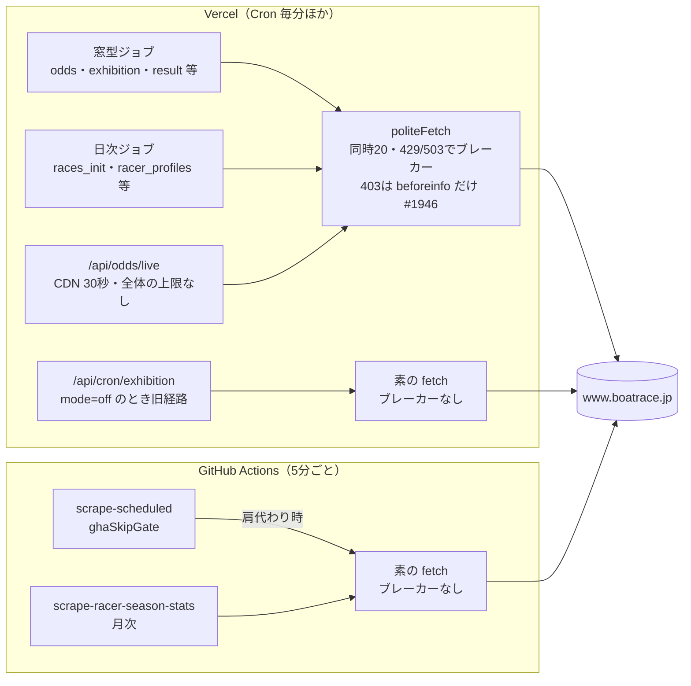
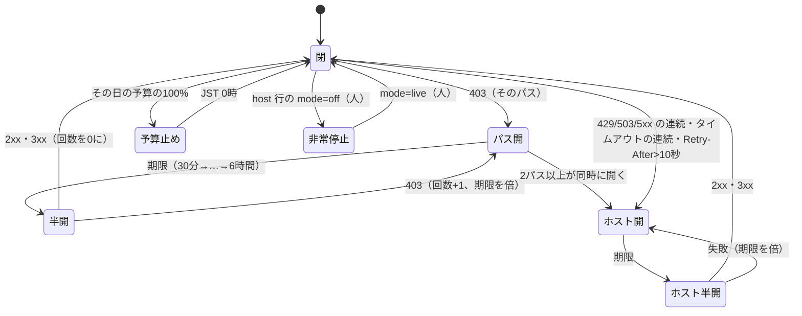
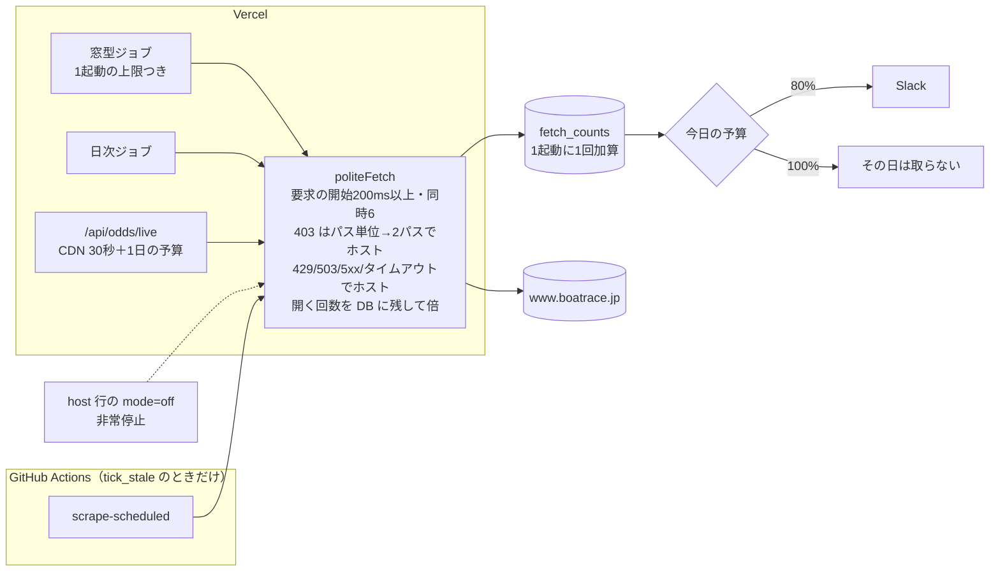

# 公式サイトへの取得の上限と止め方（scraping-load-budget）

外部サイト（主に公式 `www.boatrace.jp`）への取得に、相手ごとの上限と、拒否・過負荷のときの止め方を入れ直す設計。docs だけで、実装は別の PR で行う（§12）。ADR の案は [ADR-0101](../../adr/0101-official-site-fetch-budget-and-stop-policy.md)。元の数字は [analysis/freshness-need.md](analysis/freshness-need.md)、ファンの議論は [fan-panel.md](fan-panel.md)。

## 0. 目的と範囲

- 目的: 公式に止められないこと（ADR-0067 の禁止事項5「大量のアクセス」への配慮を、数字と仕組みで持つ）。止められたときに叩き続けないこと。止められても画面・予想・SNS が嘘を出さないこと
- 範囲: boatrace.jp のすべての取得（Vercel Cron・画面のライブオッズ・GitHub Actions の予備・cron-job.org の旧経路）。race.boatcast.jp・mbrace.or.jp・会場公式サイトは §4.4 で上限だけ決める
- 前提にしたオーナーの決定（2026-10-26）: BOATRACE振興会には連絡しない。名乗り（User-Agent）・IP を変えて回り込むことはしない
- 前提にした PR: #1945（朝の races_init が直前情報を取らない）、#1946（403 でパス単位のブレーカー、展示を1日約700回へ、claimLimit 8・並列1、GHA の肩代わりの条件）。どちらも本設計より先にマージする。本設計の数字は、この2本が入った後を「今」とする

## 1. 経緯

- 2026-10-26 15:50 JST から、公式の直前情報（`/owpc/pc/race/beforeinfo`）が当社の取得だけ HTTP 403。同じホストの odds・racelist・raceresult・pitreport は 200。ブラウザでは見られる（BOA-1145）
- 直前情報は1日 1,874回（10/25、1レース約11回）で、1つのページとしていちばん多く取っていた。403 はブレーカーの失敗に数えないため、403 の間も120秒おきに叩き続けた
- 再レビュー（system-architect、10/26）の指摘: boatrace.jp の合計は約8,400件/日でオッズが約65%。ADR-0067 の「リクエスト間隔」は boatrace.jp で実装されていない（並列の上限だけ）。GitHub Actions の予備 `scrape-scheduled` はブレーカーの無い素の fetch。`/api/odds/live` に全体の上限が無い。月次の選手プロフィールが Vercel と GitHub Actions で二重。User-Agent の1か所が旧アカウントの URL。robots.txt を読む処理が無い

## 2. 現状の実測

### 2.1 boatrace.jp への1日の取得（10/19〜10/25 の平均、156R/日）

ページ数は「スロットの試行の数（scrape_slots.attempts）×1回のページ数」。日次のジョブはコードから数えた見積り。

| 経路 | ページ | 1日（実測・見積り） | #1945・#1946 の後 | 根拠 |
|---|---|---|---|---|
| odds（6窓） | oddstf・odds3t・odds3f・odds2tf・oddsk | 約4,730（5ページ×156R×6窓＋-60 の未発売の再試行約50） | 同じ | scrape_slots odds |
| odds_final | 同じ5ページ | 約780（1回目で全件確定） | 同じ | scrape_slots odds_final |
| exhibition | beforeinfo | 1,555（-60 156、-33 1,399、補完 ほぼ0） | 約530（-60 156、-33 約375） | scrape_slots exhibition・#1946 本文 |
| races_init（朝） | race/index・raceindex・racelist・beforeinfo | 約300（1会場25ページ） | 約160（beforeinfo を外す） | racesInit/job.js・#1945 |
| result | raceresult | 506（+5 の1回目は全件空振り） | 同じ | scrape_slots result |
| race_info | racelist | 156 | 同じ | scrape_slots race_info |
| pcexpect | pcexpect | 158 | 同じ | scrape_slots pcexpect |
| race_status | race/index（＋中止の日の raceresult） | 108〜 | 同じ | registry race_status（10分おき） |
| pit_reports | pitreport | 平均46（SG の節は数百） | 同じ | scrape_slots pit_reports |
| 夜の日次 | information・pointrank・rankingmotor・news・monthlyschedule・fan | 約45 | 同じ | registry |
| 画面のライブオッズ | 上の5ページのどれか | 未計測（Vercel のログは24時間で108行。要求の数ではない） | 同じ | api/odds/live.js |
| **合計（ライブを除く）** | | **約8,400** | **約7,400** | |
| 月次の選手（取得日だけ） | racersearch/season（＋新人の profile） | 約1,630×2（Vercel と GitHub Actions の二重） | 同じ | gh run list・`SKIP_RACER_SEASON_ON_GHA` 未設定 |

- 1分あたりの最大: 10/25 の scrape_slots の最後の試行の時刻から数えて43ページ（下限。再試行の途中の回は数えていない）。中央値は7ページ/分
- 1分あたりの最初の試行の最大: odds 6スロット、exhibition 4、odds_final 4、race_info 2、result 2（10/19〜25）
- 今の boatrace.jp への待ちは並列の上限だけ（politeFetch の同時20、ジョブの concurrency）。リクエストの間隔は無い。BOATCAST だけ 2.2秒の間隔がある（`scripts/lib/boatcast/boatcastClient.js`）
- 10/26 の 403 の後も、GitHub Actions の `scrape-scheduled` は5分ごとに起動している。すべての SKIP 変数が健全と判定しており、boatrace.jp への取得は0（10/26 17:41 JST のログ）。exhibition の mode が off の間は cron-job.org の起動で旧経路（素の fetch）が動く作りだが、直近60分の Vercel のログに `/api/cron/exhibition` は無かった

### 2.2 今の流れ

## 3. 推奨の一覧

| # | 決めること | 推奨（1行） | 決め方 |
|---|---|---|---|
| 1 | 相手ごとの上限 | ホスト×パスの1日の予算を表で持ち、取得の数を DB に数え、超えたら止めて知らせる。1分はジョブの1起動の上限の和で抑え、ホストごとに要求の開始を200ms以上あける | 推奨どおり進める |
| 2 | 止め方 | 403 は boatrace.jp の全パスでパス単位に開き、2パス以上ならホストごと止める。開く時間を DB に残して倍にする（30分→6時間）。429・503・502・504・タイムアウトの連続も数える。ホストの非常停止の行を足す | 推奨どおり進める |
| 3a | オッズの窓とページ | -30 の窓を落とす（−780件/日、閲覧で重み付けしたずれ1.2%）。ADR-0057 の変更 | **オーナーに聞く** |
| 3b | -60 の体重だけの窓 | 止める（−156件/日）。体重は出走表の値で60分前から出し、調整重量は展示と同時に出る | **オーナーに聞く** |
| 3c | 結果の最初の取得 | +5→+10分（−156件/日、遅れたレース0） | 推奨どおり進める |
| 3d | 画面で使っていない取得 | 前検は節の初日と2日目だけ、月間スケジュールは週1回。特記事項・pcexpect・ピットレポートは残す | 推奨どおり進める |
| 3e | 月次の二重 | GitHub Actions を止め（変数1つ）、月次の期別は5月・11月だけにする（年16回→6回） | 推奨どおり進める（変数はオーナーの操作） |
| 3f | 展示の取りに行く時刻 | #1946 の予定に締切24分前を足す（＋156件/日。早く出る12R 等の遅れを、24分前より後の公開で最大約4分に） | **オーナーに聞く** |
| 4 | GitHub Actions の予備 | 残すのは Vercel が起動していないとき（tick_stale）だけ。取得は同じ politeFetch と DB のブレーカー・予算を通す。展示は肩代わりしない。30日肩代わりが無ければ消す。cron-job.org の展示の旧経路は消す | 推奨どおり進める |
| 5 | 劣化のさせ方 | ページごとに出すもの・出さないものを表で固定（§9）。「未発表」と出さず「公式から取得できていません」と公式へのリンク。IP ごと止められたときの手順を持つ | 文言は wording-editor を通して推奨どおり。画面の変更は UI の手順（モック） |
| 6 | 監視 | まず scrape_slots から相手ごとの回数を毎日出して Slack に流す（マイグレーション無し）。次に politeFetch が数える表を足し、ライブ・日次・GitHub Actions も数える。予算の80%で知らせ、100%で止める。403 は即時に知らせる | 推奨どおり進める |

## 4. 項目1: 相手ごとの上限

### 4.1 案

| 案 | 中身 | 良い点 | 悪い点 |
|---|---|---|---|
| A. 今のまま（ジョブごとの claimLimit・concurrency だけ） | 変えない | 手間0 | 全体の上限が無い。ライブ・GitHub Actions・日次が足されても誰も止めない。今回の 1,874回/日を誰も止めなかった |
| B. 予算の表＋数える＋1起動の上限＋要求の間隔（推奨） | registry にホスト×パスの1日の予算を置く。politeFetch が数え、起動の最後に DB へまとめて書く。各ジョブは起動の最初に今日の数を読み、予算を超えていたら取らずに終える。1分の上限は、毎分起動するジョブの1起動のページ数の上限の和で抑える。politeFetch はホストごとに要求の開始を200ms以上あける | DB の書き込みは1起動に1回。既存の cronWrapper・scrape_job_state の作りに乗る。数字が表で読める | 1分の上限は構造で抑えるだけで、厳密ではない（ジョブの起動が重なると和が上限） |
| C. 取得の窓口を1つにする（すべての取得を1つの関数か DB の行の予約で通す） | 要求ごとに DB で枠を予約する | 1分・1日を厳密に守れる | 要求ごとに DB の往復（関数は iad1・DB は ap-southeast-2）が入り、オッズの1スロットが遅くなる。作りが大きい |

推奨は B。理由: 今回の問題は「全体で何件取っているかを誰も持っていない」ことで、厳密な1分の上限ではない。1分の最大の実測は43ページ（下限）で、上限の目安60より下にある。C は実測で1分の上限を超え始めたときに検討する。

### 4.2 boatrace.jp の上限の値

「根拠」は、実測（§2）・公式の公開の時刻・画面が要る時刻のどれか。根拠の無いものは「目安（根拠なし）」と書き、止める条件にはするが、超えたらまず値を見直す（実害の証拠ではない）。公式の robots.txt は全許可で Crawl-delay は無い（docs/design/racer-period-stats/plan.md の写し）。公式は頻度・間隔の数字を出していないので、ホスト全体の値はどれも目安になる。

| 相手 | 1日の予算 | 推奨の後の見込み | 1起動の上限 | 根拠 |
|---|---|---|---|---|
| ホスト全体 | 10,000 | 約7,000（3a・3b・3f を入れなければ約7,100） | — | 目安（根拠なし）。今の実測8,400 を超えたら止まらないよう、見込みの約1.4倍 |
| ホスト全体の1分 | 60 | 最大約45 | — | 目安（根拠なし）。実測の最大43（下限）の約1.4倍 |
| オッズの5ページの合計 | 6,500 | 5,510（3a を入れれば4,730） | odds 8スロット×5、odds_final 6スロット | 実測5,510。1起動はスロットの最初の試行の最大6/分に余裕2 |
| beforeinfo | 900 | 約530（3b で約375、3f で約690） | exhibition 8（#1946） | #1946 の模擬。403 を受けたページなので予算は厳しめ |
| raceresult | 600 | 約370（結果350＋中止の確認） | result 8 | 3c の後の実測から。最初の試行の最大2/分 |
| racelist | 450 | 約310（race_info 156＋races_init 156） | race_info 6 | 実測 |
| pcexpect | 250 | 158 | 6 | 実測 |
| race/index・raceindex | 200 | 約125 | — | race_status 108＋races_init |
| pitreport | 1,000 | 平均46（SG の節で数百） | 8（今のまま） | SG の節の実測は未計測。目安（根拠なし） |
| 夜の日次（information・pointrank・rankingmotor・news・monthlyschedule・fan） | 150 | 約30（3d の後） | — | registry から数えた見積り |
| racersearch（選手） | 取得日 2,000、それ以外 50 | 取得日 約1,630 | 300人/起動（今のまま） | 選手数1,628 |
| 画面のライブオッズ（`/api/odds/live`） | 3,000 | 未計測 | — | 目安（根拠なし）。超えたら DB の最新の値を返し「公式の最新ではありません」と出す（§9） |

- 間隔: politeFetch はホストごと・プロセスごとに要求の開始を200ms以上あける（目安、根拠なし）。今のオッズの1スロットは5ページを並列に取り約12秒かかる（registry の slotSecEstimate）ので、0.8秒の追加で済む。BOATCAST は今の2.2秒のまま（ADR-0067 の調査時の2秒に余裕）
- 同時: politeFetch の同時の上限を20→6にする（目安。odds の concurrency 4 のスロットのうち、1スロットの5ページが並ぶ形を残す。今の実測で詰まらない値は、実装の PR で slotSecEstimate と合わせて確かめる）
- 1起動の上限は claimLimit の見直しで持つ。今の値（odds 32、result 40、odds_final 24、race_info 24、pcexpect 20）は、1分の最初の試行の実測（最大6・2・4・2）の4〜20倍で、上限として効いていない

### 4.3 予算を超えたとき

- 予算の80%: Slack に1回知らせる（その日のうち再通知しない）
- 予算の100%: そのパスのジョブは、その日の残りは取らずに終える（outcome `budget_exhausted`、連続失敗に数えない、GitHub Actions の肩代わりの条件に入れない）。ホスト全体の予算の100% は、ホストのすべてのジョブを止める
- 例外にしない: 「取り直せないデータ（オッズ・展示）は予算を超えても取る」としない。予算の値が間違っていたら値を直す（PR）。止めない例外を作ると、今回と同じく誰も止めない
- 日付の切り替え: JST の0時

### 4.4 他のホスト

| ホスト | 今 | 推奨 |
|---|---|---|
| race.boatcast.jp | 逐次・2.2秒・403 はカナリアで判定（ADR-0067） | 今のまま。1日の予算 1,500（目安。ADR-0067 の上限見積り800の約2倍）を足して数える。403 のパス単位のブレーカーの対象にしない（未公開のファイルを403で返すため） |
| www1.mbrace.or.jp（K・B ファイル） | 1日数件 | 1日の予算 50（目安）。バックフィルは手動の CLI で、夜間・1日の上限を CLI に持つ（今のまま） |
| 会場公式サイト | 会場ごとに数ページ・300ms 間隔 | 1日の予算 300（目安。実測約170）。ホストごとのブレーカーは今のまま |

## 5. 項目2: 止め方

### 5.1 応答ごとの扱い

| 応答 | 今（#1946 の後） | 推奨 |
|---|---|---|
| 403（boatrace.jp） | beforeinfo だけ、パス単位で1回で開く。30分、プロセスの中だけで倍（上限120分）。他のパスの 403 は成功の側 | **boatrace.jp の全パス**で、パス単位で1回で開く。同時に2パス以上が開いたら、ホスト全体を開く（IP ごとの拒否を疑う）。開く時間は30分→1時間→2時間→4時間→6時間（上限）で、**回数を DB に残す**（起動ごとに別のプロセスなので、今はいつまでも30分おきに試す）。成功で回数を0に戻す |
| 403（race.boatcast.jp） | カナリアで判定 | 今のまま |
| 429 | 最大2回の再試行（Retry-After を10秒まで尊重）。2分に5件か3件連続でホストを60秒開く（上限10分） | Retry-After が10秒を超えたら、再試行せずホストをその時間開く（上限60分）。開く時間を5分→10分→20分→60分（上限）にし、回数を DB に残す |
| 503 | 429 と同じ | 429 と同じ。保守のページ（本文に保守の文言）なら、ホストを60分開く（文言の判定は実装の PR で公式の実物の写しが手に入ってから。それまでは 429 と同じ） |
| 500・502・504 | 成功の側（ブレーカーに数えない） | 503 と同じに数える（再試行1回） |
| タイムアウト・接続の失敗 | 再試行2回。ブレーカーに数えない | ホストで5分のうちに5回続いたら、ホストを5分開く（倍、上限60分）。IP ごとの遮断は接続の切断・応答なしで現れることがあるため |
| 404 | 成功の側 | 今のまま（パスの間違いはジョブの outcome で見る） |

### 5.2 半開・通知・再開

- 半開: 期限が来たら1件だけ試す（今のまま）。試すのは、そのパスでいちばん軽いページ1件（オッズなら単勝 oddstf）。閉じるのは 2xx・3xx のときだけ（#1946 のまま）
- 通知（Slack）: 開いたとき1回、段階が上がったとき（2時間以上になったとき、ホスト全体に広がったとき）1回、閉じたとき1回。半開の試行ごとには知らせない。開いたままの日は朝夜のまとめに1行
- 非常停止: `scrape_job_state` の `host:boatrace.jp` の行の mode を `off` にすると、そのホストのすべての取得（Vercel・ライブ・GitHub Actions）が止まる（今は host の行の mode を誰も読まない）。オーナーの操作は UPDATE 1文
- 再開: 自動（半開）。人が早めたいときは `breaker_open_until` を NULL にする UPDATE。ホスト全体が開いた後の再開は §9.3 の順

### 5.3 止め方の状態

### 5.4 #1946 との関係

- #1946 の `breakerUrls`・`pathKeyOf`・`recordBlocked`・GHA の肩代わりの条件はそのまま使う。変えるのは (1) 対象を boatrace.jp の全パスに広げる（registry に「このジョブが取るパス」を書き、`breakerUrls` をそこから作る）(2) 開いた回数を DB に残す（`scrape_job_state` に列を1つ足すか、`last_report` に持つかは実装の PR で system-architect と決める）(3) 2パス以上でホストへ広げる、の3つ
- BOATCAST を 403 のパス単位のブレーカーに入れない点は #1946 と同じ

## 6. 項目3: 減らす判断

### 6.1 (a) オッズの窓とページ（オーナーに聞く）

画面が何を読むか（コードで確かめた）: オッズ一覧タブの今の表は `/api/odds/live` でその場で取る（`src/components/race/RaceOddsListTab.jsx`、CDN 30秒）。推移は `race_odds` の窓のスナップショットに、ライブの値と締切時オッズを最後の点として足す。予想の期待値は `race_odds` の最新の窓（0分）を読む。窓を間引いて変わるのは、推移の点と、予想・期待値の元の値。

| 案 | 減る件数/日 | 閲覧で重み付けした3連単のずれ | 他の影響 | 評価 |
|---|---|---|---|---|
| A1. 今のまま（6窓×5ページ、ADR-0057） | 0 | 0 | — | 全体の65%のまま |
| A2. -30 を落とす（推奨） | 780 | 1.2%（1番人気の食い違い3.2%） | 推移の点が1つ減る（-60 の次が -15） | 減る量に対して失うものが最も小さい。-30〜-15 の閲覧（76/分）は -60 の値ではなくライブの表を見る |
| A3. -15 を落とす | 780 | 1.4% | 予想の買い目のオッズのずれが11.7%で最大 | A2 より損が大きい |
| A4. 0分を落とす | 780 | 0.4% | 予想の最後の値が -5 になり、確定との差が8.9%→19.2% | prediction_odds を締切時オッズから作る変更（後出しの扱い）が前提。今は勧めない |
| A5. 3連複・2連・拡連複を -60/-15/-5 だけ | 1,404 | 3連単は0、他の券種で5〜7% | 他の券種の推移の点が半分 | 減る量は大きいが、券種によって推移の点の数が違う画面になる |

- -5 は残す（閲覧がいちばん多い締切5分前〜0分、338/分）
- A2 を選んだら、推移の点に「○分前」を付け、等間隔に見せない（data-scientist・ファン）
- ADR-0057 は「6窓すべてで全券種を全通り」をオーナーの指摘で決めた。A2 はその変更なので、オーナーに聞く

### 6.2 (b) -60 の体重だけの窓（オーナーに聞く）

| 案 | 減る件数/日 | 失うもの | 評価 |
|---|---|---|---|
| B1. 今のまま | 0 | — | 体重は出走表（race_info -60）と98.9%同じ値を二重に取っている |
| B2. 止める（推奨） | 156 | 調整重量（艇の15.8%）が展示と同時（中央値 締切16.4分前）に出る。約1%の体重の食い違い（出走表とのずれ ±0.1〜0.5kg）が展示まで残る | 60〜30分前に直前情報タブを開くのは閲覧の1.9%。予想は体重を使わない |
| B3. -60 の再試行を止め、1回だけにする | 0（今も平均1.00回） | — | 効果なし |

BOA-500 で入れた先出しをやめる変更で、見せる時刻が遅くなるので、オーナーに聞く。

### 6.3 (c) 結果の最初の取得（推奨どおり進める）

- +5→+10分。14日2,196枠で +5 の1回目に取れたレースは0。試行が31%減り（−156件/日）、完了の時刻は変わらない
- +15分からにする案（−302件/日）は、6.3%のレースが5分遅れる。結果タブは締切から1時間以上後の閲覧が91%で急ぎの需要は小さいが、的中の判定と SNS の結果の投稿が遅れるので、今回は入れない
- 見せ方を変えない（遅れが0）ので、オーナーに聞かない

### 6.4 (f) 展示の取りに行く時刻（オーナーに聞く）

#1946 で、-33 の窓の取得を締切20・16・13・10・8・7分前にした（1レース約2.4回、約375件/日）。締切20分前より前に公開されるレース（19.5%、12R は中央値20.4分前）は、公開から最大約13分遅れて画面・予想に出る（今は最大2分）。

| 案 | 件数/日 | 早く出るレースの遅れの最大 | 評価 |
|---|---|---|---|
| E1. #1946 のまま（20分前から） | 約375 | 約13分（-33分の公開） | 回数は最小 |
| E2. 24分前を足す（推奨） | 約530 | 24〜20分前の公開は最大約4分。25分前より前に出る4.2%は最大約9分 | 12R・優勝戦の展示を遅らせない。+156件/日 |
| E3. -25 から2分おき | 約830 | 約9分（25分前より前の4.2%） | 回数が多い |

ファンの4人のうち3人が「早く出るレース（とくに12R）を遅らせるのは困る」とした（fan-panel.md）。見せる時刻の判断なので、オーナーに聞く。E2 は #1946 の `pollMinBefore` に24を足すだけで、-33 の窓の中に収まる。

### 6.5 (d) 画面で使っていない取得（推奨どおり進める）

| 取得 | 画面での使用 | 実測 | 推奨 |
|---|---|---|---|
| pit_reports（ピットレポート） | 使う（直前情報タブのピットレポート） | 平均46/日 | 残す |
| race_notices（特記事項 `race/information`） | 画面は直接読まない。/today の帰郷の理由に使う | 14日で0件。1日約13ページ | 残す（欠場・変更の一次情報で、件数が小さい） |
| pcexpect（公式の予想） | 画面は読まない。分析（analogy-finder の export）と data_health が読む | 158/日 | 残す。分析で使わなくなったら止める |
| prediction_odds（買い目オッズ） | 画面は読まない | Vercel では race_odds から作るので取得0 | 取得なし。GitHub Actions の肩代わりの時だけ取る経路は §8 で消す |
| motor_pretest（前検 `rankingmotor`） | 使う | 毎日約13ページ。節の中で値が変わらない（6,349組一致） | 節の初日の前日と初日だけ取る（約2〜3/日） |
| race_series（月間スケジュール） | 使う（節の情報） | 毎日3ページ | 週1回と、月の変わり目の前後3日 |
| race_status（`race/index`） | 使う（中止・順延） | 108/日 | 残す（中止の早い確定の価値が大きい。1ページ） |

### 6.6 (e) 月次の二重取得（推奨どおり進める）

- 今: Vercel の racer_profiles（毎月2日、5・11月は9・16日も）と GitHub Actions の `scrape-racer-season-stats.yml`（同じ日の JST 03:00）が両方動く。`SKIP_RACER_SEASON_ON_GHA` が未設定で、10/2 も両方動いた（GitHub Actions は4時間22分）。次は 11/2・11/9・11/16
- 期別の成績は期の終わり（4/30・10/31）の後にしか変わらない。10/2 の回は書いた行0
- 推奨:
  1. オーナーが `SKIP_RACER_SEASON_ON_GHA=true` を立てる（11/2 03:00 JST の前。リポジトリの変数で、ghaSkipGate が racer_profiles の健全を確かめてから止める作り）
  2. 月次の全員の取得を5月・11月（2・9・16日）だけにする（年16回→6回、約1.6万件/年減る）。新人の選手の profile は毎月取る（数十件）
  3. 期別のファイル（fan{YYMM}.lzh、半期に1回）で置き換えられるかは別に確かめる（optimal-scraping-design.md の案）。置き換えられたら選手検索の月次を止める

## 7. 監視（項目6）

### 7.1 案

| 案 | 中身 | 数えられるもの | 手間 |
|---|---|---|---|
| M1. scrape_slots から毎日数える（先に入れる） | 窓型ジョブの attempts × 1回のページ数（registry に `pagesPerAttempt` を足す）を、ホスト×パスごとに日次で集計し、Slack の朝夜のまとめに出す | 窓型ジョブ（全体の約9割）。オッズの未発売の1ページ、odds_final の確認の1ページは近似 | マイグレーション無し。data_health か scrape-monitor に足す |
| M2. politeFetch が数える（次に入れる） | politeFetch が (ホスト, パス, 応答の種類) ごとに数え、起動の最後に `fetch_counts`（日・時・ホスト・パス・応答の種類・件数）へまとめて加算する | すべて（日次・ライブ・GitHub Actions も、同じ politeFetch を通せば） | マイグレーション1本（新しい表、RLS、service_role のみ）。書き込みは1起動に1回（1日約2,000回の小さな加算） |

推奨は M1 を先に、M2 を次に。M1 はすぐ数字が出る（今は1日の合計を毎回人が数えている）。M2 は §4 の予算で止める仕組みの土台になる。

### 7.2 知らせる条件

| 条件 | 知らせ方 |
|---|---|
| 403 を1件でも受けた（boatrace.jp） | 即時（ブレーカーの開放と同じ通知） |
| 1日の予算の80% | 即時に1回 |
| 1日の予算の100%（止めた） | 即時 |
| ホスト全体の1時間の数が、その時間の予算（1日の予算の1/10）を超えた | 即時に1回（目安、根拠なし） |
| 毎日の数 | 朝夜のまとめに、ホスト×パスの数と予算を1行ずつ |
| 監視が動いていない | scrape-monitor の既存の未実行の検知に載せる |

## 8. 項目4: GitHub Actions の予備

| 案 | 中身 | 評価 |
|---|---|---|
| G1. すぐ消す | scrape-scheduled の取得の部分を消す | Vercel が止まったとき（デプロイの失敗・Cron の未配信）の予備が無くなる。ADR-0066 の旧基盤の廃止の条件（全取得の移行）は満たしている |
| G2. tick_stale のときだけ、同じ守りを通して残す（推奨） | 肩代わりは Vercel が起動していない（last_tick_at が12分以上前）ときだけ。GitHub Actions の取得も politeFetch・DB のブレーカー・予算を通す（同じ `scripts/lib` を使う）。展示（beforeinfo）は肩代わりしない。買い目オッズ（prediction_odds の取得）は消す | 予備を残しつつ、別の IP から守り無しで叩く経路を無くす |
| G3. #1946 のまま | ブレーカーが開いている間は肩代わりしない。取得は素の fetch | ブレーカーが閉じていて Vercel が止まっているとき、守り無し・間隔1秒の取得が5分ごとに走る |

- 推奨は G2。30日のあいだ肩代わりが1回も無ければ G1 に進む（肩代わりの記録は ghaSkipGate のログと M2 の数）
- cron-job.org の展示の旧経路（`runLegacyExhibition`、mode が off のときに素の fetch で beforeinfo を叩く）は消す。mode=off は「取らない」の意味にそろえる。cron-job.org の展示・race-notices のジョブ自体も止める（Vercel Cron が担っている。cron-job.org の画面はオーナーの操作）
- User-Agent を1つにそろえる（`scripts/daily/scrape-pcexpect.js` の旧アカウントの URL を、politeFetch の既定に）。名乗りの中身は変えない（オーナーの決定）
- robots.txt: 1日1回、`https://www.boatrace.jp/robots.txt` を取り、当社が取るパスが Disallow に入ったら、そのパスのブレーカーを開いて知らせる（1件/日）

## 9. 項目5: 劣化のさせ方

### 9.1 1つのページが止められたとき

| 止められたページ | 画面 | 予想 | SNS |
|---|---|---|---|
| beforeinfo（直前情報） | 展示タイム・展示ST・展示進入・チルト・調整重量・気象の欄に「公式から取得できていません」と公式の直前情報へのリンク。「未発表」「展示前」とは出さない。当日体重は出走表の値を出す。オリジナル展示（BOATCAST、別ホスト）は出る | 展示前の予想のまま。予想の欄に「展示前の予想（直前情報を取得できていません）」と出す | 展示後の投稿（優勝戦の思考 FT01 の展示後版など）は出さない（今の FT01 の見送りと同じ）。全貌動画の展示の材料が欠けたら、機械の検査で止まる（今の作り） |
| オッズのページ | 推移は取れた窓までの点。今の表はライブがエラーなら最新の窓の値に「○時○分の値。公式から最新を取得できていません」 | 期待値は最新の窓の値で、時刻を出す | オッズを使う投稿は止める |
| raceresult（結果） | 「結果を取得できていません」と公式の結果へのリンク。翌朝の K ファイル（mbrace.or.jp）で着順を埋める（今の daily_reconcile の経路） | 的中の判定が翌朝になる | 結果の投稿は止める |
| racelist（出走表） | 朝の races_init の値のまま（直前の変更が入らない）。「出走表の直前の変更を取得できていません」 | そのまま | そのまま |
| race/index | 中止・順延の早い確定が止まり、90分ルールだけで確定する | そのまま | そのまま |

- 文言は wording-editor を通してから固定する。画面の変更は UI の手順（モック → 承認）を通す
- 「取得できていません」を出す条件は、ブレーカーが開いている（`scrape_job_state` の host 行）ことで決め、値が無いことからは推定しない（値が無いのは未公開のことがある）

### 9.2 IP ごと止められたときの最悪の場合

boatrace.jp のすべてのページが当社だけ 403・接続できない状態。

| 止まるもの | 結果 |
|---|---|
| races_init（朝） | その日の races・出走表が作れず、サイトの今日のレースが空になる |
| オッズ・展示・結果・直前の出走表 | すべて止まる |
| 残るもの | 前日までのデータ、BOATCAST（別ホスト、同じ振興会）、K・B ファイル（mbrace.or.jp、別ホスト） |

- 代わりの取り先の候補: B ファイル（番組表、mbrace.or.jp、`scripts/lib/kbFileParser.js` がある）で races・出走表を作る。K ファイルで翌朝に結果を埋める。展示・オッズの代わりは無い（BOATCAST のオリジナル展示は残る）
- 代わりの取り先を使うかは、別の起票で決める（同じ振興会の別ホストで、同じ IP の拒否が及ぶかもしれない。ADR-0067 の「新しい取得元は着手前に規約を確かめる」も要る）。この設計では手順だけ持つ

### 9.3 IP ごと止められたときの手順

1. 自動: ホスト全体のブレーカーが開き（2パス以上の 403、または接続の失敗の連続）、すべてのジョブが取らずに終える。Slack に知らせる
2. 人（オーナー）: ブラウザで公式が見られるかを確かめる（一般にも止まっていれば公式の障害）。`host:boatrace.jp` の mode を off にする（自動の半開の試行も止める）
3. 24時間あける。名乗り・IP は変えない。連絡はしない（オーナーの決定）
4. 再開は1つずつ: mode を live に戻すと、半開で1件だけ試す。通ったら、その日は予算を半分にして（registry の係数1つ）、軽いもの（race/index・racelist）→結果→オッズ→直前情報の順にジョブを live に戻す。次の日に予算を戻す
5. 6時間ごとの半開の試行が3日続けて 403 なら、代わりの取り先（§9.2）の起票をする

## 10. 推奨の後の流れ

## 11. 推奨の後の見込み（boatrace.jp、1日）

| | 件数/日 | 今（10/25）との差 |
|---|---|---|
| 今（#1945・#1946 の前） | 約8,400 | — |
| #1945・#1946 の後 | 約7,400 | −12% |
| ＋推奨どおり進めるもの（3c 結果 +10、3d 前検・月間スケジュール） | 約7,230 | −14% |
| ＋オーナーに聞くもの（3a -30 を落とす −780、3b -60 を止める −156、3f 24分前を足す +156） | 約6,450 | −23% |

月次の選手（取得日だけ）は、二重をやめて約1,630件/取得日、年6回にする。

## 12. 実装の PR の分け方と順

最短で並べる。前の結果が本当に要るところだけを順にした。

| 順 | PR | 中身 | 前提 | 種類 |
|---|---|---|---|---|
| 1（すぐ、並行） | P1 結果 +10・UA・旧経路 | result の offsets を +10 へ（registry 1行と期待値）、pcexpect の UA をそろえる、`runLegacyExhibition` を消す | #1946 | fix。段階0 |
| 1（すぐ、並行） | P2 数える（M1） | scrape_slots からホスト×パスの日次の数を出し、朝夜のまとめに出す（registry に `pagesPerAttempt`）。分析のスクリプトの写しを `scripts/analysis/scraping-load-budget/` へ移す | なし | feat。マイグレーション無し |
| 1（オーナーの操作） | 変数 | `SKIP_RACER_SEASON_ON_GHA=true`（11/2 03:00 JST の前） | なし | 操作 |
| 2 | P3 数える表（M2） | `fetch_counts` のマイグレーションと、politeFetch の加算 | P2 | feat。system-architect を通す |
| 3 | P4 予算と止め方 | §4 の予算の表・1起動の上限・要求の間隔・同時6、§5 の 403 の全パス・ホストへの広げ方・回数の DB・5xx とタイムアウト・非常停止・robots.txt | P3 | feat。system-architect を通す |
| 3（P4 と並行） | P5 月次 | 期別の月次を5・11月だけに、前検を節の初日と前日だけに、月間スケジュールを週1回に | なし | feat |
| 4 | P6 GitHub Actions の予備（G2） | 肩代わりを tick_stale だけ、politeFetch を通す、買い目オッズの取得を消す、展示を肩代わりしない | P4 | feat |
| 4（P6 と並行） | P7 ライブの予算 | `/api/odds/live` の1日の予算と、超えたときの返し方 | P4 | feat |
| オーナーの答えの後 | P8 窓 | 3a・3b・3f のうち承認されたもの（registry と ADR-0057 の追記） | 答え | feat |
| UI の手順の後 | P9 劣化の表示 | §9.1 の「取得できていません」（wording-editor・モック・承認） | P4 | feat（UI） |

## 13. 決まらない点

- 1分の上限60・1日の上限10,000・間隔200ms・同時6 は目安（根拠なし）。公式は数字を出していない。P3 の数を2週間見て直す
- 公式の 403 の理由（WAF のどの条件か）は分からない。回数を減らせば戻るかは分からない
- ピットレポートの SG の節の数は未計測（P2 で出る）
- 保守のページ（503）の本文の判定は、公式の実物の写しが手に入るまで決められない
- 開いた回数を残す場所（`scrape_job_state` の列か `last_report`）は P4 で system-architect と決める
- 代わりの取り先（B・K ファイル、BOATCAST）を使うかは別の起票
- fan ファイルで選手検索の月次を置き換えられるかは未確認
- -60 と -33 の体重が変わる割合は未計測（同じ行を上書きするため）

## 14. レビュー

[review.md](review.md) に、system-architect の独立の審査と、別ベンダーの批判的な検証の指摘と対応を書く。
