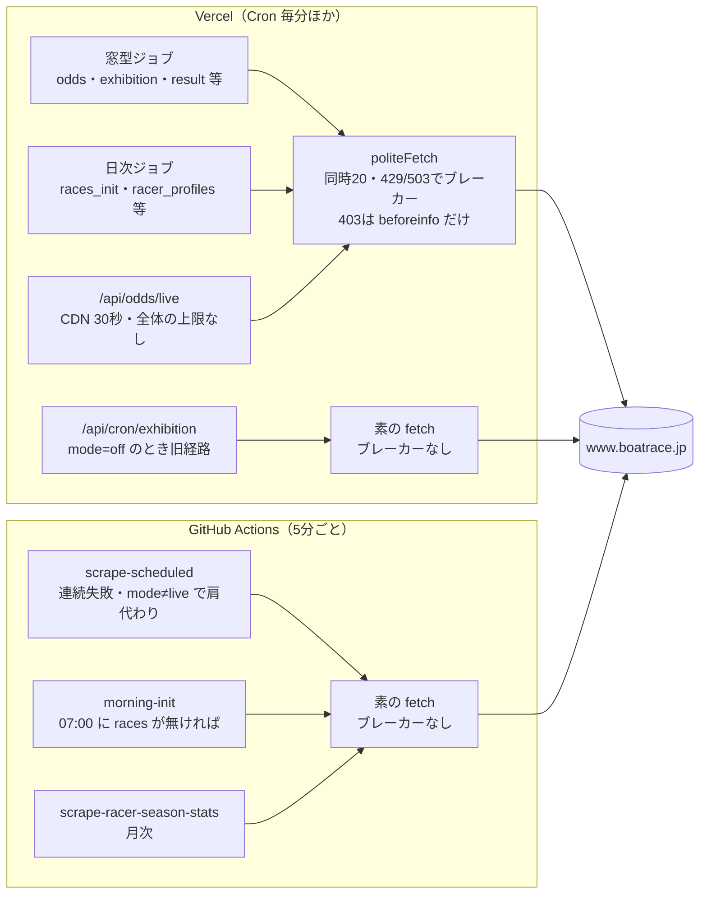
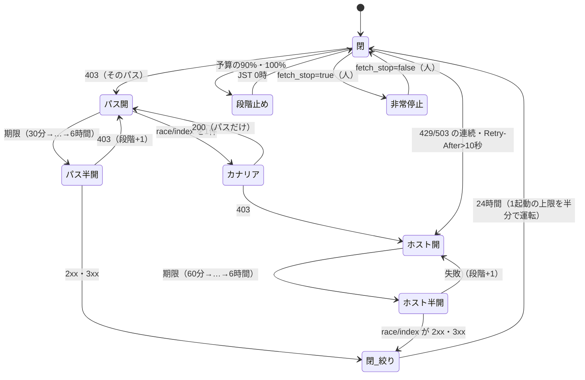
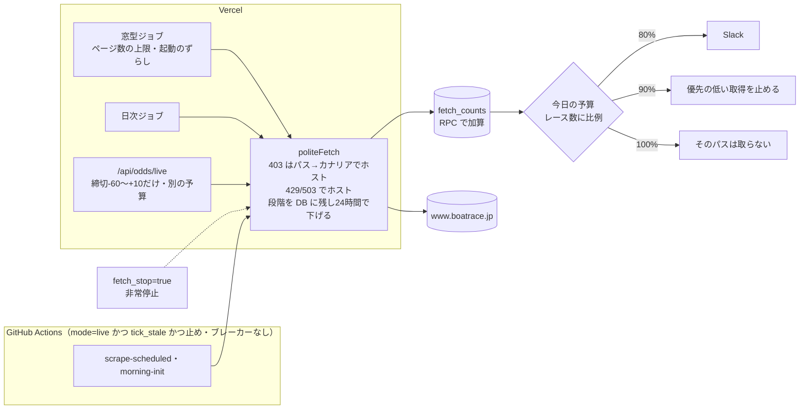

# 公式サイトへの取得の上限と止め方（scraping-load-budget）

外部サイト（主に公式 `www.boatrace.jp`）への取得に、相手ごとの上限と、拒否・過負荷のときの止め方を入れ直す設計。docs だけで、実装は別の PR で行う（§12）。ADR の案は [ADR-0101](../../adr/0101-official-site-fetch-budget-and-stop-policy.md)。元の数字は [analysis/freshness-need.md](analysis/freshness-need.md)、ファンの議論は [fan-panel.md](fan-panel.md)、審査の指摘と対応は [review.md](review.md)。

## 0. 目的と範囲

- 目的: 公式に止められないこと（ADR-0067 の禁止事項5「大量のアクセス」への配慮を、数字と仕組みで持つ）。止められたときに叩き続けないこと。守りを通らない経路（別の IP から素の fetch）で回り込まないこと。止められても画面・予想・SNS が嘘を出さないこと
- 範囲: boatrace.jp のすべての取得（Vercel Cron・画面のライブオッズ・GitHub Actions の予備・cron-job.org の旧経路）。race.boatcast.jp・mbrace.or.jp・会場公式サイトは §4.5 で上限だけ決める
- 前提にしたオーナーの決定（2026-10-26）: BOATRACE振興会には連絡しない。名乗り（User-Agent）・IP を変えて回り込むことはしない
- 前提にした PR（どちらも 2026-10-26 にマージ済み）: #1945（朝の races_init が直前情報を取らない）、#1946（beforeinfo の 403 でパス単位のブレーカー、展示の -33 の窓を締切20・16・13・10・8分前だけにする、claimLimit 8・並列1、GHA の肩代わりの条件）。本設計の「今」はこの2本の後

## 1. 経緯

- 2026-10-26 15:50 JST から、公式の直前情報（`/owpc/pc/race/beforeinfo`）が当社の取得だけ HTTP 403。同じホストの odds・racelist・raceresult・pitreport は 200。ブラウザでは見られる（BOA-1145）
- 直前情報は1日 1,874回（10/25、168R、1レース約11回）で、1つのページとしていちばん多く取っていた。403 はブレーカーの失敗に数えないため、403 の間も120秒おきに叩き続けた
- 再レビュー（system-architect、10/26）の指摘: boatrace.jp の合計は約8,400件/日でオッズが約65%。ADR-0067 の「リクエスト間隔」は boatrace.jp で実装されていない（並列の上限だけ）。GitHub Actions の予備 `scrape-scheduled` はブレーカーの無い素の fetch。`/api/odds/live` に全体の上限が無い。月次の選手プロフィールが Vercel と GitHub Actions で二重。User-Agent の1か所が旧アカウントの URL。robots.txt を読む処理が無い

## 2. 現状の実測

### 2.1 boatrace.jp への1日の取得（10/19〜10/25 の平均、156R/日）

ページ数は「スロットの試行の数（scrape_slots.attempts）×1回のページ数」。取得0の outcome（skipped_have_data・skipped_not_target・cancelled_race）は除いた。日次のジョブはコードから数えた見積り。

| 経路 | ページ | 1日（実測・見積り） | #1945・#1946 の後 | 1レースあたり（後） | 根拠 |
|---|---|---|---|---|---|
| odds（6窓） | oddstf・odds3t・odds3f・odds2tf・oddsk | 約4,730（5ページ×156R×6窓＋-60 の未発売の再試行 約44/日） | 同じ | 30.3 | scrape_slots odds |
| odds_final | 同じ5ページ | 約780（1回目で全件確定） | 同じ | 5 | scrape_slots odds_final |
| exhibition | beforeinfo | 1,555（-60 156、-33 1,399、補完の取得 ほぼ0） | 約530（-60 156、-33 約375） | 3.4 | scrape_slots exhibition・#1946 本文 |
| races_init（朝） | race/index・raceindex・racelist・beforeinfo | 約300（1会場25ページ） | 約160（beforeinfo を外す） | 1（racelist） | racesInit/job.js・#1945 |
| result | raceresult | 506（+5 の1回目は全件空振り） | 同じ | 3.2 | scrape_slots result |
| race_info | racelist | 156 | 同じ | 1 | scrape_slots race_info |
| pcexpect | pcexpect | 158 | 同じ | 1 | scrape_slots pcexpect |
| race_status | race/index（＋中止の日の raceresult） | 108〜 | 同じ | — | registry race_status（10分おき） |
| pit_reports | pitreport | 平均46（SG の節は数百、未計測） | 同じ | — | scrape_slots pit_reports |
| 夜の日次 | information・pointrank・rankingmotor・news・monthlyschedule・fan | 約45 | 同じ | — | registry |
| 画面のライブオッズ | 上の5ページのどれか | 未計測（Vercel のログは24時間で108行。要求の数ではない） | 同じ | — | api/odds/live.js |
| **合計（ライブを除く）** | | **約8,400** | **約7,400** | | |
| 月次の選手（取得日だけ） | racersearch/season（＋新人の profile） | 約1,630×2（Vercel と GitHub Actions の二重） | 同じ | — | gh run list・`SKIP_RACER_SEASON_ON_GHA` 未設定 |

- 1パスあたり: オッズの各ページは約1,100/日（同じ URL を1レース約7回）。#1946 の前の beforeinfo は1,874/日（1レース約11回）だった。#1946 の後は beforeinfo が1レース約3.4回に下がり、1パスあたりの最多はオッズの各ページになる
- 1日のレース数は直近1年で中央値156・90%点180・99%点216・最大240（system-architect、races の読み取り）。固定の1日の上限は多い日に足りなくなる（§4.2）
- 1分あたりの最大: 10/25 の最後の試行の時刻から数えて43ページ（下限。再試行の途中の回は数えていない）。中央値は7ページ/分
- 1分あたりの最初の試行の最大: odds 6スロット、odds_final 4、exhibition 3、race_info 2、result 2、**pcexpect 20**（-720 分の窓の始まりにまとめて取る）（10/19〜25、system-architect の再集計）
- 今の boatrace.jp への待ちは並列の上限だけ（politeFetch の同時20、ジョブの concurrency）。要求の間隔は無い。BOATCAST だけ 2.2秒の間隔がある（`scripts/lib/boatcast/boatcastClient.js`）
- 公式の1ページの応答は約8〜10秒かかる（registry.js の slotSecEstimate の注記、liveOdds.js の Akamai の待ちの記録）

### 2.2 守りを通らない経路（今も起きうる）

| 経路 | どうなるか | 根拠 |
|---|---|---|
| GHA の肩代わり（odds・result・race_info 等） | beforeinfo 以外のパスの 403 は、ハンドラーで例外（`HTTP 403`）になり、ジョブの連続失敗に数える。ホストのブレーカーは 403 で開かないので、連続失敗が閾値を超えると GHA が別の IP から素の fetch で肩代わりする。接続の失敗でも同じ | scripts/lib/scrapeJobs/htmlFetch.js:12、scripts/lib/ghaSkipGate.js:183 |
| GHA の朝の初期化の安全装置 | `SKIP_MORNING_INIT_ON_GHA=true` でも、JST 07:00 に当日の races が無いか確かめられなければ、素の fetch（同時12）で初期化する。公式に止められて races_init が失敗した日に、5分ごとの起動のたびに叩く | scripts/daily/morning-init.js:150-191、scrape-to-json.js |
| GHA の肩代わり（mode≠live） | ジョブの mode が live でないとき（人が off にした間も）肩代わりする（exhibition だけ例外） | ghaSkipGate.js:159 |
| cron-job.org の展示の旧経路 | exhibition の mode が off のとき、cron-job.org の起動で `runLegacyExhibition` が素の fetch で beforeinfo を叩く。直近60分（10/26 17:40 JST）の Vercel のログに `/api/cron/exhibition` は無かった | preRaceHandlers.js・scrape-exhibition-data.js:166 |
| 画面のライブオッズ | 当日の全レース×5ページのキーそれぞれに、CDN 30秒（リージョンごと）で何度でも公式へ取りに行ける。全体の上限が無い | api/odds/live.js、liveOdds.js:37-47 |

10/26 の 403 の後、GHA の `scrape-scheduled` は5分ごとに起動しているが、すべての SKIP 変数が健全と判定し、boatrace.jp への取得は0（10/26 17:41 JST のログ）。上の経路は「次に別のパスが止められたとき」に開く。

### 2.3 今の流れ

## 3. 推奨の一覧

| # | 決めること | 推奨（1行） | 決め方 |
|---|---|---|---|
| 0 | 守りを通らない経路 | GHA の肩代わりは「mode=live かつ Vercel が起動していない（tick_stale）かつ止め・ブレーカーが閉じている」ときだけ。403・接続の失敗の連続では肩代わりしない。朝の初期化の安全装置も同じ条件。展示の旧経路は消す | 推奨どおり進める（最優先） |
| 1 | 相手ごとの上限 | 1日の予算を「1レースあたりの枠×その日のレース数×1.3＋固定分」で持ち、ホスト全体の絶対の上限を別に置く。最初の2週間は知らせるだけ、数を見てから止める。止めるときは優先の低い取得から段階で止める。1分の60は目安で、数えて見る | 推奨どおり進める |
| 2 | 止め方 | 403 は全パスでパス単位に開く（2週間数えて 403 が0のパスから広げる）。パスが開いたら軽いページ（race/index）を1件試し、403 ならホスト全体を開く。開く段階を DB に残し、24時間 403 が無ければ1段下げる。閉じた後24時間は1起動の上限を半分。非常停止は専用の列 | 推奨どおり進める |
| 3a | オッズの窓とページ | -30 の窓を落とす（−780件/日）。影響する15分の間のずれは中央値6.0%、閲覧で重み付けすると1.2% | **オーナーに聞く** |
| 3b | -60 の体重だけの窓 | 止める（−156件/日）。体重は出走表の値で60分前から出し、調整重量は展示と同時に出る | **オーナーに聞く** |
| 3c | 結果の最初の取得 | +5→+10分（−156件/日、遅れたレース0） | 推奨どおり進める |
| 3d | 画面で使っていない取得 | 前検は節の初日の前日と初日だけ、月間スケジュールは週1回。特記事項・pcexpect・ピットレポートは残す。pcexpect は窓の始まりの山（20/分）をならす | 推奨どおり進める |
| 3e | 月次の二重 | GitHub Actions を止め（変数1つ）、期別の月次は5月・11月だけにする（年16回→6回） | 推奨どおり進める（変数はオーナーの操作） |
| 3f | 展示の取りに行く時刻 | 締切24分前を足す（＋156件/日）。ただし beforeinfo が7日続けて 200 になってから | **オーナーに聞く**（条件つき） |
| 4 | GitHub Actions の予備 | #0 の条件にし、取得も politeFetch・DB のブレーカー・予算を通す。展示は肩代わりしない。30日肩代わりが無ければ消す | 推奨どおり進める |
| 5 | 劣化のさせ方 | ページごとに出すもの・出さないものを表で固定（§9）。「未発表」と出さず「公式から取得できていません」と公式へのリンク。止めの状態を画面向けに公開の要約で出す。予想に「直前情報なし」の印を残し成績で分ける | 文言は wording-editor、画面は UI の手順（モック） |
| 6 | 監視 | まず scrape_slots から相手ごとの回数を毎日出す（マイグレーション無し）。次に politeFetch が数える表（応答の種類・再試行も）を足す。ライブの回数は最初の段階で数える。403 は即時、予算の80%で知らせる | 推奨どおり進める |

## 4. 項目1: 相手ごとの上限

### 4.1 案

| 案 | 中身 | 良い点 | 悪い点 |
|---|---|---|---|
| A. 今のまま（ジョブごとの claimLimit・concurrency だけ） | 変えない | 手間0 | 全体の上限が無い。今回の 1,874回/日を誰も止めなかった |
| B. 予算の表＋数える＋段階で止める（推奨） | registry にホスト×パスの「1レースあたりの枠」と固定分を置く。politeFetch が数え、DB へまとめて加算する（RPC）。各ジョブは起動の最初に今日の数を読み、予算と比べる。1分は数えて見る | DB の書き込みは起動ごと・N 件ごと。既存の cronWrapper・scrape_job_state の作りに乗る | 1分は厳密に守れない |
| C. 取得の窓口を1つにする（要求ごとに DB で枠を予約） | すべての要求の前に DB の RPC で1分・1日の枠を取る | 1分・1日を厳密に守れる | 要求ごとに DB の往復（関数は iad1、DB は ap-southeast-2）。作りが大きい |

推奨は B。今回の問題は「全体で何件取っているかを誰も持っていない」ことで、厳密な1分の上限ではない。1分の最大の実測は43ページ（下限）。C は数えた1分の実数が目安の60を超え始めたら入れる。

### 4.2 boatrace.jp の1日の予算

R＝その日の races の件数（中止の確定を除く。朝の races_init の後に決まる）。枠は「#1945・#1946 の後の1レースあたり（§2.1）×1.3」。根拠の無いものは「目安（根拠なし）」と書く。公式は頻度・間隔の数字を出しておらず、robots.txt は全許可で Crawl-delay は無い（docs/design/racer-period-stats/plan.md の写し）。

| 相手 | 1日の予算 | 156R の日 | 240R の日 | 根拠 |
|---|---|---|---|---|
| オッズの5ページの合計 | 46×R | 7,176（実測5,510） | 11,040 | 実測35.3/R×1.3 |
| beforeinfo | 4.5×R | 702（実測約530） | 1,080 | #1946 の後3.4/R×1.3 |
| raceresult | 4×R＋50 | 674（3c の後 約370） | 1,010 | 実測3.2/R×1.3、中止の確認の分50 |
| racelist | 2.6×R | 406（実測約310） | 624 | 2/R×1.3 |
| pcexpect | 1.3×R | 203（実測158） | 312 | 1/R×1.3 |
| race/index・raceindex | 200 | 200（実測約125） | 200 | race_status 108＋races_init |
| pitreport | 1,000 | 1,000（平均46） | 1,000 | SG の節は未計測。目安（根拠なし） |
| 夜の日次 | 150 | 150（約30） | 150 | registry から数えた見積り |
| racersearch（選手） | 取得日 2,000、それ以外 50 | — | — | 選手数1,628 |
| **ホスト全体の絶対の上限** | **18,000** | 約10,500（上の和） | 約15,400（上の和） | 目安（根拠なし）。暴走の検知だけの役。最大の日（240R）の和の約1.17倍 |
| 画面のライブオッズ | 3,000（ホスト全体と別に数える） | — | — | 目安（根拠なし）。§4.4 |

### 4.3 予算を超えたとき（段階で止める）

| 段階 | 条件 | 動き |
|---|---|---|
| 0 | 最初の2週間（M2 の数がそろうまで） | 知らせるだけ（80%・100%）。止めない。値を実数で直す PR を出す |
| 1 | そのパスの予算の80% | Slack に1回 |
| 2 | そのパスの予算の90% | 優先の低い取得を止める: オッズの -60・-30 の窓、pcexpect、pitreport、夜の日次。-15〜0・odds_final・結果・展示は続ける |
| 3 | そのパスの予算の100% | そのパスのジョブはその日の残りを取らない（outcome `budget_exhausted`、連続失敗に数えない、GHA の肩代わりの条件に入れない） |
| 4 | ホスト全体の絶対の上限 | ホストのすべてのジョブを止める（暴走のときだけ当たる値） |

- 「取り直せないデータは予算を超えても取る」例外は作らない。代わりに予算をレース数に比例させ、多い日にも足りるようにする（止まるのは異常のときだけ）
- 予算の読み取りに失敗したら、その起動は取らずに終え、連続して失敗したら知らせる（`?? 0` で黙って0にしない。ADR-0069）
- 日付の切り替えは JST の0時

### 4.4 1分の上限と、要求の間隔

- 1分の60は目安（根拠なし。実測の最大43の約1.4倍）。構造では守れない: ジョブの1起動の上限を足すと約100ページになり、間隔・同時の上限はプロセスごとで、毎分 :00 に別々に起動する関数をまたいでは効かない。60は M2 の1分の実数で見て、超えたら知らせる。超え始めたら案 C を入れる
- 起動の頭のずらし: 毎分のジョブ（odds・result・race_info・exhibition・pcexpect）の起動に、ジョブごとに決まった0〜30秒の待ちを入れ、:00 に重ならないようにする（目安）
- 1起動の上限はスロットの数でなくページの数で持つ（odds_final は1スロット1〜5ページ）。odds の -60 の未発売の再試行（1ページ）には別の上限を置き、他の窓を押しのけないようにする
- 要求の間隔（ホストごと・プロセスごとに開始を200ms以上）と同時の上限（20→6）は、1ページ8〜10秒の応答で1スロットの時間が延び、slotSecEstimate 12・leaseSec・claimLimit の前提（validateRegistry）が崩れる。値を計算し直し、土日を含む5日の窓内取得率（data-acquisition.md B）を確かめてから入れる（P4c）
- pcexpect は -720 分の窓の始まりに20スロット/分の山がある。claimLimit を6にし、窓の長さ（690分）で分散させる
- 画面のライブオッズ: 公式へ取りに行くのは締切 -60〜+10 分のレースだけ（画面の90分の判定をサーバーでも持つ）。1分30件・1日3,000件（目安）を超えたら、DB の最新の窓の値を「○時○分の値」として返す。ライブの数はホスト全体と別に数え、ライブが上限に達しても Cron は止めない

### 4.5 他のホスト

| ホスト | 今 | 推奨 |
|---|---|---|
| race.boatcast.jp | 逐次・2.2秒・403 はカナリアで判定（ADR-0067） | 今のまま。1日の予算 1,500（目安。ADR-0067 の上限見積り800の約2倍）を足して数える。403 のパス単位のブレーカーの対象にしない（未公開のファイルを 403 で返すため） |
| www1.mbrace.or.jp（K・B ファイル） | 1日数件 | 1日の予算 50（目安）。バックフィルは手動の CLI で、夜間・1日の上限を CLI に持つ（今のまま） |
| 会場公式サイト | 会場ごとに数ページ・300ms 間隔 | 1日の予算 300（目安。実測約170）。ホストごとのブレーカーは今のまま |

## 5. 項目2: 止め方

### 5.1 応答ごとの扱い

| 応答 | 今（#1946 の後） | 推奨 |
|---|---|---|
| 403（boatrace.jp） | beforeinfo だけ、パス単位で1回で開く。30分、プロセスの中だけで倍（上限120分）。他のパスの 403 はハンドラーの例外（連続失敗に数え、GHA の肩代わりの条件になる） | **全パス**で、パス単位で1回で開く。広げる順は、M2 でパス×応答を2週間数えて 403 が0だったパスから（公式が未公開を 403 で返すページが無いことを確かめるため。scrape_slots の last_error は ok で消えるので過去の証拠にならない）。開く段階は30分→1時間→2時間→4時間→6時間（上限）で、段階を DB に残す |
| 403 からホスト全体へ | なし | パスが開いたら、そのときに軽いページ（`race/index`）を1件取る。403 ならホスト全体を開く（60分から倍、上限6時間）。200 ならパス単位の拒否と判断し、ホストは開かない。ホストの半開の試行も `race/index` に固定する（止められたパスを試して開き直さない） |
| 403 の記録 | last_error に `HTTP 403` | 応答のヘッダの一部（Server・server-timing・Akamai の参照番号）と本文の先頭200字を breaker の記録に残す（理由の切り分け。追加の取得はしない） |
| 403（race.boatcast.jp） | カナリアで判定 | 今のまま |
| 429 | 最大2回の再試行（Retry-After を10秒まで尊重）。2分に5件か3件連続でホストを60秒開く（上限10分） | Retry-After が10秒を超えたら、再試行せずホストをその時間開く（上限60分）。開く段階を5分→10分→20分→60分にし、DB に残す |
| 503・500・502・504 | 503 は 429 と同じ。500・502・504 は成功の側 | まず M2 で数えるだけ（2週間）。その後、503 と同じにホストを開くかを実数で決める |
| タイムアウト・接続の失敗 | 再試行2回。ブレーカーに数えない | まず M2 で数えるだけ（再試行も1件として）。開く条件を入れるときは、同じプロセスで Supabase に届くこと（こちら側の障害でない）を条件にし、ホストの5分の要求に対する割合で決める。soft deadline・呼び出し側の中断は数えない |
| 404 | 成功の側 | 今のまま |
| robots.txt | 読まない | 1日1回読む。止めるパスの数・ホスト全体の判定から外す（robots.txt の 403 でホストを開かない）。当社が取るパスが Disallow に入ったら、そのパスを止める（半開で試さない）。403 のときは知らせるだけ |

### 5.2 段階の上げ下げ・通知・再開

- 段階を下げる: 成功1回で0にしない。24時間そのパスに 403 が無ければ1段下げる（拒否が量で決まる場合に、閉じてすぐ元の量に戻って30分から繰り返すのを防ぐ）
- 自動で閉じた後: 24時間は、そのパスを取るジョブの1起動の上限と窓を半分にする（自動の段階戻し）。予算は下げない（下げると午後に途中で止まる）
- 半開: 期限が来たら1件だけ試す。パスの試行はそのパスのいちばん軽いページ（オッズなら単勝 oddstf）、ホストの試行は `race/index`。閉じるのは 2xx・3xx のときだけ（#1946 のまま）
- 通知（Slack）: 開いたとき1回、段階が2時間以上になったとき・ホスト全体に広がったとき1回、閉じたとき1回。半開の試行ごとには知らせない。開いたままの日は朝夜のまとめに1行
- 非常停止: `scrape_job_state` に専用の列（例 `fetch_stop boolean NOT NULL DEFAULT false`）を足し、`host:<ホスト>` の行で true にすると、そのホストのすべての取得（Vercel・ライブ・GHA）が止まる。mode を使い回さない（mode の既定は 'off' で、ブレーカーが作る host の行は mode を書かずに upsert されるため、本番の `host:boatrace-biwako.jp` は mode=off のまま。mode で読むと一度開いたホストが永久に止まる）。操作は `INSERT … ON CONFLICT (job) DO UPDATE SET fetch_stop = true`（行が無くても効く）。読むのは breakerStore.read の同じ SELECT（TTL 10秒）
- 開いた段階を残す場所も専用の列（例 `breaker_level smallint`）にする。どちらも P4a のマイグレーションで system-architect を通す
- 再開: 自動（半開）。人が早めたいときは `breaker_open_until` を NULL にする UPDATE。ホスト全体が開いた後の再開は §9.3 の順

### 5.3 止め方の状態

段階を下げる（24時間 403 なしで1段）のは図に書いていない。

### 5.4 #1946 との関係

- #1946 の `breakerUrls`・`pathKeyOf`・`recordBlocked`・GHA の肩代わりの条件はそのまま使う。変えるのは (1) 対象を boatrace.jp の全パスへ順に広げる（registry に「このジョブが取るパス」を書き、`breakerUrls` をそこから作る）(2) 開いた段階を DB に残し、24時間で1段下げる (3) パスが開いたらカナリアでホストへ広げるかを決める (4) 閉じた後24時間の絞り、の4つ
- BOATCAST を 403 のパス単位のブレーカーに入れない点は #1946 と同じ

## 6. 項目3: 減らす判断

### 6.1 (a) オッズの窓とページ（オーナーに聞く）

画面が何を読むか（コードで確かめた）: オッズ一覧タブの今の表は `/api/odds/live` でその場で取る（`src/components/race/RaceOddsListTab.jsx`、CDN 30秒）。推移は `race_odds` の窓のスナップショットに、ライブの値と締切時オッズを最後の点として足す。予想の期待値は `race_odds` の最新の窓（0分）を読む。窓を間引いて変わるのは、推移の点と、予想・期待値の元の値。オッズ一覧タブを開く人は約19/日で、ほかの画面の期待値は `race_odds` を読む。

| 案 | 減る件数/日 | 3連単のずれ（影響する時間の中・閲覧で重み付け） | 他の影響 | 評価 |
|---|---|---|---|---|
| A1. 今のまま（6窓×5ページ、ADR-0057） | 0 | 0 | — | 全体の65%のまま |
| A2. -30 を落とす（推奨） | 780 | 締切30〜15分前の間は中央値6.0%・90%点23.5%・1番人気の食い違い16.3%。この時間の閲覧は全体の9.6%。重み付けで1.2% | 推移の点が1つ減る（-60 の次が -15） | 減る量に対して失うものが最も小さい |
| A3. -15 を落とす | 780 | 重み付けで1.4% | 予想の買い目のオッズのずれが11.7%で最大 | A2 より損が大きい |
| A4. 0分を落とす | 780 | 重み付けで0.4% | 予想の最後の値が -5 になり、確定との差が8.9%→19.2% | prediction_odds を締切時オッズから作る変更（後出しの扱い）が前提。今は勧めない |
| A5. 3連複・2連・拡連複を -60/-15/-5 だけ | 1,404 | 3連単は0、他の券種で重み付け5〜7% | 他の券種の推移の点が半分 | 券種によって推移の点の数が違う画面になる |

- -5 は残す（閲覧がいちばん多い締切5分前〜0分、338/分）
- A2 を選んだら、推移の点に「○分前」を付け、等間隔に見せない（data-scientist・ファン）。あわせて `.claude/rules/data-acquisition.md` B.3（-60 は未公開の間 -30 の窓が始まるまで再試行）と、窓内取得率の監視（6窓が前提）を直す
- ADR-0057 は「6窓すべてで全券種を全通り」をオーナーの指摘で決めた。A2 はその変更なので、オーナーに聞く

### 6.2 (b) -60 の体重だけの窓（オーナーに聞く）

| 案 | 減る件数/日 | 失うもの | 評価 |
|---|---|---|---|
| B1. 今のまま | 0 | — | 体重は出走表（race_info -60）と98.9%同じ値を二重に取っている |
| B2. 止める（推奨） | 156 | 調整重量（艇の15.8%）が展示と同時（中央値 締切16.4分前）に出る。約1%の体重の食い違い（±0.1〜0.5kg）が展示まで残る | 60〜30分前に直前情報タブを開くのは閲覧の1.9%。予想は体重を使わない。-60 と -33 で体重が変わる割合は未計測 |

BOA-500 で入れた先出しをやめる変更で、見せる時刻が遅くなるので、オーナーに聞く。

### 6.3 (c) 結果の最初の取得（推奨どおり進める）

- +5→+10分。14日2,196枠で +5 の1回目に取れたレースは0。試行が31%減り（−156件/日）、完了の時刻は変わらない
- +15分からにする案（−302件/日）は、6.3%のレースが5分遅れ、的中の判定と SNS の結果の投稿が遅れるので入れない
- 見せ方を変えない（遅れが0）ので、オーナーに聞かない

### 6.4 (f) 展示の取りに行く時刻（オーナーに聞く、条件つき）

#1946 で、-33 の窓の取得を締切20・16・13・10・8分前にした（1レース約2.4回、約375件/日）。締切20分前より前に公開されるレース（19.5%、12R は中央値20.4分前）は、公開から最大約13分遅れて画面・予想に出る（#1946 の前は最大2分）。

| 案 | -33 の窓の件数/日 | 早く出るレースの遅れの最大 | 評価 |
|---|---|---|---|
| E1. #1946 のまま（20分前から） | 約375 | 約13分（-33分の公開） | 回数は最小 |
| E2. 24分前を足す（推奨、条件つき） | 約530 | 24〜20分前の公開は最大約4分。25分前より前に出る4.2%は最大約9分 | 12R・優勝戦の展示を遅らせない |
| E3. -25 から2分おき | 約830 | 約9分 | 回数が多い |

- ファンの4人のうち3人が「早く出るレース（とくに12R）を遅らせるのは困る」とした（fan-panel.md）。見せる時刻の判断なので、オーナーに聞く
- E2 は、いま拒否されている beforeinfo への取得を増やす。入れるのは beforeinfo が7日続けて 200 になってから（目安、根拠なし）。それまでは E1
- E2 は `pollMinBefore` に24を足すだけで、-33 の窓の中に収まる

### 6.5 (d) 画面で使っていない取得（推奨どおり進める）

| 取得 | 画面での使用 | 実測 | 推奨 |
|---|---|---|---|
| pit_reports（ピットレポート） | 使う（直前情報タブのピットレポート） | 平均46/日 | 残す |
| race_notices（特記事項 `race/information`） | 画面は直接読まない。/today の帰郷の理由に使う | 14日で0件。1日約13ページ | 残す（欠場・変更の一次情報で、件数が小さい） |
| pcexpect（公式の予想） | 画面は読まない。分析（analogy-finder の export）と data_health が読む | 158/日、窓の始まりに20/分の山 | 残す。山をならす（§4.4）。分析で使わなくなったら止める |
| prediction_odds（買い目オッズ） | 画面は読まない | Vercel では race_odds から作るので取得0 | GHA の肩代わりの時だけ取る経路は §8 で消す |
| motor_pretest（前検 `rankingmotor`） | 使う | 毎日約13ページ。節の中で値が変わらない（6,349組一致） | 節の初日の前日と初日だけ取る（約2〜3/日） |
| race_series（月間スケジュール） | 使う（節の情報） | 毎日3ページ | 週1回と、月の変わり目の前後3日 |
| race_status（`race/index`） | 使う（中止・順延） | 108/日 | 残す（中止の早い確定の価値が大きい。1ページ。ホストのカナリアにも使う） |

### 6.6 (e) 月次の二重取得（推奨どおり進める）

- 今: Vercel の racer_profiles（毎月2日、5・11月は9・16日も）と GHA の `scrape-racer-season-stats.yml`（同じ日の JST 03:00）が両方動く。`SKIP_RACER_SEASON_ON_GHA` が未設定で、10/2 も両方動いた（GHA は4時間22分）。次は 11/2・11/9・11/16
- 期別の成績は期の終わり（4/30・10/31）の後にしか変わらない。10/2 の回は書いた行0（1回の観測）
- 推奨:
  1. オーナーが `SKIP_RACER_SEASON_ON_GHA=true` を立てる（11/2 03:00 JST の前。ghaSkipGate が racer_profiles の健全を確かめてから止める作り）
  2. 月次の全員の取得を5月・11月（2・9・16日）だけにする（年16回→6回、約1.6万件/年減る）。新人の選手の profile は毎月取る（数十件）
  3. 期別のファイル（fan{YYMM}.lzh、半期に1回）で置き換えられるかは別に確かめる（optimal-scraping-design.md の案）

## 7. 監視（項目6）

### 7.1 案

| 案 | 中身 | 数えられるもの | 手間・注意 |
|---|---|---|---|
| M1. scrape_slots から毎日数える（先に入れる） | 窓型ジョブの attempts × 1回のページ数（registry に `pagesPerAttempt`）を、ホスト×パスごとに日次で集計し、朝夜のまとめに出す | 窓型ジョブ（全体の約9割）の近似 | マイグレーション無し。取得0の outcome（skipped_*・cancelled_race・breaker_open・budget_exhausted）は除く。odds の no_values と odds_final の未確定は1ページ、partial の取り直しは足りない券種だけ。1日の slot は約9,000行で1,000行を超えるので SQL で集計する（PostgREST の1,000行で黙って切れない）。politeFetch の再試行は数えない |
| M2. politeFetch が数える（次に入れる） | politeFetch が (ホスト, パス, 応答の種類) ごとに数え（再試行も1件）、RPC で `fetch_counts`（日・時・ホスト・パス・応答の種類・件数）に加算する | すべて（日次・ライブ・GHA も、同じ politeFetch を通せば） | マイグレーション1本（RLS、service_role のみ）。PostgREST の upsert では数を足せないので RPC。毎分の起動は1日約6,000回あるので、取得0の起動は書かない。ライブは長く生きるので N 件ごとに書く。日の合計は RPC の SUM で読む（行が1,000を超えうる）。古い行は scrape-cleanup で消す |

推奨は M1 を先に、M2 を次に。ライブの回数は M1 の段階で数える（`/api/odds/live` で、公式へ取りに行った件数を1日1行の加算で残す。M2 の前の仮の数え方）。

### 7.2 知らせる条件

| 条件 | 知らせ方 |
|---|---|
| 403 を1件でも受けた（boatrace.jp） | 即時（ブレーカーの開放と同じ通知） |
| 1日の予算の80%（パス・ライブ） | 即時に1回 |
| 予算の90%・100%（止めた） | 即時 |
| ホスト全体の1時間の数が、その日の予算の和の1/10を超えた | 即時に1回（目安、根拠なし。レース数に比例） |
| 1分の数が60を超えた（M2 の後） | その日のまとめに1行 |
| 毎日の数 | 朝夜のまとめに、ホスト×パスの数と予算を1行ずつ |
| 監視が動いていない | scrape-monitor の既存の未実行の検知に載せる |

## 8. 項目4: GitHub Actions の予備

| 案 | 中身 | 評価 |
|---|---|---|
| G1. すぐ消す | scrape-scheduled の取得の部分と morning-init の安全装置を消す | Vercel が止まったとき（デプロイの失敗・Cron の未配信）の予備が無くなる |
| G2. 条件を絞り、同じ守りを通す（推奨） | 肩代わりは「mode=live かつ tick_stale（last_tick_at が12分以上前）かつ fetch_stop が false かつブレーカーが閉じている」ときだけ。連続失敗の理由が 403・接続の失敗なら肩代わりしない。朝の初期化の安全装置も同じ条件（host・races_init のブレーカーが開いている・last_error に 403 がある日は初期化しない）。取得も politeFetch・DB のブレーカー・予算を通す（同じ `scripts/lib` を使う）。展示は肩代わりしない。買い目オッズの取得は消す | 予備を残しつつ、別の IP から守り無しで叩く経路を無くす |
| G3. #1946 のまま | ブレーカーが開いている間は肩代わりしない。取得は素の fetch | §2.2 の経路が残る |

- 推奨は G2。条件の絞り（肩代わりしない側）は今すぐ入れる（P0）。politeFetch への置き換えはその後（P6）
- 30日のあいだ肩代わりが1回も無ければ G1 に進む
- mode=off は「どこからも取らない」にそろえる。cron-job.org の展示の旧経路（`runLegacyExhibition`）は消す。cron-job.org の展示・race-notices のジョブ自体も止める（Vercel Cron が担っている。cron-job.org の画面はオーナーの操作）
- User-Agent を1つにそろえる（`scripts/daily/scrape-pcexpect.js` の旧アカウントの URL を、politeFetch の既定に）。今止められていない pcexpect の表記を正しい連絡先にそろえるだけで、回り込みではない

## 9. 項目5: 劣化のさせ方

### 9.1 1つのページが止められたとき

「止められている」の判定: パス・ホストのブレーカーが開いている、予算で止めた、fetch_stop が true、そのジョブの mode が off、開催中なのに最終成功が想定より古い、のどれか。値が無いことからは推定しない（値が無いのは未公開のことがある）。`scrape_job_state` は service_role だけが読めるので、画面向けに止めの状態だけを出す公開の要約（ビューか API）を作る（P9）。

| 止められたページ | 画面 | 予想 | SNS |
|---|---|---|---|
| beforeinfo（直前情報） | 展示タイム・展示ST・展示進入・チルト・調整重量・気象の欄に「公式から取得できていません」と公式の直前情報へのリンク。「未発表」「展示前」とは出さない。当日体重は出走表の値を出す。オリジナル展示（BOATCAST、別ホスト）は出る | 展示前の予想のまま。予想の欄に「展示前の予想（直前情報を取得できていません）」。予想の行に「直前情報なし」の印を残し、的中率・回収率の集計で分けるか注記する | 展示後の投稿（優勝戦の思考 FT01 の展示後版など）は出さない（今の FT01 の見送りと同じ）。/today の自動投稿も同じ印で止める。全貌動画は機械の検査で止まる（今の作り） |
| オッズのページ | 推移は取れた窓までの点。今の表はライブがエラーなら最新の窓の値に「○時○分の値。公式から最新を取得できていません」 | 期待値は最新の窓の値で、時刻を出す | オッズを使う投稿は止める |
| raceresult（結果） | 「結果を取得できていません」と公式の結果へのリンク。翌朝の K ファイル（mbrace.or.jp）で着順を埋める（今の daily_reconcile の経路） | 的中の判定が翌朝になる | 結果の投稿は止める |
| racelist（出走表） | 朝の races_init の値のまま。「出走表の直前の変更を取得できていません」 | そのまま | そのまま |
| race/index | 中止・順延の早い確定が止まり、90分ルールだけで確定する | そのまま | そのまま |

- 文言は wording-editor を通してから固定する。画面の変更は UI の手順（モック → 承認）を通す

### 9.2 名乗り・網の単位で止められたときの最悪の場合

boatrace.jp のすべてのページが当社だけ 403・接続できない状態。Vercel の外向きの IP は共有で入れ替わる束なので（Vercel の公式文書）、日をまたいで続く拒否は、1つの IP より名乗り（User-Agent）かクラウドの網の単位の規則の可能性が高い（推測）。その場合、回数を減らしても戻らないことがある。

| 止まるもの | 結果 |
|---|---|
| races_init（朝） | その日の races・出走表が作れず、サイトの今日のレースが空になる |
| オッズ・展示・結果・直前の出走表 | すべて止まる |
| 残るもの | 前日までのデータ、BOATCAST（別ホスト、同じ振興会）、K・B ファイル（mbrace.or.jp、別ホスト） |

- 代わりの取り先の候補: B ファイル（番組表、`scripts/lib/kbFileParser.js` がある）で races・出走表を作る。K ファイルで翌朝に結果を埋める。展示・オッズの代わりは無い
- 代わりの取り先を使うかは別の起票で決める（同じ振興会の別ホストで、同じ規則が及ぶかもしれない。ADR-0067 の「新しい取得元は着手前に規約を確かめる」も要る）
- GHA（GitHub の網）から取るのは回り込みになるので、§8 の条件で止める

### 9.3 ホスト全体が止められたときの手順

1. 自動: ホスト全体のブレーカーが開き（カナリアの 403）、すべてのジョブが取らずに終える。GHA は肩代わりしない。Slack に知らせる
2. 人（オーナー）: ブラウザで公式が見られるかを確かめる（一般にも止まっていれば公式の障害）。`host:boatrace.jp` の fetch_stop を true にする（自動の半開の試行も止める）
3. 24時間あける。名乗り・IP は変えない。連絡はしない（オーナーの決定）
4. 再開は1つずつ: fetch_stop を false に戻すと、半開で `race/index` を1件だけ試す。通ったら、24時間は1起動の上限を半分にして、軽いもの（race/index・racelist）→結果→オッズ→直前情報の順にジョブを live に戻す（予算は下げない）
5. 6時間ごとの半開の試行が3日続けて 403 なら、代わりの取り先（§9.2）の起票をする

## 10. 推奨の後の流れ

## 11. 推奨の後の見込み（boatrace.jp、156R の日）

| | 件数/日 | 今（10/25 前の平均）との差 |
|---|---|---|
| #1945・#1946 の前 | 約8,400 | — |
| #1945・#1946 の後 | 約7,400 | −12% |
| ＋推奨どおり進めるもの（3c 結果 +10、3d 前検・月間スケジュール） | 約7,230 | −14% |
| ＋オーナーに聞くもの（3a −780、3b −156、3f +156） | 約6,450 | −23% |

月次の選手（取得日だけ）は、二重をやめて約1,630件/取得日、年6回にする。

## 12. 実装の PR の分け方と順

最短で並べる。前の結果が本当に要るところだけを順にした。

| 順 | PR | 中身 | 前提 | 種類 |
|---|---|---|---|---|
| 1（すぐ、並行） | **P0 守りを通らない経路を止める** | ghaSkipGate の肩代わりを「mode=live かつ tick_stale かつブレーカーが閉じている」に絞る、連続失敗の理由が 403・接続の失敗なら肩代わりしない、morning-init の安全装置も同じ条件、`runLegacyExhibition` を消して mode=off を「取らない」に | なし | fix。再現テストつき |
| 1（すぐ、並行） | P1 結果 +10・UA | result の offsets を +10 へ（registry と期待値）、pcexpect の UA をそろえる、pcexpect の claimLimit 6 | なし | fix。段階0 |
| 1（すぐ、並行） | P2 数える（M1＋ライブ） | scrape_slots からホスト×パスの日次の数を SQL で出し、朝夜のまとめに出す（registry に `pagesPerAttempt`）。ライブが公式へ取りに行った数を残す。分析のスクリプトの写しを `scripts/analysis/scraping-load-budget/` へ移す | なし | feat |
| 1（オーナーの操作） | 変数・cron-job.org | `SKIP_RACER_SEASON_ON_GHA=true`（11/2 03:00 JST の前）、cron-job.org の展示・race-notices のジョブを止める | なし | 操作 |
| 1（すぐ、並行） | P4a 止めの列 | `fetch_stop`・`breaker_level` のマイグレーション、非常停止の読み取り（Vercel・ライブ・GHA）、段階を DB に残して24時間で下げる、閉じた後24時間の絞り、パスが開いたらカナリアでホストへ、ホストの半開を race/index に、403 のヘッダの記録、robots.txt | なし | feat。system-architect を通す |
| 1（並行） | P5 月次・日次 | 期別の月次を5・11月だけに、前検を節の初日の前日と初日だけに、月間スケジュールを週1回に | なし | feat |
| 2 | P3 数える表（M2） | `fetch_counts` のマイグレーションと RPC の加算、politeFetch の数え（応答の種類・再試行）、ライブは N 件ごと | P2 | feat。system-architect を通す |
| 3 | P4b 403 を全パスへ | M2 で2週間 403 が0だったパスから `breakerUrls` に入れる。5xx・タイムアウトで開くかを実数で決める | P3 の2週間の数 | feat |
| 3（P4b と並行） | P4c 間隔・同時・ページの上限 | 1起動の上限をページ数で、-60 の再試行の別枠、起動のずらし、間隔200ms・同時6（slotSecEstimate・leaseSec・claimLimit を計算し直し、5日の窓内取得率を確かめてから） | P3 | feat |
| 3（P4b と並行） | P4d 予算 | §4.2 の予算の表（レース数に比例）と段階の止め方。最初は知らせるだけ、2週間の後に止める | P3 | feat |
| 4 | P6 GHA の取得を politeFetch へ | GHA の肩代わりの取得を politeFetch・DB のブレーカー・予算に通す、買い目オッズの取得を消す、展示を肩代わりしない。30日肩代わりが無ければ G1 | P4a・P4d | feat |
| 4（並行） | P7 ライブの上限 | `/api/odds/live` を締切 -60〜+10 だけに、1分30・1日3,000で DB の値を返す | P3 | feat |
| オーナーの答えの後 | P8 窓 | 3a・3b・3f のうち承認されたもの（registry・ADR-0057 の追記・data-acquisition.md B.3・窓内取得率の監視） | 答え（3f は beforeinfo が7日続けて 200） | feat |
| UI の手順の後 | P9 劣化の表示 | §9.1 の「取得できていません」、止めの状態の公開の要約、予想の「直前情報なし」の印と成績の分け方、/today の止め（wording-editor・モック・承認） | P4a | feat（UI） |

## 13. 決まらない点

- 1分60・ホスト全体18,000・ライブ3,000・間隔200ms・同時6・1レースあたりの枠の係数1.3 は目安（根拠なし）。公式は数字を出していない。M2 の数を2週間見て直す
- 公式の 403 の理由（名乗り・網の単位・量のどれか）は分からない。回数を減らせば戻るかは分からない。403 の応答のヘッダを残して切り分ける
- 公式が未公開を 403 で返すページがあるか（M2 で2週間数えて確かめる）
- ピットレポートの SG の節の数は未計測（M1 で出る）
- 保守のページ（503）の本文の判定は、公式の実物の写しが手に入るまで決められない
- 代わりの取り先（B・K ファイル、BOATCAST）を使うかは別の起票
- fan ファイルで選手検索の月次を置き換えられるかは未確認
- -60 と -33 の体重が変わる割合は未計測（同じ行を上書きするため）
- 3f の「7日続けて 200」の7日は目安（根拠なし）

## 14. レビュー

[review.md](review.md) に、system-architect の独立の審査と、second-opinion-reviewer の批判的な検証（codex:rescue が権限の規則で使えなかったための代わり）の指摘と対応を書いた。
