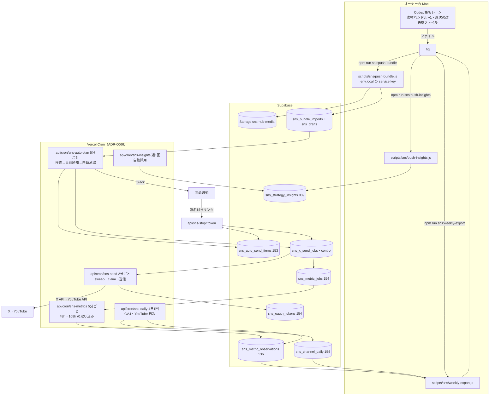
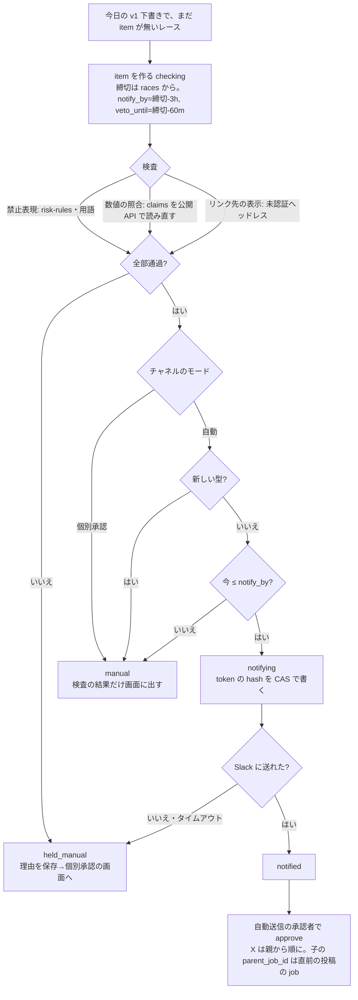
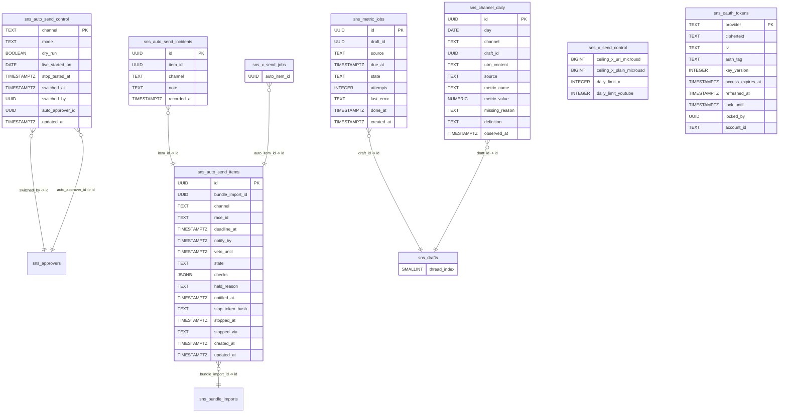

# SNS PDCA ループ: システム設計

[spec.md](spec.md)・[screens.md](screens.md) の実現方法。既存の送信契約（SQL137・139・140・146・148）と観測契約（SQL136）は作り直さず、足りない所をつなぐ。重要な判断は ADR 0090〜0094（0094 が自動送信そのものの決定）。

## 全体構成

## 1. 素材の受け渡し（spec A8、ADR 0090）

- **v1 の形式**: v0（`ryujin-preview/0`）のファイル構成・検査をそのまま使い、`schema_version=ryujin-preview/1` を足す。v1 で増えるもの:
  - `bundle.json` の `x_thread`: `[{index, text, media?}]`（親が index 0、最大6件）。URL は index 0 にだけ置く（spec の費用の決まり）
  - `bundle.json` の `claims[]`: `{id, text, value, source:{endpoint, path}}`。`endpoint` は龍神の公開 API（例 `/api/races/{raceId}`）、`path` はその JSON の中の場所。A3 の照合で使う
  - `bundle.json` の `race_id`・`screen_key`。**締切は bundle の値を使わず、DB の races から計算する**（Codex の値を信用しない）
  - 動画は1本 32 MiB まで（送信契約と同じ）
- **運び方**: `scripts/sns/push-bundle.js <素材フォルダ>`（新規）。既存の `validateBundle` を Node から呼んで検査し、`bundleStore.saveFile` と同じパスへ Storage に直接上げ、取り込みの RPC を呼ぶ。Vercel を経由しないので 4.5 MB の制限を受けない。鍵は本体の `.env.local` を読む（Codex には渡さない。hq が実行する）
- **管理画面の手取り込み**（`BundleImportPanel`）は v0 のために残す
- **v0 の公開保留は5か所にあり、v1 では全部を変える**（153）:
  1. `sns_bundle_imports.schema_version` の CHECK（v0 だけ）→ v0・v1
  2. `import_sns_preview_bundle`（v0 だけ・X は1件）→ v1 は X スレッドの本数分の下書きを作る
  3. 一意索引 `sns_drafts_bundle_version_channel_language`（版×媒体×言語で1件）→ `sns_drafts.thread_index`（既定0）を足し、索引に含める
  4. `guard_sns_preview_bundle_draft` → v1 は item の検査が合格した下書きだけ `publish_blocked=false`・`publication_hold_reasons=[]` にでき、approved・posted に進める
  5. 送信の関数の `bundle_import_id IS NOT NULL` の拒否（`approve_sns_x_send`・`transition_sns_send_139`・`youtube_call_guard`）→ v1 で検査合格なら通す
  v0 は5か所とも今のまま

## 2. 自動承認と事前通知（spec A3〜A7・A10、cron `sns-auto-plan`、ADR 0094）

5分ごと（JST 5:30〜23:00。ミッドナイトの優勝戦のため 2026-10-14 オーナー決定で 23:00 まで）。1回の流れ:

- **数値の照合**（A3）: `claims[].source.endpoint` を本番の公開 API から新しく取得し、`path` の値と `claims[].value` を照合する（数値は桁を含め完全一致、文字列は正規化後に一致）。不一致・取得失敗・endpoint が許可リスト（`/api/races/`・`/api/analogy/` 等、/step4 で一覧を固定）に無いものは不合格。Codex の `QA.pass` は見るが、それだけでは通さない。**送る直前の preflight でも同じ照合をもう一度行う**（`readCurrent` の中）
- **個別承認の画面と同じ条件**: 自動の分岐でも、`approve_sns_mobile_channel` が見る条件（qa.pass・numeric_claims_match・release_evidence・claims が空でない）を item.checks に対して検査する
- **リンク先の表示**（A2）: 既存の `createDeadlinePreflight` の `headless` を実装する（ADR 0091）。`markers` は `scripts/lib/snsScreenMarkers.js` に画面ごとの印を固定する（/step4 で実画面で決める）。結果を `release_evidence` として下書きに保存
- **禁止表現**: 既存の `scripts/lib/riskRules.js` と `sns-video-studio/remotion/risk-rules.json`、用語の検査（競艇・類似レース）
- **新しい型**（A10）: 判定のキーは `source_data.format` と `source_data.local_template_variant_id`（bundle 由来の下書きは `template_variant_id` が NULL のため）。この組が過去に `posted` になった下書きに無ければ新しい型として個別承認へ
- **同じレースの item は1つ**: 153 で `(race_id, channel)` の部分一意（state が stopped・held_manual 以外）にする。直した素材を入れ直したときは、前の item が notified 以前なら stopped（`stopped_via='superseded'`）にしてから新しい item を作る
- **送信の承認の直前に auto-plan が書くもの**（`source_data.deadline_queue`）: `deadline_at`（races から）、`expires_at`（締切−30分）、`source_revision`、`source_observed_at`（数値の照合をやり直した時刻。Codex の生成時刻は使わない）、`public_url`（UTM つき）、`screen_key`、`youtube_mode`、子は `parent_job_id`。順番は「UTM を本文に差し込む → 禁止表現の検査をやり直す → deadline_queue を書く → 承認」
- **事前通知の順番**: `checking → notifying`（token の hash を条件付き UPDATE で書く。cron が2回走っても通知とリンクは1つ）→ Slack（`unfurl_links:false`）→ `notified`（`WHERE state='notifying'` の条件付き。止める操作と競合したら止めた方が勝つ）→ approve。**Slack に送れないときは approve しない**ので、通知が届かないまま送られることは無い
- **自動送信の承認者**: 153 で `sns_approvers` に「自動送信（止められなかった）」を `active=false`（管理画面の選択肢に出さない）で入れる。分岐は表示名の文字列ではなく `sns_auto_send_control.auto_approver_id`（153）で行う
- **スレッド**: 親（thread_index 0）を approve → 返った job の id を子の `source_data.deadline_queue.parent_job_id` に書く → 子を approve、を順に行う。返信先は**直前の投稿**（index n の子は n-1 に返信。見た目が普通のスレッドになる）。子の `scheduled_at` は親から index×1分ずつずらし、runner は「親が posted の子」だけを選ぶ（同時に claim して `parent_not_posted` で held に落ちないため）
- **送る時刻**（A7）: `sns_x_send_control.schedule_minutes=60`、`timing_approved=true`（ユーザー決定 Q1。本番 SQL でオーナーが設定）。`expiry_minutes=30` は維持
- **鮮度**（`max_source_age_seconds`）: 承認は締切の3時間前より前に起きるので、`source_observed_at` からの経過は送る時点で2時間を超える。値は 4時間（14400秒）にし、送る直前の preflight で `readCurrent` が版と締切を新しく読み直すことで鮮度を担保する

## 3. 止める操作（spec A6、ADR 0092・0094）

- **止めるのは「許可のリスト」で効かせる**（153）: 自動送信の承認者の job は、`transition_sns_x_send` の `claim`・`check`・`begin_post`・`youtube_call`・`youtube_publish_begin` のたびに「item.state='notified' かつ チャネルの mode='auto'」を確かめる。外れていたら、queued・sending（外部の POST の前）は `held`（`auto_stopped`。139 の既存の保留と同じ扱い）、reconcile（外部呼び出しの途中）は RAISE して外部呼び出しを止め、YouTube でアップロード済みなら `youtube_retain`（非公開のまま残す）に回る（/step4 で確定。当初の「claim の後は RAISE」より、sending の check・begin_post を held にした方がリースの失効で要照合に落ちずに済む）。本人の承認の job でも、v1 の item を止めた後は同じく held にする。claim は `now() >= veto_until` も確かめる（X・YouTube とも）。
- **YouTube の時刻（2026-10-13 ユーザー決定、確認C）**: Q1 の決定は「YouTube は通知の時点で非公開アップロード、60分前に公開」。しかし既存の YouTube の流れ（146・`runYoutubeQueueJob`）は、(a) アップロードの直後に同じ実行の中で公開まで続け、(b) 処理の確認は1回の試行で3回まで、(c) クォータは claim した日（太平洋時間）に縛られ、締切が JST 17〜19時のレースは日付をまたいで公開できない。通知の時点でアップロードすると、この3つを作り直すことになる。**決定: YouTube も締切の60分前にアップロードを始め、同じ実行で処理の完了を待って公開する（非公開→確認→公開の案B は維持）**。Shorts の処理は通常数分で、失効（締切30分前）まで30分ある。間に合わなければ非公開のまま残る（今の契約どおり）
- **Slack のリンク**: `https://www.boat-ai.jp/api/sns-stop/<token>`。token は item ごとのランダム 32 バイト、DB には SHA-256 だけを保存。期限は `veto_until`＋30分。GET は確認の画面（対象と「この投稿を止める」ボタン1つ）を返すだけで、止めるのは POST。応答に `Cache-Control: no-store`・`Referrer-Policy: no-referrer`・`X-Robots-Tag: noindex` を付ける。管理画面の Basic 認証は通らない。できるのは「その item を止める」ことだけ
- **管理画面**: `POST /api/admin/sns-hub/auto-send` `{action:'stop', itemId}` / `{action:'mode', channel, mode:'manual'}`（自動を切る）/ `{action:'mode', channel, mode:'auto', approverId}`（自動にする。承認者が「本人」で、L3 の条件を満たすときだけ）/ `{action:'incident', channel, itemId?, note}`（誤投稿の記録）
- **`stop_sns_auto_item`**（153）: item を `stopped` にする（これで上の許可のリストが外れ、以後の外部呼び出しは止まる）。そのうえで job の状態ごとに後片付けをする:
  - `queued`・`held`: 下書きの status を `pending_review` に戻す（既存の `cancel` は queued しか受け付けないので使わない。148 のガードが未送信の job を取り消す）
  - YouTube は下の「YouTube の時刻」の決定により、アップロードと公開を止められる期限の後に1回の実行で続けて行うので、止めた時点で未送信なら job は queued のまま（上と同じ扱い）。実行中なら下の許可のリストで止まり、アップロード済みなら非公開のまま残る
  - `sending`・`reconcile`・`posted`: 触らない（148 のガードで下書きを変えられない）。返り値で「送信が始まっていた」を知らせる
- **自動を切る**: `sns_auto_send_control.mode='manual'`。`notified` の item は許可のリストから外れるので、それ以上は送られない。item は `stopped`（`stopped_via='mode_off'`）にし、後片付けは上と同じ

## 4. 送信（spec A1・A9、cron `sns-send`）

- **5本の cron と共通ラッパ**: `sns_auto_plan`（continuous、5分）・`sns_send`（continuous、2分）・`sns_metrics`（continuous、5分）・`sns_daily`（daily、JST 10:00）・`sns_insights`（daily、月曜 JST 5:00）を `scripts/lib/scrapeJobs/registry.js` に登録し、すべて `createScrapeCronHandler` を通す。`scrape_job_state` の行は mode=off で作られるので、153 で5行を `mode='shadow'` で入れ、L1 でオーナーが `live` にする
- `sns-send` は2分ごと（JST 8:00〜23:00。22:00 以降に発走するミッドナイトの優勝戦の送る時刻（締切の60分前）まで動かす。2026-10-14 オーナー決定）。`createScrapeCronHandler`（`scripts/lib/scrapeJobs/cronWrapper.js`）に新しいジョブ `sns_send` を登録する（ADR-0066 改訂1 に、外部サイトを取得しないジョブが乗った先例がある）。`maxDuration=300`、`leaseSec` は300以上。monitor の死活の通知は JST 8:00〜21:30 だけにする（レジストリにジョブごとの稼働時間を足す）
- 1回の流れ: `xSendStore.sweep()` → `queued` で `scheduled_at` を過ぎた job（子は親が posted のものだけ）を古い順に最大3件 → チャネルごとに既存の `runXSendJob` / `runYoutubeQueueJob` / `runYoutubePublishJob` を呼ぶ
- **X adapter**（新規 `api/_lib/xApiAdapter.js`）: fetch で X API v2 を直接呼ぶ。`initialize`/`append`/`finalize`/`status` は `/2/media/upload/*`、`createPost` は `POST /2/tweets`（子は `reply.in_reply_to_tweet_id`）。動画は Storage から読み、5 MB ずつ送る
- **X のトークン**（ADR 0093）: 154 の `sns_oauth_tokens` に AES-256-GCM（IV と認証タグを列に持つ）で暗号化して保存。refresh は X の HTTP をはさむので1つのトランザクションにはできない。`lock_until` と `locked_by` を条件付き UPDATE で取り、保存は `WHERE locked_by=自分` の条件付き UPDATE にする。ロックは HTTP のタイムアウト（30秒）より長い90秒。refresh に成功して保存に失敗したら refresh token を失うので、Slack に「X の連携のやり直しが要る」と通知する
- **YouTube adapter**（新規 `api/_lib/youtubeQueueAdapter.js`）: `upload` は1回の multipart（privacyStatus=private。2026-10-13 実装で確定。動画は 32 MiB まで、超えるものは送る前に止める）。32 MiB なら1回の関数で終わる見込みなので、**続きから送る仕組みは作らない**（関数の時間内に終わらなければ reconcile で止まり、オーナーの照合に回る）。`processing`・`makePublic`・`lookup` は `videos.list`・`videos.update`。既存 `youtubeUpload.js` のトークン取得を使う。サムネイルの Content-Type を媒体に合わせる
- **送る前の検査を claim の前にも通す**（tasks 19 で確定）: runner（`scripts/lib/snsSendRunner.js`）は、claim の前に送る前の検査（preflight）を1回通し、落ちたら claim しない（X の月の予約・日次の枠・YouTube のクォータを消費しない）。claim の後の検査は既存の runXSendJob・runYoutubeQueueJob の中で今までどおり行う。トークンも claim の前に取る。保留の理由・要照合は `last_report.alerts` で監視（scrape-monitor）から Slack に流す（L1 の「保留の理由を全件確認」はこれで見る）
- **鍵の健全性**（tasks 19）: `GET /api/admin/sns-hub/token-health`（Basic 認証）が、X・YouTube の投稿用・Analytics の refresh の可否と scope（YouTube は `canUpload`・`canPublish`）、Analytics の reports の状態だけを返す。トークンの値は返さない。Vercel の Sensitive の値を手元で読めないため
- **試運転**（A9）: `sns_auto_send_control.dry_run=true`（153、初期値 true）のあいだも、job を作るところまでは行い、**claim の前で止める**（DB でも、dry_run=true のチャネルは承認者によらず claim を拒否する。job は queued のまま）（X の月の予約・日次の枠・YouTube のクォータを消費しないため）。検査・preflight（ヘッドレスを含む）までを行い、結果を item.checks の `dry_run` に残す。dry_run が true のまま L2 に入らないよう、管理画面と毎日の Slack の要約に「試運転中」を出す
- **送る直前の確認（ヘッドレス）**: 既存の preflight は送信の関数の中で毎回ヘッドレスを呼ぶ（無ければ `public_check_unconfigured`）。`sns-send` でも Chromium を起動する。1回の実行で最大3件に絞り、同じ実行の中では起動した Chromium を使い回す。メモリは 2 GB
- **毎日の基準日**: 既存の契約は、claim に `daily_baseline_date = 当日 JST`（X）と `quota.baseline_day = 当日 PT`・`verified`（YouTube）を求め、オーナーが毎日 SQL で更新する前提になっている。自動送信ではこれを毎日手でやるのは続かない。**決定（2026-10-13 ユーザー、確認B）: `sns-auto-plan` の毎回、JST の日付（X）・太平洋時間の日付（YouTube）が変わっていたら基準日を当日にし、`daily_external_count`・`external_uploads`・`external_general` を0で入れる**（YouTube の日付は JST 16:00〜17:00 に変わるので、朝の1回だけでは夕方以降に古くなる）。DB の関数は `roll_sns_send_baselines()`（153。オーナーが一度も設定していない・YouTube が未確認のときは何もしない）（オーナーが手で出した投稿があれば管理画面から足す）。既存の契約（139・146 の「オーナーが毎日設定する」）を変えるので、contract.md にも追記する
- **予約額を種類別にする**（153、P0 の指摘）: 既存の claim は、送信の種類に関係なく1回ごとに `attempt_ceiling_microusd` を予約し、YouTube の claim も同じ X の台帳を消費する。1日7回（X 6＋YouTube 1）× URL つきの上限額で、月 $10 は約1週間で尽きる。153 で `sns_x_send_control` に `ceiling_x_url_microusd`（URL つきの親）・`ceiling_x_plain_microusd`（子）を足し、claim はスレッドの位置で使い分け、YouTube は0にする（YouTube Data API は無料。クォータは別の台帳）
- **日次上限をチャネル別にする**（153）: 既存の `daily_limit` は X・YouTube で1つ。スレッドの子も1回と数えるので、上限1では子が送れず、6では YouTube も6本通る。`daily_limit_x`（スレッドの投稿の数で6）・`daily_limit_youtube`（1）に分ける
- **L3 の本数と費用**（2026-10-13 オーナー決定）: L3 ではその日の優勝戦・準優勝戦をすべて自動で出す（L2 は1日1レースのまま）。直近30日は月269レース・1日最多16。X の実費は月 約$77、予約の上限額で月 約$111 になるので、153 で月の上限額の CHECK を $200 まで広げ、額は $130（2026-10-13 オーナー決定。X の Developer Console の spending limit も同額。L2 の間は $10）をオーナーが本番 SQL で入れる（153-runbook.md「L2・L3 の送信の設定」）。日次上限は「その日のレース数」を毎日入れる形にせず、直近30日の最多（X 96・YouTube 16）を天井として置く（item は該当レースにしか作らないので、本数はレース数で決まる）。YouTube の1日16本のアップロードのクォータは L3 の前にオーナーが確認する
- **費用**: X の予約台帳そのものは既存のまま。153 で `renew_sns_x_send_period(start, end)`（オーナーが本番 SQL で実行。今の期間が終わってからだけ実行でき、`reserved_microusd` を0に戻す）を足した。**月の切り替えは同じ額で自動にする**（2026-10-13 オーナー決定）: 158 で `roll_sns_x_send_period()`（service_role）を足し、`sns-auto-plan` が毎回呼ぶ。`now() >= period_end` のときだけ、期間を `[period_end, period_end + 1 month)` に進め `reserved_microusd` を0にする（額は変えない）。額を変えるときだけオーナーが本番 SQL で `budget_microusd` を変え、Console の spending limit も合わせる。期間の終わりの3日前の Slack は「自動で切り替わる・額は $X」の知らせに変える。取り込みの読み取りも同じ台帳に予約する（154 の `reserve_sns_x_read`。残りが「月の残り日数×1日の送信の予約額」を下回ったら拒否）

## 5. 取り込み（spec C1〜C4、cron `sns-metrics`・`sns-daily`）

- **ジョブの作り方**: job が `posted` になったら、154 のトリガーで `sns_metric_jobs` に `(draft_id, window, source)` を作る（`due_at = posted_at + 48h / 168h`）。X はスレッドの子にも作る（子ごとの表示・クリックを見るため。読み取りは1件 $0.001 なので月 $0.4 程度）
- **`sns-metrics`**（5分ごと、終日。許容差15分に対して1回抜けても間に合うように）: `due_at` を過ぎた pending を処理する
  - YouTube: `videos.list(statistics)` の累積値（views・likes・comments）を `measurement_kind='snapshot'` で保存
  - X: `GET /2/users/{id}/tweets`（自分の投稿、Owned Reads $0.001）の `public_metrics`・`non_public_metrics`・`organic_metrics`。投稿から30日を過ぎると非公開の指標は取れないので、168h でも十分に間に合う
  - 時刻: 136 は「累積値は対象の時刻ちょうど（`observed_at = period_end`）だけ保存できる」。cron では秒単位で合わせられないので、**154 で15分の許容差を足す（2026-10-13 ユーザー決定、確認A）**。許容差を超えたら値を null・欠測理由「取得が遅れた」で保存する
  - 失敗は `attempts` を増やし、3回続けたら Slack（spec C4）
- **`sns-daily`**（1日1回、JST 10:00）: YouTube Analytics の日次は確定まで数日かかることがあるので、毎日 D−3〜D−1（太平洋時間の日）を取り直し、値が変わったときだけ UPDATE する。「投稿日＋翌日」は太平洋時間の暦日で数える
  - YouTube Analytics の動画ごとの日次（engagedViews・averageViewPercentage・subscribersGained）を `sns_channel_daily` ではなく観測の表へ、`measurement_kind='period'`・`window` は投稿日〜翌日の2日の値として保存したいが、136 の窓は 48h/168h に固定で暦日の窓を入れられない。**暦日の値は 154 の `sns_channel_daily`（draft_id 任意）に入れる**。版の判定（spec 統計検証）はこの表の「投稿日＋翌日」を使う
  - GA4: 前日の X の UTM（`utm_content=draftId/variantId`）ごとのセッション・ユーザー・ソナーを開いた人、YouTube 経由（プロフィールの UTM＋参照元 youtube）の日次を `sns_channel_daily` へ。クエリは `scripts/analysis/sns-pdca-baseline/ga4-sns-inflow.js` と同じ流入元の完全一致のリスト（共通部分を `scripts/lib/snsGa4.js` に出す）
- **UTM**: X の親の投稿の URL は送信の承認時に `buildObservationUtm` で作る。136 の `sns_post_tracking` は campaign が `sonar-preview` 固定・`template_variant_id` 必須なので、154 で campaign に `race-full` を許し、`template_variant_id` を任意にした。/today の投稿は `utm_campaign=today_digest`・`utm_content=日付`、通り道 B は既存の `sonar-preview` 等を使う。campaign の許可は 158 で足す（下の §8）
- **鍵の置き場**: `YOUTUBE_ANALYTICS_*`（3つ）、`GOOGLE_SERVICE_ACCOUNT_KEY`（GA4、Vercel に未登録なら追加）、`SNS_TOKEN_ENC_KEY`、`X_OAUTH_CLIENT_ID`・`X_OAUTH_CLIENT_SECRET` を Vercel の環境変数（Production）に登録する。手順は tasks の段階でオーケストレーターに渡す

## 6. 改善案（spec B1〜B4、cron `sns-insights`）

- **自動採用**（B1）: 週1回（月曜 JST 5:00）。`status='proposed'` かつ `created_at` が7日以上前の案を、`scripts/lib/riskRules.js` で照合し、通れば `active`（`activated_at`、`decision_note='自動採用（1週間止められなかった）'`）、触れれば `retired`（`decision_note='自動で外した: <規則名>'`）。ADR 0030 に 2026-10-12 の追記を足す
- **保存**（B2）: `scripts/sns/push-insights.js <ファイル>`。既存の `createInsight` を使い、`research_method='codex-weekly'`、`source='own-metrics'`
- **次の生成へ**（B3）: `scripts/sns/weekly-export.js` が `active` な案と、観測の表（投稿ごと・版ごと）を1つの JSON に書き出し、hq が Codex に渡す。v1 bundle の `bundle.json` に `referenced_insight_ids` を入れてもらい、取り込みで `sns_drafts.referenced_insight_ids` に入れる
- **週次の数字**（B4）: 同じ `weekly-export.js` の出力に入れる（spec 統計検証の「守り」の判定もここで計算する。1000行の上限があるので `.range()` で読む）
- **チャネルの知見ノートへの1行**（B5、2026-10-13 オーナー方針、hq 経由）: チャネルごとに「次に変えた1点とその結果（48h・7d の数字）」を `docs/knowledge/x.md`・`youtube.md` に1行足す。**方式: DB を正本にし、週1で docs に書き出す**（Vercel の cron から PR は作らない）
  - 「変えた1点」= `sns_strategy_insights` で `active` になった案（自動採用・手動の両方。`activated_at` が起点）。「結果」= その案を `referenced_insight_ids` に持つ投稿の 48h・7d の観測（`sns_metric_observations`）を、採用前の4週の同じチャネル・同じ指標と並べた中央値と本数。新しい表・列は足さない（どちらも既存の DB にある）
  - 書き出しは `weekly-export.js` の `--knowledge`（hq が毎週の書き出しと同じ実行で走らせる）。採用から7日を過ぎ、その案を使った投稿の 7d の観測が1本以上そろった案だけを対象にする。行の末尾に `（insight:<id>）` を入れ、同じ id の行が既にあれば書かない（冪等）。7d がそろわない案は次の週に回す
  - 行の形: `- YYYY-MM-DD 変えた点: <案の要旨>。48h <指標> 中央値 <値>（<本数>本、採用前4週 <値>）・7d <同>。根拠: sns_metric_observations（insight:<id>）`。本数が少ない・欠測があるときもその旨を書いて省かない（読み物の報告原則）
  - 反映: hq が出力の差分で docs だけの PR を作る（docs だけの PR は段階0）。Codex に渡す鍵は使わない
  - 理由: (a) 結果の確定は 7d の観測を待つので、採用の瞬間（cron）では書けない。(b) cron から GitHub に書くには Vercel に書き込みの鍵が要り、鍵を増やす（ADR-0066 の鍵の置き場の外）。(c) 正本の数字は DB にあり、docs は写しにすぎないので、書き出しを何度やり直しても同じ行になる形が安全

## 8. 通り道 A・B（2026-10-13 オーナー方針、hq 経由）

sns-hub は1つのまま、中を2本の通り道に分ける。別の仕組みは作らない。B の再開そのものは別チケット（オーケストレーターが起票）。

| | A（定型・自動） | B（企画・承認） |
|---|---|---|
| 中身 | 優勝戦・準優勝戦の全貌（X スレッド＋Shorts）、本日のデータ一覧（/today）の X 投稿 | ネタ提案（sns-topic-gate）→ チャネル別の下書き → 1件ずつ承認 |
| 文面 | 全貌は素材 v1（Codex）、/today は `morning_digest_rows` から決まった型で組み立てる（AI 生成なし） | 既存の下書きの流れ |
| 承認 | L1〜L2 は1件ずつ、L3 は事前通知＋止めなければ自動（ADR 0094） | 常に本人の1件ずつ承認（自動にしない） |
| 送信の経路 | 同じ（`sns_x_send_jobs`・`sns-send`） | 同じ |

- **通り道の記録**: 158 で `sns_drafts.send_lane`（`A`・`B`、既存の行は NULL）を足す。素材 v1 の取り込みと /today の下書きは A、ネタからの下書きは B を入れる。job・観測・UTM は下書きを通して通り道が分かるので、それぞれに列は足さない
- **X の1日の本数・間隔は A＋B の合計で数える**: `daily_limit_x` は1つのまま（A と B の合計の天井）。**A を先に枠に入れ、B は残り**: 158 の claim で、B の job は「今日まだ送っていない A の予定の本数」（今日の A の item のうち notified まで進んだもののスレッドの本数＋/today の1本で、まだ claim していないもの）を枠から先に引いてから判定する。A は今までどおり。間隔は、B の送る時刻を A の送る時刻の前後30分に入れない（B の下書きの予定時刻を決めるときに避ける。DB では本数だけを守る）
- **計測は A・B 共通**: 48h・7d の取り込み（`sns_metric_jobs`）・UTM・暦日の値は同じ表に入る。hq のダッシュボードと `weekly-export.js` は `sns_drafts.send_lane` で A・B を並べる
- **/today の X 投稿**（A）: 7:45 に送り、事前通知は 5:45（2時間前）。毎朝の一覧は JST 5:30 に作られる（6:30・8:00 にやり直し）。`sns-auto-plan` の稼働時間は JST 5:30〜21:00 にする。158 で `sns_auto_send_items` に種類（`kind`: `race`・`digest`）を足し、digest は `bundle_import_id` を持たない（`race_id` は `today:YYYY-MM-DD`）。承認の関数は digest の item を下書きの ID で引く。日次上限は1本ぶん足し、L2 は `daily_limit_x=7`、L3 は 97。費用は月 約$6（予約で 約$7.5）増え、L3 の予約の合計は約$119（上限 $130 に収まる）
  - **画像**（2026-10-14 オーナー決定）: 未ログインの本番の /today を、スマホ幅の上部 4:5（1170×1464 の PNG）で1枚撮って付ける。範囲を上部にするのは、X のタイムラインで1枚の縦長の画像は縦横比の上限で切られ、全体を撮ると文字が読めないほど縮むため。撮影は送る前の表示の確認と同じ未ログインの Chromium（ADR 0091、#1518）を使い、一覧ができた後（5:30、やり直しの 6:30・8:00 の後も）に撮る。5:45 の事前通知に画像を載せる。一覧がやり直されて画像が変わったら承認を外して撮り直す。費用: X の料金表（docs.x.com、2026-10-14 確認）に媒体のアップロードの単価は無い（課金されるのは代替テキストの Media Metadata $0.005 だけ）。仮にアップロードの3回（INITIALIZE・APPEND・FINALIZE）が1回 $0.015 で数えられても1日 $0.045・月 約$1.4 で、L3 の予約の合計 約$119 に足して $130 に収まる

## 7. 画面（screens.md）

- `src/pages/admin/sns-hub/AutoSendPanel.jsx`・`.css`（新規）。`GET /api/admin/sns-hub/auto-send` で `{controls, items, conditions}` を返す。`conditions` は L3 の条件（チャネルごとの実送信件数、`posted` で誤投稿として記録された件数＝154 の `sns_auto_send_incidents`、`reconcile` の件数、止める操作の本番試験の記録）
- `?auto=<itemId>` で該当の item を先頭・強調（screens #4）
- X との連携（screens #10）: `GET /api/admin/sns-hub/x-oauth/start`（state と PKCE の verifier を作り、HttpOnly の Cookie に入れて X の許可画面へ）→ `GET /api/admin/sns-hub/x-oauth/callback`（state を照合し、コードをトークンに替えて `sns_oauth_tokens` へ暗号化して保存）。X の Developer Console のコールバック URL に本番の URL を登録する（オーナー）
- `MobileApprovalPanel` の説明文と、`held_manual` の理由のバッジ。`DeadlineQueueList` に自動・止めた・止められる期限。`InsightCard` に自動採用までの日数
- 検査の結果の表示は `MobileRaceReview` から部品 `GateChecks` を切り出して共用

## データ設計

マイグレーション案: [153_sns_auto_send.sql](../../db-migration/153_sns_auto_send.sql)、[154_sns_tokens_metric_jobs.sql](../../db-migration/154_sns_tokens_metric_jobs.sql)。どちらも新しい表は RLS 有効・service_role だけ。

`node scripts/maintenance/generate-er-diagram.js sns-pdca-loop` の出力（引用符つきの列名 `"window"` は生成器が拾わない）:

## 既存の契約との整合

| 既存の契約 | この設計での扱い |
|---|---|
| 承認 hash・snapshot（137・140） | そのまま。自動承認も同じ snapshot を作る |
| 期限キュー（139）の 90分前・30分失効 | 60分前（Q1）に設定値を変える。コードは変えない |
| 案B（146） | そのまま（非公開で上げて確認してから公開）。アップロードも公開も `veto_until`（締切60分前）以降に同じ実行で行う（2026-10-13 ユーザー決定） |
| 投稿済みの承認保護（148） | そのまま |
| v0 の恒久保留（135） | v0 はそのまま。v1 だけ検査を通れば解除 |
| X の月 $10（137） | そのまま（$10、2026-10-12 ユーザー決定）。月の切り替えの関数を足す。予約額は種類別にする |
| 観測（136） | 表はそのまま。累積値の時刻の許容差と、UTM 表の制約だけ 154 で緩める |
| 改善案（039・ADR 0030） | 表はそのまま。自動採用を戻す |
| `.claude/CLAUDE.md` の個別承認 | L3 の前に変更（[rule-change-proposal.md](rule-change-proposal.md)） |
| x-send の contract「過去の承認から自動 queue 化しない」「本人を検査」、deadline-queue の contract「親子は個別承認」 | ADR 0094 で例外を定め、/step4 で各 contract に「自動送信の承認者は ADR 0094 の条件でだけ通る」を追記する |
| 毎日の基準日（139・146） | 自動で当日にする（2026-10-13 ユーザー決定）。contract.md に追記 |

## ユーザーの決定（確認が要る点への回答）

1. **累積値の時刻の許容差**（2026-10-13 決定: 推奨どおり15分）: 136 の契約で「未承認」のままだった。推奨は「48h・168h の時刻から15分以内に取れた値を保存し、実際の取得時刻を `observed_at` に残す。15分を超えたら欠測」。理由: cron は5〜10分ごとで、秒単位では合わせられない。Shorts の再生は2日で99%が出るので、15分のずれは値にほぼ影響しない
2. ~~X の月額上限~~ → $10 のまま（2026-10-12 ユーザー決定。L3 前に実請求で見直す）
3. **毎日の基準日を自動にするか**（2026-10-13 決定: 推奨どおり自動。日付が変わるたびに更新）: 既存の契約は、X の `daily_baseline_date`（JST）と YouTube の `baseline_day`（PT）・`verified` をオーナーが毎日 SQL で当日にしないと送れない。推奨は「`sns-auto-plan` の最初の回が当日にし、他の経路の本数は0で入れる。手で出した投稿があれば管理画面から足す」。理由: 毎日の手作業が1回でも抜けるとその日は送れず、自動送信の意味が無くなる。他の経路の本数を0とみなす危険は、オーナーが手で出したときに足し忘れると日次上限を1本超えうること（上限は Shorts 1・X 1 なので、超えても1本）

4. **YouTube の時刻**（2026-10-13 決定: 推奨どおり。60分前にアップロードを始め、同じ実行で公開）
5. **モック**（2026-10-13 承認。`mock/APPROVED.md`）

## 設計検証（system-architect、2026-10-12）の指摘と対応

本番の読み取り（制約名・行数・関数の定義）と既存の SQL で根拠を確かめたうえで採否を決めた。

| 重さ | 指摘 | 対応 |
|---|---|---|
| P0 | v1 を取り込めない（`sns_bundle_imports` の CHECK と取り込み関数が v0 だけ） | 採用。§1 の5か所の変更に入れた（135:8 で再現） |
| P0 | 1バンドルに X の下書きは1件しか作れず、スレッドと衝突する（一意索引） | 採用。`thread_index` を足して索引に含める（135:26-28 で再現） |
| P0 | 公開保留の解除が approve だけでは足りない（`transition_sns_send_139`・`youtube_call_guard` も拒否） | 採用。§1 の5番（139:137・146:174 で再現） |
| P0 | 止めても claim 済みの job は送られる | 採用。許可のリストを claim・check・begin_post・youtube_publish_begin の全部で見る（§3） |
| P0 | Slack の通知が失敗しても送られる（approve が先） | 採用。通知→approve の順にした（§2） |
| P1 | YouTube の非公開アップロードが veto_until まで始まらない | 採用。veto_until で止めるのは X の claim と YouTube の公開（§3） |
| P1 | YouTube を止めたときの穴（reconcile での RAISE、ID が無いときの retain） | 採用。job の状態ごとの後片付け（§3） |
| P1 | 親子の結びつけの手順と、同時 claim で子が held に落ちる | 採用。親から順に approve、子は親が posted のものだけ選び、時刻をずらす（§2・§4） |
| P1 | 既存の契約の文言と衝突し、自動送信そのものの ADR が無い | 採用。ADR 0094 を足し、contract への追記を tasks に入れる |
| P1 | 毎日の基準日の手作業 | 案を出し、ユーザーが 2026-10-13 に採用（日付が変わるたびに自動で更新） |
| P1 | 鮮度の検査と通知の時刻の食い違い | 採用。4時間＋送る直前の読み直し（§2） |
| P1 | `sns_channel_daily` の式の一意索引は PostgREST の upsert に使えない | 採用。`UNIQUE NULLS NOT DISTINCT` の制約にする（154） |
| P1 | X トークンの refresh は1トランザクションにできない | 採用。`locked_by` の条件付き UPDATE（§4・ADR 0093） |
| P1 | 試運転で予約・クォータを消費する | 採用。claim の前で止める（§4） |
| P2 | 個別承認の画面の条件を自動では通らない | 採用（§2） |
| P2 | 自動送信の承認者が選択肢に出る | 採用。`active=false`、分岐は ID（§2） |
| P2 | maxDuration 800 は ADR-0066 改訂1 の300秒と食い違う | 採用。300秒にした（ヘッドレスは `sns-auto-plan` 側。0091 に記載） |
| P2 | 死活の監視が夜に誤って鳴る | 採用。稼働時間をレジストリに足す（§4） |
| P2 | `scrape_job_runs` は無い | 採用。試運転の記録は item.checks（§4） |
| P2 | `draft_ids UUID[]` に FK・一意が無い | 採用。153 で `sns_x_send_jobs.auto_item_id`（FK）にし、item の `draft_ids` は持たない |
| P2 | `youtube_upload_session` が承認の更新で消えず、画面の JSON に出る | 採用。続きから送る仕組み自体をやめ、列を足さない（§4） |
| P2 | `renew_sns_x_send_period` が今の期間の途中でも実行できる | 採用。`now() >= period_end` を条件にする |
| P2 | `weekly-export.js` は1000行の上限にかかる | 採用。`.range()` で読む（tasks に入れる） |
| P3 | `GRANT ALL` は広い | 採用。SELECT・INSERT・UPDATE に絞る |
| P3 | Vercel Cron の本数（今54本＋5本） | 上限は100本（一次情報で確認済み）。問題なし |
| 情報 | 148 は本番に適用済みなのに APPLIED.md は未適用 | 別 PR（#1452）で更新中とオーケストレーターから聞いている。このPRでは触らない |

## 設計レビュー（design-reviewer、2026-10-12）の指摘と対応

数値は power.js を JSON から再計算して全セル一致（観点1は問題なし）。指摘は実ファイルで再現してから採否を決めた。

| 重さ | 指摘 | 対応 |
|---|---|---|
| P0 | 予約額が送信の種類によらず一律で、YouTube も X の台帳を消費し、月 $10 が約1週間で尽きる | 採用。種類別の予約額、YouTube は0（§4、139:159-168・146:216 で再現） |
| P1 | 日次上限が X・YouTube で1つ。スレッドの子が送れない | 採用。チャネル別の上限（§4） |
| P1 | 通知の時点の YouTube の非公開アップロードは、既存の流れ（同じ実行で公開・確認3回・PT の日付）とかみ合わない | 案を出し、ユーザーが 2026-10-13 に採用（§3「YouTube の時刻」、snsDeadlineQueue.js:109-111 で再現） |
| P1 | PT の日付が変わると YouTube の公開が拒否される | 上の決定で解消（アップロードと公開を同じ実行で行う）。基準日も日付が変わるたびに更新（§4） |
| P1 | engagedViews/views の必要本数が「30回以上の動画」で数えられ、過小 | 採用。太平洋時間の2日の窓で取り直し、投稿本数に換算（1.5倍で版ごと27本・約8週）。spec・読み物・知見ノートを直した |
| P2 | 「守り」を基準値1点と比べると半分の週で悪化になる | 採用。直近4週の分布の下側10%で判定（spec） |
| P2 | `deadline_queue` を誰がいつ書くか、UTM の差し込みの順番 | 採用（§2） |
| P2 | 同じレースに item が2つできうる | 採用。`(race_id, channel)` の部分一意と置き換えの規則（§2） |
| P2 | `held` の job に `cancel` は使えない | 採用。下書きの status を戻す（§3、139:181-183 で再現） |
| P2 | 試運転では job も adapter も動かず、止める操作も試せない | 一部採用。試運転でも job は作り claim の前で止める（§4）。止める操作の本番の試験は L3 の初日に1件で行う（tasks） |
| P2 | 共通の cron ラッパは行が無いと off のまま | 採用。5本の kind を明記し、153 で行を入れる（§4） |
| P2 | 送る直前の preflight も毎回ヘッドレスを呼ぶ | 採用。sns-send でも起動し、実行の中で使い回す（§4） |
| P2 | 通知のリンク先・「自動を切る」の文言が食い違う | 採用。リンク先は ADR 0092 の止める画面を正本にし、screens に #11 を足し、文言を直した |
| P2 | YouTube Analytics の日次は確定が遅れる・PT の日付 | 採用。D−3〜D−1 を取り直す（§5）。基準値のスクリプトも PT に直した |
| P3 | spec の古い記述・子の本数・分母・新しい型のキー・notifying の条件付き更新・JST 11:00 前のレース | 採用（spec・§2） |
| 未確認 | 投稿用の `YOUTUBE_REFRESH_TOKEN`（scope は youtube.upload）で `videos.update`（公開への切り替え）ができるか | L0 で非公開の動画1本で試す（tasks に追加）。できなければ投稿用のトークンを `youtube` の scope で取り直す |
| 未確認 | カスタムサムネイルが 403（チャンネルの電話番号の確認が未完了、2026-09-02 の記録） | L0 で確かめる（tasks に追加）。未解決なら表紙を送らない |
