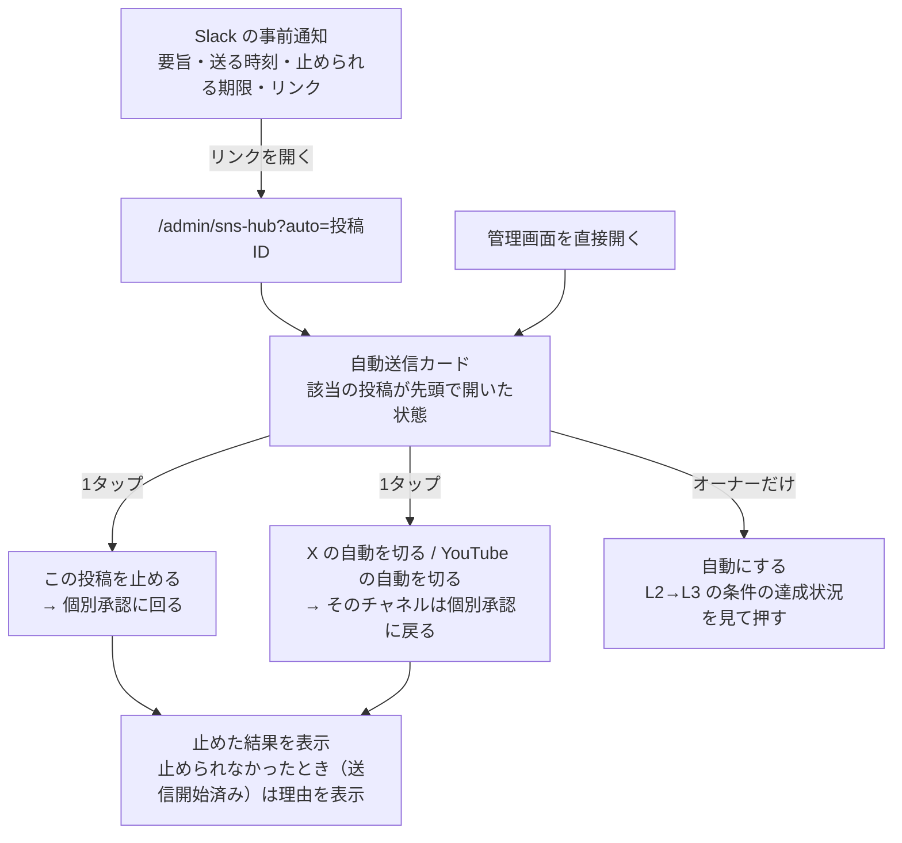

# SNS PDCA ループ: 画面・コンポーネント

対象は spec の A4〜A7（送信モード・事前通知・止める操作・時刻）と B1（週次の自動採用）。管理画面 `/admin/sns-hub`（`src/pages/admin/SnsHubAdmin.jsx`）だけで、ユーザー向けの画面は変えない。新しいページは作らない。

## 画面の流れ

## 影響する画面・コンポーネント

| # | 画面/コンポーネント | 種別 | 役割 |
|---|---|---|---|
| 1 | `AutoSendPanel`（新規、`src/pages/admin/sns-hub/AutoSendPanel.jsx`） | 新規 | 管理画面の最上部（`MobileApprovalPanel` の上）に置く「自動送信」カード。チャネル（X・YouTube）ごとの今のモード、次に自動で出る投稿の一覧、止める操作、自動にする操作をまとめる |
| 2 | `AutoSendModeRow`（#1 の内部） | 新規 | チャネル1行。モード（個別承認／自動／全停止）、個別承認の期間なら「実送信の初日から N 日目／7日」と L3 に入る条件の達成状況（実送信件数・誤投稿・要照合の未解決・止める操作の試験）。ボタンは自動なら「自動を切る」、個別承認で条件を満たしていれば「自動にする」（条件未達なら押せず、足りない条件を表示） |
| 3 | `AutoSendItem`（#1 の内部） | 新規 | 自動で出る予定の投稿1件（X スレッドは1件にまとめる）。レース名、チャネル、送る時刻（JST）、止められる期限と残り時間、検査の結果（禁止表現・数値の照合・リンク先の表示）、YouTube は非公開アップロードの状態。「この投稿を止める」ボタン（大きめ、1タップ、確認ダイアログなし。止めた投稿は個別承認に回るだけで、戻せるため） |
| 4 | Slack の通知から開いたときの強調 | 既存拡張 | `?auto=<draftId>` があれば、該当の `AutoSendItem` を一覧の先頭に出して開き、スクロールしてフォーカスする。該当が無い（すでに送信済み・期限切れ・止めた後）ときは、その状態を1行で出す |
| 5 | `MobileApprovalPanel`（既存） | 既存拡張 | 説明文「送信は未接続・停止中です」を、実際のモードに合わせた文言に変える（個別承認のチャネルだけここで承認する、と分かるように）。自動のチャネルの投稿で、機械の検査を通らず個別承認に回ったものには理由のバッジを付ける |
| 6 | `DeadlineQueueList`（既存、`DeadlineQueuePanel.jsx`） | 既存拡張 | 行に「自動」「個別承認」「止めた」の区別と、止められる期限を足す |
| 7 | `XSendPanel`（既存） | 変更なし | 全停止（paused）の既存ボタンはそのまま。#1 の「自動を切る」とは別物であることを、#1 の側の説明で示す |
| 8 | `InsightCard`（既存、`SnsHubAdmin.jsx` 内） | 既存拡張 | `proposed` の案に「自動採用まで あと N 日（M/D）」を出す。risk-rules に触れる案は「自動では採用しない（理由）」を出す。`research_method='codex-weekly'` を「Codex の週次案」と表示する。採用・却下ボタンは今のまま |
| 10 | X との連携（#1 の内部） | 新規 | X のトークンが無い・失効したときだけ「X と連携する」ボタンを出す。押すと X の許可画面（PKCE）へ移り、戻ってきたら「連携しました（@アカウント名）」と出す。トークンの値は画面に出さない（ADR 0093） |
| 9 | `InsightHistoryEntry`（既存） | 既存拡張 | 自動で採用・却下されたものに「自動」の印を付ける（`decision_note` の書き方で区別できるようにし、列は足さない） |

## 文言（案。wording-editor で確認する）

| 場所 | 文言 |
|---|---|
| #1 見出し | 自動送信 |
| モード | 個別承認 ／ 自動（止めなければ出ます） ／ 全停止 |
| #3 のボタン | この投稿を止める |
| #3 の期限 | 止められるのは 14:20 まで（あと 1時間12分） |
| 止めた後 | 止めました。個別承認に回しています |
| 止められなかった | 送信が始まっていたため止められませんでした。X・YouTube 側で確認してください |
| #2 のボタン | X の自動を切る ／ YouTube の自動を切る ／ 自動にする |
| 全停止との違い | 「自動を切る」は個別承認に戻すだけで、承認済みの投稿は送られます。すべて止めるときは「X送信を停止」を使います |

## コンポーネント再利用

- **新規か既存拡張か**: 自動送信カード（#1〜#3）は新規。既存の `MobileApprovalPanel` は「1レースの全投稿を見て承認する」画面で、「自動で出る予定を時刻順に見て止める」用途と並びが違うため流用しない。ただし検査の結果の表示（禁止表現・数値の照合）は `MobileApprovalPanel` 内の既存の表示（`MobileRaceReview` のゲート表示）を部品として切り出して共用する
- **App.jsx / RaceDetail.jsx との重複**: なし（管理画面だけ）
- **デザイントークン**: 新しいトークンは足さない。ボタンは既存の `draft-action-btn`（止める＝`redo` の色、自動にする＝`approve` の色）、カードは `MobileApprovalPanel.css` の余白・枠を踏襲。新規 CSS は `AutoSendPanel.css` に、カードの並びと残り時間の表示だけ
- **ダークモード**: 意味トークン（`--text-primary` 等）を使い、ライト・ダークの両方で確認する
- **ファイル構成**: `src/pages/admin/sns-hub/` の既存の分け方（パネルごとに jsx/css）に合わせる

## モバイル

- 375px で横にはみ出さない。「この投稿を止める」は幅いっぱい、高さ 48px 以上
- 残り時間は1分ごとに更新する（既存の `DeadlineQueuePanel` の10秒ごとの取り直しとは別に、表示だけ更新）
- `overflow: hidden/auto` でタップを妨げない（`.claude/rules/mobile-ui.md`）
