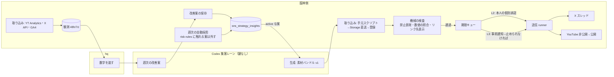
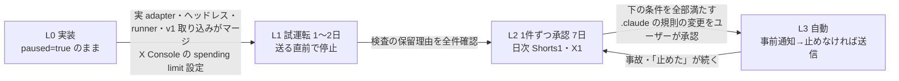

# SNS PDCA ループ（全貌 Shorts・X スレッドの 作る→出す→測る→直す）

**種別**: UI機能（スマホの「止める」操作と、自動送信の状態表示を管理画面に足す。主な中身は送信・取り込みのバッチ）
**対応Linearチケット**: なし
**前提の設計（作り直さず、上につなぐ）**: [sns-hub-phase2-pdca-loop](../sns-hub-phase2-pdca-loop/spec.md)（改善案の表・戦略メモタブ）、[sns-hub-metrics](../sns-hub-metrics/contract.md)（48h/7d の観測の受け皿、SQL136）、[sns-hub-x-send](../sns-hub-x-send/contract.md)（SQL137）、[sns-hub-deadline-queue](../sns-hub-deadline-queue/contract.md)（SQL139）、[sns-hub-mobile-approval](../sns-hub-mobile-approval/contract.md)（SQL140）、[sns-hub-shorts-send](../sns-hub-shorts-send/contract.md)（SQL146、案B）、SQL147（差分）・SQL148（投稿済みの承認保護）。いずれも本番適用済み

## 目的

毎日の全貌 Shorts（YouTube）と X スレッドを、作る→出す→測る→直すで回し、動画の質を数字で上げ続ける。ものさしは「SNS からサイトに来た人数」と「龍神ソナーを使った人数」。

## ユーザーの決定（2026-10-12、オーケストレーターのセッションで直接確認）

- **A 投稿**: 最初の1週間は今までどおり1件ずつ承認。その後は、機械の検査（禁止表現・数値の照合・リンク先の表示確認）を通ったものをオーナーへ事前通知し、締切の1時間前までに止められなければ自動で出す（X・YouTube。YouTube は 10/8 の案B＝非公開で上げて公開直前に再確認を維持）
- **B 改善**: phase2-pdca-loop の設計どおり、週1回の改善案は止めなければ採用（risk-rules に触れる案は自動で外す）。次の生成に入れる
- **C 測る**: YouTube Analytics と X API（従量課金、オーナー了承）を 48h/7d の受け皿に自動で入れる。GA4 の UTM 流入も同じ投稿に結びつける
- **役割**: 生成と週次の改善案づくりは Codex の集客レーン（hq が数字を渡す。Codex に鍵は渡さない）。送信・数字の取り込み・改善案の保存は龍神側の仕組み

## 全体の流れ

## 機能要件

### A. 自動投稿

| # | 要件 | 優先度 | 受入基準 |
|---|---|---|---|
| A1 | 送信の実接続 | 高 | X（スレッド：親＋子）と YouTube（案B：非公開アップロード→処理確認→公開）の実 adapter を、既存の `runXQueueJob` / `runYoutubeQueueJob` / `runYoutubePublishJob` の契約のまま接続する。定期実行の起動役（runner）が期限キューを読み、`sweep` → claim → 送信を行う。既存の承認hash照合・期限・費用予約・日次枠・要照合（reconcile）・初期停止（paused）の契約は変えない |
| A2 | 送信直前のリンク先表示確認 | 高 | 既存 `createDeadlinePreflight` の `headless` を実ヘッドレス（未認証・Cookie なし）で接続する。対象画面ごとの印（`markers[screen_key]`）が全部見えなければ保留。結果を `release_evidence`（mobile-approval の「正式公開証拠」）として保存する |
| A3 | 龍神側の数値の照合 | 高 | 素材の主張（`claims`）ごとに、龍神の DB の値と照合し直す。Codex の自己申告（`QA.pass`・`numeric_claims_match`）だけでは通さない。一致しない主張が1つでもあれば自動送信の対象から外し、個別承認に回す |
| A4 | 送信モード（L2 個別承認 / L3 自動）の切り替え | 高 | チャネルごと（X・YouTube）にモードを持つ。初期値は個別承認。L3 へはオーナーの1回の操作でだけ切り替わる（期間の経過で自動では切り替えない）。切り替えた日時・操作者を残す |
| A5 | 事前通知 | 高 | L3 のとき、機械の検査を通った投稿ごとに Slack へ通知する（X スレッドは1件にまとめる）。本文に「止める」ためのリンク（その投稿だけを止められる使い捨てのリンク。管理画面のパスワードは要らない。ADR 0092）、送る時刻、止められる期限、投稿の要旨を入れる。通知は止められる期限の2時間以上前（公式締切の3時間前まで）に出す。間に合わないものは自動送信せず個別承認に回す（自動の処理は JST 8:00 から動くので、締切が JST 11:00 より前のレースは常に個別承認になる） |
| A6 | 止める操作（スマホから1タップ） | 高 | (a) その投稿だけ止める（X スレッドは子も含めて止まる。YouTube は非公開のまま残す）、(b) 自動を切って個別承認に戻す（チャネルごと）。どちらもスマホの管理画面から1タップで効く。既存の全停止（paused）も残す。再開・自動への復帰は管理画面だけで行う |
| A7 | 止められる期限と送る時刻 | 高 | **（Q1、2026-10-12 ユーザー決定）** 締切＝そのレースの公式締切。止められるのは締切の60分前まで。X 投稿と YouTube の公開はその時点で行う。**YouTube は締切の60分前に非公開でアップロードを始め、同じ処理の中で処理の完了を確かめてから公開する**（2026-10-13 ユーザー決定、確認C。10/12 の「通知の時点で非公開アップロード」から変更。既存の YouTube の送信の作りと、太平洋時間の日付の検査に合わせるため）。既存の失効（締切30分前）は維持し、それまでに公開できなければ非公開のまま残す |
| A8 | 素材の受け渡し口（素材バンドル v1） | 高 | 下の「受け渡し口の判断」のとおり、v0 のファイル構成と検査は残し、版・運び方・容量を変える |
| A10 | 新しい型は自動にしない | 高 | 初めて使う構成・コンポジション（`sns_template_variants` に新しく入った版、または Codex が新しい型として出したもの）の投稿は、モードが自動でも個別承認に回す。phase2 で新しい型の自律生成を許した理由が「投稿前の人の承認が最終防波堤」だったため、その防波堤を新しい型に限って残す |
| A9 | 試運転（dry-run） | 中 | runner を「外部に送る直前で止める」モードで本番キューに対して動かせる。検査の通過・保留とその理由をログに残す |

### C. 測る

| # | 要件 | 優先度 | 受入基準 |
|---|---|---|---|
| C1 | YouTube の取り込み | 高 | 投稿済みの YouTube job（`posted`）ごとに、`posted_at` から48時間・168時間の時点で値を取り、`POST /api/admin/sns-hub/observations` と同じ契約（`sns_metric_observations`）で保存する。累積値（views 等）は対象時点に Data API で取得した値だけを保存し、遅れて取った累積値は欠測にする。日次の Analytics を時間窓へ換算しない（contract.md のまま）。日次の Analytics（engagedViews・視聴維持・登録者増）は別の系列として保存する |
| C2 | X の取り込み | 高 | 投稿済みの X job（スレッドの親・子それぞれ）について、48h/168h の時点で自分の投稿の指標（表示・エンゲージメント・リンクのクリック等、取れるもの）を X API で取得して保存する |
| C3 | GA4 の UTM 流入の結びつけ | 高 | X の投稿の URL に投稿ごとの UTM（`sns_post_tracking`、campaign・content＝投稿/版）を付け、GA4 からその UTM のセッション数・ユーザー数・ソナーを開いた人数を日次で取って同じ投稿に結びつける。**（Q2、2026-10-12 ユーザー決定）** YouTube Shorts は投稿ごとの流入を結びつけない（2023-08-31 以降、Shorts の概要欄・コメントのリンクは押せない）。Shorts からの流入は日単位で「YouTube 経由（プロフィールリンクの UTM ＋参照元 youtube.com）」として保存する |
| C4 | 取り込みの失敗の扱い | 高 | 取得失敗・上限到達・トークン失効は欠測理由として残し、0 で埋めない。3回続けて失敗したら Slack に通知する |

### B. 直す

| # | 要件 | 優先度 | 受入基準 |
|---|---|---|---|
| B1 | 週次の自動採用の復活 | 高 | `status=proposed` のまま1週間たった改善案を、週1回の定期処理で `active` にする。risk-rules（`scripts/lib/riskRules.js`）に触れる案は `retired` にして理由を `decision_note` に残す。戦略メモタブの既存の「採用」「却下」ボタンは残す（期限前に手で決めてもよい）。ADR 0030 の 2026-09-05 追記（手動採用への切り替え）をこの決定で上書きする |
| B2 | Codex の改善案の保存 | 高 | Codex が出した週次の改善案を、龍神側の仕組み（hq から渡されたファイルを読む手元スクリプト）で `sns_strategy_insights` に `status=proposed`、`research_method='codex-weekly'` で保存する。Codex は DB に書かない |
| B3 | 次の生成への受け渡し | 高 | 生成の前に、対象のチャネル・言語・型に一致する `active` な改善案を書き出し、hq 経由で Codex に渡す。生成された下書きに、参照した改善案の ID（`referenced_insight_ids`）を記録する |
| B4 | 週次の数字の受け渡し | 中 | 観測（C1〜C3）を週1回まとめ、投稿ごと・型の版ごとの表として hq に渡す（ファイル）。Codex はこれを読んで改善案を作る |

## 受け渡し口の判断（Codex が作る動画を、今のプレビューバンドルのままでよいか）

**判断: そのままでは使えない。ファイル構成と検査は残し、3点を変える（素材バンドル v1）**

| 項目 | 今（v0） | 変える理由 | v1 |
|---|---|---|---|
| 公開 | 恒久に公開保留（承認 API が 409、DB トリガーも拒否） | 自動送信の前提を満たせない | `schema_version=ryujin-preview/1`。A2・A3 の龍神側の検査を通ったものだけ公開可。v0 の保留は解除しない |
| 運び方 | 管理画面でファイルを手で選ぶ。Vercel 経由で1回4 MiB まで | 毎日の自動運用で人の操作が入る。Shorts の動画は 2 MiB に収まらない | 手元のスクリプトが Storage に直接上げ、登録 RPC を呼ぶ。鍵はこのスクリプトだけが読む（Codex は読まない） |
| 動画の容量 | 1ファイル 2 MiB | 1080×1920 の Shorts は数 MB〜十数 MB | 送信契約と同じ 32 MiB |

## 運用の段取り（L0〜L3、関門で進む）

- L2 → L3 の条件: X・Shorts とも5件以上を実送信、誤投稿0、要照合の未解決0、「機械は通したが本人が止めた／直した」件の原因が分かっている、止める操作（A6 の a・b）を本番で1回ずつ試して効いた
- L3 → L2 に戻す条件: 誤投稿1件、または1週間に「止めた」が3件以上
- 暫定の日付: L0 完了を 10/19 と置くと L2=10/20〜10/26、L3=10/27〜。L0 が延びれば後ろへずれる（日付を先に決めない）

## 統計検証（何をもって良くなったと言うか）

根拠: [analysis/baseline-and-power.md](analysis/baseline-and-power.md)（スクリプト `scripts/analysis/sns-pdca-baseline/`、結果 `data/analysis/sns-pdca-baseline/`）。

**事実**: SNS からサイトに来る人は、投稿していた期間でも X 1.11人/日・YouTube 0.22人/日。SNS 由来でソナーを開いた人は4日で1人。Shorts は 13,575回の再生でサイトへの流入が延べ4人。この量では、サイト流入とソナー利用で改善を週ごとに判定できない（2倍になっても版ごとに6週）。

**判定の段（Q3、2026-10-12 ユーザー決定）**

| 段 | 指標 | 単位 | 使い方 |
|---|---|---|---|
| 版の判定（YouTube） | engagedViews/views、平均視聴率、2日で100回以上の割合（いずれも太平洋時間の投稿日＋翌日の2日） | 1本 | 型の版を比べて採否を決める。必要件数は投稿本数で数える（率は2日で30回以上の動画でしか出ないため） |
| 版の判定（X） | 48h の表示・リンクのクリック・エンゲージメント率 | 1スレッド | 取り込み開始から4週たまったら、ばらつきを測って必要件数を決める（今は未取得） |
| 北極星 | X・YouTube 由来のサイトユーザー、SNS 由来でソナーを開いた人 | 週 | 毎週数字を出すだけ。判定は12週ごと |
| 守り | 版の判定の指標が、直近4週の分布の下側10%を下回っていない（基準値1点とは比べない。1週7本では効果が無くても半分ほどの週で基準値を下回るため） | 週 | 週次の改善案を入れた週に悪化していないかだけを見る |

**「良くなった」と言う条件**
- 版の比較は、2つの版を日替わりで交互に出す（曜日の偏りを打ち消すため、翌週は順番を逆にする）。前の週と後の週の比較は使わない（チャンネル全体の勢いの変動が版の違いより大きい）
- 同時に試す版の差は1つだけ
- 判定は「版ごとに必要件数がたまった時点」で1回だけ行う。主な目安: engagedViews/views が1.5倍なら投稿本数で版ごと27本（1日1本の交互で約8週）、平均視聴率 +10pt なら版ごと43本（約12週）。+20% ほどの小さい改善はどの指標でも1年以上かかり、判定できない
- 再開直後の2週は基準値の取り直しにあて、判定に使わない
- 数字を出すときは「GA4 は Cookie に同意した人だけ」と、母数（何本・何日）を添える

**週次の改善案（B）との関係**: 改善案は毎週入れてよいが、週ごとに効果は判定しない。週ごとには「守り」の条件だけを見て、悪化していれば次の週に外す。効果は8〜12週ごとに版をまとめて判定する

## スコープ

### やる
- 上の A1〜A9、C1〜C4、B1〜B4
- スマホの「止める」2種と、自動送信の状態（モード・次に出る投稿・止められる期限）の表示
- .claude の規則の変更案の作成（自分では書き換えない。下記「制約」）

### やらない
- 生成そのもの（Codex の担当）、改善案の中身を考えること（Codex の担当）
- TikTok（2026-10-05 にアカウントがバン）、note・ブログ
- 他者の投稿への返信・引用（自動返信は既存の契約でも提供しない）
- YouTube の `publishAt` による外部の自動公開（案B のまま）
- 要照合（reconcile）を自動で解除・再送する仕組み（既存の契約のまま）
- 複数の改善案が矛盾したときの解決（phase2 の既知の限界のまま）

## 非機能要件

- **X API の費用**: 送信と取り込みの合計で月 $10 以下（既存の上限、SQL137 で最大 $10）。料金（docs.x.com、2026-10 時点）: 投稿 $0.015／URL を含む投稿 $0.20／自分の投稿の読み取り $0.001 per resource。メディアのアップロードの単価は料金表に無く、`/step2` で確かめる。URL を含む投稿は1スレッドにつき1件（投稿ごとの UTM のため）とする

  | 1か月（30日）の見込み | 金額 |
  |---|---|
  | URL を含む親の投稿 30件 | $6.00 |
  | 子の投稿 30×5件（スレッドは最大6件） | $2.25 |
  | 取り込み（5投稿×48h・168h×30日＋自分のユーザー情報） | 約 $0.35 |
  | 合計 | 約 $8.6 |

  既存の予約台帳は1回の送信ごとに同じ上限額を予約し、返金しない。しかも YouTube の送信も同じ台帳を消費する。このままだと1日7回（X 6＋YouTube 1）×URL つきの上限額 $0.20 以上で約1週間で $10 に届く（2026-10-12 design-reviewer）。153 で予約額を種類別（URL つきの親／子／YouTube は0）にする。**上限は $10 のまま**（2026-10-12 ユーザー決定）。L3 に入る前に X Console の実請求額で見直す
- **費用の止め方**: (1) X Console の spending limit を同じ請求期間で $10 に設定（超えると X 側で API が止まる）、(2) 既存の予約台帳（`attempt_ceiling` を先に予約、返金しない）で送信が上限を超えない、(3) 取り込みも同じ台帳に予約し、残りが「当月の残り日数分の送信予約」を下回ったら取り込みを先に止める。上限の変更はオーナーだけ
- **YouTube のクォータ**: 既存の台帳（1日10,000 units、アップロード＋104 units の保守的予約）に取り込みの読み取りも計上する
- **止める操作の速さ**: スマホでリンクを開いてから1タップ。止めた後、次の外部呼び出しの前に必ず効く（すでに始まった通信は取り消せない旨を画面に出す。既存の契約どおり）
- **モバイル**: 止める画面は 375px で崩れない（`.claude/rules/mobile-ui.md`）
- **鍵**: 値をチャット・ログ・PR に出さない。Codex に渡さない
- **取り込みの完了の定義**（`.claude/rules/data-acquisition.md`）: 観測ごとに取得時刻を保存する。48h・168h の窓は「`posted_at`＋48h／168h の時点から許容遅延以内に取得できた投稿の割合」で実測する（許容遅延は `/step2` で決める）。0件の実行を成功にしない。取り込みの未実行・連続失敗を Slack に通知する
- **Disk IO**: 書き込みは1日あたり投稿2件×窓2つ×指標十数個＋GA4 の日次数十行程度の見込み（`/step2` で行数×行サイズを見積もる）

## 制約・前提

- **規則の変更が要る**: `.claude/CLAUDE.md`「確認のバッチ化」は SNS 投稿の最終送信を1件ずつユーザー承認としている。L3 を動かすにはこの規則の変更が要る。変更案は [rule-change-proposal.md](rule-change-proposal.md) に書き、オーケストレーター経由でユーザーが自動モード以外のセッションで承認・反映する（このレーンは .claude を書き換えない）
- **本番 DB の変更**: マイグレーション案と本番 SQL をユーザーに渡す（Claude は読み取りのみ）。番号は 153（送信モード・止める・事前通知）、154（X トークン・取り込みジョブ）を hq が予約済み（2026-10-12）
- **鍵の置き場**: YouTube Analytics の3つは取得済み（`.env.local`、読み取りを確認済み）。runner と取り込みは Vercel で動かす（ADR-0066）ため、Vercel の環境変数にも登録が要る（手順は plan 確定後にオーケストレーターへ渡す）。投稿用の `YOUTUBE_REFRESH_TOKEN`（scope=youtube.upload）は分析を読めないので流用しない。X の OAuth（ユーザー文脈）は refresh token が使うたびに入れ替わるため、固定の Secret では保てない。保存先は plan で決める（候補: DB に暗号化して保存）
- **用語**: 「競艇」は本文・ナレーション・焼き込み文字で使わない。ハッシュタグの暫定例外は既存のとおり（GA4 月間ユーザー1000人まで）
- **法的**: 結果を保証しない表現・射幸心をあおる表現は禁止（risk-rules.json）。舟券の購入を勧めない
- **既存の部品**: スマホの止める操作は mobile-approval の画面に足す。新しい画面は作らない

## 既定値で決定した事項（2026-10-12、オーケストレーター経由でユーザーが異議なしと確認。最後の行は ADR-0066 による）

| 項目 | 既定値 | 根拠 |
|---|---|---|
| 「龍神ソナーを使った人数」 | SNS 由来（UTM または参照元が SNS）のセッションで、ソナーのタブを開いた人数（`race_tab_select`／`race_tab_initial` の `tab_id=sonar`） | 投稿の効果を見るため SNS 由来に絞る。`analogy_section_view` は意味の切り替わり日をまたいで比べない |
| 数値の照合 | 龍神側が DB と照合し直す | 人の承認が外れる段階で、生成した側の自己採点だけでは通さない |
| 止める操作 | 1件だけ止める／自動を切って個別承認に戻す の2種＋既存の全停止 | 1件の不備で全体を止めずに済み、続く不備には全体で戻せる |
| 事前通知の場所 | Slack＋スマホ管理画面へのリンク | Slack は既存のワークフローで使っている。sns-hub に通知の仕組みは無い |
| 最初の1週間 | X・YouTube それぞれ実送信の初日から7日。経過後はオーナーが1回操作して切り替える | 自動で切り替わると、条件を確かめないまま L3 に入る |
| X の月額上限 | 送信と取り込みの合計で $10。近づいたら取り込みを先に止める | 送信が主目的。数字は欠測で残せる |
| 検査が止められる期限の後に通った | 自動で送らず個別承認へ | 止める時間が無いまま送らない |
| X スレッドの単位 | 通知1件、止めると子も全部止まる | 既存の `parent_not_posted` で子は送られない |
| 1日の本数 | Shorts 1本＋X スレッド1本（1レース） | 既存の運用。統計の母数もこの本数で見積もる |
| Codex の改善案 | `research_method='codex-weekly'` を足す。既存の供給元は残す | phase2 の表の拡張性の設計どおり（スキーマ変更なし） |
| 取り込み・runner の置き場 | Vercel Functions + Vercel Cron | ADR-0066（新しい取得・定期処理は Vercel Cron、GitHub Actions に足さない）。送信直前のヘッドレス確認を Vercel で動かせるか（時間・容量）は `/step2` で確かめ、無理なら理由を ADR に残して別の置き場を決める |

## 未確定事項

| 項目 | 内容 | いつ・誰が決めるか |
|---|---|---|
| X の取り込みの単価 | `GET /2/users/{id}/tweets` が Owned Reads（$0.001）になるか、媒体のアップロードに課金されるか。料金表に明記が無い | L2 の間に X Console の請求で実測する |
| 事前通知の送り先 | 既存の `SLACK_WEBHOOK_URL`（1つだけ。どのチャンネルかは未確認）を流用するか、通知専用の Webhook を作るか | オーナー（tasks 26 の鍵の登録のとき） |
