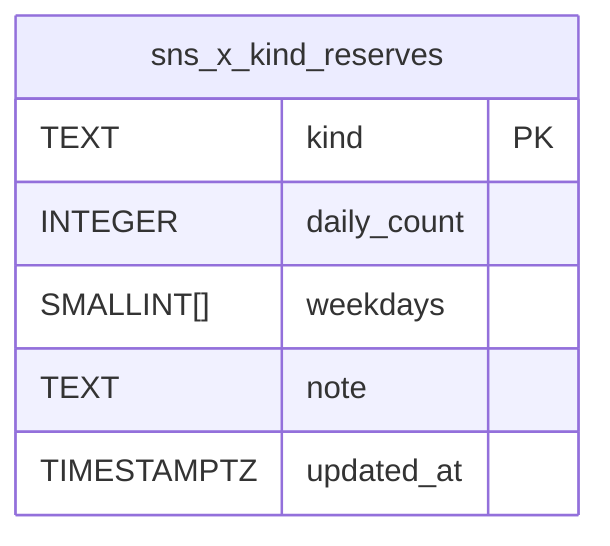

# X の日の枠の取り置き（出し物ごと）

X の1日の送信の枠（`sns_x_send_control.daily_limit_x`）を出し物（全貌・/today・優勝戦・数字で見たら）ごとに取り置き、先に送る出し物が他の出し物の枠を使わないようにする。マイグレーション 179。

## 1. 背景

- 今の上限は `daily_limit_x` の合計だけ。送り手の claim（`transition_sns_send_139`、177）が「今日の試行＋他経路＋必要な本数 ≤ 上限」を見る。先に claim した側が枠を取る
- 送る前（取り込み）に枠を確かめるのは `scripts/sns/push-finals-image.js` の `dailyLimitReason` だけ。`push-full-picture.js` と /today（`scripts/lib/snsTodayPlanner.js`）には無い
- 優勝戦は締切が遅い（16:30〜20:45）。全貌が多く送られた日は、優勝戦の本投稿と投票のリプの組が落ちる
- 取り置きの数の正本は hq の `config/x-slots.json`（全貌4・/today 1・優勝戦3・数字で見たら1（月水金）、合計9。数字で見たらが無い曜日の1本は取り置かない）。本番（Vercel の送り手）から hq のファイルは読めない
- 実測（2026-10-27、読み取り）: `daily_limit_x=9`（10/26 の決定の8から、10/27 に数字で見たら分を上げた）・`daily_external_count=0`。直近7日の X の試行は /today 1本/日・全貌 1〜4本/日。/today の返信の型と優勝戦はまだ送っていない

## 2. 決めたこと

### 2.1 取り置きの持ち方: DB の表 `sns_x_kind_reserves`

| 列 | 型 | 意味 |
|---|---|---|
| kind | text PK | 出し物。`sns_auto_send_items.kind` と同じ値（`full_picture`・`digest`・`finals_image`、数字で見たらは取り込みの PR が決める kind） |
| daily_count | int 0〜100 | その日の取り置きの本数（スレッド・リプも1本ずつ数える） |
| weekdays | smallint[]（ISO の曜日 1=月〜7=日）、NULL は毎日 | この曜日だけ取り置く |
| note | text | 説明 |

- 初期の行（179 で入れる）: `full_picture` 4・`digest` 1・`finals_image` 3（合計8。上限9なので取り置かれていない残りは1）。数字で見たらの行（月水金に1）は、その取り込みの PR が kind を決めて入れる。入れると月水金は合計9＝上限で残りが0になる
- 書き込みはオーナー（SQL Editor）だけ。service_role は読むだけ。RLS 有効・匿名の権限なし
- hq の config との照合: `scripts/sns/x-slots-check.js <x-slots.json>`（読み取りだけ）が DB と比べ、違えば直す SQL を出す。hq が同じ Mac で回す。名前の対応（hq → kind）は `today→digest`・`finals→finals_image`・`full_picture→full_picture`・`research_rank→`（取り込みの PR が決める）
- 代案（採らない）: `sns_x_send_control` に JSONB の列。曜日つきの行を CHECK で縛れず、1行の更新で全部を書き換えるので取り違えやすい

### 2.2 数え方（関数 `sns_x_slot_room`、claim と取り込みで同じ式）

JST の今日について、出し物 j ごとに

- r_j: 今日の取り置き（曜日が外れれば0、表に無い kind・item の無い job（通り道 B）は0）
- B_j: 今日の X の試行の数（`attempt_dates`）＋まだ claim していない分（下）
- job の出し物は `auto_item_id` の item の kind。item の無い子（リプ）は親の item の kind

出し物 k が n 本を足せるのは

```
他経路（daily_external_count） + B_k + Σ_{j≠k} max(r_j, B_j) + n ≤ daily_limit_x
```

- 他の出し物は、取り置きの残り（r_j − B_j）を使われない。取り置きを越えた分（例: 全貌の5本目）は、取り置かれていない残り（上限 − 取り置きの合計）を早い者勝ちで使う
- 今の式（今日の試行＋他経路＋n ≤ 上限）は Σ max(r_j, B_j) ≥ Σ B_j なので、この式を満たせば必ず満たす。今の検査は残す
- 「まだ claim していない分」は呼ぶ側で変える
  - claim（`p_with_queued=false`）: 親が今日 claim 済み（sending・reconcile・posted）で、まだ claim していない X の子（177 の「他の親の子」と同じ条件）。自分と自分の子は除き、n に入れる。まだ送る時刻でない queued は数えない（来ないかもしれない job で今の job を止めない）
  - 取り込み（`p_with_queued=true`）: 今日が期限の X の queued（attempts=0、期限の前）全部。朝に全貌を5本受けたとき、5本目を受ける時点で止められる。作り直し（/today で版が同じとき）は前の版の job が queued のまま残るので、`p_draft_id`（今の下書き）の job とその子は数えない
- 返り値に今日の取り置きの合計（`reserved_total`）と、他経路と足して上限を越えるか（`over_reserved`）を入れる。越える日は取り置きの中でも後から来た出し物が止まる。DB では拒まず、取り込みが Slack・結果に1行出す（`x-slots-check.js` も警告する）。`daily_external_count`（他経路）は取り置かれていない残りから先に使う
- 例（上限9・取り置き 全貌4・/today 1・優勝戦3、火曜）: 全貌の5本目は 0+4+max(1,1)+max(3,0)+1=9 で通る、6本目は10で止まる。その後の優勝戦の本投稿＋投票（n=2）は 0+max(4,5)+max(1,1)+0+2=8 で通り、展示後のリプも9で通る

### 2.3 原子性

- claim は `transition_sns_send_139` の中で `sns_x_send_control` を FOR UPDATE で取ってから数える（今と同じ）。同時の claim は1つずつ通るので、枠を越えない
- 取り込みの確かめは予定に入れる前の目安（同時に2本を受けると両方通りうる）。正は claim。取り込みの確かめは「claim で止まるのが分かっている job を作らない」ため（作ると期限まで2分ごとに Slack が鳴る、sns-send-ops.md）

### 2.4 claim で止まったとき: held（`kind_slot_full`）

- 今の「日次全体上限です」は例外を投げ、job は queued のまま残り、runner が2分ごとに Slack に知らせ続ける。取り置きで止めるときは例外にせず `state='held', error_code='kind_slot_full'` にして1回で終える（取り置きは後から空かない）
- claim の held は runXSendJob がそのまま返し、runner は reconcile しか知らせていなかった。runner（`snsSendRunner.js`）が `held`・`kind_slot_full` を一度きりの事象として Slack に1回知らせる（system-architect の P1）。送り直すのは再承認（approve の ON CONFLICT で queued に戻る）。全貌・/today に自動で作り直す道は無い。優勝戦は push の作り直しで戻せる
- 子（リプ）にも同じ式を当てる。親の claim は自分の子を n に入れて通っており、他の claim は claim 済みの親の子を B に数えるので、子が後で止まるのは取り置きの数を日中に変えたときだけ
- 通り道 B（企画・承認）と kind=race は r=0 なので、取り置かれていない残り（上限−取り置きの合計）だけを使い、無ければ held。取り置きの合計＝上限の日は必ず止まる（直近21日の本番の X の試行は digest と full_picture だけなので今は起きない）。今の v_a_pending（A の予定を先に引く）は 177 の全体の検査の側に残す

### 2.5 取り込みの確かめ

共通の `scripts/lib/snsXSlots.js` の `checkXSlot(call, kind, need, draftId)` が rpc `sns_x_slot_room` を呼ぶ。止めるのは `reason='kind_slot_full'` のときだけ。関数が無い（179 の適用前、PostgREST の 404・PGRST202）・今日の基準が未確認・読めない（5xx 等）ときは止めない（今のまま。claim が正）。読めない理由と取り置きの越えは `note` で返し、呼ぶ側が Slack・結果に1行出す。

| 取り込み | kind | n | 枠が無いとき |
|---|---|---|---|
| push-full-picture.js | full_picture | 1（X だけ） | X の下書きを作らず、YouTube（完全版・Shorts）は送る。Slack に1行 |
| /today（snsTodayPlanner.js） | digest | 1、返信の型は2 | 自動の承認をせず、item を manual（返信の型は held_manual）に戻す（今の自動の承認の失敗と同じ道） |
| push-finals-image.js | finals_image | 本投稿2（投票のリプと対）・展示後のリプ1 | 今の dailyLimitReason の拒否と同じ（exit 1）。dailyLimitReason（全体の上限）は残し、取り置きの確かめを足す |
| push-research-image.js（並行で新設） | 新しい kind | 1 | 同じ `xSlotRoom` を使う（その PR で） |

### 2.6 適用の順と互換

- コード（取り込みの確かめ）が先でも後でもよい。179 の前は rpc が 404 で、取り込みは今のまま送る。claim も今のまま
- 179 の後は claim が取り置きを見る。古いコードの取り込みでも、claim が出し物ごとに止める（held）
- 戻し方: 関数 `transition_sns_send_139` を 177 の本文に戻す。表と `sns_x_slot_room` は残してよい（呼ばれなければ効かない）。消すなら必ず関数を戻した後（plpgsql の中の呼び出しは pg_depend に出ないので、先に消すと X の claim が全部例外になる）
- 当てるとき: 当てる直前に `daily_limit_x` を読み直す（PR を書いた時点の値で決めない）。177 の「claim を待つリプの子の数」が0で、優勝戦の時間帯（16:30〜20:45）の外に当てる（claim 済みの親の子が、当てた瞬間に新しい式で止まらないように）

### 2.7 データ設計



外部キーは置かない（kind は `sns_auto_send_items.kind` の値と文字で合わせる。数字で見たらの kind を新設する PR が CHECK を足す前に行を入れられるように）。

## 3. 注意（hq に返す）

- /today の返信の型は1日2本（親と返信、どちらも kind=digest）。取り置き1のままだと、取り置かれていない残りが無い日（合計＝上限）は親の claim が止まる（返信と対で数えるため。177 の意図どおり親だけは送らない）。返信の型を回すなら /today の取り置きを2にし、上限も1上げる
- 合計（取り置き）＋他経路 ≤ `daily_limit_x` を保つ。越えると後から送る出し物が止まる。`x-slots-check.js` と取り込みの Slack が越えを警告する
- 取り置きは、その出し物の締切が全部過ぎても・許可が off でも、その日は解けない（無駄が出る。今の全貌は1日1〜4本なので実害なし。必要になったら「許可が false の kind は r=0」にする）
- 数字で見たらの kind 名は push-research-image.js の PR が決める。決まったら hq の対応（research_rank → kind）を `x-slots-check.js` の `HQ_KIND` に足す

## 4. （急がない）全貌を完全版と入口版の別の出し物に分ける案

今は `daily.mjs --variant a|b` が bundle に `full_picture_variant: {id}` を1つ書き、push-full-picture.js が X・YouTube（完全版）・Shorts の3つの下書きに同じ札を写す。

案:
- `daily.mjs --variant full=a,entry=b` を受ける（`--variant a` は今までどおり両方 a）。bundle は `full_picture_variant: {id: "a", by_part: {full: "a", entry: "b"}}`（`id` は今の読み手のために残す）
- push-full-picture.js は下書きごとに札を選ぶ: YouTube（完全版）は `by_part.full`、X と Shorts（入口版、同じ mp4）は `by_part.entry`。`by_part` が無ければ今の `id`
- 送る口は1レース1回のまま（1つの bundle・1回の push）。完全版→Shorts の URL の差し込み（Shorts の `parent_job_id`＝完全版の job、`{full_url}`）は変えない
- 取り置きを分けるとき（X の入口版だけを別の出し物にするなら）は item の kind を分けず、`sns_x_kind_reserves` の kind を `full_picture` のまま使う（X に出るのは入口版の1本だけなので、分ける必要が出るまで分けない）
- 描く段と比べる段だけを分ける（hq P1-4）。材料の取得は1回で、2つの描く段を同じ周で続けて動かす（hq P1-6）
