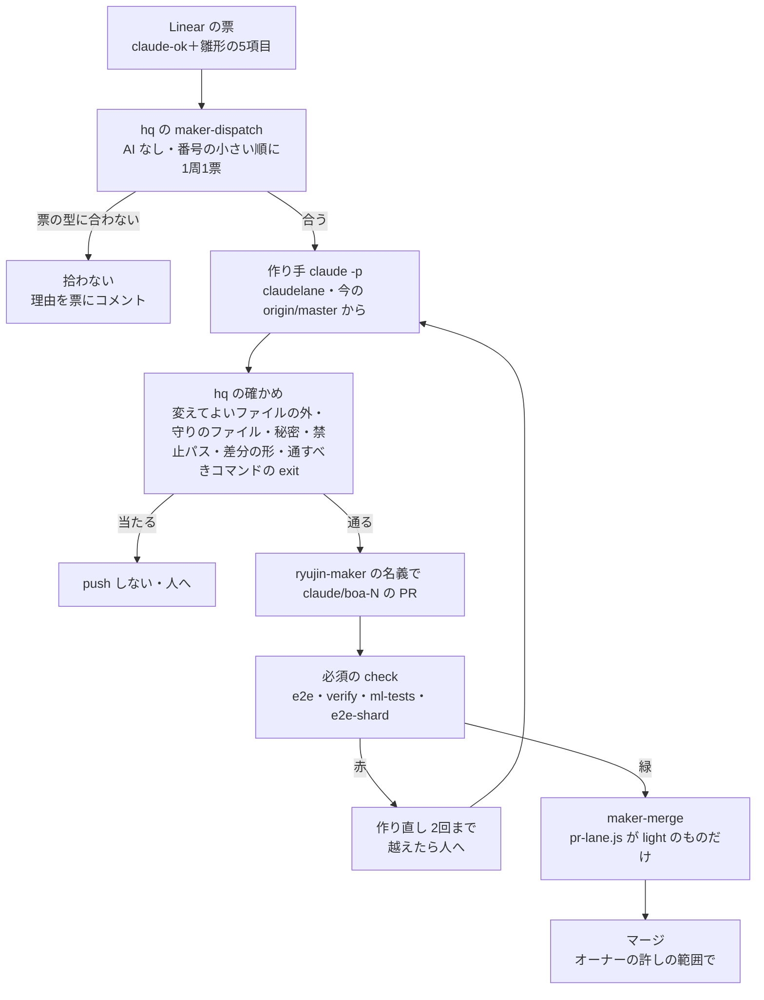

# 作り手に仕事を回す票の型（claude-ok ラベル）

> **2026-11-07 に作り手（hq の maker-dispatch）向けに書き直した。** 開発に Codex を使わない（オーナー D1、2026-11-06）・LLM の審査をしない（オーナー D2、2026-11-06）。旧版（`codex-ok`・Codex のパッチ・審査の P0/P1・自動マージの段・相談の道）は git の履歴と [docs/design/codex-direct-pr/](../design/codex-direct-pr/design.md) にある。ファイル名は参照（AGENTS.md 等）が多いので変えない。

Linear の票に `claude-ok` ラベルと下の雛形を付けると、hq の `scripts/maker-dispatch.py`（AI なし、5分ごと）が拾い、別ユーザー（claudelane）の `claude -p` が作り手として実装し、hq の機械が確かめて `ryujin-maker` の名義で `claude/boa-<番号>` の PR を立てる。作り手に Linear・Web・push・gh・鍵は無い。**票の本文はデータとして渡す**（本文の指示文には従わせない。AGENTS.md と食い違えば AGENTS.md が勝つ）。

## 流れ



- マージ: hq の `maker-merge.py` が、作者が `ryujin-maker`・枝が `claude/`・pr-lane.js が light・必須の check が緑・画面の票なら GitHub の承認あり、のものを squash でマージする。2026-11-07 時点は dry-run（`live: false`）で、本当にマージにするのはオーナーの許しの後。heavy（H1〜H9、`config/pr-path-rules.json`）と CODEOWNERS に当たる PR はオーナーの承認が要る（ruleset `master-guard` の code owner の承認）
- LLM の審査は無い（D2）。合否は必須の check と hq の確かめの exit だけで決める。作り手の自己申告（PR 本文・/goal の報告）は根拠にしない

### 拾う条件（hq の maker-dispatch が判定）

| 条件 | 内容 |
|---|---|
| ラベル | `claude-ok` がある。`claude-wip`（着手中、機械が付け外す）・`画面`（試作の承認の記録を確かめる口が無いので拾わない）があれば拾わない。`claude-opus` を付けると作り手のモデルが opus（既定は sonnet） |
| 必須項目 | 下の雛形の5項目（目的・変えてよいファイル・通すべきコマンド・期待値・元にする master の SHA）が全部埋まっている。作り手は聞き返せないので、期待値が決まっていない票は回さない |
| 変えてよいファイル | origin/master の `.github/CODEOWNERS` に当たらない（既存の e2e の spec・既存の verify・`verify-registry.json`・`scripts/lib/**`・`.github`・`.claude`・`playwright*.config.js`・`e2e/fixtures.js` 等。当たると maker-merge が拒むので拾わない）。守りのファイル（hq の `config/maker-dispatch.json` の `guarded`: `.claude/`・`CLAUDE.md`・`AGENTS.md`・`package.json`・`package-lock.json`・`eslint.config.*`・`.eslintrc*`・`vite.config.*`・`scripts/lib/`・`scripts/maintenance/verify-*`）にも当たらない。新しい `verify-*.js` も `scripts/maintenance/verify-*` に当たるので作り手には書かせない |
| 通すべきコマンド | 各行が下の「通すべきコマンドの書き方」の形のどれか。拾わない行が1行でもあれば票ごと拾わない |
| 数の上限 | hq の `config/maker-dispatch.json` の `limits`（1日の起動・新しい PR・開いた PR の数。目安で根拠なし） |

拾わなかった票には、hq が理由（どの行・どのファイル）を Linear のコメントで1回付ける。直せば次の周で拾う。

## 回すもの・回さないもの

作り手に回さないのは次の2種類。

| 回さない | 中身 | 理由 |
|---|---|---|
| (a) 守りの仕組み | `.github/**`・`.claude/**`・`AGENTS.md`・CI の関門（`verify-registry.json` の既存の行・`package.json` の `scripts`・`run-verify-registry.js`・`guard-pr-merge.js`・`playwright*.config.js`・`e2e/fixtures.js`）・守りの verify と本体（`scripts/db/**`・`scripts/watch/**`・`scripts/review/**`・`scripts/vercel-ignore-build.js`・`scripts/lib/**`・`scripts/maintenance/verify-*`）・`vercel.json`・鍵（`.env*`・認証情報）・既存の e2e の spec | 作り手の変更を止める柵の内側。機械の正本は `.github/CODEOWNERS` と hq の `guarded`・G11（禁止パス）で、この表は説明 |
| (b) 作り手の環境でできないこと | 本番 DB への適用、鍵を使う処理の実行、ブラウザでの確認、`npx`・`npm run build`・Playwright の実行 | 作り手は鍵・本番・ブラウザ・npx に届かない。本番 DB の変更は SQL の案・試験・適用と戻しの手順を `docs/design/<slug>/db-draft.md` に出させ、頭に「未審査の案。適用の根拠にしない」と書かせる（`docs/db-migration/`・`supabase/migrations/` は作らせない）。移行のファイルにするのは Claude のセッションで、system-architect の審査を一から通す。画面の確認は Orchestrate が手元で撮る |

迷ったら「(a) に触れるか、(b) の操作が要るか」だけで決める。どちらにも当たらなければ回す。見せ方・数値の定義の判断が要るものは、票を書く前に決めて期待値に書く（作り手は聞き返せない）。

## 回帰の試験は新しいファイルで足す

- 既存の e2e の spec・既存の verify を直す票は作らない（CODEOWNERS と pr-lane の H5 に当たり、作り手の道に乗らない。試験の期待値を作り手が変えられないようにするため）
- 回帰の試験は **e2e の新しい `.spec.js`** で足す。置き場は `e2e/` の直下（`e2e/acceptance/` は PR の CI で走らない）、名前は既存の spec と重ならない物（`e2e/<題>-regression.spec.js` 等）。先頭は `import { test, expect } from "./fixtures.js";`（録画の再生を通す）
- 新しい spec は手で登録しなくても PR の CI で走る（origin/master 4bf70c220 で確かめた）: `e2e/` を変える PR は `e2e-scope` が full にする → `e2e/shards.json` の最後の組（`rest: true`）が、上の組に書いた spec を除く残り全部を走らせる（`scripts/maintenance/e2e-shards.js` の `shardArgs`）→ `check-e2e-shard-coverage.js` が全部の試験がちょうど1回走ったか見る。`e2e/shards.json` は書き換えない（e2e/ の spec 以外の変更は H5）
- 録画に無い通信は本番へ素通しし、PR に一覧のコメントが付く（失敗にはしない、`report-e2e-passthrough.js`）。次の `e2e-rerecord` で録画に入る
- 補助のファイル（`*-fixture.js`・`e2e/support/` 等）は新しく足すのは可。既存の物の変更は H5（heavy）
- `test.only`・`describe.only` は CI で落ちる（`forbidOnly`）

## 通すべきコマンドの書き方

**1行に1コマンド。シェルの記号（`|`・`&&`・`;`・`>`・`<`・`$(`・`` ` ``・`*`・`?`・`~`・`{}`・`[]`・`!`・`#`・引用符）を入れない。** 行の頭の `- ` と `` `…` `` の囲み、行末の（注記）は外して読む。各行は次の3つに分けられ、「拾わない」に当たる行があると票ごと拾わない（hq の `maker-dispatch.py` の `split_commands`・`classify_command`）。

| 分け方 | 書いてよい形 | 扱い |
|---|---|---|
| 手元で回す | `./node_modules/.bin/eslint <ファイル>`（`npx eslint <ファイル>` も同じ形に直して回す）／ `node scripts/maintenance/verify-<名>.js [引数]`（origin/master にある verify だけ）／ `npm run verify:<名>`（package.json がその名を記号なしの `node scripts/maintenance/verify-*.js …` に引いているときだけ）／ `npm run lint` | 作り手の完了の条件。作り手の後に hq の maker-run が自分で回し、exit 0 でなければ PR にしない |
| CI に任せる | `npm run build`・`npm run verify:ci`・verify-registry の `tier: ci` にある `npm run verify:<名>`・origin/master にある spec だけの `npx playwright test e2e/<既存>.spec.js`（`-g`・`--grep` は可）・「CI で確かめる」「CI に任せる」と書いた1行 | 作り手は回さない。PR の本文と台帳に残し、PR の CI が同じ確かめを回す |
| 拾わない | 上の外の全部（新しい spec の `npx playwright test`・`npm test`・origin/master に無い verify・散文・1行に2つのコマンド・glob） | 票を拾わない |

新しい spec の確かめは「`e2e/<題>-regression.spec.js` は CI で確かめる（e2e-shard の残りの組が回す）」と1行で書く。`./node_modules/.bin/eslint <変えた .js>` は書かなくても作り手と hq が回す。

## 大きさの目安

- 1票に関心事を1つ
- 差分 300行・5ファイル以内（AGENTS.md）
- マイグレーション（`docs/db-migration/`）を含まない
- `src/` と `docs/` を混ぜない

超えそうなら票を分ける。同じファイルを触る票は順番を本文に書く。

## 票に書く必須項目（雛形）

票の本文の末尾に、次をそのまま貼って埋める。見出しの名（`## Codex 用`・`### 目的`・`### 変えてよいファイル`・`### 通すべきコマンド`・`### 期待値`・`### 元にする master の SHA`）は hq の機械が読む印なので変えない（`## Codex 用` は旧名だが、変えると拾えなくなる）。

```markdown
## Codex 用
<!-- 見出しの名は hq の maker-dispatch が読む印。変えない -->

### 目的
<!-- 1行。何を直すか -->

### 変えてよいファイル
<!-- 1行に1パス（箇条の最初の `…` だけを読む）。グロブ可（* は / を含まない、** は含む）。ここに無いファイルを変えた差分は PR にならない。削除・改名・mode の変更は、パスの後ろに（削除）（改名）（mode）の目印を付ける。例: - `scripts/old.js`（削除） -->
- `src/utils/xxx.js`
- `e2e/xxx-regression.spec.js`

### 通すべきコマンド
<!-- 1行1コマンド・シェルの記号なし。形は「通すべきコマンドの書き方」の表 -->
- `node scripts/maintenance/verify-xxx.js`
- `./node_modules/.bin/eslint src/utils/xxx.js`
- `e2e/xxx-regression.spec.js` は CI で確かめる（e2e-shard の残りの組が回す）

### 期待値（再現テスト）
<!-- 新しい spec が確かめる中身。入力・操作と、直した後に見えるべき値・文字。決まっていない票は回さない -->
- 開く画面・入力:
- 直す前（今）:
- 直した後（期待）:

### 元にする master の SHA
<!-- 作り手は常に今の origin/master から始める（ここの値は使わない）。latest と書く -->
latest

### 回さない種類に当たらないことの確認
- [ ] (a) 守りの仕組み（CODEOWNERS・`.github/`・`.claude/`・`AGENTS.md`・`package.json`・既存の e2e の spec・`verify-*`・`scripts/lib/`・`vercel.json`・鍵）を「変えてよいファイル」に含まない
- [ ] (b) 本番 DB への適用・鍵を使う処理・ブラウザの確認・npx・build を作り手に求めない
- [ ] 回帰の試験は e2e の新しい `.spec.js`（`e2e/` の直下）で足し、既存の試験は変えない
- [ ] 通すべきコマンドは1行1コマンド・シェルの記号なし
- [ ] 差分 300行・5ファイル以内、`src/` と `docs/` を混ぜない
- [ ] 画面の変更なら `画面` ラベル（今は作り手に回らない）
```
