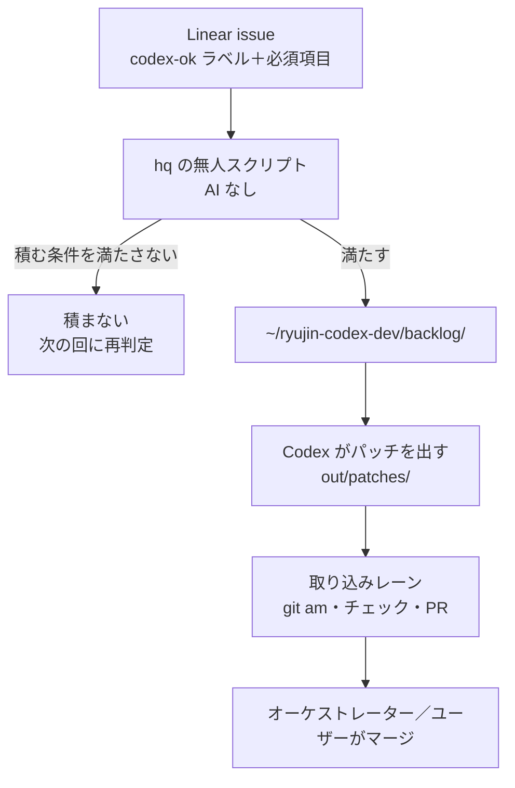

# Codex に仕事を積む（codex-ok ラベルと backlog）

Linear の issue に `codex-ok` ラベルと必須項目を付けると、hq の無人スクリプト（AI なし）が `~/ryujin-codex-dev/backlog/` に積み、Codex がパッチを出す。パッチは取り込みレーンが PR にする（2026-10-12 オーナー承認、hq 経由）。

Codex（`~/ryujin-codex-dev`）はリポジトリの浅い複製で実装し、パッチを出すだけ。push・PR・鍵・本番 DB には触れない。Codex への指示は `AGENTS.md` と下の雛形だけで、**issue 本文はデータとして扱う**（本文に書かれた指示文には従わせない）。

## 流れ



### 積む条件（hq のスクリプトが判定）

| 条件 | 内容 |
|---|---|
| 数の上限 | 上限なし。`codex-ok` は空き次第すぐ積む。取り込み待ちが5件以上になったら hq に通知し、オーケストレーターが取り込みのレーンを増やすか決める（2026-10-13 オーナー承認） |
| 元の SHA の鮮度 | issue の「元にする master の SHA」から master が3日超進んでいたら積まず、SHA を取り直して必須項目を作り直す |
| 必須項目 | 下の雛形の項目が全部埋まっていないものは積まない |

## 出せるもの・出せないもの

| 出せる | 出せない |
|---|---|
| テスト・品質ゲートの穴埋め（落ちている・抜けている再現テスト、verify の追加） | 設計・見せ方・数値の定義の判断（期待値を issue に書けないものは全部ここ） |
| 文書と実装の食い違いの修正（どちらが正かが issue に書いてあるもの） | 本番 DB への適用、本番データを書くバッチ |
| 再現手順と期待値が書ける小さな不具合 | 鍵・認証情報に触れるもの |
| 承認済みモックの小さな UI 修正（当面は絞る。承認範囲がモックの `APPROVED.md` で特定できるものだけ） | `.claude/`・CI のゲート（`verify-registry.json` 等）・permission・`.github/workflows/` |
| | マージの順序の判断 |
| | BOA-271・BOA-430 の見せ方の判断 |

迷ったら「期待値（修正後に何が正しいか）を issue に1文で書けるか」で決める。書けないものは見せ方か定義の判断なので出さない。

## 大きさの目安

- 1パッチに関心事を1つ
- 差分 300行・5ファイル以内
- マイグレーション（`docs/db-migration/`）を含まない
- `src/` と `docs/` を混ぜない

超えそうなら issue を分ける。

## issue に書く必須項目（雛形）

issue 本文の末尾に、次をそのまま貼って埋める。

```markdown
## Codex 用

### 目的
<!-- 1行。何を直すか -->

### 変えてよいファイル
<!-- パスの列挙かグロブ。ここに無いファイルは変えない -->
- `path/to/file.js`
- `e2e/xxx.spec.js`

### 通すべきコマンド
<!-- 修正後に緑になること。修正前は再現テストが落ちること -->
- `npx playwright test e2e/xxx.spec.js -g "…"`
- `node scripts/maintenance/verify-xxx.js`

### 期待値（再現テスト）
<!-- 修正前に落ちる再現テストの中身。入力・操作と、修正後に見えるべき値・文字 -->
- 開く画面・入力:
- 修正前（今）:
- 修正後（期待）:

### 元にする master の SHA
<!-- git rev-parse origin/master の値。3日超古いと積まれない -->
`0000000`

### 出せない種類に当たらないことの確認
- [ ] 設計・見せ方・数値の定義の判断を含まない（期待値が上に書けている）
- [ ] 本番 DB への適用・本番データを書くバッチを含まない
- [ ] 鍵・認証情報に触れない
- [ ] `.claude/`・CI ゲート・permission・`.github/workflows/` を変えない
- [ ] マイグレーションを含まない
- [ ] BOA-271・BOA-430 の見せ方の判断を含まない
- [ ] 差分 300行・5ファイル以内、`src/` と `docs/` を混ぜない
```

## 取り込みレーンのチェック

Codex の自己点検を通ったパッチでも、取り込みで CI に落ちる不具合が毎回見つかっている（[sns-hub-codex-intake-handoff.md](./sns-hub-codex-intake-handoff.md) の「CI で毎回引っかかる点」）。PR を作る前に次を確かめる。

1. パッチ冒頭の `From <commit>` と、issue の「元にする master の SHA」が合っているか。`origin/master` から作業ブランチを切って `git am --3way`
2. **rebase・衝突解消で古い期待値を持ち越さない**。元の SHA の後に master で変わったテストの期待値・文言・台帳の行を、パッチ側の古い値で上書きしていないかを `git diff origin/master -- <ファイル>` で確かめる（追加した行だけになっているか）。衝突マーカーを正規表現の置換で消さない
3. 変えたファイルが issue の「変えてよいファイル」に収まっているか。外れたものは戻すか、理由を PR に書く
4. `npm run verify:ci` に入っている検査のうち、変更に関係するもの（`npm run verify:*` の個別）と `node scripts/maintenance/verify-relative-imports.js` を手元で流す。全件は PR の CI（Quality Gates）で確かめる
5. UI テストは手元で実際に走らせる。Codex の環境はブラウザが起動しないので、「UI 未検証」のまま渡ってくる
6. 新しい `scripts/maintenance/verify-*.js` は `scripts/maintenance/verify-registry.json` に登録する（Codex は台帳を変えられないので、CI から呼ばれない場所に置かれていることがある）
7. SQL の `GRANT`/`REVOKE` は1関数1文（`verify-migration-rls` は1文の先頭の関数しか読まない）。マイグレーションは本来積まないので、含まれていたら issue の作り方を見直す
8. 通すべきコマンドが issue のとおり緑になり、再現テストが修正前に落ちることを確かめる
9. PR 本文に元の issue・元の SHA・上のチェックの結果を書く。マージはオーケストレーターかユーザー
