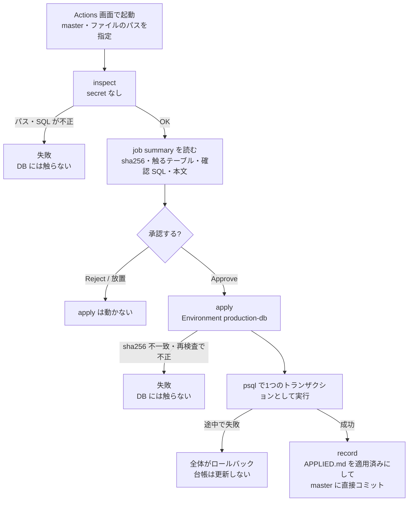
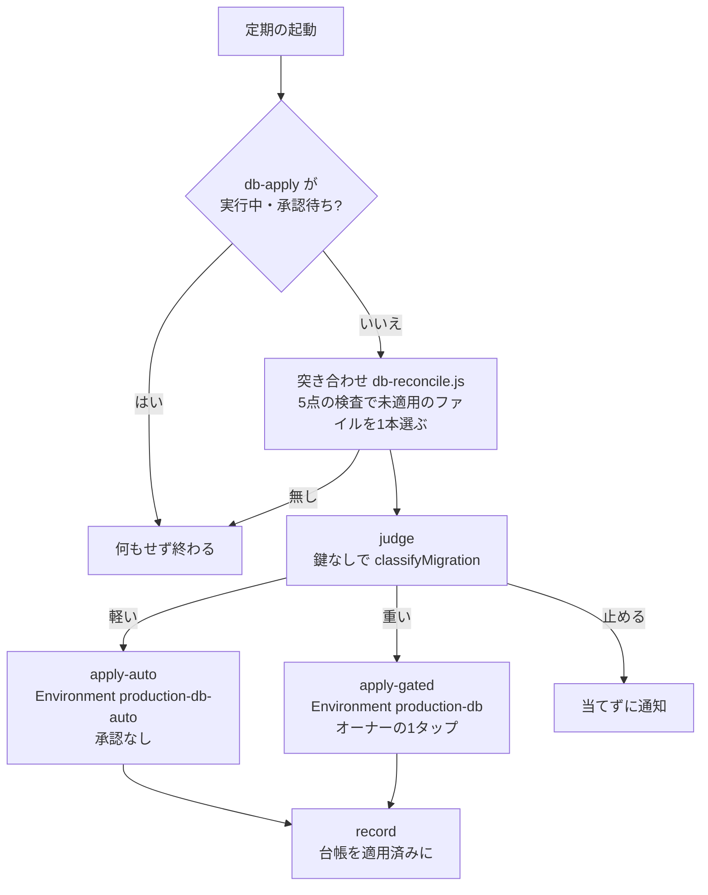

# 本番 DB へのマイグレーション適用（db-apply ワークフロー）

`docs/db-migration/` のマイグレーション1本を、GitHub Actions の画面から本番 DB（Supabase）に適用する。
承認は GitHub Environments の required reviewer（ユーザー本人）が1タップで行う。
これまでの「Supabase Dashboard の SQL Editor に全文を貼って実行」を置き換える。

- ワークフロー: `.github/workflows/db-apply.yml`
- 検査のロジック: `scripts/lib/dbApplySql.js`（CLI は `scripts/db/db-apply.js`）
- 検証: `npm run verify:db-apply`（Quality Gates で PR ごとに実行）

## 流れ

| job | 何をするか | secret | 書き込み権限 |
|---|---|---|---|
| inspect | master からの起動か確認、パスの検証、HEAD に通常ファイルとしてあるか確認、SQL の検査、job summary の出力 | 読まない | なし |
| apply | 承認を待つ。承認後、同じコミットを取り出し sha256 を再照合・再検査してから psql で実行 | `SUPABASE_DB_URL`（この job だけ） | なし |
| record | 最新の master の APPLIED.md を更新し、アプリ ryujin-bot の名義で master に直接コミットする（`[automated]`、`push-with-retry.sh`） | DB の secret は読まない（Environment `ryujin-bot` の App の鍵だけ） | GITHUB_TOKEN にはなし（App トークンの contents だけ） |

### 承認の前に止めるもの（inspect）

- パスが `docs/db-migration/NNN_英小文字.sql`（`013b_` のような枝番は可）でない。`..`・`/` を含められないので、ディレクトリの外は指定できない
- 起動した時点の master のコミットに、そのファイルが通常ファイル（シンボリックリンク不可）として無い
- トランザクションに包めない文: `CONCURRENTLY`（CREATE/DROP/REINDEX）、`VACUUM`、`ALTER SYSTEM`、`CREATE/DROP DATABASE`、`CREATE/DROP TABLESPACE`、`SUBSCRIPTION` の操作、`REINDEX SYSTEM/DATABASE`、`DISCARD ALL`
- トランザクション制御（`BEGIN`・`COMMIT`・`ROLLBACK`・`SAVEPOINT` 等）。ただし「先頭の文が `BEGIN`、最後の文が `COMMIT`」の1組だけは許す（現行のマイグレーションの書き方。下記）
  - `COMMIT;` の後に `GRANT` 等を書くと拒否される（139・140 がこの形）。`COMMIT` の後の文はトランザクションの外で単独実行になり、失敗しても前半が戻らないため。`COMMIT;` はファイルの最後に置く
- 見えない制御文字（双方向制御 U+202A〜202E・U+2066〜2069、ゼロ幅 U+200B〜200F、BOM）。承認画面に見える SQL と実行される SQL をずらせるため
- psql のメタコマンド（`\!` `\i` `\copy` 等。`\!` はランナー上でシェルを実行できる）
- `COPY`（データの投入はこのワークフローでは扱わない）、`BEGIN ATOMIC` の関数本体（文の区切りを判定できない。`$$` で書く）
- 閉じていない文字列・`$$`・コメント

これらを含むマイグレーション（既存では `CREATE INDEX CONCURRENTLY` の 050・055）は、従来どおり SQL Editor で手で適用する。

### トランザクションの包み方

| ファイルの書き方 | 実行 |
|---|---|
| トランザクション制御が無い | `psql -X -v ON_ERROR_STOP=1 --single-transaction -f <file>` |
| 先頭の文が `BEGIN`、最後の文が `COMMIT`（116〜122 の書き方） | `psql -X -v ON_ERROR_STOP=1 -f <file>`（ファイル自身の BEGIN〜COMMIT が1つのトランザクション） |

どちらも、途中の文が失敗すれば psql はそこで止まって接続を閉じ、トランザクション全体が戻る。

ファイルの前に `-c "SET lock_timeout = '10s'"`・`-c "SET statement_timeout = '10min'"` を実行する（`scripts/lib/dbApplySql.js` の `psqlArgs`）。
混み合うテーブルへの `ALTER TABLE` がロック待ちになると、後ろに並んだ本番の読み取りも止まる。10秒で諦めて全体を戻し、時間を置いて再実行する。
`--single-transaction` と、ファイル内の `BEGIN`/`COMMIT` を同時に使うと、ファイルの `COMMIT` の時点で確定してしまい、以後の文が単独で実行される（psql の仕様）。そのため2つの形に分けている。

## 初回設定（ユーザーが行う）

### 1. 接続文字列を取る（Supabase Dashboard）

1. Supabase Dashboard でプロジェクトを開き、上部の **Connect** を押す
2. **Connection String** タブで **Session pooler** を選ぶ（Type は URI）
3. 表示された `postgresql://postgres.<project-ref>:[YOUR-PASSWORD]@aws-0-<region>.pooler.supabase.com:5432/postgres` の `[YOUR-PASSWORD]` を DB のパスワードに置き換える
   - パスワードが分からなければ Project Settings > Database で再設定する（既存の接続に使っているなら、その接続も直すことになるので注意）
   - パスワードに `@` `:` `/` `?` `#` `%` を含むなら URL エンコードする（例: `@` → `%40`）

**Session pooler を使う理由**

| 接続先 | GitHub Actions から | 判断 |
|---|---|---|
| Direct connection（`db.<ref>.supabase.co:5432`） | IPv6 のみ（IPv4 は有料アドオン）。GitHub のホステッドランナーは IPv6 に出られないため繋がらない | 使わない |
| Transaction pooler（`:6543`） | IPv4 で繋がるが、トランザクションごとに裏の接続が入れ替わる。`SET`（`LOCAL` でないもの）等のセッション単位の設定が次の文に効かない | 使わない |
| **Session pooler（`:5432`）** | IPv4 で繋がり、1回の psql の間は同じ接続を使う。マイグレーションの実行に向く | **使う** |

### 2. Environment `production-db` を作る（GitHub）

リポジトリの Settings > Environments > New environment で `production-db` を作り、次を設定する。

| 設定 | 値 | 理由 |
|---|---|---|
| Required reviewers | 自分（rhapsody0919） | 適用の前に必ず本人が承認する |
| Prevent self-review | **OFF** | 起動するのも承認するのも本人1人のため。ON だと自分で起動した run を自分で承認できない |
| Wait timer | 0（設定しない） | |
| Allow administrators to bypass | **OFF** | ON だと admin（本人のアカウント。Claude の `gh` も同じアカウント）が承認なしで適用できる |
| Deployment branches and tags | **Selected branches and tags** で `master` だけ | master 以外から起動した run はこの Environment を使えない（ワークフロー側でも master 以外は落とす） |
| Environment secrets | `SUPABASE_DB_URL` = 手順1の接続文字列 | 承認後の job だけが読める。リポジトリの secret には置かない |

### 3. 変えない設定（GitHub）

- Settings > Actions > General > Workflow permissions の **Allow GitHub Actions to create and approve pull requests** は **OFF のまま**にする。record は PR を作らず、アプリ ryujin-bot の名義で master に直接コミットするので要らない。ON にすると pull_request のワークフローが bot として PR を承認でき、master の「承認1件」の要件が実質なくなる
- Environment `ryujin-bot`（`RYUJIN_BOT_APP_ID`・`RYUJIN_BOT_PRIVATE_KEY`）は他の自動コミットと共用で、既にある。足すものは無い

## 毎回の手順

1. 適用したいマイグレーションが master にマージ済みであることを確認する（PR のブランチ上のファイルは適用できない）
2. Actions > **DB Apply (production)** > **Run workflow**
   - Use workflow from: `master`
   - 適用するファイル: `docs/db-migration/122_venues_first_win_rate_race_count.sql` のようにリポジトリ直下からのパス
3. 起動した run を開き、**inspect** の job summary を読む。run 名が **DB Apply (production)** で、自分が今起動したものであることを確かめる（`production-db` を使うワークフローは db-apply.yml だけに限っている。`npm run verify:db-apply` が検査する）
   - ファイル・sha256・行数・実行のしかた（single-transaction / file-transaction）
   - 触るテーブル（CREATE/ALTER/INSERT/UPDATE/DELETE/DROP/TRUNCATE の対象。DO ブロック・関数本体の中は出ない）
   - 冒頭コメントの確認 SQL（適用前に SQL Editor で読み取りだけ実行して状態を確かめる、適用後に結果を照合する）
   - 文の一覧と本文（2000行まで全文。既存の最長は 001 の748行）
   - 「200 字を超える行がある」の注意が出ていれば、その行を行末まで横にスクロールして読む
   - 「台帳では既に適用済み」の注意が出ていれば、再適用してよいかを確かめる
4. 問題なければ **Review deployments** > `production-db` にチェック > **Approve and deploy**。やめるなら **Reject**
   - 承認すると、起動した時点のコミットのファイルが適用される。承認待ちのまま古くなった run（その後に同じファイルを直した等）は承認せず Reject し、起動し直す
5. apply が成功すると、record が APPLIED.md の行を「適用済み（日付・run URL・sha256）」にして master に直接コミットする（人の操作は要らない）
   - 「確認した根拠」の列を書き足すなら、別の PR で足す
6. ファイル冒頭の「適用後の確認」を実行する。RPC を変えたなら `node --env-file=.env.local scripts/maintenance/verify-rpc-output-keys.js` も実行する（CLAUDE.md の自動レビュー4）

## 失敗したとき

| どこで | DB | 台帳 | 対処 |
|---|---|---|---|
| inspect | 触っていない | 変わらない | summary の理由を直したマイグレーションを master にマージし、新しく起動する |
| apply の sha256 照合・再検査 | 触っていない | 変わらない | 起こらない想定（同じコミットを取り出している）。起きたら run を残して調べる |
| apply の psql | **全体がロールバック済み**（1つのトランザクション） | 変わらない（record は動かない） | ログの `psql:<file>:<行>: ERROR:` を見てマイグレーションを直し、master にマージして新しく起動する。`lock_timeout` 切れなら時間を置いて **Re-run jobs** でもよい（再承認が要る） |
| record | **適用済み** | 変わらない | **apply を再実行しない**。record だけを **Re-run failed jobs** で再実行する（失敗した job だけが動き、apply は再実行されない）。それでも無理なら APPLIED.md を手で直す PR を出す |

- **Re-run all jobs** は apply も含めてやり直す（承認がもう一度要る）。適用済みのものを再適用しないよう、record の失敗では使わない
- 同時に2本は走らない（`concurrency: db-apply`。2本目は1本目が終わるまで待つ）。待てるのは1本だけで、3本目を起動すると待っている2本目は取り消される。承認待ちの run も枠を占めるので、使わない run は Reject する
- 成功したが内容が誤っていた場合に自動で戻す手段は無い。戻す SQL を書いて同じ手順で適用する。最終手段は Supabase のバックアップからの復元（プランで有無・保持期間が違う。Dashboard > Database > Backups で確認する）
- 台帳（APPLIED.md）は record のコミットが master に入るまで「適用済み」にならない。record が失敗したまま同じファイルを起動しても「既に適用済み」の注意は出ないので、record の失敗は先に片付ける（DB 側での二重適用の防止は BOA-842）

## Claude（AI）は起動・承認しない

起動（`gh workflow run db-apply` や API の dispatch）・deployment の承認（`pending_deployments`）・Environments の変更は、ユーザー本人だけが行う。
Claude の役割は、マイグレーションを書いて PR にすることと、適用後の確認（読み取り）まで。

**技術的には止め切れていない。** Claude の `gh` はユーザーと同じアカウントで認証されているため、GitHub から見て Claude の承認と本人の承認は区別できない。
`.claude/hooks/guard-deploy-approval.sh`（PreToolUse）と `.claude/settings.json` の deny は、よく使う書き方を文字列で止めているだけで、言い換え（workflow の表示名や数値の ID での起動、GraphQL での承認、ブラウザ操作）は通る。
根本的に塞ぐには、Claude 用の `gh` を Environment の reviewer でない別アカウント（または権限を絞ったトークン）にする必要がある。ADR-0097 の切替（Claude の `gh` を作成の App にする）がこれに当たる。それまでは「Claude は起動・承認しない」という規律が主な防御になる。

## 自動の適用（ADR-0097）

[ADR-0097](../adr/0097-identity-separation-auto-review-and-db-apply.md) で、手での起動に加えて、定期の起動（毎時17分）が未適用のマイグレーションを当てる。同じ `db-apply.yml` の中にあり、手での起動の流れは変わらない。

- 今は試運転（`db-apply.yml` の `DB_APPLY_DRY_RUN: "true"`）。当てずに「当てるはずだった（軽い／重い／止める、理由）」を Slack と元の PR に1回だけ出す。当てるのは今までどおり上の「毎回の手順」
- 対象は、`DB_APPLY_SWITCH_SHA`（切り替えのコミット）より後に、審査の App が承認した PR で足されたファイルだけ。それより前の「未適用」は手で当てる
- repo の変数 `REVIEWER_BOT_USER_ID` が入るまでは、定期の起動は何もしない

- 試運転の間（段取り D〜D'）は judge までを動かし、当てずに「当てるはずだった」を通知する
- 当てる対象の5点の検査・軽い／重いの列挙・削除の前の控えは ADR-0097 にある
- 重いものの承認待ちが6時間を超えたら通知する
- 自動の経路は手での起動より短い `lock_timeout`・`statement_timeout` で当てる。超えたら失敗として止め、通知する

### 台帳の書き方（機械で読む）

突き合わせは APPLIED.md の「適用状況」の列を先頭の語で読む。

| 先頭の語 | 意味 | 自動で当てるか |
|---|---|---|
| `未適用` | 本番に無い | 当てる（そのファイルを足したのと同じ PR で行を足したときだけ） |
| `適用済み` | 本番にある | 当てない |
| `不明` | 突合で確かめられない | 当てない |
| `廃止` | 当てない決定 | 当てない |

- 新しいマイグレーションの PR では、行の「適用状況」を `未適用` で始める（括弧の中に補足を書いてよい）
- 先頭が上の4つのどれでもない行（古い行に日付で始まるものがある）は当てない

## マイグレーションに書かないもの

API キー・パスワード等の秘密の値。psql のエラー出力（`--echo-errors`）と job summary の本文にそのまま出る。

## 範囲外: データの一括投入

数万行規模のデータ投入（既存の upsert スクリプト。`scripts/maintenance/` のバックフィル等）は、このワークフローでは扱わない（`COPY` もここで拒否する）。
SQL ファイル1本を1トランザクションで流す形に合わず、所要時間・Disk IO・途中失敗時の再開の考え方が違うため。
必要になったら、同じ Environment の承認を前段に置いた別のワークフローにする（今は作らない）。
