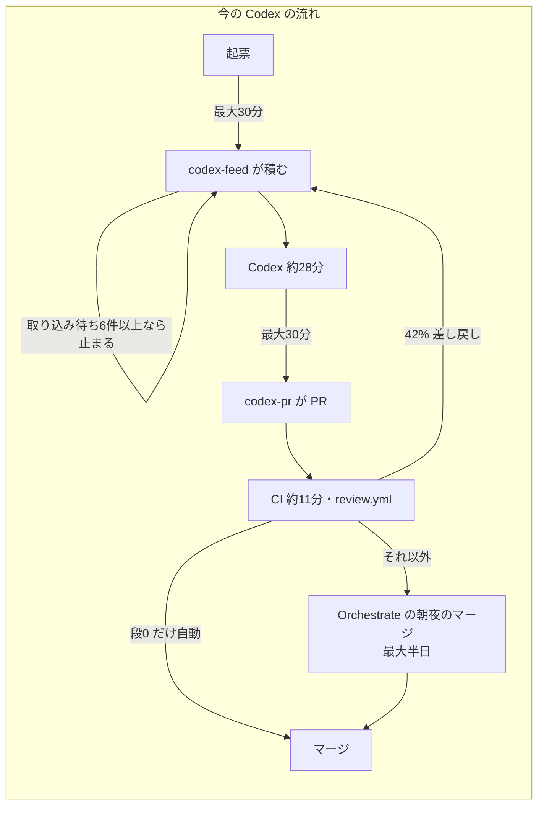
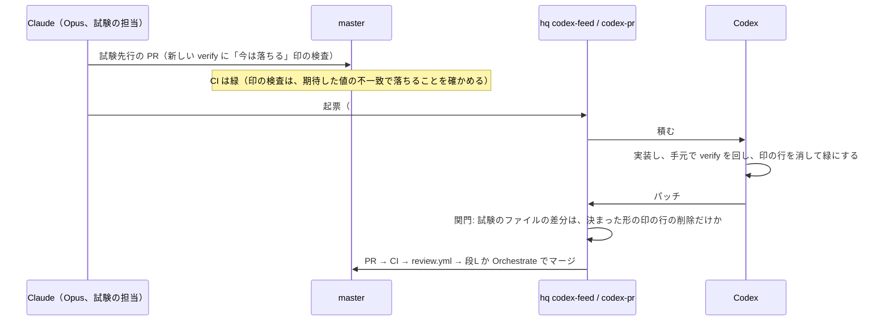

# 開発の手順の再設計（2026-11-05）

オーナー 2026-11-05「開発効率をもっと根本的に劇的に上げたい。遅い」「Codex も最大限活用したい」。設計に進むことを承認した4点の案。独立の審査を2つ（system-architect・second-opinion-reviewer）通し、指摘を反映した版（8章に記録）。

**決まりのファイル（`.claude/`・`AGENTS.md`・`vercel.json`・`.github/`）はこの PR では変えない**。変更案を書くだけで、入れるのはオーナーの再承認の後。

## 0. 目的と、根拠の実測

目的: 1つの依頼が「頼む → 本番」に届くまでの時間を短くし、Codex の枠を使い切る。Claude の週の枠は 84〜86%（11/5、リセットは 11/7 08:00 JST）で、Claude の仕事を増やす案は逆効果になりうる。

| 実測 | 値 | 出典 |
|---|---|---|
| 11/3〜11/5 にマージした PR | 111本（Claude 55・Codex 48・記事 8 ※ maker 名義の `claude/content-*` を含む） | `gh pr list --search "merged:>=2026-11-03"`（11/5） |
| PR の作成 → マージの中央値 | Claude の PR 0.4〜0.7時間。Codex の PR 0.7〜1.7時間、ただし 6.8・11.9・12.9時間の塊がある（朝夜にまとめるマージの待ちと見られる。推測） | 同上の createdAt・mergedAt（second-opinion の集計） |
| Claude の PR への `@codex review` | ほぼ全部の PR で回っており、返りは約2〜3分（#2266: 04:56:28 → 04:59:07）。軽い種類の約20本はどれも指摘0件。P1 は #2250・#2249・#2243・#2223 の4件で、全部 SNS の送る口・本番のバッチ・統計の数字の PR | issue のコメントと行のコメント（`chatgpt-codex-connector`）。初版で「55本中5本」と書いたのは行のコメントだけを数えた誤り |
| Codex の取り込みの上限 | 取り込み待ち（PR にしたが未マージ）が6件以上の間は新しい起票を積まない。11/5 15:13 にこれで止まった。10/24〜11/5 の13日中8日で上限に当たった | `~/hq/scripts/codex-feed.py:59`（`INTAKE_CAP = 6`）、`~/hq/logs/codex-feed.log` |
| Codex の止まり19件の内訳（11/5 14:42） | 取り込み待ち11・順の hold 5・パッチ無し1・関門 NG 1・必須項目が空1 | `~/hq/state/codex-feed.json` の `scan.blocked`（second-opinion の集計） |
| Codex の見回りの間隔 | `codex-feed`・`codex-pr` とも 300秒（11/5 hq 4c48ba5。それまで 1800秒） | `~/hq/launchd/com.terukina.hq.codex-{feed,pr}.plist` |
| Codex の差し戻し | 10/29 以降、積み130回のうち54回（42%）が差し戻しの積み直し。台帳の理由は ci 18・gate 7 | `~/hq/ledger/codex-prs.jsonl`（second-opinion の集計。ci 18件の内訳は未確認） |
| Codex の積み → PR | 中央値 約28分（n=86） | 同上 |
| Codex の週の使用率 | 12.0%、開発の線 59.6%（11/5 15:13） | `scan.dev_yield_why` |
| E2E 赤（コード起因） | 11件中9件が既存の期待値の追随漏れ（10/31〜11/4） | memory `feedback_codex_ok_needs_codex_section` 11/4 追記（元の PR は未確認） |
| Sonnet で書いた起票 | 約12本のうち3本が判断の誤りで差し戻し | memory `feedback_codex_tickets_written_by_opus` |
| GS04 | Codex で1日止まり、Claude で約4時間 | Orchestrate 11/5 |
| 6艇の表の Codex の PR | #2210・#2222・#2226・#2232・#2256・#2258・#2262 の7本が 11/4〜11/5 にマージ。各 PR の作成 → マージは32〜41分。遅さの主因は、前の子のマージを待つ直列（順の hold）と30分ごとの見回り | second-opinion の集計。Orchestrate の「7本中1本しか出なかった」は PR の記録から再現できなかった（指す範囲は未確認） |
| Vercel の Preview の環境変数 | 10個。鍵は `SUPABASE_SERVICE_KEY`・`INTERNAL_API_KEY`・`SNS_HUB_BASIC_AUTH_USER`・`SNS_HUB_BASIC_AUTH_PASSWORD`。ブランチ別の値は0個 | Vercel MCP `filter_project_envs`（名前と target だけ、値は読まない、11/5） |
| CI の E2E | 中央値 11.2分、最大 14.2分 | second-opinion の集計 |

### 遅さの原因（審査を受けて直した見立て）

1. **Codex の流量が、取り込みの上限6件とマージの待ちで詰まっている**。積む起票が足りないのではなく、積んでも「取り込み待ち6件以上」で止まる。取り込み待ちが減らないのは、Codex の画面・既存のファイルの変更の PR は自動マージの段の外で、Orchestrate の朝夜のマージを待つため
2. **見回りが30分ごとで、直列の子ごとに最大約1時間の待ちが乗る**（積む30分＋PR にする30分）
3. **差し戻しが42%**。期待値の追随漏れ（E2E 赤の 9/11）と起票の誤りが多い
4. **どの変更にも同じ重さの手順を通す**。ただし Claude の PR では、外せる手順の時間は今でも小さい（作成 → マージの中央値 0.4〜0.7時間、Codex 審査は約3分）。手順の重さは Claude の PR より Codex の PR の待ちに効いている

初版は4を主因にしたが、審査で1〜3が大きいと分かった。案の順もそれに合わせる（7章）。



---

## 1. 軽い道と重い道

### 1.1 現状

- 段階0（`.claude/skills/orchestrate/SKILL.md` §4）は「誰がマージしてよいか」を A〜G で分けているが、通す手順は分けていない。CLAUDE.md「実装完了後の自動レビュー」の1〜8は全部の PR にかかる。画面が変わればファン評価・mock-diff も（「ファン評価あり」の指定のとき）
- Codex の PR は、hq の `codex-pr.py` の段（`~/hq/config/codex-pr.json` の `tiers`、設計 `docs/design/codex-direct-pr/design.md` §4・§10）で自動マージを決める。開いているのは段0（docs だけ）。段1 は影の運用中（`open_line: shadow_pass 10, false_pass 0`）。`src/` の画面は段3 で、オーナーが開くまで自動マージしない
- Claude の PR の作成 → マージは今でも短い（0章）。この章で縮むのは主に Codex の PR の待ちと、Orchestrate・Claude の審査の手間（枠）

### 1.2 案: 道の判定

**H1〜H9 のどれにも当たらなければ軽い道**。1つでも当たれば重い道。パスに当たれば申告に関係なく重い道。迷ったら重い道。

| # | 重い道に入れる条件 | 機械で見る所 | 根拠（過去の事故・実例） |
|---|---|---|---|
| H1 | 本番 DB の変更と、本番で動く `scripts/**` | `docs/db-migration/**`・`supabase/**`・`scripts/**` の全部（`scripts/maintenance/verify-*.js` の新規と `data/analysis/**` の新規だけ除く）。dev-gate の prodWrite の導出（`docs/design/db-apply-automation-finish/dev-gate.draft.json`）は案のままで実装が無いので、入るまではこの広い線にする | バルク upsert のキーの集合違いで NULL（memory `technical_postgrest_bulk_upsert_nulls_missing_keys`）、非冪等な集計が本番データを壊した（AGENTS.md 固有観点1） |
| H2 | SNS の自動送信に届く変更 | `scripts/maintenance/sns-makers-scope.js`（SNS の作り手に届く差分か）と、`sns-video-studio/remotion/src/**`・`scripts/sns/**`・`api/cron/sns-*` を入口にした import の閉包（`scripts/lib/relativeImportGraph.js`）。`src/utils/**` の変更もここで拾う | #2236 で `upsetWin/model.js → src/utils/raceSeriesText.js → raceDetailHeading.js → src/config/languages.js` がつながり、自動で送る動画が全部止まった（11/4 21:28〜、#2251 で直した）。#2250・#2223 の P1 |
| H3 | 表示する数字の定義を作る・変える（集計・算出・母数・期間・並び順の基準） | `src/pure/**`・`src/services/**`・`scripts/analysis/**`・RPC の差分、PR 本文の申告 | #2243 の P1（10%・20% ちょうどが別の階級）、`src/services/analogyFeedback.js` は anon で INSERT する（`docs/db-migration/143_analogy_feedback.sql`） |
| H4 | 新しいページ・タブ・主要コンポーネント、承認したモックの実装 | `src/main.jsx` のルート・`src/pages/**` の新規ファイル・`docs/design/*/mock/` を指す PR・申告 | review-fix-cycle.md の新UIフロー |
| H5 | 守りの仕組みと鍵、試験の期待値の変更 | `.claude/**`・`.github/**`・`AGENTS.md`・`vercel.json`・`middleware.js`・`vite.config.js`・`index.html`・`package.json`（`sns-video-studio/**/package.json` を含む）・`package-lock.json`・`eslint.config.js`・`playwright*.config.js`・`e2e/fixtures.js`・`*-allowlist.json`・`verify-registry.json` の既存の行・`sns-video-studio/remotion/risk-rules.json`（自動送信の禁止表現の正本）・判定の script と規則そのもの・**既存の `e2e/*.spec.js`・`verify-*.js` の変更** | 守りを変えると検査が黙って弱まる（codex-direct-pr §4.1）。#2233 は既存の e2e 5本の期待値の変更 |
| H6 | `api/**` と、`api/**`・`middleware.js` から import でたどれるファイル | 同じ import の閉包 | `data || []` で除外が反転した（memory `technical_supabase_read_error_swallowed_flips_guard`）、#1316 の存在しない import |
| H7 | 共通部品・ルーティング・URL 構造・i18n の区分・全体の CSS・サイト全体の頭 | `src/components/race/` の共通部分・`Header`・`LanguageSwitcher`・`src/config/languages.js`・`src/App.css`・`src/styles/design-tokens.css`・ルートの定義・`public/robots.txt`・`public/sitemap*`・`public/llms*` | i18n のリンクの接頭辞漏れで UI 全体の言語が切り替わった（AGENTS.md 固有観点2）、#2153 の全体の CSS |
| H8 | fs・URL で読まれるデータ | `data/**`（`data/analysis/**` の新規を除く）・`config/*.json`・`src/locales/**`（`src/locales/ja/common.json` は sns-auto-plan の関数に含まれる、`vercel.json:324`） | import の閉包に出ない読み方。鍵の定期 job が `data/**` を読み書きする（codex-direct-pr §4 の対象外の行） |
| H9 | 事業・法務・ブランドの語が新しく入る | 4言語の差分を `risk-rules.json` と「競艇・的中率・回収率」で grep | 段階0 B・C の条件と同じ |

**判定の作り（審査 P1-7 を反映）**:

- 判定は新しい `scripts/maintenance/classify-pr-path.js`（読み取りだけ）と H の一覧 `config/pr-path-rules.json`。消した・名前を変えたファイルは元のパスでも判定する（`--no-renames`、`scripts/vercel-ignore-build.js:12` と同じ）
- CI の `verify` は PR の head のコードで動くので、その PR 自身が判定の script と規則を書き換えられる。そこで **マージのときに `guard-pr-merge.js` が origin/master の script と規則で、差分と今の PR 本文を判定し直し、重い道なら止める**（`guard-pr-merge.js` の e2e の範囲の判定し直し（:59-65）と同じ作り）
- このフックを通るのは Claude の `gh pr merge` だけ。**軽い道の担当マージは Claude の `gh pr merge` に限る**。Codex の PR の軽い道は hq の `codex-pr.py` の段（下の段L）で行い、同じ `config/pr-path-rules.json` を origin/master から読む

### 1.3 各道で必須の手順

| 手順 | 軽い道 | 重い道 |
|---|---|---|
| 再現テスト・受け入れ試験（同じ PR） | 必須（例外は review-fix-cycle.md の3つ） | 必須 |
| CI の必須3つ（verify・ml-tests・e2e）緑 | 必須 | 必須 |
| `/code-review` | 必須（1回） | 必須 |
| 画面が変わるときの修正前後の画像（375・1440） | 必須（Claude の PR は担当が撮る。Codex の PR は 4章の CI の撮影） | 必須 |
| 別ベンダーの審査（Claude の PR は `@codex review`） | **頼むが待たない**。返りは約3分で、マージを止めない。マージ後に P0・P1 が返ったら、担当が実在を確かめて fix か revert | 必須。P0・P1 が0件になるまで先へ進めない（今のまま） |
| Codex の PR の review.yml | ruleset の承認1件として必須（GitHub が強制） | 必須 |
| ファン評価ループ | 外す | H4 だけ。**依頼（束）ごとに1回**、最後の PR の Preview で（2章） |
| mock-diff | 外す | H4 だけ、束ごとに1回 |
| data-accuracy-verifier | 外す | H3 だけ |
| system-architect | 外す | H1・H5・H6 |
| マージ | **Claude の PR: 担当が自分でマージ**（`guard-pr-merge.js` の CI・マージ順・道の判定し直しが効く）。**Codex の PR: `codex-pr.py` の段L で自動マージ**（下） | Orchestrate（段階0〜2、今のまま） |
| マージ後の本番の確認（該当ページの表示とコンソールの誤り） | 必須（担当。Codex の PR は hq の qa の毎朝の照合） | 必須 |
| 朝夜のダイジェスト | 1行（PR 番号・道・本番の確認の結果） | 今のまま |

**Codex の PR の段L（審査の指摘4を反映）**: 「H1〜H9 に当たらない」を `~/hq/config/codex-pr.json` の `tiers` に新しい段 L として足す。最初は `shadow: true`（自動マージせず、開いていたら自動マージしたかだけを台帳に書く）。台帳 `~/hq/ledger/codex-prs.jsonl` の影の判定（506行、`would`・`false_pass`）と同じ形で、`shadow_pass 10・false_pass 0`（今の段1 と同じ線。目安、根拠なし）に届いたらオーナーの判断で開く。段L が開けば、Codex の軽い PR は Orchestrate の朝夜を待たずにマージされ、取り込み待ちが減り、`INTAKE_CAP` の詰まりが直接外れる。段3（既存の画面の自動マージ）の前提（codex-direct-pr §4.4）のうち、画像の比較と素通し0件は段L でも求める。

### 1.4 軽い道で外す手順と、戻る事故・事後に拾う仕組み

| 外す手順 | 外すと戻りうる事故（過去の実例） | 軽い道の範囲で起きる見込み | 事後に拾う仕組み |
|---|---|---|---|
| 別ベンダーの審査を待つこと | P1 の見落とし（#2250・#2249・#2243・#2223） | 低い。4件とも H1〜H3 に当たり重い道に残る。軽い種類の約20本の審査は全部指摘0件（11/3〜5） | 審査そのものは続く（待たないだけ）。マージ後に返った P0・P1 は担当が直す |
| ファン評価 | 「初見で何のデータか分からない」（9/27 のレース詳細の反復レビューで出た型、memory `race_detail_fan_review_loop_2026_09_27`） | 中。既存の画面の直しでも言葉・並びの分かりにくさは出うる | オーナーの実機の気づき（`docs/knowledge/user-insights.md`）、GA4、朝夜のダイジェスト。異議の出た種類は H に足す |
| Orchestrate の確認 | 同じファイルを触る PR の順序崩れ（SKILL 冒頭の理由）、#929 の変数渡しでのマージ順の素通り | 低い。`guard-pr-merge.js` が台帳のマージ順と CI を担当のマージでも止める | 同上 |
| mock-diff・data-accuracy | 承認範囲外の見た目・集計の誤り | 範囲外（H3・H4 で重い道） | — |

**すぐ戻せる形**: 軽い道の PR は squash で1コミット、`git revert` 1つで戻せる大きさ（既存の決まり）。Vercel の Instant Rollback は全体が壊れたときだけ（SKILL §4 のまま）。

**dev-loss の輪への接続（審査の指摘11を反映）**: 軽い道でマージした PR が触ったファイルを、7日以内に別の `fix:` のコミットが触ったら、hq の `loss-harvest.py` が git から機械で「軽い道の漏れの候補」として数える（PR 本文の `Fixes #` に頼らない。例として #2157 → #2245、#2173 → #2223 が引っかかる。漏れかどうかは未判定）。同じ型が週2回以上なら `dev-loss` で起票し、その型を `config/pr-path-rules.json` の H に1行足す。基準が実績で締まる向きに動く。

### 1.5 11/3〜11/5 の PR の振り分け（111本）

審査の指摘（7・P1-6）を反映して、初版の軽い道39本から8本を重い道へ移した（#2156: `api/_lib/botRace.js` で H6、#2266: `src/pure`・`src/services` で H3、#2154: 並び順の基準で H3、#2216: remotion の `package.json` で H5、#2184: 全貌の動画の組み方で H2、#2233: 既存の e2e の期待値で H5、#2251: `src/utils` と `verify-registry.json` で H2・H5、#2258: `src/locales/ja` で H8）。

| 道 | 本数 | PR |
|---|---|---|
| 軽い | 31 | docs・知見: #2267・#2198・#2195・#2193・#2191・#2196・#2176・#2174・#2204・#2257・#2246・#2203・#2175／新しい試験の追加: #2247（既存の spec の終わりに経路を外す1か所。H5 の境目）／ESLint: #2209・#2172・#2173／ページの OGP・title: #2261・#2186・#2168・#2167・#2166・#2159・#2158／訳のキーの追加（ja 以外）: #2222・#2178（ja を含めば H8）／データの追加: #2252・#2201／既存の画面の小さな直し: #2157・#2235・#2237 |
| 記事の道（変えない） | 14 | #2265・#2230・#2228・#2207・#2182・#2164・#2163・#2161・#2160・#2255・#2254・#2253・#2134・#2088 |
| 重い | 66 | H1: #2249・#2205・#2229・#2202・#2197・#2188・#2192／H2: #2250・#2248・#2245・#2244・#2236・#2227・#2223・#2218・#2217・#2215・#2214・#2213・#2211・#2208・#2200・#2199・#2194・#2190・#2189・#2184・#2251／H3: #2256・#2262・#2243・#2238・#2234・#2231・#2226・#2210・#2266・#2154／H4: #2264・#2263・#2259・#2242・#2239・#2232・#2187・#2180・#2179／H5: #2268・#2220・#2206・#2185・#2183・#2181・#2171・#2170・#2150・#2216・#2233／H6: #2177・#2165・#2155・#2152・#2156／H7: #2153・#2144／H8: #2258 |

- 分類は差分のパスと題で手で行った。`classify-pr-path.js` の試作で出し直してから比率を確定する（7章の段1）
- 軽い道は 28%（31/111）、記事を除くと 32%（31/97）。#2222・#2178・#2257 は ja を含むかで H8 に移りうる（未確認）

### 1.6 変えるファイル（★はオーナーの承認が要る）

| ファイル | 変え方 |
|---|---|
| ★ `.claude/CLAUDE.md`「実装完了後の自動レビュー」 | 冒頭に「道の判定」を足し、1〜8を「重い道の手順」とする。軽い道は 1.3 の手順。手順8に「軽い道の Claude の PR は担当がマージ」 |
| ★ `.claude/skills/orchestrate/SKILL.md` §4・「Codex の PR」 | 段階0 の前に軽い道を置く。Codex の PR の段L |
| ★ `.claude/rules/review-fix-cycle.md` | 新UIフロー・ファン評価ループは H4 のときだけ、束ごとに1回 |
| ★ `AGENTS.md` | 審査の行（軽い道は待たない）、PR 本文に `道:`・`数字の定義:`・`新しい画面:` の3行 |
| ★ `.github/pull_request_template.md` | 上の3行の欄 |
| ★ `scripts/maintenance/guard-pr-merge.js` | origin/master の script と規則で道を判定し直す |
| ★ `scripts/maintenance/verify-registry.json` | `classify-pr-path` を `ci` で登録 |
| `scripts/maintenance/classify-pr-path.js`・`config/pr-path-rules.json`（新規） | 判定と H の一覧（両方とも H5 に入れる） |
| hq: `codex-pr.json` の段L（影から）・G5 に判定の script と規則・`loss-harvest.py` の漏れの数え方 | hq へ依頼 |

---

## 2. 依頼の単位で Claude と Codex に分ける

### 2.1 現状

- 大きな依頼を `codex-ok` の子に割り、前の子が master に入るまで次を積まない（`前提: BOA-NNNN` の hold）。6艇の表の7本は各 PR が32〜41分でマージされたが、直列の待ちと30分ごとの見回りで全体が延びた（0章）
- 11/5 のオーナー決定（memory `feedback_ui_work_by_claude_not_codex`）で画面は Claude に寄せた。ただし Codex の6艇の表の PR は1本ずつは速く、遅さの主因は直列だった（second-opinion の集計）

### 2.2 案: 1つの依頼は1つの担当が通しで持つ

**依頼**＝オーナーが頼んだ1つの成果（「6艇の表を出す」「GS04 お気に入り」）。担当をまたいで割らない。例外は3章の「Claude が試験を先に書き、Codex が緑にする」の1回の受け渡しだけ。

| 依頼の種類 | 担当 | 理由 |
|---|---|---|
| H1・H2・H5（本番 DB・SNS の自動送信・守り） | Claude | Codex の環境で適用・鍵・送信を確かめられない（codex-backlog.md (b)） |
| H3・H4 で、定義・見せ方が**まだ決まっていない**もの | Claude | 判断が途中で何度も要る。Codex の相談の道は1往復が30分〜数時間 |
| H3・H4 で、定義・見せ方が**承認済み**（spec・モックがある）もの | **オーナーの判断が要る**（下） | 11/5 の決定は Claude。審査は「Codex でも1本ずつは速く、直列の待ちが主因」と指摘 |
| 上に当たらず、完了を試験で言える依頼（純関数・リファクタ・試験の追加・訳・既存の画面の小さな直し・docs） | Codex | 3章の試験を先に書けば Codex だけで完了を確かめられる |
| 試験を書けない・期待値を1文で言えない依頼 | Claude | 相談の道で往復が増える |

**承認済みの H3・H4 の扱い（オーナーに出す選択）**:

| 案 | 中身 | 良い所 | 悪い所 |
|---|---|---|---|
| A（11/5 の決定のまま） | Claude のサブ（Opus）が束で1〜2本の PR にする | 往復が無い。GS04 は約4時間 | Claude の枠（84〜86%）を使う。Codex の48本のうち約16本（H2〜H4）が Claude へ移る計算（second-opinion の数え） |
| B（審査の推奨） | Codex に回し、同じファイルの子は「1つの起票に束ねる」か「前の PR のブランチの上に積む（stack）」。試験は 3章で Claude が先に書く | Codex の枠を使う。直列の待ちが消える | stack は `codex-pr.py` の変更が要る（hq）。束ねると 300行・5ファイル（G4）を超えやすく、G4 を外す起票の id を hq の設定に置く手間（codex-direct-pr §4.3） |

推奨: **B を試し、A を予備にする**。根拠は、Claude の枠の残りと、Codex の PR は1本ずつは速いという実測。ただし 11/5 のオーナー決定を変えるので、オーナーの承認を取ってから入れる。それまでは A のまま。

### 2.3 Claude が通しで持つ依頼の流れ

```mermaid
flowchart TD
  R[依頼] --> P{道の判定}
  P -->|軽い| L1[実装＋再現テスト]
  L1 --> L2[手元: 関係する verify・spec だけ]
  L2 --> L3[PR・CI・@codex review を頼む]
  L3 --> L4[/code-review を1回・指摘の実在確認/]
  L4 --> L5{CI 緑・/code-review の P0/P1 なし}
  L5 -->|はい| L6[担当がマージ<br/>guard が道を判定し直す]
  L6 --> L7[本番の該当ページを確認<br/>codex review の返りを見る]
  L7 --> L8[ダイジェストに1行]
  L5 -->|いいえ| L1
  P -->|重い| H0[spec-ambiguity-detector<br/>挙動が変わるときだけ]
  H0 --> H1[必要な専門役<br/>H1/H5/H6: system-architect<br/>H3: 統計の検証済みか確認]
  H1 --> H2[束の PR を順に実装<br/>各 PR に再現テスト]
  H2 --> H3[各 PR: CI・/code-review・@codex review の P0/P1 が0]
  H3 --> H4[束の最後の PR の Preview で<br/>ファン評価・mock-diff を1回 H4 のみ]
  H4 --> H5[Orchestrate がマージ<br/>段階0〜2]
```

- 束の途中の PR は、画面に出ない形（純関数・取得・フラグの裏の部品）なら束の最後の評価の前にマージしてよい。画面に出る PR は最後の評価を通してからマージする
- 「設計の確認」は、承認済みの spec・モックがあれば読み直しだけ。無い新しい見せ方は今のとおり SDD・モック承認

### 2.4 変えるファイル

| ファイル | 変え方 |
|---|---|
| ★ `.claude/skills/orchestrate/SKILL.md` §2 | 依頼の単位で担当を決める表（2.2） |
| ★ `docs/operation/codex-backlog.md`「回すもの・回さないもの」 | 2.2 の Codex の行、束ねる・stack の書き方。この文書は AGENTS.md が読むので段0 の除外、オーナー承認に入れる |
| ★ memory `feedback_ui_work_by_claude_not_codex` の改め（B を採るとき） | オーナーの 11/5 の決定の変更 |
| hq: `codex-pr.py` の stack（前の PR のブランチを元にする） | hq へ依頼（B を採るとき） |

---

## 3. 試験を先に書いてから Codex に渡す

### 3.1 現状

- Codex は既存の `e2e/*.spec.js`・`verify-*.js` の期待値を変えてはならない（AGENTS.md「変更してはならない」）。期待値は起票の文で渡るので、解釈がずれる（BOA-1333 の ko に日本語、BOA-1330 の禁止の言い方）、追随が漏れる（E2E 赤の 9/11）
- Codex の手元で Playwright は動かない（Chromium の seatbelt の誤り、hq `drafts/codex-e2e-browser-20261103/`）。sandbox の外にブラウザを立てる案 A を試験中（結果は未確認）。e2e の試験を渡しても、Codex は緑を CI に出すまで確かめられない
- `scripts/maintenance/check-e2e-skips.js` は skip を数えるが `test.fail()` は数えない（今の e2e に `test.fail(` は0件）。CI の retries は1（`playwright.config.js:97`）

### 3.2 案: Claude（Opus）が「今は落ちる検査」を master に先に入れる

**最初は node で動く検査（`verify-*.js`・純関数の試験）に限る**（審査の指摘6）。Codex が手元で緑を確かめられ、CI の往復（差し戻しの ci 18件の型）を増やさない。e2e はブラウザの案 A が本番の条件で通ってから広げる。



**「今は落ちる」印（審査 P1-8・P1-9 を反映）**:

- 印は検査の1つずつに付ける。ファイル全体を黙らせない
- 小さな関数 `pendingCheck("BOA-1234", () => 検査, { expected })` を共有の補助に置く（例 `scripts/maintenance/lib/pendingCheck.js`、この補助は H5）。中の失敗が**期待値の不一致で、その不一致が `expected` と一致するときだけ**合格（「PENDING BOA-1234」と出す）。例外・import の誤り・別の値の不一致は赤。検査が通ってしまったら赤（「印を外す」）
- ファイルのほかの検査はいつもどおり走る
- `verify:ci` の最後に、印の数と ID を1行で出す
- 印の起票が Done・Canceled になった、または14日を超えたら CI を赤にする（14日は目安、根拠なし。警告だけだと残り続ける）
- 印のある検査の再試行は0回（たまたま通って master が揺れるのを防ぐ）
- e2e に広げるときも同じ形の `expectPending`（Playwright の `test.fail()` は使わない。どの理由の失敗でも合格になり、データで揺れる本番の Supabase の上で守りが外れるため。memory `technical_e2e_depends_on_live_supabase_flakiness`）、加えて `E2E_REPLAY_STRICT=1`（`e2e/fixtures.js:97`）で録画に無い取得を合格にしない

**既存の期待値の変更（審査の指摘6・P1-8 を反映）**:

- 既存の試験には印を付けない（付けると、その試験の変えない期待値まで守りが外れる）
- 起票の「## Codex 用」に「旧 → 新の期待値の行」を書き（ファイル・行・旧の文字・新の文字）、Codex の差分がその行の置き換えだけであることを hq の関門で照合する。これで M7（既存の試験の変更は要審査）の例外にできる
- 期待値を決めるのは Claude（起票を書く Opus）。Codex は期待値を決めない（AGENTS.md の趣旨はそのまま）
- 試験先行の PR のうち、新しい検査の追加だけは軽い道。既存の期待値を変える PR は H5 で重い道

**hq の `codex-pr.py` の関門（審査 P2-6 を反映）**:

- 消した行は、決まった形の正規表現（`pendingCheck("BOA-1234", …` の開きの行と閉じの行）にちょうど当たるものだけ。「`pending:` を含む行」のような緩い一致にしない
- 試験のファイルに足した行は0。その ID の印は全部消す。試験のファイルの削除・名前の変更は禁止
- 試験が import する補助（`pendingCheck.js`・`e2e/fixtures.js`・`e2e/helpers/**`・`e2e/recordings/**`）と `playwright*.config.js` が同じパッチにあれば M7 の例外にしない
- 実装が試験の環境（`FAKE_NOW_ISO`・録画の時刻・`navigator.webdriver`）を見て分岐していないかは機械で見られないので、review.yml の審査の観点に足す

**起票の形（`## Codex 用` の差分）**:

```markdown
### 期待値（再現テスト）
- 試験のファイル: `scripts/maintenance/verify-six-boat-rows.js`（PR #NNNN で master に入った。pendingCheck("BOA-1234") が3か所）
- 印の行を消して緑にする。検査の中身（期待値・入力）は変えない
- 既存の期待値の置き換え（あれば）: `e2e/x.spec.js:42` 旧 `"平均0.15"` → 新 `"平均0.15・3位"`

### 変えてよいファイル
- `src/pure/sixBoatRows.js`
- `scripts/maintenance/verify-six-boat-rows.js`（印の行の削除だけ）
```

### 3.3 Codex の積み: 積みの量より流量を見る

審査で、Codex の空きの主因は起票の不足ではなく取り込みの上限（`INTAKE_CAP = 6`）とマージの待ちと分かった（0章）。積みの線（`codex_refill` の3件以下）を上げても、上限で止まって効かない（`~/hq/scripts/status-snapshot.py:643` は上限の間 `codex_refill` を出さない）。

| 手 | 中身 | 持ち主 |
|---|---|---|
| 流量（最優先） | 段L（1.3）で Codex の軽い PR を自動マージに乗せる。取り込み待ちが減る | hq・オーナー（段を開く判断） |
| 見回りの間隔 | `codex-feed`・`codex-pr` の launchd を 1800秒 → 300秒（目安、根拠なし）か、マージを合図に動かす。直列の子ごとの最大約1時間の待ちが縮む | hq |
| 差し戻しの往復 | 差し戻し42%の ci 18件を型に分ける（期待値の追随漏れ・環境・本当の誤り）。起票の形の検査を Linear に置いた時点で行う（今は codex-feed が積むときにはじく） | hq・Orchestrate |
| 補充の作り手 | 見回りで `codex_refill` が出たら、試験の担当（Opus のサブ1本）が Linear の未着手から 2.2 の Codex の行に当たる依頼を選び、試験先行の PR と起票を作る。1周で2依頼まで（目安、根拠なし） | Orchestrate |
| 見る指標 | 「積める件数」ではなく「取り込み待ちの滞留時間」と「区間ごとの時間（起票 → 積み → PR → マージ）」。`codex-feed.log` と台帳から今でも出せる | hq |
| `INTAKE_CAP` | 段L が開いて取り込み待ちが減るまでは変えない（上げると Orchestrate のマージの山が増えるだけ） | — |

供給の元: 11/3 の優先順（GS・SNS → 仕組み化・セキュリティ・E2E/CI → リファクタリング → UI/UX）。リファクタリングの棚卸し（#2267）が純関数化・試験の追加の山を持っており、node の試験先行に向く。

### 3.4 変えるファイル

| ファイル | 変え方 |
|---|---|
| ★ `AGENTS.md`「変更してはならない」 | 「起票に書いた ID の `pendingCheck` の行の削除と、起票に書いた旧 → 新の期待値の行の置き換えだけは、変えてよいファイルにあるときに限りしてよい」 |
| ★ `docs/operation/codex-backlog.md` の雛形 | 3.2 の書き方。試験先行の PR は `前提: PR #N` |
| ★ `.claude/skills/orchestrate/SKILL.md` §2 OP01 | 補充を「試験先行の PR＋起票」にし、試験の担当を置く |
| ★ `scripts/maintenance/verify-registry.json`・`run-verify-registry.js` | 印の数と ID の1行の出力、起票の状態と日数での赤 |
| `scripts/maintenance/lib/pendingCheck.js`・`scripts/maintenance/verify-pending-tests.js`（新規） | 印の補助と、印の一覧・期限の検査（補助は H5 と G5 に入れる） |
| hq: `codex-pr.py`（印・置き換えの関門、M7 の例外）、launchd の間隔、`codex-feed` の起票の形の検査 | hq へ依頼 |

---

## 4. Codex の PR の画面を見る口

### 4.1 現状

- `codex/**` は Preview を作らない（`vercel.json` の `git.deploymentEnabled`、`verify-codex-no-preview.js`、#1623、10/18）。Preview の環境変数に本番 DB の管理者キー（`SUPABASE_SERVICE_KEY`）が載り、Codex のコードがマージ前にそれを持って動くため
- そのため Codex の画面の PR は、Orchestrate が手元で修正前後を撮って審査している（SKILL「Codex の PR」、#1798・#1799 の形）

### 4.2 二つの案（審査の指摘10を反映して、鍵の操作が要らない案を先に置く）

| | 案1: CI で撮る（推奨、先に入れる） | 案2: Vercel の `codex-preview` の枠 |
|---|---|---|
| 中身 | `codex/` の PR の CI で `vite build`＋`vite preview` を立て、Playwright で変えた画面を 375・1440 で撮り、修正前（master）と並べて PR に残す。E2E はすでに build＋vite preview で流している（#2170） | 決まったブランチ `codex-preview` だけ Vercel の Preview を許し、鍵を消した環境で動かす |
| 鍵 | CI の e2e と同じ（anon の鍵だけ）。Codex のコードは今も CI の e2e で動いている | Vercel の環境の設定が要る（下） |
| オーナーの操作 | `.github/workflows` の変更の承認だけ | Vercel の環境・GitHub の ruleset・（案によって）hq の token |
| 見られるもの | 撮った画像（固定の操作だけ）。ファン評価・mock-diff は、Claude が手元で Codex のブランチを vite preview して回す | 人が触れる URL。ファン評価・mock-diff を URL で回せる |
| 類似レースの部分 | 動かない（鍵が無い） | 動かない（鍵が無い） |
| 同時の数 | PR ごと（並行） | 1本 |

推奨: **案1を先に入れる**。軽い道の「修正前後の画像」と、既存の画面の小さな直しの審査はこれで足りる。案2は、Codex の PR でファン評価・mock-diff を URL で回す必要が出たとき（2.2 の B を採り、H4 の束を Codex が持つとき）に入れる。

### 4.3 案2 の設計（入れるときの形）

**Vercel が branch ごとの Preview の環境変数を上書きできるか（公式文書で確認）**: できる。Vercel の文書 "Environment variables" の Preview の節（https://vercel.com/docs/environment-variables 、2026-11-05 に読んだ）に、Preview の変数は全部の非本番ブランチか特定のブランチに付けられ、ブランチ別の値は同じ名前の他の Preview の値より優先される（"Any branch-specific variables will override other preview environment variables with the same name"）。Vercel の cron は本番のデプロイだけで動く（文書 "Configure crons in vercel.json"）。

**守りは「消す鍵の一覧」でなく「許す変数の一覧」で作る**（審査 P1-1）。本番のコードは Preview に今は無い鍵（`SLACK_WEBHOOK_URL`・`X_OAUTH_CLIENT_SECRET`・`SNS_TOKEN_ENC_KEY`・`YOUTUBE_*`・`GITHUB_MERGE_TOKEN`・`CRON_SECRET` 等）を読むので、誰かがそれを Preview に足した瞬間に、上書きの無いまま `codex-preview` に載る。

| 項目 | 決め |
|---|---|
| 環境 | 第一案: Vercel の Custom Environment を `codex-preview` のブランチに付け、許した名前（`SUPABASE_URL`・`SUPABASE_ANON_KEY`・`VITE_SUPABASE_URL`・`VITE_SUPABASE_ANON_KEY`・`VITE_DATA_SOURCE`・`VITE_GA_MEASUREMENT_ID`）だけを置く。プランで使えるか、Preview の変数を受け継がないか、Deployment Protection がかかるかは**未確認**で、最初に確かめる。使えなければ第二案: Preview のブランチ別の上書き |
| 上書きの値（第二案） | 空にしない（空がブランチ別の上書きとみなされるか、全ブランチの値に落ちるかが未確認、審査 P1-2）。秘密でない決まった目印の文字（plain 型）を置き、値が目印と同じかで確かめる。`INTERNAL_API_KEY`・`SNS_HUB_BASIC_AUTH_*` は、認証のコードが目印を「未設定」として扱う形にする（目印を知る人が関門を通れないように） |
| ビルドの中で止める（本体、審査 P1-3） | `vercel.json` の buildCommand の頭に `node scripts/maintenance/assert-codex-preview-env.js &&` を付ける。`VERCEL_GIT_COMMIT_REF` が `codex-preview` のとき、許した名前の外の変数に目印でない値が1つでもあれば、また `VERCEL_AUTOMATION_BYPASS_SECRET`・`VERCEL_OIDC_TOKEN` が載っていれば exit 1。ビルドが止まればデプロイも関数も動かない。hq に Vercel の token（チーム単位で、読むだけに絞れない見込み。未確認）を置かずに済む |
| ignoreCommand | `scripts/vercel-ignore-build.js` と `scripts/lib/vercelIgnoreBuild.js` は buildCommand より先に同じ環境変数で動く。この2つと assert の script を G5（PR 自体を作らない）に入れる。今は `merge_protected` だけ（codex-backlog.md の (a) の注） |
| Automation Bypass（審査 P1-4） | Preview には Standard Protection と Bypass の秘密がある（`docs/operation/vercel-preview-access.md:3,25`）。Vercel がこの秘密をシステムの環境変数で出すなら、Codex のコードから読める。assert で載っていないことを確かめ、載るなら Bypass をやめて共有リンク（`_vercel_share`）だけにするか、案2を見送る |
| ビルドの時点の実行（審査 P2-1） | `npm run build` は vite build の後に `scripts/generate-ai-snapshots.js` が `src` を import して Chromium で描く（`package.json:8`）。前提として「ビルドと関数の環境変数は全部 Codex のコードに読まれる」と書き、守りを環境の中身だけに置く。`vite.config.js`・`middleware.js`・`index.html` を G5 に足す |
| 中身を写す | hq の `codex-pr.py` が、画面を触る `codex/` の PR の head を `codex-preview` へ push する（`--force-with-lease`）。持ち主の PR の head が変わるたびに写し直す |
| SHA の照合（審査 P2-2） | Vercel の deployment のメタの `githubCommitSha` が push した SHA と一致し、READY になるまで待つ。ignored・canceled は失敗として通知（ignoreCommand が前の写しとの差分でビルドを飛ばすと、前の持ち主の中身が残るため）。PR には固定のブランチの URL でなく、その deployment だけの URL を書く |
| 同時に1本 | `codex-pr.py` が持ち主の PR を state に持ち、マージ・閉じる・2時間（目安、根拠なし）まで次を写さない |
| ruleset（審査 P2-3） | `codex-preview` は `ryujin-maker` だけ bypass（force push 可）、ほかは作成・更新・削除を禁止。管理者を bypass に入れない。これは中身の正しさの守りで、鍵の守りは上の assert |
| `verify-codex-no-preview.js` の改め方 | (a)〜(c) は残す。(d) `git.deploymentEnabled` に `codex-preview` を false にする規則が無いこと、(e) buildCommand の頭に assert があること、(f) `config/codex-preview.json`（許す名前の一覧）と assert が同じ一覧を読むこと。Vercel の実物の設定はリポジトリから見えないので、実物は assert がビルドのたびに守る |

**管理者キーが無いと動かない画面**（`api/` の grep、11/5）:

| 区分 | 関数の数 | `codex-preview` での動き |
|---|---|---|
| 類似レース（`api/analogy/{similar,scenario,layer,facts}/[raceId].js`） | 4 | 動かない（`api/_lib/analogyV16.js:22-24` が鍵なしで UpstreamError）。レース詳細の類似レースの部分が誤りの表示 |
| 決まり手の履歴（`api/race-history/summary.js`） | 1 | 鍵が無ければ anon の鍵に落ちて動く（`summary.js:14-17`）。目印の文字だと 401。assert の許す一覧で鍵の変数自体を無くせば動く |
| 管理の画面（`api/admin/sns-hub/**` 24本・`api/admin/rules/performance.js`） | 25 | 動かない。Codex の画面の審査には要らない |
| cron（`api/cron/sns-*` 4本・`analogy-exhibition.js`） | 5 | Preview では定時に動かない。`CRON_SECRET` が無く `isAuthorized` が false（`cronWrapper.js:72-73`） |

ファンの画面で影響が出るのは類似レースの部分だけ。

**残る危うさ**: Codex のマージ前のコードが本番の Supabase に anon の鍵でつながる。マイグレーションの上で anon に書けるのは `analogy_feedback` の INSERT だけ（143、トリガーと CHECK で連投を抑える）で、あとは読む RPC。増える危うさは重い RPC をループで叩く程度（本番の今の GRANT は未確認）。Preview は Standard Protection で外からは見えない（`vercel-preview-access.md:3`）。push で動く Actions は全部 master だけなので、`codex-preview` への push で鍵つきの workflow は動かない（system-architect が確認）。

**ADR**: AGENTS.md:25 の「Preview には管理者キーが載る」という前提が変わるので、案2 を入れるときは ADR を1件足す。

### 4.4 変えるファイル

| ファイル | 案 | 変え方 |
|---|---|---|
| ★ `.github/workflows/`（e2e か新しい workflow） | 1 | `codex/` の PR で変えた画面を撮り、master と並べて残す |
| ★ `.claude/skills/orchestrate/SKILL.md`「Codex の PR」 | 1 | 審査は CI の画像で行い、手元で撮るのをやめる |
| ★ Vercel の Custom Environment か Preview のブランチ別の値（オーナーの操作） | 2 | 上の表 |
| ★ `vercel.json`（buildCommand の頭） | 2 | assert |
| ★ `scripts/maintenance/verify-codex-no-preview.js` | 2 | (d)〜(f) |
| ★ GitHub の ruleset | 2 | `codex-preview` の push |
| ★ `AGENTS.md` のブランチの表・ADR 1件 | 2 | `codex-preview` の行 |
| `scripts/maintenance/assert-codex-preview-env.js`・`config/codex-preview.json`（新規） | 2 | G5 に入れる |
| hq: `codex-pr.py`（写す・SHA の照合・持ち主）、G5 の追加 | 2 | hq へ依頼 |

---

## 5. オーナーに承認をもらう変更の一覧（ファイル単位）

| # | ファイル・設定 | 章 | 種類 |
|---|---|---|---|
| 1 | `.claude/CLAUDE.md`（実装完了後の自動レビュー） | 1 | .claude |
| 2 | `.claude/skills/orchestrate/SKILL.md`（§2・§4・Codex の PR） | 1・2・3・4 | .claude |
| 3 | `.claude/rules/review-fix-cycle.md` | 1 | .claude |
| 4 | `AGENTS.md`（審査の行・PR 本文の3行・印と期待値の置き換え・ブランチの表） | 1・3・4 | 規約 |
| 5 | `.github/pull_request_template.md` | 1 | .github |
| 6 | `.github/workflows/`（Codex の PR の画面を撮る） | 4 案1 | .github |
| 7 | `scripts/maintenance/guard-pr-merge.js`（道の判定し直し） | 1 | CI の関門 |
| 8 | `scripts/maintenance/verify-registry.json`・`run-verify-registry.js` | 1・3 | CI の関門 |
| 9 | `docs/operation/codex-backlog.md`（回すもの・雛形） | 2・3 | Codex への指示の正本 |
| 10 | 2.2 の承認済み H3・H4 を Codex に回すか（11/5 の決定の変更） | 2 | 決定 |
| 11 | hq の段L を影で始め、線に届いたら開く | 1・3 | 自動マージの範囲 |
| 12 | 案2 を入れるとき: Vercel の環境、`vercel.json`、`verify-codex-no-preview.js`、ruleset、ADR | 4 案2 | 鍵・権限 |

hq の持ち物（hq の手順で決める）: `codex-pr.py`（段L・印と置き換えの関門・M7 の例外・stack・案2 の写し）、`codex-pr.json` の G5 の追加、launchd の間隔、`codex-feed` の起票の形の検査、`loss-harvest.py` の漏れの数え方。

承認なしで作れるもの（新しいファイルで、どこからも呼ばれない間）: `classify-pr-path.js`・`config/pr-path-rules.json`・`pendingCheck.js`・`verify-pending-tests.js`。CI に効くのは 7・8 の後。

## 6. 効果の見込み

| 変更 | 見込み | 根拠と確度 |
|---|---|---|
| 段L（Codex の軽い PR の自動マージ） | Codex の PR の作成 → マージの塊（6.8〜12.9時間）のうち軽い PR の分が、CI と review.yml の後の次の見回りまで（30分か5分）に縮む。取り込み待ちが減り、`INTAKE_CAP` で止まる日（13日中8日）が減る | 塊が朝夜のマージの待ちであることは推測。Codex の軽い PR の割合は 1.5 の手の分類（Codex 48本のうち軽い道は約15本、推測） |
| 見回りの間隔 | 直列の子ごとの最大約1時間の待ちが約10分に | 1800秒の設定は実測。縮む幅は計算 |
| 軽い道（Claude の PR） | 作成 → マージの時間はほぼ変わらない（今も中央値 0.4時間）。縮むのは Orchestrate の確認と審査のサブの手間（Claude の枠） | 実測。枠の減り幅は未測定 |
| 試験の先行（node から） | 起票の解釈違い・期待値の追随漏れの型の差し戻しが減る | 差し戻し42%・E2E 赤 9/11 は実測。ci 18件の内訳が未確認なので、減る幅は不明 |
| 依頼の単位 | 直列の子の hold の待ちが消える（束ねる・stack・Claude の通し） | 6艇の表で各 PR は32〜41分、全体を延ばしたのは直列（second-opinion の集計） |
| CI で撮る（4章 案1） | Orchestrate が手元で撮る審査が要らなくなる | 1件あたりの時間は未測定 |
| Claude の枠 | 軽い道で審査のサブが減り、試験の先行（Opus）で増える。差し引き未測定 | 推測 |

測り方（審査の指摘11を反映）:

- 区間ごとの時間（起票 → 積み → PR → マージ）を `codex-feed.log` と台帳で出し、導入の前後で比べる。前後1週間の単純な比較は、週の枠のリセット（11/7）・重点の変化・依頼の大きさに引きずられるので、区間ごとに見る
- 取り込み待ちの滞留時間、`INTAKE_CAP` で止まった時間
- 軽い道の漏れの候補（1.4、git から機械で）
- `classify-pr-path.js` で過去の PR を判定し直し、影の台帳と同じ形で基準を確かめてから手順を外す
- Claude と Codex の週の使用率

## 7. 入れる順（最短）

| 段 | 中身 | 前提 | 決まりの変更 |
|---|---|---|---|
| 1 | hq の launchd の間隔（1800 → 300秒）、段L を影で始める、`classify-pr-path.js` の試作で 1.5 を出し直す | なし。並行で始められる | hq の設定だけ（段L の影は自動マージしない） |
| 2 | 試験の先行（node の `pendingCheck`）と起票の形 | 段1 と並行 | AGENTS.md・codex-backlog.md・registry（★） |
| 3 | Claude の軽い道（guard の判定し直しと一緒に入れる） | 試作の判定で誤りが無いこと | CLAUDE.md・SKILL・guard（★） |
| 4 | CI で撮る（4章 案1） | なし | .github（★） |
| 5 | 段L を開く | 影で `shadow_pass 10・false_pass 0`（目安） | オーナーの判断 |
| 6 | 2.2 の B（承認済みの H3・H4 を Codex へ） | オーナーの承認、stack は hq | ★ |
| 7 | 4章 案2 | 案1 で足りないと分かったとき | 鍵・権限（★） |

段1・2・4 は今日から並行で始められる。段5 は影の本数が溜まる速さで決まる（Codex の軽い PR が1日に数本なら数日。推測）。

## 8. 審査の記録

### (a) system-architect（安全・CI・権限）

| 指摘 | 重大度 | 対応 |
|---|---|---|
| P1-1 鍵の上書きが「消す一覧」で、Preview に鍵を足すと漏れる | P1 | 採用。許す一覧（Custom Environment か、ビルドの中の assert）に変えた（4.3） |
| P1-2 空の値の上書きが全ブランチの値に落ちるおそれ | P1 | 採用。目印の文字にし、値で確かめる |
| P1-3 hq の Vercel の token は読むだけに絞れない見込み | P1 | 採用。ビルドの中の assert に置き換えた（token のスコープは未確認と明記） |
| P1-4 Automation Bypass の秘密が Codex のコードから読める見込み | P1 | 採用。assert で確かめ、載るなら Bypass をやめるか案2 を見送る |
| P1-5 H1 が頼る prodWrite の導出がまだ無い | P1 | 採用。入るまで `scripts/**` を広く H1 にした |
| P1-6 `src/utils`・訳・データが SNS の自動送信と api に届く | P1 | 採用。H2・H6 を import の閉包で判定し、H8（fs で読むデータ）を足した。#2251・#2258 を重い道へ移した |
| P1-7 判定の script と規則を PR 自身が書き換えられる | P1 | 採用。マージ時に origin/master の script で判定し直す。軽い道の担当マージは Claude の `gh pr merge` に限った |
| P1-8 既存の試験に `test.fail()` を付けると守りが外れる | P1 | 採用。既存の試験は印にせず旧 → 新の置き換え、印は期待値で一致を確かめる `pendingCheck` |
| P1-9 verify の PENDING がファイル全体を黙らせる | P1 | 採用。検査ごとの印、例外は赤、期限で赤 |
| P2-1 ビルドの時点で Codex のコードが全部の環境変数を読める | P2 | 採用。前提として明記し、`vite.config.js`・`middleware.js`・`index.html` を G5・H5 に |
| P2-2 写した SHA のずれ | P2 | 採用。deployment の SHA の照合と deployment ごとの URL |
| P2-3 ruleset の形 | P2 | 採用 |
| P2-4 `public/robots.txt` 等・消したファイル・H3 の申告の扱い | P2 | 採用（H7・`--no-renames`・「パスに当たれば重い」） |
| P2-5 期待値を書き換える試験先行の PR は重い道に | P2 | 採用（H5） |
| P2-6 `codex-pr.py` の関門の詰め | P2 | 採用（3.2） |
| P3 anon の書き込み・Preview の公開範囲・cron・目印の扱い・Actions | P3 | 4.3 の「残る危うさ」に反映。Preview の公開範囲の「未確認」は閉じた |
| P3 印のある試験の再試行 | P3 | 採用（再試行0回） |
| ADR を1件足す | — | 採用（案2 を入れるとき） |

### (b) second-opinion-reviewer（品質・より効く手）

| 指摘 | 重大度 | 対応 |
|---|---|---|
| 1 「Codex 審査は55本中5本」は読み違い。ほぼ全部で回り、返りは約3分 | P1 | 採用。0章を直し、自分でも #2266 の返り（04:56:28 → 04:59:07）を確かめた。軽い道は「外す」から「頼むが待たない」に変えた |
| 2 Codex の空きの主因は取り込みの上限6件とマージの詰まり | P1 | 採用。`codex-feed.py:59` と 15:13 のログを自分で確かめた。3.3 を流量を先にする形に直し、積みの線の変更は取り下げた |
| 3 Claude の PR は今でも作成 → マージが短く、短縮の見込みが強すぎる | P1 | 採用。6章を区間ごとの見込みに置き換えた |
| 4 軽い道が既存の Codex の段と二重 | P1 | 採用。Codex 側は段L として `tiers` に影で入れ、同じ規則を読む |
| 5 2章は Codex の仕事を Claude に移し、枠で逆効果のおそれ | P1 | 一部採用。Claude の担当を H1・H2・H5 と未決の H3・H4 に絞った。承認済みの H3・H4 は、11/5 のオーナー決定に関わるので推奨（B）つきでオーナーに出す |
| 6 e2e の試験の先行は Codex が緑を確かめられず、既存の試験の守りも穴 | P1 | 採用。最初は node の検査に限る。既存の試験は印にせず置き換え |
| 7 振り分けの誤り（#2156・#2266・#2154・#2216・#2184・#2233） | P2 | 採用。重い道へ移した（軽い道 39 → 31本） |
| 8 パスだけの判定では import で自動送信に届く変更を取りこぼす（#2236 の事故） | P2 | 採用。H2 を import の閉包で判定 |
| 9 見回りの間隔・差し戻し42%・stack・Codex の自動マージが抜けている | P2 | 採用（3.3・2.2・7章の段1） |
| 10 鍵の操作の要らない「CI で撮る」案がある | P2 | 採用。案1 として先に置いた |
| 11 測り方が弱い | P2 | 採用（6章の測り方） |
| 12 Codex の週の使用率は12%、止まりの内訳は読める | P3 | 採用（0章） |

反映しなかったもの: なし。2.2 の承認済み H3・H4 の担当だけは、審査の推奨（Codex）を推奨として書いたうえで、オーナーの 11/5 の決定の変更になるので承認待ちにした。

### 確かめられなかったもの（未確認）

- Vercel の Custom Environment がプランで使えるか・Preview の変数を受け継がないか、空の値の上書きの扱い、Bypass の秘密・OIDC の token がシステム変数として載るか、Vercel の token のスコープ
- 本番の anon の GRANT の今の実物
- Codex の差し戻しの ci 18件の内訳、E2E 赤 9/11 の元の PR
- Orchestrate の「6艇の表の7本中1本」が指す範囲
- Codex のブラウザの案 A の試験の結果
