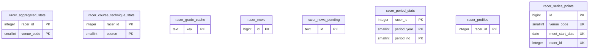
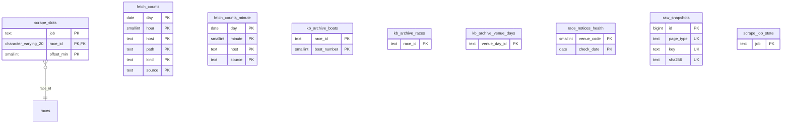

```mermaid
erDiagram
    sns_auto_send_control }o--o| sns_approvers : "auto_approver_id -> id"
    sns_auto_send_control }o--o| sns_approvers : "switched_by -> id"
    sns_auto_send_incidents }o--o| sns_auto_send_items : "item_id -> id"
    sns_auto_send_items }o--o| sns_bundle_imports : "bundle_import_id -> id"
    sns_auto_send_items }o--o| sns_drafts : "draft_id -> id"
    sns_campaign_entries }o--|| sns_campaigns : "campaign_id -> id"
    sns_campaign_entries }o--|| races : "race_id"
    sns_channel_daily }o--o| sns_drafts : "draft_id -> id"
    sns_draft_metrics }o--|| sns_drafts : "draft_id -> id"
    sns_drafts }o--o| sns_approvers : "approver_id -> id"
    sns_drafts }o--o| sns_bundle_imports : "bundle_import_id -> id"
    sns_drafts }o--o| sns_drafts : "parent_draft_id -> id"
    sns_drafts }o--o| sns_template_variants : "template_variant_id -> id"
    sns_metric_jobs }o--|| sns_drafts : "draft_id -> id"
    sns_metric_observations }o--|| sns_drafts : "draft_id -> id"
    sns_post_tracking |o--|| sns_drafts : "draft_id -> id"
    sns_post_tracking }o--o| sns_template_variants : "template_variant_id -> id"
    sns_strategy_insights }o--o| sns_strategy_insights : "superseded_by -> id"
    sns_topic_categories }o--o| sns_content_types : "content_type_id -> id"
    sns_topic_category_channels }o--|| sns_topic_categories : "category_id -> id"
    sns_topic_targets }o--o| sns_drafts : "draft_id -> id"
    sns_topic_targets }o--|| sns_target_accounts : "target_account_id -> id"
    sns_topic_targets }o--|| sns_topics : "topic_id -> id"
    sns_topics }o--o| sns_approvers : "approver_id -> id"
    sns_topics }o--o| sns_campaigns : "campaign_id -> id"
    sns_topics }o--|| sns_content_types : "content_type_id -> id"
    sns_x_send_jobs }o--|| sns_approvers : "approver_id -> id"
    sns_x_send_jobs }o--o| sns_auto_send_items : "auto_item_id -> id"
    sns_x_send_jobs |o--|| sns_drafts : "draft_id -> id"
    sns_x_send_jobs }o--o| sns_x_send_jobs : "parent_job_id -> id"
    sns_youtube_quota_attempts }o--|| sns_x_send_jobs : "job_id -> id"
    sns_youtube_quota_reads }o--|| sns_x_send_jobs : "job_id -> id"
    sns_approvers {
        uuid id PK
        character_varying_50 display_name UK
    }
    sns_auto_send_control {
        text channel PK
        uuid switched_by FK
        uuid auto_approver_id FK
    }
    sns_auto_send_incidents {
        uuid id PK
        uuid item_id FK
    }
    sns_auto_send_items {
        uuid id PK
        uuid bundle_import_id FK, UK
        text channel UK
        text stop_token_hash UK
        uuid draft_id FK
    }
    sns_bundle_imports {
        uuid id PK
        text version_hash UK
    }
    sns_campaign_entries {
        uuid id PK
        uuid campaign_id FK
        character_varying_50 race_id FK
    }
    sns_campaigns {
        uuid id PK
    }
    sns_channel_daily {
        uuid id PK
        date day UK
        text channel UK
        uuid draft_id FK, UK
        text utm_content UK
        text source UK
        text metric_name UK
        text definition UK
    }
    sns_content_types {
        uuid id PK
        character_varying_50 type_key UK
    }
    sns_draft_metrics {
        uuid id PK
        uuid draft_id FK
    }
    sns_drafts {
        uuid id PK
        uuid parent_draft_id FK
        uuid template_variant_id FK
        uuid approver_id FK
        uuid bundle_import_id FK
    }
    sns_metric_jobs {
        uuid id PK
        uuid draft_id FK, UK
        text window UK
        text source UK
    }
    sns_metric_observations {
        uuid id PK
        uuid draft_id FK, UK
        text window UK
        text source UK
        text metric_name UK
        text definition UK
        text measurement_kind UK
        integer revision UK
    }
    sns_oauth_tokens {
        text provider PK
    }
    sns_post_tracking {
        uuid draft_id PK, FK
        uuid template_variant_id FK
    }
    sns_strategy_insights {
        uuid id PK
        uuid superseded_by FK
    }
    sns_target_accounts {
        uuid id PK
        character_varying_20 platform UK
        character_varying_50 account_label UK
    }
    sns_template_variants {
        uuid id PK
        character_varying_50 format UK
        character_varying_50 variant_name UK
    }
    sns_today_type_schedule {
        date day PK
    }
    sns_topic_categories {
        uuid id PK
        character_varying_50 category_key UK
        uuid content_type_id FK
    }
    sns_topic_category_channels {
        uuid id PK
        uuid category_id FK, UK
        character_varying_20 platform UK
    }
    sns_topic_targets {
        uuid id PK
        uuid topic_id FK, UK
        uuid target_account_id FK, UK
        uuid draft_id FK
    }
    sns_topics {
        uuid id PK
        uuid content_type_id FK
        uuid approver_id FK
        uuid campaign_id FK
    }
    sns_x_kind_reserves {
        text kind PK
    }
    sns_x_send_control {
        boolean id PK
    }
    sns_x_send_jobs {
        uuid id PK
        uuid draft_id FK, UK
        uuid approver_id FK
        text external_post_id UK
        uuid parent_job_id FK
        uuid auto_item_id FK
    }
    sns_youtube_quota_attempts {
        uuid job_id PK, FK
        integer attempt PK
    }
    sns_youtube_quota_control {
        boolean id PK
    }
    sns_youtube_quota_reads {
        uuid id PK
        uuid job_id FK
    }
```

```mermaid
erDiagram
    analogy_contribution_profiles }o--|| analogy_models : "model_version"
    analogy_feedback }o--|| races : "race_id"
    analogy_v16_snapshots }o--|| races : "race_id"
    bet_filters }o--o| models : "model_id"
    bet_recommendations }o--o| bet_filters : "filter_id"
    bet_recommendations }o--|| models : "model_id"
    bet_recommendations }o--|| races : "race_id"
    daily_bet_summary }o--|| models : "model_id"
    model_bet_candidates }o--|| models : "model_id"
    model_bet_candidates }o--|| races : "race_id"
    model_experiments }o--o| models : "control_model_id -> model_id"
    model_experiments }o--o| models : "treatment_model_id -> model_id"
    model_performance_daily }o--|| models : "model_id"
    models }o--o| models : "parent_model_id -> model_id"
    prediction_odds |o--|| races : "race_id"
    predictions }o--|| models : "model_id"
    predictions }o--|| races : "race_id"
    user_visible_summary }o--o| models : "model_id"
    accuracy_cache {
        text key PK
    }
    analogy_contribution_profiles {
        text model_version PK, FK
        smallint finish_target PK
        smallint venue_code PK
        text grade PK
        text round PK
        smallint boat_number PK
        text stage PK
    }
    analogy_feedback {
        bigint id PK
        text kind UK
        character_varying race_id FK, UK
        uuid client_key UK
    }
    analogy_models {
        text model_version PK
    }
    analogy_v16_snapshots {
        character_varying race_id PK, FK
        text stage PK
    }
    bet_filters {
        integer filter_id PK
        character_varying_50 model_id FK
    }
    bet_recommendations {
        character_varying_20 race_id PK, FK
        character_varying_50 model_id PK, FK
        integer filter_id FK
    }
    daily_bet_summary {
        date date PK
        character_varying_50 model_id PK, FK
    }
    external_predictions {
        bigint id PK
        character_varying_32 source UK
        date race_date UK
        smallint venue_code UK
        smallint race_no UK
    }
    model_bet_candidates {
        character_varying_20 race_id PK, FK
        character_varying_50 model_id PK, FK
        smallint pattern_index PK
        smallint bet_rank PK
    }
    model_experiments {
        integer experiment_id PK
        character_varying_50 control_model_id FK
        character_varying_50 treatment_model_id FK
    }
    model_performance_daily {
        character_varying_50 model_id PK, FK
        date date PK
    }
    models {
        character_varying_50 model_id PK
        character_varying_50 parent_model_id FK
    }
    mycroft_predictions {
        character_varying_20 race_id PK
    }
    poirot_predictions {
        character_varying_20 race_id PK
        character_varying_20 model_version PK
    }
    prediction_odds {
        character_varying_20 race_id PK, FK
    }
    predictions {
        integer prediction_id PK
        character_varying_20 race_id FK, UK
        character_varying_50 model_id FK, UK
    }
    user_visible_summary {
        integer summary_id PK
        character_varying_50 model_id FK
    }
    watson_predictions {
        character_varying_20 race_id PK
    }
    v_performance_comparison
    v_prediction_performance
    v_production_models
    v_todays_recommendations
```

```mermaid
erDiagram
    morning_digest_rows }o--|| morning_digest_days : "digest_date"
    venue_entry_course_stats }o--|| races : "race_id"
    exhibition_time_top_stats {
        bigint id PK
        smallint venue_code UK
        smallint boat_number UK
    }
    in_caution_gap_band_daily {
        date race_date PK
        text round_grp PK
        smallint gap_band PK
    }
    losing_technique_stats {
        bigint id PK
        smallint venue_code UK
        smallint boat_number UK
        text losing_technique UK
    }
    morning_digest_days {
        date digest_date PK
    }
    morning_digest_rows {
        date digest_date PK, FK
        text section PK
        smallint rank PK
    }
    motor_pretest_stats {
        date race_date PK
        smallint venue_code PK
        integer racer_id PK
    }
    nige_outcome_distribution {
        bigint id PK
        smallint venue_code UK
        smallint first_boat UK
        smallint second_boat UK
        smallint third_boat UK
    }
    nige_second_by_course {
        smallint venue_code PK
        smallint second_course PK
    }
    outcome_distribution {
        bigint id PK
        smallint venue_code UK
        smallint first_boat UK
        smallint second_boat UK
        smallint third_boat UK
    }
    race_history_cache {
        text key PK
    }
    race_outcome_frequencies {
        smallint venue_code PK
        smallint rank1_boat PK
        smallint rank2_boat PK
        smallint rank3_boat PK
        smallint window_days PK
    }
    st_course_baseline {
        smallint course PK
        text grade PK
    }
    top_start_stats {
        bigint id PK
        smallint venue_code UK
        smallint boat_number UK
    }
    venue_course_technique_baseline {
        smallint venue_code PK
        text race_grade PK
        smallint course PK
    }
    venue_entry_course_stats {
        character_varying_20 race_id PK, FK
        smallint waku PK
        smallint entry_course PK
    }
    venue_grade_boat_stats {
        smallint venue_code PK
        text race_grade PK
        smallint boat_number PK
    }
    venue_motor_start_dates {
        smallint venue_code PK
        date start_date PK
    }
    venue_motor_stats {
        smallint venue_code PK
        smallint motor_number PK
        date scraped_date PK
    }
    venue_technique_period_stats {
        smallint venue_code PK
        smallint period_days PK
        text winning_technique PK
    }
    winning_technique_stats {
        bigint id PK
        smallint venue_code UK
        smallint boat_number UK
        text winning_technique UK
    }
```

# DB 全体の ER 図

> 機械生成（`node scripts/maintenance/generate-schema-er-diagram.js`）。手で書き換えない。master へのマージ後に CI（regenerate-generated-docs.yml）が作り直す。PR には含めない（ADR-0078）。
>
> 入力: 本番スキーマの写し `docs/reference/schema-snapshot.json`（取得 2026-10-27T08:16:33.412Z、適用済みの番号の最大 186、ADR-0102）。DB には接続しない。写しが古いと図も古い。写しの作り直しは写しの `$comment` を見る。
>
> 図に出す列は主キー（PK）・外部キー（FK）・一意（UK）の列だけ。全部の列・型・権限は写しを、読み手・書き手は `docs/reference/data-readers.md` を見る。個別機能の新しい表の図は各 `docs/design/{slug}/plan.md`（`generate-er-diagram.js {slug}`、DDL から）。

線の端の記号: 子の側 `}o` は多、`|o` は外部キーの列がそのまま主キーか一意（1対1）。親の側 `||` は外部キーの列が NOT NULL、`o|` は NULL を許す。

## 件数

| 項目 | 件数 |
|---|---|
| 表 | 103 |
| ビュー | 4 |
| 外部キー | 67 |
| まとまりをまたぐ外部キー | 9 |
| どのまとまりにも当たらない表（その他） | 0 |

まとまりは表の名前で決める（`scripts/lib/schemaErDiagram.js` の `DOMAINS`、上から順に最初に当たったもの）。その他に入った表は、そこに1行足して分ける。

## まとまりの一覧

| まとまり | 表・ビュー | 外部キー（まとまりの中か、外と結ぶもの） |
|---|---|---|
| [SNS 配信](#d-sns) | 29 | 32 |
| [選手](#d-racer) | 8 | 0 |
| [予想・モデル・類似レース](#d-prediction) | 23 | 18 |
| [取得・運用](#d-ops) | 9 | 1 |
| [集計（会場・枠・技・当日のまとめ）](#d-aggregate) | 20 | 2 |
| [レース・会場](#d-race) | 18 | 23 |

## SNS 配信

| 表 | 種類 | 列 | 主キー | RLS |
|---|---|---|---|---|
| sns_approvers | table | 4 | id | 有効 |
| sns_auto_send_control | table | 11 | channel | 有効 |
| sns_auto_send_incidents | table | 5 | id | 有効 |
| sns_auto_send_items | table | 19 | id | 有効 |
| sns_bundle_imports | table | 10 | id | 有効 |
| sns_campaign_entries | table | 13 | id | 有効 |
| sns_campaigns | table | 13 | id | 有効 |
| sns_channel_daily | table | 11 | id | 有効 |
| sns_content_types | table | 9 | id | 有効 |
| sns_draft_metrics | table | 6 | id | 有効 |
| sns_drafts | table | 43 | id | 有効 |
| sns_metric_jobs | table | 10 | id | 有効 |
| sns_metric_observations | table | 20 | id | 有効 |
| sns_oauth_tokens | table | 10 | provider | 有効 |
| sns_post_tracking | table | 10 | draft_id | 有効 |
| sns_strategy_insights | table | 14 | id | 有効 |
| sns_target_accounts | table | 7 | id | 有効 |
| sns_template_variants | table | 8 | id | 有効 |
| sns_today_type_schedule | table | 5 | day | 有効 |
| sns_topic_categories | table | 8 | id | 有効 |
| sns_topic_category_channels | table | 5 | id | 有効 |
| sns_topic_targets | table | 9 | id | 有効 |
| sns_topics | table | 11 | id | 有効 |
| sns_x_kind_reserves | table | 5 | kind | 有効 |
| sns_x_send_control | table | 18 | id | 有効 |
| sns_x_send_jobs | table | 27 | id | 有効 |
| sns_youtube_quota_attempts | table | 10 | job_id, attempt | 有効 |
| sns_youtube_quota_control | table | 7 | id | 有効 |
| sns_youtube_quota_reads | table | 7 | id | 有効 |

他のまとまりの表（図では列を出さない）: races（レース・会場）

## 選手

| 表 | 種類 | 列 | 主キー | RLS |
|---|---|---|---|---|
| racer_aggregated_stats | table | 13 | racer_id, venue_code | 有効 |
| racer_course_technique_stats | table | 22 | racer_id, course | 有効 |
| racer_grade_cache | table | 3 | key | 有効 |
| racer_news | table | 8 | id | 有効 |
| racer_news_pending | table | 10 | id | 有効 |
| racer_period_stats | table | 137 | racer_id, period_year, period_no | 有効 |
| racer_profiles | table | 20 | racer_id | 有効 |
| racer_series_points | table | 17 | id | 有効 |

## 予想・モデル・類似レース

| 表 | 種類 | 列 | 主キー | RLS |
|---|---|---|---|---|
| accuracy_cache | table | 3 | key | 有効 |
| analogy_contribution_profiles | table | 15 | model_version, stage, finish_target, venue_code, grade, round, boat_number | 有効 |
| analogy_feedback | table | 11 | id | 有効 |
| analogy_models | table | 7 | model_version | 有効 |
| analogy_v16_snapshots | table | 10 | race_id, stage | 有効 |
| bet_filters | table | 13 | filter_id | 有効 |
| bet_recommendations | table | 13 | race_id, model_id | 有効 |
| daily_bet_summary | table | 17 | date, model_id | 有効 |
| external_predictions | table | 10 | id | 有効 |
| model_bet_candidates | table | 13 | race_id, model_id, pattern_index, bet_rank | 有効 |
| model_experiments | table | 19 | experiment_id | 有効 |
| model_performance_daily | table | 13 | model_id, date | 有効 |
| models | table | 29 | model_id | 有効 |
| mycroft_predictions | table | 7 | race_id | 有効 |
| poirot_predictions | table | 8 | race_id, model_version | 有効 |
| prediction_odds | table | 14 | race_id | 有効 |
| predictions | table | 20 | prediction_id | 有効 |
| user_visible_summary | table | 16 | summary_id | 有効 |
| v_performance_comparison | view | 12 | — | — |
| v_prediction_performance | view | 8 | — | — |
| v_production_models | view | 23 | — | — |
| v_todays_recommendations | view | 10 | — | — |
| watson_predictions | table | 7 | race_id | 有効 |

他のまとまりの表（図では列を出さない）: races（レース・会場）

## 取得・運用

| 表 | 種類 | 列 | 主キー | RLS |
|---|---|---|---|---|
| fetch_counts | table | 8 | day, hour, host, path, kind, source | 有効 |
| fetch_counts_minute | table | 5 | day, minute, host, source | 有効 |
| kb_archive_boats | table | 24 | race_id, boat_number | 有効 |
| kb_archive_races | table | 24 | race_id | 有効 |
| kb_archive_venue_days | table | 12 | venue_day_id | 有効 |
| race_notices_health | table | 5 | venue_code, check_date | 有効 |
| raw_snapshots | table | 9 | id | 有効 |
| scrape_job_state | table | 18 | job | 有効 |
| scrape_slots | table | 18 | job, race_id, offset_min | 有効 |

他のまとまりの表（図では列を出さない）: races（レース・会場）

## 集計（会場・枠・技・当日のまとめ）

| 表 | 種類 | 列 | 主キー | RLS |
|---|---|---|---|---|
| exhibition_time_top_stats | table | 10 | id | 有効 |
| in_caution_gap_band_daily | table | 7 | race_date, round_grp, gap_band | 有効 |
| losing_technique_stats | table | 9 | id | 有効 |
| morning_digest_days | table | 11 | digest_date | 有効 |
| morning_digest_rows | table | 27 | digest_date, section, rank | 有効 |
| motor_pretest_stats | table | 13 | race_date, venue_code, racer_id | 有効 |
| nige_outcome_distribution | table | 11 | id | 有効 |
| nige_second_by_course | table | 13 | venue_code, second_course | 有効 |
| outcome_distribution | table | 11 | id | 有効 |
| race_history_cache | table | 3 | key | 有効 |
| race_outcome_frequencies | table | 11 | venue_code, rank1_boat, rank2_boat, rank3_boat, window_days | 有効 |
| st_course_baseline | table | 15 | course, grade | 有効 |
| top_start_stats | table | 10 | id | 有効 |
| venue_course_technique_baseline | table | 13 | venue_code, race_grade, course | 有効 |
| venue_entry_course_stats | table | 17 | race_id, waku, entry_course | 有効 |
| venue_grade_boat_stats | table | 12 | venue_code, race_grade, boat_number | 有効 |
| venue_motor_start_dates | table | 3 | venue_code, start_date | 有効 |
| venue_motor_stats | table | 19 | venue_code, motor_number, scraped_date | 有効 |
| venue_technique_period_stats | table | 8 | venue_code, period_days, winning_technique | 有効 |
| winning_technique_stats | table | 9 | id | 有効 |

他のまとまりの表（図では列を出さない）: races（レース・会場）

## レース・会場

| 表 | 種類 | 列 | 主キー | RLS |
|---|---|---|---|---|
| exhibition_data | table | 19 | race_id, boat_number | 有効 |
| race_conditions | table | 15 | race_id | 有効 |
| race_entries | table | 29 | race_id, boat_number | 有効 |
| race_odds | table | 33 | race_id, captured_at | 有効 |
| race_odds_final | table | 9 | race_id | 有効 |
| race_original_exhibition | table | 9 | race_id | 有効 |
| race_original_exhibition_values | table | 6 | race_id, boat_number, kind | 有効 |
| race_payouts | table | 9 | race_id, bet_type, seq | 有効 |
| race_pit_comments | table | 8 | race_id, boat_number | 有効 |
| race_pit_reports | table | 11 | race_id | 有効 |
| race_results | table | 50 | race_id | 有効 |
| race_series | table | 11 | venue_code, start_date | 有効 |
| race_special_notes | table | 10 | id | 有効 |
| race_start_timings | table | 13 | race_id, boat_number | 有効 |
| races | table | 21 | race_id | 有効 |
| rule_applications | table | 8 | id | 有効 |
| venue_rules | table | 12 | id | 有効 |
| venues | table | 9 | code | 有効 |

他のまとまりの表（図では列を出さない）: analogy_feedback（予想・モデル・類似レース）、analogy_v16_snapshots（予想・モデル・類似レース）、bet_recommendations（予想・モデル・類似レース）、model_bet_candidates（予想・モデル・類似レース）、prediction_odds（予想・モデル・類似レース）、predictions（予想・モデル・類似レース）、scrape_slots（取得・運用）、sns_campaign_entries（SNS 配信）、venue_entry_course_stats（集計（会場・枠・技・当日のまとめ））

```mermaid
erDiagram
    analogy_feedback }o--|| races : "race_id"
    analogy_v16_snapshots }o--|| races : "race_id"
    bet_recommendations }o--|| races : "race_id"
    exhibition_data }o--|| races : "race_id"
    model_bet_candidates }o--|| races : "race_id"
    prediction_odds |o--|| races : "race_id"
    predictions }o--|| races : "race_id"
    race_conditions |o--|| races : "race_id"
    race_entries }o--|| races : "race_id"
    race_odds }o--|| races : "race_id"
    race_odds_final |o--|| races : "race_id"
    race_original_exhibition |o--|| races : "race_id"
    race_original_exhibition_values }o--|| races : "race_id"
    race_payouts }o--|| races : "race_id"
    race_pit_comments }o--|| races : "race_id"
    race_pit_reports |o--|| races : "race_id"
    race_results |o--|| races : "race_id"
    race_start_timings }o--|| races : "race_id"
    races }o--|| venues : "venue_code -> code"
    rule_applications }o--|| venue_rules : "rule_id"
    scrape_slots }o--|| races : "race_id"
    sns_campaign_entries }o--|| races : "race_id"
    venue_entry_course_stats }o--|| races : "race_id"
    exhibition_data {
        character_varying_20 race_id PK, FK
        smallint boat_number PK
    }
    race_conditions {
        character_varying_20 race_id PK, FK
    }
    race_entries {
        character_varying_20 race_id PK, FK
        smallint boat_number PK
    }
    race_odds {
        character_varying_20 race_id PK, FK
        timestamp_with_time_zone captured_at PK
    }
    race_odds_final {
        character_varying_20 race_id PK, FK
    }
    race_original_exhibition {
        character_varying_20 race_id PK, FK
    }
    race_original_exhibition_values {
        character_varying_20 race_id PK, FK
        smallint boat_number PK
        text kind PK
    }
    race_payouts {
        character_varying_20 race_id PK, FK
        text bet_type PK
        smallint seq PK
    }
    race_pit_comments {
        character_varying_20 race_id PK, FK
        smallint boat_number PK
    }
    race_pit_reports {
        character_varying_20 race_id PK, FK
    }
    race_results {
        character_varying_20 race_id PK, FK, UK
    }
    race_series {
        smallint venue_code PK
        date start_date PK
    }
    race_special_notes {
        bigint id PK
        smallint venue_code UK
        date race_date UK
        character_varying_20 category UK
        text detail_text UK
        text racer_name UK
    }
    race_start_timings {
        character_varying_20 race_id PK, FK
        smallint boat_number PK
    }
    races {
        character_varying_20 race_id PK
        date race_date UK
        smallint venue_code FK, UK
        smallint race_number UK
    }
    rule_applications {
        integer id PK
        text rule_id FK
    }
    venue_rules {
        integer id PK
        text rule_id UK
    }
    venues {
        smallint code PK
    }
```

